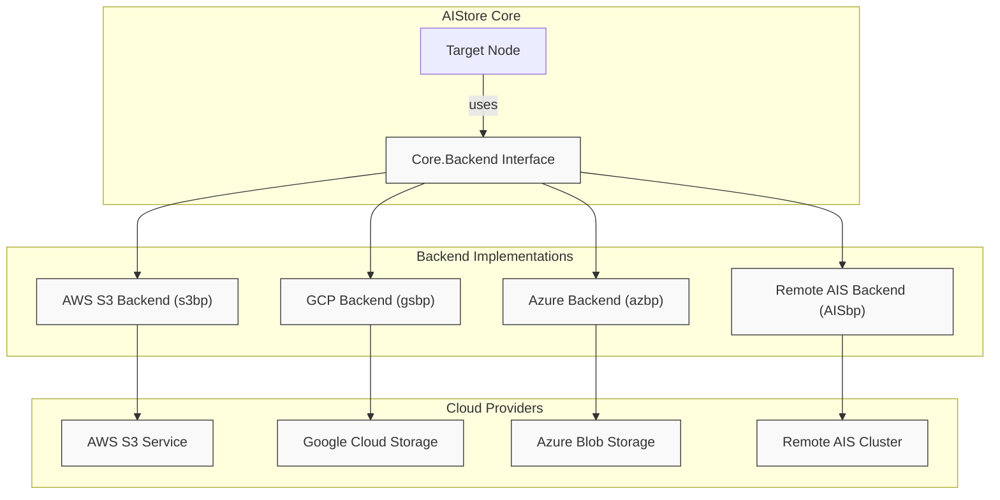
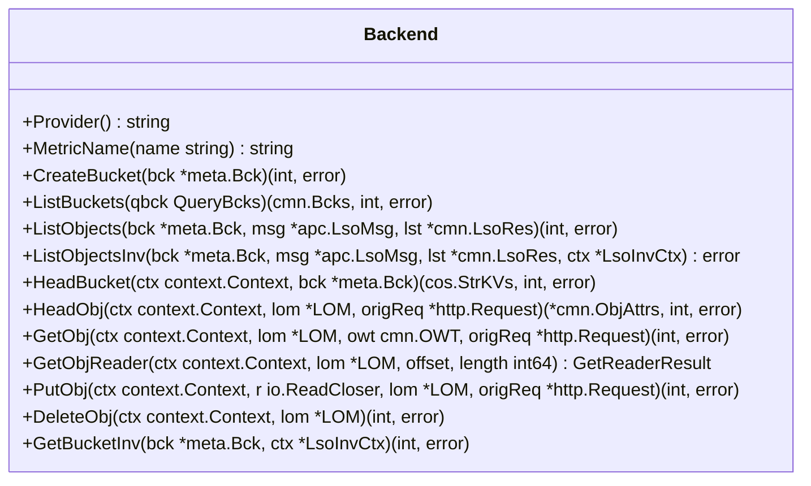
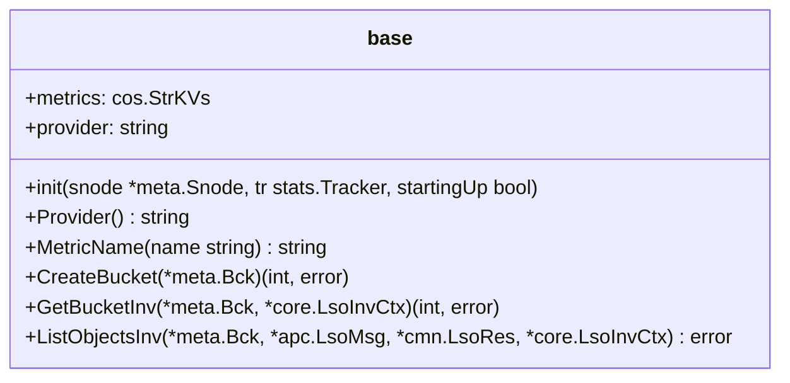
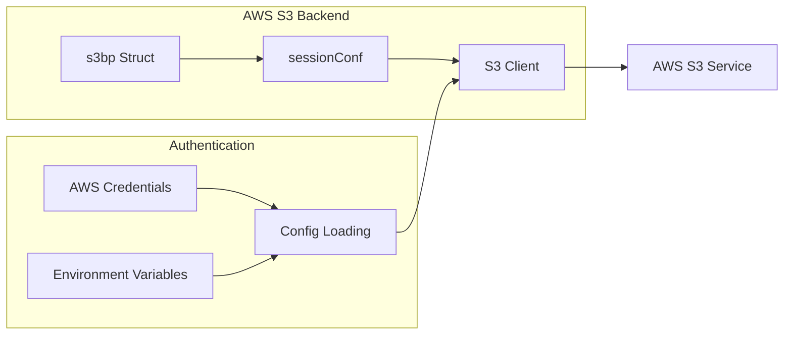
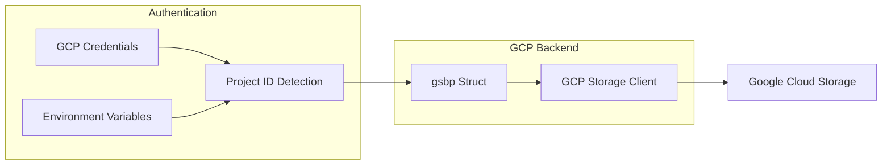
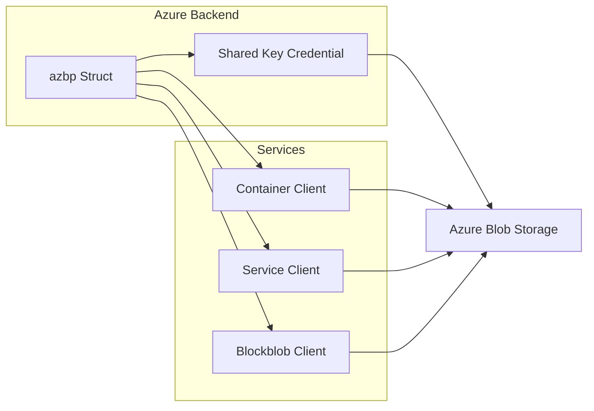
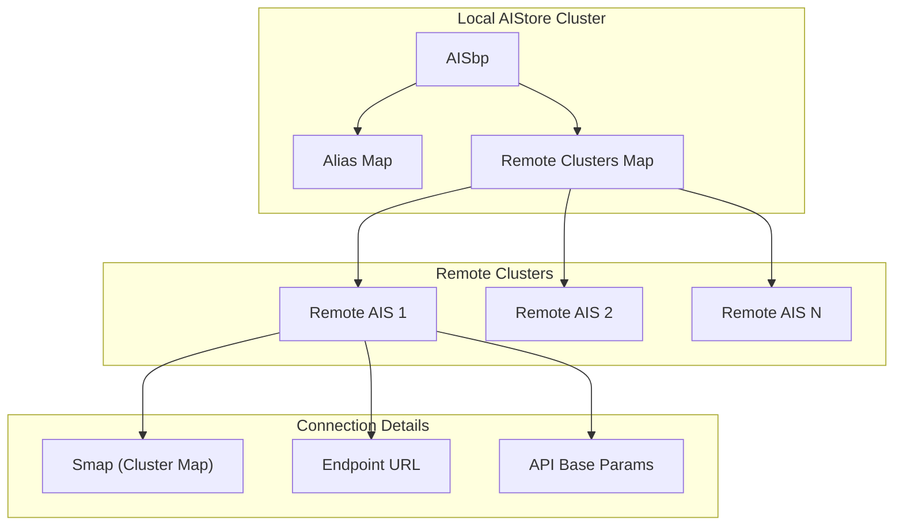
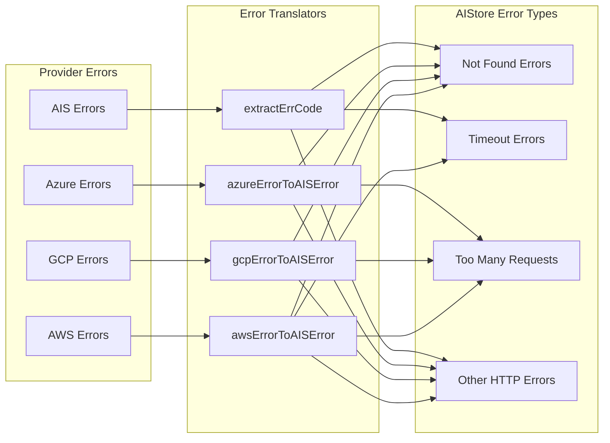
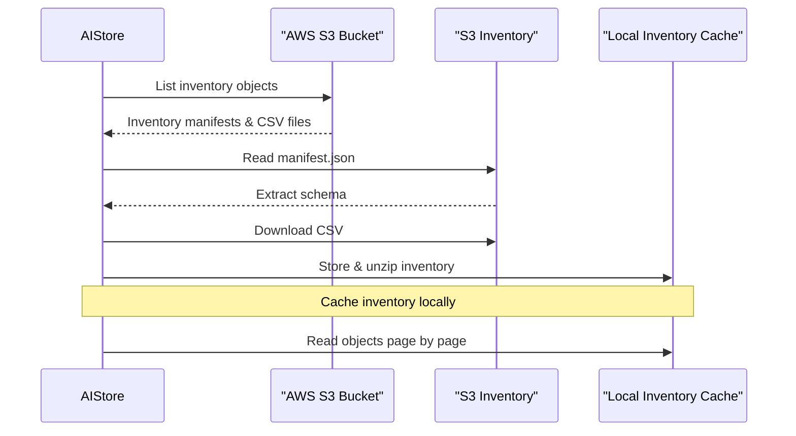
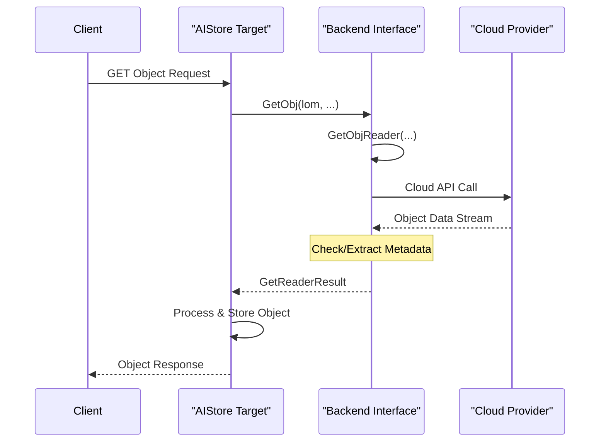

<!-- source: DeepWiki mcp.deepwiki.com · repo NVIDIA/aistore · page 4.1 Cloud Provider Integration · fetched 2026-10-26 -->

# Cloud Provider Integration

Relevant source files

The following files were used as context for generating this wiki page:

- [ais/backend/ais.go](ais/backend/ais.go)
- [ais/backend/aws.go](ais/backend/aws.go)
- [ais/backend/awsinv.go](ais/backend/awsinv.go)
- [ais/backend/azure.go](ais/backend/azure.go)
- [ais/backend/common.go](ais/backend/common.go)
- [ais/backend/gcp.go](ais/backend/gcp.go)
- [ais/backend/mock_backend.go](ais/backend/mock_backend.go)
- [core/backend.go](core/backend.go)

This page documents how AIStore integrates with external cloud storage providers. It explains the architecture, interfaces, and specific implementations that allow AIStore to seamlessly work with AWS S3, Google Cloud Storage, Azure Blob Storage, and remote AIS clusters as backend storage systems.

For S3-compatible API that AIStore provides to clients, see [S3 Compatibility](4.2).

## Architecture Overview

AIStore integrates with cloud providers through a pluggable backend architecture that abstracts vendor-specific implementations behind a common interface.

Sources: [core/backend.go:38-63](), [ais/backend/aws.go:44-54](), [ais/backend/gcp.go:45-51](), [ais/backend/azure.go:62-69](), [ais/backend/ais.go:41-58]()

## Backend Interface

All cloud provider integrations implement the `core.Backend` interface, which defines a set of methods for performing operations on cloud storage. This interface serves as the contract between AIStore and various cloud providers.

Key operations supported by the interface include:

Sources: [core/backend.go:38-63]()

## Common Backend Base

All backend implementations share a common `base` struct that handles metrics registration and provides default implementations for some methods.

Sources: [ais/backend/common.go:24-27](), [ais/backend/common.go:194-217]()

## Supported Cloud Providers

AIStore supports the following cloud storage providers:

| Provider | Implementation Type | Description |
|----------|---------------------|-------------|
| AWS S3 | `s3bp` | Amazon Simple Storage Service integration |
| Google Cloud Storage | `gsbp` | Google Cloud Storage integration |
| Azure Blob Storage | `azbp` | Microsoft Azure Blob Storage integration |
| Remote AIS | `AISbp` | AIStore-to-AIStore integration for remote clusters |
| Mock (for testing) | `mockbp` | Mock backend for testing |

Sources: [ais/backend/aws.go:44-54](), [ais/backend/gcp.go:45-51](), [ais/backend/azure.go:62-69](), [ais/backend/ais.go:41-58](), [ais/backend/mock_backend.go:23-26]()

### AWS S3 Integration

The AWS S3 backend implementation (`s3bp`) provides integration with Amazon S3 storage service. It uses the AWS SDK for Go v2 to interact with S3 services.

Key features:
- Supports standard bucket and object operations
- Handles authentication via AWS credentials
- Supports S3 bucket inventory for efficient object listing
- Region detection and handling
- Supports S3 versioning

Sources: [ais/backend/aws.go:44-54](), [ais/backend/aws.go:70-83](), [ais/backend/aws.go:788-891]()

#### Authentication & Configuration

AWS S3 backend supports authentication through AWS credentials, which can be configured via:
- Environment variables (`AWS_PROFILE`, `AWS_ENDPOINT`, etc.)
- Bucket properties

Configuration options:
- Region specification
- Endpoint customization
- Credentials profile selection
- Path-style request support

Sources: [ais/backend/aws.go:55-63](), [ais/backend/aws.go:789-815](), [ais/backend/aws.go:876-891]()

### Google Cloud Storage Integration

The Google Cloud Storage backend implementation (`gsbp`) provides integration with Google Cloud Storage. It uses the official Go client library for GCP.

Key features:
- Project ID detection from credentials or environment variables
- Standard bucket and object operations
- Custom metadata handling
- Error translation

Sources: [ais/backend/gcp.go:45-51](), [ais/backend/gcp.go:64-96](), [ais/backend/gcp.go:100-122]()

#### Authentication & Configuration

GCP backend supports authentication through:
- Service account credentials file (specified via `GOOGLE_APPLICATION_CREDENTIALS`)
- Project ID (specified via `GOOGLE_CLOUD_PROJECT` or detected from credentials)

Sources: [ais/backend/gcp.go:40-43](), [ais/backend/gcp.go:64-83](), [ais/backend/gcp.go:461-473]()

### Azure Blob Storage Integration

The Azure Blob Storage backend implementation (`azbp`) provides integration with Microsoft Azure Blob Storage. It uses the Azure SDK for Go.

Key features:
- Shared key authentication
- Standard bucket and object operations
- Custom endpoint configuration
- Error code translation

Sources: [ais/backend/azure.go:62-69](), [ais/backend/azure.go:102-120]()

#### Authentication & Configuration

Azure backend supports authentication through:
- Shared key credentials (`AZURE_STORAGE_ACCOUNT` and `AZURE_STORAGE_KEY` environment variables)
- Custom endpoint configuration (via `AIS_AZURE_URL` and `AIS_AZURE_PROTO` environment variables)

Sources: [ais/backend/azure.go:46-56](), [ais/backend/azure.go:79-100](), [ais/backend/azure.go:106-114]()

### Remote AIS Integration

The Remote AIS backend implementation (`AISbp`) provides integration with other AIStore clusters. It enables communication and data transfer between separate AIStore deployments.

Key features:
- Support for multiple remote clusters
- Alias-based cluster identification
- Dynamic discovery of cluster endpoints
- Transport of AIStore-specific metadata

Sources: [ais/backend/ais.go:41-59](), [ais/backend/ais.go:67-78](), [ais/backend/ais.go:262-313]()

#### Configuration

Remote AIS backend configuration happens through AIStore's configuration system. Clusters can be attached and detached dynamically by providing endpoint URLs and aliases.

Sources: [ais/backend/ais.go:122-173](), [ais/backend/ais.go:179-252]()

## Common Operations

All backend implementations support a core set of operations that allow AIStore to read, write, and manage data in cloud storage.

### Bucket Operations

| Operation | Description | Method |
|-----------|-------------|--------|
| Head Bucket | Check if a bucket exists and get its properties | `HeadBucket` |
| List Buckets | List all buckets available in the provider | `ListBuckets` |
| Create Bucket | Create a new bucket (only implemented by some providers) | `CreateBucket` |

Sources: [ais/backend/aws.go:93-133](), [ais/backend/aws.go:424-450](), [ais/backend/gcp.go:130-149](), [ais/backend/gcp.go:235-260](), [ais/backend/azure.go:224-249](), [ais/backend/azure.go:337-361](), [ais/backend/ais.go:414-443](), [ais/backend/ais.go:476-508]()

### Object Operations

| Operation | Description | Method |
|-----------|-------------|--------|
| List Objects | List objects in a bucket | `ListObjects` |
| Head Object | Get object metadata | `HeadObj` |
| Get Object | Download an object | `GetObj` |
| Put Object | Upload an object | `PutObj` |
| Delete Object | Remove an object | `DeleteObj` |

Sources: [ais/backend/aws.go:290-418](), [ais/backend/aws.go:457-533](), [ais/backend/aws.go:539-573](), [ais/backend/aws.go:656-743](), [ais/backend/aws.go:754-776](), [ais/backend/gcp.go:155-229](), [ais/backend/gcp.go:266-310](), [ais/backend/gcp.go:318-396](), [ais/backend/gcp.go:402-436](), [ais/backend/gcp.go:442-455](), [ais/backend/azure.go:260-331](), [ais/backend/azure.go:367-411](), [ais/backend/azure.go:417-481](), [ais/backend/azure.go:487-519](), [ais/backend/azure.go:525-537](), [ais/backend/ais.go:539-562](), [ais/backend/ais.go:590-627](), [ais/backend/ais.go:630-665](), [ais/backend/ais.go:674-675]()

## Error Handling

Each backend implementation provides specialized error handling to translate provider-specific errors into consistent AIStore errors.

Sources: [ais/backend/aws.go:918-987](), [ais/backend/gcp.go:475-522](), [ais/backend/azure.go:142-216](), [ais/backend/ais.go:94-119]()

### Common Error Patterns

- Not Found errors: Translated to `http.StatusNotFound` with appropriate context
- Rate limiting: Translated to `http.StatusTooManyRequests` with retry information
- Authentication/authorization: Preserved with appropriate status codes
- Timeout handling: Specific handling for client timeouts

Sources: [ais/backend/aws.go:932-960](), [ais/backend/gcp.go:477-504](), [ais/backend/azure.go:160-187](), [ais/backend/ais.go:98-102]()

## Special Features

### AWS Bucket Inventory

AWS S3 backend supports listing objects via S3 Bucket Inventory, which provides a more efficient way to list large buckets compared to the standard ListObjects API.

Sources: [ais/backend/aws.go:141-251](), [ais/backend/aws.go:254-283](), [ais/backend/awsinv.go:83-251](), [ais/backend/awsinv.go:254-377]()

## Metrics and Monitoring

All backend implementations collect and expose metrics for monitoring cloud provider interactions.

Key metrics include:
- Request counts (GET, PUT, HEAD)
- Latency measurements
- Data transfer sizes
- Version change tracking

Sources: [ais/backend/common.go:29-193]()

## Implementation Flow

This diagram shows a typical flow for retrieving an object from cloud storage:

Sources: [ais/backend/aws.go:539-573](), [ais/backend/gcp.go:318-330](), [ais/backend/azure.go:417-429](), [ais/backend/ais.go:561-588](), [ais/backend/common.go:235-247]()

---

