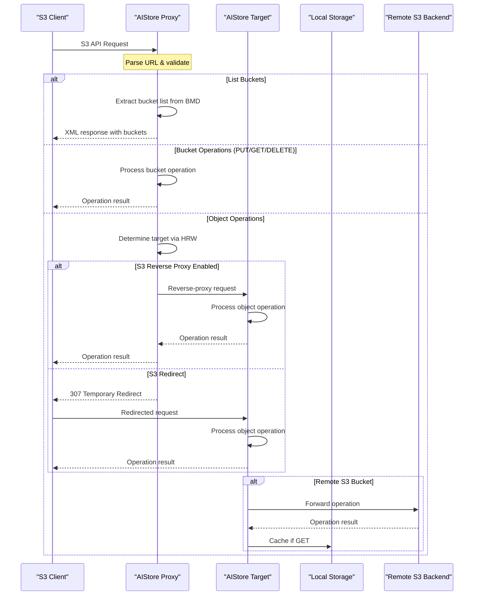
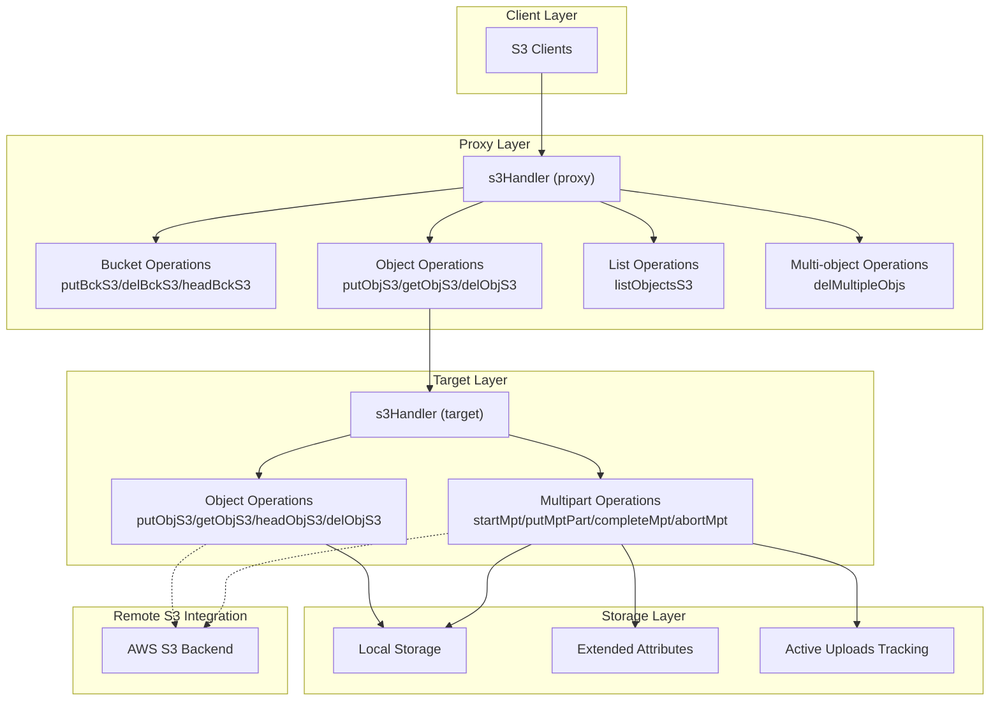
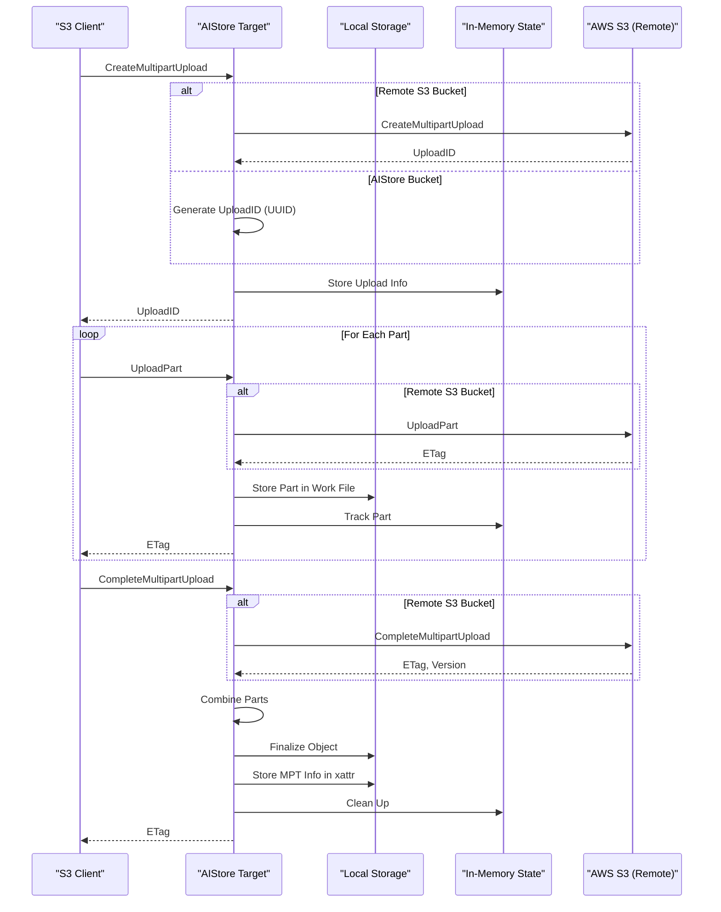

<!-- source: DeepWiki mcp.deepwiki.com · repo NVIDIA/aistore · page 4.2 S3 Compatibility · fetched 2026-10-26 -->

# S3 Compatibility

<details>
<summary>Relevant source files</summary>

The following files were used as context for generating this wiki page:

- [ais/backend/awsmpt.go](ais/backend/awsmpt.go)
- [ais/backend/mock_aws.go](ais/backend/mock_aws.go)
- [ais/backend/mock_azure.go](ais/backend/mock_azure.go)
- [ais/backend/mock_gcp.go](ais/backend/mock_gcp.go)
- [ais/prxs3.go](ais/prxs3.go)
- [ais/s3/const.go](ais/s3/const.go)
- [ais/s3/mpt.go](ais/s3/mpt.go)
- [ais/s3/types.go](ais/s3/types.go)
- [ais/s3/xattr.go](ais/s3/xattr.go)
- [ais/tgts3.go](ais/tgts3.go)
- [ais/tgts3mpt.go](ais/tgts3mpt.go)

</details>


AIStore provides Amazon S3 API compatibility, allowing users to interact with AIStore using standard S3 clients and tools such as AWS CLI, s3cmd, boto3, and other S3-compatible clients. This page describes the S3 compatibility layer in AIStore, its architecture, supported operations, and implementation details.

For information about cloud provider integration in general, see [Cloud Provider Integration](#4.1).

## Overview

AIStore's S3 compatibility layer enables AIStore clusters to:

1. Serve as an S3-compatible storage system for applications expecting an S3 API
2. Provide a caching layer in front of actual AWS S3 buckets
3. Support multipart uploads for large objects

The implementation focuses on the most commonly used S3 operations while maintaining AIStore's high-performance characteristics.

## Architecture

AIStore's S3 compatibility is implemented through specialized request handlers at both the proxy and target levels of the AIStore cluster.

### S3 Request Flow



Sources: [ais/prxs3.go:37-157](), [ais/tgts3.go:30-65]()

### System Components



Sources: [ais/prxs3.go](), [ais/tgts3.go](), [ais/tgts3mpt.go]()

## Supported S3 Operations

AIStore implements the following S3 API operations:

| Category | Operations |
|----------|------------|
| **Service Operations** | ListBuckets |
| **Bucket Operations** | CreateBucket, DeleteBucket, HeadBucket, ListObjects |
| **Object Operations** | PutObject, GetObject, HeadObject, DeleteObject, DeleteObjects, CopyObject |
| **Multipart Upload** | CreateMultipartUpload, UploadPart, CompleteMultipartUpload, AbortMultipartUpload, ListParts, ListMultipartUploads |
| **Bucket Properties** | Versioning (get/put) |

Sources: [ais/prxs3.go:37-157](), [ais/tgts3.go:30-65]()

## Proxy-Side Implementation

The proxy node handles incoming S3 requests through its `s3Handler` function. This handler parses the URL, identifies the operation type, and either processes the request directly or forwards it to an appropriate target node.

### URL Parsing and Routing

S3 requests follow the pattern `/s3/<bucket-name>[/<object-name>]` with additional information in query parameters. The proxy parses these components to determine the appropriate action:

```
GET /s3                      → List all buckets
PUT /s3/mybucket             → Create bucket
GET /s3/mybucket?versioning  → Get bucket versioning
GET /s3/mybucket             → List objects in bucket  
GET /s3/mybucket/myobject    → Get object
PUT /s3/mybucket/myobject    → Put object
DELETE /s3/mybucket/myobject → Delete object
```

Sources: [ais/prxs3.go:37-157]()

### Request Processing

For bucket operations (create, delete, get properties), the proxy typically handles the request directly by interacting with the cluster metadata.

For object operations, the proxy uses a Hash-Range-Weighted (HRW) algorithm to determine which target should handle the request. The request is then either reverse-proxied or redirected to that target.

```go
// Example: determining target for an object operation
smap := p.owner.smap.get()
si, err := smap.HrwName2T(bck.MakeUname(objName))
```

Sources: [ais/prxs3.go:480-528](), [ais/prxs3.go:529-567]()

### S3 Redirection

AIStore supports two methods of redirecting clients to the appropriate target:

1. **Reverse Proxy**: When enabled, the proxy forwards requests to the target internally.
2. **HTTP Redirect**: The proxy responds with a 307 Temporary Redirect, instructing the client to contact the target directly.

This behavior is controlled by the `S3ReverseProxy` feature flag.

Sources: [ais/prxs3.go:752-796]()

## Target-Side Implementation

Target nodes handle the actual data operations in the S3 compatibility layer, including object storage/retrieval and multipart upload processing.

### Object Operations

Targets implement handlers for standard object operations:

| Operation | Handler | Description |
|-----------|---------|-------------|
| PUT | `putObjS3` | Store object data |
| GET | `getObjS3` | Retrieve object data |
| HEAD | `headObjS3` | Get object metadata |
| DELETE | `delObjS3` | Remove object |
| COPY | `copyObjS3` | Copy object within or between buckets |

Sources: [ais/tgts3.go:184-282]()

### Metadata Handling

AIStore sets appropriate S3 headers when responding to clients, including:

- ETag (typically MD5 checksum)
- Last-Modified time
- Content-Length
- Custom metadata with X-Amz-Meta prefix

```go
// Setting S3 headers in response
func SetS3Headers(hdr http.Header, lom *core.LOM) {
    // ETag handling
    if etag := hdr.Get(cos.HdrETag); etag != "" {
        // Use existing ETag
    } else if v, exists := lom.GetCustomKey(cmn.ETag); exists {
        hdr.Set(cos.HdrETag, v)
    } else if cksum := lom.Checksum(); cksum.Type() == cos.ChecksumMD5 {
        hdr.Set(cos.HdrETag, `"`+cksum.Value()+`"`)
    }
    
    // Last-Modified handling
    // Additional headers...
}
```

Sources: [ais/s3/types.go:199-238]()

## Multipart Upload

AIStore implements S3's multipart upload functionality to handle large objects efficiently. This involves several operations coordinated between clients and the server.

### Multipart Upload Flow



Sources: [ais/tgts3mpt.go:51-405]()

### In-Memory State Management

AIStore maintains an in-memory map of active multipart uploads, tracking:

- Upload ID
- Bucket and object names
- Upload parts information (part number, size, MD5 hash)
- Creation time
- Custom metadata

This state is kept until the upload is completed or aborted.

Sources: [ais/s3/mpt.go:36-218]()

### XAttr Persistence

When a multipart upload completes, AIStore stores information about the parts in the object's extended attributes. This enables subsequent part-based GET operations on the completed object.

```go
// Store multipart information in xattr
func storeMptXattr(fqn string, mpt *mpt) (err error) {
    sort.Slice(mpt.parts, func(i, j int) bool {
        return mpt.parts[i].Num < mpt.parts[j].Num
    })
    b := mpt.pack()
    return fs.SetXattr(fqn, mptXattrID, b)
}
```

Sources: [ais/s3/xattr.go:46-54]()

## Remote S3 Integration

When working with remote S3 buckets, AIStore can forward operations to the actual AWS S3 service, acting as a caching layer.

### Backend Operations

For remote S3 buckets, AIStore uses the AWS SDK to perform operations on the actual S3 service:

```go
// Example: Starting multipart upload on remote S3
var (
    cloudBck = lom.Bck().RemoteBck()
    sessConf = sessConf{bck: cloudBck}
    input    = s3.CreateMultipartUploadInput{
        Bucket:   aws.String(cloudBck.Name),
        Key:      aws.String(lom.ObjName),
        Metadata: metadata,
    }
)
svc, errN := sessConf.s3client("[start_mpt]")
out, err := svc.CreateMultipartUpload(context.Background(), &input)
if err == nil {
    id = *out.UploadId
}
```

Sources: [ais/backend/awsmpt.go:36-77]()

### Presigned Request Support

AIStore also supports S3's presigned requests for remote buckets, allowing secure access to objects without sharing credentials:

```go
// Example: Handling presigned request
if lom.IsFeatureSet(feat.S3PresignedRequest) && oreq != nil {
    pts := aiss3.NewPresignedReq(oreq, lom, r, oq)
    resp, err := pts.Do(core.T.DataClient())
    // Process response...
}
```

Sources: [ais/backend/awsmpt.go:83-92]()

## Limitations and Compatibility Notes

The AIStore S3 compatibility layer focuses on the most commonly used S3 operations. Some features have limited or no support:

| Feature | Status |
|---------|--------|
| Bucket Policies | Not implemented |
| Bucket CORS | Not implemented |
| Bucket Lifecycle | Not implemented |
| Bucket ACLs | Not implemented |
| Object Tagging | Not implemented |
| Object Locks | Not implemented |
| Server-Side Encryption | Not implemented |

Additionally, there are some behavior differences from AWS S3:
- AIStore may use different ETag calculation methods
- Some response XML fields might differ slightly from AWS S3
- Error codes and messages might not exactly match AWS S3

Sources: [ais/prxs3.go:696-703]()

## Configuration

S3 redirection behavior can be configured through feature flags. Setting the `S3ReverseProxy` feature flag determines whether AIStore uses reverse proxy or HTTP redirect for S3 requests.

```go
// Checking if S3 reverse proxy is enabled
if cmn.Rom.Features().IsSet(feat.S3ReverseProxy) {
    // Use reverse proxy
} else {
    // Use HTTP redirect
}
```

Sources: [ais/prxs3.go:752-759]()

---

