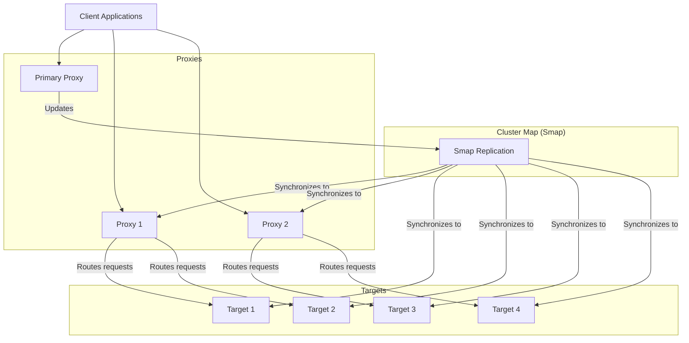
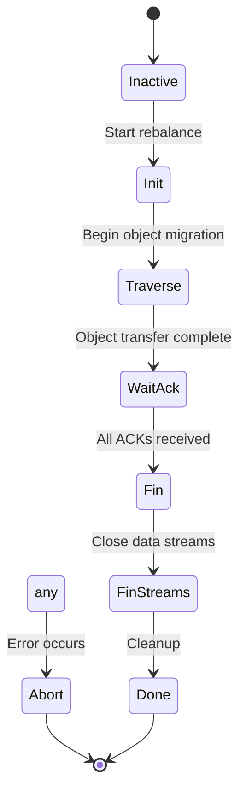
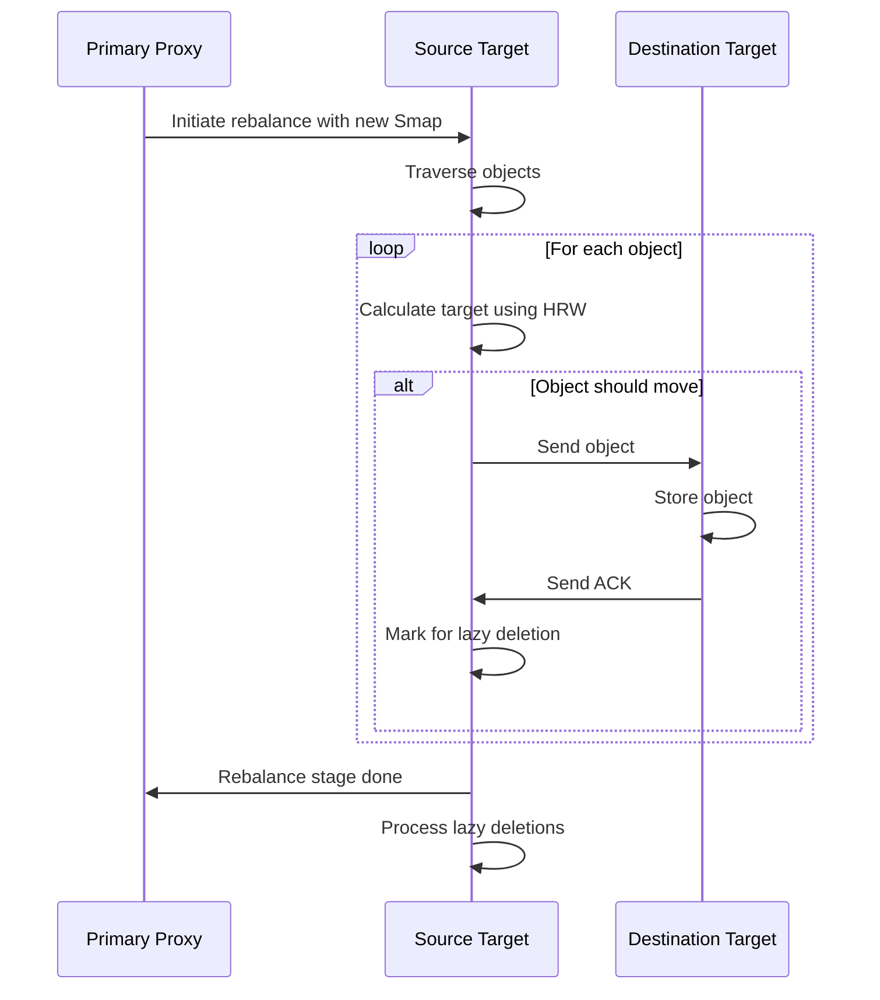
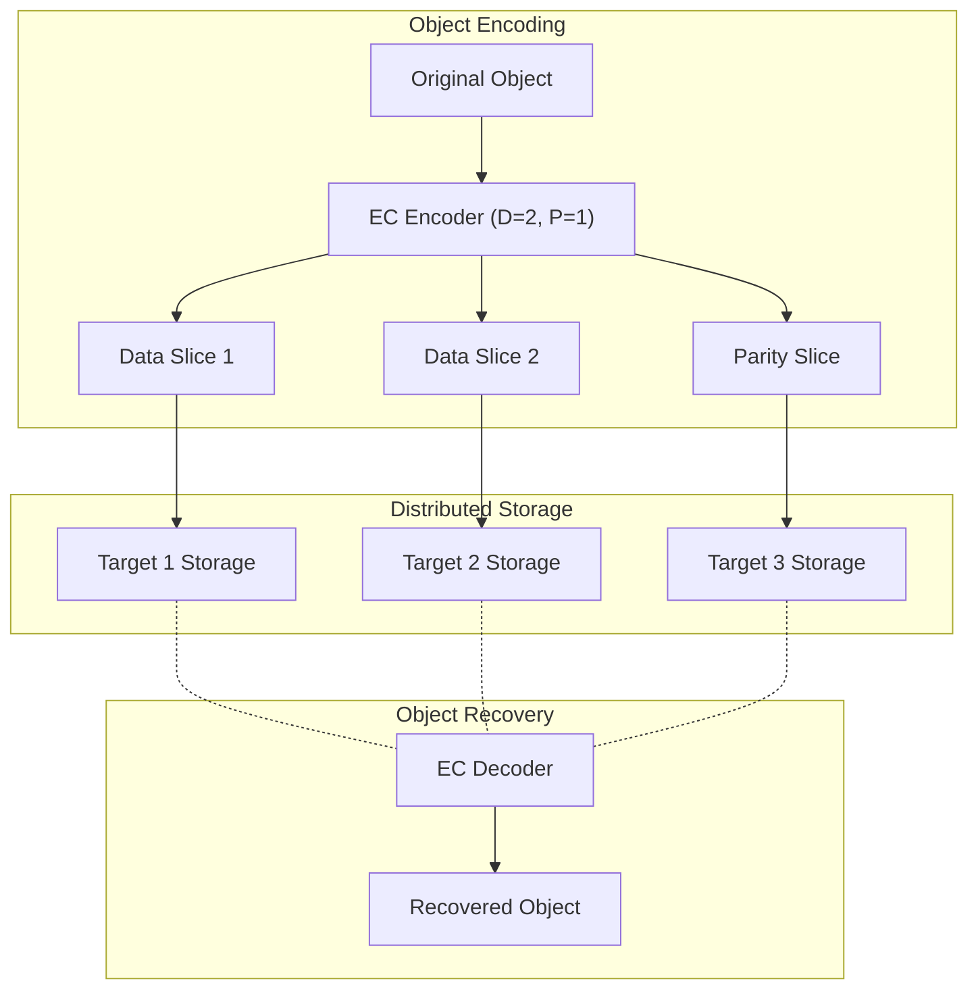
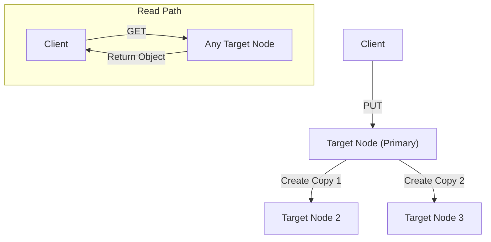
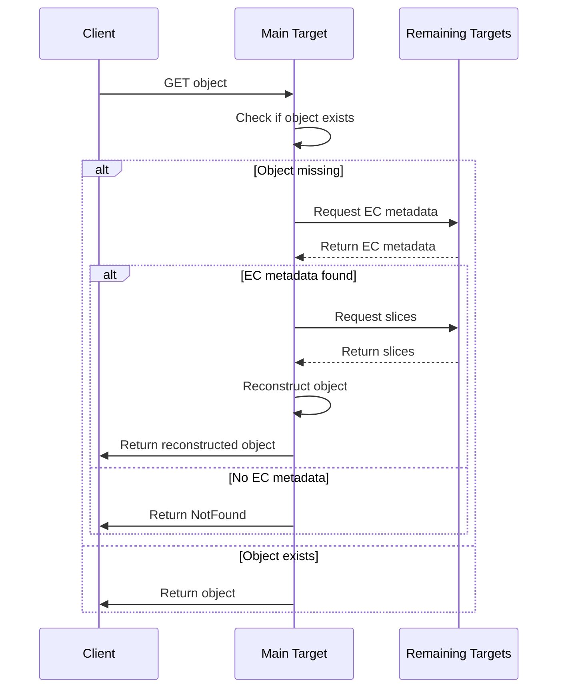
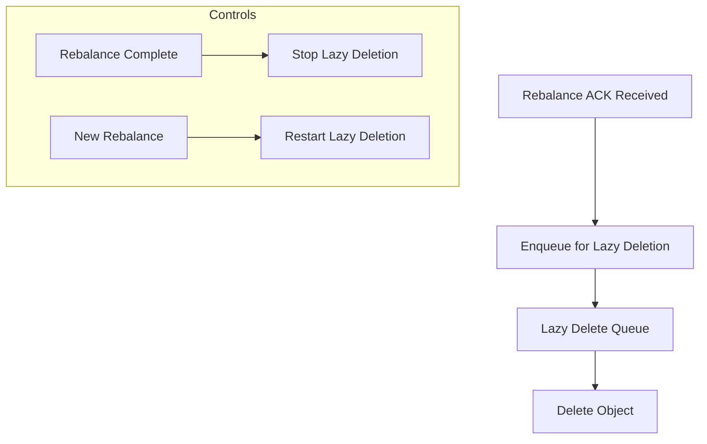
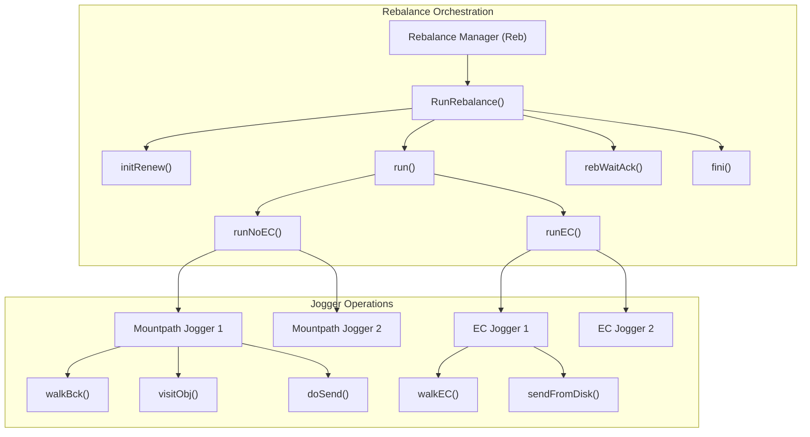

<!-- source: DeepWiki mcp.deepwiki.com · repo NVIDIA/aistore · page 5 Cluster Management · fetched 2026-10-26 -->

# Cluster Management

Relevant source files

The following files were used as context for generating this wiki page:

- [cmn/tests/bytepack_test.go](cmn/tests/bytepack_test.go)
- [core/lif.go](core/lif.go)
- [ec/ec.go](ec/ec.go)
- [ec/getjogger.go](ec/getjogger.go)
- [ec/manager.go](ec/manager.go)
- [ec/putjogger.go](ec/putjogger.go)
- [ec/xaction.go](ec/xaction.go)
- [mirror/makencopies.go](mirror/makencopies.go)
- [reb/bcast.go](reb/bcast.go)
- [reb/ec.go](reb/ec.go)
- [reb/globrun.go](reb/globrun.go)
- [reb/lazydel.go](reb/lazydel.go)
- [reb/packed_struct.go](reb/packed_struct.go)
- [reb/qui.go](reb/qui.go)
- [reb/reb_suite_test.go](reb/reb_suite_test.go)
- [reb/recv.go](reb/recv.go)
- [reb/stages.go](reb/stages.go)
- [reb/status.go](reb/status.go)
- [reb/utils.go](reb/utils.go)
- [xact/xreg/marker.go](xact/xreg/marker.go)

AIStore's cluster management system enables resilient, scalable operation by maintaining cluster state, handling node additions and removals, redistributing data via rebalancing, and protecting data through erasure coding and mirroring. This page describes the key components and mechanisms that ensure the cluster's high availability and data integrity.

For specific details on individual components, see [Rebalancing](#5.1) and [Erasure Coding](#5.2).

## Cluster Architecture and State Management

AIStore operates with two primary node types:

1. **Proxy nodes**: Handle client requests, maintain cluster state, and coordinate operations
2. **Target nodes**: Store and serve data, execute data-intensive operations

The cluster's state is maintained in a structure called **Smap** (cluster map), which tracks membership information and is replicated across all nodes. The primary proxy is responsible for updating the Smap when nodes join or leave.

Sources: [reb/globrun.go:62-114](). [reb/utils.go:24-42]().

## Rebalance Process

Rebalancing is triggered when cluster membership changes (nodes added or removed) to ensure data is evenly distributed. AIStore uses a sophisticated state machine approach to rebalance data with minimal disruption.

### Rebalance Stages

Rebalance proceeds through well-defined stages:

Sources: [reb/globrun.go:44-53](), [reb/globrun.go:292-330]()

### Rebalance Workflow

The rebalance operation moves objects between nodes based on the HRW (Highest Random Weight) algorithm, which deterministically maps each object to its target node:

Sources: [reb/globrun.go:216-321](), [reb/globrun.go:533-616]()

## Data Protection

AIStore offers two complementary data protection mechanisms:

### Erasure Coding (EC)

Erasure coding provides data protection by splitting objects into data slices, generating parity slices, and distributing them across target nodes. If target nodes fail, the original data can be reconstructed from the remaining slices.

During cluster rebalancing, EC-encoded objects require special handling. The EC rebalance process ensures that slices are properly redistributed while maintaining data protection guarantees.

Sources: [ec/ec.go:32-106](), [reb/ec.go:27-47]()

### Mirroring

Mirroring maintains multiple copies of objects across different targets for redundancy:

Sources: [mirror/makencopies.go:25-172]()

## Cluster Recovery

When a node fails, AIStore initiates recovery processes to maintain data availability:

1. **Smap Update**: The primary proxy detects the failure and updates the Smap
2. **Rebalance**: A rebalance is triggered to redistribute objects from the failed node
3. **EC Recovery**: For EC-enabled buckets, objects are reconstructed from available slices
4. **Resilver**: When a node rejoins, it synchronizes and rebuilds its contents

### EC Recovery Process

Sources: [ec/getjogger.go:134-267](), [ec/getjogger.go:700-861]()

## Management Features

AIStore provides several features for cluster management:

1. **Status Monitoring**: Track the status of rebalance and other operations
2. **Health Checks**: Verify node health and availability
3. **Lazy Deletion**: Efficiently clean up migrated objects after rebalance
4. **Statistics Collection**: Track cluster performance and resource usage

### Lazy Deletion

During rebalance, objects are not immediately deleted from the source after migration to avoid data loss if the destination fails. Instead, they are queued for lazy deletion:

Sources: [reb/lazydel.go:30-190](), [reb/utils.go:170-198]()

## Implementing Rebalance

The rebalance implementation uses a sophisticated jogger-based architecture to efficiently traverse and migrate objects.

Joggers are worker goroutines that traverse mountpaths during rebalance:

Sources: [reb/globrun.go:136-353](), [reb/globrun.go:740-880]()

## Conclusion

AIStore's cluster management system provides a robust foundation for reliable, scalable object storage through:

1. **Distributed State Management**: Using Smap to coordinate cluster state
2. **Efficient Rebalancing**: Moving data when cluster membership changes
3. **Flexible Data Protection**: Through erasure coding and mirroring
4. **Automated Recovery**: Restoring data availability after failures

Together, these components ensure that AIStore can maintain high availability and durability even in the face of hardware failures, scaling events, and other operational challenges.

Sources: [reb/globrun.go](), [ec/ec.go](), [mirror/makencopies.go]()

---

