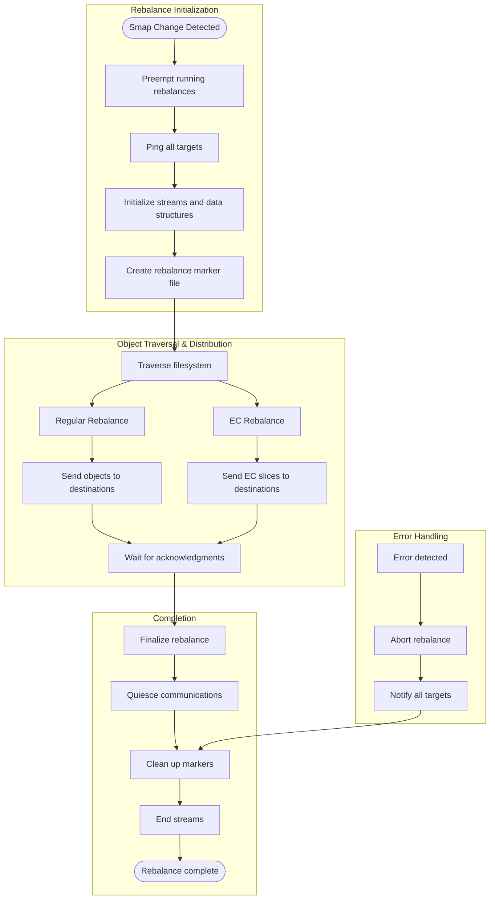
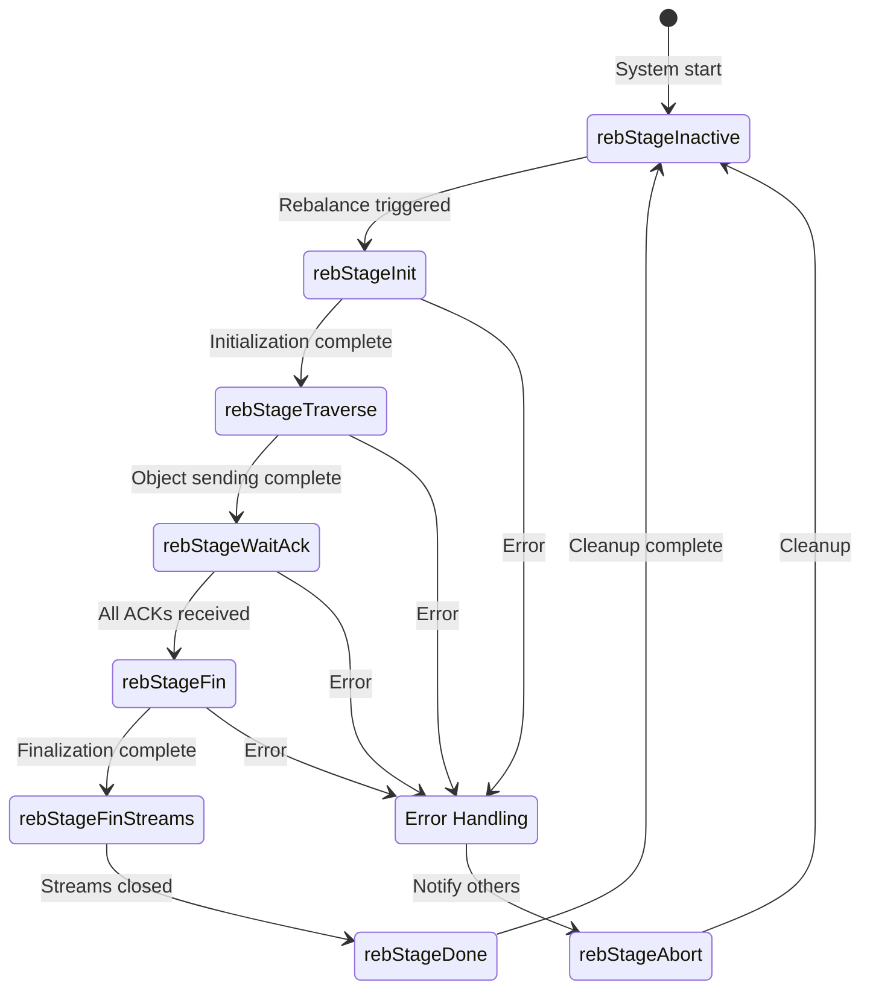
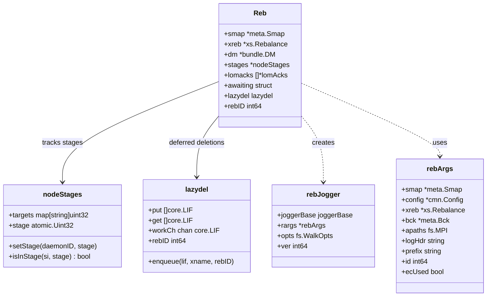
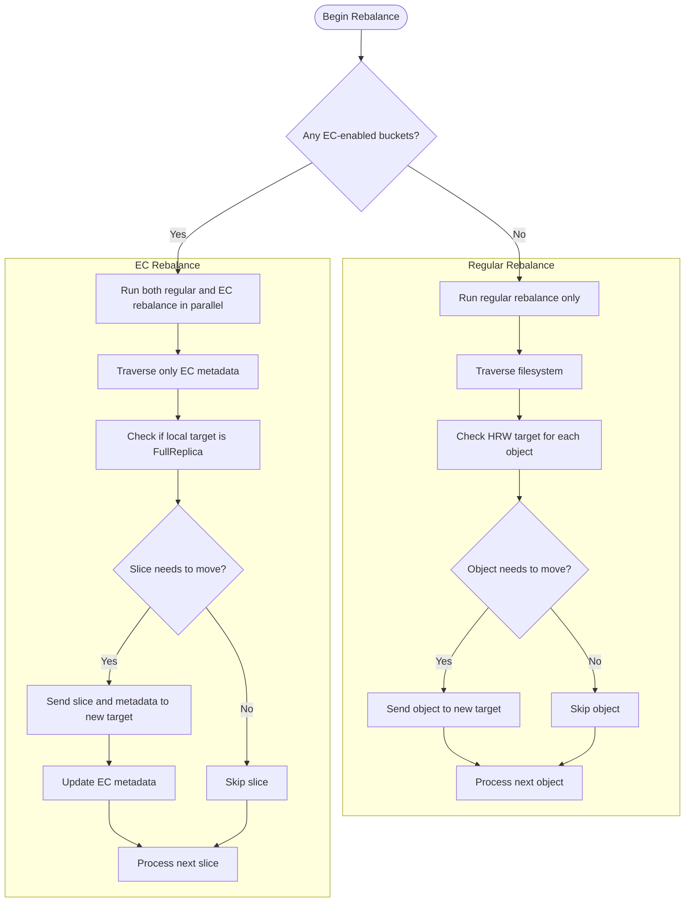
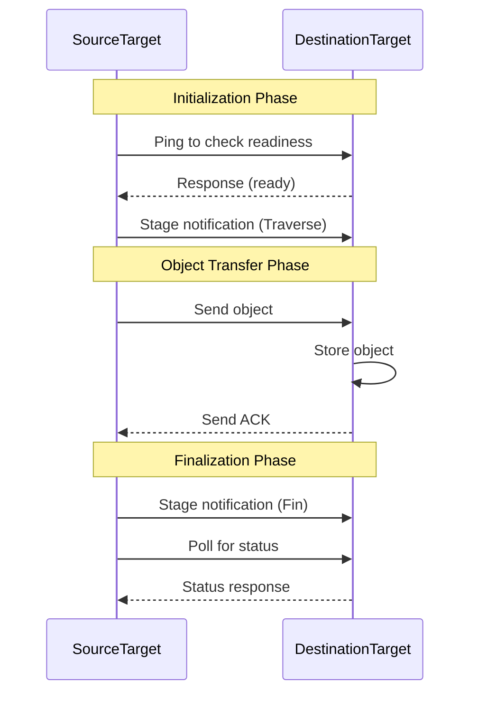
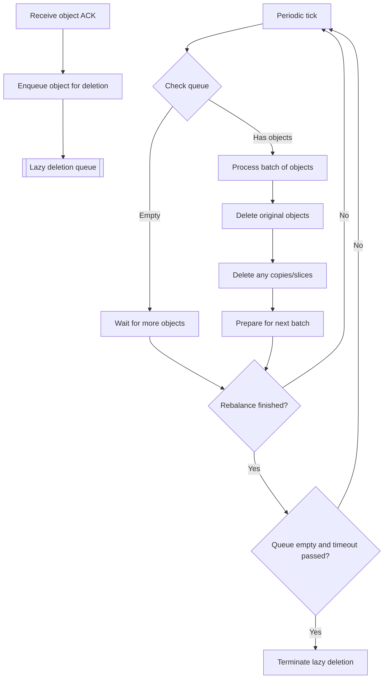

<!-- source: DeepWiki mcp.deepwiki.com · repo NVIDIA/aistore · page 5.1 Rebalancing · fetched 2026-10-26 -->

# Rebalancing

Relevant source files

The following files were used as context for generating this wiki page:

- [cmn/tests/bytepack_test.go](cmn/tests/bytepack_test.go)
- [core/lif.go](core/lif.go)
- [reb/bcast.go](reb/bcast.go)
- [reb/ec.go](reb/ec.go)
- [reb/globrun.go](reb/globrun.go)
- [reb/lazydel.go](reb/lazydel.go)
- [reb/packed_struct.go](reb/packed_struct.go)
- [reb/qui.go](reb/qui.go)
- [reb/reb_suite_test.go](reb/reb_suite_test.go)
- [reb/recv.go](reb/recv.go)
- [reb/stages.go](reb/stages.go)
- [reb/status.go](reb/status.go)
- [reb/utils.go](reb/utils.go)
- [xact/xreg/marker.go](xact/xreg/marker.go)

## Purpose and Scope

This document describes the rebalancing mechanism in AIStore, which is responsible for redistributing objects across storage targets when the cluster topology changes. Rebalancing is triggered automatically when nodes are added to or removed from the cluster, ensuring data is properly distributed according to the Rendezvous (HRW) hashing algorithm.

## Overview

Rebalancing in AIStore is implemented as a cluster-wide extended action (xaction) that coordinates the redistribution of objects across all target nodes. The rebalancing process operates in well-defined stages, handles both regular objects and erasure-coded (EC) objects, and includes mechanisms for failure recovery.

### Rebalance Workflow Diagram

Sources: [reb/globrun.go:216-322](), [reb/globrun.go:336-353](), [reb/globrun.go:691-738]()

## Rebalance Stages

Rebalancing proceeds through a sequence of well-defined stages that coordinate the process across all target nodes:

| Stage | Name | Description |
|-------|------|-------------|
| 0 | `rebStageInactive` | No rebalancing is currently active |
| 1 | `rebStageInit` | Rebalancing has been initiated, preparing resources |
| 2 | `rebStageTraverse` | Scanning the filesystem to identify objects that need relocation |
| 3 | `rebStageWaitAck` | Waiting for acknowledgments of received objects |
| 4 | `rebStageFin` | All objects have been processed, finalizing |
| 5 | `rebStageFinStreams` | Closing data streams between targets |
| 6 | `rebStageDone` | Rebalancing has completed |
| 7 | `rebStageAbort` | Rebalancing has been aborted due to errors |

Sources: [reb/globrun.go:44-54](), [reb/globrun.go:122-131]()

### Stage Transition Diagram

Sources: [reb/globrun.go:44-54](), [reb/utils.go:107-124](), [reb/utils.go:127-144]()

## Rebalance Components

The rebalancing system consists of several key components:

### Reb Structure

The central component is the `Reb` structure which manages the entire rebalancing process:

Sources: [reb/globrun.go:61-89](), [reb/globrun.go:101-119](), [reb/lazydel.go:25-35](), [reb/stages.go:18-22]()

## Rebalancing Process

### Initialization

When rebalancing is triggered (typically by a Smap change), the system:

1. Preempts any currently running rebalance operations
2. Pings all targets to ensure they're reachable
3. Initializes data structures and streams for object transfer
4. Creates a persistent marker file to track rebalance state
5. Notifies all targets to begin the rebalance process

Sources: [reb/globrun.go:216-265](), [reb/globrun.go:367-456]()

### Regular vs. EC Rebalancing

AIStore handles two types of rebalancing that may run in parallel:

1. **Regular Rebalancing**: For standard objects stored without erasure coding
2. **EC Rebalancing**: For erasure-coded objects that have data and parity slices distributed across nodes

The decision to run one or both types is made based on whether any buckets in the system use erasure coding:

Sources: [reb/globrun.go:336-353](), [reb/globrun.go:476-495](), [reb/globrun.go:498-530](), [reb/ec.go:47-72]()

### Object Movement Process

The core of rebalancing is the movement of objects between targets:

1. Each target traverses its local storage to identify objects
2. For each object, the HRW algorithm determines its correct target based on the updated cluster map
3. If an object should be relocated, it's sent to the appropriate target
4. Receiving targets acknowledge successful object transfer
5. The source target tracks these acknowledgments
6. After all objects are processed, the system waits for any outstanding acknowledgments
7. Finally, source targets may delete their original copies through the lazy deletion mechanism

Sources: [reb/globrun.go:744-776](), [reb/recv.go:137-236](), [reb/globrun.go:533-616]()

### EC Data Handling

For erasure-coded objects, rebalancing is more complex:

1. Only metadata files are initially traversed
2. A target only processes EC slices for which it is the "main" (FullReplica) target
3. When an EC slice is moved, both the data and updated metadata are sent
4. The receiving target may need to handle slice conflicts (when it already has a different slice of the same object)
5. After a slice is successfully moved, updated metadata is broadcast to all relevant targets

Sources: [reb/ec.go:26-47](), [reb/ec.go:73-93](), [reb/ec.go:94-157](), [reb/ec.go:166-260]()

## Communication and Coordination

### Target-to-Target Communication

Targets communicate with each other during rebalancing through:

1. **Data Movement**: Objects are sent from source to destination targets
2. **Acknowledgements**: Recipients acknowledge successful object receipt
3. **Stage Notifications**: Targets notify each other about stage transitions
4. **Status Checks**: Targets poll each other's status during the waiting stage

Sources: [reb/bcast.go:47-66](), [reb/recv.go:17-94](), [reb/utils.go:107-124]()

### Stage Management

The `nodeStages` structure tracks which stage each target node is in:

1. Each target maintains a local stage counter
2. When a target changes its stage, it notifies all other targets
3. Targets store the current stage of each remote target
4. This information is used to coordinate progress and ensure all targets complete necessary stages before proceeding

Sources: [reb/stages.go:18-69](), [reb/utils.go:107-124]()

## Lazy Deletion

After objects are successfully migrated, the source may delete the original copies. The lazy deletion mechanism:

1. Postpones deletions until after successful object transfer and acknowledgment
2. Operates on batches of objects to improve efficiency
3. Uses a background process to perform the actual deletions
4. Continues running even after the main rebalance operation completes
5. Self-terminates once all deletions are processed and the rebalance has been finished for a sufficient period

Sources: [reb/lazydel.go:36-200](), [reb/utils.go:171-198]()

## Error Handling and Recovery

The rebalancing system includes mechanisms for handling errors:

1. **Abort Mechanism**: Any target can abort the rebalance if it encounters a fatal error
2. **Abort Notification**: When a target aborts, it notifies all other targets
3. **Retransmission**: Failed object transfers may be retried
4. **Persistent Markers**: Filesystem markers track rebalance state for recovery after crashes
5. **Status Polling**: Targets check each other's status to detect issues

Sources: [reb/utils.go:127-144](), [reb/globrun.go:617-689](), [reb/bcast.go:189-256]()

## Persistent State and Recovery

The rebalancing system uses persistent markers to track state:

1. **Rebalance Marker**: Indicates an active or interrupted rebalance
2. **Node Restarted Marker**: Indicates a node restart during rebalance

When a target restarts, these markers are used to determine if rebalancing should be resumed.

Sources: [reb/globrun.go:436-446](), [reb/globrun.go:710-714](), [xact/xreg/marker.go:14-26]()

## Conclusion

The rebalancing system is a critical component of AIStore that ensures data is properly distributed across the cluster as nodes are added or removed. It operates as a coordinated cluster-wide operation with well-defined stages, handles both regular and erasure-coded objects, and includes mechanisms for error recovery and efficient object movement.

---

