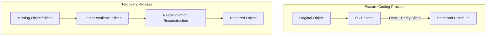
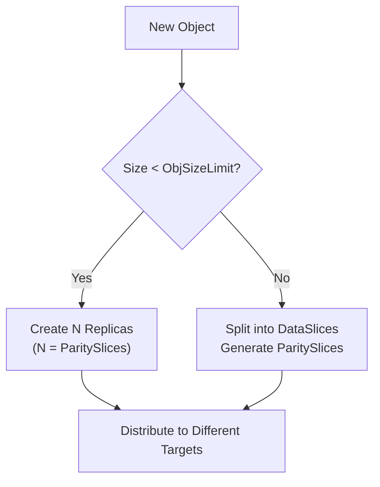
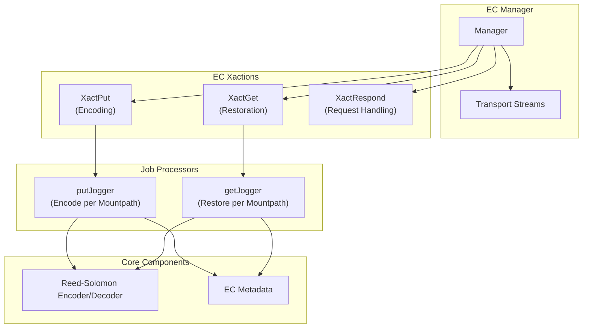
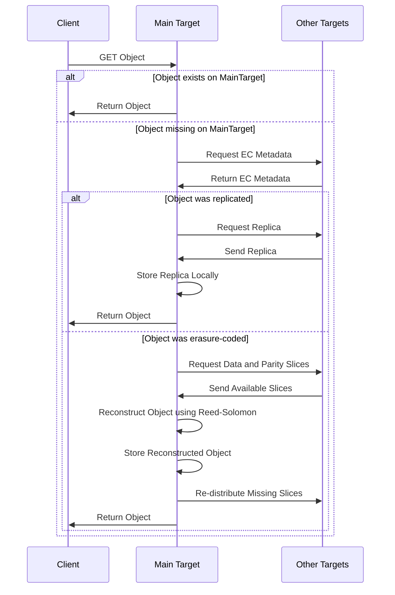
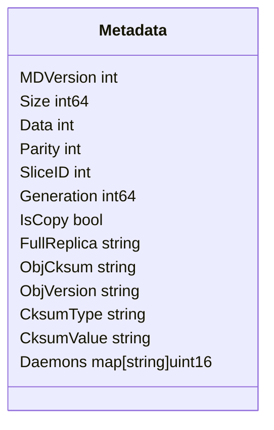
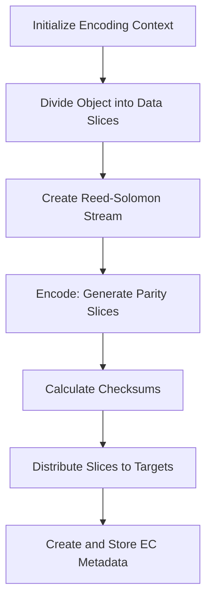
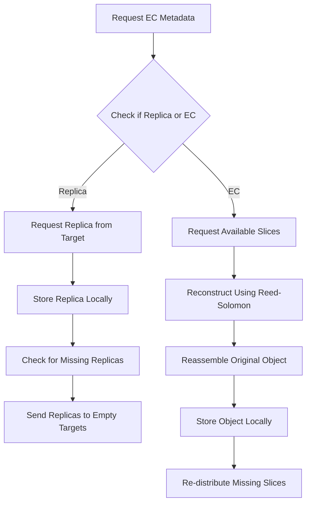
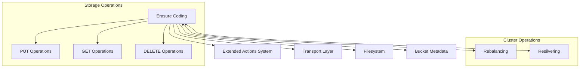

<!-- source: DeepWiki mcp.deepwiki.com · repo NVIDIA/aistore · page 5.2 Erasure Coding · fetched 2026-10-26 -->

# Erasure Coding

<details>
<summary>Relevant source files</summary>

The following files were used as context for generating this wiki page:

- [ec/ec.go](ec/ec.go)
- [ec/getjogger.go](ec/getjogger.go)
- [ec/manager.go](ec/manager.go)
- [ec/putjogger.go](ec/putjogger.go)
- [ec/xaction.go](ec/xaction.go)
- [mirror/makencopies.go](mirror/makencopies.go)

</details>


This page describes AIStore's Erasure Coding (EC) feature, a data protection mechanism that ensures data durability and availability even in the face of storage node failures. EC offers space-efficient redundancy compared to full replication while maintaining high data reliability. For information about other data protection methods like mirroring, see [Rebalancing](#5.1).

## Overview

Erasure Coding in AIStore provides data protection on a per-bucket basis. When enabled, EC splits objects into data fragments, computes additional parity fragments, and distributes them across different storage targets. If some fragments become unavailable due to node failures or corruption, the original object can be reconstructed using the remaining fragments.



Sources: [ec/ec.go:33-61](), [ec/putjogger.go:530-574](), [ec/getjogger.go:450-653]()

## Configuration

EC is configured on a per-bucket basis with the following parameters:

| Parameter | Description |
|-----------|-------------|
| Enable | Enables or disables EC protection |
| DataSlices | Number of data slices (1-32) |
| ParitySlices | Number of parity slices (1-32) |
| ObjSizeLimit | Size threshold in bytes for using EC vs. replication |

Small objects below `ObjSizeLimit` are protected by creating full replicas (the number equals `ParitySlices`). For larger objects, Reed-Solomon erasure coding is used to generate `DataSlices + ParitySlices` fragments.



Sources: [ec/ec.go:33-61](), [ec/ec.go:330-333]()

## System Architecture

Erasure Coding in AIStore is implemented as a set of extended actions (xactions) with supporting components for encoding, decoding, and managing EC metadata.



Sources: [ec/manager.go:29-289](), [ec/xaction.go:30-45](), [ec/putjogger.go:46-56](), [ec/getjogger.go:34-43]()

### Key Components

1. **EC Manager**: Coordinates all EC operations, maintains transport streams for inter-target communication, and manages EC-related xactions.

2. **XactPut**: Handles the encoding and distribution of objects across targets.

3. **XactGet**: Handles object restoration when the original is unavailable.

4. **XactRespond**: Processes EC-related requests from other targets.

5. **Joggers**: Per-mountpath workers that perform actual encoding/decoding tasks.

6. **Reed-Solomon Library**: Provides the mathematical foundation for erasure coding (using the Klauspost/reedsolomon implementation).

Sources: [ec/manager.go:29-346](), [ec/xaction.go:30-397]()

## Data Flow

### Encoding Process (PUT)

When a new object is PUT into a bucket with EC enabled:

```mermaid
sequenceDiagram
    participant Client
    participant MainTarget as Main Target
    participant OtherTargets as Other Targets
    
    Client->>MainTarget: PUT Object
    MainTarget->>MainTarget: Save Object
    
    opt Object Size > ObjSizeLimit
        MainTarget->>MainTarget: Calculate Slice Assignments
        MainTarget->>MainTarget: Split Object into Data Slices
        MainTarget->>MainTarget: Generate Parity Slices
        MainTarget->>OtherTargets: Distribute Slices
        OtherTargets->>OtherTargets: Store Slices + Metadata
    else Object Size <= ObjSizeLimit
        MainTarget->>MainTarget: Calculate Replica Assignments
        MainTarget->>OtherTargets: Distribute Full Replicas
        OtherTargets->>OtherTargets: Store Replicas + Metadata
    end
    
    MainTarget->>MainTarget: Store EC Metadata
    MainTarget->>Client: Success Response
```

Sources: [ec/ec.go:63-106](), [ec/putjogger.go:132-182](), [ec/putjogger.go:366-432](), [ec/putjogger.go:494-574]()

### Restoration Process (GET)

When an object is requested but not available locally:



Sources: [ec/ec.go:80-103](), [ec/getjogger.go:133-150](), [ec/getjogger.go:796-861](), [ec/getjogger.go:492-653]()

## EC Metadata

For each EC-protected object, AIStore maintains metadata that tracks:

1. EC configuration used (data/parity slices)
2. Locations of all slices or replicas
3. Generation number for versioning
4. Checksum information

This metadata is crucial for the recovery process, as it helps locate the necessary fragments to reconstruct missing objects.



The `Daemons` map associates target IDs with their respective slice IDs, enabling the system to locate all fragments during recovery operations.

Sources: [ec/ec.go:237-255](), [ec/putjogger.go:282-292]()

## Encoding and Decoding Implementation

AIStore uses the Reed-Solomon erasure coding algorithm for data protection, implemented using the Klauspost/reedsolomon library.

### Encoding Steps:

1. Calculate slice size based on object size and number of data slices
2. Divide the original object into data slices
3. Generate parity slices using Reed-Solomon
4. Calculate checksums for each slice
5. Distribute slices to different targets



Sources: [ec/putjogger.go:383-457](), [ec/putjogger.go:472-494]()

### Decoding Steps:

1. Request EC metadata from all targets to locate slices
2. Download available slices
3. Use Reed-Solomon to reconstruct any missing slices
4. Reassemble the original object
5. Store reconstructed object locally
6. Re-distribute any missing slices to maintain redundancy



Sources: [ec/getjogger.go:360-432](), [ec/getjogger.go:492-653](), [ec/getjogger.go:796-861]()

## Storage Layout

AIStore organizes EC-related files in specific directories within mountpaths:

- `/%ob/` - For main objects and replicas
- `/%ec/` - For object data and parity slices
- `/%mt/` - For EC metadata files

Each slice and replica has a corresponding metadata file that helps in reconstruction and management.

Sources: [ec/ec.go:62-67]()

## Integration with AIStore Components

Erasure Coding is integrated with other AIStore components to provide a complete data protection solution:



Sources: [ec/manager.go:276-345](), [ec/xaction.go:153-196]()

### Key Interactions:

1. **Transport Layer**: EC heavily relies on the transport system for slice and replica distribution between targets.

2. **Extended Actions**: EC operations are implemented as xactions that can run in the background.

3. **Bucket Metadata**: EC is configured and tracked at the bucket level through bucket properties.

4. **Filesystem Notifications**: EC responds to filesystem events to maintain data protection levels.

5. **Rebalance/Resilver**: EC interacts with these operations to maintain data protection during cluster changes.

Sources: [ec/manager.go:47-215](), [ec/xaction.go:22-28]()

## Performance Considerations

AIStore's EC implementation includes several optimizations for performance:

1. **Memory vs. Disk Usage**: Automatically switches between memory-based and disk-based encoding/decoding based on object size and available memory.

2. **Parallel Processing**: Uses per-mountpath joggers to parallelize encoding and decoding operations.

3. **Throttling**: Implements throttling to prevent overloading the system during intensive EC operations.

4. **Streaming**: Uses efficient streaming transport for slice and replica distribution.

Sources: [ec/ec.go:333-349](), [ec/putjogger.go:58-60](), [ec/getjogger.go:78-80]()

## Comparison with Mirroring

AIStore provides two primary data protection mechanisms: Erasure Coding and Mirroring. Here's how they compare:

| Feature | Erasure Coding | Mirroring |
|---------|---------------|-----------|
| Storage Efficiency | Higher (uses less space) | Lower (full copies) |
| CPU Usage | Higher (encoding/decoding) | Lower |
| Recovery Complexity | Higher | Lower |
| Performance Impact | Higher | Lower |
| Recommended Use | Large objects | Small objects |

AIStore automatically selects between replication and erasure coding based on object size, providing an optimal balance between protection and resource usage.

Sources: [ec/ec.go:33-61](), [mirror/makencopies.go:112-161]()

---

