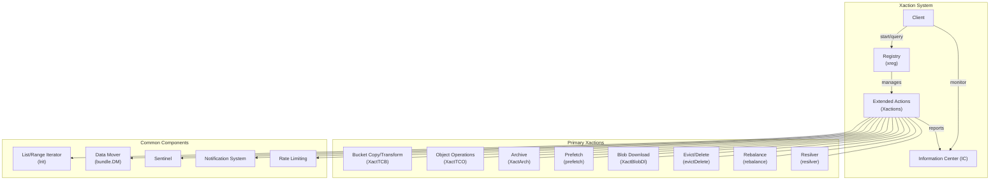
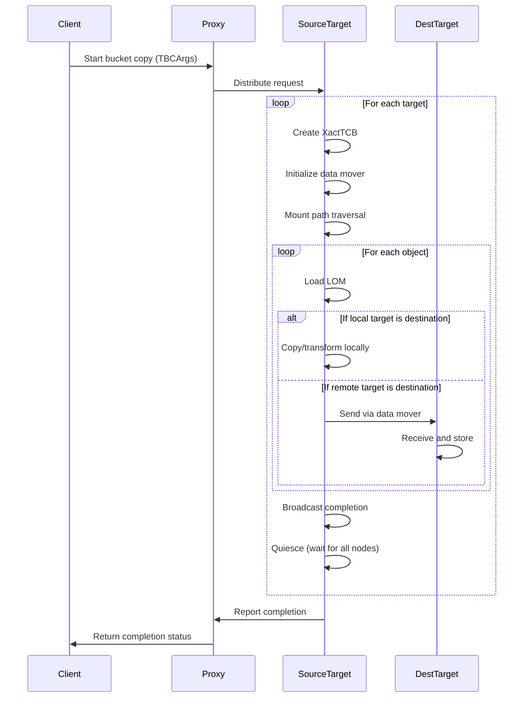
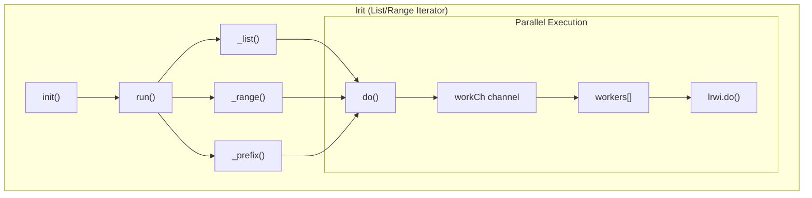
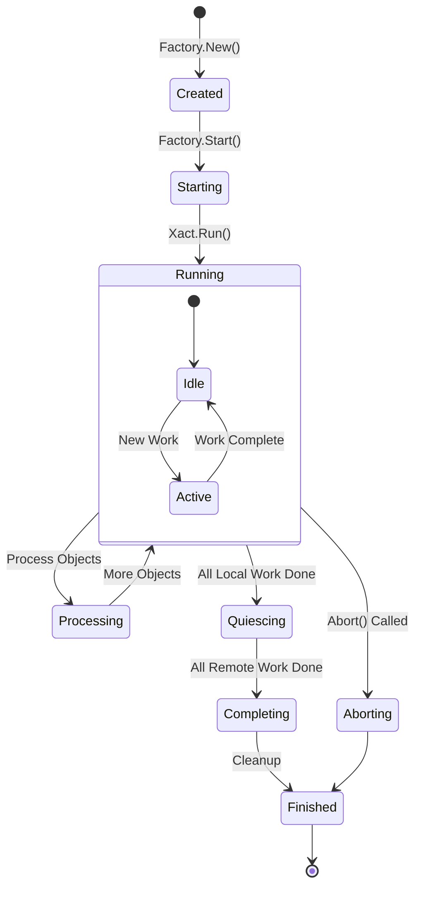
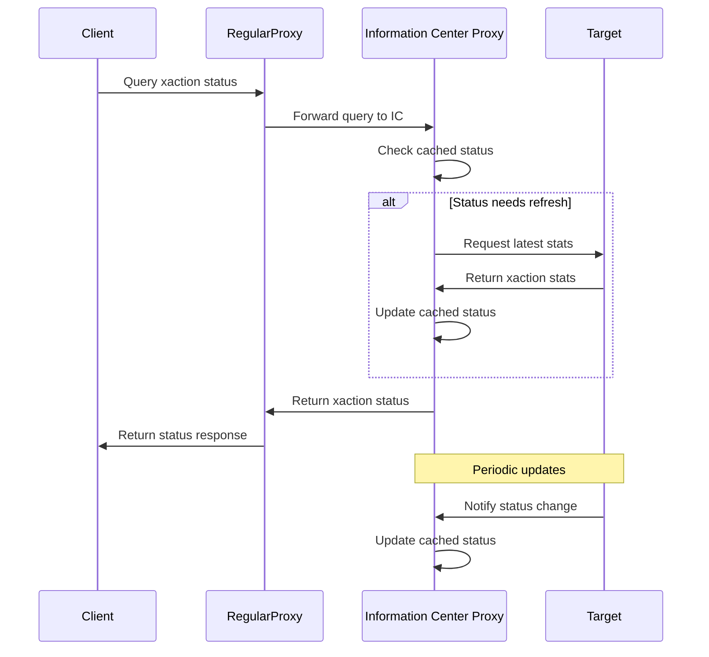

<!-- source: DeepWiki mcp.deepwiki.com · repo NVIDIA/aistore · page 6 Extended Actions (Xactions) · fetched 2026-10-26 -->

# Extended Actions (Xactions)

<details>
<summary>Relevant source files</summary>

The following files were used as context for generating this wiki page:

- [ais/ic.go](ais/ic.go)
- [ais/rlbackend.go](ais/rlbackend.go)
- [ais/tgtxact.go](ais/tgtxact.go)
- [api/cluster.go](api/cluster.go)
- [api/daemon.go](api/daemon.go)
- [api/download.go](api/download.go)
- [api/dsort.go](api/dsort.go)
- [api/multiobj.go](api/multiobj.go)
- [api/s3.go](api/s3.go)
- [api/xaction.go](api/xaction.go)
- [cmn/cos/rate_limit.go](cmn/cos/rate_limit.go)
- [cmn/tests/rate_limit_test.go](cmn/tests/rate_limit_test.go)
- [nl/listener.go](nl/listener.go)
- [xact/bckjog.go](xact/bckjog.go)
- [xact/xreg/custom.go](xact/xreg/custom.go)
- [xact/xs/archive.go](xact/xs/archive.go)
- [xact/xs/blob_download.go](xact/xs/blob_download.go)
- [xact/xs/evict.go](xact/xs/evict.go)
- [xact/xs/lrit.go](xact/xs/lrit.go)
- [xact/xs/prefetch.go](xact/xs/prefetch.go)
- [xact/xs/sentinel.go](xact/xs/sentinel.go)
- [xact/xs/streaming.go](xact/xs/streaming.go)
- [xact/xs/tcb.go](xact/xs/tcb.go)
- [xact/xs/tcobjs.go](xact/xs/tcobjs.go)
- [xact/xs/xutils.go](xact/xs/xutils.go)

</details>


Extended Actions (Xactions) are a core system in AIStore that manage long-running operations across the cluster. These operations often involve multiple objects and can span across multiple nodes, requiring coordination, monitoring, and fault tolerance. Xactions provide a unified framework for executing, tracking, and managing these distributed tasks.

This document covers the architecture, lifecycle, types, and management of Xactions. For information about specific operations like rebalancing, see [Rebalancing](#5.1), and for erasure coding, see [Erasure Coding](#5.2).

## Overview

Xactions are designed to handle operations that:
- Process multiple objects (often entire buckets)
- May run for extended periods
- Need to report progress and status
- Might need to be monitored or aborted
- Run distributedly across the cluster

Examples include bucket copying, object transformation, archiving, prefetching, and rebalancing.



Sources: [xact/xs/tcb.go:1-547]()/[xact/xs/tcobjs.go:1-474]()/[xact/xs/archive.go:1-734]()/[xact/xs/prefetch.go:1-438]()/[api/xaction.go:1-307]()

## Xaction Architecture

At the core of the xaction system is a set of interfaces and base implementations that provide common functionality.

```mermaid
classDiagram
    class core.Xact {
        <<interface>>
        ID() string
        Kind() string
        String() string
        IsAborted() bool
        Abort(error) bool
        Finished() bool
        Snap() *core.Snap
    }

    class xreg.Renewable {
        <<interface>>
        Kind() string
        Get() core.Xact
        Start() error
        WhenPrevIsRunning(prev) (WPR, error)
    }

    class xreg.Args {
        UUID string
        Kind string
        Bck *meta.Bck
        Custom interface{}
        ForceRestart bool
    }

    class xact.Base {
        InitBase(uuid, kind, ctlMsg, bck)
        ID() string
        Kind() string
        Abort(err) bool
        Finish()
    }

    class xact.DemandBase {
        IdleTime
        InitBase(uuid, kind, ctlMsg, bck)
        IdleTimer() <-chan time.Time
        IncPending()
        DecPending()
    }

    class lrwi {
        <<interface>>
        do(lom, lrit, buf)
    }

    class lrxact {
        <<interface>>
        Abort(error) bool
        IsAborted() bool
        Finished() bool
        Name() string
        ChanAbort() <-chan error
    }

    streamingF --> xreg.Renewable
    streamingX --> xact.DemandBase

    xact.Base ..|> core.Xact
    xact.DemandBase --> xact.Base
</br>
    core.Xact <|.. XactTCB
    core.Xact <|.. XactTCO
    core.Xact <|.. XactArch
    core.Xact <|.. prefetch
    core.Xact <|.. XactBlobDl
    core.Xact <|.. evictDelete

    xreg.Renewable <|.. tcbFactory
    xreg.Renewable <|.. tcoFactory
    xreg.Renewable <|.. archFactory
    xreg.Renewable <|.. prfFactory
    xreg.Renewable <|.. blobFactory
    xreg.Renewable <|.. evdFactory

    lrwi <|.. tcowi
    lrwi <|.. prefetch
    lrwi <|.. archwi
    lrwi <|.. evictDelete

    lrxact <|.. XactTCO
    lrxact <|.. XactArch
    lrxact <|.. prefetch
    lrxact <|.. evictDelete
```

Sources: [xact/xs/tcb.go:39-79]()/[xact/xs/tcobjs.go:38-81]()/[xact/xs/archive.go:40-97]()/[xact/xs/prefetch.go:39-70]()/[xact/xs/lrit.go:40-63]()

### Factory Pattern

Each xaction type has a corresponding factory that implements the `xreg.Renewable` interface, enabling consistent creation and management across different xaction types:

```go
type Renewable interface {
    Kind() string
    Get() core.Xact
    Start() error
    WhenPrevIsRunning(prev Renewable) (WPR, error)
    New(args Args, bck *meta.Bck) Renewable
}
```

The factory pattern provides:
1. Creation and initialization of xactions with consistent parameters
2. Policy decisions when a new xaction of the same kind is requested while one is already running
3. Generation of unique IDs for xactions

Sources: [xact/xs/tcb.go:82-187]()/[xact/xs/tcobjs.go:85-171]()/[xact/xs/archive.go:97-148]()

## Extended Action Types

AIStore implements several specialized xaction types, each designed for specific operations:

### Bucket Copy/Transform (XactTCB)

XactTCB handles copying an entire bucket into another bucket, with optional transformation of objects through ETL (Extract, Transform, Load). It can operate across multiple targets using a distributed data mover and supports features like synchronization.



Key components:
- Mountpath joggers that traverse the filesystem
- Workers for parallel processing
- Data mover for target-to-target transfers
- Sentinel for coordination between targets
- Optional ETL transformation

Sources: [xact/xs/tcb.go:48-488]()/[xact/xs/tcb.go:190-464]()

### Object Operations (XactTCO)

XactTCO manages operations on individual objects or subsets of objects defined by lists, ranges, or prefixes. Unlike XactTCB which copies entire buckets, XactTCO processes specific objects, often in multiple batches.

Key components:
- Transaction-based messaging with BeginMsg/ContMsg/DoMsg
- List/Range/Prefix iterator to process specified objects
- Workers for parallel processing
- Data mover for target-to-target transfers
- Support for multiple batch operations in a single xaction

Sources: [xact/xs/tcobjs.go:38-89]()/[xact/xs/tcobjs.go:176-289]()

### Archive (XactArch)

XactArch handles the creation of archives (tar, zip, etc.) from existing objects in a bucket. It supports:
- Multiple archiving formats
- Concurrent archive creation
- Appending to existing archives
- Mountpath-based parallelism via joggers
- Writer serialization for safe archive creation

Sources: [xact/xs/archive.go:40-733]()/[xact/xs/archive.go:148-154]()

### Prefetch (prefetch)

Prefetch xactions bring objects from remote storage (cloud, remote AIS) into the local cache proactively. They support:
- List/range/prefix-based object selection
- Large object handling via Blob Download
- Rate limiting to avoid overwhelming cloud providers
- Latest version fetching
- Optimistic concurrency for efficient prefetching

Sources: [xact/xs/prefetch.go:39-437]()/[xact/xs/prefetch.go:93-225]()

### Blob Download (XactBlobDl)

XactBlobDl is specialized for downloading large binary objects efficiently by:
- Splitting downloads into configurable chunks
- Parallel downloading of chunks
- Memory management to avoid excessive memory usage
- Checksum validation
- Progress tracking

Sources: [xact/xs/blob_download.go:39-165]()/[xact/xs/blob_download.go:179-240]()

### Evict/Delete (evictDelete)

The evictDelete xaction handles both eviction (removing cached objects but keeping remote copies) and deletion (completely removing objects). It leverages the list/range iterator for object selection.

Sources: [xact/xs/evict.go:22-126]()/[xact/xs/evict.go:87-115]()

## Common Components

Several key components are shared across different xaction types:

### List/Range Iterator (lrit)

The list/range iterator provides a unified way to iterate over multiple objects using three patterns:
1. **List**: Iterate over a predefined list of object names
2. **Range**: Iterate over objects matching a template pattern with range expressions
3. **Prefix**: Iterate over objects sharing a common prefix

It supports parallel processing through workers and can distribute objects across workers.



Sources: [xact/xs/lrit.go:40-386]()/[xact/xs/lrit.go:88-139]()

### Data Mover and Transport

For operations requiring data transfer between nodes, xactions use a data mover (`bundle.DM`) built on AIStore's transport system. Key aspects include:
- Send/receive endpoints for each xaction
- Stream bundling for efficient network usage
- Compression options
- Control message exchange via special opcodes

Sources: [xact/xs/tcb.go:192-214]()/[xact/xs/streaming.go:106-132]()

### Sentinel

For coordinating distributed xactions across targets, a sentinel pattern is used that:
- Tracks progress of all participating targets
- Broadcasts completion/abort messages
- Handles quiescence when operations complete
- Manages reference counting for concurrent operations

Sources: [xact/xs/sentinel.go:34-244]()/[xact/xs/sentinel.go:50-96]()

### Rate Limiting

To avoid overwhelming resources (network, CPU, IO, backend providers), xactions employ rate limiting, including:
- Basic token bucket rate limiting
- Adaptive rate limiting for backend operations
- Burst rate limiting for front-end operations
- Timeouts and retries with backoff

Sources: [cmn/cos/rate_limit.go:53-185]()/[cmn/cos/rate_limit.go:97-159]()

## Xaction Lifecycle

Xactions go through a well-defined lifecycle:



1. **Creation**: Xactions are created via their factory's `New()` method
2. **Initialization**: The factory's `Start()` method initializes resources and dependencies
3. **Execution**: The xaction's `Run()` method is called in a separate goroutine
4. **Processing**: Objects are processed according to the xaction's logic
5. **Idle Management**: Demand-based xactions can become idle while waiting for work
6. **Quiescence**: For distributed xactions, waiting for all targets to complete
7. **Completion/Abortion**: Normal completion or abortion due to errors or user request
8. **Cleanup**: Release of resources after completion

Sources: [xact/xs/tcb.go:287-348]()/[xact/xs/streaming.go:135-217]()

## Information Center and Monitoring

The Information Center (IC) is a group of proxies that own and track the status of running xactions. This enables:
- Status queries from any proxy
- Progress monitoring
- Notification of completion or errors
- Historical information about completed xactions



Key APIs for monitoring xactions:
- `GetOneXactionStatus`: Gets status of a single xaction
- `GetAllXactionStatus`: Gets status of all matching xactions
- `WaitForXactionIC`: Waits for a global xaction to complete
- `WaitForXactionNode`: Waits for a node-specific xaction to complete

Sources: [ais/ic.go:45-460]()/[api/xaction.go:129-307]()/[ais/tgtxact.go:1-100]()

## API for Managing Xactions

AIStore provides a set of APIs for clients to manage xactions:

```
StartXaction          - Start a new xaction
AbortXaction          - Abort a running xaction
GetAllRunningXactions - Get all currently running xactions
QueryXactionSnaps     - Get snapshots of xactions matching criteria
GetOneXactionStatus   - Get status of a single xaction
GetAllXactionStatus   - Get status of all matching xactions
WaitForXactionIdle    - Wait for an on-demand xaction to become idle
WaitForXactionIC      - Wait for a global xaction monitored by IC
WaitForXactionNode    - Wait for a node-specific xaction to complete
```

Sources: [api/xaction.go:21-306]()/[ais/tgtxact.go:27-334]()

## Extended Actions vs Regular Actions

Not all operations in AIStore are implemented as extended actions. Here's how they differ:

| Extended Actions (Xactions) | Regular Actions |
|----------------------------|-----------------|
| Long-running operations | Short-lived operations |
| Progress reporting and monitoring | Simple success/failure reporting |
| Can be aborted | Cannot be aborted once started |
| Distributed coordination | Often single-node operations |
| Tracked by Information Center | Not tracked centrally |
| Uniquely identified by UUID | Not uniquely identified |
| Support waiting for completion | Synchronous or basic async |
| Examples: bucket copying, rebalancing, prefetching | Examples: object PUT, GET, DELETE |

Sources: [ais/tgtxact.go:26-334]()/[api/xaction.go:21-70]()

## Summary

Extended Actions (Xactions) form a critical part of AIStore's architecture, enabling the system to perform complex, long-running operations with proper monitoring, coordination, and error handling. The system's modular design allows for implementing various types of operations while reusing common components like the list/range iterator, data mover, and notification system.

Key takeaways:
- Xactions manage long-running operations that often process multiple objects
- The factory pattern provides a consistent way to create and manage xactions
- Common patterns like list/range iteration and data movement are abstracted for reuse
- The Information Center provides centralized monitoring of xaction progress
- Various xaction types handle specific operations like bucket copying, prefetching, and archiving

---

