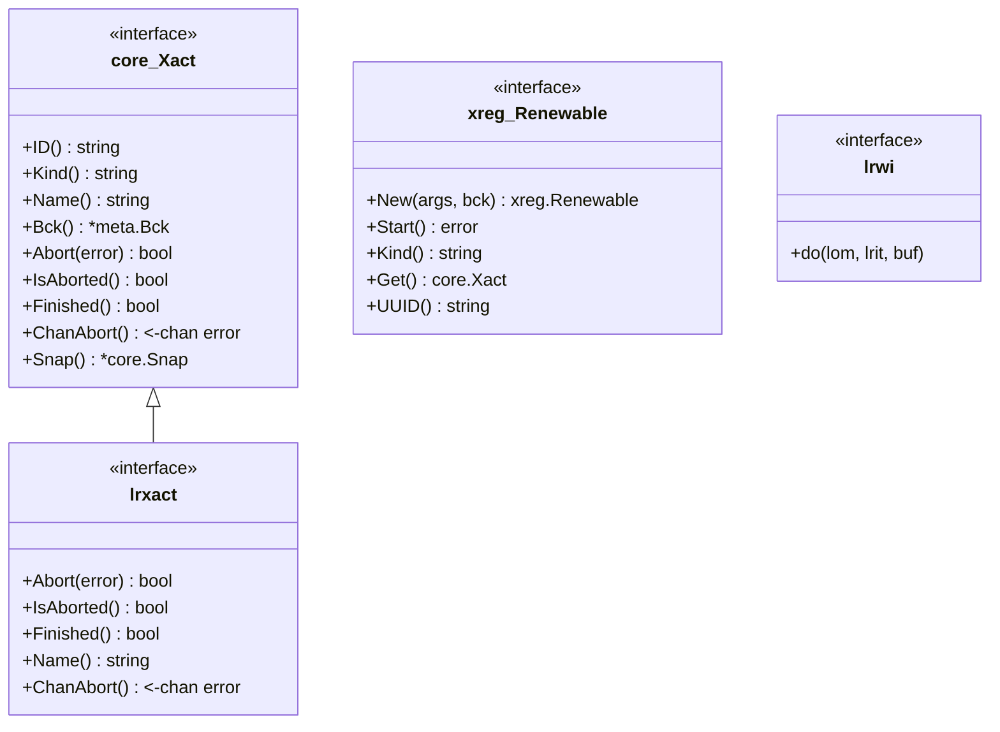
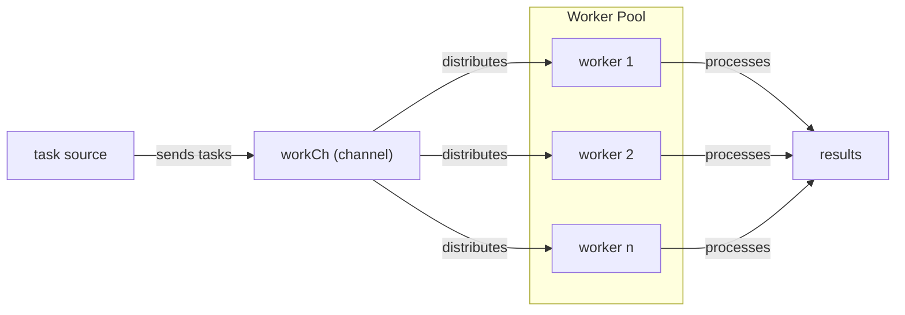
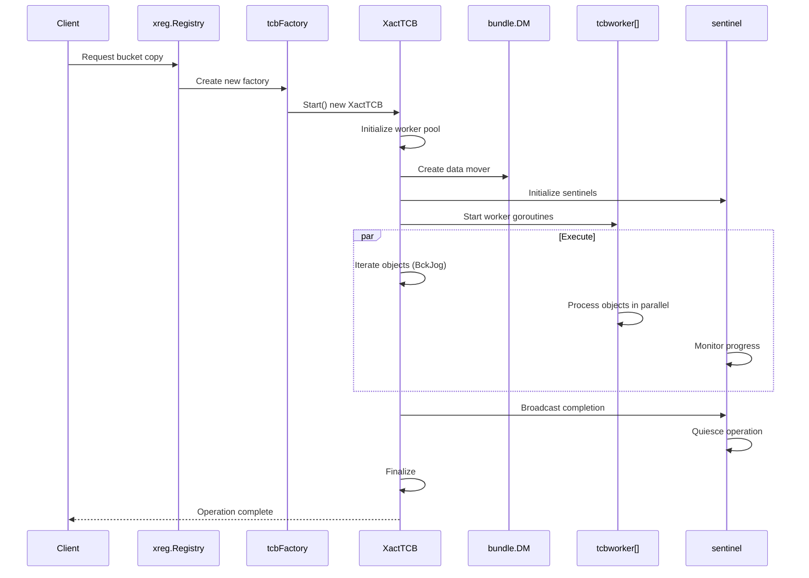
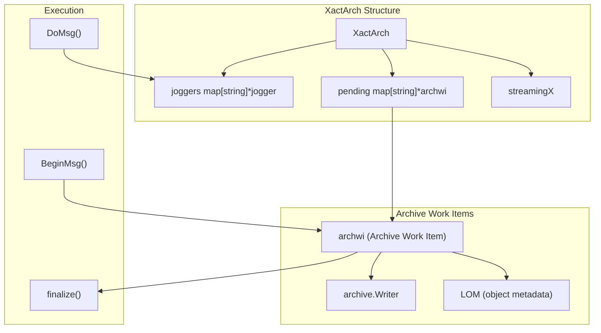
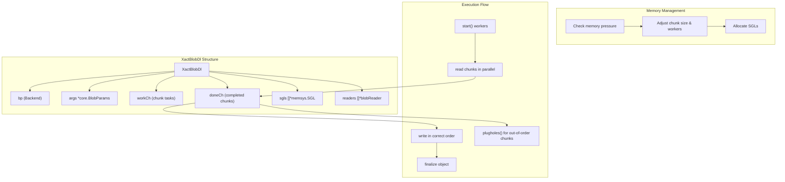
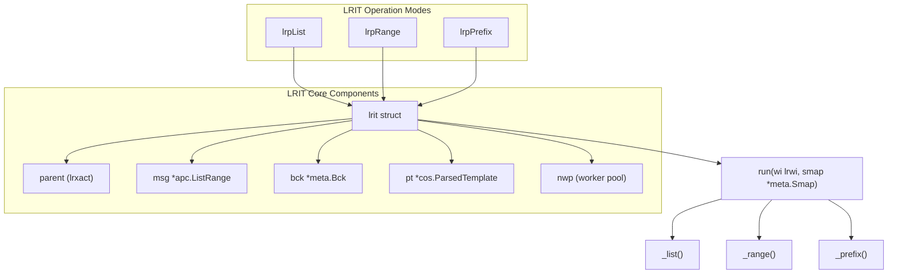
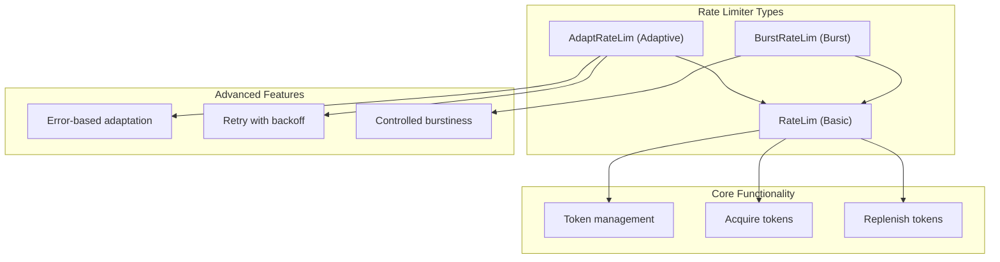

<!-- source: DeepWiki mcp.deepwiki.com · repo NVIDIA/aistore · page 6.1 Xaction Types · fetched 2026-10-26 -->

# Xaction Types

Relevant source files

The following files were used as context for generating this wiki page:

- [ais/rlbackend.go](ais/rlbackend.go)
- [cmn/cos/rate_limit.go](cmn/cos/rate_limit.go)
- [cmn/tests/rate_limit_test.go](cmn/tests/rate_limit_test.go)
- [xact/bckjog.go](xact/bckjog.go)
- [xact/xreg/custom.go](xact/xreg/custom.go)
- [xact/xs/archive.go](xact/xs/archive.go)
- [xact/xs/blob_download.go](xact/xs/blob_download.go)
- [xact/xs/evict.go](xact/xs/evict.go)
- [xact/xs/lrit.go](xact/xs/lrit.go)
- [xact/xs/prefetch.go](xact/xs/prefetch.go)
- [xact/xs/sentinel.go](xact/xs/sentinel.go)
- [xact/xs/streaming.go](xact/xs/streaming.go)
- [xact/xs/tcb.go](xact/xs/tcb.go)
- [xact/xs/tcobjs.go](xact/xs/tcobjs.go)
- [xact/xs/xutils.go](xact/xs/xutils.go)

This document provides a comprehensive overview of the extended actions (xactions) in AIStore. Xactions are long-running operations that typically handle multi-object tasks, distributed processing, and asynchronous workloads. Understanding the various xaction types is essential for comprehending AIStore's architecture and operational capabilities.

For information about the xaction notification system, see [Notification System](#6.2).

## Overview of Xactions

Xactions in AIStore are implementations of the `core.Xact` interface that provide a framework for executing complex, often distributed operations. They differ from regular HTTP handlers by maintaining state across multiple requests and coordinating work across multiple target nodes.

```mermaid
graph TB
    subgraph "Core Xaction Types"
        tcb["XactTCB (Bucket Copy/Transform)"]
        tco["XactTCO (Object Operations)"]
        arch["XactArch (Archive)"]
        prefetch["prefetch (Cold Get)"]
        blobdl["XactBlobDl (Large Object Download)"]
        evictdelete["evictDelete (Remove Objects)"]
        ec["EC (Erasure Coding)"]
        rebalance["Rebalance"]
        resilver["Resilver"]
    end
    
    subgraph "Factory Pattern (xreg.Renewable)"
        tcbf["tcbFactory"]
        tcof["tcoFactory"]
        archf["archFactory"]
        prff["prfFactory"]
        blobf["blobFactory"]
        evdf["evdFactory"]
    end
    
    subgraph "Common Utilities"
        lrit["lrit (List/Range Iterator)"]
        sentl["sentinel (Target Coordination)"]
        stream["streamingX (Message Flow)"]
        rate["tcrate (Rate Control)"]
        bckjog["BckJog (Bucket Processing)"]
    end
    
    tcbf --> tcb
    tcof --> tco
    archf --> arch
    prff --> prefetch
    blobf --> blobdl
    evdf --> evictdelete
    
    lrit --> tco
    lrit --> arch
    lrit --> prefetch
    lrit --> evictdelete
    
    sentl --> tcb
    sentl --> tco
    
    stream --> tco
    stream --> arch
    
    rate --> tcb
    rate --> prefetch
    
    bckjog --> tcb
```

Sources: [xact/xs/tcb.go](xact/xs/tcb.go), [xact/xs/tcobjs.go](xact/xs/tcobjs.go), [xact/xs/archive.go](xact/xs/archive.go), [xact/xs/prefetch.go](xact/xs/prefetch.go), [xact/xs/blob_download.go](xact/xs/blob_download.go), [xact/xs/evict.go](xact/xs/evict.go)

## Xaction Interfaces and Common Patterns

All xactions implement key interfaces that define their behavior and lifecycle:

Sources: [xact/xs/lrit.go:39-63](xact/xs/lrit.go:39-63)

### Factory Pattern

Every xaction type has a corresponding factory that implements `xreg.Renewable` interface. The factory is responsible for:

1. Creating new xaction instances
2. Initializing resources
3. Handling potential conflicts with existing xactions
4. Managing xaction lifecycle

### Worker Management

Most xactions employ worker pools to parallelize operations:

Sources: [xact/xs/tcb.go:142-156](xact/xs/tcb.go:142-156), [xact/xs/lrit.go:135-147](xact/xs/lrit.go:135-147)

## Detailed Xaction Types

### XactTCB (Bucket Copy/Transform)

The TCB xaction performs bucket-to-bucket copy operations, optionally with transformation (ETL).

Key features:
- Copies entire buckets or bucket subsets
- Supports transformation through ETL
- Uses distributed data mover (DM) for target-to-target transfers
- Employs parallelism across worker pools
- Handles rate limiting for controlled data transfer

Sources: [xact/xs/tcb.go:48-87](xact/xs/tcb.go:48-87), [xact/xs/tcb.go:287-348](xact/xs/tcb.go:287-348)

### XactTCO (Object Operations)

The TCO xaction operates on specific objects within buckets, executing copy or transform operations.

Key features:
- Handles list-range-prefix API calls
- Operates on subsets of objects
- Supports ETL transformations
- Uses transactional model with BeginMsg, ContMsg, doMsg
- Employs the same data moving infrastructure as TCB

Sources: [xact/xs/tcobjs.go:38-186](xact/xs/tcobjs.go:38-186)

### XactArch (Archive)

The Archive xaction creates archives (e.g., tar files) from bucket objects.

Key features:
- Creates various archive formats
- Supports appending to existing archives
- Distributes work across mountpaths (joggers)
- Handles both local and remote objects

Sources: [xact/xs/archive.go:44-72](xact/xs/archive.go:44-72), [xact/xs/archive.go:153-204](xact/xs/archive.go:153-204)

### Prefetch Xaction

The Prefetch xaction proactively fetches objects from remote/cloud storage into local cache.

Key features:
- Lists and fetches objects based on patterns
- Supports large blob downloading for objects exceeding size thresholds
- Implements rate limiting to avoid overwhelming backends
- Uses parallel workers for efficient fetching

Sources: [xact/xs/prefetch.go:40-64](xact/xs/prefetch.go:40-64), [xact/xs/prefetch.go:133-164](xact/xs/prefetch.go:133-164)

### XactBlobDl (Blob Download)

The Blob Download xaction handles efficient downloading of large objects.

Key features:
- Chunk-based parallel downloading
- Memory-aware operation (adjusts chunk size and parallelism based on memory pressure)
- Writer multiplexing for simultaneous local storage and streaming
- Progress tracking and efficient error handling

Sources: [xact/xs/blob_download.go:54-90](xact/xs/blob_download.go:54-90), [xact/xs/blob_download.go:439-486](xact/xs/blob_download.go:439-486)

### Evict/Delete Xaction

The EvictDelete xaction removes objects from buckets, either by evicting them from cache or deleting them entirely.

Key features:
- Supports both eviction and full deletion
- Works with lists, ranges, or prefixes of objects
- Uses parallelized workers for efficiency
- Built on the LRIT (List/Range Iterator) framework

Sources: [xact/xs/evict.go:22-42](xact/xs/evict.go:22-42), [xact/xs/evict.go:91-125](xact/xs/evict.go:91-125)

## Common Utilities and Components

### LRIT (List/Range Iterator)

The LRIT (List/Range Iterator) is a common framework used by multiple xactions to iterate over objects matching certain criteria.

Key features:
- Supports three operation modes:
  - `lrpList`: Process an explicit list of objects
  - `lrpRange`: Process objects matching a range pattern (e.g., `file-{0..100}`)
  - `lrpPrefix`: Process objects with a common prefix
- Parallelized worker pool for concurrent processing
- Configurable number of workers with adaptive throttling

Sources: [xact/xs/lrit.go:34-82](xact/xs/lrit.go:34-82), [xact/xs/lrit.go:88-147](xact/xs/lrit.go:88-147)

### Sentinel

The Sentinel component handles coordination between targets for distributed xactions.

Key features:
- Tracks progress across targets
- Implements quiescing behavior for graceful completions
- Handles error propagation and abort signals
- Manages communication via opcode messages

Sources: [xact/xs/sentinel.go:34-49](xact/xs/sentinel.go:34-49), [xact/xs/sentinel.go:51-68](xact/xs/sentinel.go:51-68)

### StreamingX

The StreamingX component provides common functionality for on-demand transactional xactions.

Key features:
- Handles common message passing patterns
- Manages the data mover (DM) lifecycle
- Implements common finalization patterns
- Provides error handling infrastructure

Sources: [xact/xs/streaming.go:36-49](xact/xs/streaming.go:36-49), [xact/xs/streaming.go:135-217](xact/xs/streaming.go:135-217)

### Rate Limiting

Rate limiting is implemented across various xactions to control resource usage.

AIStore supports multiple rate limiting strategies:
- `RateLim`: Basic token bucket rate limiter
- `AdaptRateLim`: Adaptive rate limiter that adjusts based on errors
- `BurstRateLim`: Rate limiter that allows for short bursts of activity

Sources: [cmn/cos/rate_limit.go:98-120](cmn/cos/rate_limit.go:98-120), [cmn/cos/rate_limit.go:166-289](cmn/cos/rate_limit.go:166-289), [cmn/cos/rate_limit.go:299-354](cmn/cos/rate_limit.go:299-354)

## Xaction Registry and Lifecycle

All xactions are registered and managed by the xaction registry (`xreg`).

The typical lifecycle of an xaction includes:

1. **Creation**: Factory creates a new xaction instance
2. **Initialization**: Resources are allocated and configured
3. **Execution**: Workers process tasks in parallel
4. **Monitoring**: Progress is tracked and reported
5. **Finalization**: Resources are cleaned up
6. **Completion/Abort**: Xaction terminates either normally or due to an error

Sources: [xact/xs/tcb.go:85-104](xact/xs/tcb.go:85-104), [xact/xs/blob_download.go:166-186](xact/xs/blob_download.go:166-186)

## Xaction Integration with AIStore

Xactions integrate with the broader AIStore architecture in several ways:

1. **Transport Layer**: For inter-target communication and data transfer
2. **Storage Layer**: For accessing and modifying objects
3. **Notification System**: For reporting progress and status updates
4. **Statistics**: For monitoring and performance analysis

This integration allows xactions to operate efficiently across the distributed AIStore cluster while providing visibility into their operation.

Sources: [xact/xs/tcb.go:194-212](xact/xs/tcb.go:194-212), [xact/xs/sentinel.go:70-104](xact/xs/sentinel.go:70-104)

---

