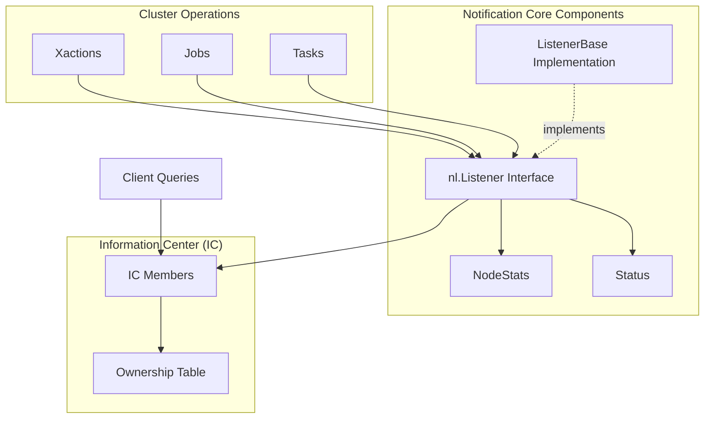
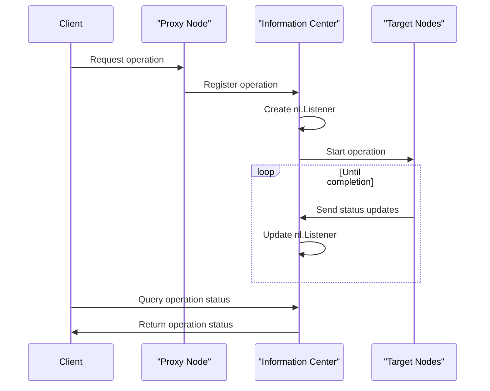
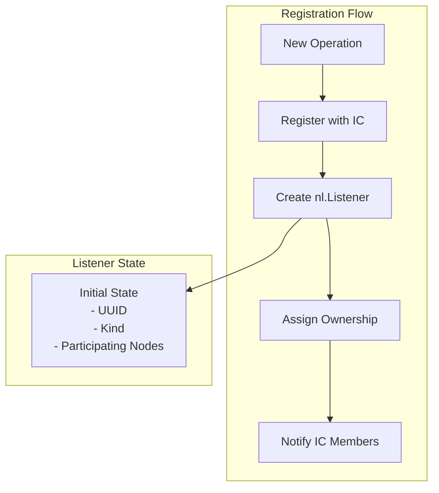
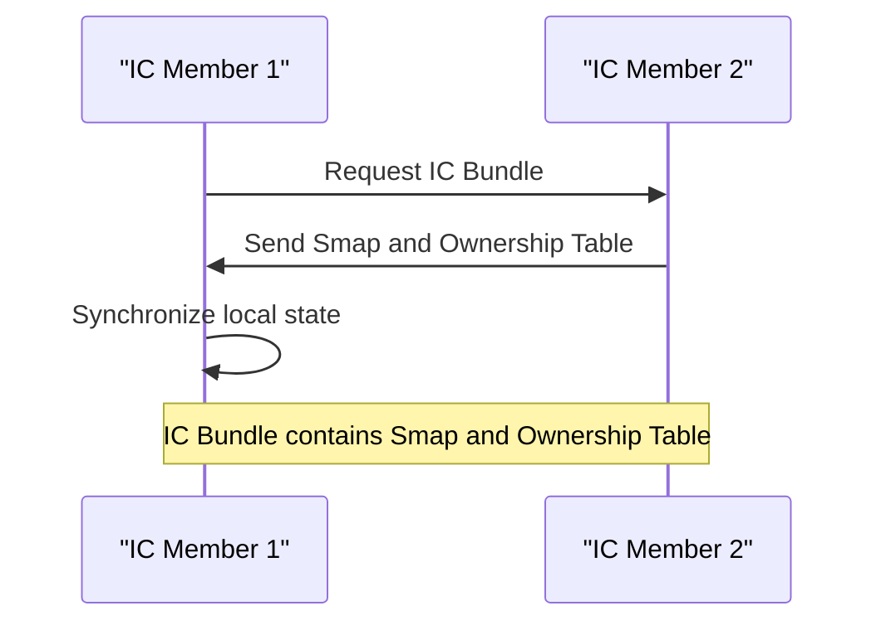

<!-- source: DeepWiki mcp.deepwiki.com · repo NVIDIA/aistore · page 6.2 Notification System · fetched 2026-10-26 -->

# Notification System

<details>
<summary>Relevant source files</summary>

The following files were used as context for generating this wiki page:

- [ais/ic.go](ais/ic.go)
- [nl/listener.go](nl/listener.go)

</details>


The Notification System in AIStore enables monitoring and tracking the status of distributed operations across the cluster. It provides a mechanism to track the progress of extended actions (xactions), notify interested components about state changes, and query the current status of operations. This system is particularly important for long-running operations that span multiple nodes within the AIStore cluster.

For information about the different types of extended actions, see [Xaction Types](#6.1).

## Overview

The Notification System consists of several key components that work together to provide real-time status updates for operations:



Sources: [nl/listener.go:23-62](), [ais/ic.go:28-36]()

## Core Components

### Listener Interface

The `nl.Listener` interface is the foundation of the notification system. It defines methods for tracking and managing notifications related to distributed operations.

Key capabilities include:
- Callback mechanisms for notification events
- Thread-safe access to notification data
- Managing notifiers (nodes that send notifications)
- Tracking errors and operation state
- Storing and retrieving statistics

Each notification listener is associated with a specific operation (xaction, job, or task) and tracks its status across all participating nodes.

Sources: [nl/listener.go:23-62]()

### ListenerBase

`ListenerBase` provides the standard implementation of the `nl.Listener` interface with common functionality that most notification listeners require.

Key fields and structures:
- `Srcs`: All nodes that send notifications
- `ActiveSrcs`: Currently active notifiers
- `Stats`: Statistics reported by each node
- `UUID`, `Kind`, `Cause`: Information about the associated operation
- `Errs`: Tracking of errors that occur
- `EndTimeX`: Timestamp when the operation finished

Sources: [nl/listener.go:72-96](), [nl/listener.go:112-276]()

### NodeStats

The `NodeStats` structure manages statistics reported by each node in the cluster for a specific operation. It maintains a thread-safe map of daemon IDs to statistics objects.

```mermaid
classDiagram
    class "NodeStats" {
        +map[string]any stats
        +Store(key string, stats any)
        +Range(func(string, any) bool)
        +Load(key string) (any, bool)
        +Len() int
    }
    
    class "ListenerBase" {
        +meta.NodeMap Srcs
        +meta.NodeMap ActiveSrcs
        +NodeStats Stats
        +map[string]int64 lastUpdated
        +Common struct
        +cos.Errs Errs
        +time.Duration progress
        +atomic.Int64 addedTime
        +atomic.Int64 EndTimeX
        +atomic.Bool AbortedX
    }
    
    ListenerBase --> "NodeStats" : contains
```

Sources: [nl/listener.go:67-70](), [nl/listener.go:311-367]()

### Status

The `Status` structure represents the current state of an operation being monitored. It contains:
- `Kind`: The type of operation (e.g., rebalance, EC)
- `UUID`: Unique identifier for the operation
- `ErrMsg`: Error message, if any
- `EndTimeX`: Timestamp when the operation ended
- `AbortedX`: Whether the operation was aborted

Sources: [nl/listener.go:98-105](), [nl/listener.go:282-305]()

## Information Center (IC)

The Information Center is a group of proxy nodes that manage the ownership of jobs, tasks, and extended actions. The IC is responsible for:

1. Registering new operations
2. Assigning ownership to proxy nodes
3. Monitoring operation status
4. Providing status information to clients



Sources: [ais/ic.go:28-36](), [ais/ic.go:67-65]()

## Notification Ownership

The notification system uses an ownership model to determine which IC member is responsible for tracking which operations:

1. **Equal Ownership (`equalIC`)**: All IC members equally own the operation
2. **Specific Ownership**: A specific IC member owns the operation
3. **No Ownership**: The operation is not owned by any IC member

When a client requests the status of an operation, the request is routed to the owner of that operation.

Sources: [ais/ic.go:37-42](), [ais/ic.go:72-148]()

## Registering and Tracking Operations

### Operation Registration

When a new operation (xaction, job, or task) starts, it is registered with the IC:



Sources: [ais/ic.go:339-364](), [ais/ic.go:380-386]()

### Status Tracking

The notification system continuously tracks the status of operations:

1. Each participating node sends status updates to the IC
2. The IC updates the corresponding notification listener
3. When all nodes complete or an error occurs, the operation is marked as finished
4. Clients can query the status through the IC API

Sources: [nl/listener.go:161-168](), [ais/ic.go:208-270]()

## Querying Operation Status

Clients can query the status of operations through the IC API:

### Query for Single Operation

The `xstatusOne` handler processes requests for the status of a specific operation:

1. Client sends a request with the operation UUID and/or kind
2. If not an IC member, the request is redirected to an IC member
3. If not the owner, the request is forwarded to the owner
4. The owner retrieves and returns the operation status

Sources: [ais/ic.go:209-270]()

### Query for Multiple Operations

The `xstatusAll` handler returns the status of multiple operations matching certain criteria:

1. Client sends a request with filter criteria (ID, kind, bucket, etc.)
2. The IC member finds all matching notification listeners
3. Status information is collected and returned to the client

Sources: [ais/ic.go:168-207]()

## Keeping IC Members Synchronized

To ensure all IC members have consistent information, they synchronize their ownership tables:



Sources: [ais/ic.go:391-460]()

## Error Handling and Monitoring

The notification system tracks errors for each operation:

1. Errors are added to the listener's error collection
2. The error count and messages are included in status reports
3. Clients can check for errors when querying operation status

The system also monitors for "tardy" nodes that haven't sent updates within the expected timeframe, allowing for targeted status refreshes.

Sources: [nl/listener.go:170-178](), [nl/listener.go:198-214]()

## Integration with Extended Actions

The notification system is tightly integrated with AIStore's extended actions (xactions) framework. Each xaction registers with the notification system, allowing clients to monitor its progress and completion status.

For more information on how xactions utilize the notification system, see [Extended Actions (Xactions)](#6).

Sources: [ais/ic.go:339-364]()

## Summary

The AIStore Notification System provides a robust framework for tracking and monitoring distributed operations across the cluster. Through the Information Center and notification listeners, it enables:

1. Real-time monitoring of operation progress
2. Status querying for clients
3. Error tracking and reporting
4. Completion notification

This system is essential for managing the lifecycle of long-running operations in a distributed storage environment, ensuring clients can track the status of their requests and system administrators can monitor the health of cluster operations.

---

