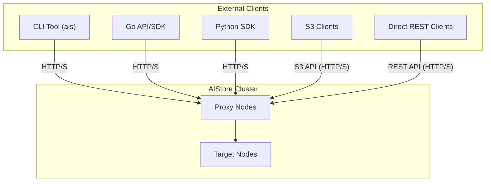
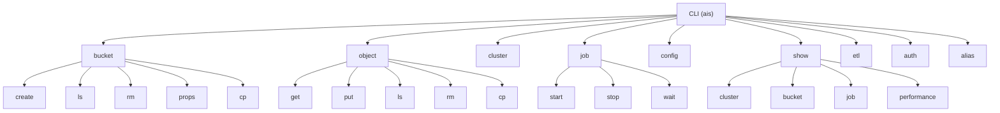
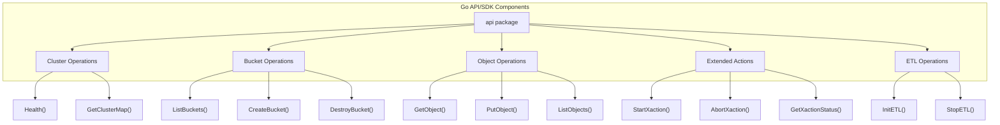
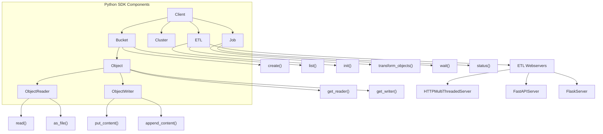
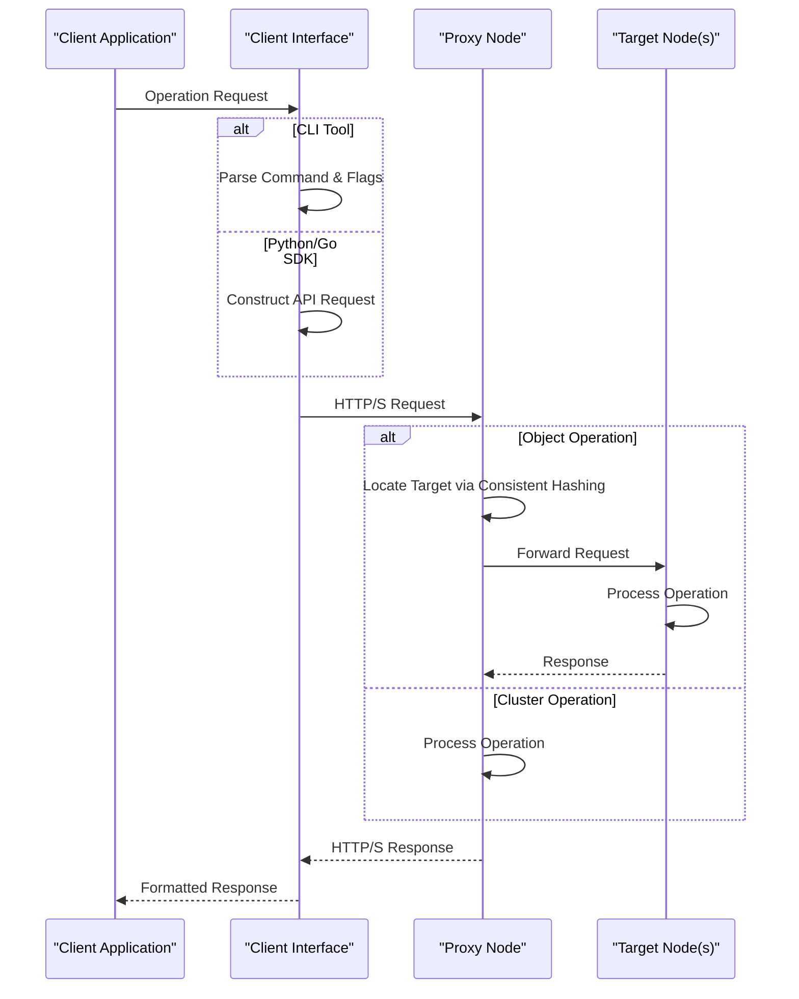

<!-- source: DeepWiki mcp.deepwiki.com · repo NVIDIA/aistore · page 7 Client Interfaces · fetched 2026-10-26 -->

# Client Interfaces

<details>
<summary>Relevant source files</summary>

The following files were used as context for generating this wiki page:

- [ais/tgtxact.go](ais/tgtxact.go)
- [api/cluster.go](api/cluster.go)
- [api/daemon.go](api/daemon.go)
- [api/download.go](api/download.go)
- [api/dsort.go](api/dsort.go)
- [api/multiobj.go](api/multiobj.go)
- [api/s3.go](api/s3.go)
- [api/xaction.go](api/xaction.go)
- [cmd/cli/cli/bucket.go](cmd/cli/cli/bucket.go)
- [cmd/cli/cli/bucket_hdlr.go](cmd/cli/cli/bucket_hdlr.go)
- [cmd/cli/cli/const.go](cmd/cli/cli/const.go)
- [cmd/cli/cli/etl.go](cmd/cli/cli/etl.go)
- [cmd/cli/cli/job_hdlr.go](cmd/cli/cli/job_hdlr.go)
- [cmd/cli/cli/object.go](cmd/cli/cli/object.go)
- [cmd/cli/cli/object_hdlr.go](cmd/cli/cli/object_hdlr.go)
- [cmd/cli/cli/show_hdlr.go](cmd/cli/cli/show_hdlr.go)
- [cmd/cli/cli/utils.go](cmd/cli/cli/utils.go)
- [cmd/cli/go.mod](cmd/cli/go.mod)
- [cmd/cli/go.sum](cmd/cli/go.sum)
- [cmd/ishard/go.mod](cmd/ishard/go.mod)
- [cmd/ishard/go.sum](cmd/ishard/go.sum)
- [go.mod](go.mod)
- [go.sum](go.sum)
- [python/CHANGELOG.md](python/CHANGELOG.md)
- [python/aistore/common_requirements](python/aistore/common_requirements)
- [python/aistore/sdk/etl/etl.py](python/aistore/sdk/etl/etl.py)
- [python/aistore/sdk/etl/etl_const.py](python/aistore/sdk/etl/etl_const.py)
- [python/aistore/sdk/etl/etl_templates.py](python/aistore/sdk/etl/etl_templates.py)
- [python/aistore/sdk/etl/webserver/__init__.py](python/aistore/sdk/etl/webserver/__init__.py)
- [python/aistore/sdk/etl/webserver/base_etl_server.py](python/aistore/sdk/etl/webserver/base_etl_server.py)
- [python/aistore/sdk/etl/webserver/fastapi_server.py](python/aistore/sdk/etl/webserver/fastapi_server.py)
- [python/aistore/sdk/etl/webserver/flask_server.py](python/aistore/sdk/etl/webserver/flask_server.py)
- [python/aistore/sdk/etl/webserver/http_multi_threaded_server.py](python/aistore/sdk/etl/webserver/http_multi_threaded_server.py)
- [python/aistore/version.py](python/aistore/version.py)
- [python/pyproject.toml](python/pyproject.toml)
- [python/tests/unit/sdk/test_etl.py](python/tests/unit/sdk/test_etl.py)
- [python/tests/unit/sdk/test_etl_webserver.py](python/tests/unit/sdk/test_etl_webserver.py)

</details>


This document provides an overview of the different ways to interact with AIStore. AIStore offers multiple client interfaces tailored for various use cases, from command-line operations to programmatic access through SDKs. For information about extended actions in AIStore, see [Extended Actions (Xactions)](#6).

## Overview of Client Interfaces

AIStore provides the following client interfaces:

1. **Command Line Interface (CLI)**: A comprehensive command-line tool for managing AIStore clusters, buckets, objects, and more
2. **REST API**: The underlying HTTP/S API that all other interfaces build upon
3. **Go API/SDK**: Native Go bindings for AIStore operations
4. **Python SDK**: Python client with additional features like ETL capabilities
5. **S3-compatible API**: Compatibility layer for S3 clients

All these interfaces communicate with AIStore via HTTP/HTTPS through proxy nodes, which coordinate with target nodes to execute storage operations.

### Client Interface Architecture



Sources: [cmd/cli/cli/const.go], [api/cluster.go], [python/aistore/version.py], [go.mod]

## Command Line Interface (CLI)

The AIStore CLI (`ais`) provides a comprehensive set of commands for cluster management, bucket and object operations, as well as extended functionality like ETL and jobs management. 

### CLI Command Structure



Sources: [cmd/cli/cli/const.go:20-37], [cmd/cli/cli/show_hdlr.go:123-140], [cmd/cli/cli/bucket_hdlr.go]

### Basic CLI Usage Examples

```
# List all buckets
ais ls

# Create a bucket
ais bucket create ais://mybucket

# Upload an object
ais put file.txt ais://mybucket

# Download an object
ais get ais://mybucket/file.txt output.txt

# Show cluster status
ais show cluster
```

Sources: [cmd/cli/cli/bucket_hdlr.go], [cmd/cli/cli/object_hdlr.go]

### CLI Configuration and Flags

The CLI supports numerous flags to customize operations. Common flags include:

| Flag | Description |
|------|-------------|
| `--all` | Apply to all objects or include all information |
| `--json` | Output results as JSON |
| `--regex` | Filter results using regular expressions |
| `--verbose` | Show detailed output |
| `--refresh` | Refresh output at specified intervals |
| `--props` | Specify object properties to display |

Sources: [cmd/cli/cli/const.go:393-517]

## REST API

The AIStore REST API is the foundation for all client interfaces. It follows RESTful principles with standard HTTP methods and JSON responses. All SDK operations and CLI commands ultimately translate to REST API calls.

### Key REST API Endpoints

| Endpoint Pattern | Purpose |
|------------------|---------|
| `/v1/buckets/...` | Bucket operations (create, list, properties) |
| `/v1/objects/...` | Object operations (get, put, list, delete) |
| `/v1/cluster/...` | Cluster management operations |
| `/v1/health` | Health and readiness checks |
| `/v1/daemon/...` | Daemon information and operations |
| `/v1/etl/...` | ETL operations |
| `/v1/xactions/...` | Extended action management |

Sources: [api/cluster.go], [api/xaction.go], [ais/tgtxact.go]

### REST API Examples

The following examples demonstrate basic REST API usage:

```
# List buckets
GET /v1/buckets

# Create bucket
POST /v1/buckets/mybucket

# Get object
GET /v1/objects/mybucket/myobject

# Put object
PUT /v1/objects/mybucket/myobject
```

## Go API/SDK

The native Go API provides a programmatic interface to AIStore operations. It's implemented in the `api` package and abstracts the underlying REST API calls.

### Go SDK Architecture



Sources: [api/cluster.go], [api/xaction.go], [api/daemon.go]

### Basic Go SDK Usage

Here's a simple example of using the Go SDK:

```go
import (
    "github.com/NVIDIA/aistore/api"
    "github.com/NVIDIA/aistore/cmn"
    "github.com/NVIDIA/aistore/api/apc"
)

// Initialize client parameters
baseParams := api.BaseParams{
    URL: "http://localhost:8080",
}

// Create a bucket
bck := cmn.Bck{Name: "mybucket", Provider: apc.AIS}
err := api.CreateBucket(baseParams, bck, nil)

// Put an object
reader := strings.NewReader("hello world")
err = api.PutObject(baseParams, bck, "myobject", reader)

// Get an object
obj, err := api.GetObject(baseParams, bck, "myobject")
```

## Python SDK

The AIStore Python SDK provides a high-level, Pythonic interface to AIStore. It includes features like ETL transformations and convenient object operations.

### Python SDK Structure



Sources: [python/aistore/version.py], [python/aistore/common_requirements], [python/aistore/sdk/etl/webserver/fastapi_server.py]

### Python SDK Version and Features

The Python SDK is actively developed, with the current version being 1.13.5. Recent features include:

- Object reader and writer interfaces
- ETL transformations with multiple server implementations
- Direct object access (bypassing proxy nodes)
- Improved error handling and retry mechanisms
- Support for various cloud backends including AWS, GCP, Azure, and OCI

Sources: [python/aistore/version.py], [python/CHANGELOG.md]

### Basic Python SDK Usage

```python
from aistore import Client

# Initialize client
client = Client("http://localhost:8080")

# Create a bucket
bucket = client.bucket("ais://mybucket").create()

# Put an object
obj = bucket.object("myobject").get_writer()
obj.put_content("Hello, world!")

# Get an object
obj_reader = bucket.object("myobject").get_reader()
content = obj_reader.read()

# ETL example - transform objects
from aistore.sdk.etl import ETL

def transform_func(data):
    return data.upper()  # Convert to uppercase

etl = ETL(client, transform_func)
etl_id = etl.init("uppercase-transform")
etl.transform_objects("ais://source", "ais://destination")
```

Sources: [python/CHANGELOG.md:27-51], [python/CHANGELOG.md:144-183]

## S3-Compatible API

AIStore provides S3 API compatibility that allows clients built for Amazon S3 to work with AIStore. This enables integration with existing S3 tools and applications.

### S3 API Compatibility

The S3-compatible API supports common S3 operations:

- Bucket operations: CREATE, DELETE, HEAD, LIST
- Object operations: GET, PUT, DELETE, HEAD, LIST

### Using S3 Clients with AIStore

Standard S3 clients can connect to AIStore by configuring the endpoint URL:

```
# AWS CLI example
aws s3 ls --endpoint-url http://aistore-cluster:8080/s3

# AWS S3 SDK (Python) example
import boto3
s3_client = boto3.client(
    's3',
    endpoint_url='http://aistore-cluster:8080/s3',
    aws_access_key_id='minioadmin',  # Default value
    aws_secret_access_key='minioadmin'  # Default value
)
```

## Feature Comparison

The following table compares features across the different client interfaces:

| Feature | CLI | REST API | Go SDK | Python SDK | S3 API |
|---------|-----|----------|--------|------------|--------|
| Bucket Operations | ✓ | ✓ | ✓ | ✓ | ✓ |
| Object Operations | ✓ | ✓ | ✓ | ✓ | ✓ |
| Cluster Management | ✓ | ✓ | ✓ | ✓ | - |
| Job Management | ✓ | ✓ | ✓ | ✓ | - |
| ETL Support | ✓ | ✓ | ✓ | ✓ | - |
| Extended Actions | ✓ | ✓ | ✓ | ✓ | - |
| Batch Operations | ✓ | ✓ | ✓ | ✓ | ✓ |
| Progress Monitoring | ✓ | ✓ | ✓ | ✓ | - |
| Authentication | ✓ | ✓ | ✓ | ✓ | ✓ |

Sources: [cmd/cli/cli/const.go], [api/cluster.go], [python/CHANGELOG.md]

## Integration Flow

This diagram shows how the different clients integrate with the AIStore system:



Sources: [api/cluster.go], [api/xaction.go], [cmd/cli/cli/utils.go]

## Choosing the Right Interface

When selecting a client interface, consider these guidelines:

- **CLI**: Best for interactive use, administrative tasks, and scripting
- **REST API**: For direct integration or custom clients
- **Go SDK**: For applications written in Go that need deep integration
- **Python SDK**: For data science workloads, machine learning, and Python applications
- **S3 API**: For compatibility with existing S3 clients and tools

Each interface provides access to AIStore's core functionality, with varying levels of abstraction and language-specific features.

Sources: [cmd/cli/cli/const.go], [python/CHANGELOG.md], [go.mod]

---

