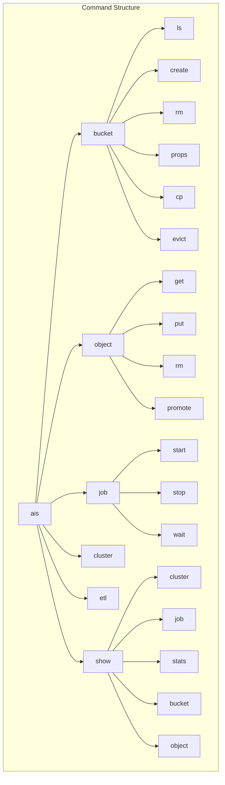
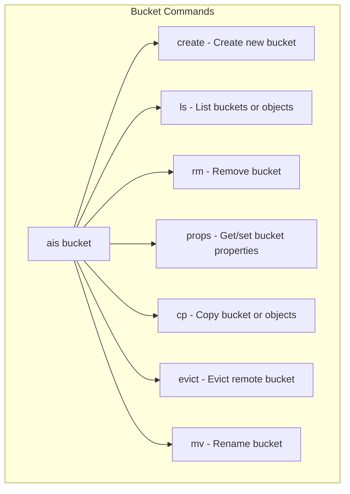
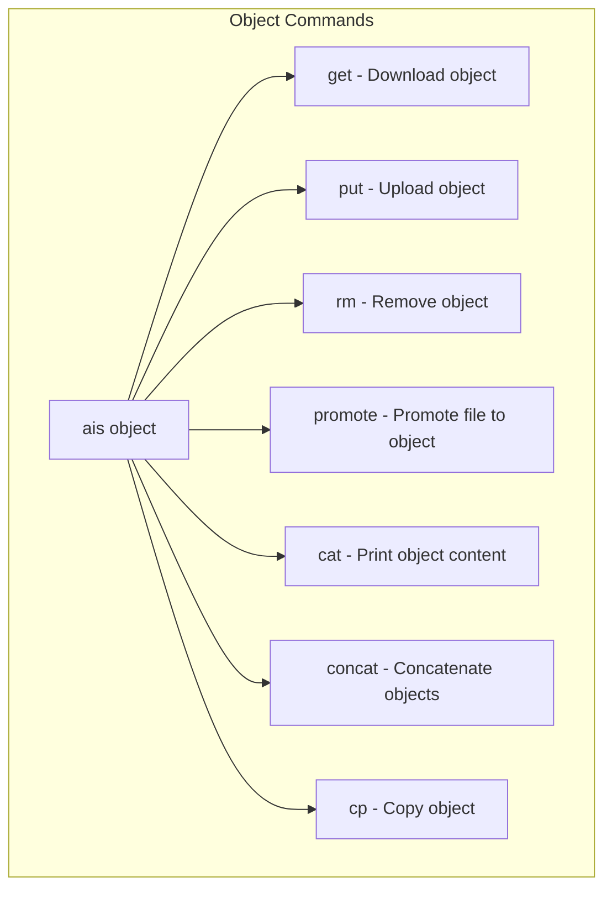
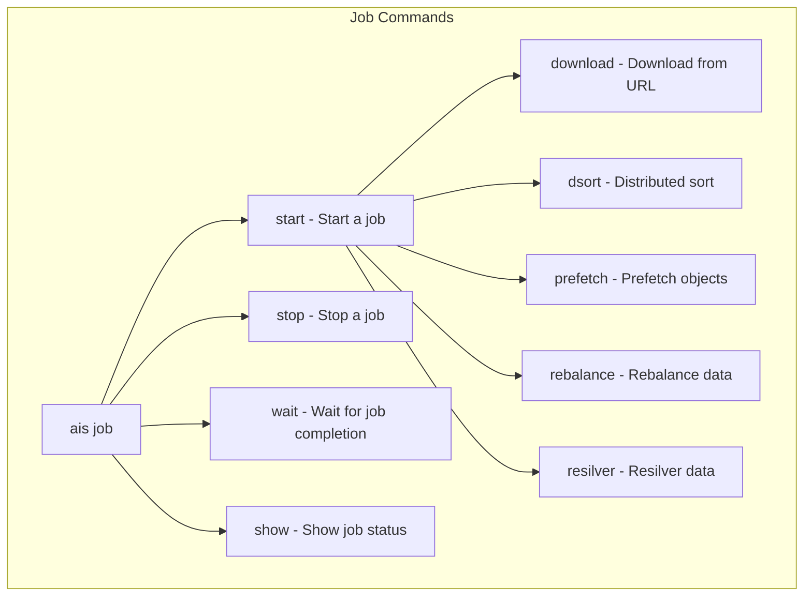
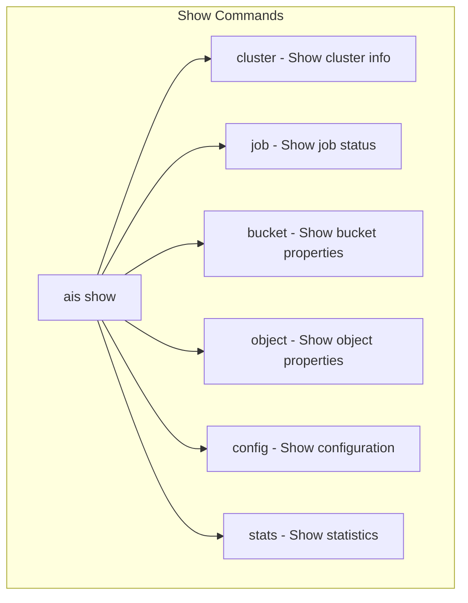
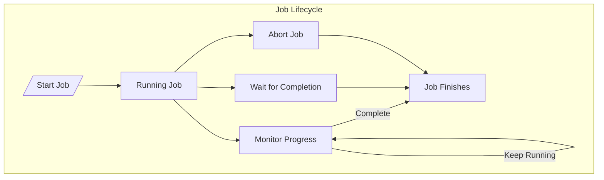
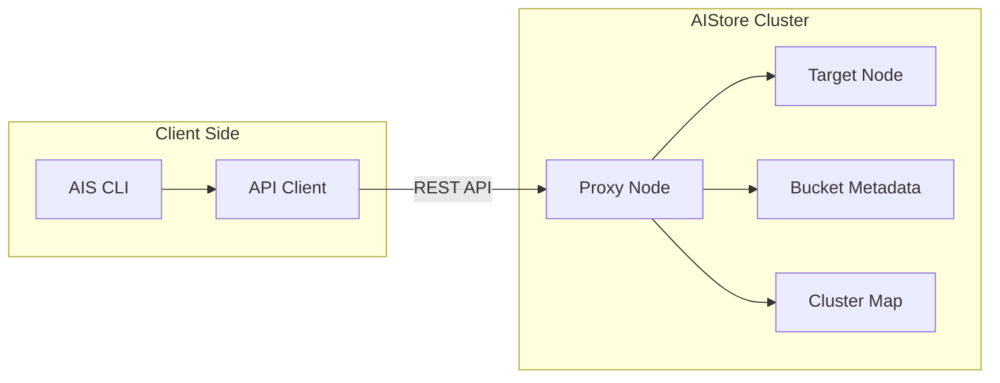

<!-- source: DeepWiki mcp.deepwiki.com · repo NVIDIA/aistore · page 7.1 Command Line Interface · fetched 2026-10-26 -->

# Command Line Interface

<details>
<summary>Relevant source files</summary>

The following files were used as context for generating this wiki page:

- [cmd/cli/cli/bucket.go](cmd/cli/cli/bucket.go)
- [cmd/cli/cli/bucket_hdlr.go](cmd/cli/cli/bucket_hdlr.go)
- [cmd/cli/cli/const.go](cmd/cli/cli/const.go)
- [cmd/cli/cli/etl.go](cmd/cli/cli/etl.go)
- [cmd/cli/cli/job_hdlr.go](cmd/cli/cli/job_hdlr.go)
- [cmd/cli/cli/object.go](cmd/cli/cli/object.go)
- [cmd/cli/cli/object_hdlr.go](cmd/cli/cli/object_hdlr.go)
- [cmd/cli/cli/show_hdlr.go](cmd/cli/cli/show_hdlr.go)
- [cmd/cli/cli/utils.go](cmd/cli/cli/utils.go)
- [cmd/cli/go.mod](cmd/cli/go.mod)
- [cmd/cli/go.sum](cmd/cli/go.sum)
- [cmd/ishard/go.mod](cmd/ishard/go.mod)
- [cmd/ishard/go.sum](cmd/ishard/go.sum)
- [go.mod](go.mod)
- [go.sum](go.sum)

</details>


The AIStore (AIS) Command Line Interface (CLI) provides a robust and comprehensive set of commands to manage, monitor, and utilize AIS clusters. This document covers the CLI structure, command organization, and usage patterns for interacting with AIStore through the command line.

For information about the REST API, see [API Reference](#7.2).

## Overview

The AIS CLI is a versatile tool that enables users to:

- Manage buckets and objects
- Monitor cluster status and performance
- Configure cluster settings
- Manage jobs and extended actions (xactions)
- Execute administrative tasks
- Work with archives, ETL pipelines, and more

The CLI follows a consistent command structure with various subcommands organized in a hierarchical fashion.

Sources: [cmd/cli/cli/const.go:20-37](), [cmd/cli/cli/const.go:59-198]()

## Installation and Setup

The AIS CLI is bundled with the main AIStore distribution. After downloading and building AIStore, the CLI is available as the `ais` command.

### Configuration

The CLI uses the following environment variables for configuration:

- `AIS_ENDPOINT` - URL of the AIStore cluster to connect to
- `AIS_AUTHN_TOKEN_FILE` - Path to authentication token file

You can also use the `config` command to manage CLI-specific configuration settings.

Sources: [cmd/cli/cli/utils.go:56-61]()

## Command Structure



All AIS CLI commands follow the general pattern:

```
ais <command> <subcommand> [arguments] [options]
```

Where:
- `<command>` is a top-level command (bucket, object, job, etc.)
- `<subcommand>` is an action related to the top-level command
- `[arguments]` are positional arguments (like bucket names, object names, etc.)
- `[options]` are flags that modify the command behavior

Common flags available across many commands include:
- `--json` or `-j`: Output in JSON format
- `--verbose` or `-v`: Verbose output
- `--help`: Show help for a command
- `--progress`: Show progress bar for operations
- `--regex`: Use regular expressions for matching

Sources: [cmd/cli/cli/const.go:394-570](), [cmd/cli/cli/utils.go:149-165]()

## Core Commands

### Bucket Commands

Bucket commands manage AIStore buckets and their properties:



Example usage:

```
# Create a bucket
ais bucket create ais://mybucket

# List objects in a bucket
ais bucket ls ais://mybucket

# Copy objects between buckets
ais bucket cp ais://source ais://destination --all

# Set bucket properties
ais bucket props set ais://mybucket mirror.enabled=true mirror.copies=4
```

Sources: [cmd/cli/cli/bucket_hdlr.go:207-243](), [cmd/cli/cli/bucket.go:26-115]()

### Object Commands

Object commands handle individual objects within buckets:



Example usage:

```
# Upload a file
ais object put myfile.txt ais://mybucket

# Download an object
ais object get ais://mybucket/myfile.txt local-copy.txt

# Remove an object
ais object rm ais://mybucket/myfile.txt

# Promote a file on target node to an object
ais object promote /path/on/target/myfile.txt ais://mybucket
```

Sources: [cmd/cli/cli/object_hdlr.go:25-47](), [cmd/cli/cli/object.go:30-91]()

### Job Commands

Job commands manage long-running operations and extended actions:



Example usage:

```
# Start a prefetch job
ais job start prefetch s3://mybucket --template "images/*.jpg"

# Show running jobs
ais show job

# Stop a job
ais job stop JOB_ID
```

Sources: [cmd/cli/cli/job_hdlr.go:65-78](), [cmd/cli/cli/job_hdlr.go:224-256]()

### Show Commands

Show commands display information about various aspects of the cluster:



Example usage:

```
# Show cluster information
ais show cluster

# Show job status
ais show job prefetch

# Show bucket properties
ais show bucket ais://mybucket

# Show object properties
ais show object ais://mybucket/myfile.txt
```

Sources: [cmd/cli/cli/show_hdlr.go:122-229]()

## Bucket Operations

### Creating Buckets

```
ais bucket create BUCKET [--props="property1=value1 property2=value2"]
```

You can specify bucket properties during creation, such as:
- `mirror.enabled=true` - Enable mirroring
- `mirror.copies=N` - Set number of copies
- `ec.enabled=true` - Enable erasure coding
- `checksum.type=xxhash` - Set checksum type

### Listing Buckets and Objects

```
# List all buckets
ais ls

# List objects in a bucket
ais ls BUCKET

# List with specific properties
ais ls BUCKET --props=name,size,atime

# List with template or prefix matching
ais ls BUCKET --template "images/*.jpg"
ais ls BUCKET --prefix "images/"
```

### Bucket Properties

```
# Show all properties
ais bucket props show BUCKET

# Set properties
ais bucket props set BUCKET property1=value1 property2=value2

# Reset properties to defaults
ais bucket props reset BUCKET
```

Sources: [cmd/cli/cli/bucket_hdlr.go:87-98](), [cmd/cli/cli/bucket.go:116-178]()

## Object Operations

### Uploading Objects

```
# Upload a single file
ais object put FILE BUCKET[/OBJECT_NAME]

# Upload multiple files
ais object put "*.jpg" BUCKET/images/

# Upload with progress bar
ais object put FILE BUCKET --progress
```

### Downloading Objects

```
# Download to a file
ais object get BUCKET/OBJECT_NAME OUTPUT_FILE

# Download multiple objects
ais object get BUCKET --prefix "images/" OUTPUT_DIR

# Download with progress
ais object get BUCKET/OBJECT_NAME OUTPUT_FILE --progress
```

### Object Properties

```
# Show object properties
ais show object BUCKET/OBJECT_NAME

# Show specific properties
ais show object BUCKET/OBJECT_NAME --props=name,size,checksum

# Set custom properties
ais object set-custom BUCKET/OBJECT_NAME key1=value1 key2=value2
```

Sources: [cmd/cli/cli/object_hdlr.go:48-58](), [cmd/cli/cli/object.go:92-142]()

## Job Management

AIStore performs many operations as asynchronous jobs, also called extended actions or xactions. The CLI provides commands to manage these jobs.



### Starting Jobs

```
# Start a prefetch job
ais job start prefetch BUCKET --template "images/*.jpg"

# Start a download job
ais job start download URL BUCKET

# Start distributed sort
ais job start dsort SPECIFICATION SRC_BUCKET DST_BUCKET
```

### Monitoring Jobs

```
# Show all running jobs
ais show job

# Show specific job type
ais show job prefetch

# Show specific job
ais show job JOB_ID

# Monitor with refresh
ais show job --refresh 5s
```

### Stopping Jobs

```
# Stop a specific job
ais job stop JOB_ID

# Stop all jobs of a specific type
ais job stop prefetch

# Force stop a job
ais job stop JOB_ID --force
```

Sources: [cmd/cli/cli/job_hdlr.go:79-162](), [cmd/cli/cli/show_hdlr.go:252-386]()

## Advanced Usage

### Batch Operations

Many commands support batch operations using templates, prefixes, or regular expressions:

```
# Copy multiple objects using a template
ais bucket cp SRC_BUCKET DST_BUCKET --template "images/{0000..9999}.jpg"

# Delete objects matching a pattern
ais object rm BUCKET --regex ".*\.tmp$"

# List objects with specific prefix
ais ls BUCKET --prefix "logs/2023/"
```

### Performance Monitoring

```
# Show cluster performance
ais show performance

# Show throughput statistics
ais show throughput

# Show latency statistics
ais show latency
```

### Working with Archives

AIStore can work directly with archive formats (tar, zip, etc.):

```
# Extract a file from an archive
ais object get BUCKET/archive.tar.gz --extract file.txt output.txt

# List contents of an archive
ais archive list BUCKET/archive.tar.gz
```

Sources: [cmd/cli/cli/const.go:258-262](), [cmd/cli/cli/object.go:143-200]()

## Global Flags and Common Patterns

### Commonly Used Flags

| Flag | Description |
|------|-------------|
| `--json` or `-j` | Output in JSON format |
| `--verbose` or `-v` | Verbose output |
| `--regex` | Use regular expression for matching |
| `--progress` | Show progress bar |
| `--refresh` | Set refresh rate for continuous monitoring |
| `--props` | Specify properties to display |
| `--template` | Use template for matching |
| `--prefix` | Use prefix for matching |
| `--all` | Include all items (specific meaning varies by command) |

### Pattern Matching

The CLI supports several methods for selecting multiple objects:

1. **Prefix Matching**: `--prefix "images/"` 
2. **Template Matching**: `--template "images/{0000..9999}.jpg"`
3. **Regular Expressions**: `--regex ".*\.jpg$"`

Sources: [cmd/cli/cli/const.go:419-449](), [cmd/cli/cli/const.go:474-493]()

## CLI Architecture

The CLI is built as a standalone component that communicates with the AIStore cluster through its REST API. This architecture allows the CLI to be used from any client machine that can reach the cluster.



When executing commands, the CLI:
1. Parses command-line arguments and flags
2. Constructs appropriate API calls
3. Communicates with the AIS cluster via the REST API
4. Formats and displays the results to the user

Commands are organized into categories, with each category having its own set of subcommands and flags. This hierarchical structure allows for intuitive command organization while maintaining consistency across the interface.

Sources: [cmd/cli/cli/utils.go:35-61](), [cmd/cli/cli/utils.go:175-200]()

## Summary

The AIS CLI is a powerful tool for interacting with AIStore clusters, providing comprehensive commands for bucket and object management, job control, cluster monitoring, and advanced operations. The consistent command structure and extensive help documentation make it approachable for new users while offering advanced capabilities for power users.

For detailed examples and more information about specific commands, you can use the `--help` flag with any command:

```
ais --help
ais bucket --help
ais bucket create --help
```

---

