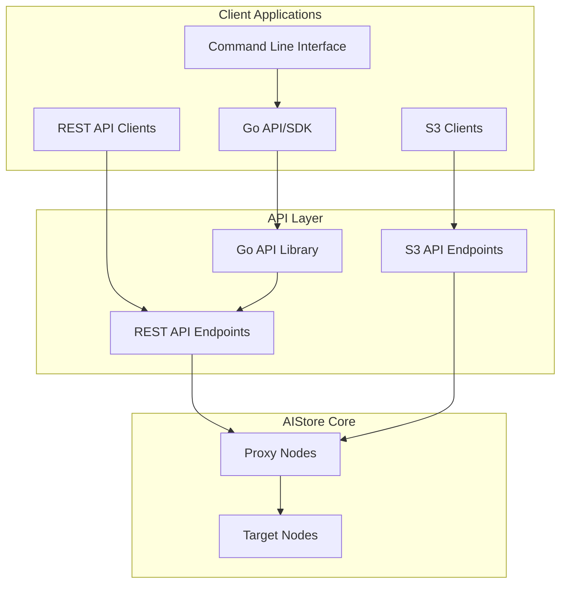
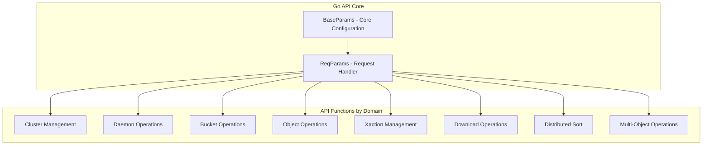
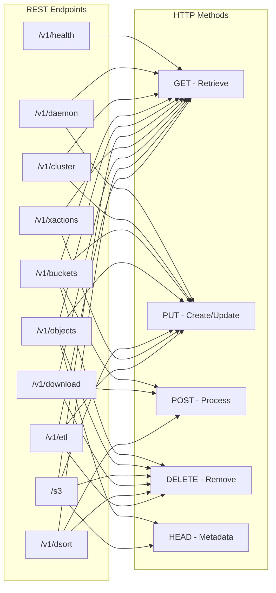
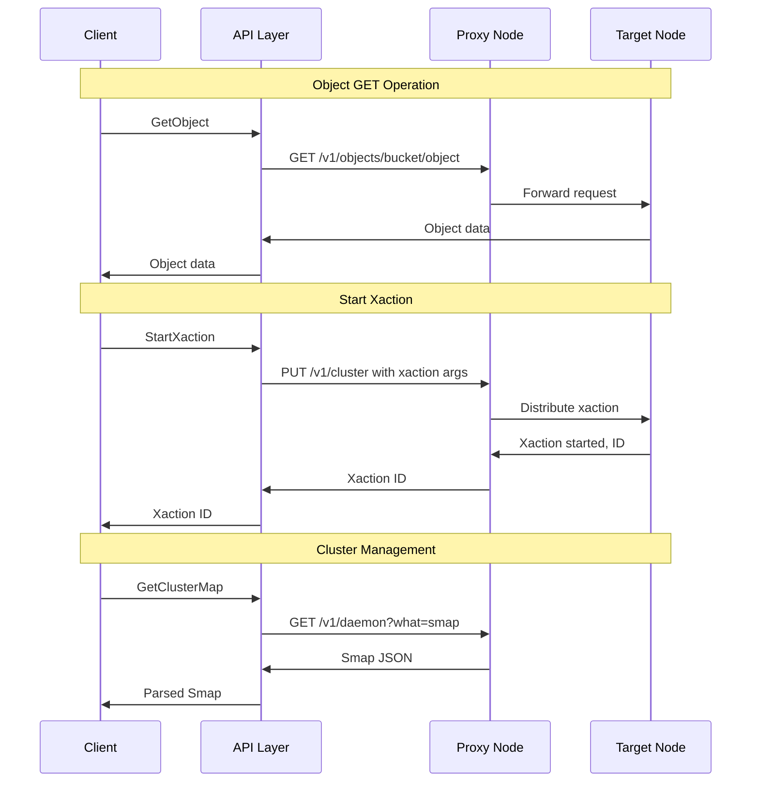

<!-- source: DeepWiki mcp.deepwiki.com · repo NVIDIA/aistore · page 7.2 API Reference · fetched 2026-10-26 -->

# API Reference

<details>
<summary>Relevant source files</summary>

The following files were used as context for generating this wiki page:

- [ais/tgtxact.go](ais/tgtxact.go)
- [api/cluster.go](api/cluster.go)
- [api/daemon.go](api/daemon.go)
- [api/download.go](api/download.go)
- [api/dsort.go](api/dsort.go)
- [api/multiobj.go](api/multiobj.go)
- [api/s3.go](api/s3.go)
- [api/xaction.go](api/xaction.go)

</details>


This page documents the API interfaces available in AIStore, covering the native REST API, the Go API/SDK, and the S3-compatible API. It provides a comprehensive reference for developers who need to interact with AIStore programmatically. For information about the Command Line Interface, see [Command Line Interface](#7.1).

## API Overview

AIStore provides multiple ways to interact with the system:

1. **REST API** - A comprehensive HTTP-based API that exposes all AIStore functionality
2. **Go API/SDK** - A native Go client library that wraps the REST API
3. **S3-compatible API** - Support for the Amazon S3 protocol
4. **Python SDK** - Higher-level client libraries (referenced but not covered in this document)

The diagram below shows how these different API interfaces connect to the AIStore system:



Sources: [api/cluster.go](), [api/xaction.go](), [ais/tgtxact.go]()

## Go API/SDK

The Go API/SDK provides a convenient way to interact with AIStore programmatically from Go applications. It wraps the REST API and provides strongly typed methods for all operations.

### API Structure

The Go API is organized around functional areas:



Sources: [api/cluster.go](), [api/daemon.go](), [api/xaction.go](), [api/download.go](), [api/dsort.go](), [api/multiobj.go]()

### Core Components

#### BaseParams

All API calls require a `BaseParams` object, which contains base configuration for communicating with the AIStore cluster:

- URL of the AIStore endpoint
- HTTP client configuration
- Timeout settings
- Authentication information

#### Request Structure

The Go API uses a fluent pattern for building requests:

1. Create a request with `BaseParams`
2. Set specific parameters for the operation
3. Execute the request
4. Process the response

### Key API Areas

#### Cluster Management

| Function | Description | Source |
|----------|-------------|--------|
| `GetProxyReadiness` | Check if proxy is ready (used by Kubernetes) | [api/cluster.go:21-35]() |
| `Health` | Check cluster health | [api/cluster.go:37-42]() |
| `GetClusterMap` | Retrieve cluster map (Smap) | [api/cluster.go:71-87]() |
| `GetBMD` | Get bucket metadata | [api/cluster.go:110-128]() |
| `GetClusterConfig` | Get cluster-wide configuration | [api/cluster.go:365-386]() |
| `SetClusterConfig` | Set cluster-wide configuration | [api/cluster.go:268-289]() |
| `JoinCluster` | Add a node to a cluster | [api/cluster.go:224-241]() |
| `SetPrimary` | Set a new primary proxy | [api/cluster.go:245-263]() |

Sources: [api/cluster.go:21-386]()

#### Node/Daemon Management

| Function | Description | Source |
|----------|-------------|--------|
| `GetDaemonLog` | Get logs from a specific node | [api/daemon.go:27-54]() |
| `GetDaemonConfig` | Get node-specific configuration | [api/daemon.go:65-69]() |
| `SetDaemonConfig` | Set node-specific configuration | [api/daemon.go:161-180]() |
| `GetMountpaths` | Get target's mountpaths | [api/daemon.go:57-61]() |
| `AttachMountpath` | Attach a new mountpath to a target | [api/daemon.go:95-104]() |
| `DetachMountpath` | Detach a mountpath from a target | [api/daemon.go:111-118]() |
| `StartMaintenance` | Put a node into maintenance mode | [api/cluster.go:495-497]() |
| `ShutdownNode` | Shutdown a node | [api/cluster.go:505-507]() |
| `DecommissionNode` | Permanently remove a node from the cluster | [api/cluster.go:510-512]() |

Sources: [api/daemon.go:27-206](), [api/cluster.go:476-572]()

#### Extended Actions (Xactions)

Xactions are long-running operations in AIStore that can be started, monitored, and aborted.

| Function | Description | Source |
|----------|-------------|--------|
| `StartXaction` | Start a new xaction | [api/xaction.go:21-46]() |
| `AbortXaction` | Stop/abort a running xaction | [api/xaction.go:49-70]() |
| `GetAllRunningXactions` | List all running xactions | [api/xaction.go:79-100]() |
| `QueryXactionSnaps` | Get detailed xaction status snapshots | [api/xaction.go:104-128]() |
| `GetOneXactionStatus` | Get status of a specific xaction | [api/xaction.go:139-148]() |
| `WaitForXactionIdle` | Wait for xaction to become idle | [api/xaction.go:219-225]() |
| `WaitForXactionIC` | Wait for cluster-wide xaction to complete | [api/xaction.go:230-232]() |

Sources: [api/xaction.go:21-306](), [ais/tgtxact.go:27-333]()

#### Downloads

AIStore provides specialized APIs for downloading objects from external sources:

| Function | Description | Source |
|----------|-------------|--------|
| `DownloadSingle` | Download a single object from external URL | [api/download.go:18-32]() |
| `DownloadRange` | Download a range of objects using template | [api/download.go:34-42]() |
| `DownloadMulti` | Download multiple objects | [api/download.go:59-68]() |
| `DownloadBackend` | Download objects from a backend provider | [api/download.go:70-78]() |
| `DownloadStatus` | Check download status | [api/download.go:80-95]() |
| `DownloadGetList` | List active downloads | [api/download.go:97-111]() |
| `AbortDownload` | Abort a download operation | [api/download.go:113-126]() |
| `RemoveDownload` | Remove a download job | [api/download.go:128-141]() |

Sources: [api/download.go:18-148]()

#### Distributed Sort

AIStore includes a distributed sort capability (dsort):

| Function | Description | Source |
|----------|-------------|--------|
| `StartDsort` | Start a distributed sort job | [api/dsort.go:16-28]() |
| `AbortDsort` | Abort a running dsort job | [api/dsort.go:30-41]() |
| `RemoveDsort` | Remove a dsort job | [api/dsort.go:43-54]() |
| `ListDsort` | List all dsort jobs | [api/dsort.go:56-72]() |
| `MetricsDsort` | Get detailed metrics for a dsort job | [api/dsort.go:74-85]() |

Sources: [api/dsort.go:16-85]()

#### Multi-Object Operations

AIStore provides APIs for operations on multiple objects at once:

| Function | Description | Source |
|----------|-------------|--------|
| `ArchiveMultiObj` | Archive multiple objects | [api/multiobj.go:28-33]() |
| `CopyMultiObj` | Copy multiple objects | [api/multiobj.go:38-46]() |
| `ETLMultiObj` | Apply ETL to multiple objects | [api/multiobj.go:48-56]() |
| `DeleteMultiObj` | Delete multiple objects | [api/multiobj.go:58-64]() |
| `EvictMultiObj` | Evict multiple objects from cache | [api/multiobj.go:66-72]() |
| `Prefetch` | Prefetch objects from backend | [api/multiobj.go:74-79]() |

Sources: [api/multiobj.go:28-95]()

## REST API

The native REST API is the foundation of all AIStore client interfaces. It provides HTTP endpoints for all operations supported by AIStore.

### API Structure

The REST API is organized around resource paths and HTTP methods:



Sources: [ais/tgtxact.go:30-44](), [api/cluster.go](), [api/xaction.go]()

### Common Query Parameters

| Parameter | Description | Example |
|-----------|-------------|---------|
| `what` | Specify what information to retrieve | `?what=smap` |
| `props` | Properties to include in response | `?props=size,atime` |
| `uuid` | Xaction UUID | `?uuid=abc123` |
| `force` | Force operation | `?force=true` |
| `bucket` | Bucket name | `?bucket=mybucket` |
| `provider` | Backend provider | `?provider=aws` |

### Common HTTP Headers

| Header | Description |
|--------|-------------|
| `Content-Type` | Usually `application/json` for request bodies |
| `Content-MD5` | Object checksum for uploads |
| `X-Ais-Node-ID` | Target node ID for node-specific operations |
| `X-Ais-FltPresence` | Filter for object presence |

### Error Responses

Error responses follow a standard format with HTTP status codes and a JSON body containing error details:

```json
{
  "status": 404,
  "message": "bucket \"mybucket\" doesn't exist",
  "method": "GET",
  "remote_addr": "127.0.0.1",
  "caller_name": "getBucket",
  "caller_path": "github.com/NVIDIA/aistore/ais/bckget.go:213"
}
```

## S3-Compatible API

AIStore provides an S3-compatible API for clients familiar with AWS S3. This allows existing S3 clients to work with AIStore with minimal changes.

### Endpoint Structure

```
http://ais-endpoint/s3/<bucket-name>/<object-name>
```

### Supported Operations

| Operation | Description | Source |
|-----------|-------------|--------|
| `GET Object` | Retrieve an object | [api/s3.go:17-41]() |
| Other S3 operations | Various other S3-compatible operations | |

Sources: [api/s3.go:17-41]()

## API Use Patterns

The following diagram illustrates common API call flows for different operations:



Sources: [api/cluster.go](), [api/xaction.go](), [ais/tgtxact.go]()

## API Request Lifecycle

Every Go API request follows this general pattern:

1. Create or use an existing `BaseParams` with cluster endpoint information
2. Prepare specific parameters for the operation
3. Set HTTP method, path, query parameters and headers
4. Marshal request body if needed
5. Send request to AIStore
6. Unmarshal response or handle errors
7. Return result to caller

In the Go API, this is implemented through the `ReqParams` struct and its methods like `DoRequest`, `DoReqAny`, etc.

## Conclusion

This API Reference provides an overview of the core API interfaces available in AIStore. The Go API/SDK is the most comprehensive and recommended way to interact with AIStore programmatically, while the REST API provides direct HTTP access and the S3-compatible API offers interoperability with existing S3 clients.

For more detailed information on specific API operations, refer to the AIStore documentation and SDK examples. For ETL operations, see [ETL System](#8) and [Python ETL Implementation](#8.2).

---

