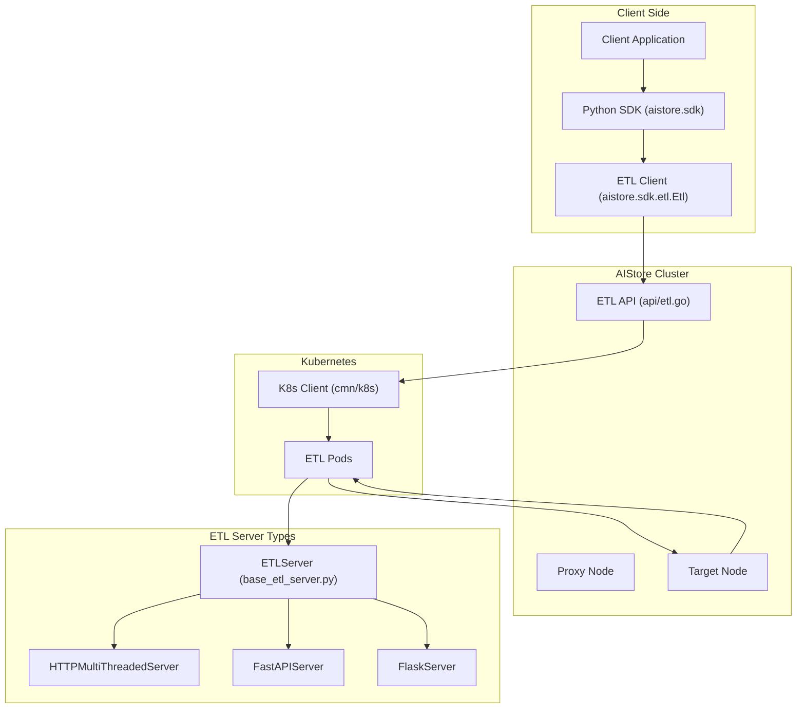
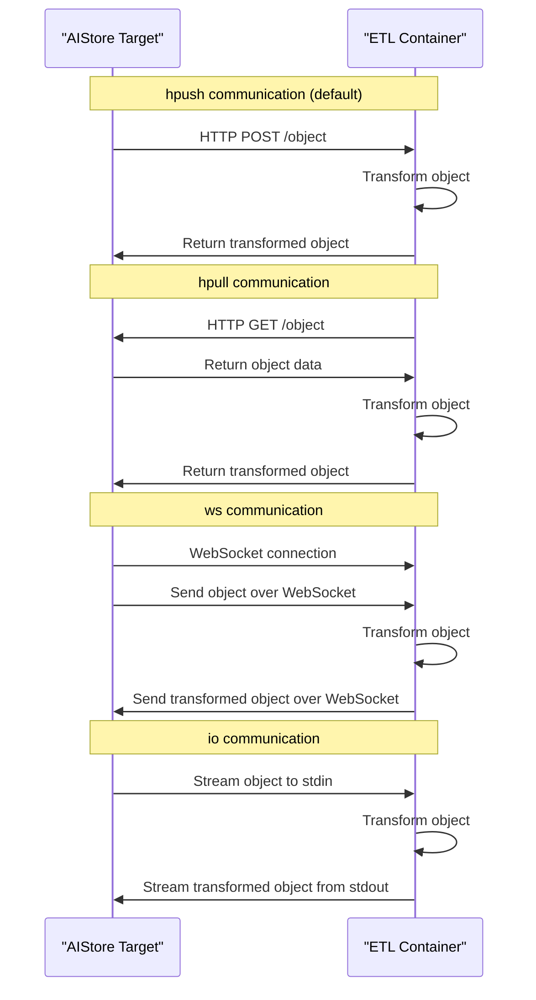
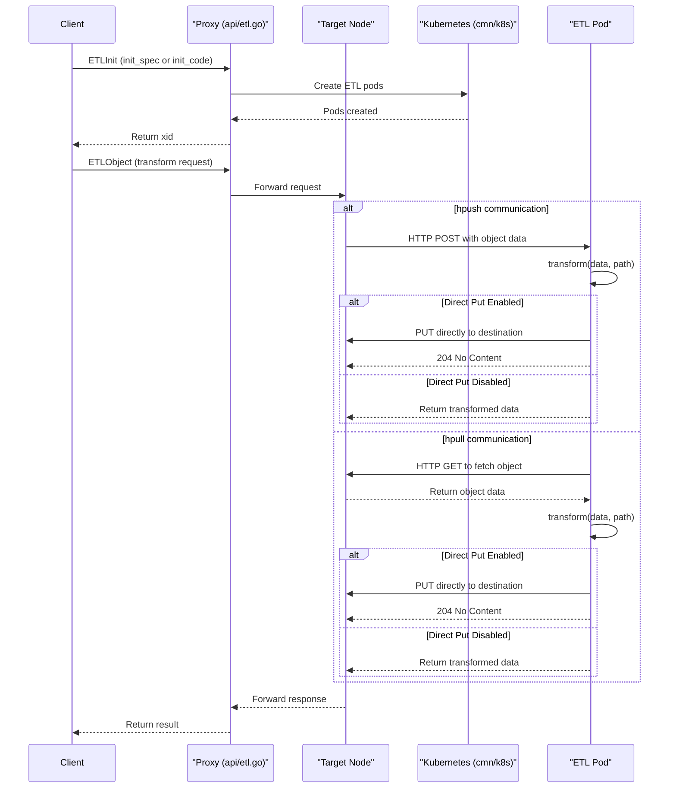
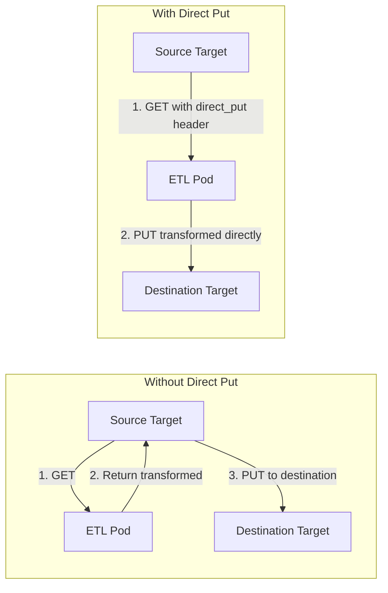
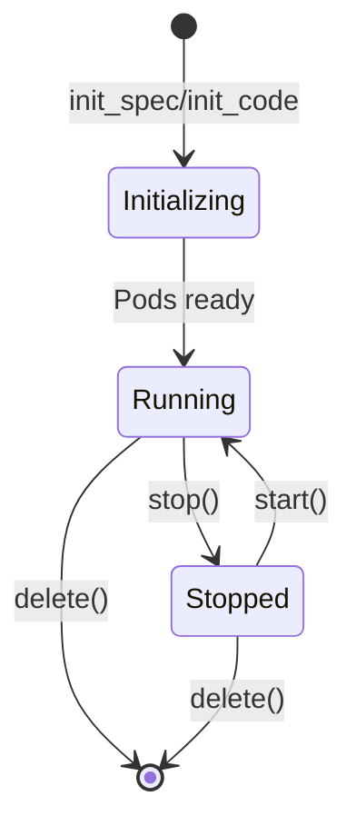

<!-- source: DeepWiki mcp.deepwiki.com · repo NVIDIA/aistore · page 8 ETL System · fetched 2026-10-26 -->

# ETL System

<details>
<summary>Relevant source files</summary>

The following files were used as context for generating this wiki page:

- [api/etl.go](api/etl.go)
- [cmn/k8s/client.go](cmn/k8s/client.go)
- [cmn/k8s/k8s.go](cmn/k8s/k8s.go)
- [cmn/k8s/util.go](cmn/k8s/util.go)
- [python/CHANGELOG.md](python/CHANGELOG.md)
- [python/aistore/common_requirements](python/aistore/common_requirements)
- [python/aistore/sdk/etl/etl.py](python/aistore/sdk/etl/etl.py)
- [python/aistore/sdk/etl/etl_const.py](python/aistore/sdk/etl/etl_const.py)
- [python/aistore/sdk/etl/etl_templates.py](python/aistore/sdk/etl/etl_templates.py)
- [python/aistore/sdk/etl/webserver/__init__.py](python/aistore/sdk/etl/webserver/__init__.py)
- [python/aistore/sdk/etl/webserver/base_etl_server.py](python/aistore/sdk/etl/webserver/base_etl_server.py)
- [python/aistore/sdk/etl/webserver/fastapi_server.py](python/aistore/sdk/etl/webserver/fastapi_server.py)
- [python/aistore/sdk/etl/webserver/flask_server.py](python/aistore/sdk/etl/webserver/flask_server.py)
- [python/aistore/sdk/etl/webserver/http_multi_threaded_server.py](python/aistore/sdk/etl/webserver/http_multi_threaded_server.py)
- [python/aistore/version.py](python/aistore/version.py)
- [python/pyproject.toml](python/pyproject.toml)
- [python/tests/unit/sdk/test_etl.py](python/tests/unit/sdk/test_etl.py)
- [python/tests/unit/sdk/test_etl_webserver.py](python/tests/unit/sdk/test_etl_webserver.py)

</details>


The Extract, Transform, Load (ETL) system in AIStore enables object transformations through custom code deployed as Kubernetes pods. This document covers the architecture, initialization methods, communication mechanisms, server implementations, and operational workflow of the ETL system.

For ETL configuration options specific to individual transformation types, see [ETL Architecture](#8.1).

## Architecture Overview

The ETL system consists of interconnected components that work together to provide flexible data transformation capabilities.



The ETL system consists of these key components:

1. **ETL API**: Handles ETL initialization, management, and execution
2. **Kubernetes Integration**: Deploys and manages ETL pods 
3. **ETL Servers**: Implements the transformation logic with multiple framework options
4. **Communication Mechanisms**: Defines how objects are transferred between AIStore and ETL pods

Sources: [api/etl.go]()(1-172), [python/aistore/sdk/etl/etl.py]()(1-269), [cmn/k8s/client.go]()(1-223)

## ETL API Structure

The ETL API is defined in `api/etl.go` and provides these key functions:

| Function | Description |
|----------|-------------|
| `ETLInit` | Initialize an ETL job with a given initialization message |
| `ETLList` | List all ETL jobs |
| `ETLGetInitMsg` | Get the initialization message for an ETL job |
| `ETLLogs` | Get logs from an ETL job |
| `ETLMetrics` | Get CPU/memory metrics from an ETL job |
| `ETLHealth` | Get health status from an ETL job |
| `ETLDelete` | Delete an ETL job |
| `ETLStop` | Stop an ETL job |
| `ETLStart` | Start a stopped ETL job |
| `ETLObject` | Transform an object using an ETL job |

Sources: [api/etl.go]()(35-169)

## Initialization Methods

The ETL system supports two initialization methods:

### 1. Pod Specification Template Initialization

This method uses a Kubernetes pod specification template to define the ETL container:

```python
from aistore.sdk import Client
from aistore.sdk.etl import etl_templates

client = Client("http://aistore-proxy:8080")
etl = client.etl("my-etl-name")  # Name must be 6-32 chars, [a-z0-9-] only
etl.init_spec(
    template=etl_templates.MD5,
    communication_type="hpush",
    timeout="5m",
    arg_type=""  # Optional: specify arg_type for metadata handling
)
```

### 2. Custom Code Initialization

This method provides the actual transformation code:

```python
from aistore.sdk import Client

def transform(data):
    return data.upper()

client = Client("http://aistore-proxy:8080")
etl = client.etl("my-etl-name")  # Name must be 6-32 chars, [a-z0-9-] only
etl.init_code(
    transform=transform,
    runtime="python3.13v2",  # Supports 3.9-3.13
    communication_type="hpush",
    timeout="5m",
    dependencies=["numpy", "pandas"],  # Optional Python dependencies
    preimported_modules=["numpy"],  # Optional modules to preimport
    chunk_size=1024000,  # Optional chunk size for streaming
    arg_type=""  # Optional: specify arg_type for metadata handling
)
```

### ETL Name Validation

ETL names must follow these rules:
- 6-32 characters long
- Contain only lowercase letters, numbers, and hyphens
- Start and end with a lowercase letter or number

Sources: [python/aistore/sdk/etl/etl.py]()(68-107), [python/aistore/sdk/etl/etl.py]()(110-169), [cmn/k8s/util.go]()(20-36)

## Communication Mechanisms

The ETL system supports four communication methods defined in `etl_const.py`:

| Method | Description | Usage |
|--------|-------------|-------|
| `hpush` | AIStore pushes objects to ETL containers via HTTP POST | Default, best for most cases |
| `hpull` | ETL containers pull objects from AIStore via HTTP GET | Good for ETL-initiated processing |
| `ws` | WebSocket communication | For streaming data |
| `io` | I/O-based communication | For direct I/O operations |



Sources: [python/aistore/sdk/etl/etl_const.py]()(1-38)

## ETL Server Implementations

The ETL system provides three server implementations in the Python SDK, all inheriting from the abstract `ETLServer` base class:

### ETL Server Base Class

The `ETLServer` abstract base class defined in `base_etl_server.py` provides the foundation:

```python
class ETLServer(ABC):
    def __init__(self):
        self.host_target = os.getenv("AIS_TARGET_URL")
        self.arg_type = os.getenv("ARG_TYPE", "")
        self.direct_put = os.getenv("DIRECT_PUT", "false").lower() == "true"
        self.logger = logging.getLogger(self.__class__.__name__)
    
    @abstractmethod
    def transform(self, data: bytes, path: str) -> bytes:
        """Transform data and return the result"""
        pass
    
    @abstractmethod
    def start(self):
        """Start the ETL server"""
        pass
    
    def get_mime_type(self) -> str:
        """Optional: Return the MIME type of the transformed data"""
        return "application/octet-stream"
```

### 1. HTTPMultiThreadedServer

A multi-threaded HTTP server based on Python's `http.server`:

```python
from aistore.sdk.etl.webserver import HTTPMultiThreadedServer

class MyETL(HTTPMultiThreadedServer):
    def transform(self, data: bytes, path: str) -> bytes:
        # Custom transformation logic
        return data.upper()
    
    def get_mime_type(self) -> str:
        # Optional: override MIME type (default: application/octet-stream)
        return "text/plain"

if __name__ == "__main__":
    server = MyETL(host="0.0.0.0", port=80)
    server.start()
```

### 2. FastAPIServer

A high-performance, async-based server using FastAPI:

```python
from aistore.sdk.etl.webserver import FastAPIServer

class MyETL(FastAPIServer):
    def transform(self, data: bytes, path: str) -> bytes:
        # Custom transformation logic
        return data.upper()
    
    def get_mime_type(self) -> str:
        # Optional: override MIME type
        return "text/plain"

if __name__ == "__main__":
    server = MyETL(host="0.0.0.0", port=8000)
    server.start()
```

### 3. FlaskServer

A simple, WSGI-based server using Flask:

```python
from aistore.sdk.etl.webserver import FlaskServer

class MyETL(FlaskServer):
    def transform(self, data: bytes, path: str) -> bytes:
        # Custom transformation logic
        return data.upper()
    
    def get_mime_type(self) -> str:
        # Optional: override MIME type
        return "text/plain"

if __name__ == "__main__":
    server = MyETL(host="0.0.0.0", port=5000)
    server.start()
```

### Server Environment Variables

All server implementations require these environment variables:
- `AIS_TARGET_URL`: URL of the AIS target (required)
- `ARG_TYPE`: Type of argument passed to transform (optional, default: "")
- `DIRECT_PUT`: Enable direct put support (optional, default: "false")

Sources: [python/aistore/sdk/etl/webserver/base_etl_server.py]()(1-84), [python/aistore/sdk/etl/webserver/fastapi_server.py]()(1-241), [python/aistore/sdk/etl/webserver/flask_server.py]()(1-134), [python/aistore/sdk/etl/webserver/http_multi_threaded_server.py]()(1-236)

## ETL Templates

The ETL system provides pre-built templates for common transformations:

| Template | Description |
|----------|-------------|
| `MD5` | Returns the MD5 sum of the original data |
| `HELLO_WORLD` | Returns "Hello World!" on any request |
| `ECHO` | Returns the original data with MD5 sum in headers |
| `TAR2TF` | Transforms TAR files to TensorFlow-compatible format |
| `COMPRESS` | Compresses/decompresses files |
| `KERAS_TRANSFORMER` | Transforms data using Keras |
| `FFMPEG` | Decodes content using FFMPEG |
| `TORCHVISION_TRANSFORMER` | Transforms images using Torchvision |
| `FACE_DETECTION_TRANSFORMER` | Detects faces in images |
| `HASH` | Returns the XXHASH of the original data |

Each template is defined as a YAML pod specification with appropriate container image, command, and annotations.

Sources: [python/aistore/sdk/etl/etl_templates.py]()(1-404)

## ETL Workflow

The diagram below shows the end-to-end workflow for ETL operations:



Sources: [api/etl.go]()(35-169), [python/aistore/sdk/etl/etl.py]()(171-217)

## Direct Put Support

As of v1.13.5, all ETL web servers support "direct put" for optimized data flow in bucket-to-bucket transformations:



Direct put eliminates one network hop by allowing the ETL pod to write directly to the destination target. It is enabled by:
1. Setting `DIRECT_PUT=true` in the ETL pod environment
2. Including the `HEADER_NODE_URL` header in requests to the ETL pod

All three server implementations (HTTPMultiThreadedServer, FastAPIServer, and FlaskServer) support this feature.

Sources: [python/CHANGELOG.md]()(19-21), [python/CHANGELOG.md]()(42-43), [python/aistore/sdk/etl/webserver/fastapi_server.py]()(194-228), [python/aistore/sdk/etl/webserver/flask_server.py]()(95-125), [python/aistore/sdk/etl/webserver/http_multi_threaded_server.py]()(69-100)

## ETL Arguments

ETL transformations can accept additional arguments for customizing behavior:

```python
# Client side
from aistore.sdk import Client

client = Client("http://aistore-proxy:8080")
etl = client.etl("my-etl-name")

# Transform with arguments
obj = client.bucket("my-bucket").object("my-object")
transform_args = {"format": "json", "compression": "gzip"}
transformed = obj.get_reader(etl=etl.name, etl_args=transform_args)
```

In the API, `ETLObjArgs` is defined to handle these arguments:

```go
type ETLObjArgs struct {
    // TransformArgs holds the arguments for ETL inline transform
    TransformArgs any
    
    // ETLName specifies the running ETL instance to use
    ETLName string
}
```

The arguments are passed as query parameters and can be accessed in the ETL transform function.

Sources: [api/etl.go]()(20-28), [api/etl.go]()(158-169)

## ETL Lifecycle

ETLs in AIStore have a defined lifecycle managed through these stages:

| Stage | Description | Management |
|-------|-------------|------------|
| Initializing | ETL is being created and pods are starting | `etl.init_spec()` or `etl.init_code()` |
| Running | ETL pods are active and processing transformations | Default state after initialization |
| Stopped | ETL pods are stopped but not deleted | `etl.stop()` to stop, `etl.start()` to resume |
| Deleted | ETL pods and specifications are removed | `etl.delete()` |



Sources: [python/aistore/sdk/etl/etl.py]()(183-217), [python/aistore/sdk/etl/etl_const.py]()(16-19)

## Runtime Support

The ETL system supports multiple Python runtime versions:

| Runtime | Description |
|---------|-------------|
| python3.9v2 | Python 3.9 runtime |
| python3.10v2 | Python 3.10 runtime |
| python3.11v2 | Python 3.11 runtime |
| python3.12v2 | Python 3.12 runtime |
| python3.13v2 | Python 3.13 runtime (default) |

The runtime can be specified when initializing an ETL with `init_code()`. If not specified, the system uses:
1. A matching runtime version for the client's Python version, if available
2. The default runtime (python3.13v2) otherwise

The `_get_default_runtime()` function in `etl.py` handles this selection logic.

Sources: [python/aistore/sdk/etl/etl.py]()(34-43), [python/aistore/sdk/etl/etl_const.py]()(1-4), [python/aistore/sdk/etl/etl_const.py]()(24)

## Kubernetes Integration

The ETL system relies on Kubernetes for deploying and managing ETL pods. The `cmn/k8s` package provides a client interface for interacting with Kubernetes:

```go
// Client is simplified version of default `kubernetes.Interface` client.
type Client interface {
    Create(v any) error
    Delete(entityType, entityName string) error
    CheckExists(entityType, entityName string) (bool, error)
    Pod(name string) (*corev1.Pod, error)
    Pods() (*corev1.PodList, error)
    Service(name string) (*corev1.Service, error)
    Logs(podName string) ([]byte, error)
    WatchPodEvents(podName string) (watch.Interface, error)
    Health(podName string) (string, error)
    CheckMetricsAvailability() error
}
```

This interface is used to create and manage ETL pods, check their status, and retrieve logs and metrics.

Sources: [cmn/k8s/client.go]()(26-39), [cmn/k8s/k8s.go]()(1-127)

## Conclusion

The ETL system in AIStore provides a flexible and powerful way to transform objects using custom code deployed as Kubernetes pods. With multiple server implementations, communication mechanisms, and rich configuration options, it can address a wide range of data transformation needs.

Key advantages of the AIStore ETL system include:
1. Seamless integration with Kubernetes for container orchestration
2. Multiple server frameworks (HTTP, FastAPI, Flask) to suit different needs
3. Optimized data flow with direct put support
4. Flexible communication patterns for different workloads
5. Support for transformation arguments to customize behavior

---

