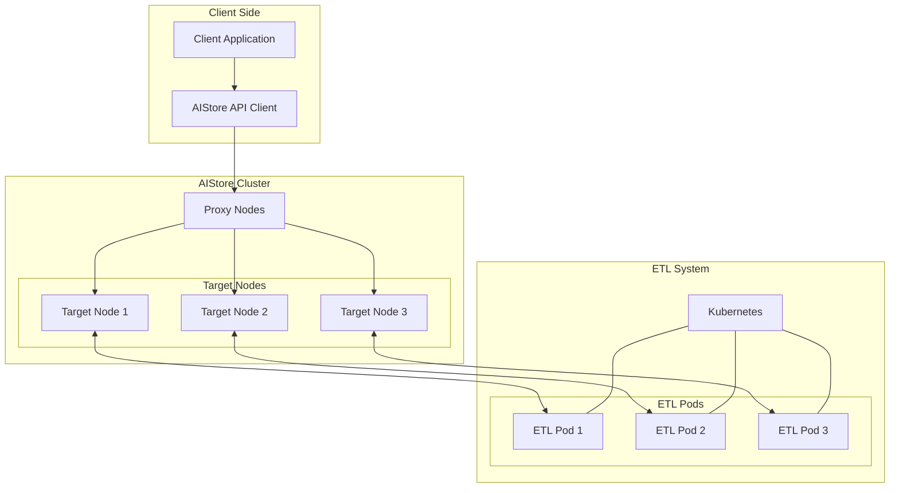
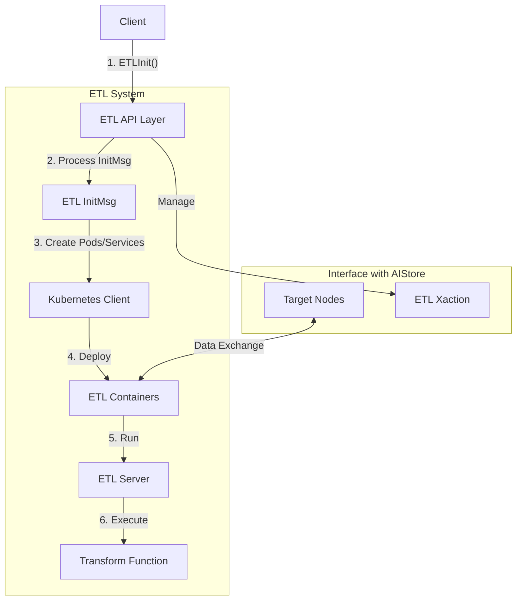
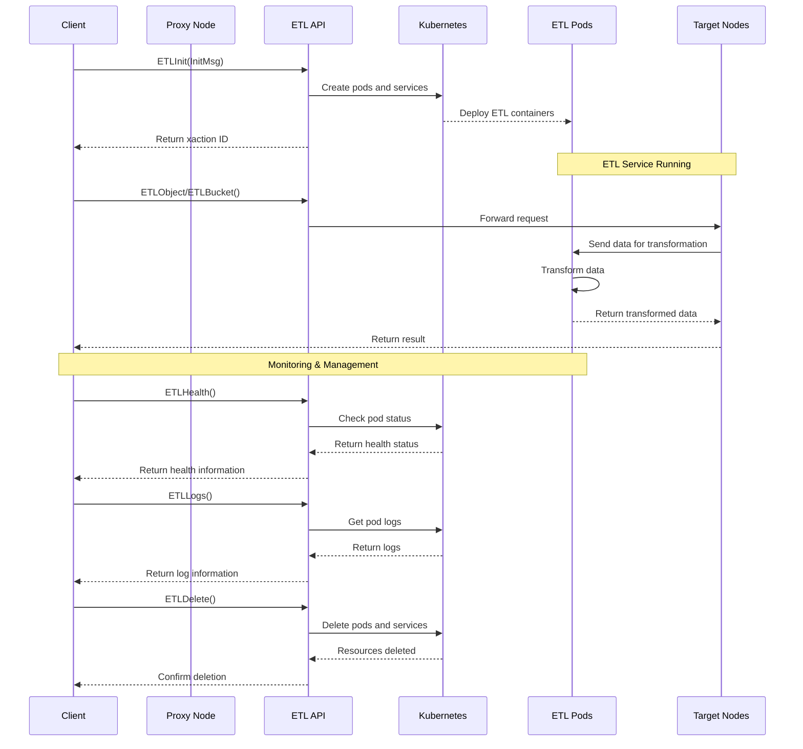
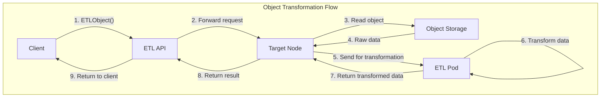
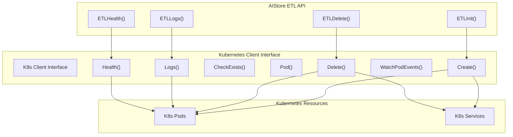
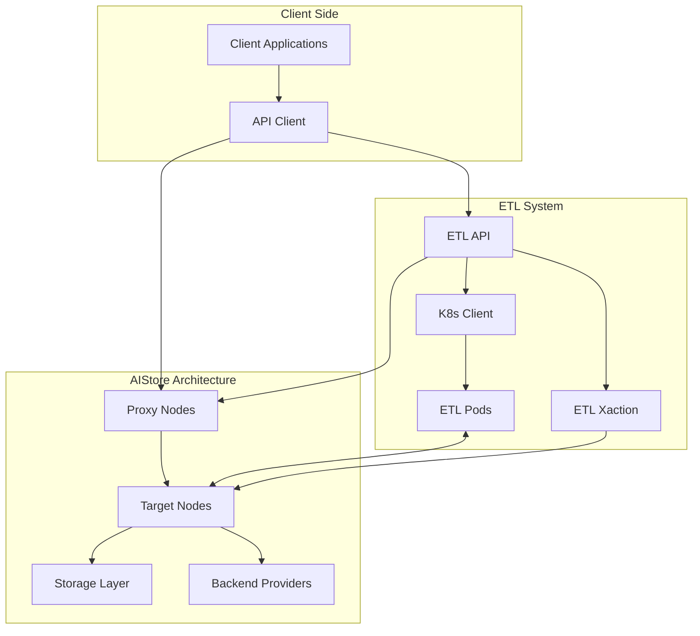

<!-- source: DeepWiki mcp.deepwiki.com · repo NVIDIA/aistore · page 8.1 ETL Architecture · fetched 2026-10-26 -->

# ETL Architecture

<details>
<summary>Relevant source files</summary>

The following files were used as context for generating this wiki page:

- [api/etl.go](api/etl.go)
- [cmn/k8s/client.go](cmn/k8s/client.go)
- [cmn/k8s/k8s.go](cmn/k8s/k8s.go)
- [cmn/k8s/util.go](cmn/k8s/util.go)

</details>


This page documents the Extract, Transform, Load (ETL) architecture in AIStore, detailing how AIStore implements data transformation capabilities. For information on using Python with ETL capabilities, see [Python ETL Implementation](#8.2).

## Overview

AIStore's ETL system enables on-the-fly data transformation by deploying and managing transformation pods in a Kubernetes environment. The architecture follows a distributed model where each AIStore target node has an associated ETL container, allowing data transformations to run close to where data is stored.



Sources: [api/etl.go:1-172](), [cmn/k8s/client.go:1-223](), [cmn/k8s/k8s.go:1-126]()

## Key Components

### ETL System Components

The ETL architecture consists of several key components that work together to enable data transformation:



Sources: [api/etl.go:30-46](), [cmn/k8s/client.go:26-39]()

### Component Details

1. **ETL API Layer**: Provides interfaces for initializing, managing, and using ETL transformations
2. **InitMsg**: Container for ETL initialization parameters that define the ETL workload
3. **Kubernetes Client**: Abstracts interaction with Kubernetes for creating and managing ETL pods
4. **ETL Containers**: Kubernetes pods that run the actual transformation code
5. **ETL Server**: Web server running inside ETL containers that receives and processes transformation requests
6. **Transform Function**: User-defined code that performs the actual data transformation

Sources: [api/etl.go:30-46](), [cmn/k8s/client.go:26-39]()

## ETL Lifecycle

The ETL system follows a well-defined lifecycle from initialization to termination:



Sources: [api/etl.go:35-46](), [api/etl.go:82-98](), [api/etl.go:113-136]()

### Initialization

ETL initialization is handled by the `ETLInit` function which:
1. Takes an `etl.InitMsg` parameter that defines the ETL configuration
2. Deploys Kubernetes ETL pods - one pod per storage target
3. Returns a transaction ID (xid) for tracking the ETL deployment

Sources: [api/etl.go:30-46]()

### Monitoring and Management

The ETL system provides several APIs for monitoring and managing ETL instances:

| API Function | Purpose |
|--------------|---------|
| `ETLList` | Lists all running ETL instances |
| `ETLLogs` | Retrieves logs from ETL containers |
| `ETLMetrics` | Gets CPU and memory metrics for ETL pods |
| `ETLHealth` | Checks health status of ETL pods |
| `ETLStart` | Starts a stopped ETL instance |
| `ETLStop` | Stops a running ETL instance |
| `ETLDelete` | Deletes an ETL instance and its resources |

Sources: [api/etl.go:48-156]()

## ETL Data Flow

The ETL system supports two primary data flow patterns:

1. **Object-level transformations**: Transform individual objects using `ETLObject`
2. **Bucket-level transformations**: Transform all objects in a bucket using `ETLBucket`



Sources: [api/etl.go:158-169]()

### Inline Object Transformation

For object-level transformations:
1. Client calls `ETLObject` with bucket, object name, and ETL parameters
2. Request is routed to the target node holding the object
3. Target retrieves the object and sends it to the associated ETL pod
4. ETL pod transforms the data and returns the result
5. Transformed data is returned to the client

The `ETLObjArgs` struct enables passing transformation arguments for customized processing:

```go
type ETLObjArgs struct {
    // TransformArgs holds the arguments to be used in ETL inline transform
    TransformArgs any
    
    // ETLName specifies the running ETL instance to be used in inline transform
    ETLName string
}
```

Sources: [api/etl.go:20-28](), [api/etl.go:158-169]()

## Kubernetes Integration

AIStore's ETL system is tightly integrated with Kubernetes to manage the lifecycle of ETL pods:



Sources: [cmn/k8s/client.go:26-39](), [cmn/k8s/client.go:98-223]()

### Kubernetes Client

AIStore provides a simplified Kubernetes client interface that abstracts away the complexity of interacting with the Kubernetes API:

```go
// Client is simplified version of default `kubernetes.Interface` client.
type Client interface {
    Create(v any) error
    Delete(entityType, entityName string) error
    CheckExists(entityType, entityName string) (bool, error)
    Pod(name string) (*corev1.Pod, error)
    Pods() (*corev1.PodList, error)
    Service(name string) (*corev1.Service, error)
    Logs(podName string) ([]byte, error)
    WatchPodEvents(podName string) (watch.Interface, error)
    Health(podName string) (string, error)
    CheckMetricsAvailability() error
}
```

The client handles:
1. Creating and deleting pods and services
2. Checking for resource existence
3. Retrieving pod information and logs
4. Monitoring pod events and health

Sources: [cmn/k8s/client.go:26-39](), [cmn/k8s/client.go:98-223]()

### ETL Name Validation

ETL names are validated to ensure they conform to Kubernetes naming requirements:

```go
func ValidateEtlName(name string) error {
    const prefix = "ETL name %q "
    l := len(name)
    if l < shortNameETL {
        return fmt.Errorf(prefix+"is too short", name)
    }
    if l > longNameETL {
        return fmt.Errorf(prefix+"is too long", name)
    }
    for _, c := range name {
        if (c >= 'a' && c <= 'z') || (c >= '0' && c <= '9') || c == '-' {
            continue
        }
        return fmt.Errorf(prefix+"is invalid: can only contain [a-z0-9-]", name)
    }
    return nil
}
```

Key validation rules:
- Names must be between 6 and 32 characters long
- Names can only contain lowercase letters, numbers, and hyphens

Sources: [cmn/k8s/util.go:20-36]()

## Integration with AIStore Core

ETL is designed to work seamlessly with the rest of AIStore:



Sources: [api/etl.go:1-172]()

### ETL and Extended Actions (Xactions)

ETL operations are implemented as extended actions (xactions) in AIStore:

1. When an ETL is initialized, a corresponding xaction is created to track its deployment
2. The xaction ID is returned to the client for monitoring the ETL deployment
3. ETL operations are executed within the AIStore xaction framework

This integration allows ETL to leverage AIStore's existing mechanisms for:
- Distributed operation execution
- Progress tracking
- Error handling
- Notification delivery

Sources: [api/etl.go:35-46]()

## Conclusion

AIStore's ETL architecture provides a flexible, Kubernetes-based system for data transformation that integrates tightly with the core storage functionality. By deploying ETL containers alongside target nodes, AIStore enables efficient data processing without unnecessary data movement, improving performance for data-intensive workloads.

The system offers both object and bucket-level transformation capabilities, comprehensive monitoring and management APIs, and seamless integration with the rest of the AIStore ecosystem.

---

