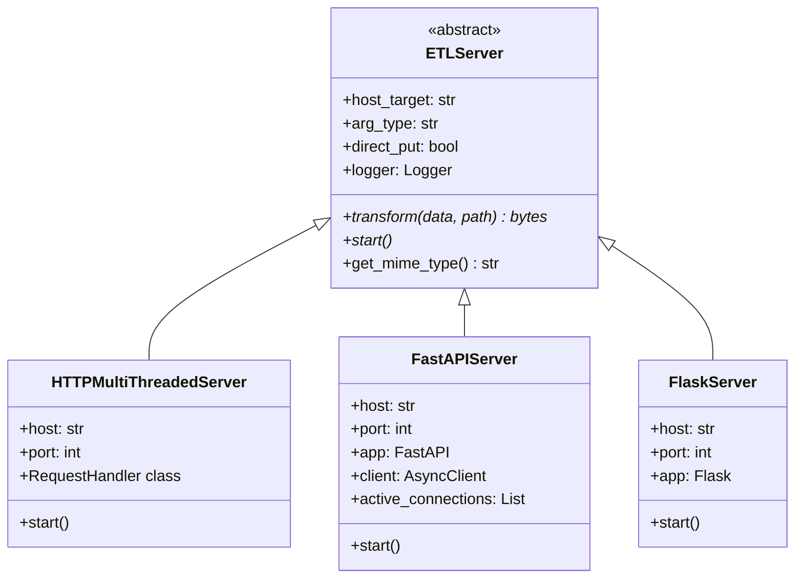
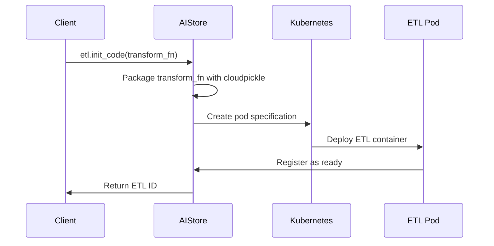
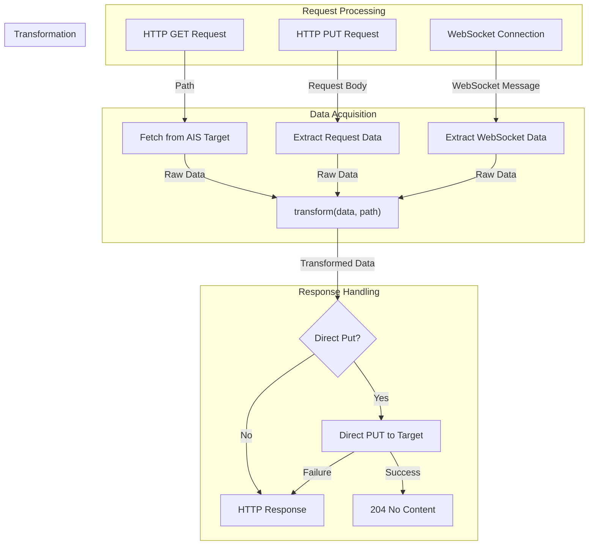
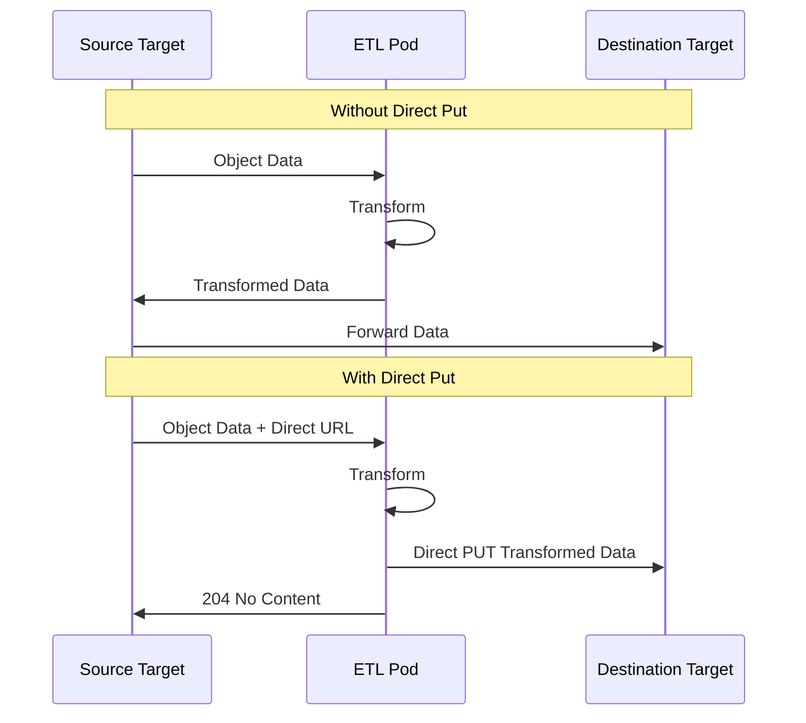
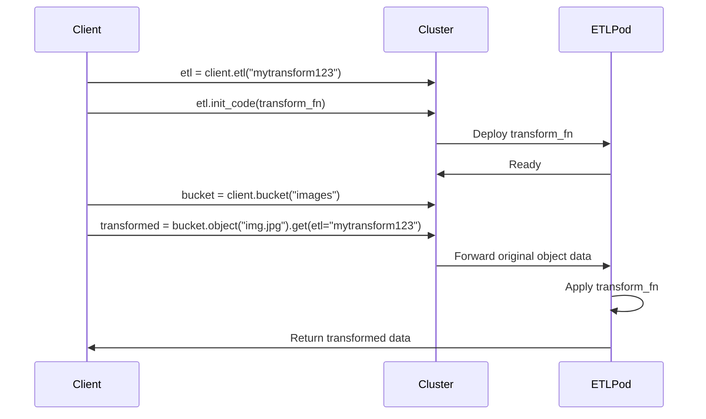

<!-- source: DeepWiki mcp.deepwiki.com · repo NVIDIA/aistore · page 8.2 Python ETL Implementation · fetched 2026-10-26 -->

# Python ETL Implementation

<details>
<summary>Relevant source files</summary>

The following files were used as context for generating this wiki page:

- [python/CHANGELOG.md](python/CHANGELOG.md)
- [python/aistore/common_requirements](python/aistore/common_requirements)
- [python/aistore/sdk/etl/etl.py](python/aistore/sdk/etl/etl.py)
- [python/aistore/sdk/etl/etl_const.py](python/aistore/sdk/etl/etl_const.py)
- [python/aistore/sdk/etl/etl_templates.py](python/aistore/sdk/etl/etl_templates.py)
- [python/aistore/sdk/etl/webserver/__init__.py](python/aistore/sdk/etl/webserver/__init__.py)
- [python/aistore/sdk/etl/webserver/base_etl_server.py](python/aistore/sdk/etl/webserver/base_etl_server.py)
- [python/aistore/sdk/etl/webserver/fastapi_server.py](python/aistore/sdk/etl/webserver/fastapi_server.py)
- [python/aistore/sdk/etl/webserver/flask_server.py](python/aistore/sdk/etl/webserver/flask_server.py)
- [python/aistore/sdk/etl/webserver/http_multi_threaded_server.py](python/aistore/sdk/etl/webserver/http_multi_threaded_server.py)
- [python/aistore/version.py](python/aistore/version.py)
- [python/pyproject.toml](python/pyproject.toml)
- [python/tests/unit/sdk/test_etl.py](python/tests/unit/sdk/test_etl.py)
- [python/tests/unit/sdk/test_etl_webserver.py](python/tests/unit/sdk/test_etl_webserver.py)

</details>


This document details AIStore's Python-based Extract, Transform, Load (ETL) implementation. It covers the client-side and server-side components, transformation frameworks, and deployment patterns. For higher-level concepts of the ETL system architecture, see [ETL Architecture](#8.1).

## Overview

AIStore's Python ETL functionality provides a framework for data transformation within the storage system. It enables:

1. Processing data as it moves between client and storage
2. Transforming objects during bucket-to-bucket operations
3. Building custom processing pipelines with user-defined code

The implementation consists of a Python SDK with client interfaces for managing ETL, and server-side components that execute transformations.

Sources: [python/aistore/sdk/etl/etl.py](), [python/CHANGELOG.md]()

## Architecture

### ETL Component Architecture

```mermaid
graph TD
    subgraph "Client Side"
        client["Python Client"]
        etl_client["Etl Client"]
        client --> etl_client
    end

    subgraph "AIStore Cluster"
        proxy["AIS Proxy"]
        etl_infra["ETL Infrastructure"]
        k8s["Kubernetes"]
        
        subgraph "ETL Pod"
            etl_server["ETL Server"]
            transform["Transform Function"]
            
            etl_server --> transform
        end
        
        etl_client --> proxy
        proxy --> etl_infra
        etl_infra --> k8s
        k8s --> "ETL Pod"
    end
    
    object_store["Storage Targets"]
    etl_server --> object_store
    object_store --> etl_server
```

Sources: [python/aistore/sdk/etl/etl.py](), [python/aistore/sdk/etl/webserver/base_etl_server.py]()

### ETL Server Class Hierarchy



Sources: [python/aistore/sdk/etl/webserver/base_etl_server.py](), [python/aistore/sdk/etl/webserver/http_multi_threaded_server.py](), [python/aistore/sdk/etl/webserver/fastapi_server.py](), [python/aistore/sdk/etl/webserver/flask_server.py]()

## Client-Side Implementation

The Python SDK provides an `Etl` class that handles ETL lifecycle management:

1. **ETL Creation**:
   - `init_spec()`: Deploy ETL from a Kubernetes pod template
   - `init_code()`: Deploy ETL from Python code with a transform function

2. **ETL Management**:
   - `view()`: Retrieve ETL details
   - `start()`: Start a stopped ETL
   - `stop()`: Stop a running ETL
   - `delete()`: Delete an ETL

Sources: [python/aistore/sdk/etl/etl.py:53-269]()

### ETL Communication Types

AIStore supports several communication patterns between clients, ETL pods, and storage:

| Communication Type | Description | Use Case |
|-------------------|-------------|----------|
| `hpush` (Default) | HTTP Push - AIStore pushes data to ETL | Standard transformations |
| `hpull` | HTTP Pull - ETL pulls data from AIStore | Transformations that control data fetching |
| `io` | Standard I/O-based | Special cases and legacy support |
| `ws` | WebSocket-based | Real-time transformations |

Sources: [python/aistore/sdk/etl/etl_const.py:6-14](), [python/aistore/sdk/etl/etl.py:87-100]()

### Creating an ETL with Code

Code-based ETL allows you to define transformations with Python functions. The SDK will package, deploy, and manage the transformation:



Sources: [python/aistore/sdk/etl/etl.py:110-170](), [python/aistore/sdk/etl/etl_const.py:28-38]()

## Server-Side Implementation

AIStore's Python ETL system provides three server implementations that can be used to execute transformations:

### Base ETL Server

All server implementations extend the abstract `ETLServer` class which defines:

- `transform(data: bytes, path: str) -> bytes`: The transformation logic
- `start()`: Starting the server
- `get_mime_type()`: MIME type for the transformed response

Sources: [python/aistore/sdk/etl/webserver/base_etl_server.py:11-84]()

### Server Implementations

1. **HTTP Multi-Threaded Server**
   - Basic multi-threaded HTTP server based on Python's standard library
   - Useful for simple transformations with standard HTTP methods

2. **FastAPI Server**
   - Async-based server using FastAPI
   - Supports WebSocket connections for streaming transformations
   - Higher performance for concurrent workloads

3. **Flask Server**
   - Traditional Flask-based server
   - Compatible with many existing Python web applications

Sources: [python/aistore/sdk/etl/webserver/__init__.py](), [python/aistore/sdk/etl/webserver/http_multi_threaded_server.py](), [python/aistore/sdk/etl/webserver/fastapi_server.py](), [python/aistore/sdk/etl/webserver/flask_server.py]()

### Data Flow in ETL Servers



Sources: [python/aistore/sdk/etl/webserver/fastapi_server.py:125-174](), [python/aistore/sdk/etl/webserver/flask_server.py:34-87](), [python/aistore/sdk/etl/webserver/http_multi_threaded_server.py:114-211]()

## Advanced Features

### Direct Put Optimization

The "Direct Put" feature optimizes the data flow in bucket-to-bucket transformations:



Direct Put is enabled in all server implementations and can be activated by setting the `DIRECT_PUT` environment variable to `true`.

Sources: [python/aistore/sdk/etl/webserver/fastapi_server.py:194-228](), [python/aistore/sdk/etl/webserver/flask_server.py:95-125](), [python/aistore/sdk/etl/webserver/http_multi_threaded_server.py:69-100]()

### ETL Templates

The Python SDK includes a variety of predefined ETL templates for common transformations:

| Template | Description |
|----------|-------------|
| `MD5` | Returns MD5 hash of input data |
| `ECHO` | Returns original data with added metadata |
| `HELLO_WORLD` | Returns "Hello World!" regardless of input |
| `TAR2TF` | Converts TAR files to TensorFlow format |
| `COMPRESS` | Compresses/decompresses files |
| `KERAS_TRANSFORMER` | Applies Keras transformations |
| `FFMPEG` | Processes media files with FFMPEG |
| `TORCHVISION_TRANSFORMER` | Applies torchvision transformations |
| `FACE_DETECTION_TRANSFORMER` | Detects faces in images |
| `HASH` | Calculates hash of objects with metadata |

Sources: [python/aistore/sdk/etl/etl_templates.py]()

### ETL Arguments

ETL transformations can accept arguments to modify their behavior:

1. **FQN Support**: When `arg_type` is set to `"fqn"`, the ETL server reads from a local file path instead of fetching from a target
2. **ETL Args**: Custom parameters can be passed to transformations during initialization or at request time

Sources: [python/aistore/sdk/etl/webserver/base_etl_server.py:40-41](), [python/CHANGELOG.md:126-128]()

## Implementation Example

Here's an example of creating and using a custom ETL transformation:



To implement custom ETL servers, developers should:

1. Subclass `ETLServer` or one of its implementations
2. Override the `transform()` method with custom logic
3. Deploy the server using ETL pod templates

Sources: [python/aistore/sdk/etl/webserver/base_etl_server.py:52-64](), [python/tests/unit/sdk/test_etl_webserver.py:18-26](), [python/tests/unit/sdk/test_etl_webserver.py:57-62](), [python/tests/unit/sdk/test_etl_webserver.py:65-70]()

## Recent Enhancements

Recent updates to the Python ETL implementation include:

- Addition of `FlaskServer` implementation
- Enhanced `direct put` support in all webserver implementations
- Support for FQN (fully qualified name) in WebSocket endpoints
- Improved error handling for ETL operations
- Extended support for bucket-to-bucket transformations with additional options
- Structured separation between server logic and transformation logic

Sources: [python/CHANGELOG.md:15-43](), [python/CHANGELOG.md:57-63]()

---

