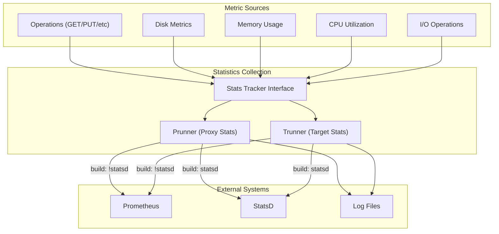
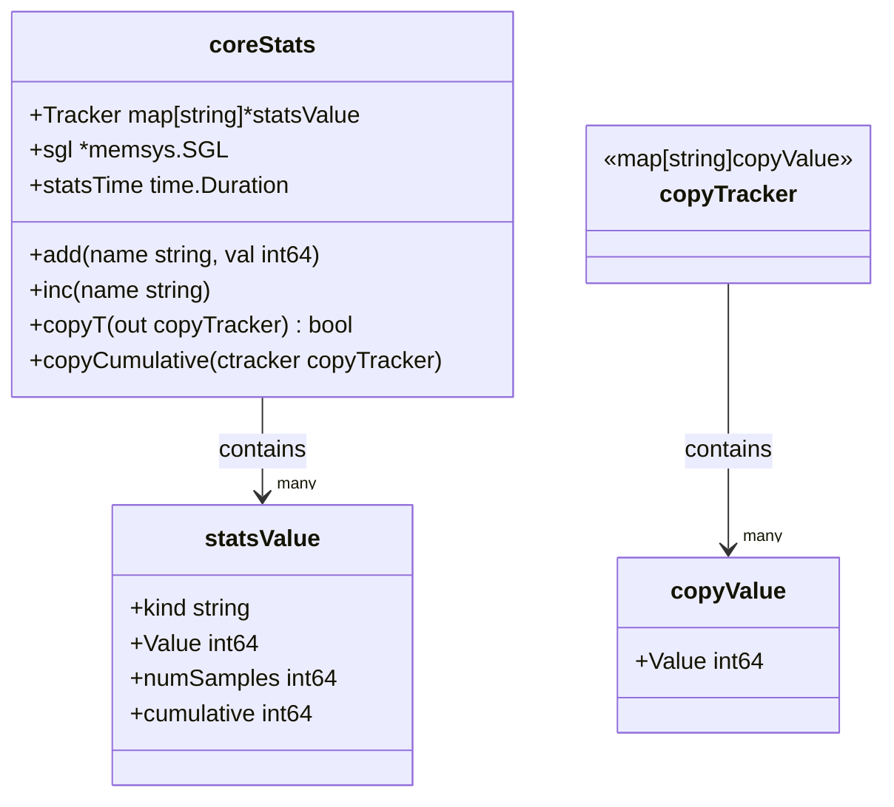
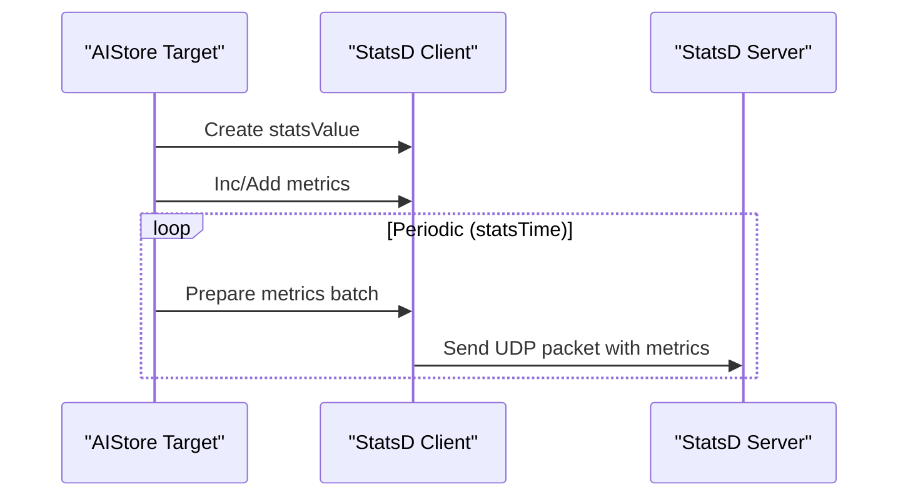
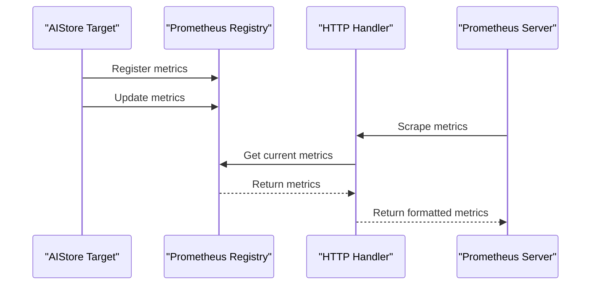
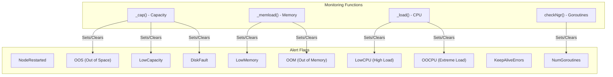
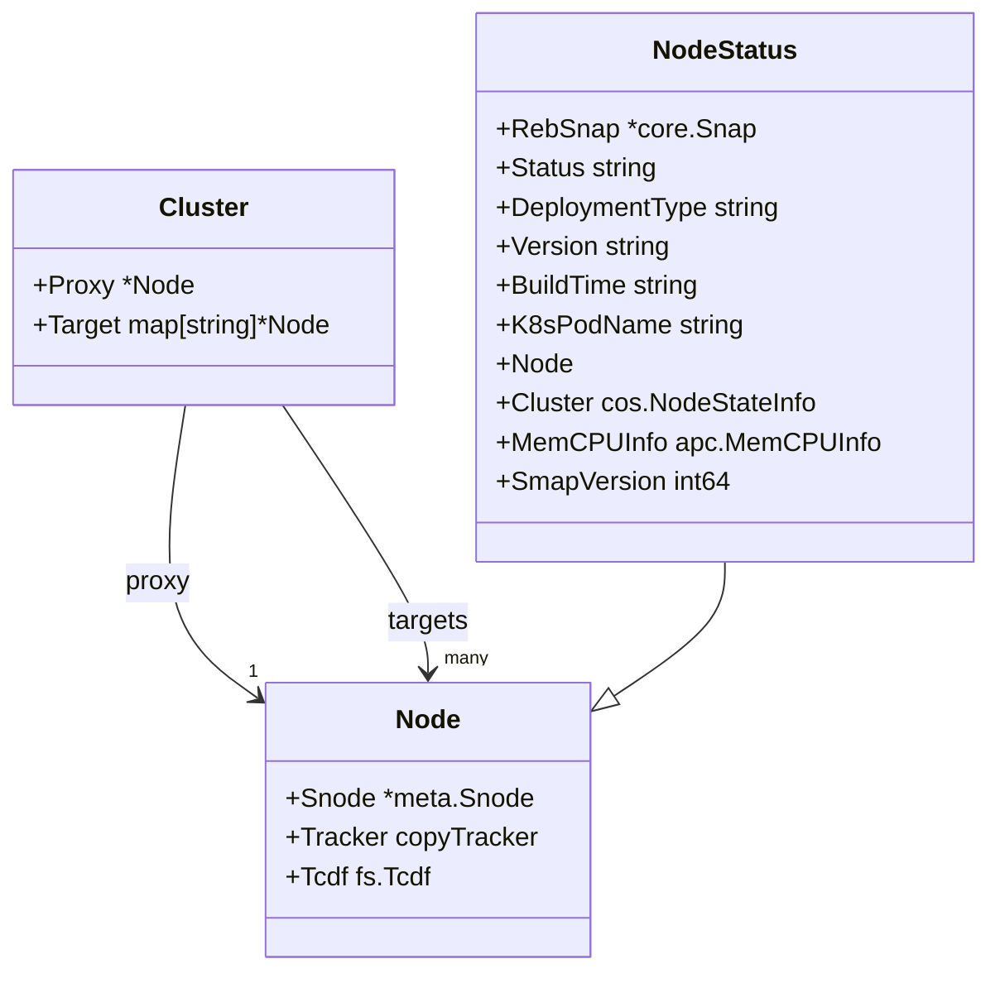

<!-- source: DeepWiki mcp.deepwiki.com · repo NVIDIA/aistore · page 9 Monitoring and Statistics · fetched 2026-10-26 -->

# Monitoring and Statistics

<details>
<summary>Relevant source files</summary>

The following files were used as context for generating this wiki page:

- [cmn/cos/stats.go](cmn/cos/stats.go)
- [core/mock/stats_mock.go](core/mock/stats_mock.go)
- [stats/api.go](stats/api.go)
- [stats/common.go](stats/common.go)
- [stats/common_prom.go](stats/common_prom.go)
- [stats/common_statsd.go](stats/common_statsd.go)
- [stats/prom.go](stats/prom.go)
- [stats/proxy_stats.go](stats/proxy_stats.go)
- [stats/statsd/client.go](stats/statsd/client.go)
- [stats/statsd/client_test.go](stats/statsd/client_test.go)
- [stats/target_stats.go](stats/target_stats.go)

</details>


This document describes the monitoring and statistics subsystem of AIStore, which provides comprehensive metrics collection, tracking, and reporting capabilities. It covers how metrics are collected, tracked, and exposed for monitoring and debugging purposes. For information about capacity management and health checking, see [Cluster Management](#5).

## 1. Statistics System Overview

AIStore implements a robust statistics system that provides metrics for both internal usage and external monitoring. The system collects various performance metrics, logs them periodically, and can also export them to monitoring systems like Prometheus or StatsD.



Sources: [stats/common.go:132-189](), [stats/target_stats.go:136-146](), [stats/proxy_stats.go:32-36]()

## 2. Stats Collection Architecture

The AIStore statistics system is organized around two main components:

1. **Stats Runners**: Specialized runners for proxy and target nodes that collect, aggregate, and report metrics
2. **Metrics Registry**: A map of named metrics with their current values and metadata

### 2.1 Stats Runners

AIStore uses two types of stats runners:

- **Prunner**: Collects and manages proxy-specific statistics
- **Trunner**: Collects and manages target-specific statistics, including disk and mountpath metrics

Both runners implement the `Tracker` interface which provides methods for incrementing, adding, and querying metrics.

```mermaid
classDiagram
    class Tracker {
        <<interface>>
        +Inc(metric string)
        +Add(metric string, val int64)
        +AddWith(namedVal64 ...NamedVal64)
        +IncWith(name string, vlabs map[string]string)
        +IncBck(name string, bck *cmn.Bck)
        +SetFlag(name string, set NodeStateFlags)
        +ClrFlag(name string, clr NodeStateFlags)
        +GetStats() *Node
        +ResetStats(errorsOnly bool)
        +GetMetricNames() cos.StrKVs
    }
    
    class runner {
        -node core.Node
        -stopCh chan struct{}
        -ticker *time.Ticker
        -core *coreStats
        -ctracker copyTracker
        -name string
        -sorted []string
        +_run(logger statsLogger) error
        +Inc(name string)
        +Add(name string, val int64)
        +AddWith(nvs ...cos.NamedVal64)
        +reg(snode *meta.Snode, name, kind string, extra *Extra)
        +GetStats() *Node
    }
    
    class Prunner {
        +Run() error
        +Init(p core.Node) *atomic.Bool
        +log(now int64, uptime time.Duration, config *cmn.Config)
    }
    
    class Trunner {
        -t core.Target
        -disk struct
        -fsIDs []cos.FsID
        -Tcdf fs.Tcdf
        +Run() error
        +Init() *atomic.Bool
        +RegMetrics(snode *meta.Snode)
        +RegDiskMetrics(snode *meta.Snode, disk string)
    }
    
    Tracker <|.. Prunner
    Tracker <|.. Trunner
    runner <|-- Prunner
    runner <|-- Trunner
```

Sources: [stats/api.go:54-72](), [stats/common.go:151-165](), [stats/proxy_stats.go:23-35](), [stats/target_stats.go:114-135]()

### 2.2 Metric Types

AIStore uses several types of metrics, each with its own behavior and purpose:

| Metric Type | Description | Suffix | Example |
|-------------|-------------|--------|---------|
| KindCounter | Simple incrementing counter | `.n` | `get.n` |
| KindLatency | Latency measurements (nanoseconds) | `.ns` | `get.ns` |
| KindTotal | Cumulative time (nanoseconds) | `.ns.total` | `get.ns.total` |
| KindSize | Size measurements (bytes) | `.size` | `lru.evict.size` |
| KindThroughput | Throughput (bytes per second) | `.bps` | `get.bps` |
| KindComputedThroughput | Computed throughput (bytes per second) | `.bps` | `disk.sda.read.bps` |
| KindGauge | Point-in-time value | varies | `disk.sda.util` |
| KindSpecial | Special metrics like uptime | varies | `up.ns.time` |

Sources: [stats/api.go:22-38](), [stats/common.go:36-44]()

### 2.3 Metric Organization

Metrics in AIStore follow a structured naming convention:

1. **Basic operations**: `get.n`, `put.n`, etc.
2. **Error metrics**: Error counters prefixed with `err.`, e.g., `err.get.n`
3. **I/O error metrics**: I/O-specific errors prefixed with `err.io.`, e.g., `err.io.get.n`
4. **Disk metrics**: Disk-specific metrics prefixed with `disk.`, e.g., `disk.sda.read.bps`

Metrics may also have variable labels that provide additional context, such as bucket names or mount paths.

Sources: [stats/api.go:47-51](), [stats/common.go:72-75]()

## 3. Data Collection and Tracking

### 3.1 Core Data Structures

The statistics system uses the following key data structures:

- **statsValue**: Represents a single metric with its value and metadata
- **coreStats**: Container for all metrics and additional tracking information
- **copyTracker**: Used for snapshots of statistics for reporting



Sources: [stats/common.go:142-148](), [stats/common_statsd.go:27-47](), [stats/common_prom.go:25-38]()

### 3.2 Updating Metrics

Metrics can be updated using several methods:

- **Inc(name)**: Increment a counter metric by 1
- **Add(name, val)**: Add a value to a metric
- **IncWith(name, labels)**: Increment a counter with variable labels
- **AddWith(namedVal)**: Add a value with variable labels

These methods update the underlying `statsValue` and, depending on the build configuration, also update Prometheus metrics or prepare data for StatsD.

Sources: [stats/common.go:335-367](), [stats/prom.go:145-171]()

### 3.3 Periodic Processing

Both Prunner and Trunner run periodic routines that:

1. Collect metrics
2. Process and potentially reset certain metrics (like computing averages for latency metrics)
3. Log statistics
4. Export to external systems (StatsD or Prometheus)
5. Check system health and raise alerts if necessary

Sources: [stats/common.go:396-514](), [stats/target_stats.go:603-680](), [stats/proxy_stats.go:63-92]()

## 4. External Integration

AIStore can export metrics to external monitoring systems in two ways, controlled by build tags:

### 4.1 StatsD Integration

When built with the `statsd` tag, AIStore exports metrics to a StatsD server. The StatsD client sends metrics in the format expected by StatsD (counters, timers, gauges).



Configuration options for StatsD can be provided via environment variables:
- `AIS_STATSD_PORT`: The port to connect to (default: 8125)
- `AIS_STATSD_PROBE`: Whether to test-probe the StatsD server at init time

Sources: [stats/common_statsd.go:1-314](), [stats/statsd/client.go:1-221]()

### 4.2 Prometheus Integration

When built without the `statsd` tag, AIStore exposes metrics via a Prometheus endpoint. Metrics are registered with the Prometheus registry and exposed via an HTTP handler.



Each metric type is mapped to an appropriate Prometheus metric type:
- Counters → Prometheus Counters
- Gauges → Prometheus Gauges
- Latency and throughput are computed internally

Sources: [stats/common_prom.go:1-257](), [stats/prom.go:1-182]()

## 5. Health Monitoring and Alerts

AIStore includes comprehensive health monitoring capabilities that track system resources and raise alerts when issues are detected.

### 5.1 Resource Monitoring

The statistics system monitors several key resources:

1. **Disk space**: Tracks available capacity on mountpaths
2. **Disk I/O**: Monitors read/write throughput and utilization
3. **Memory usage**: Detects low memory and out-of-memory conditions
4. **CPU utilization**: Detects high CPU usage
5. **Number of goroutines**: Alerts on potentially problematic goroutine counts

### 5.2 NodeStateFlags Alert System

Alerts are tracked using `NodeStateFlags`, a bitwise enum that represents various alert conditions:



These flags are stored in the `NodeAlerts` metric and can be queried to get the overall health status of a node.

Sources: [stats/common.go:518-552](), [stats/common.go:553-598](), [stats/common.go:611-637]()

## 6. Statistics API

### 6.1 Core API

The core API for interacting with statistics is implemented by the `Tracker` interface:

```go
type Tracker interface {
    // Update methods
    Inc(metric string)
    Add(metric string, val int64)
    IncWith(metric string, vlabs map[string]string)
    IncBck(name string, bck *cmn.Bck)
    AddWith(namedVal64 ...NamedVal64)
    
    // Flag methods
    SetFlag(name string, set NodeStateFlags)
    ClrFlag(name string, clr NodeStateFlags)
    SetClrFlag(name string, set, clr NodeStateFlags)
    
    // Query methods
    Get(name string) int64
    GetStats() *Node
    GetMetricNames() cos.StrKVs
    
    // Management
    ResetStats(errorsOnly bool)
    RegExtMetric(node *meta.Snode, name, kind string, extra *Extra)
    PromHandler() http.Handler
}
```

Sources: [stats/api.go:54-72]()

### 6.2 REST API

AIStore provides REST API endpoints to query statistics:

- The statistics are returned in JSON format
- Target nodes include additional information like capacity stats (`Tcdf`)
- Stats can be queried for individual nodes or the entire cluster

The main structures used for the API responses are:



Sources: [stats/api.go:75-109]()

## 7. Target-Specific Metrics

Target nodes collect additional metrics related to storage operations and disk performance.

### 7.1 Storage Operation Metrics

Target nodes track metrics for various storage operations including:

- **LRU Evictions**: Count and size of LRU evictions (`lru.evict.n`, `lru.evict.size`)
- **Space Cleanup**: Metrics for cleanup operations (`cleanup.store.n`, `cleanup.store.size`)
- **Version Changes**: Out-of-band updates (`ver.change.n`, `ver.change.size`)
- **I/O Operations**: Various I/O errors and operations (`err.io.get.n`, etc.)
- **ETL Operations**: Extract, transform, load metrics (`etl.offline.n`, etc.)

Sources: [stats/target_stats.go:34-109](), [stats/target_stats.go:257-535]()

### 7.2 Disk Performance Metrics

Target nodes also collect detailed disk performance metrics:

- **Read/Write Throughput**: Bytes per second for reads/writes (`disk.<disk>.read.bps`, `disk.<disk>.write.bps`)
- **Average I/O Size**: Average read/write sizes (`disk.<disk>.avg.rsize`, `disk.<disk>.avg.wsize`)
- **Disk Utilization**: Percentage utilization of each disk (`disk.<disk>.util`)

These metrics are collected for each disk and are registered dynamically.

Sources: [stats/target_stats.go:537-560](), [stats/target_stats.go:776-806]()

## 8. Common Metrics

Both proxy and target nodes collect a set of common metrics that track basic operations:

- **HTTP Operations**: GET, PUT, HEAD, DELETE, etc. (`get.n`, `put.n`, etc.)
- **Error Counters**: For each operation (`err.get.n`, `err.put.n`, etc.)
- **Latency Metrics**: Average time for operations (`get.ns`, `put.ns`, etc.)
- **System Metrics**: Uptime, node state flags, etc.

Sources: [stats/common.go:84-130](), [stats/common.go:188-329]()

## 9. Implementation Details

### 9.1 Build System Integration

The statistics system supports two backends through build tags:

- **Default (Prometheus)**: When built without special tags, metrics are exposed via Prometheus
- **StatsD**: When built with the `statsd` tag, metrics are sent to a StatsD server

This allows for flexibility in integrating with different monitoring systems.

Sources: [stats/common_prom.go:1-2](), [stats/common_statsd.go:1-2]()

### 9.2 Log Rotation and Management

The statistics system includes management for log files:

- Logs are rotated based on size
- The total log size is kept below a configured maximum
- Old logs are automatically cleaned up

Sources: [stats/common.go:736-834]()

### 9.3 Periodic Reporting

Statistics are periodically logged and reported based on configurable intervals:

- `Periodic.StatsTime`: The interval for collecting statistics
- `Log.StatsTime`: The interval for logging statistics
- Idle metrics are filtered to reduce log noise

Sources: [stats/common.go:388-395](), [stats/target_stats.go:603-606]()

---

