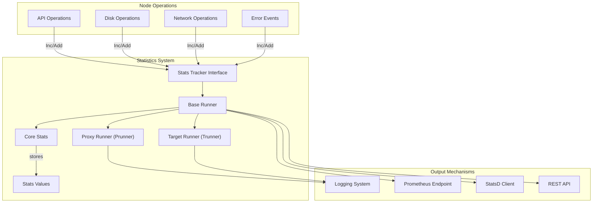
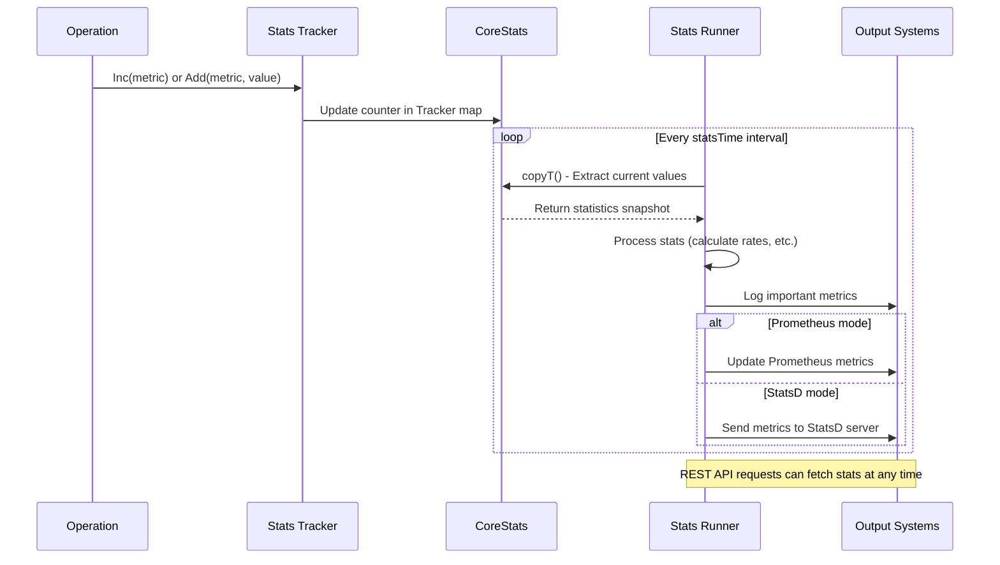

<!-- source: DeepWiki mcp.deepwiki.com · repo NVIDIA/aistore · page 9.1 Statistics Collection · fetched 2026-10-26 -->

# Statistics Collection

<details>
<summary>Relevant source files</summary>

The following files were used as context for generating this wiki page:

- [cmn/cos/stats.go](cmn/cos/stats.go)
- [core/mock/stats_mock.go](core/mock/stats_mock.go)
- [stats/api.go](stats/api.go)
- [stats/common.go](stats/common.go)
- [stats/common_prom.go](stats/common_prom.go)
- [stats/common_statsd.go](stats/common_statsd.go)
- [stats/prom.go](stats/prom.go)
- [stats/proxy_stats.go](stats/proxy_stats.go)
- [stats/statsd/client.go](stats/statsd/client.go)
- [stats/statsd/client_test.go](stats/statsd/client_test.go)
- [stats/target_stats.go](stats/target_stats.go)

</details>


## Purpose and Scope

This document covers AIStore's statistics collection subsystem, which provides comprehensive metrics gathering, tracking, and reporting capabilities. The system collects various performance and operational metrics from both target and proxy nodes, making them available for monitoring, alerting, and performance analysis.

The statistics system supports two implementations: Prometheus (default) and StatsD (optional), allowing for flexible integration with monitoring solutions.

Sources: [stats/common.go:1-15](), [stats/common_prom.go:1-15](), [stats/common_statsd.go:1-15]()

## Architecture Overview

The statistics collection system in AIStore is composed of several key components that work together to gather, process, and expose metrics about the system's operation.



Sources: [stats/api.go:1-35](), [stats/common.go:133-152](), [stats/target_stats.go:114-136](), [stats/proxy_stats.go:21-37]()

### Core Components

1. **Stats Tracker Interface**: Common interface for updating stats across AIStore components
2. **Runners**: Periodic collectors and processors of statistics
   - **Base Runner**: Common functionality for all stats runners
   - **Proxy Runner (Prunner)**: Stats collection specific to proxy nodes
   - **Target Runner (Trunner)**: Stats collection specific to target nodes with additional storage metrics
3. **Core Stats**: Central tracking and management of metric values
4. **Output Mechanisms**: Multiple ways to access and visualize statistics

Sources: [stats/common.go:133-165](), [stats/proxy_stats.go:21-37](), [stats/target_stats.go:114-136]()

## Metric Types and Naming Conventions

AIStore uses several types of metrics to track different aspects of system performance:

| Metric Kind | Description | Naming Convention | Example |
|-------------|-------------|-------------------|---------|
| KindCounter | Simple counters that increment | `*.n` | `get.n` - Count of GET operations |
| KindLatency | Time-based metrics | `*.ns` | `get.ns` - GET latency |
| KindTotal | Cumulative time measurements | `*.ns.total` | `get.ns.total` - Total GET time |
| KindSize | Size-based metrics | `*.size` | `get.size` - Total bytes retrieved |
| KindThroughput | Bandwidth metrics | `*.bps` | `get.bps` - GET throughput |
| KindGauge | Point-in-time measurements | varies | `disk.sda.util` - Disk utilization |
| KindSpecial | Special purpose metrics | varies | `up.ns.time` - Node uptime |

Error metrics consistently use the `err_` prefix, such as `err.get.n` for GET operation errors.

Sources: [stats/api.go:22-38](), [stats/common.go:36-44](), [stats/target_stats.go:25-33]()

## Statistics Collection Flow

The following sequence diagram illustrates how statistics flow through the system:



Sources: [stats/common.go:387-514](), [stats/common_prom.go:61-113](), [stats/common_statsd.go:125-209]()

## Implementation Details

### Stats Runners

AIStore implements two types of stats runners:

1. **Proxy Runner (Prunner)**: Handles metrics for proxy nodes which primarily focus on API operations and cluster management.

2. **Target Runner (Trunner)**: Handles metrics for target nodes which include all proxy-level metrics plus additional metrics for storage operations, disk utilization, and data management.

Both runners inherit from a common `runner` type that provides shared functionality for tracking and processing metrics.

Sources: [stats/proxy_stats.go:21-92](), [stats/target_stats.go:114-843]()

### Stats Storage and Processing

Statistics are stored in a `coreStats` structure containing a map of metric names to `statsValue` objects. The `statsValue` holds:

- Current value
- Metric kind
- For latency metrics: sample count for averaging
- Cumulative value for total tracking

The system periodically processes these raw statistics (based on the configured `statsTime` interval) to:

1. Calculate averages for latency metrics
2. Compute rates and throughputs
3. Log significant changes
4. Export to external monitoring systems

Sources: [stats/common.go:607-734](), [stats/common_prom.go:26-48](), [stats/common_statsd.go:27-48]()

### Output Modes

AIStore supports two primary modes for exporting metrics:

1. **Prometheus** (default): Metrics are exposed via an HTTP endpoint for scraping by Prometheus. Implementation is in [stats/common_prom.go]() and [stats/prom.go]().

2. **StatsD**: Metrics are sent to a StatsD server for aggregation. Implementation is in [stats/common_statsd.go]() and [stats/statsd/client.go]().

Both implementations share the same core statistics collection mechanism but differ in how metrics are exported.

Sources: [stats/common_prom.go:1-181](), [stats/common_statsd.go:1-314](), [stats/statsd/client.go:1-221]()

## Common Metrics

AIStore collects numerous metrics. Here are some of the key categories:

### Basic Operation Metrics

| Metric | Description |
|--------|-------------|
| `get.n` | Count of GET operations |
| `put.n` | Count of PUT operations |
| `delete.n` | Count of DELETE operations |
| `list.n` | Count of LIST operations |
| `err.get.n` | Count of GET errors |

### Latency Metrics

| Metric | Description |
|--------|-------------|
| `get.ns` | Average GET latency |
| `put.ns` | Average PUT latency |
| `head.ns` | Average HEAD latency |
| `kalive.ns` | Average keep-alive latency |

### Throughput Metrics

| Metric | Description |
|--------|-------------|
| `get.bps` | GET throughput (bytes per second) |
| `put.bps` | PUT throughput (bytes per second) |

### Target-Specific Metrics

Target nodes collect additional metrics including:

| Metric | Description |
|--------|-------------|
| `disk.<device>.read.bps` | Disk read throughput |
| `disk.<device>.write.bps` | Disk write throughput |
| `disk.<device>.util` | Disk utilization percentage |
| `lru.evict.n` | Count of LRU evictions |
| `lru.evict.size` | Size of LRU evictions |

Sources: [stats/common.go:78-130](), [stats/target_stats.go:34-112]()

## Alerting System

The statistics system includes built-in alerting capabilities that monitor for:

1. **Capacity Issues**: When storage capacity thresholds are reached
2. **Memory Pressure**: OOM and low memory conditions
3. **CPU Utilization**: High CPU usage alerts
4. **I/O Errors**: Tracking and alerting on I/O error rates
5. **Node Connectivity**: Keep-alive errors

These alerts set flags in the `NodeAlerts` metric, which can be monitored through the usual statistics interfaces.

Sources: [stats/common.go:542-597](), [stats/target_stats.go:577-738]()

## Implementation Choices

### StatsD vs. Prometheus

AIStore supports both StatsD and Prometheus through build tags:

- **Prometheus** (default): When built without the 'statsd' tag, AIStore uses Prometheus for metrics
- **StatsD**: When built with the 'statsd' tag, AIStore sends metrics to a StatsD server

This provides flexibility for integration with different monitoring ecosystems.

### Build Configuration

To enable StatsD:
```
go build -tags=statsd
```

By default, AIStore uses Prometheus metrics.

Sources: [stats/common_prom.go:1-5](), [stats/common_statsd.go:1-8]()

## Using the Statistics System

### Accessing Statistics

Statistics can be accessed through:

1. **REST API**: Query node and cluster statistics
2. **Prometheus Endpoint**: When using Prometheus mode
3. **StatsD**: Metrics are pushed to a configured StatsD server
4. **Logs**: Key metrics are periodically logged

### Extending the Statistics System

AIStore modules can register their own metrics using the `RegExtMetric` method on the `Tracker` interface.

Example of registering a custom metric:
```go
tracker.RegExtMetric(snode, "custom.metric.n", stats.KindCounter,
    &stats.Extra{
        Help: "My custom metric description",
    },
)
```

Sources: [stats/api.go:71-72](), [stats/common.go:183-185]()

## Key Implementation Files

- [stats/api.go](): Defines core interfaces and constants
- [stats/common.go](): Common statistics functionality
- [stats/target_stats.go](): Target-specific statistics
- [stats/proxy_stats.go](): Proxy-specific statistics
- [stats/common_prom.go](): Prometheus implementation
- [stats/common_statsd.go](): StatsD implementation
- [stats/statsd/client.go](): StatsD client for sending metrics

---

