# Page: Overview

# Overview

<details>
<summary>Relevant source files</summary>

The following files were used as context for generating this wiki page:

- [README.md](README.md)
- [ais/bucketmeta.go](ais/bucketmeta.go)
- [ais/clustermap.go](ais/clustermap.go)
- [ais/daemon.go](ais/daemon.go)
- [ais/earlystart.go](ais/earlystart.go)
- [ais/htcommon.go](ais/htcommon.go)
- [ais/htrun.go](ais/htrun.go)
- [ais/kalive.go](ais/kalive.go)
- [ais/metasync.go](ais/metasync.go)
- [ais/proxy.go](ais/proxy.go)
- [ais/prxclu.go](ais/prxclu.go)
- [ais/prxtxn.go](ais/prxtxn.go)
- [ais/rebmeta.go](ais/rebmeta.go)
- [ais/target.go](ais/target.go)
- [ais/tgtcp.go](ais/tgtcp.go)
- [ais/tgttxn.go](ais/tgttxn.go)
- [ais/txn.go](ais/txn.go)
- [ais/vote.go](ais/vote.go)
- [api/bucket.go](api/bucket.go)
- [api/client.go](api/client.go)
- [api/object.go](api/object.go)
- [cmd/aisinit/config.go](cmd/aisinit/config.go)
- [cmn/api.go](cmn/api.go)
- [cmn/config.go](cmn/config.go)
- [cmn/iter_fields.go](cmn/iter_fields.go)
- [cmn/tests/api_test.go](cmn/tests/api_test.go)
- [cmn/tests/common_test.go](cmn/tests/common_test.go)
- [cmn/tests/config_test.go](cmn/tests/config_test.go)
- [cmn/tests/configs/config.json](cmn/tests/configs/config.json)
- [cmn/tests/iter_fields_test.go](cmn/tests/iter_fields_test.go)
- [cmn/ver_const.go](cmn/ver_const.go)
- [deploy/dev/local/aisnode_config.fspaths.sh](deploy/dev/local/aisnode_config.fspaths.sh)
- [deploy/dev/local/aisnode_config.sh](deploy/dev/local/aisnode_config.sh)
- [docs/batch.md](docs/batch.md)
- [docs/bucket.md](docs/bucket.md)
- [docs/cli.md](docs/cli.md)
- [docs/cli/alias.md](docs/cli/alias.md)
- [docs/configuration.md](docs/configuration.md)
- [docs/docs.md](docs/docs.md)
- [docs/http_api.md](docs/http_api.md)
- [docs/index.md](docs/index.md)
- [docs/overview.md](docs/overview.md)
- [docs/providers.md](docs/providers.md)
- [docs/rebalance.md](docs/rebalance.md)
- [docs/storage_svcs.md](docs/storage_svcs.md)

</details>


AIStore (AIS) is a lightweight, built-from-scratch distributed object storage system designed specifically for AI and machine learning workloads. It features elastic clustering capabilities, linear scalability, and optimized performance characteristics for high-throughput data access patterns typical in deep learning applications.

This page provides a comprehensive overview of AIStore's architecture, core components, and key concepts. For information about deploying AIStore, see [Getting Started](#10), and for detailed API documentation, see [API Reference](#7.2).

## System Architecture

AIStore follows a distributed architecture with two primary node types:

1. **Proxy nodes** (also called gateways): Handle client requests, coordinate cluster operations, and manage metadata
2. **Target nodes**: Store and serve data from local disks, manage cache, and handle data operations

The system is designed to scale horizontally with performance increasing linearly as more target nodes are added.

**AIStore High-Level Architecture**

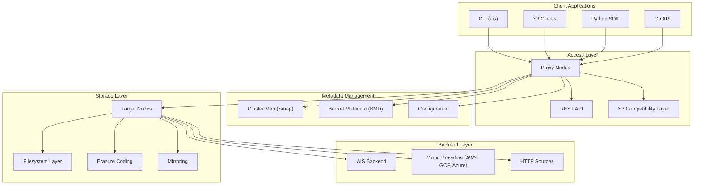

Sources:
- [ais/proxy.go:49-86]() - Proxy structure definition
- [ais/target.go:56-92]() - Target structure definition
- [cmn/config.go:50-168]() - Configuration structures
- [ais/clustermap.go:30-43]() - Cluster map definitions

## Key Terminology

| Term | Description |
|------|-------------|
| Proxy | Gateway node that handles client requests and cluster management |
| Target | Storage node that stores and serves data |
| Bucket | Container for objects with configurable properties |
| BMD | Bucket Metadata - cluster-wide registry of buckets and their properties |
| Smap | Cluster Map - contains information about all nodes in the cluster |
| Backend Provider | Storage provider that AIStore can interface with (AWS, GCP, Azure, etc.) |
| Mountpath | Local filesystem path used by target for object storage |
| Xaction | Extended Action - long-running asynchronous operation |

Sources:
- [README.md:1-56]() - Project overview
- [cmn/api.go:50-66]() - Bucket properties structure

## Data Flow

The following diagram illustrates how data flows through AIStore for common operations:

**Object Operation Flow**

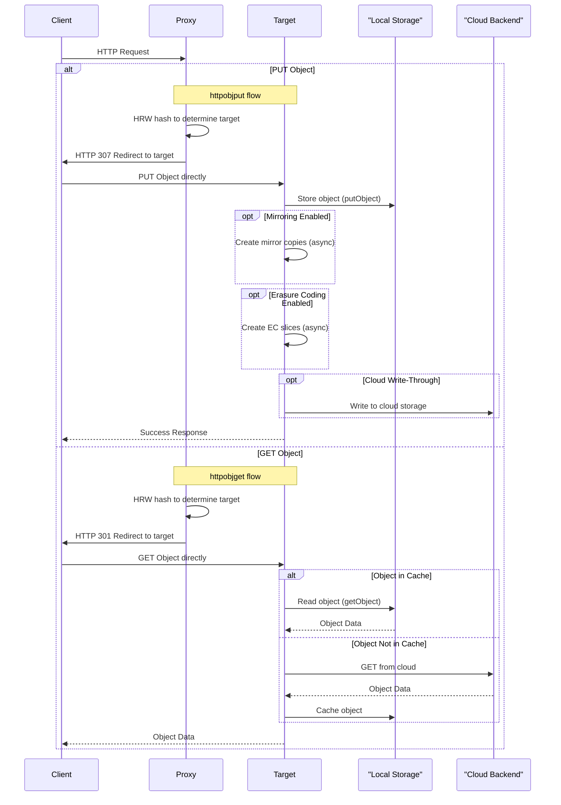

Sources:
- [ais/proxy.go:708-771]() - Object GET handling in proxy
- [ais/proxy.go:772-870]() - Object PUT handling in proxy
- [ais/target.go:732-865]() - Object GET handling in target
- [ais/target.go:886-990]() - Object PUT handling in target

## Core Components

### Proxy Architecture

Proxy nodes are the entry points to the AIStore system. They handle client requests, manage cluster metadata, and orchestrate operations across target nodes.

**Proxy Node Components**

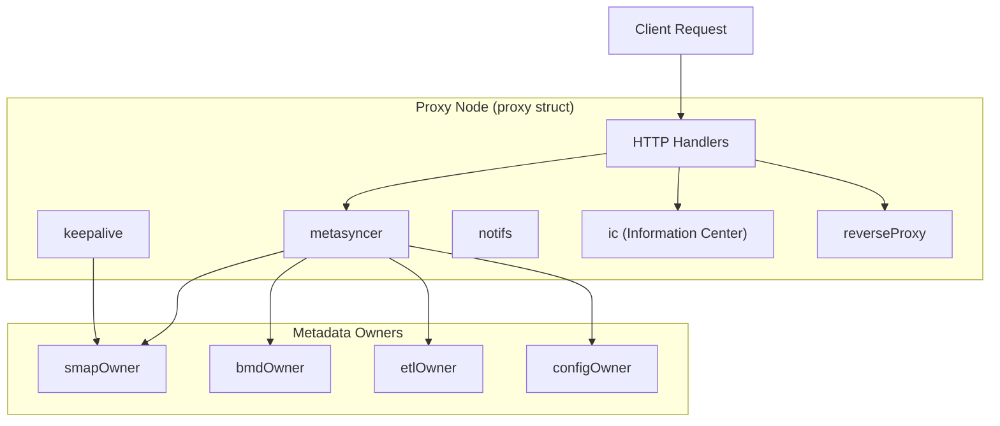

Sources:
- [ais/proxy.go:55-82]() - Proxy structure definition
- [ais/proxy.go:183-254]() - Proxy initialization
- [ais/proxy.go:437-494]() - HTTP handlers for object and bucket operations
- [ais/proxy.go:1010-1083]() - Metasync handler

### Target Architecture

Target nodes handle data storage and retrieval. They manage local disks, process object operations, and interact with backend providers for cloud integration.

**Target Node Components**

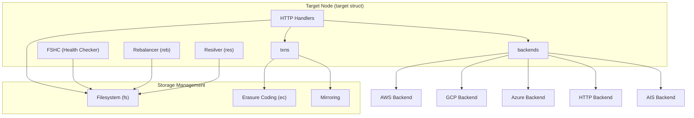

Sources:
- [ais/target.go:64-76]() - Target structure definition
- [ais/target.go:107-136]() - Backend interface implementation
- [ais/target.go:368-477]() - Target initialization and run
- [ais/target.go:554-574]() - HTTP handler registration

### Bucket System

Buckets in AIStore are containers for objects with configurable properties that determine behavior including replication, erasure coding, access control, and more.

**Bucket Properties**

| Property | Description | Default Source |
|----------|-------------|----------------|
| Provider | Backend provider (ais, aws, gcp, etc.) | User-specified |
| Checksum | Checksum type and validation | Global config |
| Versioning | Object versioning settings | Global config |
| Access | Access permissions | apc.AccessAll |
| EC | Erasure coding configuration | Global config |
| Mirror | Mirroring configuration | Global config |
| LRU | LRU eviction policy | Global config (disabled for AIS buckets) |
| RateLimit | Rate limiting configuration | Global config |

Sources:
- [cmn/api.go:50-66]() - Bucket properties structure (Bprops)
- [cmn/api.go:169-197]() - Default bucket properties initialization

### Cluster Management

AIStore uses several critical metadata structures to manage the cluster state:

1. **Smap (Cluster Map)**: Contains information about all nodes in the cluster, their roles, and network endpoints
2. **BMD (Bucket Metadata)**: Registry of all buckets and their properties
3. **Config**: Cluster and node configuration settings

These structures are maintained by the primary proxy and synchronized to all nodes through the metasync mechanism.

**Metadata Synchronization Flow**

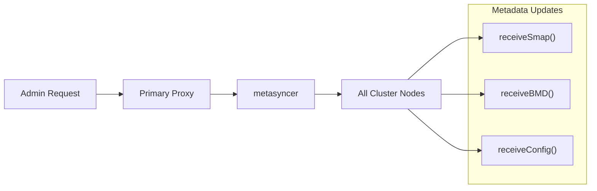

Sources:
- [ais/metasync.go:33-41]() - Metasync system overview
- [ais/clustermap.go:30-43]() - Cluster map structure
- [ais/bucketmeta.go:30-35]() - Bucket metadata structure

## Advanced Features

### Transactions

For operations that span multiple nodes and require consistency, AIStore implements a transaction system with begin-commit-abort semantics.

**Transaction Flow**

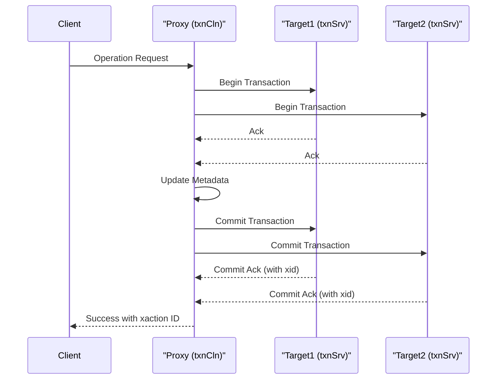

Sources:
- [ais/prxtxn.go:30-135]() - Proxy transaction client (txnCln)
- [ais/tgttxn.go:38-178]() - Target transaction server (txnSrv)

### Backend Integration

AIStore seamlessly integrates with multiple backend storage providers, allowing it to serve as both a standalone storage system and a caching layer for cloud storage.

**Backend Provider Architecture**

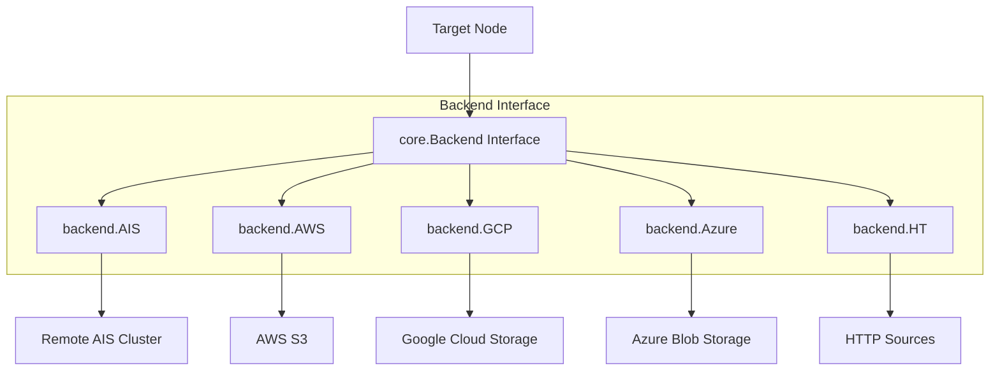

Sources:
- [ais/target.go:107-136]() - Backend method in target
- [ais/backend/ais.go]() - AIS backend implementation
- [cmn/config.go:170-174]() - Backend configuration structures

### Extended Actions (Xactions)

AIStore uses extended actions (Xactions) for long-running operations like rebalancing, erasure coding, and object transformations.

**Xactions System**

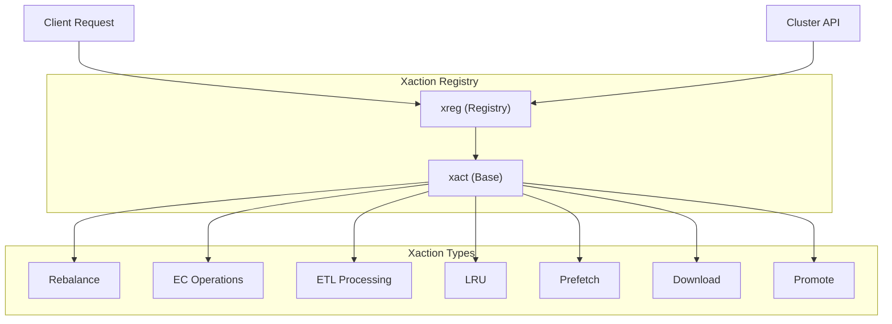

Sources:
- [xact/README.md]() - Xactions documentation
- [xact/xreg/registry.go]() - Xaction registry implementation

## Conclusion

AIStore is a high-performance distributed object storage system optimized for AI and machine learning workloads. Its architecture consists of proxy and target nodes with a clear separation of concerns and extensive support for backend storage providers.

With features like erasure coding, mirroring, and ETL processing, AIStore provides a comprehensive solution for data storage and processing needs beyond just AI applications, including general object storage, caching, and distributed data transformation.

For more detailed information about using and administering AIStore, please refer to the specific wiki pages on [CLI](#7.1), [Bucket Management](#3), and [Deployment](#10).

Sources:
- [README.md:1-56]() - Project overview and features
- [cmn/ver_const.go:10-13]() - Version information

---

# Page: Key Terminology

# Key Terminology

<details>
<summary>Relevant source files</summary>

The following files were used as context for generating this wiki page:

- [README.md](README.md)
- [ais/bucketmeta.go](ais/bucketmeta.go)
- [ais/clustermap.go](ais/clustermap.go)
- [ais/earlystart.go](ais/earlystart.go)
- [ais/htcommon.go](ais/htcommon.go)
- [ais/htrun.go](ais/htrun.go)
- [ais/kalive.go](ais/kalive.go)
- [ais/metasync.go](ais/metasync.go)
- [ais/proxy.go](ais/proxy.go)
- [ais/prxclu.go](ais/prxclu.go)
- [ais/prxtxn.go](ais/prxtxn.go)
- [ais/rebmeta.go](ais/rebmeta.go)
- [ais/target.go](ais/target.go)
- [ais/tgtcp.go](ais/tgtcp.go)
- [ais/tgtimpl.go](ais/tgtimpl.go)
- [ais/tgtobj.go](ais/tgtobj.go)
- [ais/tgttxn.go](ais/tgttxn.go)
- [ais/txn.go](ais/txn.go)
- [ais/vote.go](ais/vote.go)
- [api/bucket.go](api/bucket.go)
- [api/client.go](api/client.go)
- [api/object.go](api/object.go)
- [cmn/api.go](cmn/api.go)
- [cmn/err.go](cmn/err.go)
- [cmn/owt.go](cmn/owt.go)
- [cmn/ver_const.go](cmn/ver_const.go)
- [core/mock/target_mock.go](core/mock/target_mock.go)
- [core/target.go](core/target.go)
- [docs/batch.md](docs/batch.md)
- [docs/bucket.md](docs/bucket.md)
- [docs/cli.md](docs/cli.md)
- [docs/cli/alias.md](docs/cli/alias.md)
- [docs/configuration.md](docs/configuration.md)
- [docs/docs.md](docs/docs.md)
- [docs/http_api.md](docs/http_api.md)
- [docs/index.md](docs/index.md)
- [docs/overview.md](docs/overview.md)
- [docs/providers.md](docs/providers.md)
- [docs/rebalance.md](docs/rebalance.md)
- [docs/storage_svcs.md](docs/storage_svcs.md)
- [mirror/utils.go](mirror/utils.go)
- [mirror/utils_test.go](mirror/utils_test.go)

</details>


This page defines the key terms and concepts used throughout the AIStore system. Understanding these foundational elements will help you navigate the codebase and documentation more effectively. For detailed information about the system architecture, see [Core Architecture](#2).

## Core Components

### Nodes: Proxy and Target

AIStore clusters consist of two types of nodes:

1. **Proxy Node**: Acts as a gateway for client requests, maintains cluster metadata, and coordinates operations across the cluster.
   - Key responsibilities:
     - Forwards client requests to appropriate target nodes
     - Maintains and distributes the cluster map (Smap)
     - Manages bucket metadata (BMD)
     - Coordinates distributed transactions
     - Handles authentication and authorization

2. **Target Node**: Stores and manages actual data (objects), interacts with backend storage systems, and executes extended operations (xactions).
   - Key responsibilities:
     - Stores objects on local file systems
     - Executes data operations (read, write, delete)
     - Implements data protection mechanisms (erasure coding, mirroring)
     - Connects to remote storage backends
     - Participates in rebalancing and other distributed operations

#### Diagram: AIStore Node Types and Their Relationships

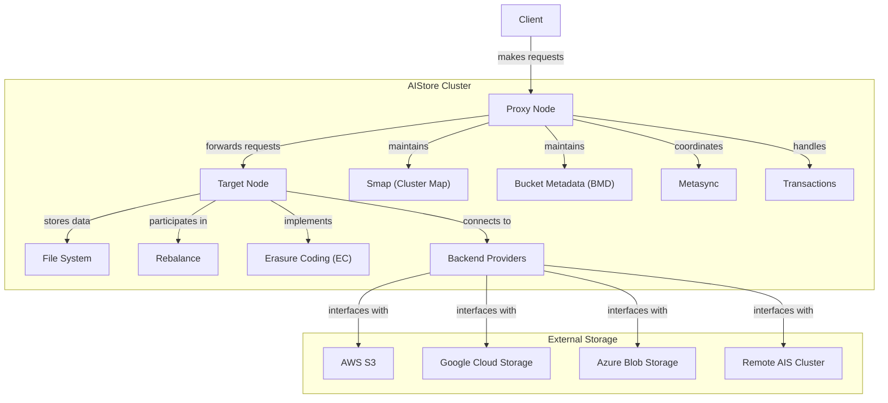

Sources: [ais/proxy.go:54-80](), [ais/target.go:56-76]()

### Cluster Map (Smap)

The Smap is a fundamental data structure that represents the current membership and topology of the AIStore cluster.

- Key features:
  - Identifies the primary proxy
  - Lists all proxy and target nodes with their network information
  - Maintains version information for cluster-wide consistency
  - Used for request routing and distributed operations

Sources: [ais/clustermap.go:30-39]()

### Bucket Metadata (BMD)

BMD is a cluster-wide metadata structure that maintains information about all buckets in the system.

- Key features:
  - Tracks all buckets and their properties
  - Distributed to all nodes via metasync
  - Used for bucket operations and policy enforcement

Sources: [ais/bucketmeta.go:1-16]()

## Storage Concepts

### Buckets

Buckets are logical containers for objects and serve as the primary organizational unit within AIStore.

- Types:
  - **AIS Buckets**: Native buckets managed entirely by AIStore
  - **Cloud Buckets**: Represent and can interact with buckets in cloud storage (AWS, GCP, Azure, etc.)
  - **Remote AIS Buckets**: Buckets in a remote AIStore cluster

- Key properties (managed by `Bprops` struct):
  - Checksum configuration
  - Erasure coding settings
  - LRU (Least Recently Used) policies
  - Mirroring configuration
  - Access control
  - Versioning settings
  - Rate limiting options

Sources: [cmn/api.go:50-66](), [docs/bucket.md:12-23]()

### Objects

Objects are the fundamental data entities stored in buckets.

- Key operations:
  - GET: Retrieve an object
  - PUT: Store an object
  - DELETE: Remove an object
  - HEAD: Get object metadata

- Properties:
  - Name
  - Content type
  - Size
  - Checksum
  - Version
  - Custom metadata

#### Diagram: Data Organization and Access Flow

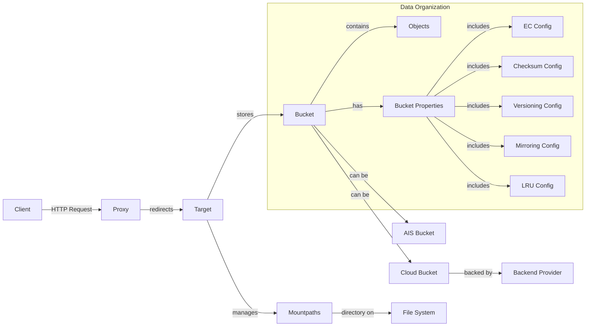

Sources: [ais/proxy.go:709-912](), [ais/tgtobj.go:732-963](), [api/object.go:32-90]()

### Mountpaths

Mountpaths are filesystem directories used by target nodes to store objects.

- Key features:
  - Multiple mountpaths per target for increased capacity and parallelism
  - Health monitoring via FSHC (FileSystem Health Checker)
  - Can be added or removed at runtime

Sources: [ais/target.go:376-387]()

## Extended Operations (Xactions)

Xactions (extended actions) are long-running, asynchronous operations that execute across the cluster.

- Types of xactions:
  - **Rebalance**: Redistributes objects when cluster membership changes
  - **Erasure Coding (EC)**: Encodes and decodes objects for data protection
  - **Copy Bucket (TCB)**: Copies entire buckets
  - **Copy Objects (TCO)**: Copies selected objects
  - **Archiving**: Creates and manages archives
  - **Downloads**: Downloads objects from external sources
  - **Distributed Sort (dsort)**: Sorts and reshards objects
  - **ETL**: Transforms data during processing

#### Diagram: Extended Actions and Monitoring System

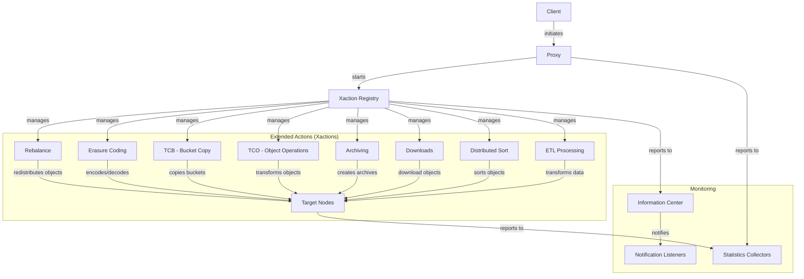

Sources: [ais/tgttxn.go:100-159]()

## Network and Communication

### REST API

AIStore provides a comprehensive REST API for operations on buckets, objects, and cluster management.

- Key endpoints:
  - `/v1/buckets`: Bucket operations ([ais/proxy.go:437-468]())
  - `/v1/objects`: Object operations ([ais/proxy.go:470-493]())
  - `/v1/daemon`: Daemon management ([ais/htrun.go:141-157]())
  - `/v1/cluster`: Cluster operations ([ais/prxclu.go:36-49]())
  - `/v1/download`: Download management
  - `/v1/etl`: ETL operations

Sources: [docs/http_api.md:10-16](), [ais/target.go:554-573]()

### S3 Compatibility

AIStore provides compatibility with Amazon S3 API for easier integration with existing applications.

- Endpoint: `/s3`
- Allows running unmodified S3 clients and applications against AIStore

Sources: [ais/proxy.go:226-232](), [ais/target.go:571](), [README.md:14]()

### Easy URL

A simplified URL scheme for accessing objects without using the full REST API path.

- Format: `/<provider>/<bucket>/<object>`
- Supported providers:
  - `gs`: Google Cloud Storage
  - `az`: Azure Blob Storage
  - `ais`: AIStore

Example:
```
GET /gs/my-bucket/object.txt  # Access Google Cloud Storage
GET /ais/local-bucket/data.csv # Access AIS bucket
```

Sources: [ais/proxy.go:497-587]()

## Backend Integration

### Backend Providers

AIStore can interface with various external storage systems through backend providers.

- Supported providers:
  - AWS S3
  - Google Cloud Storage
  - Azure Blob Storage
  - Oracle Cloud Infrastructure (OCI)
  - HTTP data sources
  - Remote AIStore clusters

Sources: [ais/target.go:106-128](), [ais/target.go:137-237](), [README.md:16]()

### Remote AIS Clusters

AIStore clusters can be interconnected, allowing visibility and access to objects across clusters.

- Features:
  - Attach remote clusters to create a global namespace
  - Access objects in remote clusters transparently
  - Copy data between clusters

Sources: [ais/proxy.go:62-72](), [ais/prxclu.go:235-267](), [README.md:74]()

## Transactions and Metadata Synchronization

### Transactions

Transactions are used to ensure consistency for operations that affect multiple nodes or require atomicity.

- Components:
  - `txnCln`: Client-side transaction context ([ais/prxtxn.go:33-45]())
  - `txnSrv`: Server-side transaction context ([ais/tgttxn.go:37-55]())
  - Phases: Begin, Commit, Abort

Sources: [ais/prxtxn.go:46-127](), [ais/tgttxn.go:59-177]()

### Metasync

Metasync is the process of synchronizing cluster metadata (Smap, BMD, etc.) across all nodes.

- Key features:
  - Ensures all nodes have consistent view of cluster state
  - Handles synchronization of Smap, BMD, and other metadata
  - Used during cluster membership changes and bucket operations

Sources: [ais/metasync.go:29-33]()

## Table: Common HTTP API Actions

| Action | Description | HTTP Method | Path |
|--------|-------------|-------------|------|
| `ActCreateBck` | Create bucket | POST | /v1/buckets |
| `ActListBuckets` | List buckets | GET | /v1/buckets |
| `ActListObjects` | List objects | GET | /v1/buckets/bucket-name |
| `ActPutObject` | Put object | PUT | /v1/objects/bucket-name/object-name |
| `ActGetObject` | Get object | GET | /v1/objects/bucket-name/object-name |
| `ActDeleteObject` | Delete object | DELETE | /v1/objects/bucket-name/object-name |
| `ActCopyBck` | Copy bucket | POST | /v1/buckets/bucket-name |
| `ActECEncode` | Erasure code objects | PUT | /v1/ec |
| `ActRebalance` | Rebalance cluster | POST | /v1/cluster |

Sources: [ais/proxy.go:437-493](), [docs/http_api.md:15-16]()

---

# Page: Core Architecture

# Core Architecture

<details>
<summary>Relevant source files</summary>

The following files were used as context for generating this wiki page:

- [ais/bucketmeta.go](ais/bucketmeta.go)
- [ais/clustermap.go](ais/clustermap.go)
- [ais/daemon.go](ais/daemon.go)
- [ais/earlystart.go](ais/earlystart.go)
- [ais/htcommon.go](ais/htcommon.go)
- [ais/htrun.go](ais/htrun.go)
- [ais/kalive.go](ais/kalive.go)
- [ais/metasync.go](ais/metasync.go)
- [ais/proxy.go](ais/proxy.go)
- [ais/prxclu.go](ais/prxclu.go)
- [ais/prxtxn.go](ais/prxtxn.go)
- [ais/rebmeta.go](ais/rebmeta.go)
- [ais/target.go](ais/target.go)
- [ais/tgtcp.go](ais/tgtcp.go)
- [ais/tgttxn.go](ais/tgttxn.go)
- [ais/txn.go](ais/txn.go)
- [ais/vote.go](ais/vote.go)
- [api/bucket.go](api/bucket.go)
- [api/client.go](api/client.go)
- [api/object.go](api/object.go)
- [cmd/aisinit/config.go](cmd/aisinit/config.go)
- [cmn/api.go](cmn/api.go)
- [cmn/config.go](cmn/config.go)
- [cmn/iter_fields.go](cmn/iter_fields.go)
- [cmn/tests/api_test.go](cmn/tests/api_test.go)
- [cmn/tests/common_test.go](cmn/tests/common_test.go)
- [cmn/tests/config_test.go](cmn/tests/config_test.go)
- [cmn/tests/configs/config.json](cmn/tests/configs/config.json)
- [cmn/tests/iter_fields_test.go](cmn/tests/iter_fields_test.go)
- [deploy/dev/local/aisnode_config.fspaths.sh](deploy/dev/local/aisnode_config.fspaths.sh)
- [deploy/dev/local/aisnode_config.sh](deploy/dev/local/aisnode_config.sh)

</details>


This document describes the fundamental architecture of AIStore (AIS), including its node types, core components, and their interactions. For information about specific subsystems like rebalancing or erasure coding, please refer to their dedicated sections in the documentation.

## Overview

AIStore is a distributed object storage system designed for high-performance AI and deep learning workloads. It follows a clustered architecture with two primary node types:

1. **Proxy nodes**: The entry points for client requests that manage cluster state and coordinate operations
2. **Target nodes**: Storage nodes that handle data operations and manage physical storage resources

One proxy in the cluster is designated as the **primary** (leader), responsible for cluster-wide decision making, metadata management, and orchestrating distributed operations.

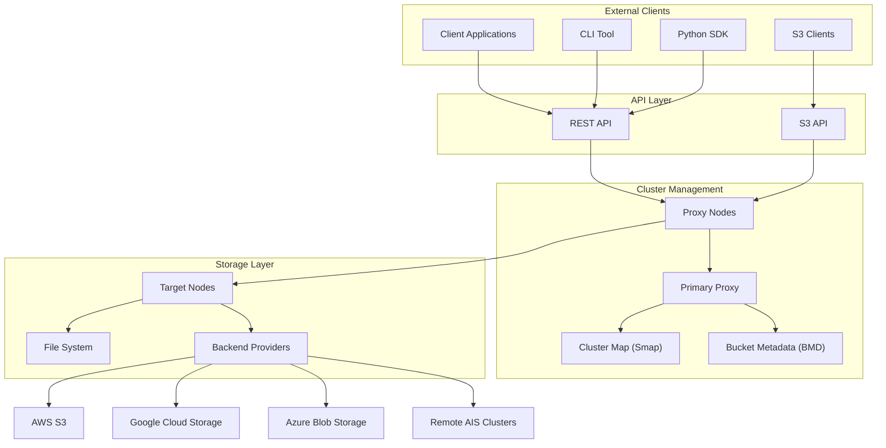

Sources:
- [ais/proxy.go:55-83]()
- [ais/target.go:56-76]()
- [api/client.go]()

## Common Node Infrastructure

Both proxy and target nodes are built on a common foundation called `htrun` (HTTP runner), which provides shared infrastructure for:

- HTTP server and request handling
- Node identity management
- Metadata access
- Configuration management
- Memory management
- Stats collection

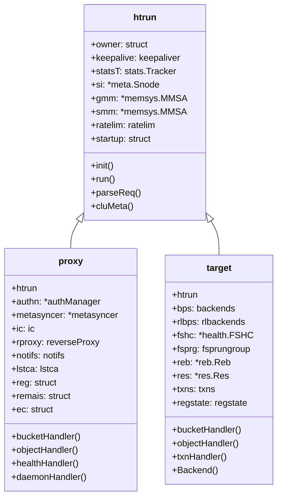

Sources:
- [ais/htrun.go:75-93]()
- [ais/proxy.go:55-83]()
- [ais/target.go:56-76]()

## Proxy Nodes

Proxy nodes handle client requests and manage cluster metadata. The primary proxy has additional responsibilities for cluster management and metadata distribution.

Key components and functionalities of proxy nodes include:

1. **API Handlers**: Process client HTTP requests for various endpoints
2. **Request Routing**: Direct requests to appropriate target nodes based on consistent hashing
3. **Metadata Management**: Manage and distribute cluster metadata (Smap, BMD)
4. **Information Center (IC)**: Handle inter-node communication and notifications
5. **Metasync**: Distribute metadata changes across the cluster

### Request Handlers

Proxy nodes register HTTP handlers for various endpoints, which process client requests and either respond directly or redirect to appropriate target nodes:

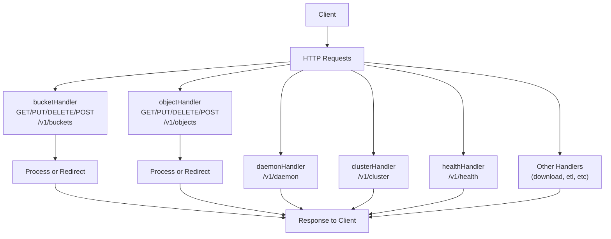

Sources:
- [ais/proxy.go:207-257]()
- [ais/proxy.go:437-493]()
- [ais/proxy.go:656-912]()

## Target Nodes

Target nodes handle actual data storage and retrieval operations, managing the local file system and integration with backend storage providers.

Key components and functionalities of target nodes include:

1. **Object Operations**: Handle GET, PUT, DELETE for objects
2. **Backend Integration**: Connect with various storage backends (AWS, GCP, Azure, etc.)
3. **File System Management**: Manage local storage resources
4. **Transaction Handling**: Execute distributed transactions
5. **Extended Actions**: Perform rebalancing, erasure coding, and other maintenance operations

### Backend Providers

Target nodes implement a common backend interface for interacting with different storage systems:

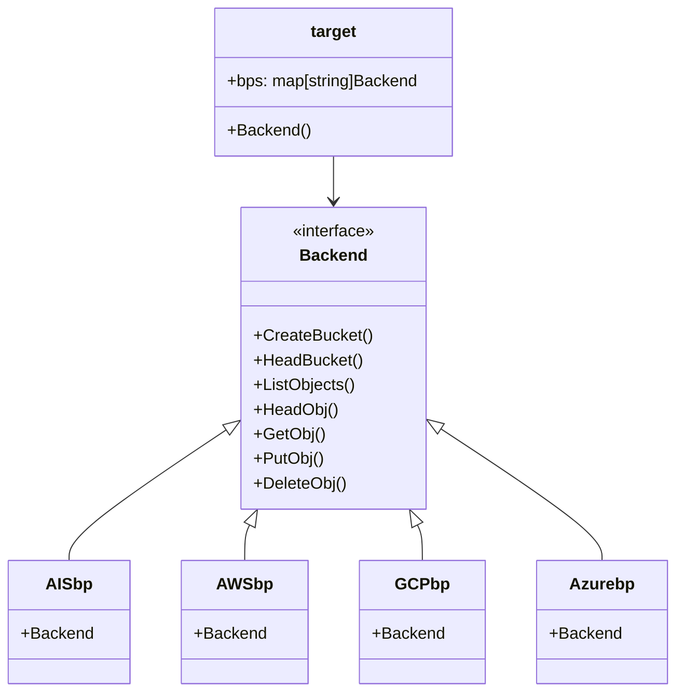

Sources:
- [ais/target.go:107-127]()
- [ais/target.go:137-161]()

## Metadata Management

AIStore manages cluster state through several key metadata structures:

### Cluster Map (Smap)

The Cluster Map (Smap) represents the cluster's topology and is the source of truth for:
- Which nodes are in the cluster (proxies and targets)
- Their roles, network addresses, and capabilities
- Which proxy is the primary

The Smap is versioned and immutable - updates create new versions that are distributed through the metasync system:

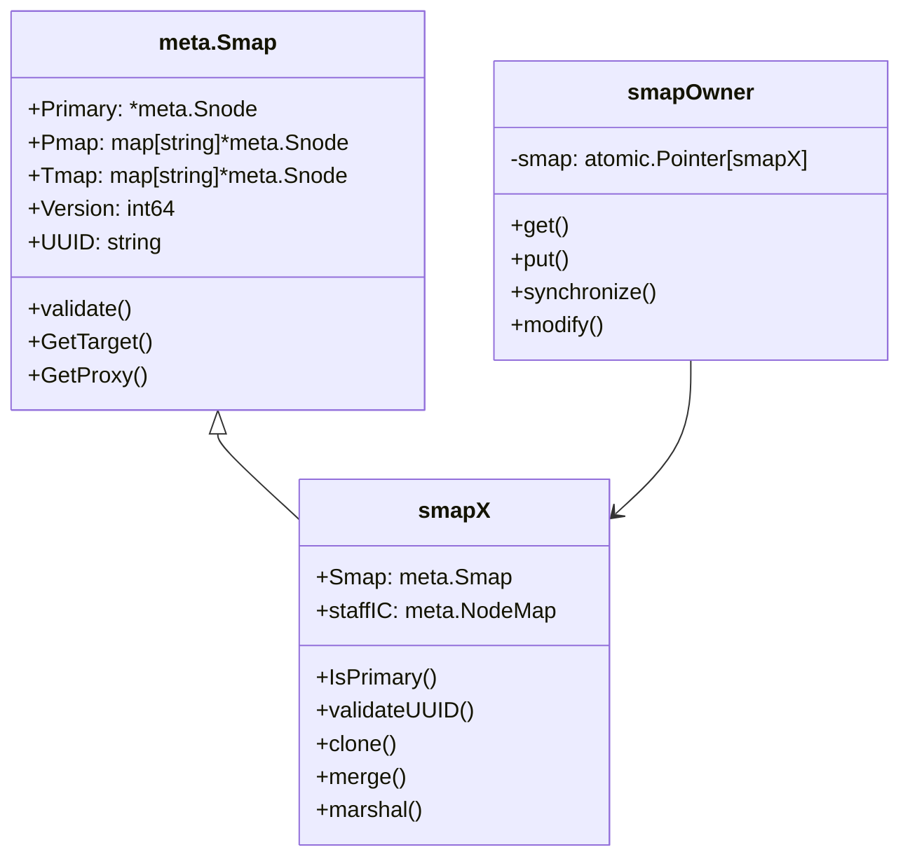

Sources:
- [ais/clustermap.go]()

### Bucket Metadata (BMD)

The Bucket Metadata (BMD) manages bucket configurations and properties:

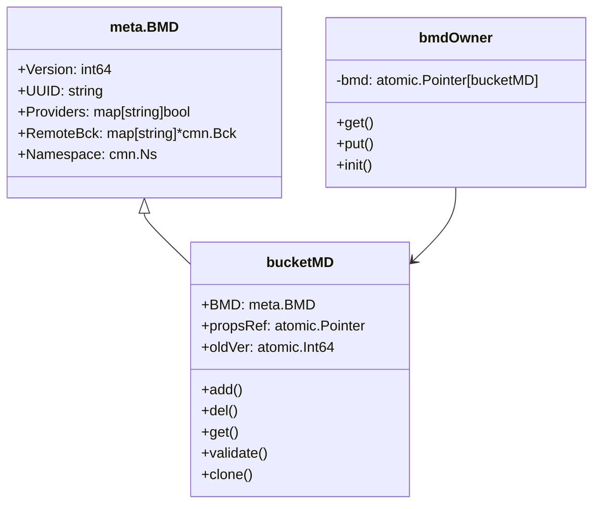

Sources:
- [ais/bucketmeta.go]()

## Object Operations

AIStore implements a redirection-based approach for object operations. Here's how a typical object GET flow works:

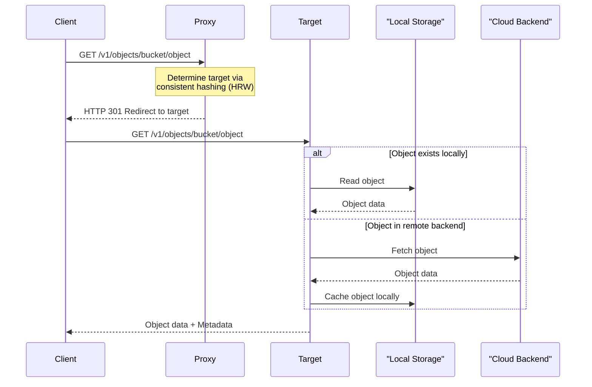

And for a PUT operation:

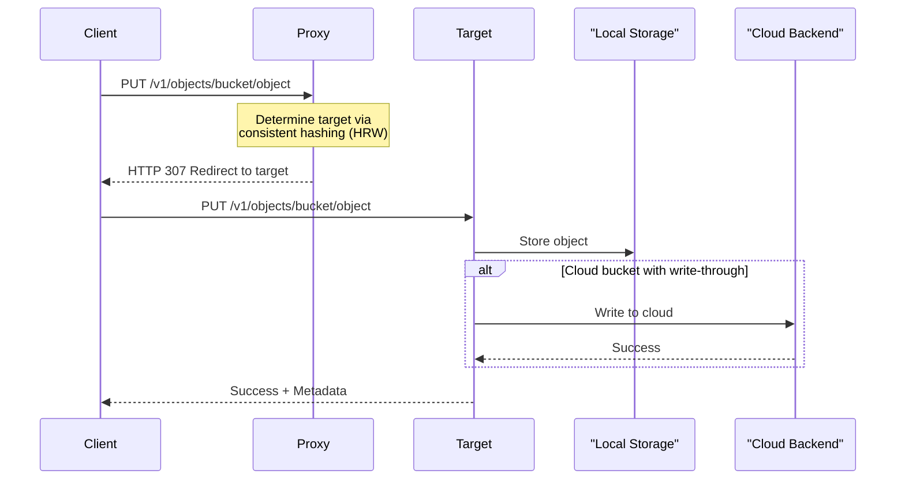

Sources:
- [ais/proxy.go:709-771]()
- [ais/proxy.go:774-870]()
- [ais/target.go:732-768]()
- [ais/target.go:888-963]()

## Transaction System

AIStore uses a two-phase commit protocol for distributed transactions, with components on both proxy and target nodes:

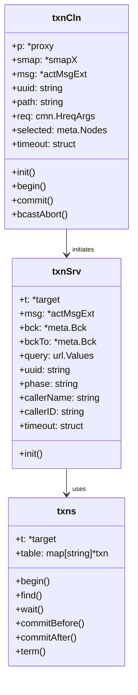

Transaction flow for operations like create bucket:

```mermaid
sequenceDiagram
    participant Client
    participant Proxy
    participant Target1
    participant Target2
    
    Client->>Proxy: Create bucket request
    
    Proxy->>Proxy: Create txnCln
    
    Proxy->>Target1: BEGIN phase
    Proxy->>Target2: BEGIN phase
    Target1-->>Proxy: OK
    Target2-->>Proxy: OK
    
    Proxy->>Proxy: Update BMD locally
    Proxy->>Proxy: Distribute BMD via metasync
    
    Proxy->>Target1: COMMIT phase
    Proxy->>Target2: COMMIT phase
    Target1-->>Proxy: OK (with xaction ID)
    Target2-->>Proxy: OK (with xaction ID)
    
    Proxy-->>Client: Success
```

Sources:
- [ais/prxtxn.go:33-157]()
- [ais/tgttxn.go:37-178]()
- [ais/txn.go]()

## Metadata Synchronization

The metasync system ensures that metadata changes (Smap, BMD) are consistently propagated throughout the cluster:

```mermaid
classDiagram
    class metasyncer {
        +p: *proxy
        +smap: *smapX
        +callbackCnt: int
        +last: atomic.Int64
        +listeners: map[string]metasyncer.Listener
        +prev: atomic.Pointer[cluMeta]
        +sync()
    }
    
    class cluMeta {
        +SI: *meta.Snode
        +Smap: *smapX
        +BMD: *bucketMD
        +Config: *cmn.Config
        +RMD: *rebMD
        +EtlMD: *etlMD
        +PrimeTime: int64
        +Flags: cos.BitFlags
    }
    
    metasyncer --> cluMeta: distributes
    
    class htrun {
        +receiveSmap()
        +receiveBMD()
        +receiveConfig()
    }
    
    cluMeta --> htrun: received by
```

Primary proxy initiates metadata synchronization by creating a `cluMeta` package with updated metadata and distributing it to all nodes in the cluster.

Sources:
- [ais/metasync.go]()
- [ais/htrun.go]()

## Startup and Initialization

AIStore nodes follow a carefully designed startup sequence:

### Proxy Startup

```mermaid
flowchart TD
    start["Start proxy"] --> init["Initialize htrun:
    - Parse configuration
    - Set node ID
    - Register handlers"]
    
    init --> loadmeta["Load local metadata
    (Smap, BMD)"]
    
    loadmeta --> checkrole{"Determine role
    (primary or not)"}
    
    checkrole -- "Primary" --> pstart["Primary startup:
    - Wait for targets to join
    - Initialize metadata
    - Start metasync"]
    
    checkrole -- "Non-primary" --> npstart["Non-primary startup:
    - Join existing cluster
    - Receive metadata"]
    
    pstart --> ready["Ready to serve requests"]
    npstart --> ready
```

### Target Startup

```mermaid
flowchart TD
    start["Start target"] --> init["Initialize htrun:
    - Parse configuration
    - Set node ID
    - Register handlers"]
    
    init --> initfs["Initialize file system:
    - Register mountpaths
    - Check available space"]
    
    initfs --> initb["Initialize backends:
    - AWS, GCP, Azure, etc."]
    
    initb --> join["Join cluster:
    - Contact proxy
    - Register self"]
    
    join --> recvmeta["Receive cluster metadata:
    - Smap
    - BMD"]
    
    recvmeta --> ready["Ready to serve requests"]
```

Sources:
- [ais/daemon.go]()
- [ais/proxy.go:183-254]()
- [ais/target.go:368-477]()
- [ais/earlystart.go:53-105]()

## Configuration System

AIStore uses a hierarchical configuration system that includes:

1. **Global (Cluster) Configuration**: Shared across all nodes
2. **Local Configuration**: Node-specific settings

The configuration is stored in a `cmn.Config` structure:

```mermaid
classDiagram
    class Config {
        +LocalConfig: LocalConfig
        +ClusterConfig: ClusterConfig
        +role: string
    }
    
    class LocalConfig {
        +FSP: FSPConf
        +ConfigDir: string
        +LogDir: string
        +TestFSP: TestFSPConf
        +HostNet: LocalNetConfig
    }
    
    class ClusterConfig {
        +Backend: BackendConf
        +Mirror: MirrorConf
        +EC: ECConf
        +Versioning: VersionConf
        +Net: NetConf
        +Timeout: TimeoutConf
        +Space: SpaceConf
        +LRU: LRUConf
        +Disk: DiskConf
        +Rebalance: RebalanceConf
        +Client: ClientConf
        +Features: feat.Flags
    }
    
    Config *-- LocalConfig
    Config *-- ClusterConfig
```

Configuration changes follow the same transaction and metasync patterns as other metadata updates.

Sources:
- [cmn/config.go:51-168]()

## Conclusion

AIStore's core architecture is designed for scalability, performance, and flexibility. The clear separation between proxy and target nodes, coupled with robust metadata management and synchronization, provides a solid foundation for a high-performance distributed object storage system.

Key architectural strengths include:
- Clear separation of concerns between proxy and target nodes
- Robust metadata management with versioning and consistent distribution
- Flexible backend integration supporting multiple cloud providers
- Scalable design with horizontal scaling of both proxy and target nodes
- Transaction-based approach for maintaining system consistency

Sources:
- [ais/proxy.go]()
- [ais/target.go]()
- [ais/htrun.go]()
- [cmn/config.go]()

---

# Page: Proxy Nodes

# Proxy Nodes

<details>
<summary>Relevant source files</summary>

The following files were used as context for generating this wiki page:

- [ais/backend/awsmpt.go](ais/backend/awsmpt.go)
- [ais/backend/mock_aws.go](ais/backend/mock_aws.go)
- [ais/backend/mock_azure.go](ais/backend/mock_azure.go)
- [ais/backend/mock_gcp.go](ais/backend/mock_gcp.go)
- [ais/bucketmeta.go](ais/bucketmeta.go)
- [ais/clustermap.go](ais/clustermap.go)
- [ais/earlystart.go](ais/earlystart.go)
- [ais/htcommon.go](ais/htcommon.go)
- [ais/htrun.go](ais/htrun.go)
- [ais/kalive.go](ais/kalive.go)
- [ais/metasync.go](ais/metasync.go)
- [ais/proxy.go](ais/proxy.go)
- [ais/prxclu.go](ais/prxclu.go)
- [ais/prxdl.go](ais/prxdl.go)
- [ais/prxs3.go](ais/prxs3.go)
- [ais/prxtxn.go](ais/prxtxn.go)
- [ais/rebmeta.go](ais/rebmeta.go)
- [ais/s3/const.go](ais/s3/const.go)
- [ais/s3/mpt.go](ais/s3/mpt.go)
- [ais/s3/types.go](ais/s3/types.go)
- [ais/s3/xattr.go](ais/s3/xattr.go)
- [ais/target.go](ais/target.go)
- [ais/tgtcp.go](ais/tgtcp.go)
- [ais/tgtdl.go](ais/tgtdl.go)
- [ais/tgts3.go](ais/tgts3.go)
- [ais/tgts3mpt.go](ais/tgts3mpt.go)
- [ais/tgttxn.go](ais/tgttxn.go)
- [ais/txn.go](ais/txn.go)
- [ais/vote.go](ais/vote.go)
- [api/bucket.go](api/bucket.go)
- [api/client.go](api/client.go)
- [api/object.go](api/object.go)
- [cmn/api.go](cmn/api.go)

</details>


This document describes proxy nodes in AIStore, which serve as the entry point and control plane for the cluster. Proxy nodes handle client requests, manage cluster membership, coordinate metadata distribution, and route operations to the appropriate target nodes. For information about target nodes, which handle data storage and processing, see [Target Nodes](#2.2).

## Proxy Node Architecture

In AIStore's architecture, proxy nodes play a critical role in cluster management and request handling. A key feature is the primary-backup architecture where one proxy node is designated as the primary, responsible for managing cluster membership and maintaining authoritative metadata, while other proxies operate in non-primary mode.

```mermaid
classDiagram
    class htrun {
        +owner struct
        +keepalive keepaliver
        +statsT stats.Tracker
        +si *meta.Snode
        +gmm *memsys.MMSA
        +smm *memsys.MMSA
        +parseReq()
        +cluMeta()
        +ClusterStarted()
        +NodeStarted()
    }
    
    class proxy {
        +htrun
        +authn *authManager
        +metasyncer *metasyncer
        +ic ic
        +rproxy reverseProxy
        +notifs notifs
        +lstca lstca
        +reg struct
        +remais struct
        +ec struct
        +Run() error
        +joinCluster()
        +recvCluMeta()
        +bucketHandler()
        +objectHandler()
    }
    
    htrun <|-- proxy
```

Key components of a proxy node include:

1. **Authentication Manager (`authn`)**: Handles authentication and authorization for API requests
2. **Metasyncer (`metasyncer`)**: Distributes metadata updates to all nodes in the cluster
3. **Information Center (`ic`)**: Tracks extended operations (xactions) across the cluster
4. **Reverse Proxy (`rproxy`)**: Forwards requests to other nodes when needed
5. **Notifications System (`notifs`)**: Manages notifications for cluster events
6. **Node Registration (`reg`)**: Handles registration of nodes joining the cluster
7. **Metadata Owners**: Through the inherited `htrun.owner` field, manages various cluster metadata:
   - Smap (cluster membership)
   - BMD (bucket metadata)
   - RMD (rebalance metadata)
   - Configuration
   - ETL (extract-transform-load) metadata

Sources:
- [ais/proxy.go:49-83]()
- [ais/htrun.go:75-92]()

## Initialization and Startup

When a proxy node starts up, it follows a specific initialization sequence:

```mermaid
flowchart TD
    A["init()"] --> B["Load/Generate Node ID"]
    B --> C["Initialize Memory Managers"]
    C --> D["Register with Daemon"]
    D --> E["Initialize Stats Tracking"]
    E --> F["Initialize Keepalive"]
    F --> G["Initialize Metasyncer"]
    G --> H["Run()"]
    H --> I["Load Configuration"]
    I --> J["Initialize Owners (BMD, ETL)"]
    J --> K["Register HTTP Handlers"]
    K --> L["bootstrap()"]
    L --> M{"Primary?"}
    M -- "Yes" --> N["primaryStartup()"]
    M -- "No" --> O["secondaryStartup()"]
    O --> P["gojoin()"]
```

The initialization process in `proxy.init()` includes:

1. Loading or generating a unique node ID
2. Initializing memory managers and network settings
3. Registering with the daemon rungroup
4. Setting up statistics tracking

The `Run()` method then:
1. Initializes owners for bucket metadata and ETL metadata
2. Registers HTTP API handlers
3. Calls `bootstrap()` to determine the node's role and initiate the appropriate startup process

The bootstrap sequence handles primary discovery and role determination based on:
- Environment variables
- Existing local Smap (if present)
- Configuration settings

Sources:
- [ais/proxy.go:87-121]()
- [ais/proxy.go:183-254]()
- [ais/earlystart.go:48-105]()

## Request Handling

Proxy nodes handle various client requests through a set of HTTP handlers registered during initialization:

```mermaid
flowchart LR
    Client["Client Applications"] --> ProxyNode["Proxy Node"]
    
    subgraph "Proxy Node API Handlers"
        bucketHandler["bucketHandler\n/v1/buckets"]
        objectHandler["objectHandler\n/v1/objects"]
        daemonHandler["daemonHandler\n/v1/daemon"]
        clusterHandler["clusterHandler\n/v1/cluster"]
        healthHandler["healthHandler\n/v1/health"]
        s3Handler["s3Handler\n/s3"]
    end
    
    ProxyNode --> bucketHandler
    ProxyNode --> objectHandler
    ProxyNode --> daemonHandler
    ProxyNode --> clusterHandler
    ProxyNode --> healthHandler
    ProxyNode --> s3Handler
    
    bucketHandler --> Operations["Route/Process Operations"]
    objectHandler --> Operations
    
    Operations --> Redirect["Redirect to Target"]
    Operations --> Forward["Forward to Primary"]
    Operations --> Process["Process Locally"]
```

The key API endpoints and their handlers include:

1. **Bucket Handler** (`/v1/buckets`): 
   - GET: List buckets or objects in a bucket
   - PUT: Perform bucket operations (archive)
   - POST: Create bucket, set bucket properties
   - DELETE: Destroy bucket or evict objects
   - HEAD: Get bucket properties/metadata

2. **Object Handler** (`/v1/objects`): 
   - GET: Retrieve objects
   - PUT: Upload objects
   - POST: Perform operations on objects
   - DELETE: Delete objects
   - HEAD: Get object metadata

3. **Cluster Handler** (`/v1/cluster`):
   - GET: Query cluster states and stats
   - POST: Handle node joins and keepalives
   - PUT/DELETE: Perform cluster management operations

4. **Health Handler** (`/v1/health`):
   - Reports node and cluster health status
   - Used for internal health monitoring

5. **S3 Handler** (`/s3`):
   - Provides S3-compatible API support

Sources:
- [ais/proxy.go:208-241]()
- [ais/proxy.go:437-493]()
- [ais/prxclu.go:36-53]()

## Object Operation Flow

A key function of proxy nodes is routing object operations to the appropriate target nodes:

```mermaid
sequenceDiagram
    participant Client
    participant Proxy
    participant Target
    
    Client->>Proxy: GET /v1/objects/bucket/object
    Note over Proxy: Parse request
    Note over Proxy: Initialize bucket
    Note over Proxy: Rate limit check
    Proxy->>Proxy: HRW to select target
    Proxy-->>Client: HTTP 301 Redirect to Target
    Client->>Target: GET /v1/objects/bucket/object
    Target-->>Client: Object Data
    
    Client->>Proxy: PUT /v1/objects/bucket/object
    Note over Proxy: Parse request
    Note over Proxy: Initialize bucket
    Note over Proxy: Rate limit check
    Proxy->>Proxy: HRW to select target
    Proxy-->>Client: HTTP 307 Redirect to Target
    Client->>Target: PUT /v1/objects/bucket/object
    Target-->>Client: Success Response
```

### GET Object Flow

For GET requests (`httpobjget`), the proxy:

1. Parses the request to extract bucket and object names
2. Initializes the bucket context and checks if the bucket exists
3. Validates permissions (if configured)
4. Applies rate limiting if configured
5. Uses HRW (Highest Random Weight) hashing to select the target node
6. Redirects the client to the selected target node with HTTP 301

### PUT Object Flow

For PUT requests (`httpobjput`), the flow is similar, but with these differences:
1. The proxy uses a temporary (307) redirect instead of a permanent redirect
2. Additional headers may be set for operations like append
3. Different permissions are checked

Sources:
- [ais/proxy.go:709-772]()
- [ais/proxy.go:774-870]()

## Primary Role and Cluster Management

AIStore uses a primary-backup architecture for proxy nodes. The primary proxy is responsible for:
- Maintaining the authoritative cluster map (Smap)
- Handling node joins and departures
- Coordinating metadata distribution
- Managing bucket operations

### Node Registration and Cluster Join Process

When a node joins the cluster:

```mermaid
sequenceDiagram
    participant JoiningNode as Joining Node
    participant Primary as Primary Proxy
    participant OtherNodes as Other Nodes
    
    Note over JoiningNode: Initialize
    JoiningNode->>Primary: POST /v1/cluster/join
    Primary->>Primary: Validate join request
    Primary->>Primary: Add node to Smap
    Primary->>JoiningNode: Send cluster metadata
    Primary->>OtherNodes: Metasync new Smap
    JoiningNode->>JoiningNode: Process cluster metadata
    JoiningNode->>Primary: Regular keepalives
```

The joining process via `joinCluster()` involves:

1. The node sends a join request with its info to the primary
2. The primary validates the request and checks for duplicate IDs
3. The primary adds the node to the Smap
4. The primary sends back the current cluster metadata (Smap, BMD, etc.)
5. The primary syncs the updated Smap to all nodes
6. The joining node begins participating in cluster operations

Sources:
- [ais/proxy.go:256-269]()
- [ais/prxclu.go:352-553]()

## Metadata Management and Synchronization

Proxies manage several types of cluster metadata:

1. **Smap** (cluster map): Information about all nodes in the cluster
2. **BMD** (bucket metadata): Information about buckets and their properties
3. **RMD** (rebalance metadata): State of cluster rebalancing
4. **Configuration**: Cluster-wide configuration

The metasync process ensures all nodes have consistent metadata:

```mermaid
sequenceDiagram
    participant Primary as Primary Proxy
    participant NonPrimary as Non-Primary Proxies
    participant Targets as Target Nodes
    
    Note over Primary: Metadata Update Event
    Primary->>Primary: Update Local Metadata
    Primary->>NonPrimary: PUT /v1/metasync
    Primary->>Targets: PUT /v1/metasync
    
    NonPrimary->>NonPrimary: Extract & Apply Updates
    Targets->>Targets: Extract & Apply Updates
    
    NonPrimary-->>Primary: Success/Error Response
    Targets-->>Primary: Success/Error Response
```

When metadata changes (like Smap updates), the primary:
1. Updates its local copy
2. Packages relevant updates into a payload (`cluMeta`)
3. Sends the payload to all nodes via PUT to `/v1/metasync`
4. Each node processes the updates via `recvCluMeta()`
5. Versioning ensures updates are applied in the correct order

The metasync handler (`metasyncHandler` in proxy.go) receives and processes metadata updates from the primary.

Sources:
- [ais/proxy.go:1010-1083]()
- [ais/metasync.go]()

## Transaction Management

For cluster-modifying operations, proxy nodes implement a transaction system to ensure consistency:

```mermaid
flowchart TD
    A["Client Request"] --> B["Proxy txnCln"]
    
    subgraph "Proxy Transaction Flow"
        B --> C["init()"]
        C --> D["begin() - Broadcast to Targets"]
        D --> E["Update Local Metadata"]
        E --> F["Metasync Updates"]
        F --> G["commit() - Broadcast to Targets"]
        G --> H["Return Result to Client"]
    end
    
    B --> I["Error Handling"]
    I --> J["bcastAbort()"]
```

The transaction system, implemented via `txnCln`, provides a two-phase commit process:

1. **Begin Phase**: The proxy broadcasts a begin request to all targets
2. **Local Update**: The proxy updates its local metadata
3. **Metasync**: The updated metadata is distributed to all nodes
4. **Commit Phase**: The proxy broadcasts a commit request to finalize

If any stage fails, an abort is sent to roll back the operation.

This ensures atomic updates for operations like:
- Creating or destroying buckets
- Setting bucket properties
- Changing mirror settings (make-n-copies)
- Renaming buckets

Sources:
- [ais/prxtxn.go:33-163]()
- [ais/prxtxn.go:192-308]()

## S3 Compatibility

Proxy nodes provide S3-compatible API support through the `/s3` endpoint, allowing S3 clients to interact with AIStore without modification:

```mermaid
flowchart LR
    Client["S3 Client"] --> S3["s3Handler\n/s3"]
    
    subgraph "S3 API Implementation"
        S3 --> ListBuckets["listBuckets()"]
        S3 --> CreateBucket["createBucket()"]
        S3 --> HeadBucket["headBucket()"]
        S3 --> ListObjects["listObjects()"]
        S3 --> GetObject["getObject()"]
        S3 --> PutObject["putObject()"]
        S3 --> DeleteObject["deleteObject()"]
    end
    
    ListBuckets --> AIS["Native AIS API"]
    CreateBucket --> AIS
    HeadBucket --> AIS
    ListObjects --> AIS
    GetObject --> AIS
    PutObject --> AIS
    DeleteObject --> AIS
```

The S3 handler:
1. Parses and validates S3 requests
2. Translates them to AIStore's internal API
3. Processes the operation using AIStore's native functionality
4. Formats responses to be S3-compatible

Key S3 operations supported include:
- ListBuckets
- CreateBucket
- HeadBucket
- ListObjects
- GetObject
- PutObject
- DeleteObject

Sources:
- [ais/prxs3.go:37-309]()

## Primary vs Non-Primary Behavior

A proxy node's behavior differs based on whether it's operating as the primary:

### Primary Proxy
- Maintains the authoritative cluster map (Smap)
- Accepts and processes node join requests
- Coordinates metadata distribution
- Handles bucket creation/deletion
- Monitors node health through keepalives
- Initiates rebalancing when needed

### Non-Primary Proxy
- Forwards cluster management requests to the primary
- Routes object operations directly to targets
- Participates in primary elections when needed
- Monitors the primary's health

The proxy's health handler (`healthHandler`) handles both external health checks and internal keepalive requests. For cluster management operations, non-primary proxies use `forwardCP()` to redirect requests to the primary.

Sources:
- [ais/proxy.go:1102-1186]()
- [ais/htrun.go:1266-1300]()

## Conclusion

Proxy nodes form the control plane of AIStore, handling client requests, managing cluster membership, and coordinating metadata distribution. The primary-backup architecture ensures high availability and consistency of cluster operations, while the HRW-based routing of object operations enables efficient data access.

Understanding proxy node functionality is essential for managing AIStore clusters and developing applications that interact with the storage system.

---

# Page: Target Nodes

# Target Nodes

<details>
<summary>Relevant source files</summary>

The following files were used as context for generating this wiki page:

- [ais/bucketmeta.go](ais/bucketmeta.go)
- [ais/clustermap.go](ais/clustermap.go)
- [ais/earlystart.go](ais/earlystart.go)
- [ais/htcommon.go](ais/htcommon.go)
- [ais/htrun.go](ais/htrun.go)
- [ais/kalive.go](ais/kalive.go)
- [ais/metasync.go](ais/metasync.go)
- [ais/proxy.go](ais/proxy.go)
- [ais/prxclu.go](ais/prxclu.go)
- [ais/prxtxn.go](ais/prxtxn.go)
- [ais/rebmeta.go](ais/rebmeta.go)
- [ais/target.go](ais/target.go)
- [ais/tgtcp.go](ais/tgtcp.go)
- [ais/tgtimpl.go](ais/tgtimpl.go)
- [ais/tgtobj.go](ais/tgtobj.go)
- [ais/tgttxn.go](ais/tgttxn.go)
- [ais/txn.go](ais/txn.go)
- [ais/vote.go](ais/vote.go)
- [api/bucket.go](api/bucket.go)
- [api/client.go](api/client.go)
- [api/object.go](api/object.go)
- [cmn/api.go](cmn/api.go)
- [cmn/err.go](cmn/err.go)
- [cmn/owt.go](cmn/owt.go)
- [core/mock/target_mock.go](core/mock/target_mock.go)
- [core/target.go](core/target.go)
- [mirror/utils.go](mirror/utils.go)
- [mirror/utils_test.go](mirror/utils_test.go)

</details>


Target nodes are the data storage workhorses of AIStore. While [Proxy Nodes](#2.1) handle client connections and coordinate cluster activities, target nodes are responsible for the actual storage and retrieval of data objects, interaction with backend cloud providers, and handling advanced storage features such as erasure coding and mirroring.

## Architecture and Components

Target nodes have a layered architecture with several key components that work together to provide robust object storage capabilities.

### Target Node Structure Diagram

```mermaid
graph TD
    Target["target struct"]
    HTRun["htrun - base HTTP runtime"]
    Backends["bps - backends map"]
    RLBackends["rlbps - rate-limited backends"]
    FSHC["fshc - filesystem health checker"]
    FSPRG["fsprg - filesystem process rungroup"]
    REB["reb - rebalancer"]
    RES["res - resilver"]
    TXNs["txns - transaction manager"]
    RegState["regstate - registration state"]
    
    Target --> HTRun
    Target --> Backends
    Target --> RLBackends
    Target --> FSHC
    Target --> FSPRG
    Target --> REB
    Target --> RES
    Target --> TXNs
    Target --> RegState
    
    Backends --> AIS["AISbp - AIStore backend"]
    Backends --> AWS["AWS backend"]
    Backends --> GCP["GCP backend"]
    Backends --> Azure["Azure backend"]
    Backends --> OCI["OCI backend"]
    Backends --> HT["HTTP backend"]
```

Sources: [ais/target.go:57-76](). [ais/target.go:106-128]()

The key components include:

1. **HTTP Runtime (htrun)** - Base functionality shared by both proxy and target nodes for HTTP handling.
2. **Backend Providers (bps)** - A map of backend implementations for cloud storage integration.
3. **Rate-Limited Backends (rlbps)** - Wrappers around backends that implement rate limiting.
4. **FileSystem Health Checker (fshc)** - Monitors the health of storage devices.
5. **FileSystem Process RunGroup (fsprg)** - Manages filesystem operations.
6. **Rebalancer (reb)** - Handles data rebalancing across the cluster when nodes join or leave.
7. **Resilver (res)** - Repairs data after failures or during recovery.
8. **Transactions (txns)** - Manages distributed transactions across the cluster.
9. **Registration State (regstate)** - Tracks the node's status within the cluster.

## Target Node Initialization and Startup

```mermaid
graph TD
    Init["init(config)"]
    Run["Run()"]
    
    Init --> InitSnode["Initialize node with target ID"]
    Init --> InitTID["Load or generate target ID"]
    Init --> InitMemory["Initialize memory management"]
    Init --> InitVol["Initialize volume management"]
    Init --> InitNetwork["Configure network endpoints"]
    Init --> InitStats["Initialize statistics tracking"]
    Init --> InitKeepAlive["Setup keepalive mechanism"]
    Init --> InitFSPRG["Initialize filesystem operations"]
    Init --> InitTransport["Initialize transport subsystem"]
    Init --> InitFSHC["Initialize filesystem health checker"]
    
    Run --> ValidateSI["Validate node information"]
    Run --> InitHTRun["Initialize HTTP runtime"]
    Run --> CoreInit["Initialize core target components"]
    Run --> CheckRestart["Check if target is restarting"]
    Run --> RegisterContentType["Register object & workfile types"]
    Run --> InitOwners["Init metadata owners (BMD, ETL)"]
    Run --> LoadClusterMap["Load or create cluster map"]
    Run --> JoinCluster["Join the cluster"]
    Run --> InitBackends["Initialize backend providers"]
    Run --> InitKVStore["Initialize key-value store"]
    Run --> InitTxns["Initialize transaction system"]
    Run --> InitREB["Initialize rebalancer"]
    Run --> InitRES["Initialize resilver"]
    Run --> RegisterHandlers["Register HTTP handlers"]
    Run --> InitEC["Initialize erasure coding"]
    Run --> InitMirror["Initialize mirroring"]
    Run --> InitXactions["Register and init extended actions"]
    Run --> CheckResilver["Check if resilver is required"]
    Run --> InitDSort["Initialize distributed sorting"]
    Run --> InitDownload["Initialize download manager"]
    Run --> StartHTTPServer["Start HTTP server"]
```

Sources: [ais/target.go:248-339](). [ais/target.go:368-477]()

The initialization process involves:

1. **Target Identification** - Each target gets a unique ID, either loaded from storage or generated.
2. **Volume Management** - Initializes and validates mountpaths for data storage.
3. **Network Configuration** - Sets up control, data, and public network endpoints.
4. **Cluster Joining** - The target joins the cluster by communicating with the primary proxy.
5. **Backend Initialization** - Sets up connections to cloud providers and other backends.
6. **Handler Registration** - Registers HTTP handlers for API endpoints.
7. **Feature Initialization** - Sets up erasure coding, mirroring, and other features.

## Data Flow Architecture

The following diagram illustrates how data flows through a target node for the main object operations:

```mermaid
graph TD
    Client["Client"]
    Proxy["Proxy Node"]
    Target["Target Node"]
    Backend["Backend Provider"]
    LocalStorage["Local Storage"]
    
    Client -->|"1. Request object"| Proxy
    Proxy -->|"2. Redirect to target"| Client
    Client -->|"3. GET request"| Target
    
    Target -->|"4. Check if object exists"| LocalStorage
    
    subgraph "Cold GET flow"
        LocalStorage -->|"5a. Object not found"| Target
        Target -->|"6a. Request from backend"| Backend
        Backend -->|"7a. Return object"| Target
        Target -->|"8a. Cache object"| LocalStorage
        Target -->|"9a. Return to client"| Client
    end
    
    subgraph "Warm GET flow"
        LocalStorage -->|"5b. Object found"| Target
        Target -->|"6b. Return to client"| Client
    end
    
    subgraph "PUT flow"
        Client -->|"1. PUT request"| Proxy
        Proxy -->|"2. Redirect to target"| Client
        Client -->|"3. PUT request"| Target
        Target -->|"4. Write to temporary file"| LocalStorage
        LocalStorage -->|"5. Success"| Target
        Target -->|"6. Rename to final location"| LocalStorage
        Target -->|"7. Apply EC/mirroring if enabled"| LocalStorage
        Target -->|"8. Write to backend if remote bucket"| Backend
        Target -->|"9. Return success"| Client
    end
```

Sources: [ais/tgtobj.go:658-757](). [ais/tgtobj.go:886-963]()

## Request Handling Flow

Target nodes handle several types of HTTP requests through dedicated handlers:

```mermaid
sequenceDiagram
    participant Client
    participant Target as "Target Node"
    participant ObjectHandler as "objectHandler"
    participant BucketHandler as "bucketHandler"
    participant DaemonHandler as "daemonHandler"
    participant TxnHandler as "txnHandler"
    participant Backend as "Backend Provider"
    participant Storage as "Local Storage"
    
    Client->>Target: HTTP Request
    
    alt Object Request (/v1/objects)
        Target->>ObjectHandler: Route to objectHandler
        alt GET Object
            ObjectHandler->>Storage: Check if object exists
            alt Object exists locally
                Storage-->>ObjectHandler: Return object data
                ObjectHandler-->>Client: Return object
            else Object not in cache
                ObjectHandler->>Backend: Get object from backend
                Backend-->>ObjectHandler: Return object data
                ObjectHandler->>Storage: Cache object
                ObjectHandler-->>Client: Return object
            end
        else PUT Object
            ObjectHandler->>Storage: Write to work file
            Storage-->>ObjectHandler: Write complete
            ObjectHandler->>Storage: Rename to final path
            alt Remote bucket
                ObjectHandler->>Backend: Upload to backend
            end
            ObjectHandler-->>Client: Success response
        end
    else Bucket Request (/v1/buckets)
        Target->>BucketHandler: Route to bucketHandler
        BucketHandler->>BucketHandler: Process bucket operation
        BucketHandler-->>Client: Return result
    else Daemon Request (/v1/daemon)
        Target->>DaemonHandler: Route to daemonHandler
        DaemonHandler->>DaemonHandler: Process daemon operation
        DaemonHandler-->>Client: Return result
    else Transaction Request (/v1/txn)
        Target->>TxnHandler: Route to txnHandler
        TxnHandler->>TxnHandler: Process transaction
        TxnHandler-->>Client: Return result
    end
```

Sources: [ais/target.go:554-576](). [ais/target.go:659-719]()

The main HTTP handlers registered by a target node include:

1. **bucketHandler** - Handles bucket operations (`/v1/buckets`)
2. **objectHandler** - Handles object operations (`/v1/objects`)
3. **daemonHandler** - Handles daemon management and configuration (`/v1/daemon`)
4. **metasyncHandler** - Handles metadata synchronization (`/v1/metasync`)
5. **healthHandler** - Handles health checks (`/v1/health`)
6. **txnHandler** - Handles transactions (`/v1/txn`)

## Backend Integration

Target nodes can interact with multiple storage backends, including cloud providers and HTTP sources:

```mermaid
graph LR
    Target["Target Node"]
    Backend["t.Backend(bck)"]
    
    Target --> Backend
    
    Backend -->|"bck.IsRemoteAIS()"| AIS["AISbp (Remote AIS clusters)"]
    Backend -->|"bck.Provider == apc.AWS"| AWS["AWS S3"]
    Backend -->|"bck.Provider == apc.GCP"| GCP["Google Cloud Storage"]
    Backend -->|"bck.Provider == apc.Azure"| Azure["Azure Blob Storage"]
    Backend -->|"bck.Provider == apc.OCI"| OCI["Oracle Cloud Infrastructure"]
    Backend -->|"bck.Provider == apc.HT"| HT["HTTP Source"]
    
    subgraph "Rate Limiting"
        RL{"Rate limiting enabled?"}
        Backend --> RL
        RL -->|"Yes"| RLBackend["rlbackend wrapper"]
        RL -->|"No"| DirectBackend["Direct backend access"]
    end
```

Sources: [ais/target.go:107-135](). [ais/target.go:137-189]()

The `Backend()` method returns an implementation of the `core.Backend` interface for a given bucket. Each backend provides standard operations like:
- Listing objects
- Getting object data
- Putting objects
- Deleting objects
- Getting bucket information

## Object Operations Implementation

The implementation of object operations involves several specialized structures:

1. **putOI** - For PUT operations
2. **getOI** - For GET operations
3. **apndOI** - For APPEND operations

### Object GET Flow

```mermaid
graph TD
    httpobjget["httpobjget()"]
    getObject["getObject()"]
    get["getOI.get()"]
    
    httpobjget --> getObject
    getObject --> get
    
    get --> LoadObject["Load object metadata"]
    LoadObject --> ObjectExists{"Object exists locally?"}
    
    ObjectExists -->|"Yes"| ValidationCheck{"Validate checksum?"}
    ValidationCheck -->|"Yes"| ValidateRecover["validateRecover()"]
    ValidationCheck -->|"No"| SendObject["Read and send object"]
    ValidateRecover -->|"Valid"| SendObject
    
    ObjectExists -->|"No"| CloudBucket{"Is cloud bucket?"}
    CloudBucket -->|"No"| RestoreEC["Try restore from EC"]
    CloudBucket -->|"Yes"| ColdGET["Perform cold GET"]
    
    ColdGET --> UpgradeLock["Upgrade read lock to write"]
    UpgradeLock --> ColdReader["Get backend reader (GetObjReader)"]
    ColdReader --> ColdObjectHandling{"How to handle cold object?"}
    
    ColdObjectHandling -->|"Streaming enabled"| ColdStream["coldStream()"]
    ColdObjectHandling -->|"Range read/special"| ColdReopen["coldReopen()"]
    ColdObjectHandling -->|"Standard"| ColdPut["coldPut()"]
    
    ColdPut --> PutObject["Create object via putOI"]
    PutObject --> TxFini["Read and send object (txfini)"]
    
    ColdStream --> ResponseWriter["Stream directly to response"]
    ColdReopen --> ResponseWriter
    SendObject --> TxFini
```

Sources: [ais/tgtobj.go:582-762](). [ais/tgtobj.go:764-882]()

### Object PUT Flow

```mermaid
graph TD
    httpobjput["httpobjput()"]
    putObject["putObject()"]
    poido["putOI.do()"]
    
    httpobjput --> putObject
    putObject --> poido
    
    poido --> CheckCksumMatch{"Existing object with same checksum?"}
    CheckCksumMatch -->|"Yes"| SkipPut["Skip PUT (no-op)"]
    CheckCksumMatch -->|"No"| WriteObject["Write object to work file"]
    
    WriteObject --> ComputeHash["Compute hash (if needed)"]
    ComputeHash --> ValidateHash{"Validate hash (if provided)"}
    ValidateHash -->|"Valid"| Finalize["finalize()"]
    ValidateHash -->|"Invalid"| ErrorCksum["Return checksum error"]
    
    Finalize --> RemoteBucket{"Is remote bucket?"}
    RemoteBucket -->|"Yes"| PutRemote["putRemote() to backend"]
    RemoteBucket -->|"No"| Continue["Continue"]
    
    PutRemote --> Continue
    Continue --> LockObj["Lock object"]
    LockObj --> RenameFile["Rename work file to final path"]
    RenameFile --> DeleteCopies["Delete old copies (if any)"]
    DeleteCopies --> PersistMeta["Persist metadata"]
    PersistMeta --> ECEncode["Erasure code (if enabled)"]
    ECEncode --> PutMirror["Create mirrors (if enabled)"]
```

Sources: [ais/tgtobj.go:147-342](). [ais/tgtobj.go:430-541]()

## Health Monitoring and Management

Target nodes implement extensive health monitoring and management capabilities:

1. **Filesystem Health Checker (FSHC)** - Monitors mountpath health
2. **Mountpath Management** - Enables adding, removing, and disabling mountpaths
3. **Node Metrics** - Collects performance and health metrics
4. **Keepalive** - Maintains connection with the proxy for health monitoring

### Mountpath Management

```mermaid
graph TD
    DaemonHandler["daemonHandler (HTTP)"]
    HandleMpath["handleMpathReq()"]
    
    DaemonHandler --> HandleMpath
    
    HandleMpath --> MpathAction{"Action type?"}
    
    MpathAction -->|"EnableMpath"| EnableMpath["enableMpath()"]
    MpathAction -->|"AttachMpath"| AttachMpath["attachMpath()"]
    MpathAction -->|"DisableMpath"| DisableMpath["disableMpath()"]
    MpathAction -->|"DetachMpath"| DetachMpath["detachMpath()"]
    MpathAction -->|"RescanMpath"| RescanMpath["rescanMpath()"]
    MpathAction -->|"FSHC"| FSHCMpath["fshcMpath()"]
    
    EnableMpath --> CreateBucketDirs["Create missing bucket directories"]
    AttachMpath --> AddMountpath["Add new mountpath"]
    DisableMpath --> MarkDisabled["Mark mountpath as disabled"]
    DetachMpath --> RemoveMountpath["Remove mountpath completely"]
    RescanMpath --> ReloadMountpath["Reload mountpath information"]
    FSHCMpath --> CheckHealth["Check mountpath health"]
```

Sources: [ais/tgtcp.go:553-629](). [ais/htrun.go:95-125]()

## Rebalancing and Resilver

Target nodes participate in data rebalancing and resilver operations:

1. **Rebalancing** - Redistributes objects when cluster membership changes
2. **Resilver** - Repairs data after failures or during recovery

```mermaid
graph TD
    RunResilver["runResilver()"]
    Resilver["res.RunResilver()"]
    
    RunResilver --> GenUUID["Generate UUID if not provided"]
    GenUUID --> BroadcastMsg["Broadcast xaction registration"]
    BroadcastMsg --> GetSmap["Get current Smap"]
    GetSmap --> Resilver
    Resilver --> WalkMountpaths["Walk mountpaths"]
    WalkMountpaths --> FindObjects["Find objects to resilver"]
    FindObjects --> CheckECData["Check EC data"]
    CheckECData --> RestoreMissingData["Restore missing data"]
    CheckECData --> RecreateSlices["Recreate missing slices"]
    CheckECData --> ValidateObjects["Validate object integrity"]
```

Sources: [ais/target.go:510-531](). [ais/rebmeta.go:1-50]()

## Transaction Management

Target nodes implement a transaction system for consistent distributed operations:

```mermaid
graph TD
    TxnHandler["txnHandler (HTTP)"]
    
    TxnHandler --> ParseRequest["Parse request"]
    ParseRequest --> CheckMsgAction{"Message action?"}
    
    CheckMsgAction -->|"CreateBucket"| CreateBucket["createBucket()"]
    CheckMsgAction -->|"MakeNCopies"| MakeNCopies["makeNCopies()"]
    CheckMsgAction -->|"SetBprops"| SetBprops["setBprops()"]
    CheckMsgAction -->|"MoveBucket"| RenameBucket["renameBucket()"]
    CheckMsgAction -->|"CopyBucket/ETLBucket"| TCB["tcb()"]
    CheckMsgAction -->|"CopyObjects/ETLObjects"| TCObjs["tcobjs()"]
    CheckMsgAction -->|"ECEncode"| ECEncode["ecEncode()"]
    CheckMsgAction -->|"Archive"| CreateArchive["createArchMultiObj()"]
    CheckMsgAction -->|"Maintenance/Shutdown"| BeginRM["beginRm()"]
    CheckMsgAction -->|"DestroyBucket"| DestroyBucket["destroyBucket()"]
    CheckMsgAction -->|"Promote"| Promote["promote()"]
    
    CreateBucket --> CheckPhase{"Transaction phase?"}
    MakeNCopies --> CheckPhase
    SetBprops --> CheckPhase
    RenameBucket --> CheckPhase
    TCB --> CheckPhase
    TCObjs --> CheckPhase
    ECEncode --> CheckPhase
    CreateArchive --> CheckPhase
    BeginRM --> CheckPhase
    DestroyBucket --> CheckPhase
    Promote --> CheckPhase
    
    CheckPhase -->|"Begin"| TxnBegin["Begin transaction"]
    CheckPhase -->|"Commit"| TxnCommit["Commit transaction"]
    CheckPhase -->|"Abort"| TxnAbort["Abort transaction"]
```

Sources: [ais/tgttxn.go:36-178](). [ais/txn.go:1-50]()

## Summary

Target nodes form the data storage layer of AIStore, responsible for:

1. Storing and retrieving objects from both local storage and remote backends
2. Managing multiple storage backends (AWS, GCP, Azure, etc.)
3. Providing advanced features like erasure coding and mirroring
4. Monitoring storage health and taking appropriate actions
5. Participating in cluster-wide operations like rebalancing
6. Executing distributed transactions for consistency

Target nodes work in tandem with proxy nodes to provide a complete distributed object storage system that offers high performance, scalability, and durability.

Sources: [ais/target.go:1-51](). [ais/target.go:76-100]()

---

# Page: Configuration System

# Configuration System

<details>
<summary>Relevant source files</summary>

The following files were used as context for generating this wiki page:

- [ais/daemon.go](ais/daemon.go)
- [cmd/aisinit/config.go](cmd/aisinit/config.go)
- [cmn/config.go](cmn/config.go)
- [cmn/iter_fields.go](cmn/iter_fields.go)
- [cmn/tests/api_test.go](cmn/tests/api_test.go)
- [cmn/tests/common_test.go](cmn/tests/common_test.go)
- [cmn/tests/config_test.go](cmn/tests/config_test.go)
- [cmn/tests/configs/config.json](cmn/tests/configs/config.json)
- [cmn/tests/iter_fields_test.go](cmn/tests/iter_fields_test.go)
- [deploy/dev/local/aisnode_config.fspaths.sh](deploy/dev/local/aisnode_config.fspaths.sh)
- [deploy/dev/local/aisnode_config.sh](deploy/dev/local/aisnode_config.sh)

</details>


The Configuration System in AIStore manages both cluster-wide (global) and node-specific (local) configuration settings. This page explains the architecture, components, and operation of the configuration system, including how configurations are loaded, validated, accessed, and updated at runtime.

## Architecture Overview

AIStore uses a hierarchical configuration system with a clear separation between node-specific configurations and cluster-wide configurations. The system supports loading configurations from files, programmatic updates, command-line overrides, and API-driven modifications.

```mermaid
graph TD
    subgraph "Configuration System"
        Config["Config"]
        Config -->|embeds| LocalConfig["LocalConfig"]
        Config -->|embeds| ClusterConfig["ClusterConfig"]
        ConfigToSet["ConfigToSet"]
        
        LocalConfig --> FSPConf["FSPConf (Filesystem Paths)"]
        LocalConfig --> HostNet["LocalNetConfig (Network)"]
        
        ClusterConfig --> Backend["BackendConf"]
        ClusterConfig --> EC["ECConf"]
        ClusterConfig --> Net["NetConf"]
        ClusterConfig --> Space["SpaceConf"]
        ClusterConfig --> LRU["LRUConf"]
        ClusterConfig --> Features["Features Flags"]
        ClusterConfig -->|other sections| OtherSections["..."]
        
        ConfigToSet -.->|update| Config
    end
    
    subgraph "External"
        JSONFiles["JSON Config Files"]
        CLI["Command Line Arguments"]
        API["RESTful API"]
        
        JSONFiles -->|loaded into| Config
        CLI -->|override| ConfigToSet
        API -->|modify| ConfigToSet
    end
```

Sources: [cmn/config.go:46-55](), [cmn/config.go:60-90](), [cmn/config.go:95-134](), [cmn/config.go:135-168]()

## Configuration Components

### Main Configuration Types

The configuration system is built around several core structures:

1. **Config**: The top-level configuration structure that combines both cluster-wide and node-specific settings.
2. **LocalConfig**: Contains node-specific settings like filesystem paths and network configuration.
3. **ClusterConfig**: Contains cluster-wide settings that apply across all nodes.
4. **ConfigToSet**: A special structure used for updating configuration values.

```mermaid
classDiagram
    class Config {
        +string role
        +Validate() error
        +UpdateClusterConfig(updateConf *ConfigToSet, asType string) error
        +TestingEnv() bool
    }
    
    class LocalConfig {
        +FSPConf FSP
        +string ConfigDir
        +string LogDir
        +TestFSPConf TestFSP
        +LocalNetConfig HostNet
        +TestingEnv() bool
        +AddPath(mpath string)
        +DelPath(mpath string)
    }
    
    class ClusterConfig {
        +BackendConf Backend
        +WritePolicyConf WritePolicy
        +ProxyConf Proxy
        +AuthConf Auth
        +CksumConf Cksum
        +NetConf Net
        +TimeoutConf Timeout
        +LRUConf LRU
        +SpaceConf Space
        +feat.Flags Features
        +Apply(updateConf *ConfigToSet, asType string) error
    }
    
    class ConfigToSet {
        +BackendConf *Backend
        +MirrorConfToSet *Mirror
        +ECConfToSet *EC
        +LogConfToSet *Log
        +FillFromQuery(query url.Values) error
        +Merge(update *ConfigToSet)
        +FillFromKVS(kvs []string) error
    }
    
    Config "1" *-- "1" LocalConfig : embeds
    Config "1" *-- "1" ClusterConfig : embeds
    ConfigToSet ..> Config : updates
```

Sources: [cmn/config.go:51-55](), [cmn/config.go:60-90](), [cmn/config.go:95-134](), [cmn/config.go:135-168]()

### Validator Interface

Configuration components implement validation interfaces to ensure that configuration values are correct:

```go
type Validator interface {
    Validate() error
}

type PropsValidator interface {
    ValidateAsProps(arg ...any) error
}
```

Sources: [cmn/config.go:38-44](), [cmn/config.go:771-805]()

## Configuration Loading Process

Configurations are loaded during daemon initialization from two separate files:

1. **Global Configuration File**: Contains cluster-wide settings (shared by all nodes)
2. **Local Configuration File**: Contains node-specific settings (unique to each node)

```mermaid
sequenceDiagram
    participant D as Daemon
    participant L as LoadConfig
    participant V as Validation
    participant GCO as Global Config Object
    
    D->>L: LoadConfig(globalPath, localPath, role, config)
    L->>L: Load GlobalConfig from globalPath
    L->>L: Load LocalConfig from localPath
    L->>L: Merge configurations
    L->>V: Validate merged configuration
    L->>D: Return config
    D->>GCO: cmn.GCO.Put(config)
    
    Note over D,GCO: After loading, apply any command-line overrides
    
    alt Has Command-Line Overrides
        D->>D: Create ConfigToSet from overrides
        D->>D: Apply ConfigToSet to config
        D->>D: Validate updated config
        D->>D: Save overrides if not transient
    end
```

Sources: [ais/daemon.go:148-153](), [ais/daemon.go:167-186]()

## Command-Line Configuration Overrides

AIStore supports overriding configuration values at startup via command-line arguments:

```
$ aisnode -config=/etc/ais.json -local_config=/etc/ais_local.json -role=target \
   -config_custom="client.client_timeout=13s,log.level=4"
```

These overrides can be persistent (default) or transient:

```
$ aisnode -config=/etc/ais.json -local_config=/etc/ais_local.json -role=target -transient=true \
   -config_custom="client.client_timeout=13s"
```

The format for configuration keys follows a dotted notation: `section.property`, e.g., `client.client_timeout`.

Sources: [ais/daemon.go:155-166](), [ais/daemon.go:167-186]()

## Configuration Update Mechanism

The configuration update mechanism uses the `ConfigToSet` structure to represent changes. Only the fields that need to be updated are set in this structure (as pointers), and the system applies these changes to the current configuration.

### Field Iteration and Field Update

A key part of the update mechanism is the `IterFields` function, which allows traversing configuration structures and updating fields:

```mermaid
flowchart TD
    A["CreateConfigToSet"] --> B["Set fields to update"]
    B --> C["Apply updates to Config"]
    C --> D["IterFields processes each field"]
    D --> E["For matching fields, apply update"]
    E --> F["Validate updated config"]
    F --> G["Save to disk if persistent"]
```

The system uses reflection with tags to control field access:
- `json` tag: Defines the field's name for JSON serialization
- `list` tag: Can be "readonly" (cannot be updated), "omit" (excluded), or "omitempty" (skipped when empty)
- `allow` tag: Restricts updates to specific scopes ("cluster" or "daemon")

Sources: [cmn/iter_fields.go:72-100](), [cmn/iter_fields.go:101-219](), [cmn/iter_fields.go:232-301]()

## Configuration Sections

AIStore configuration is divided into multiple sections, each handling a specific aspect of the system:

| Section | Description | Key Properties |
|---------|-------------|---------------|
| Backend | Cloud backend configuration | `Providers`, `Conf` |
| Mirror | Object mirroring settings | `Copies`, `Enabled`, `Burst` |
| EC | Erasure coding parameters | `DataSlices`, `ParitySlices`, `ObjSizeLimit`, `Enabled` |
| Log | Logging configuration | `Level`, `MaxSize`, `MaxTotal`, `FlushTime` |
| Space | Space management thresholds | `LowWM`, `HighWM`, `CleanupWM`, `OOS` |
| LRU | Eviction policy settings | `DontEvictTime`, `CapacityUpdTime`, `Enabled` |
| Net | Network configuration | `HTTP` (protocol, certificates), `L4` (buffer sizes) |
| Transport | Data transfer settings | `MaxHeaderSize`, `Burst`, `IdleTeardown` |
| Timeout | Operation timeouts | `CplaneOperation`, `MaxKeepalive`, `SendFile` |
| FSP | Filesystem paths | `Paths` (mountpaths/volumes for storage) |

Sources: [cmn/config.go:170-174](), [cmn/config.go:176-185](), [cmn/config.go:187-225](), [cmn/config.go:227-242](), [cmn/config.go:344-366](), [cmn/config.go:368-383](), [cmn/config.go:475-523](), [cmn/config.go:613-634](), [cmn/config.go:297-318](), [cmn/config.go:82-84]()

## Configuration Storage

Configuration files are typically stored in JSON format:

### Global Config Example (Snippet)
```json
{
  "backend": {"aws": {}, "gcp": {}},
  "mirror": {
    "copies": 2,
    "burst_buffer": 512,
    "enabled": false
  },
  "ec": {
    "objsize_limit": 262144,
    "compression": "never",
    "data_slices": 1,
    "parity_slices": 1,
    "enabled": false
  },
  "timeout": {
    "cplane_operation": "2s",
    "max_keepalive": "4s",
    "startup_time": "1m"
  }
}
```

### Local Config Example
```json
{
  "confdir": "/etc/ais/",
  "log_dir": "/tmp/ais/log",
  "host_net": {
    "hostname": "localhost",
    "port": 8080,
    "port_intra_control": 9080,
    "port_intra_data": 10080
  },
  "fspaths": {
    "/tmp/ais/mp1": "disk1",
    "/tmp/ais/mp2": "disk2"
  }
}
```

Sources: [deploy/dev/local/aisnode_config.sh:11-209](), [deploy/dev/local/aisnode_config.fspaths.sh:208-226](), [cmn/tests/configs/config.json:1-165]()

## Configuration Access and Management

The configuration is managed through a Global Configuration Object (GCO) that provides thread-safe access:

```mermaid
flowchart TD
    A["Client"] -->|"cmn.GCO.Get()"| B["Obtain current config"]
    C["Modifier"] -->|"cmn.GCO.BeginUpdate()"| D["Start config update"]
    D --> E["Modify config"]
    E -->|"cmn.GCO.CommitUpdate()"| F["Apply modified config"]
```

For Proxy and Target nodes, this configuration object is initialized at startup and used throughout the system.

Sources: [ais/daemon.go:148-153]()

## Default Configuration

AIStore provides default configuration values for all settings, which serve as a starting point for new deployments. These defaults are defined in the codebase and can be overridden as needed.

Sources: [cmd/aisinit/config.go:16-169](), [cmd/aisinit/config.go:171-197]()

## Configuration Relationship to Other Subsystems

The configuration system is central to AIStore operation and interacts with virtually all other subsystems:

```mermaid
flowchart TD
    Config["Configuration System"] --> A["Proxy/Target Nodes"]
    Config --> B["Storage Backend Integration"]
    Config --> C["Network & HTTP Services"]
    Config --> D["Cluster Management"]
    Config --> E["Data Protection (EC, Mirroring)"]
    Config --> F["Space Management & LRU"]
    Config --> G["Authentication & Security"]
    Config --> H["Extended Actions (Xactions)"]
```

Each subsystem reads its specific section from the configuration to determine its behavior.

Sources: [cmn/config.go:95-134]()

## Validation and Constraints

Each configuration section implements validation rules through the `Validate` method. The top-level `Config.Validate` method calls these section-specific validations to ensure overall configuration consistency.

Common validations include:
- Range checks for numeric values
- Format validation for durations and sizes
- Interdependent setting validation (e.g., ensuring lowWM < highWM < OOS in space management)

Sources: [cmn/config.go:814-846]()

## Conclusion

The AIStore configuration system provides a flexible, hierarchical approach to managing both cluster-wide and node-specific settings. Its validation mechanisms, update capabilities, and integration with command-line arguments allow for easy customization while maintaining configuration consistency across the cluster.

---

# Page: Data Operations

# Data Operations

<details>
<summary>Relevant source files</summary>

The following files were used as context for generating this wiki page:

- [ais/tgtimpl.go](ais/tgtimpl.go)
- [ais/tgtobj.go](ais/tgtobj.go)
- [cmn/err.go](cmn/err.go)
- [cmn/owt.go](cmn/owt.go)
- [core/mock/target_mock.go](core/mock/target_mock.go)
- [core/target.go](core/target.go)
- [mirror/utils.go](mirror/utils.go)
- [mirror/utils_test.go](mirror/utils_test.go)
- [transport/README.md](transport/README.md)
- [transport/api.go](transport/api.go)
- [transport/base.go](transport/base.go)
- [transport/bundle/dmover.go](transport/bundle/dmover.go)
- [transport/collect.go](transport/collect.go)
- [transport/header.go](transport/header.go)
- [transport/obj_test.go](transport/obj_test.go)
- [transport/pdu.go](transport/pdu.go)
- [transport/recv.go](transport/recv.go)
- [transport/sendobj.go](transport/sendobj.go)
- [transport/stream_bundle_test.go](transport/stream_bundle_test.go)

</details>


This document describes the core data operations within AIStore, focusing on how data is stored, retrieved, moved, and transmitted across the system. It covers the primary object operations (PUT, GET, APPEND, COPY), their implementation, and the underlying transport mechanisms that move data between nodes.

For information about storage backends and cloud integration, see [Storage Backends](#4).

## Overview of Data Operations

AIStore's data operations provide methods for moving objects into, out of, and across the storage cluster. These operations include:

- **PUT**: Storing objects in the system
- **GET**: Retrieving objects from the system
- **APPEND**: Appending data to existing objects
- **COPY**: Copying objects between locations

These operations are implemented by target nodes, which handle the actual data storage and retrieval. The operations can involve both local storage and remote storage backends.

```mermaid
graph TB
    subgraph "Client Applications"
        client["Client Application"]
    end
    
    subgraph "AIStore Cluster"
        proxy["Proxy Node"]
        
        subgraph "Target Node"
            target["Target"]
            dataOps["Data Operations"]
            dataOps --> put["PUT"]
            dataOps --> get["GET"]
            dataOps --> append["APPEND"]
            dataOps --> copy["COPY"]
            
            storage["Storage Layer"]
            put --> storage
            get --> storage
            append --> storage
            copy --> storage
            
            storage --> local["Local Filesystem"]
            storage --> remote["Remote Backend"]
        end
        
        subgraph "Transport"
            transport["Transport Layer"]
            streams["Stream Bundles"]
            dm["Data Mover (DM)"]
        end
    end
    
    client -- "HTTP Request" --> proxy
    proxy -- "Forward Request" --> target
    target -- "Intra-cluster" --> transport
    transport --> streams
    streams --> dm
    dm -- "Send to" --> target
```

Sources: [ais/tgtobj.go:1-48](), [core/target.go:1-30]()

## Core Data Structures

AIStore implements data operations through several key structures that encapsulate the necessary functionality:

```mermaid
classDiagram
    class putOI {
        +lom *core.LOM
        +r io.ReadCloser
        +workFQN string
        +cksumToUse *cos.Cksum
        +atime int64
        +do(http.Header, *http.Request, *dpq) (int, error)
        -putObject() (int, error)
        -write() ([]byte, *memsys.Slab, cos.LomWriter, error)
        -fini() (int, error)
    }
    
    class getOI {
        +lom *core.LOM
        +w http.ResponseWriter
        +req *http.Request
        +ranges byteRanges
        +atime int64
        +getObject() (int, error)
        -get() (int, error)
        -coldPut(*core.GetReaderResult) (int, error)
        -txfini() (int, error)
    }
    
    class apndOI {
        +lom *core.LOM
        +r io.ReadCloser
        +cksum *cos.Cksum
        +op string
        +size int64
    }
    
    class core.LOM {
        +FQN string
        +Lock(bool)
        +Unlock(bool)
        +Load(bool, bool) error
        +Persist() error
    }
    
    putOI --> "1" core.LOM: operates on
    getOI --> "1" core.LOM: operates on
    apndOI --> "1" core.LOM: operates on
```

Sources: [ais/tgtobj.go:50-140](), [core/target.go:27-69]()

## PUT Operations

The PUT operation stores objects in AIStore. It handles everything from simple file writes to complex operations involving checksums, compression, and distribution across the cluster.

### PUT Flow

```mermaid
sequenceDiagram
    participant Client
    participant Target
    participant putOI
    participant LOM
    participant Backend
    
    Client->>Target: PUT Request
    Target->>putOI: Initialize (do method)
    
    Note over putOI: Check if checksums match
    
    putOI->>putOI: write() to temporary file
    Note over putOI: Validate checksum if needed
    
    putOI->>putOI: finalize()
    
    alt Remote Bucket
        putOI->>Backend: putRemote()
    end
    
    putOI->>LOM: Lock
    putOI->>LOM: IncVersion (for AIS buckets)
    putOI->>LOM: RenameFinalize (temporary to final)
    putOI->>LOM: PersistMain (metadata)
    
    alt Erasure Coding Enabled
        putOI->>LOM: ECM.EncodeObject()
    end
    
    alt Mirroring Enabled
        putOI->>LOM: putMirror()
    end
    
    putOI->>Target: Update Statistics
    Target->>Client: Response
```

The PUT operation follows these steps:

1. A PUT request is received and the `putOI` structure is initialized
2. The object is written to a temporary file with optional checksum validation
3. For remote buckets, the object is sent to the backend provider
4. The object is finalized by:
   - Locking the LOM (Lock Object Metadata)
   - Handling version control for AIS buckets
   - Renaming from temporary to final location
   - Persisting metadata
5. Optional erasure coding and mirroring are performed
6. Statistics are updated and a response is sent

Sources: [ais/tgtobj.go:142-579]()

### Error Handling in PUT

The PUT operation includes comprehensive error handling for:
- Checksum validation
- Filesystem errors
- Backend errors for remote buckets
- Space constraints
- Concurrent access conflicts

```mermaid
graph TD
    Start["putObject()"] --> CheckVC["Check skipVC and checksums"]
    CheckVC --> Write["write()"]
    Write --> ChecksumErr{Checksum Error?}
    
    ChecksumErr -- Yes --> ReturnError1["Return Error"]
    ChecksumErr -- No --> Finalize["finalize()"]
    
    Finalize --> IsRemote{Remote Bucket?}
    IsRemote -- Yes --> PutRemote["putRemote()"]
    IsRemote -- No --> Fini["fini()"]
    
    PutRemote --> RemoteErr{Remote Error?}
    RemoteErr -- Yes --> Retry503{Status 503?}
    RemoteErr -- No --> Fini
    
    Retry503 -- Yes --> RetryPutRemote["Retry putRemote()"]
    Retry503 -- No --> ReturnError2["Return Error"]
    
    RetryPutRemote --> RetryErr{Error?}
    RetryErr -- Yes --> ReturnError3["Return Error"]
    RetryErr -- No --> Fini
    
    Fini --> ECEnabled{Erasure Coding?}
    ECEnabled -- Yes --> EncodeObject["ECM.EncodeObject()"]
    ECEnabled -- No --> MirrorObject["putMirror()"]
    
    EncodeObject --> ECErr{EC Error?}
    ECErr -- Yes --> ReturnError4["Return Error"]
    ECErr -- No --> MirrorObject
    
    MirrorObject --> Success["Return Success"]
```

Sources: [ais/tgtobj.go:178-246](), [cmn/err.go:500-520]()

## GET Operations

The GET operation retrieves objects from AIStore. It supports retrieving objects from local storage, other nodes in the cluster, and remote backends.

### GET Flow

```mermaid
sequenceDiagram
    participant Client
    participant Target
    participant getOI
    participant LOM
    participant Backend
    
    Client->>Target: GET Request
    Target->>getOI: Initialize
    
    getOI->>LOM: Lock(read)
    getOI->>LOM: Load(true, true)
    
    alt Object Not Found
        alt Has Remote Backend
            getOI->>Backend: Cold GET
            Backend->>getOI: Object Data
            getOI->>getOI: coldPut() to store locally
        else AIS Bucket
            getOI->>getOI: restoreFromAny() (EC/replica)
        end
    end
    
    alt Checksum Validation Enabled
        getOI->>getOI: validateRecover()
        alt Corrupted Object
            getOI->>getOI: Recover from copies/EC
        end
    end
    
    getOI->>getOI: txfini()
    
    alt Range Request
        getOI->>getOI: _txrng()
    else Archive Request
        getOI->>getOI: _txarch()
    else Regular
        getOI->>getOI: _txreg()
    end
    
    getOI->>getOI: transmit()
    getOI->>Client: Object Data
    getOI->>Target: Update Statistics
```

The GET operation follows these steps:

1. A GET request is received and the `getOI` structure is initialized
2. The LOM is read-locked and loaded
3. If the object is not found:
   - For remote buckets, a cold GET is performed from the backend
   - For AIS buckets, restoration from alternate sources is attempted
4. If checksum validation is enabled, the object integrity is checked
5. The object is transmitted based on the request type:
   - Regular retrieval
   - Range requests for partial objects
   - Archive extraction for specific files
6. Statistics are updated and a response is sent

Sources: [ais/tgtobj.go:584-1269]()

### Cold GET Processing

When an object isn't found locally but exists in a remote backend, AIStore performs a "cold GET" to retrieve it:

```mermaid
graph TD
    ColdGET["coldPut()"] --> UpgradeLock["Upgrade read lock to write lock"]
    UpgradeLock --> SetAttrs["Set attributes (atime, etc.)"]
    SetAttrs --> GetObjReader["Backend.GetObjReader()"]
    
    GetObjReader --> Method{Transmission Method}
    Method -- "Streaming" --> ColdStream["coldStream()"]
    Method -- "Regular" --> ColdReopen["coldReopen()"]
    Method -- "PDU/Checksum" --> RegularPut["Regular putObject()"]
    
    ColdStream --> Response["Send to client"]
    ColdReopen --> Response
    RegularPut --> RegularGet["Regular GET flow"]
    RegularGet --> Response
```

Sources: [ais/tgtobj.go:764-800]()

## APPEND Operations

APPEND operations allow adding data to existing objects or creating new ones. This is particularly useful for log files or any scenario where data accumulates over time.

### APPEND Structure and Flow

The `apndOI` structure represents an APPEND operation:

```mermaid
graph TB
    AppendOp["Append Operation"] --> Initialize["Initialize apndOI"]
    Initialize --> Operation{Operation Type}
    
    Operation -- "apc.AppendOp" --> CreateHandle["Create/Get handle"]
    Operation -- "apc.FlushOp" --> Flush["flush()"]
    
    CreateHandle --> Append["Append data to temporary file"]
    Append --> UpdatePartialCksum["Update partial checksum"]
    
    Flush --> FinalizeChecksum["Finalize checksum"]
    FinalizeChecksum --> ValidateChecksum["Validate checksum"]
    ValidateChecksum --> StoreObject["Store as regular object via PUT"]
```

APPEND operations work in two phases:
1. **Append Phase**: Data is appended to a temporary file with a handle
2. **Flush Phase**: The temporary file is finalized and stored as a regular object

Sources: [ais/tgtobj.go:99-116]()

## COPY Operations

COPY operations duplicate objects within or across buckets. This can involve transferring data between targets or transforming objects during the copy process.

### COPY Flow

```mermaid
sequenceDiagram
    participant Client
    participant Target
    participant CopyOI
    participant DM
    participant DestTarget
    
    Client->>Target: COPY Request
    Target->>CopyOI: Initialize coi
    
    alt Source Not Local
        CopyOI->>Target: GetCold to get from backend
    end
    
    CopyOI->>CopyOI: Determine destination
    
    alt Different Target
        CopyOI->>DM: Send object to destination target
        DM->>DestTarget: Forward object
        DestTarget->>DestTarget: Store with PutObject
    else Same Target
        CopyOI->>Target: Local copy
    end
    
    CopyOI->>Client: Response
```

COPY operations handle several scenarios:
- Copying within the same bucket
- Copying between different buckets
- Copying between targets (using the Data Mover)
- Copying from remote backends

Sources: [ais/tgtimpl.go:114-117]()

## Transport Layer

The transport layer is responsible for moving data between nodes in the AIStore cluster. It provides reliable, efficient data transfer with features like streaming, chunking, and compression.

### Transport Architecture

```mermaid
graph TB
    subgraph "Transport API"
        API["transport API"] --> Stream["Stream"]
        API --> Handle["Handle (receive)"]
    end
    
    subgraph "Sender"
        Stream --> SendObj["Send(obj)"]
        SendObj --> ObjHeader["Object Header"]
        SendObj --> ObjData["Object Data"]
        
        ObjSize{Size Known?} -- "Yes" --> DirectSend["Direct Send"]
        ObjSize -- "No or Large" --> PDU["Use PDUs"]
        
        subgraph "PDU (Protocol Data Unit)"
            PDU --> PDUHeader["PDU Header"]
            PDU --> PDUFragment["PDU Fragment"]
            PDU --> PDUFlags["Flags (last, etc.)"]
        end
    end
    
    subgraph "HTTP Layer"
        DirectSend --> HTTP["HTTP Transport"]
        PDU --> HTTP
        HTTP --> TCPConnection["TCP Connection"]
    end
    
    subgraph "Receiver"
        TCPConnection --> RxHandler["RxAnyStream"]
        RxHandler --> ParseProtoHdr["Parse Protocol Header"]
        ParseProtoHdr --> IsPDU{Is PDU?}
        
        IsPDU -- "Yes" --> DecodePDU["Decode PDU"]
        IsPDU -- "No" --> DirectReceive["Direct Receive"]
        
        DecodePDU --> Reassemble["Reassemble Object"]
        DirectReceive --> Deliver["Deliver Object"]
        Reassemble --> Deliver
        
        Deliver --> UserCallback["User Callback"]
    end
```

The transport layer has these key components:

1. **Stream**: Handles sending objects to a destination
2. **Object**: Contains a header and data
3. **PDU (Protocol Data Unit)**: Used for breaking large objects into smaller chunks
4. **Receiver**: Processes incoming objects and delivers them to callbacks

Sources: [transport/api.go:1-50](), [transport/recv.go:1-100](), [transport/sendobj.go:1-100]()

### Object Streaming

Objects are sent asynchronously through streams, which provides several benefits:
- Multiple objects can be sent over a single HTTP connection
- Objects are queued and sent in order
- Callbacks can be registered for send completion
- The system can handle errors and retries

```mermaid
sequenceDiagram
    participant Code
    participant Stream
    participant WorkCh
    participant HTTP
    participant Receiver
    participant CmplCh
    
    Code->>Stream: Send(obj)
    Stream->>WorkCh: Queue object
    
    Note over Stream,WorkCh: "Send Queue (SQ)"
    
    Stream->>Stream: sendLoop()
    Stream->>HTTP: Read() called by HTTP
    HTTP->>Receiver: Object transferred
    Receiver->>Receiver: Process object
    
    Stream->>CmplCh: Post completion
    
    Note over Stream,CmplCh: "Send Completion Queue (SCQ)"
    
    Stream->>Stream: cmplLoop()
    Stream->>Code: Callback invoked
```

Sources: [transport/sendobj.go:147-179](), [transport/README.md:42-54]()

### PDU-Based Transfer

When objects are large or of unknown size, they're broken into Protocol Data Units (PDUs):

```mermaid
graph TD
    Stream["Stream"] --> UsePDU{Use PDU?}
    
    UsePDU -- "Yes" --> SendPDU["Send using PDUs"]
    UsePDU -- "No" --> SendDirect["Send directly"]
    
    SendPDU --> BreakObject["Break object into chunks"]
    BreakObject --> SetFlags["Set PDU flags"]
    SetFlags --> TransmitPDU["Transmit PDU"]
    
    TransmitPDU --> IsLast{Last chunk?}
    IsLast -- "No" --> BreakObject
    IsLast -- "Yes" --> SetLastFlag["Set last flag"]
    SetLastFlag --> TransmitFinal["Transmit final PDU"]
```

PDUs allow efficient handling of:
- Large objects that exceed memory limits
- Objects of unknown size (streamed content)
- Objects that are generated on-the-fly

Sources: [transport/pdu.go:1-80](), [transport/README.md:109-125]()

## Data Mover

The Data Mover (DM) orchestrates data transfers between target nodes in the cluster, providing a higher-level abstraction above the transport layer.

### Data Mover Architecture

```mermaid
graph TB
    subgraph "Client Code (e.g., Rebalance)"
        XactCode["Xaction Code"] --> InitDM["Initialize DM"]
    end
    
    subgraph "Data Mover (DM)"
        InitDM --> RegisterRecv["Register Receive Handlers"]
        InitDM --> OpenStreams["Open Streams"]
        
        RegisterRecv --> DataHandler["Data Receive Handler"]
        RegisterRecv --> ACKHandler["ACK Receive Handler"]
        
        OpenStreams --> DataStreams["Data Streams"]
        OpenStreams --> ACKStreams["ACK Streams"]
        
        DataStreams --> SendObj["Send(obj)"]
        ACKStreams --> SendACK["ACK(hdr)"]
        
        SendObj --> ErrorHandling["Error Handling"]
        ErrorHandling --> Retry["Retry"]
        ErrorHandling --> Abort["Abort"]
    end
    
    subgraph "Transport Layer"
        SendObj --> Streams["Stream Bundle"]
        SendACK --> Streams
        Streams --> HTTPTransport["HTTP Transport"]
    end
    
    subgraph "Receiver Node"
        HTTPTransport --> RecvHandler["Receive Handler"]
        RecvHandler --> DataRecvHandler["Data Handler"]
        RecvHandler --> ACKRecvHandler["ACK Handler"]
        
        DataRecvHandler --> UserCallback["User Callback"]
    end
```

The Data Mover provides:
1. **Stream Bundle Management**: Creates and manages streams to multiple target nodes
2. **Send/Receive Registration**: Registers handlers for receiving data and acknowledgments
3. **Coordinated Data Transfer**: Sends objects to specific targets or broadcasts to all targets
4. **ACK System**: Enables acknowledgments for reliable data transfer
5. **Error Handling**: Manages retries and aborts on failure

Sources: [transport/bundle/dmover.go:1-100](), [transport/bundle/dmover.go:179-225](), [transport/stream_bundle_test.go:1-50]()

### DM Lifecycle

```mermaid
sequenceDiagram
    participant Client
    participant DM
    participant StreamBundle
    participant Transport
    participant TargetNode
    
    Client->>DM: NewDM(trname, recvCB, owt)
    Client->>DM: RegRecv()
    
    DM->>Transport: Handle(trname, wrapRecvData)
    DM->>Transport: Handle(ackTrname, wrapRecvACK)
    
    Client->>DM: Open()
    
    DM->>StreamBundle: New(dataArgs)
    DM->>StreamBundle: New(ackArgs)
    
    Client->>DM: Send(obj, reader, target)
    DM->>StreamBundle: Send(obj, reader)
    StreamBundle->>Transport: HTTP PUT
    Transport->>TargetNode: Data Transfer
    
    TargetNode->>Transport: HTTP Handler
    Transport->>DM: wrapRecvData
    DM->>Client: recvCB
    
    Client->>DM: Close(nil)
    DM->>StreamBundle: Close(graceful)
    
    Client->>DM: UnregRecv()
    DM->>Transport: Unhandle(trname)
    DM->>Transport: Unhandle(ackTrname)
```

The Data Mover lifecycle involves:
1. Creation with `NewDM`
2. Registration of receive handlers with `RegRecv`
3. Opening streams with `Open`
4. Sending objects with `Send` or `Bcast`
5. Closing streams with `Close`
6. Unregistering handlers with `UnregRecv`

Sources: [transport/bundle/dmover.go:68-176](), [transport/bundle/dmover.go:266-314]()

## Conclusion

Data operations are at the core of AIStore's functionality, providing the mechanisms for storing, retrieving, and moving data across the cluster. The system's architecture balances performance, reliability, and flexibility through:

1. **Core Object Operations**: PUT, GET, APPEND, and COPY operations that handle the fundamental data management tasks
2. **Transport Layer**: Efficient data movement between nodes using streams, PDUs, and compression
3. **Data Mover**: Orchestration of complex data transfers with reliability and error handling

Together, these components create a robust distributed storage system capable of handling diverse workloads and storage requirements.

Sources: [ais/tgtobj.go](), [transport/api.go](), [transport/bundle/dmover.go]()

---

# Page: Object Operations

# Object Operations

<details>
<summary>Relevant source files</summary>

The following files were used as context for generating this wiki page:

- [ais/tgtimpl.go](ais/tgtimpl.go)
- [ais/tgtobj.go](ais/tgtobj.go)
- [cmn/err.go](cmn/err.go)
- [cmn/owt.go](cmn/owt.go)
- [core/mock/target_mock.go](core/mock/target_mock.go)
- [core/target.go](core/target.go)
- [mirror/utils.go](mirror/utils.go)
- [mirror/utils_test.go](mirror/utils_test.go)

</details>


This page documents the core object operations in AIStore, including PUT, GET, APPEND, and COPY operations. It explains how data flows through the system during these operations and outlines the key components and mechanisms involved. For information about the transport layer used for these operations, see [Transport Layer](#3.2).

## Overview of Object Operations

AIStore supports several fundamental object operations that allow clients to interact with data stored in the cluster:

```mermaid
flowchart TD
    subgraph "Client Operations"
        PUT["PUT (Upload)"]
        GET["GET (Download)"]
        APPEND["APPEND (Modify)"]
        COPY["COPY (Duplicate)"]
    end
    
    subgraph "Internal Operations"
        COLD_GET["Cold GET (From backend)"]
        PROMOTE["Promote (Local file to object)"]
        MIRROR["Mirror (Create replicas)"]
        EC["Erasure Coding"]
    end
    
    PUT --> MIRROR
    PUT --> EC
    GET --> COLD_GET
    COPY --> PUT
    PROMOTE --> PUT
```

Sources: [ais/tgtobj.go:46-140](), [core/target.go:26-114]()

## Object Write Transactions (OWT)

AIStore uses Object Write Transactions (OWT) to control different aspects of creating and modifying objects in the cluster. OWT types determine locking strategies, handling of remote objects, and other behavioral aspects of operations.

### OWT Types

| OWT Type | Description | Use Case |
|----------|-------------|----------|
| OwtPut | Standard PUT operation | Client uploading an object |
| OwtPromote | Promote local files to AIS objects | Ingesting existing files |
| OwtArchive | Multi-object archive operations | Working with TAR files |
| OwtTransform | ETL transformed objects | Data processing pipelines |
| OwtCopy | Copy objects within cluster | Duplicating objects |
| OwtRebalance | Move objects during rebalance | Cluster maintenance |
| OwtGetTryLock | Try lock for cold GET | Concurrent object access |
| OwtGetLock | Exclusive lock for cold GET | Ensuring consistency |
| OwtGet | Regular GET with lock upgrading | Standard download |
| OwtGetPrefetchLock | Special lock for prefetching | Bulk prefetch operations |
| OwtCopySameBucket | Copy within same bucket | Object duplication |

Sources: [cmn/owt.go:1-83]()

## PUT Operation

The PUT operation stores objects in the AIS cluster. It handles both client uploads and internal operations like cold GET (which retrieves objects from remote backends).

### PUT Flow

```mermaid
sequenceDiagram
    participant Client
    participant Target as Target Node
    participant Local as Local Storage
    participant Remote as Remote Backend
    participant Mirror as Mirroring
    participant EC as Erasure Coding
    
    Client->>Target: PUT Request
    Target->>Target: Create PutOI
    Target->>Target: Generate Work FQN
    Target->>Target: Compute Checksum
    Target->>Local: Write Object to Work FQN
    
    alt Remote Bucket
        Target->>Remote: PUT to Remote Backend
    end
    
    Target->>Local: Rename from Work FQN to Final FQN
    
    alt EC Enabled
        Target->>EC: Encode Object
    end
    
    alt Mirroring Enabled
        Target->>Mirror: Create Replicas
    end
    
    Target->>Client: Success Response
```

Sources: [ais/tgtobj.go:147-246](), [ais/tgtobj.go:314-429](), [ais/tgtimpl.go:38-69]()

### PUT Implementation Details

The core of the PUT operation is implemented in the `putOI` (PUT Object Info) struct and its methods. The process includes:

1. **Initialization**: Set up the PUT operation with target, LOM (Local Object Metadata), work file path, etc.
2. **Writing**: Copy data from the source to a temporary work file with optional checksum validation
3. **Finalization**: For remote buckets, PUT to the backend, then rename from work path to final path
4. **Post-Processing**: Apply erasure coding and mirroring policies

Key methods:
- `do()`: Entry point for restful PUT requests
- `putObject()`: Main logic for putting an object
- `write()`: Write object data with checksum computation
- `finalize()`: Complete the PUT operation including remote backend operations

Sources: [ais/tgtobj.go:147-246](), [ais/tgtobj.go:314-429](), [ais/tgtobj.go:460-542]()

## GET Operation

The GET operation retrieves objects from the AIS cluster. It handles both warm GETs (retrieving from local storage) and cold GETs (retrieving from remote backends).

### GET Flow

```mermaid
sequenceDiagram
    participant Client
    participant Target as Target Node
    participant Local as Local Storage
    participant Remote as Remote Backend
    
    Client->>Target: GET Request
    Target->>Target: Create getOI
    
    alt Object Exists Locally
        Target->>Local: Load Object
        
        opt Validate Checksum
            Target->>Target: Validate & Recover if needed
        end
        
        Target->>Client: Stream Object
    else Object Not Found Locally
        Target->>Target: Upgrade rlock to wlock
        Target->>Remote: Cold GET
        Remote->>Target: Object Data
        Target->>Local: Write to Storage
        Target->>Client: Stream Object
    end
```

Sources: [ais/tgtobj.go:584-1302]()

### GET Implementation Details

The GET operation is implemented through the `getOI` (GET Object Info) struct and its methods. The process includes:

1. **Initialization**: Set up the GET operation with target, LOM, etc.
2. **Load**: Attempt to load the object locally
3. **Validation**: Optionally validate checksums and recover corrupted objects
4. **Cold GET**: If not found locally, retrieve from remote backend
5. **Streaming**: Return the object data to the client

Key methods:
- `getObject()`: Entry point for GET requests
- `get()`: Main logic for getting an object
- `validateRecover()`: Validate and attempt to recover corrupted objects
- `coldPut()`: Write object from remote backend to local storage
- `txfini()`: Transmit the object data back to the client

Sources: [ais/tgtobj.go:584-799](), [ais/tgtobj.go:800-1020](), [ais/tgtobj.go:1021-1219]()

## APPEND Operation

The APPEND operation allows adding data to existing objects. AIStore supports two types of append operations:

1. **Regular append**: Appending data to a file
2. **Append to archive**: Adding files to an archive (like TAR)

### APPEND Flow

```mermaid
flowchart TD
    subgraph "APPEND Operations"
        direction LR
        A["APPEND Request"] --> B["Identify Operation Type"]
        
        B --> C["Regular Append"]
        B --> D["Append to Archive"]
        
        C --> E["Open Existing Object"]
        E --> F["Append Data"]
        F --> G["Update Metadata"]
        
        D --> H["Open Archive"]
        H --> I["Add File to Archive"]
        I --> J["Update Archive Metadata"]
    end
```

Sources: [ais/tgtobj.go:99-115](), [ais/tgtobj.go:129-139]()

## COPY Operation

The COPY operation creates duplicates of objects within the cluster. It can copy objects between different buckets or within the same bucket, potentially with different names.

### COPY Flow

```mermaid
sequenceDiagram
    participant Client
    participant Source as Source Target
    participant Dest as Destination Target
    
    Client->>Source: COPY Request
    
    alt Same Target
        Source->>Source: Local Copy
    else Different Target
        Source->>Source: Read Object
        Source->>Dest: Send Object
        Dest->>Dest: PUT Object
    end
    
    Source->>Client: Success Response
```

Sources: [ais/tgtobj.go:117-127](), [ais/tgtimpl.go:114-118]()

## Mirroring and Replication

AIStore supports local mirroring to create and maintain multiple copies of objects within the cluster for increased availability and durability.

### Mirroring Process

```mermaid
flowchart TD
    subgraph "Mirroring Operations"
        A["PUT Complete"] --> B["Check Mirroring Policy"]
        
        B --> C{"Mirroring Enabled?"}
        
        C -->|"Yes"| D["Determine Copy Count"]
        C -->|"No"| E["Skip Mirroring"]
        
        D --> F["Find Least Utilized Mountpaths"]
        F --> G["Create Object Copies"]
        G --> H["Update Copy Metadata"]
    end
```

Sources: [mirror/utils.go:1-88](), [mirror/utils_test.go:1-147]()

### Mirroring Implementation

The mirroring system:
1. Determines the number of copies needed based on bucket properties
2. Selects mountpaths with the lowest utilization for balanced distribution
3. Creates copies of objects on different mountpaths
4. Maintains metadata linking the original object with its copies

Key functions:
- `addCopies()`: Creates additional copies up to the configured limit
- `delCopies()`: Removes excess copies when configuration changes
- `putMirror()`: Called after a successful PUT to trigger mirroring

Sources: [mirror/utils.go:48-77](), [ais/tgtobj.go:340]()

## Cold Operations

Cold operations involve interaction with remote backend storage (like AWS S3, Google Cloud Storage, etc.). AIStore supports several cold operations:

### Cold GET

Cold GET retrieves objects from remote backends when they're not found locally. The process:

1. Upgrade read lock to write lock on the object
2. Retrieve the object from the remote backend
3. Store locally and serve to the client
4. Maintain cached copy for future requests

Implementation in `getOI.coldPut()` method handles the core of this functionality.

Sources: [ais/tgtobj.go:764-800](), [ais/tgtimpl.go:119-160]()

### Cold PUT

When objects are PUT to a remote bucket, AIStore:

1. First writes the object locally
2. Then sends it to the remote backend
3. Updates metadata with remote source information

Implementation in `putOI.putRemote()` method.

Sources: [ais/tgtobj.go:432-458]()

## Error Handling

AIStore implements comprehensive error handling for object operations, including:

1. Checksum validation failures
2. Remote backend errors
3. Filesystem errors
4. Capacity exceeded errors

Common error types include:

| Error Type | Description |
|------------|-------------|
| ErrCapExceeded | Storage capacity limits exceeded |
| ErrInvalidCksum | Checksum validation failed |
| ErrMpathNotFound | Mountpath not found or disabled |
| ErrBckNotFound | Bucket does not exist |
| ErrRemoteBckNotFound | Remote bucket not found |
| ErrFailedTo | Generic operation failure |

Sources: [cmn/err.go:69-205](), [cmn/err.go:489-520]()

## Conclusion

Object operations form the core functionality of the AIStore system. The implementation balances performance, reliability, and consistency through careful locking strategies, efficient data flow, and integration with various backends. The architecture provides high flexibility while maintaining robustness and scalability.

---

# Page: Transport Layer

# Transport Layer

<details>
<summary>Relevant source files</summary>

The following files were used as context for generating this wiki page:

- [transport/README.md](transport/README.md)
- [transport/api.go](transport/api.go)
- [transport/base.go](transport/base.go)
- [transport/bundle/dmover.go](transport/bundle/dmover.go)
- [transport/collect.go](transport/collect.go)
- [transport/header.go](transport/header.go)
- [transport/obj_test.go](transport/obj_test.go)
- [transport/pdu.go](transport/pdu.go)
- [transport/recv.go](transport/recv.go)
- [transport/sendobj.go](transport/sendobj.go)
- [transport/stream_bundle_test.go](transport/stream_bundle_test.go)

</details>


This page describes AIStore's transport layer, which provides long-lived HTTP/TCP connections for efficient intra-cluster communications. The transport layer enables reliable, high-performance streaming of objects between nodes with features such as compression, Protocol Data Units (PDUs), and connection management.

## Overview

The transport layer in AIStore provides a system for establishing and maintaining streams of objects between nodes in the cluster. It's designed for high-throughput, long-lived connections that efficiently transmit multiple objects over a single HTTP connection.

Key capabilities include:
- Streaming multiple objects over a single HTTP/TCP connection
- Efficient protocol with minimal overhead
- Automatic connection reestablishment after idle periods
- Buffered asynchronous sending with backpressure control
- Compression support
- Protocol Data Units (PDUs) for streaming objects of unknown size
- Ordered delivery and completion notifications
- Stream bundling for multicast/broadcast operations

```mermaid
graph TB
    subgraph "AIStore Node"
        App["Application Layer"]
        Transport["Transport Layer"]
        HTTP["HTTP Layer"]
        TCP["TCP/IP"]
    end

    subgraph "Remote AIStore Node"
        RemoteTCP["TCP/IP"]
        RemoteHTTP["HTTP Layer"]
        RemoteTransport["Transport Layer"]
        RemoteApp["Application Layer"]
    end

    App -- "Send Object" --> Transport
    Transport -- "HTTP Request" --> HTTP
    HTTP -- "TCP Connection" --> TCP
    
    TCP -- "Network" --> RemoteTCP
    RemoteTCP --> RemoteHTTP
    RemoteHTTP --> RemoteTransport
    RemoteTransport -- "Receive Callback" --> RemoteApp
    
    classDef default fill:#f9f9f9,stroke:#333,stroke-width:1px;
```

Sources: [transport/README.md:1-5](), [transport/api.go:1-20]()

## Key Concepts

### Objects and Headers

The fundamental unit of transfer in the transport layer is an **object**, consisting of:

1. **Object Header (`ObjHdr`)**: Contains metadata including:
   - Bucket information
   - Object name
   - Object size
   - Custom metadata
   - Optional opaque data for control information
   
2. **Object Data**: The actual content of the object, accessible via an `io.Reader` interface

```mermaid
classDiagram
    class ObjHdr {
        Bck cmn.Bck
        ObjName string
        SID string
        Opaque []byte
        ObjAttrs cmn.ObjAttrs
        Opcode int
    }
    
    class Obj {
        Hdr ObjHdr
        Reader io.ReadCloser
        CmplArg any
        Callback ObjSentCB
        prc *atomic.Int64
    }
    
    Obj --> ObjHdr : Contains
    
    class Stream {
        Send(obj *Obj) error
        Fin()
        GetStats() Stats
    }
    
    Stream -- Obj : Transmits
```

Sources: [transport/api.go:66-81](), [transport/header.go:233-241]()

### Streams

A **Stream** establishes a long-lived connection between two nodes to transfer objects. Key characteristics include:

- Maintains a single HTTP connection for multiple object transfers
- Preserves send order (FIFO)
- Supports send completion callbacks
- Automatically handles connection teardown after idle periods
- Supports compression
- Provides statistics about transferred objects

```mermaid
sequenceDiagram
    participant Sender
    participant Stream
    participant HTTP
    participant RemoteNode
    
    Sender->>Stream: NewObjStream()
    Note over Stream: Stream created but<br>no connection yet
    
    Sender->>Stream: Send(obj1)
    activate Stream
    Stream->>HTTP: Establish HTTP connection
    Stream->>HTTP: Send obj1 header
    Stream->>HTTP: Send obj1 data
    HTTP->>RemoteNode: Deliver obj1
    RemoteNode-->>Sender: Callback(obj1)
    deactivate Stream
    
    Sender->>Stream: Send(obj2)
    activate Stream
    Stream->>HTTP: Reuse existing connection
    Stream->>HTTP: Send obj2 header
    Stream->>HTTP: Send obj2 data
    HTTP->>RemoteNode: Deliver obj2
    RemoteNode-->>Sender: Callback(obj2)
    deactivate Stream
    
    Note over Stream: Idle timeout
    Stream->>HTTP: Connection teardown
    
    Sender->>Stream: Send(obj3)
    activate Stream
    Stream->>HTTP: Establish new connection
    Stream->>HTTP: Send obj3 header
    Stream->>HTTP: Send obj3 data
    HTTP->>RemoteNode: Deliver obj3
    RemoteNode-->>Sender: Callback(obj3)
    deactivate Stream
    
    Sender->>Stream: Fin()
    Stream->>HTTP: Send end marker
    Stream->>HTTP: Close connection
```

Sources: [transport/sendobj.go:23-45](), [transport/api.go:109-133]()

## Stream Creation and Usage

Creating and using a stream involves:

1. **Creating a Stream**: Using `NewObjStream` with a client, URL, and optional settings
2. **Sending Objects**: Using `Stream.Send()` with appropriate headers and readers
3. **Finalizing**: Using `Stream.Fin()` to gracefully close the stream

Example sequence:
```
1. httpClient := transport.NewIntraDataClient()
2. stream := transport.NewObjStream(httpClient, serverURL, nodeID, &extra)
3. stream.Send(&obj)
4. ...
5. stream.Fin()
```

### Stream Configuration

Streams can be configured using the `Extra` structure, which includes options for:

- Compression
- Idle teardown timeout
- Channel burst size (for backpressure control)
- PDU size for chunked transfers
- Custom completion callbacks

Sources: [transport/api.go:48-59](), [transport/base.go:97-154]()

## Transport Protocol

The transport protocol encodes objects as follows:

1. **Protocol Header** (16 bytes)
   - Header length (8 bytes)
   - Checksum (8 bytes)

2. **Object Header** (variable length)
   - Serialized fields from `ObjHdr`
   - Bucket, object name, attributes, etc.

3. **Object Data** (variable length)
   - Raw object content

For PDU-based transfers (used for objects of unknown size), data is sent in chunks:

1. Object header with `Size = SizeUnknown` flag
2. Series of PDUs containing data chunks
3. Final PDU with last chunk flag

```mermaid
graph TD
    subgraph "On the Wire Format"
        A["Protocol Header (16 bytes)"] --> B["Object Header (variable)"]
        B --> C["Object Data (variable)"]
    end
    
    subgraph "Protocol Header"
        PH1["Header Length (8 bytes)"]
        PH2["Checksum (8 bytes)"]
    end
    
    subgraph "Object Header"
        OH1["Session ID"]
        OH2["Opcode"]
        OH3["Bucket Info"]
        OH4["Object Name"]
        OH5["Opaque Data"]
        OH6["Object Attributes"]
    end
    
    subgraph "PDU-based Streaming"
        D["Object Header (Size=Unknown)"] --> E["PDU 1"]
        E --> F["PDU 2"]
        F --> G["PDU N (Last flag)"]
    end
    
    subgraph "PDU Structure"
        PDU1["PDU Header (16 bytes)"]
        PDU2["PDU Data"]
    end
```

Sources: [transport/header.go:30-41](), [transport/header.go:39-121](), [transport/pdu.go:17-34]()

## Receiving Objects

On the receiving side, objects are processed using registered callbacks. The process involves:

1. **Registering a Callback**: Using `transport.Handle(trname, callback)`
2. **Processing Received Objects**: The callback is invoked for each received object
3. **Handling Errors**: The callback must handle errors appropriately

The callback has the signature:
```go
type RecvObj func(hdr *ObjHdr, objReader io.Reader, err error) error
```

```mermaid
flowchart TB
    RxAnyStream["RxAnyStream(w, r)"] --> GetHandler["Get handler for trname"]
    GetHandler --> SetupIterator["Setup iterator"]
    SetupIterator --> RxLoop["rxloop (receive loop)"]
    
    RxLoop --> NextProtoHdr["Read protocol header"]
    NextProtoHdr --> NextObj["Read object header"]
    NextObj --> |"If PDU stream"| ReadPDU["Read PDU chunks"]
    NextObj --> |"Direct read"| ReadObject["Read object data"]
    
    ReadPDU --> InvokeHandler["Invoke user callback"]
    ReadObject --> InvokeHandler
    
    InvokeHandler --> NextProtoHdr
```

Sources: [transport/recv.go:88-145](), [transport/recv.go:178-190]()

## Stream Management

Streams are managed by a **Stream Collector** that handles lifecycle, cleanup, and idle detection:

1. **Activation/Deactivation**: Controls stream state transitions
2. **Idle Detection**: Tracks idle time and terminates connections when needed
3. **Cleanup**: Frees resources after stream termination

```mermaid
graph TB
    subgraph "Stream Collector"
        direction TB
        Tick["Periodic Tick"] --> CheckStreams["Check All Streams"]
        CheckStreams --> |"Stream active"| UpdateTicks["Update ticks counter"]
        CheckStreams --> |"Stream idle"| SendIdleTick["Send idle tick to stream"]
        CheckStreams --> |"Stream terminated"| Cleanup["Cleanup resources"]
        
        AddStream["Add Stream"] --> Insert["Insert into heap"]
        RemoveStream["Remove Stream"] --> Delete["Delete from heap"]
    end
    
    subgraph "Stream States"
        direction LR
        Inactive["Inactive (no connection)"] --> |"Send object"| Active["Active (connected)"]
        Active --> |"Idle timeout"| Inactive
        Active --> |"Error/Fin"| Terminated["Terminated"]
        Inactive --> |"Error/Fin"| Terminated
    end
```

Sources: [transport/collect.go:24-39](), [transport/collect.go:162-202]()

## Stream Bundle

The transport layer includes **Stream Bundle** functionality for managing multiple streams as a group:

1. **Broadcast/Multicast**: Send objects to multiple destinations
2. **Connection Management**: Establish and maintain connections to multiple nodes
3. **Automatic Reconnection**: Handle node additions/removals automatically

The Data Mover (`DM`) provides higher-level cluster operations using stream bundles:

```mermaid
classDiagram
    class Streams {
        Send(obj, roc, node) error
        Close(gracefully bool)
        Abort()
    }
    
    class DM {
        data bp
        ack bp
        xctn core.Xact
        Open()
        Close(err)
        Abort()
        Send(obj, roc, node) error
        ACK(hdr, cb, node) error
        Bcast(obj, roc) error
    }
    
    class bp {
        client transport.Client
        recv transport.RecvObj
        streams *Streams
        trname string
        net string
    }
    
    DM *-- bp : data channel
    DM *-- bp : ack channel
    bp *-- Streams : contains
```

Sources: [transport/bundle/dmover.go:26-65](), [transport/bundle/dmover.go:181-207]()

## Advanced Features

### Compression

The transport layer supports LZ4 compression for efficient data transfer:

- Configured via the `Extra.Compression` field
- Compresses data blocks before transmission
- Automatically decompresses on the receiving side
- Provides compression ratio statistics

### Protocol Data Units (PDUs)

PDUs enable handling objects of unknown size:

- Objects marked with `Size = SizeUnknown` use PDU streaming
- Data is sent in chunks with explicit markers
- Efficient for streaming data without knowing total size upfront
- Final PDU marked with a special flag

Sources: [transport/sendobj.go:419-463](), [transport/pdu.go:56-87](), [transport/pdu.go:89-138]()

## Performance Considerations

The transport layer is optimized for high-performance data transfer:

- **Long-lived connections**: Reduce connection establishment overhead
- **Header pooling**: Reuse memory buffers for headers
- **Asynchronous operation**: Non-blocking sends with completion callbacks
- **Backpressure control**: Prevent overwhelming receivers
- **Efficient wire protocol**: Minimal overhead per object
- **Connection management**: Automatic teardown of idle connections
- **Compression**: Reduce network bandwidth usage

Sources: [transport/README.md:42-56](), [transport/obj_test.go:461-472]()

## Integration with AIStore

The transport layer integrates with other AIStore components:

- Used by the rebalancing system for redistributing objects between targets
- Powers distributed operations like bucket copying and erasure coding
- Enables ETL (Extract, Transform, Load) data processing pipelines
- Provides foundation for cluster-wide data transfers

```mermaid
graph TD
    subgraph "AIStore Components"
        Rebalance["Rebalancing"] --> Transport["Transport Layer"]
        EC["Erasure Coding"] --> Transport
        TCB["Target Copy Bucket"] --> Transport
        ETL["ETL Processing"] --> Transport
        Download["Download Manager"] --> Transport
    end
    
    Transport --> NetworkStack["HTTP/TCP Stack"]
    NetworkStack --> RemoteNodes["Remote Nodes"]
```

Sources: [transport/README.md:187-195]()

---

# Page: Download System

# Download System

<details>
<summary>Relevant source files</summary>

The following files were used as context for generating this wiki page:

- [ais/prxdl.go](ais/prxdl.go)
- [ais/tgtdl.go](ais/tgtdl.go)

</details>


## Purpose and Scope

The Download System is a core component of AIStore that enables downloading objects from external sources (URLs) into AIStore buckets. This document covers the architecture, API, and implementation details of the download system, focusing on how it manages and executes download operations across the AIStore cluster. For information about object operations (GET, PUT, DELETE), see [Object Operations](#3.1).

## Architecture Overview

The Download System is implemented as a distributed operation spanning both proxy and target nodes in the AIStore cluster. It uses AIStore's extended actions (xactions) framework to manage asynchronous, long-running download operations.

```mermaid
graph TB
    subgraph "Client Applications"
        client["Client Application"]
    end

    subgraph "Proxy Layer"
        proxy["Proxy Node"]
        dloadHandler["dloadHandler()"]
        httpdlpost["httpdlpost()"]
        httpdladm["httpdladm()"]
        dlstart["dlstart()"]
        dladm["dladm()"]
        validateDownload["validateDownload()"]
        dlstatus["dlstatus()"]
    end

    subgraph "Target Layer"
        target["Target Node"]
        downloadHandler["downloadHandler()"]
        renewdl["renewdl()"]
        xact["dload.Xact"]
        dljob["dload.Job"]
    end

    subgraph "Notification System"
        nl["nl.Listener"]
        progress["Progress Tracking"]
        IC["Information Center (IC)"]
    end

    subgraph "External Sources"
        external["External Data Sources"]
    end

    client -- "HTTP Request" --> proxy
    proxy -- "Forward Request" --> target
    target -- "Download Data" --> external

    dloadHandler -- "POST" --> httpdlpost
    dloadHandler -- "GET/DELETE" --> httpdladm
    httpdlpost -- "Validate" --> validateDownload
    httpdlpost -- "Start Download" --> dlstart
    httpdladm -- "Admin Operations" --> dladm
    dladm -- "Get Status" --> dlstatus
    
    downloadHandler -- "Create Job" --> dljob
    dljob -- "Execute As" --> xact
    downloadHandler -- "Renew Xaction" --> renewdl

    dljob -- "Register Notifications" --> nl
    nl -- "Send Updates" --> progress
    nl -- "Report To" --> IC
    proxy -- "Query" --> IC
```

Sources: [ais/prxdl.go](), [ais/tgtdl.go]()

## API Endpoints

The Download System exposes the following REST API endpoints:

| Method | Endpoint | Description |
|--------|----------|-------------|
| POST | /v1/download | Start a new download job |
| GET | /v1/download | Get status of download jobs |
| DELETE | /v1/download/{abort,remove} | Abort or remove a download job |

Sources: [ais/prxdl.go:26-39](), [ais/tgtdl.go:30-202]()

## Download Job Lifecycle

```mermaid
stateDiagram-v2
    [*] --> Created: "POST /v1/download"
    Created --> Running: "Start download xaction"
    Running --> Completed: "All objects downloaded"
    Running --> Failed: "Error occurred"
    Running --> Aborted: "DELETE /v1/download/abort"
    Completed --> [*]
    Failed --> [*]
    Aborted --> [*]
    Completed --> Removed: "DELETE /v1/download/remove"
    Failed --> Removed: "DELETE /v1/download/remove"
    Aborted --> Removed: "DELETE /v1/download/remove"
    Removed --> [*]
```

Sources: [ais/prxdl.go:82-132](), [ais/tgtdl.go:41-180]()

## Request Flow

The following diagram illustrates the flow of a download request through the system:

```mermaid
sequenceDiagram
    participant Client
    participant Proxy
    participant Target
    participant External as "External Source"

    Client->>Proxy: POST /v1/download
    Proxy->>Proxy: validateDownload()
    Proxy->>Proxy: Generate jobID (dljob-uuid)
    Proxy->>Target: Forward download request
    Target->>Target: Create download job
    Target->>Target: Register NotifDownload listener
    Target->>External: Begin downloading data
    Target-->>Proxy: Acknowledge job start
    Proxy-->>Client: Return jobID

    Note over Client,External: Download proceeds asynchronously

    Client->>Proxy: GET /v1/download?id=jobID
    alt Status in Information Center
        Proxy->>Proxy: Get status from IC
    else Status not in IC
        Proxy->>Target: Query job status
        Target-->>Proxy: Return job status
        Proxy->>Proxy: Aggregate responses
    end
    Proxy-->>Client: Aggregated status response

    Note over Client,External: Optionally abort download

    Client->>Proxy: DELETE /v1/download/abort?id=jobID
    Proxy->>Target: Abort job request
    Target->>Target: Abort download xaction
    Target-->>Proxy: Acknowledge abort
    Proxy-->>Client: Abort confirmation
```

Sources: [ais/prxdl.go:41-300](), [ais/tgtdl.go:30-211]()

## Implementation Details

### Proxy-side Implementation

The proxy node acts as the central coordinator for download operations:

1. **Request Handling**: `dloadHandler()` routes download requests based on HTTP method
2. **Download Initiation**: `httpdlpost()` validates requests, generates job IDs, and initiates downloads
3. **Status Management**: `httpdladm()` and `dladm()` handle status queries and job management
4. **Status Aggregation**: `dlstatus()` aggregates status responses from all targets
5. **Request Validation**: `validateDownload()` validates download requests and bucket permissions

Each download job is assigned a unique ID prefixed with "dljob-" to differentiate it from xaction IDs.

Sources: [ais/prxdl.go:26-39](), [ais/prxdl.go:82-132](), [ais/prxdl.go:41-80]()

### Target-side Implementation

Target nodes perform the actual download operations:

1. **Download Execution**: `downloadHandler()` processes download requests and executes downloads
2. **Xaction Management**: `renewdl()` renews download xactions for management operations
3. **Job Creation**: Creates and manages download jobs using the `dload` package
4. **Progress Reporting**: Sends progress updates via notification listeners

Downloads are executed as extended actions (xactions) to provide asynchronous operation and manageable lifecycle.

Sources: [ais/tgtdl.go:30-202](), [ais/tgtdl.go:204-211]()

## Monitoring and Progress Tracking

The Download System provides comprehensive monitoring capabilities:

1. **Progress Notifications**: Download progress is reported at configurable intervals (specified in the download request or defaulting to `dload.DownloadProgressInterval`)
2. **Status Queries**: Clients can query download status using GET requests
3. **Job Filtering**: Jobs can be filtered by ID, regular expression, or active status
4. **Information Center Integration**: Status updates are available through AIStore's Information Center

### Status Information

Status queries return detailed information including:
- Job metadata (ID, description)
- Progress metrics (downloaded objects, total size)
- Current state (running, completed, failed, aborted)
- Error details (if applicable)

Sources: [ais/prxdl.go:232-255](), [ais/tgtdl.go:30-202]()

## Download Types

The Download System supports multiple download types:

1. **Single**: Download a single file from a URL
2. **Range**: Download a range of sequentially numbered files
3. **List**: Download multiple files specified in a list

The download type is specified in the download request body.

Sources: [ais/prxdl.go:282-300](), [ais/tgtdl.go:63-77]()

## Error Handling

Download errors are tracked and reported through the status API. Common error types include:
- Network connectivity issues
- Authentication failures
- Invalid URL formats
- Permission issues
- Storage capacity limitations

Errors are reported in the job status and can be queried using the status API.

Sources: [ais/prxdl.go:134-230](), [ais/tgtdl.go:30-202]()

## Conclusion

AIStore's Download System provides a robust, distributed solution for downloading objects from external sources into AIStore buckets. By leveraging AIStore's xaction framework and notification system, it offers reliable, asynchronous download operations with comprehensive monitoring and management capabilities.

---

# Page: Storage Backends

# Storage Backends

<details>
<summary>Relevant source files</summary>

The following files were used as context for generating this wiki page:

- [ais/backend/ais.go](ais/backend/ais.go)
- [ais/backend/aws.go](ais/backend/aws.go)
- [ais/backend/awsinv.go](ais/backend/awsinv.go)
- [ais/backend/awsmpt.go](ais/backend/awsmpt.go)
- [ais/backend/azure.go](ais/backend/azure.go)
- [ais/backend/common.go](ais/backend/common.go)
- [ais/backend/gcp.go](ais/backend/gcp.go)
- [ais/backend/mock_aws.go](ais/backend/mock_aws.go)
- [ais/backend/mock_azure.go](ais/backend/mock_azure.go)
- [ais/backend/mock_backend.go](ais/backend/mock_backend.go)
- [ais/backend/mock_gcp.go](ais/backend/mock_gcp.go)
- [ais/prxs3.go](ais/prxs3.go)
- [ais/s3/const.go](ais/s3/const.go)
- [ais/s3/mpt.go](ais/s3/mpt.go)
- [ais/s3/types.go](ais/s3/types.go)
- [ais/s3/xattr.go](ais/s3/xattr.go)
- [ais/tgts3.go](ais/tgts3.go)
- [ais/tgts3mpt.go](ais/tgts3mpt.go)
- [core/backend.go](core/backend.go)

</details>


This page documents the storage backend system in AIStore, which enables transparent access to various cloud storage providers. Storage backends allow AIStore to operate as both a standalone object storage system and as a caching layer in front of cloud storage services like AWS S3, Google Cloud Storage, Azure Blob Storage, and even other AIStore clusters.

For information about configuration settings related to storage backends, see [Configuration System](#2.3).

## Backend Architecture Overview

The backend system follows a plugin architecture where each storage provider implements a common interface (`core.Backend`). This design enables uniform access to various cloud providers while maintaining consistent behavior patterns throughout the codebase.

```mermaid
graph TB
    subgraph "AIStore Target"
        Target["Target Node"] --> BackendProvider["core.Backend Interface"]
        BackendProvider --> AWS["AWS S3 Backend<br>(s3bp)"]
        BackendProvider --> GCP["Google Cloud Storage<br>(gsbp)"]
        BackendProvider --> Azure["Azure Blob Storage<br>(azbp)"]
        BackendProvider --> RemoteAIS["Remote AIS Cluster<br>(AISbp)"]
        
        BackendCommon["backend.base<br>(Common Functionality)"] --> AWS
        BackendCommon --> GCP
        BackendCommon --> Azure
        BackendCommon --> RemoteAIS
    end
    
    AWS --> AWSCloud["AWS S3 Service"]
    GCP --> GCPCloud["Google Cloud Storage"]
    Azure --> AzureCloud["Azure Blob Storage"]
    RemoteAIS --> RemoteAISCluster["Remote AIS Cluster"]
```

Sources: [ais/backend/aws.go]()</span>, [ais/backend/gcp.go]()</span>, [ais/backend/azure.go]()</span>, [ais/backend/ais.go]()</span>, [ais/backend/common.go]()</span>, [core/backend.go]()</span>

## Core Backend Interface

All storage backends implement the `core.Backend` interface defined in [core/backend.go:38-63](). This interface specifies common operations for interacting with cloud storage:

```mermaid
classDiagram
    class Backend {
        Provider() string
        MetricName(string) string
        CreateBucket(bck *meta.Bck) (int, error)
        ListBuckets(qbck QueryBcks) (Bcks, int, error)
        ListObjects(bck *meta.Bck, msg *LsoMsg, lst *LsoRes) (int, error)
        ListObjectsInv(bck *meta.Bck, msg *LsoMsg, lst *LsoRes, ctx *LsoInvCtx) error
        HeadBucket(ctx context.Context, bck *meta.Bck) (StrKVs, int, error)
        HeadObj(ctx context.Context, lom *LOM, req *http.Request) (*ObjAttrs, int, error)
        GetObj(ctx context.Context, lom *LOM, owt OWT, req *http.Request) (int, error)
        GetObjReader(ctx context.Context, lom *LOM, offset, length int64) GetReaderResult
        PutObj(ctx context.Context, r io.ReadCloser, lom *LOM, req *http.Request) (int, error)
        DeleteObj(ctx context.Context, lom *LOM) (int, error)
        GetBucketInv(bck *meta.Bck, ctx *LsoInvCtx) (int, error)
    }
```

The key operations include:

- **Bucket operations**: `CreateBucket`, `ListBuckets`, `HeadBucket`
- **Object operations**: `GetObj`, `PutObj`, `DeleteObj`, `HeadObj`
- **Listing operations**: `ListObjects`, `ListObjectsInv`
- **Helper methods**: `Provider`, `MetricName`

Sources: [core/backend.go:38-63]()

## Supported Storage Backends

### AWS S3 Backend

The AWS S3 backend (`s3bp` struct) provides integration with Amazon S3 storage or S3-compatible services.

#### Authentication and Configuration

AWS S3 authentication uses environment variables and credential profiles:

- `AWS_ENDPOINT`: Custom S3 endpoint URL
- `AWS_PROFILE`: Profile name from AWS credentials file
- `AWS_REGION`: Default AWS region (if not specified by bucket properties)

Per-bucket configuration can be set through bucket properties:

| Property | Description |
|----------|-------------|
| `cloud_region` | AWS region for the bucket |
| `endpoint` | Custom endpoint for this bucket |
| `profile` | AWS profile to use |
| `multi_part_size` | Size of chunks for multipart uploads |

The backend maintains a pool of S3 clients based on profile, region, and endpoint combinations, allowing efficient reuse of connections:

```go
var clients sync.Map // map[string]*s3.Client
```

Each client is keyed by a combination of profile, region, and endpoint, as seen in [ais/backend/aws.go:856-874]().

Sources: [ais/backend/aws.go:44-83](), [ais/backend/aws.go:783-853]()

### Google Cloud Storage Backend

The Google Cloud Storage backend (`gsbp` struct) provides integration with Google Cloud Storage.

#### Authentication and Configuration

Google Cloud Storage authentication uses standard GCP environment variables:

- `GOOGLE_CLOUD_PROJECT`: GCP project ID
- `GOOGLE_APPLICATION_CREDENTIALS`: Path to service account credentials file

The backend creates a single shared client for all operations, following Google's recommendation:

```go
var gcpClient *storage.Client // "Clients should be reused instead of created as needed"
```

Sources: [ais/backend/gcp.go:35-61](), [ais/backend/gcp.go:93-96](), [ais/backend/gcp.go:100-122]()

### Azure Blob Storage Backend

The Azure Blob Storage backend (`azbp` struct) provides integration with Azure Blob Storage.

#### Authentication and Configuration

Azure authentication uses environment variables:

- `AZURE_STORAGE_ACCOUNT`: Azure storage account name
- `AZURE_STORAGE_KEY`: Azure storage account key
- `AIS_AZURE_URL`: Custom Azure Blob Storage endpoint (optional)
- `AIS_AZURE_PROTO`: Protocol (http/https) to use (optional)

Sources: [ais/backend/azure.go:47-56](), [ais/backend/azure.go:102-118]()

### Remote AIS Cluster Backend

The Remote AIS Cluster backend (`AISbp` struct) allows one AIStore cluster to access objects stored in another AIStore cluster.

#### Configuration and Management

Remote AIS clusters are configured through cluster configuration (using `cmn.BackendConfAIS`) and can be managed with alias names:

```go
type AISbp struct {
    t      core.TargetPut
    alias  cos.StrKVs         // alias => UUID
    remote map[string]*remAis // by UUID
    base
    appliedCfgVer int64
    mu            sync.RWMutex
}
```

Multiple remote clusters can be attached to a single AIStore deployment, and they can be referenced by either UUID or an assigned alias. The remote cluster connection is established by connecting to one of the configured URLs and retrieving the cluster's Smap (System Map).

Sources: [ais/backend/ais.go:41-66](), [ais/backend/ais.go:121-174]()

## Common Backend Operations

All backends implement standard operations defined by the `core.Backend` interface. Here are key operations:

### HeadBucket

The `HeadBucket` operation checks if a bucket exists and retrieves its properties:

```go
func (bp *backendProvider) HeadBucket(ctx context.Context, bck *meta.Bck) (bckProps cos.StrKVs, ecode int, err error)
```

This operation returns bucket properties in a standardized format (`cos.StrKVs`) that includes provider-specific metadata, such as:

- `apc.HdrBackendProvider`: The backend provider (AWS, GCP, Azure, AIS)
- `apc.HdrBucketVerEnabled`: Whether versioning is enabled
- Provider-specific attributes (region, endpoint, etc.)

Sources: [ais/backend/aws.go:93-133](), [ais/backend/gcp.go:130-149](), [ais/backend/azure.go:224-250](), [ais/backend/ais.go:413-443]()

### ListObjects

The `ListObjects` operation lists objects in a bucket with support for pagination, prefixes, and other filtering options:

```go
func (bp *backendProvider) ListObjects(bck *meta.Bck, msg *apc.LsoMsg, lst *cmn.LsoRes) (ecode int, err error)
```

Key features:
- Pagination via page size and continuation tokens
- Filtering by prefix
- Virtual directory support via the `apc.LsNoRecursion` flag
- Optional object metadata (size, checksum, version, custom attributes)

Sources: [ais/backend/aws.go:154-417](), [ais/backend/gcp.go:154-229](), [ais/backend/azure.go:259-330](), [ais/backend/ais.go:445-507]()

### GetObj and GetObjReader

The `GetObj` operation retrieves an object from the backend:

```go
func (bp *backendProvider) GetObj(ctx context.Context, lom *core.LOM, owt cmn.OWT, origReq *http.Request) (ecode int, err error)
```

This typically calls `GetObjReader` to obtain a reader for the object data, then passes the data to the target for storage:

```go
func (bp *backendProvider) GetObjReader(ctx context.Context, lom *core.LOM, offset, length int64) GetReaderResult
```

Key features:
- Range requests via offset and length parameters
- Expected checksum for validation
- Custom metadata handling
- Built-in error handling with HTTP status codes

Sources: [ais/backend/aws.go:539-625](), [ais/backend/gcp.go:318-396](), [ais/backend/azure.go:417-481](), [ais/backend/ais.go:560-626]()

### PutObj

The `PutObj` operation stores an object in the backend:

```go
func (bp *backendProvider) PutObj(ctx context.Context, r io.ReadCloser, lom *core.LOM, origReq *http.Request) (ecode int, err error)
```

Key features:
- Checksum handling
- Custom metadata support
- Versioning support where available
- Multipart upload configuration (especially for AWS S3)

Sources: [ais/backend/aws.go:656-743](), [ais/backend/gcp.go:402-435](), [ais/backend/azure.go:487-546](), [ais/backend/ais.go:630-662]()

## Special Features

### S3 Compatibility Layer

AIStore implements an S3-compatible API that allows S3 clients to interact with AIStore. This functionality spans both proxy nodes (handling routing) and target nodes (handling operations).

```mermaid
graph LR
    S3Client["S3 Client"] --> |S3 API Request| Proxy["AIStore Proxy"]
    Proxy --> |HTTP/HTTPS| Target["AIStore Target"]
    Target --> |Backend Interface| Backend["Storage Backend"]
    Backend --> |Provider API| Provider["Cloud Provider"]
    
    style S3Client fill:#f5f5f5
    style Provider fill:#f5f5f5
```

The implementation includes:
- **API handlers**: [ais/prxs3.go:37-157]() (proxy) and [ais/tgts3.go:31-65]() (target)
- **S3 response types**: [ais/s3/types.go:29-110]()
- **Error handling**: `WriteErr` functions in the s3 package

Sources: [ais/prxs3.go:37-797](), [ais/tgts3.go:31-399](), [ais/s3/types.go:29-243]()

### Multipart Uploads

AIStore supports S3-compatible multipart uploads for handling large objects in chunks. The flow consists of:

1. **Start Multipart Upload**: Initializes the upload and returns an upload ID
2. **Upload Parts**: Each part is uploaded individually with a part number
3. **Complete Multipart Upload**: Combines all parts into the final object

```mermaid
sequenceDiagram
    participant Client
    participant Target
    participant Backend
    participant Provider
    
    Client->>Target: InitiateMultipartUpload
    Target->>Backend: StartMpt
    Backend->>Provider: CreateMultipartUpload
    Provider-->>Backend: UploadID
    Backend-->>Target: UploadID
    Target-->>Client: UploadID
    
    loop For each part
        Client->>Target: UploadPart (partNum, data)
        Target->>Backend: PutMptPart
        Backend->>Provider: UploadPart
        Provider-->>Backend: PartETag
        Backend-->>Target: PartETag
        Target-->>Client: PartETag
    end
    
    Client->>Target: CompleteMultipartUpload (parts list)
    Target->>Backend: CompleteMpt
    Backend->>Provider: CompleteMultipartUpload
    Provider-->>Backend: Object ETag
    Backend-->>Target: Object ETag
    Target-->>Client: Complete Response
```

Sources: [ais/backend/awsmpt.go:29-228](), [ais/tgts3mpt.go:52-405](), [ais/s3/mpt.go:46-226]()

### Bucket Inventory

The AWS S3 backend supports bucket inventory, which provides a scheduled alternative to the LIST operation for large buckets. The implementation includes:

1. **Initialization**: Locates and validates inventory files
2. **Retrieval**: Downloads, uncompresses, and stores inventory data
3. **Listing**: Uses inventory data for efficient object listing

This feature is particularly useful for buckets with millions of objects where standard LIST operations would be inefficient.

```mermaid
graph TD
    GetBucketInv["GetBucketInv"] --> initInventory["initInventory<br>(Find latest inventory)"]
    initInventory --> checkInvLom["checkInvLom<br>(Check cached inventory)"]
    
    checkInvLom -- "Not cached or outdated" --> getInventory["getInventory<br>(Download and process)"]
    getInventory --> xblob["GetColdBlob<br>(Download from S3)"]
    xblob --> unzip["Decompress gzip"]
    unzip --> cache["Cache inventory locally"]
    
    checkInvLom -- "Cached & recent" --> useCache["Use cached inventory"]
    
    useCache --> ListObjectsInv["ListObjectsInv"]
    cache --> ListObjectsInv
    
    ListObjectsInv --> listInventory["listInventory<br>(Parse CSV entries)"]
```

Sources: [ais/backend/awsinv.go:83-306]()

## Metrics and Monitoring

Each backend registers metrics to track performance and usage. This is implemented in the `base` struct's `init` method, which all backends embed and call during initialization.

Key metrics include:

| Metric Category | Metrics |
|-----------------|---------|
| GET operations | Count, latency, data size |
| PUT operations | Count, latency, end-to-end latency, data size |
| HEAD operations | Count, latency |
| Version changes | Count and size of objects updated externally |

```go
// Sample metric creation
b.metrics[stats.GetCount] = prefix + "." + stats.GetCount
tr.RegExtMetric(snode,
    b.metrics[stats.GetCount],
    stats.KindCounter,
    &stats.Extra{
        Help:    "GET: total number of executed remote requests",
        StrName: "remote_get_count",
        Labels:  labels,
        VarLabs: stats.BckXlabs,
    },
)
```

Sources: [ais/backend/common.go:29-194]()

## Error Handling

Each backend implements provider-specific error handling to convert provider errors into standardized AIStore errors with appropriate HTTP status codes:

- AWS: [ais/backend/aws.go:918-987]()
- GCP: [ais/backend/gcp.go:475-522]()
- Azure: [ais/backend/azure.go:136-216]()
- RemoteAIS: [ais/backend/ais.go:94-119]()

This ensures consistent error reporting across different backends.

## Summary

The storage backend system in AIStore provides a flexible, extensible architecture for integrating with various cloud storage providers. By implementing a common interface, AIStore can present a unified API for operations across different providers, while still taking advantage of provider-specific features.

Key components include:
1. The core `Backend` interface defines common operations
2. Backend implementations for AWS S3, Google Cloud Storage, Azure Blob Storage, and Remote AIS Clusters  
3. S3-compatible API for client applications
4. Support for advanced features like multipart uploads and bucket inventory
5. Comprehensive metrics for monitoring performance and usage

This architecture allows AIStore to function both as a standalone object storage system and as a caching layer in front of existing cloud storage services.

---

# Page: Cloud Provider Integration

# Cloud Provider Integration

<details>
<summary>Relevant source files</summary>

The following files were used as context for generating this wiki page:

- [ais/backend/ais.go](ais/backend/ais.go)
- [ais/backend/aws.go](ais/backend/aws.go)
- [ais/backend/awsinv.go](ais/backend/awsinv.go)
- [ais/backend/azure.go](ais/backend/azure.go)
- [ais/backend/common.go](ais/backend/common.go)
- [ais/backend/gcp.go](ais/backend/gcp.go)
- [ais/backend/mock_backend.go](ais/backend/mock_backend.go)
- [core/backend.go](core/backend.go)

</details>


This page documents how AIStore integrates with external cloud storage providers. It explains the architecture, interfaces, and specific implementations that allow AIStore to seamlessly work with AWS S3, Google Cloud Storage, Azure Blob Storage, and remote AIS clusters as backend storage systems.

For S3-compatible API that AIStore provides to clients, see [S3 Compatibility](4.2).

## Architecture Overview

AIStore integrates with cloud providers through a pluggable backend architecture that abstracts vendor-specific implementations behind a common interface.

```mermaid
graph TB
    subgraph "AIStore Core"
        t["Target Node"] -- "uses" --> backend["Core.Backend Interface"]
    end
    
    subgraph "Backend Implementations"
        backend --> aws["AWS S3 Backend (s3bp)"]
        backend --> gcp["GCP Backend (gsbp)"]
        backend --> azure["Azure Backend (azbp)"]
        backend --> ais["Remote AIS Backend (AISbp)"]
    end
    
    subgraph "Cloud Providers"
        aws --> awsS3["AWS S3 Service"]
        gcp --> gcpStorage["Google Cloud Storage"]
        azure --> azureBlob["Azure Blob Storage"]
        ais --> remoteAIS["Remote AIS Cluster"]
    end
    
    classDef interface fill:#f9f9f9,stroke:#333,stroke-width:1px;
    classDef implementation fill:#f9f9f9,stroke:#333,stroke-width:1px;
    classDef service fill:#f9f9f9,stroke:#333,stroke-width:1px;
    
    class backend interface;
    class aws,gcp,azure,ais implementation;
    class awsS3,gcpStorage,azureBlob,remoteAIS service;
```

Sources: [core/backend.go:38-63](), [ais/backend/aws.go:44-54](), [ais/backend/gcp.go:45-51](), [ais/backend/azure.go:62-69](), [ais/backend/ais.go:41-58]()

## Backend Interface

All cloud provider integrations implement the `core.Backend` interface, which defines a set of methods for performing operations on cloud storage. This interface serves as the contract between AIStore and various cloud providers.

Key operations supported by the interface include:

```mermaid
classDiagram
    class Backend {
        +Provider() string
        +MetricName(name string) string
        +CreateBucket(bck *meta.Bck) (int, error)
        +ListBuckets(qbck QueryBcks) (cmn.Bcks, int, error)
        +ListObjects(bck *meta.Bck, msg *apc.LsoMsg, lst *cmn.LsoRes) (int, error)
        +ListObjectsInv(bck *meta.Bck, msg *apc.LsoMsg, lst *cmn.LsoRes, ctx *LsoInvCtx) error
        +HeadBucket(ctx context.Context, bck *meta.Bck) (cos.StrKVs, int, error)
        +HeadObj(ctx context.Context, lom *LOM, origReq *http.Request) (*cmn.ObjAttrs, int, error)
        +GetObj(ctx context.Context, lom *LOM, owt cmn.OWT, origReq *http.Request) (int, error)
        +GetObjReader(ctx context.Context, lom *LOM, offset, length int64) GetReaderResult
        +PutObj(ctx context.Context, r io.ReadCloser, lom *LOM, origReq *http.Request) (int, error)
        +DeleteObj(ctx context.Context, lom *LOM) (int, error)
        +GetBucketInv(bck *meta.Bck, ctx *LsoInvCtx) (int, error)
    }
```

Sources: [core/backend.go:38-63]()

## Common Backend Base

All backend implementations share a common `base` struct that handles metrics registration and provides default implementations for some methods.

```mermaid
classDiagram
    class base {
        +metrics: cos.StrKVs
        +provider: string
        +init(snode *meta.Snode, tr stats.Tracker, startingUp bool)
        +Provider() string
        +MetricName(name string) string
        +CreateBucket(*meta.Bck) (int, error)
        +GetBucketInv(*meta.Bck, *core.LsoInvCtx) (int, error)
        +ListObjectsInv(*meta.Bck, *apc.LsoMsg, *cmn.LsoRes, *core.LsoInvCtx) error
    }
```

Sources: [ais/backend/common.go:24-27](), [ais/backend/common.go:194-217]()

## Supported Cloud Providers

AIStore supports the following cloud storage providers:

| Provider | Implementation Type | Description |
|----------|---------------------|-------------|
| AWS S3 | `s3bp` | Amazon Simple Storage Service integration |
| Google Cloud Storage | `gsbp` | Google Cloud Storage integration |
| Azure Blob Storage | `azbp` | Microsoft Azure Blob Storage integration |
| Remote AIS | `AISbp` | AIStore-to-AIStore integration for remote clusters |
| Mock (for testing) | `mockbp` | Mock backend for testing |

Sources: [ais/backend/aws.go:44-54](), [ais/backend/gcp.go:45-51](), [ais/backend/azure.go:62-69](), [ais/backend/ais.go:41-58](), [ais/backend/mock_backend.go:23-26]()

### AWS S3 Integration

The AWS S3 backend implementation (`s3bp`) provides integration with Amazon S3 storage service. It uses the AWS SDK for Go v2 to interact with S3 services.

Key features:
- Supports standard bucket and object operations
- Handles authentication via AWS credentials
- Supports S3 bucket inventory for efficient object listing
- Region detection and handling
- Supports S3 versioning

```mermaid
flowchart LR
    subgraph "AWS S3 Backend"
        session["sessionConf"]
        client["S3 Client"]
        s3bp["s3bp Struct"]
    end
    
    s3bp --> session
    session --> client
    client --> AWS["AWS S3 Service"]
    
    subgraph "Authentication"
        cred["AWS Credentials"]
        env["Environment Variables"]
        config["Config Loading"]
    end
    
    cred --> config
    env --> config
    config --> client
```

Sources: [ais/backend/aws.go:44-54](), [ais/backend/aws.go:70-83](), [ais/backend/aws.go:788-891]()

#### Authentication & Configuration

AWS S3 backend supports authentication through AWS credentials, which can be configured via:
- Environment variables (`AWS_PROFILE`, `AWS_ENDPOINT`, etc.)
- Bucket properties

Configuration options:
- Region specification
- Endpoint customization
- Credentials profile selection
- Path-style request support

Sources: [ais/backend/aws.go:55-63](), [ais/backend/aws.go:789-815](), [ais/backend/aws.go:876-891]()

### Google Cloud Storage Integration

The Google Cloud Storage backend implementation (`gsbp`) provides integration with Google Cloud Storage. It uses the official Go client library for GCP.

Key features:
- Project ID detection from credentials or environment variables
- Standard bucket and object operations
- Custom metadata handling
- Error translation

```mermaid
flowchart LR
    subgraph "GCP Backend"
        gsbp["gsbp Struct"]
        client["GCP Storage Client"]
    end
    
    gsbp --> client
    client --> GCP["Google Cloud Storage"]
    
    subgraph "Authentication"
        cred["GCP Credentials"]
        env["Environment Variables"]
        projectID["Project ID Detection"]
    end
    
    cred --> projectID
    env --> projectID
    projectID --> gsbp
```

Sources: [ais/backend/gcp.go:45-51](), [ais/backend/gcp.go:64-96](), [ais/backend/gcp.go:100-122]()

#### Authentication & Configuration

GCP backend supports authentication through:
- Service account credentials file (specified via `GOOGLE_APPLICATION_CREDENTIALS`)
- Project ID (specified via `GOOGLE_CLOUD_PROJECT` or detected from credentials)

Sources: [ais/backend/gcp.go:40-43](), [ais/backend/gcp.go:64-83](), [ais/backend/gcp.go:461-473]()

### Azure Blob Storage Integration

The Azure Blob Storage backend implementation (`azbp`) provides integration with Microsoft Azure Blob Storage. It uses the Azure SDK for Go.

Key features:
- Shared key authentication
- Standard bucket and object operations
- Custom endpoint configuration
- Error code translation

```mermaid
flowchart LR
    subgraph "Azure Backend"
        azbp["azbp Struct"]
        cred["Shared Key Credential"]
    end
    
    azbp --> cred
    cred --> Azure["Azure Blob Storage"]
    
    subgraph "Services"
        container["Container Client"]
        service["Service Client"]
        blob["Blockblob Client"]
    end
    
    azbp --> container
    azbp --> service
    azbp --> blob
    
    container --> Azure
    service --> Azure
    blob --> Azure
```

Sources: [ais/backend/azure.go:62-69](), [ais/backend/azure.go:102-120]()

#### Authentication & Configuration

Azure backend supports authentication through:
- Shared key credentials (`AZURE_STORAGE_ACCOUNT` and `AZURE_STORAGE_KEY` environment variables)
- Custom endpoint configuration (via `AIS_AZURE_URL` and `AIS_AZURE_PROTO` environment variables)

Sources: [ais/backend/azure.go:46-56](), [ais/backend/azure.go:79-100](), [ais/backend/azure.go:106-114]()

### Remote AIS Integration

The Remote AIS backend implementation (`AISbp`) provides integration with other AIStore clusters. It enables communication and data transfer between separate AIStore deployments.

Key features:
- Support for multiple remote clusters
- Alias-based cluster identification
- Dynamic discovery of cluster endpoints
- Transport of AIStore-specific metadata

```mermaid
flowchart TB
    subgraph "Local AIStore Cluster"
        aisBp["AISbp"]
        alias["Alias Map"]
        remote["Remote Clusters Map"]
    end
    
    aisBp --> alias
    aisBp --> remote
    
    subgraph "Remote Clusters"
        remAis1["Remote AIS 1"]
        remAis2["Remote AIS 2"]
        remAisN["Remote AIS N"]
    end
    
    remote --> remAis1
    remote --> remAis2
    remote --> remAisN
    
    subgraph "Connection Details"
        smap["Smap (Cluster Map)"]
        url["Endpoint URL"]
        bp["API Base Params"]
    end
    
    remAis1 --> smap
    remAis1 --> url
    remAis1 --> bp
```

Sources: [ais/backend/ais.go:41-59](), [ais/backend/ais.go:67-78](), [ais/backend/ais.go:262-313]()

#### Configuration

Remote AIS backend configuration happens through AIStore's configuration system. Clusters can be attached and detached dynamically by providing endpoint URLs and aliases.

Sources: [ais/backend/ais.go:122-173](), [ais/backend/ais.go:179-252]()

## Common Operations

All backend implementations support a core set of operations that allow AIStore to read, write, and manage data in cloud storage.

### Bucket Operations

| Operation | Description | Method |
|-----------|-------------|--------|
| Head Bucket | Check if a bucket exists and get its properties | `HeadBucket` |
| List Buckets | List all buckets available in the provider | `ListBuckets` |
| Create Bucket | Create a new bucket (only implemented by some providers) | `CreateBucket` |

Sources: [ais/backend/aws.go:93-133](), [ais/backend/aws.go:424-450](), [ais/backend/gcp.go:130-149](), [ais/backend/gcp.go:235-260](), [ais/backend/azure.go:224-249](), [ais/backend/azure.go:337-361](), [ais/backend/ais.go:414-443](), [ais/backend/ais.go:476-508]()

### Object Operations

| Operation | Description | Method |
|-----------|-------------|--------|
| List Objects | List objects in a bucket | `ListObjects` |
| Head Object | Get object metadata | `HeadObj` |
| Get Object | Download an object | `GetObj` |
| Put Object | Upload an object | `PutObj` |
| Delete Object | Remove an object | `DeleteObj` |

Sources: [ais/backend/aws.go:290-418](), [ais/backend/aws.go:457-533](), [ais/backend/aws.go:539-573](), [ais/backend/aws.go:656-743](), [ais/backend/aws.go:754-776](), [ais/backend/gcp.go:155-229](), [ais/backend/gcp.go:266-310](), [ais/backend/gcp.go:318-396](), [ais/backend/gcp.go:402-436](), [ais/backend/gcp.go:442-455](), [ais/backend/azure.go:260-331](), [ais/backend/azure.go:367-411](), [ais/backend/azure.go:417-481](), [ais/backend/azure.go:487-519](), [ais/backend/azure.go:525-537](), [ais/backend/ais.go:539-562](), [ais/backend/ais.go:590-627](), [ais/backend/ais.go:630-665](), [ais/backend/ais.go:674-675]()

## Error Handling

Each backend implementation provides specialized error handling to translate provider-specific errors into consistent AIStore errors.

```mermaid
flowchart LR
    subgraph "Provider Errors"
        awsErr["AWS Errors"]
        gcpErr["GCP Errors"]
        azureErr["Azure Errors"]
        aisErr["AIS Errors"]
    end
    
    subgraph "Error Translators"
        awsToAis["awsErrorToAISError"]
        gcpToAis["gcpErrorToAISError"]
        azureToAis["azureErrorToAISError"]
        extractErr["extractErrCode"]
    end
    
    awsErr --> awsToAis
    gcpErr --> gcpToAis
    azureErr --> azureToAis
    aisErr --> extractErr
    
    subgraph "AIStore Error Types"
        notFound["Not Found Errors"]
        timeout["Timeout Errors"]
        tooMany["Too Many Requests"]
        other["Other HTTP Errors"]
    end
    
    awsToAis --> notFound
    awsToAis --> timeout
    awsToAis --> tooMany
    awsToAis --> other
    
    gcpToAis --> notFound
    gcpToAis --> tooMany
    gcpToAis --> other
    
    azureToAis --> notFound
    azureToAis --> tooMany
    azureToAis --> other
    
    extractErr --> notFound
    extractErr --> timeout
    extractErr --> other
```

Sources: [ais/backend/aws.go:918-987](), [ais/backend/gcp.go:475-522](), [ais/backend/azure.go:142-216](), [ais/backend/ais.go:94-119]()

### Common Error Patterns

- Not Found errors: Translated to `http.StatusNotFound` with appropriate context
- Rate limiting: Translated to `http.StatusTooManyRequests` with retry information
- Authentication/authorization: Preserved with appropriate status codes
- Timeout handling: Specific handling for client timeouts

Sources: [ais/backend/aws.go:932-960](), [ais/backend/gcp.go:477-504](), [ais/backend/azure.go:160-187](), [ais/backend/ais.go:98-102]()

## Special Features

### AWS Bucket Inventory

AWS S3 backend supports listing objects via S3 Bucket Inventory, which provides a more efficient way to list large buckets compared to the standard ListObjects API.

```mermaid
sequenceDiagram
    participant AIStore
    participant AWSBucket as "AWS S3 Bucket"
    participant Inventory as "S3 Inventory"
    participant LocalCache as "Local Inventory Cache"
    
    AIStore->>AWSBucket: List inventory objects
    AWSBucket-->>AIStore: Inventory manifests & CSV files
    AIStore->>Inventory: Read manifest.json
    Inventory-->>AIStore: Extract schema
    AIStore->>Inventory: Download CSV
    AIStore->>LocalCache: Store & unzip inventory
    Note over AIStore,LocalCache: Cache inventory locally
    AIStore->>LocalCache: Read objects page by page
```

Sources: [ais/backend/aws.go:141-251](), [ais/backend/aws.go:254-283](), [ais/backend/awsinv.go:83-251](), [ais/backend/awsinv.go:254-377]()

## Metrics and Monitoring

All backend implementations collect and expose metrics for monitoring cloud provider interactions.

Key metrics include:
- Request counts (GET, PUT, HEAD)
- Latency measurements
- Data transfer sizes
- Version change tracking

Sources: [ais/backend/common.go:29-193]()

## Implementation Flow

This diagram shows a typical flow for retrieving an object from cloud storage:

```mermaid
sequenceDiagram
    participant Client
    participant Target as "AIStore Target"
    participant Backend as "Backend Interface"
    participant Provider as "Cloud Provider"
    
    Client->>Target: GET Object Request
    Target->>Backend: GetObj(lom, ...)
    Backend->>Backend: GetObjReader(...)
    Backend->>Provider: Cloud API Call
    Provider-->>Backend: Object Data Stream
    note over Backend: Check/Extract Metadata
    Backend-->>Target: GetReaderResult
    Target->>Target: Process & Store Object
    Target-->>Client: Object Response
```

Sources: [ais/backend/aws.go:539-573](), [ais/backend/gcp.go:318-330](), [ais/backend/azure.go:417-429](), [ais/backend/ais.go:561-588](), [ais/backend/common.go:235-247]()

---

# Page: S3 Compatibility

# S3 Compatibility

<details>
<summary>Relevant source files</summary>

The following files were used as context for generating this wiki page:

- [ais/backend/awsmpt.go](ais/backend/awsmpt.go)
- [ais/backend/mock_aws.go](ais/backend/mock_aws.go)
- [ais/backend/mock_azure.go](ais/backend/mock_azure.go)
- [ais/backend/mock_gcp.go](ais/backend/mock_gcp.go)
- [ais/prxs3.go](ais/prxs3.go)
- [ais/s3/const.go](ais/s3/const.go)
- [ais/s3/mpt.go](ais/s3/mpt.go)
- [ais/s3/types.go](ais/s3/types.go)
- [ais/s3/xattr.go](ais/s3/xattr.go)
- [ais/tgts3.go](ais/tgts3.go)
- [ais/tgts3mpt.go](ais/tgts3mpt.go)

</details>


AIStore provides Amazon S3 API compatibility, allowing users to interact with AIStore using standard S3 clients and tools such as AWS CLI, s3cmd, boto3, and other S3-compatible clients. This page describes the S3 compatibility layer in AIStore, its architecture, supported operations, and implementation details.

For information about cloud provider integration in general, see [Cloud Provider Integration](#4.1).

## Overview

AIStore's S3 compatibility layer enables AIStore clusters to:

1. Serve as an S3-compatible storage system for applications expecting an S3 API
2. Provide a caching layer in front of actual AWS S3 buckets
3. Support multipart uploads for large objects

The implementation focuses on the most commonly used S3 operations while maintaining AIStore's high-performance characteristics.

## Architecture

AIStore's S3 compatibility is implemented through specialized request handlers at both the proxy and target levels of the AIStore cluster.

### S3 Request Flow

```mermaid
sequenceDiagram
    participant Client as "S3 Client"
    participant Proxy as "AIStore Proxy"
    participant Target as "AIStore Target"
    participant Storage as "Local Storage"
    participant Backend as "Remote S3 Backend"
    
    Client->>Proxy: S3 API Request
    Note over Proxy: Parse URL & validate
    
    alt List Buckets
        Proxy->>Proxy: Extract bucket list from BMD
        Proxy-->>Client: XML response with buckets
    else Bucket Operations (PUT/GET/DELETE)
        Proxy->>Proxy: Process bucket operation
        Proxy-->>Client: Operation result
    else Object Operations
        Proxy->>Proxy: Determine target via HRW
        alt S3 Reverse Proxy Enabled
            Proxy->>Target: Reverse-proxy request
            Target->>Target: Process object operation
            Target-->>Proxy: Operation result
            Proxy-->>Client: Operation result
        else S3 Redirect
            Proxy-->>Client: 307 Temporary Redirect
            Client->>Target: Redirected request
            Target->>Target: Process object operation
            Target-->>Client: Operation result
        end
        
        alt Remote S3 Bucket
            Target->>Backend: Forward operation
            Backend-->>Target: Operation result
            Target->>Storage: Cache if GET
        end
    end
```

Sources: [ais/prxs3.go:37-157](), [ais/tgts3.go:30-65]()

### System Components

```mermaid
graph TB
    subgraph "Client Layer"
        client["S3 Clients"]
    end

    subgraph "Proxy Layer"
        s3handler["s3Handler (proxy)"]
        s3bucketops["Bucket Operations<br>putBckS3/delBckS3/headBckS3"]
        s3objops["Object Operations<br>putObjS3/getObjS3/delObjS3"]
        s3listops["List Operations<br>listObjectsS3"]
        s3multi["Multi-object Operations<br>delMultipleObjs"]
    end

    subgraph "Target Layer"
        ts3handler["s3Handler (target)"]
        t_objops["Object Operations<br>putObjS3/getObjS3/headObjS3/delObjS3"]
        t_mptops["Multipart Operations<br>startMpt/putMptPart/completeMpt/abortMpt"]
    end

    subgraph "Storage Layer"
        localstore["Local Storage"]
        xattrs["Extended Attributes"]
        uploadsmap["Active Uploads Tracking"]
    end

    subgraph "Remote S3 Integration"
        backendaws["AWS S3 Backend"]
    end

    client --> s3handler
    s3handler --> s3bucketops
    s3handler --> s3objops
    s3handler --> s3listops
    s3handler --> s3multi
    
    s3objops --> ts3handler
    
    ts3handler --> t_objops
    ts3handler --> t_mptops
    
    t_objops --> localstore
    t_mptops --> localstore
    t_mptops --> uploadsmap
    t_mptops --> xattrs
    
    t_objops -.-> backendaws
    t_mptops -.-> backendaws
```

Sources: [ais/prxs3.go](), [ais/tgts3.go](), [ais/tgts3mpt.go]()

## Supported S3 Operations

AIStore implements the following S3 API operations:

| Category | Operations |
|----------|------------|
| **Service Operations** | ListBuckets |
| **Bucket Operations** | CreateBucket, DeleteBucket, HeadBucket, ListObjects |
| **Object Operations** | PutObject, GetObject, HeadObject, DeleteObject, DeleteObjects, CopyObject |
| **Multipart Upload** | CreateMultipartUpload, UploadPart, CompleteMultipartUpload, AbortMultipartUpload, ListParts, ListMultipartUploads |
| **Bucket Properties** | Versioning (get/put) |

Sources: [ais/prxs3.go:37-157](), [ais/tgts3.go:30-65]()

## Proxy-Side Implementation

The proxy node handles incoming S3 requests through its `s3Handler` function. This handler parses the URL, identifies the operation type, and either processes the request directly or forwards it to an appropriate target node.

### URL Parsing and Routing

S3 requests follow the pattern `/s3/<bucket-name>[/<object-name>]` with additional information in query parameters. The proxy parses these components to determine the appropriate action:

```
GET /s3                      → List all buckets
PUT /s3/mybucket             → Create bucket
GET /s3/mybucket?versioning  → Get bucket versioning
GET /s3/mybucket             → List objects in bucket  
GET /s3/mybucket/myobject    → Get object
PUT /s3/mybucket/myobject    → Put object
DELETE /s3/mybucket/myobject → Delete object
```

Sources: [ais/prxs3.go:37-157]()

### Request Processing

For bucket operations (create, delete, get properties), the proxy typically handles the request directly by interacting with the cluster metadata.

For object operations, the proxy uses a Hash-Range-Weighted (HRW) algorithm to determine which target should handle the request. The request is then either reverse-proxied or redirected to that target.

```go
// Example: determining target for an object operation
smap := p.owner.smap.get()
si, err := smap.HrwName2T(bck.MakeUname(objName))
```

Sources: [ais/prxs3.go:480-528](), [ais/prxs3.go:529-567]()

### S3 Redirection

AIStore supports two methods of redirecting clients to the appropriate target:

1. **Reverse Proxy**: When enabled, the proxy forwards requests to the target internally.
2. **HTTP Redirect**: The proxy responds with a 307 Temporary Redirect, instructing the client to contact the target directly.

This behavior is controlled by the `S3ReverseProxy` feature flag.

Sources: [ais/prxs3.go:752-796]()

## Target-Side Implementation

Target nodes handle the actual data operations in the S3 compatibility layer, including object storage/retrieval and multipart upload processing.

### Object Operations

Targets implement handlers for standard object operations:

| Operation | Handler | Description |
|-----------|---------|-------------|
| PUT | `putObjS3` | Store object data |
| GET | `getObjS3` | Retrieve object data |
| HEAD | `headObjS3` | Get object metadata |
| DELETE | `delObjS3` | Remove object |
| COPY | `copyObjS3` | Copy object within or between buckets |

Sources: [ais/tgts3.go:184-282]()

### Metadata Handling

AIStore sets appropriate S3 headers when responding to clients, including:

- ETag (typically MD5 checksum)
- Last-Modified time
- Content-Length
- Custom metadata with X-Amz-Meta prefix

```go
// Setting S3 headers in response
func SetS3Headers(hdr http.Header, lom *core.LOM) {
    // ETag handling
    if etag := hdr.Get(cos.HdrETag); etag != "" {
        // Use existing ETag
    } else if v, exists := lom.GetCustomKey(cmn.ETag); exists {
        hdr.Set(cos.HdrETag, v)
    } else if cksum := lom.Checksum(); cksum.Type() == cos.ChecksumMD5 {
        hdr.Set(cos.HdrETag, `"`+cksum.Value()+`"`)
    }
    
    // Last-Modified handling
    // Additional headers...
}
```

Sources: [ais/s3/types.go:199-238]()

## Multipart Upload

AIStore implements S3's multipart upload functionality to handle large objects efficiently. This involves several operations coordinated between clients and the server.

### Multipart Upload Flow

```mermaid
sequenceDiagram
    participant Client as "S3 Client"
    participant Target as "AIStore Target"
    participant Storage as "Local Storage"
    participant MemState as "In-Memory State"
    participant Backend as "AWS S3 (Remote)"
    
    Client->>Target: CreateMultipartUpload
    alt Remote S3 Bucket
        Target->>Backend: CreateMultipartUpload
        Backend-->>Target: UploadID
    else AIStore Bucket
        Target->>Target: Generate UploadID (UUID)
    end
    Target->>MemState: Store Upload Info
    Target-->>Client: UploadID
    
    loop For Each Part
        Client->>Target: UploadPart
        alt Remote S3 Bucket
            Target->>Backend: UploadPart
            Backend-->>Target: ETag
        end
        Target->>Storage: Store Part in Work File
        Target->>MemState: Track Part
        Target-->>Client: ETag
    end
    
    Client->>Target: CompleteMultipartUpload
    alt Remote S3 Bucket
        Target->>Backend: CompleteMultipartUpload
        Backend-->>Target: ETag, Version
    end
    Target->>Target: Combine Parts
    Target->>Storage: Finalize Object
    Target->>Storage: Store MPT Info in xattr
    Target->>MemState: Clean Up
    Target-->>Client: ETag
```

Sources: [ais/tgts3mpt.go:51-405]()

### In-Memory State Management

AIStore maintains an in-memory map of active multipart uploads, tracking:

- Upload ID
- Bucket and object names
- Upload parts information (part number, size, MD5 hash)
- Creation time
- Custom metadata

This state is kept until the upload is completed or aborted.

Sources: [ais/s3/mpt.go:36-218]()

### XAttr Persistence

When a multipart upload completes, AIStore stores information about the parts in the object's extended attributes. This enables subsequent part-based GET operations on the completed object.

```go
// Store multipart information in xattr
func storeMptXattr(fqn string, mpt *mpt) (err error) {
    sort.Slice(mpt.parts, func(i, j int) bool {
        return mpt.parts[i].Num < mpt.parts[j].Num
    })
    b := mpt.pack()
    return fs.SetXattr(fqn, mptXattrID, b)
}
```

Sources: [ais/s3/xattr.go:46-54]()

## Remote S3 Integration

When working with remote S3 buckets, AIStore can forward operations to the actual AWS S3 service, acting as a caching layer.

### Backend Operations

For remote S3 buckets, AIStore uses the AWS SDK to perform operations on the actual S3 service:

```go
// Example: Starting multipart upload on remote S3
var (
    cloudBck = lom.Bck().RemoteBck()
    sessConf = sessConf{bck: cloudBck}
    input    = s3.CreateMultipartUploadInput{
        Bucket:   aws.String(cloudBck.Name),
        Key:      aws.String(lom.ObjName),
        Metadata: metadata,
    }
)
svc, errN := sessConf.s3client("[start_mpt]")
out, err := svc.CreateMultipartUpload(context.Background(), &input)
if err == nil {
    id = *out.UploadId
}
```

Sources: [ais/backend/awsmpt.go:36-77]()

### Presigned Request Support

AIStore also supports S3's presigned requests for remote buckets, allowing secure access to objects without sharing credentials:

```go
// Example: Handling presigned request
if lom.IsFeatureSet(feat.S3PresignedRequest) && oreq != nil {
    pts := aiss3.NewPresignedReq(oreq, lom, r, oq)
    resp, err := pts.Do(core.T.DataClient())
    // Process response...
}
```

Sources: [ais/backend/awsmpt.go:83-92]()

## Limitations and Compatibility Notes

The AIStore S3 compatibility layer focuses on the most commonly used S3 operations. Some features have limited or no support:

| Feature | Status |
|---------|--------|
| Bucket Policies | Not implemented |
| Bucket CORS | Not implemented |
| Bucket Lifecycle | Not implemented |
| Bucket ACLs | Not implemented |
| Object Tagging | Not implemented |
| Object Locks | Not implemented |
| Server-Side Encryption | Not implemented |

Additionally, there are some behavior differences from AWS S3:
- AIStore may use different ETag calculation methods
- Some response XML fields might differ slightly from AWS S3
- Error codes and messages might not exactly match AWS S3

Sources: [ais/prxs3.go:696-703]()

## Configuration

S3 redirection behavior can be configured through feature flags. Setting the `S3ReverseProxy` feature flag determines whether AIStore uses reverse proxy or HTTP redirect for S3 requests.

```go
// Checking if S3 reverse proxy is enabled
if cmn.Rom.Features().IsSet(feat.S3ReverseProxy) {
    // Use reverse proxy
} else {
    // Use HTTP redirect
}
```

Sources: [ais/prxs3.go:752-759]()

---

# Page: Cluster Management

# Cluster Management

<details>
<summary>Relevant source files</summary>

The following files were used as context for generating this wiki page:

- [cmn/tests/bytepack_test.go](cmn/tests/bytepack_test.go)
- [core/lif.go](core/lif.go)
- [ec/ec.go](ec/ec.go)
- [ec/getjogger.go](ec/getjogger.go)
- [ec/manager.go](ec/manager.go)
- [ec/putjogger.go](ec/putjogger.go)
- [ec/xaction.go](ec/xaction.go)
- [mirror/makencopies.go](mirror/makencopies.go)
- [reb/bcast.go](reb/bcast.go)
- [reb/ec.go](reb/ec.go)
- [reb/globrun.go](reb/globrun.go)
- [reb/lazydel.go](reb/lazydel.go)
- [reb/packed_struct.go](reb/packed_struct.go)
- [reb/qui.go](reb/qui.go)
- [reb/reb_suite_test.go](reb/reb_suite_test.go)
- [reb/recv.go](reb/recv.go)
- [reb/stages.go](reb/stages.go)
- [reb/status.go](reb/status.go)
- [reb/utils.go](reb/utils.go)
- [xact/xreg/marker.go](xact/xreg/marker.go)

</details>


AIStore's cluster management system enables resilient, scalable operation by maintaining cluster state, handling node additions and removals, redistributing data via rebalancing, and protecting data through erasure coding and mirroring. This page describes the key components and mechanisms that ensure the cluster's high availability and data integrity.

For specific details on individual components, see [Rebalancing](#5.1) and [Erasure Coding](#5.2).

## Cluster Architecture and State Management

AIStore operates with two primary node types:

1. **Proxy nodes**: Handle client requests, maintain cluster state, and coordinate operations
2. **Target nodes**: Store and serve data, execute data-intensive operations

The cluster's state is maintained in a structure called **Smap** (cluster map), which tracks membership information and is replicated across all nodes. The primary proxy is responsible for updating the Smap when nodes join or leave.

```mermaid
flowchart TB
    subgraph "Cluster Map (Smap)"
        smap[Smap Replication]
    end

    subgraph "Proxies"
        primary[Primary Proxy]
        proxy1[Proxy 1]
        proxy2[Proxy 2]
    end

    subgraph "Targets"
        target1[Target 1]
        target2[Target 2]
        target3[Target 3]
        target4[Target 4]
    end

    primary --> |Updates| smap
    smap --> |Synchronizes to| proxy1
    smap --> |Synchronizes to| proxy2
    smap --> |Synchronizes to| target1
    smap --> |Synchronizes to| target2
    smap --> |Synchronizes to| target3
    smap --> |Synchronizes to| target4
    
    client[Client Applications] --> primary
    client --> proxy1
    client --> proxy2
    
    proxy1 -- Routes requests --> target1
    proxy1 -- Routes requests --> target2
    proxy2 -- Routes requests --> target3
    proxy2 -- Routes requests --> target4
```

Sources: [reb/globrun.go:62-114](). [reb/utils.go:24-42]().

## Rebalance Process

Rebalancing is triggered when cluster membership changes (nodes added or removed) to ensure data is evenly distributed. AIStore uses a sophisticated state machine approach to rebalance data with minimal disruption.

### Rebalance Stages

Rebalance proceeds through well-defined stages:

```mermaid
stateDiagram-v2
    [*] --> Inactive
    Inactive --> Init: Start rebalance
    Init --> Traverse: Begin object migration
    Traverse --> WaitAck: Object transfer complete
    WaitAck --> Fin: All ACKs received
    Fin --> FinStreams: Close data streams
    FinStreams --> Done: Cleanup
    any --> Abort: Error occurs
    Abort --> [*]
    Done --> [*]
```

Sources: [reb/globrun.go:44-53](), [reb/globrun.go:292-330]()

### Rebalance Workflow

The rebalance operation moves objects between nodes based on the HRW (Highest Random Weight) algorithm, which deterministically maps each object to its target node:

```mermaid
sequenceDiagram
    participant Proxy as Primary Proxy
    participant SourceNode as Source Target
    participant DestNode as Destination Target
    
    Proxy->>SourceNode: Initiate rebalance with new Smap
    SourceNode->>SourceNode: Traverse objects
    loop For each object
        SourceNode->>SourceNode: Calculate target using HRW
        alt Object should move
            SourceNode->>DestNode: Send object
            DestNode->>DestNode: Store object
            DestNode->>SourceNode: Send ACK
            SourceNode->>SourceNode: Mark for lazy deletion
        end
    end
    SourceNode->>Proxy: Rebalance stage done
    SourceNode->>SourceNode: Process lazy deletions
```

Sources: [reb/globrun.go:216-321](), [reb/globrun.go:533-616]()

## Data Protection

AIStore offers two complementary data protection mechanisms:

### Erasure Coding (EC)

Erasure coding provides data protection by splitting objects into data slices, generating parity slices, and distributing them across target nodes. If target nodes fail, the original data can be reconstructed from the remaining slices.

```mermaid
flowchart TB
    subgraph "Object Encoding"
        object["Original Object"]
        object --> encoder["EC Encoder (D=2, P=1)"]
        encoder --> slice1["Data Slice 1"]
        encoder --> slice2["Data Slice 2"]
        encoder --> parity["Parity Slice"]
    end
    
    subgraph "Distributed Storage"
        slice1 --> target1["Target 1 Storage"]
        slice2 --> target2["Target 2 Storage"]
        parity --> target3["Target 3 Storage"]
    end
    
    subgraph "Object Recovery"
        target1 -.- decoder["EC Decoder"]
        target2 -.- decoder
        target3 -.- decoder
        decoder --> recovered["Recovered Object"]
    end
```

During cluster rebalancing, EC-encoded objects require special handling. The EC rebalance process ensures that slices are properly redistributed while maintaining data protection guarantees.

Sources: [ec/ec.go:32-106](), [reb/ec.go:27-47]()

### Mirroring

Mirroring maintains multiple copies of objects across different targets for redundancy:

```mermaid
flowchart TB
    client["Client"] -->|PUT| target1["Target Node (Primary)"]
    target1 -->|Create Copy 1| target2["Target Node 2"]
    target1 -->|Create Copy 2| target3["Target Node 3"]
    
    subgraph "Read Path"
        direction LR
        client2["Client"] -->|GET| anyTarget["Any Target Node"]
        anyTarget -->|Return Object| client2
    end
```

Sources: [mirror/makencopies.go:25-172]()

## Cluster Recovery

When a node fails, AIStore initiates recovery processes to maintain data availability:

1. **Smap Update**: The primary proxy detects the failure and updates the Smap
2. **Rebalance**: A rebalance is triggered to redistribute objects from the failed node
3. **EC Recovery**: For EC-enabled buckets, objects are reconstructed from available slices
4. **Resilver**: When a node rejoins, it synchronizes and rebuilds its contents

### EC Recovery Process

```mermaid
sequenceDiagram
    participant Client as Client
    participant MainTarget as Main Target
    participant RemainingTargets as Remaining Targets
    
    Client->>MainTarget: GET object
    MainTarget->>MainTarget: Check if object exists
    
    alt Object missing
        MainTarget->>RemainingTargets: Request EC metadata
        RemainingTargets-->>MainTarget: Return EC metadata
        
        alt EC metadata found
            MainTarget->>RemainingTargets: Request slices
            RemainingTargets-->>MainTarget: Return slices
            MainTarget->>MainTarget: Reconstruct object
            MainTarget->>Client: Return reconstructed object
        else No EC metadata
            MainTarget->>Client: Return NotFound
        end
    else Object exists
        MainTarget->>Client: Return object
    end
```

Sources: [ec/getjogger.go:134-267](), [ec/getjogger.go:700-861]()

## Management Features

AIStore provides several features for cluster management:

1. **Status Monitoring**: Track the status of rebalance and other operations
2. **Health Checks**: Verify node health and availability
3. **Lazy Deletion**: Efficiently clean up migrated objects after rebalance
4. **Statistics Collection**: Track cluster performance and resource usage

### Lazy Deletion

During rebalance, objects are not immediately deleted from the source after migration to avoid data loss if the destination fails. Instead, they are queued for lazy deletion:

```mermaid
flowchart TB
    rebAck["Rebalance ACK Received"] --> enqueue["Enqueue for Lazy Deletion"]
    enqueue --> queue["Lazy Delete Queue"]
    queue --> delete["Delete Object"]
    
    subgraph "Controls"
        rebComplete["Rebalance Complete"] --> stop["Stop Lazy Deletion"]
        newRebalance["New Rebalance"] --> restart["Restart Lazy Deletion"]
    end
```

Sources: [reb/lazydel.go:30-190](), [reb/utils.go:170-198]()

## Implementing Rebalance

The rebalance implementation uses a sophisticated jogger-based architecture to efficiently traverse and migrate objects.

Joggers are worker goroutines that traverse mountpaths during rebalance:

```mermaid
flowchart TB
    subgraph "Rebalance Orchestration"
        rebManager["Rebalance Manager (Reb)"]
        rebManager --> runRebalance["RunRebalance()"]
        runRebalance --> initRenew["initRenew()"]
        runRebalance --> run["run()"]
        run --> runNoEC["runNoEC()"]
        run --> runEC["runEC()"]
        runRebalance --> rebWaitAck["rebWaitAck()"]
        runRebalance --> fini["fini()"]
    end
    
    subgraph "Jogger Operations"
        runNoEC --> jogger1["Mountpath Jogger 1"]
        runNoEC --> jogger2["Mountpath Jogger 2"]
        runEC --> ecJogger1["EC Jogger 1"]
        runEC --> ecJogger2["EC Jogger 2"]
        
        jogger1 --> walkBck["walkBck()"]
        jogger1 --> visitObj["visitObj()"]
        jogger1 --> sendObj["doSend()"]
        
        ecJogger1 --> walkEC["walkEC()"]
        ecJogger1 --> sendFromDisk["sendFromDisk()"]
    end
```

Sources: [reb/globrun.go:136-353](), [reb/globrun.go:740-880]()

## Conclusion

AIStore's cluster management system provides a robust foundation for reliable, scalable object storage through:

1. **Distributed State Management**: Using Smap to coordinate cluster state
2. **Efficient Rebalancing**: Moving data when cluster membership changes
3. **Flexible Data Protection**: Through erasure coding and mirroring
4. **Automated Recovery**: Restoring data availability after failures

Together, these components ensure that AIStore can maintain high availability and durability even in the face of hardware failures, scaling events, and other operational challenges.

Sources: [reb/globrun.go](), [ec/ec.go](), [mirror/makencopies.go]()

---

# Page: Rebalancing

# Rebalancing

<details>
<summary>Relevant source files</summary>

The following files were used as context for generating this wiki page:

- [cmn/tests/bytepack_test.go](cmn/tests/bytepack_test.go)
- [core/lif.go](core/lif.go)
- [reb/bcast.go](reb/bcast.go)
- [reb/ec.go](reb/ec.go)
- [reb/globrun.go](reb/globrun.go)
- [reb/lazydel.go](reb/lazydel.go)
- [reb/packed_struct.go](reb/packed_struct.go)
- [reb/qui.go](reb/qui.go)
- [reb/reb_suite_test.go](reb/reb_suite_test.go)
- [reb/recv.go](reb/recv.go)
- [reb/stages.go](reb/stages.go)
- [reb/status.go](reb/status.go)
- [reb/utils.go](reb/utils.go)
- [xact/xreg/marker.go](xact/xreg/marker.go)

</details>


## Purpose and Scope

This document describes the rebalancing mechanism in AIStore, which is responsible for redistributing objects across storage targets when the cluster topology changes. Rebalancing is triggered automatically when nodes are added to or removed from the cluster, ensuring data is properly distributed according to the Rendezvous (HRW) hashing algorithm.

## Overview

Rebalancing in AIStore is implemented as a cluster-wide extended action (xaction) that coordinates the redistribution of objects across all target nodes. The rebalancing process operates in well-defined stages, handles both regular objects and erasure-coded (EC) objects, and includes mechanisms for failure recovery.

### Rebalance Workflow Diagram

```mermaid
graph TD
    subgraph "Rebalance Initialization"
        start([Smap Change Detected]) --> preempt["Preempt running rebalances"]
        preempt --> ping["Ping all targets"]
        ping --> init["Initialize streams and data structures"]
        init --> markReb["Create rebalance marker file"]
    end

    subgraph "Object Traversal & Distribution"
        markReb --> traverse["Traverse filesystem"]
        traverse --> regular["Regular Rebalance"] 
        traverse --> ec["EC Rebalance"]
        regular --> send["Send objects to destinations"]
        ec --> sendEC["Send EC slices to destinations"]
        send --> wait["Wait for acknowledgments"]
        sendEC --> wait
    end

    subgraph "Completion"
        wait --> finalize["Finalize rebalance"]
        finalize --> quiesce["Quiesce communications"]
        quiesce --> cleanup["Clean up markers"]
        cleanup --> endStreams["End streams"]
        endStreams --> done([Rebalance complete])
    end

    subgraph "Error Handling"
        error[Error detected] --> abort["Abort rebalance"]
        abort --> notify["Notify all targets"]
        notify --> cleanup
    end
```

Sources: [reb/globrun.go:216-322](), [reb/globrun.go:336-353](), [reb/globrun.go:691-738]()

## Rebalance Stages

Rebalancing proceeds through a sequence of well-defined stages that coordinate the process across all target nodes:

| Stage | Name | Description |
|-------|------|-------------|
| 0 | `rebStageInactive` | No rebalancing is currently active |
| 1 | `rebStageInit` | Rebalancing has been initiated, preparing resources |
| 2 | `rebStageTraverse` | Scanning the filesystem to identify objects that need relocation |
| 3 | `rebStageWaitAck` | Waiting for acknowledgments of received objects |
| 4 | `rebStageFin` | All objects have been processed, finalizing |
| 5 | `rebStageFinStreams` | Closing data streams between targets |
| 6 | `rebStageDone` | Rebalancing has completed |
| 7 | `rebStageAbort` | Rebalancing has been aborted due to errors |

Sources: [reb/globrun.go:44-54](), [reb/globrun.go:122-131]()

### Stage Transition Diagram

```mermaid
stateDiagram-v2
    [*] --> rebStageInactive: System start
    rebStageInactive --> rebStageInit: Rebalance triggered
    rebStageInit --> rebStageTraverse: Initialization complete
    rebStageTraverse --> rebStageWaitAck: Object sending complete
    rebStageWaitAck --> rebStageFin: All ACKs received
    rebStageFin --> rebStageFinStreams: Finalization complete
    rebStageFinStreams --> rebStageDone: Streams closed
    rebStageDone --> rebStageInactive: Cleanup complete
    
    state "Error Handling" as err
    rebStageInit --> err: Error
    rebStageTraverse --> err: Error  
    rebStageWaitAck --> err: Error
    rebStageFin --> err: Error
    err --> rebStageAbort: Notify others
    rebStageAbort --> rebStageInactive: Cleanup
```

Sources: [reb/globrun.go:44-54](), [reb/utils.go:107-124](), [reb/utils.go:127-144]()

## Rebalance Components

The rebalancing system consists of several key components:

### Reb Structure

The central component is the `Reb` structure which manages the entire rebalancing process:

```mermaid
classDiagram
    class Reb {
        +smap *meta.Smap
        +xreb *xs.Rebalance
        +dm *bundle.DM
        +stages *nodeStages
        +lomacks []*lomAcks
        +awaiting struct
        +lazydel lazydel
        +rebID int64
    }
    class rebJogger {
        +joggerBase joggerBase
        +rargs *rebArgs
        +opts fs.WalkOpts
        +ver int64
    }
    class rebArgs {
        +smap *meta.Smap
        +config *cmn.Config
        +xreb *xs.Rebalance
        +bck *meta.Bck
        +apaths fs.MPI
        +logHdr string
        +prefix string
        +id int64
        +ecUsed bool
    }
    class nodeStages {
        +targets map[string]uint32
        +stage atomic.Uint32
        +setStage(daemonID, stage)
        +isInStage(si, stage) bool
    }
    class lazydel {
        +put []core.LIF
        +get []core.LIF
        +workCh chan core.LIF
        +rebID int64
        +enqueue(lif, xname, rebID)
    }
    
    Reb --> nodeStages: tracks stages
    Reb --> lazydel: deferred deletions
    Reb ..> rebJogger: creates
    Reb ..> rebArgs: uses
```

Sources: [reb/globrun.go:61-89](), [reb/globrun.go:101-119](), [reb/lazydel.go:25-35](), [reb/stages.go:18-22]()

## Rebalancing Process

### Initialization

When rebalancing is triggered (typically by a Smap change), the system:

1. Preempts any currently running rebalance operations
2. Pings all targets to ensure they're reachable
3. Initializes data structures and streams for object transfer
4. Creates a persistent marker file to track rebalance state
5. Notifies all targets to begin the rebalance process

Sources: [reb/globrun.go:216-265](), [reb/globrun.go:367-456]()

### Regular vs. EC Rebalancing

AIStore handles two types of rebalancing that may run in parallel:

1. **Regular Rebalancing**: For standard objects stored without erasure coding
2. **EC Rebalancing**: For erasure-coded objects that have data and parity slices distributed across nodes

The decision to run one or both types is made based on whether any buckets in the system use erasure coding:

```mermaid
flowchart TD
    start([Begin Rebalance]) --> ecCheck{Any EC-enabled buckets?}
    ecCheck -->|No| regularOnly["Run regular rebalance only"]
    ecCheck -->|Yes| both["Run both regular and EC rebalance in parallel"]
    
    subgraph "Regular Rebalance"
        regularOnly --> traverse["Traverse filesystem"]
        traverse --> hrw["Check HRW target for each object"]
        hrw --> shouldMove{Object needs to move?}
        shouldMove -->|Yes| send["Send object to new target"]
        shouldMove -->|No| skip["Skip object"]
        send --> nextObj["Process next object"]
        skip --> nextObj
    end
    
    subgraph "EC Rebalance"
        both --> traverseEC["Traverse only EC metadata"]
        traverseEC --> checkFullReplica["Check if local target is FullReplica"]
        checkFullReplica --> shouldMoveEC{Slice needs to move?}
        shouldMoveEC -->|Yes| sendEC["Send slice and metadata to new target"]
        shouldMoveEC -->|No| skipEC["Skip slice"]
        sendEC --> updateMD["Update EC metadata"]
        updateMD --> nextSlice["Process next slice"]
        skipEC --> nextSlice
    end
```

Sources: [reb/globrun.go:336-353](), [reb/globrun.go:476-495](), [reb/globrun.go:498-530](), [reb/ec.go:47-72]()

### Object Movement Process

The core of rebalancing is the movement of objects between targets:

1. Each target traverses its local storage to identify objects
2. For each object, the HRW algorithm determines its correct target based on the updated cluster map
3. If an object should be relocated, it's sent to the appropriate target
4. Receiving targets acknowledge successful object transfer
5. The source target tracks these acknowledgments
6. After all objects are processed, the system waits for any outstanding acknowledgments
7. Finally, source targets may delete their original copies through the lazy deletion mechanism

Sources: [reb/globrun.go:744-776](), [reb/recv.go:137-236](), [reb/globrun.go:533-616]()

### EC Data Handling

For erasure-coded objects, rebalancing is more complex:

1. Only metadata files are initially traversed
2. A target only processes EC slices for which it is the "main" (FullReplica) target
3. When an EC slice is moved, both the data and updated metadata are sent
4. The receiving target may need to handle slice conflicts (when it already has a different slice of the same object)
5. After a slice is successfully moved, updated metadata is broadcast to all relevant targets

Sources: [reb/ec.go:26-47](), [reb/ec.go:73-93](), [reb/ec.go:94-157](), [reb/ec.go:166-260]()

## Communication and Coordination

### Target-to-Target Communication

Targets communicate with each other during rebalancing through:

1. **Data Movement**: Objects are sent from source to destination targets
2. **Acknowledgements**: Recipients acknowledge successful object receipt
3. **Stage Notifications**: Targets notify each other about stage transitions
4. **Status Checks**: Targets poll each other's status during the waiting stage

```mermaid
sequenceDiagram
    participant SourceTarget
    participant DestinationTarget
    
    Note over SourceTarget,DestinationTarget: Initialization Phase
    SourceTarget->>DestinationTarget: Ping to check readiness
    DestinationTarget-->>SourceTarget: Response (ready)
    SourceTarget->>DestinationTarget: Stage notification (Traverse)
    
    Note over SourceTarget,DestinationTarget: Object Transfer Phase
    SourceTarget->>DestinationTarget: Send object
    DestinationTarget->>DestinationTarget: Store object
    DestinationTarget-->>SourceTarget: Send ACK
    
    Note over SourceTarget,DestinationTarget: Finalization Phase
    SourceTarget->>DestinationTarget: Stage notification (Fin)
    SourceTarget->>DestinationTarget: Poll for status
    DestinationTarget-->>SourceTarget: Status response
```

Sources: [reb/bcast.go:47-66](), [reb/recv.go:17-94](), [reb/utils.go:107-124]()

### Stage Management

The `nodeStages` structure tracks which stage each target node is in:

1. Each target maintains a local stage counter
2. When a target changes its stage, it notifies all other targets
3. Targets store the current stage of each remote target
4. This information is used to coordinate progress and ensure all targets complete necessary stages before proceeding

Sources: [reb/stages.go:18-69](), [reb/utils.go:107-124]()

## Lazy Deletion

After objects are successfully migrated, the source may delete the original copies. The lazy deletion mechanism:

1. Postpones deletions until after successful object transfer and acknowledgment
2. Operates on batches of objects to improve efficiency
3. Uses a background process to perform the actual deletions
4. Continues running even after the main rebalance operation completes
5. Self-terminates once all deletions are processed and the rebalance has been finished for a sufficient period

```mermaid
flowchart TD
    ack["Receive object ACK"] --> enqueue["Enqueue object for deletion"]
    enqueue --> queue[["Lazy deletion queue"]]
    
    tick["Periodic tick"] --> check{"Check queue"}
    check -->|Empty| waitMore["Wait for more objects"]
    check -->|Has objects| process["Process batch of objects"]
    
    process --> delete["Delete original objects"]
    delete --> deleteSlices["Delete any copies/slices"]
    deleteSlices --> nextBatch["Prepare for next batch"]
    
    finCheck{"Rebalance finished?"}
    waitMore --> finCheck
    nextBatch --> finCheck
    finCheck -->|No| tick
    finCheck -->|Yes| terminateCheck{"Queue empty and timeout passed?"}
    terminateCheck -->|No| tick
    terminateCheck -->|Yes| terminate["Terminate lazy deletion"]
```

Sources: [reb/lazydel.go:36-200](), [reb/utils.go:171-198]()

## Error Handling and Recovery

The rebalancing system includes mechanisms for handling errors:

1. **Abort Mechanism**: Any target can abort the rebalance if it encounters a fatal error
2. **Abort Notification**: When a target aborts, it notifies all other targets
3. **Retransmission**: Failed object transfers may be retried
4. **Persistent Markers**: Filesystem markers track rebalance state for recovery after crashes
5. **Status Polling**: Targets check each other's status to detect issues

Sources: [reb/utils.go:127-144](), [reb/globrun.go:617-689](), [reb/bcast.go:189-256]()

## Persistent State and Recovery

The rebalancing system uses persistent markers to track state:

1. **Rebalance Marker**: Indicates an active or interrupted rebalance
2. **Node Restarted Marker**: Indicates a node restart during rebalance

When a target restarts, these markers are used to determine if rebalancing should be resumed.

Sources: [reb/globrun.go:436-446](), [reb/globrun.go:710-714](), [xact/xreg/marker.go:14-26]()

## Conclusion

The rebalancing system is a critical component of AIStore that ensures data is properly distributed across the cluster as nodes are added or removed. It operates as a coordinated cluster-wide operation with well-defined stages, handles both regular and erasure-coded objects, and includes mechanisms for error recovery and efficient object movement.

---

# Page: Erasure Coding

# Erasure Coding

<details>
<summary>Relevant source files</summary>

The following files were used as context for generating this wiki page:

- [ec/ec.go](ec/ec.go)
- [ec/getjogger.go](ec/getjogger.go)
- [ec/manager.go](ec/manager.go)
- [ec/putjogger.go](ec/putjogger.go)
- [ec/xaction.go](ec/xaction.go)
- [mirror/makencopies.go](mirror/makencopies.go)

</details>


This page describes AIStore's Erasure Coding (EC) feature, a data protection mechanism that ensures data durability and availability even in the face of storage node failures. EC offers space-efficient redundancy compared to full replication while maintaining high data reliability. For information about other data protection methods like mirroring, see [Rebalancing](#5.1).

## Overview

Erasure Coding in AIStore provides data protection on a per-bucket basis. When enabled, EC splits objects into data fragments, computes additional parity fragments, and distributes them across different storage targets. If some fragments become unavailable due to node failures or corruption, the original object can be reconstructed using the remaining fragments.

```mermaid
graph TB
    subgraph "Erasure Coding Process"
        original["Original Object"]
        encode["EC Encode"]
        store["Store and Distribute"]
        
        original --> encode
        encode --> |"Data + Parity Slices"| store
    end
    
    subgraph "Recovery Process"
        missing["Missing Object/Slices"]
        gather["Gather Available Slices"]
        reconstruct["Reed-Solomon Reconstruction"]
        restored["Restored Object"]
        
        missing --> gather
        gather --> reconstruct
        reconstruct --> restored
    end
```

Sources: [ec/ec.go:33-61](), [ec/putjogger.go:530-574](), [ec/getjogger.go:450-653]()

## Configuration

EC is configured on a per-bucket basis with the following parameters:

| Parameter | Description |
|-----------|-------------|
| Enable | Enables or disables EC protection |
| DataSlices | Number of data slices (1-32) |
| ParitySlices | Number of parity slices (1-32) |
| ObjSizeLimit | Size threshold in bytes for using EC vs. replication |

Small objects below `ObjSizeLimit` are protected by creating full replicas (the number equals `ParitySlices`). For larger objects, Reed-Solomon erasure coding is used to generate `DataSlices + ParitySlices` fragments.

```mermaid
flowchart TD
    start["New Object"] --> sizeCheck{"Size < ObjSizeLimit?"}
    sizeCheck -->|"Yes"| replicate["Create N Replicas\n(N = ParitySlices)"]
    sizeCheck -->|"No"| encode["Split into DataSlices\nGenerate ParitySlices"]
    
    replicate --> distribute["Distribute to Different Targets"]
    encode --> distribute
```

Sources: [ec/ec.go:33-61](), [ec/ec.go:330-333]()

## System Architecture

Erasure Coding in AIStore is implemented as a set of extended actions (xactions) with supporting components for encoding, decoding, and managing EC metadata.

```mermaid
graph TD
    subgraph "EC Manager"
        ECM["Manager"]
        transp["Transport Streams"]
    end
    
    subgraph "EC Xactions"
        XactPut["XactPut\n(Encoding)"]
        XactGet["XactGet\n(Restoration)"]
        XactRespond["XactRespond\n(Request Handling)"]
    end
    
    subgraph "Job Processors"
        putJogger["putJogger\n(Encode per Mountpath)"]
        getJogger["getJogger\n(Restore per Mountpath)"]
    end
    
    subgraph "Core Components"
        rs["Reed-Solomon Encoder/Decoder"]
        meta["EC Metadata"]
    end
    
    ECM --> XactPut
    ECM --> XactGet
    ECM --> XactRespond
    ECM --> transp
    
    XactPut --> putJogger
    XactGet --> getJogger
    
    putJogger --> rs
    getJogger --> rs
    
    putJogger --> meta
    getJogger --> meta
```

Sources: [ec/manager.go:29-289](), [ec/xaction.go:30-45](), [ec/putjogger.go:46-56](), [ec/getjogger.go:34-43]()

### Key Components

1. **EC Manager**: Coordinates all EC operations, maintains transport streams for inter-target communication, and manages EC-related xactions.

2. **XactPut**: Handles the encoding and distribution of objects across targets.

3. **XactGet**: Handles object restoration when the original is unavailable.

4. **XactRespond**: Processes EC-related requests from other targets.

5. **Joggers**: Per-mountpath workers that perform actual encoding/decoding tasks.

6. **Reed-Solomon Library**: Provides the mathematical foundation for erasure coding (using the Klauspost/reedsolomon implementation).

Sources: [ec/manager.go:29-346](), [ec/xaction.go:30-397]()

## Data Flow

### Encoding Process (PUT)

When a new object is PUT into a bucket with EC enabled:

```mermaid
sequenceDiagram
    participant Client
    participant MainTarget as Main Target
    participant OtherTargets as Other Targets
    
    Client->>MainTarget: PUT Object
    MainTarget->>MainTarget: Save Object
    
    opt Object Size > ObjSizeLimit
        MainTarget->>MainTarget: Calculate Slice Assignments
        MainTarget->>MainTarget: Split Object into Data Slices
        MainTarget->>MainTarget: Generate Parity Slices
        MainTarget->>OtherTargets: Distribute Slices
        OtherTargets->>OtherTargets: Store Slices + Metadata
    else Object Size <= ObjSizeLimit
        MainTarget->>MainTarget: Calculate Replica Assignments
        MainTarget->>OtherTargets: Distribute Full Replicas
        OtherTargets->>OtherTargets: Store Replicas + Metadata
    end
    
    MainTarget->>MainTarget: Store EC Metadata
    MainTarget->>Client: Success Response
```

Sources: [ec/ec.go:63-106](), [ec/putjogger.go:132-182](), [ec/putjogger.go:366-432](), [ec/putjogger.go:494-574]()

### Restoration Process (GET)

When an object is requested but not available locally:

```mermaid
sequenceDiagram
    participant Client
    participant MainTarget as Main Target
    participant OtherTargets as Other Targets
    
    Client->>MainTarget: GET Object
    
    alt Object exists on MainTarget
        MainTarget->>Client: Return Object
    else Object missing on MainTarget
        MainTarget->>OtherTargets: Request EC Metadata
        OtherTargets->>MainTarget: Return EC Metadata
        
        alt Object was replicated
            MainTarget->>OtherTargets: Request Replica
            OtherTargets->>MainTarget: Send Replica
            MainTarget->>MainTarget: Store Replica Locally
            MainTarget->>Client: Return Object
        else Object was erasure-coded
            MainTarget->>OtherTargets: Request Data and Parity Slices
            OtherTargets->>MainTarget: Send Available Slices
            MainTarget->>MainTarget: Reconstruct Object using Reed-Solomon
            MainTarget->>MainTarget: Store Reconstructed Object
            MainTarget->>OtherTargets: Re-distribute Missing Slices
            MainTarget->>Client: Return Object
        end
    end
```

Sources: [ec/ec.go:80-103](), [ec/getjogger.go:133-150](), [ec/getjogger.go:796-861](), [ec/getjogger.go:492-653]()

## EC Metadata

For each EC-protected object, AIStore maintains metadata that tracks:

1. EC configuration used (data/parity slices)
2. Locations of all slices or replicas
3. Generation number for versioning
4. Checksum information

This metadata is crucial for the recovery process, as it helps locate the necessary fragments to reconstruct missing objects.

```mermaid
classDiagram
    class Metadata {
        MDVersion int
        Size int64
        Data int
        Parity int
        SliceID int
        Generation int64
        IsCopy bool
        FullReplica string
        ObjCksum string
        ObjVersion string
        CksumType string
        CksumValue string
        Daemons map[string]uint16
    }
```

The `Daemons` map associates target IDs with their respective slice IDs, enabling the system to locate all fragments during recovery operations.

Sources: [ec/ec.go:237-255](), [ec/putjogger.go:282-292]()

## Encoding and Decoding Implementation

AIStore uses the Reed-Solomon erasure coding algorithm for data protection, implemented using the Klauspost/reedsolomon library.

### Encoding Steps:

1. Calculate slice size based on object size and number of data slices
2. Divide the original object into data slices
3. Generate parity slices using Reed-Solomon
4. Calculate checksums for each slice
5. Distribute slices to different targets

```mermaid
flowchart TD
    init["Initialize Encoding Context"] --> divideObj["Divide Object into Data Slices"]
    divideObj --> createStream["Create Reed-Solomon Stream"]
    createStream --> encode["Encode: Generate Parity Slices"]
    encode --> calcCksum["Calculate Checksums"]
    calcCksum --> distribute["Distribute Slices to Targets"]
    distribute --> meta["Create and Store EC Metadata"]
```

Sources: [ec/putjogger.go:383-457](), [ec/putjogger.go:472-494]()

### Decoding Steps:

1. Request EC metadata from all targets to locate slices
2. Download available slices
3. Use Reed-Solomon to reconstruct any missing slices
4. Reassemble the original object
5. Store reconstructed object locally
6. Re-distribute any missing slices to maintain redundancy

```mermaid
flowchart TD
    reqMeta["Request EC Metadata"] --> checkMeta{"Check if Replica or EC"}
    
    checkMeta -->|"Replica"| reqReplica["Request Replica from Target"]
    reqReplica --> storeReplica["Store Replica Locally"]
    storeReplica --> checkMissing["Check for Missing Replicas"]
    checkMissing --> sendMissing["Send Replicas to Empty Targets"]
    
    checkMeta -->|"EC"| reqSlices["Request Available Slices"]
    reqSlices --> reconstruct["Reconstruct Using Reed-Solomon"]
    reconstruct --> reassemble["Reassemble Original Object"]
    reassemble --> storeObj["Store Object Locally"]
    storeObj --> redistribute["Re-distribute Missing Slices"]
```

Sources: [ec/getjogger.go:360-432](), [ec/getjogger.go:492-653](), [ec/getjogger.go:796-861]()

## Storage Layout

AIStore organizes EC-related files in specific directories within mountpaths:

- `/%ob/` - For main objects and replicas
- `/%ec/` - For object data and parity slices
- `/%mt/` - For EC metadata files

Each slice and replica has a corresponding metadata file that helps in reconstruction and management.

Sources: [ec/ec.go:62-67]()

## Integration with AIStore Components

Erasure Coding is integrated with other AIStore components to provide a complete data protection solution:

```mermaid
graph TB
    EC["Erasure Coding"] --> Xact["Extended Actions System"]
    EC --> Transport["Transport Layer"]
    EC --> FS["Filesystem"]
    EC --> BMD["Bucket Metadata"]
    
    subgraph "Storage Operations"
        EC --> PUT["PUT Operations"]
        EC --> GET["GET Operations"]
        EC --> DEL["DELETE Operations"]
    end
    
    subgraph "Cluster Operations"
        EC <--> Rebalance["Rebalancing"]
        EC <--> Resilver["Resilvering"]
    end
```

Sources: [ec/manager.go:276-345](), [ec/xaction.go:153-196]()

### Key Interactions:

1. **Transport Layer**: EC heavily relies on the transport system for slice and replica distribution between targets.

2. **Extended Actions**: EC operations are implemented as xactions that can run in the background.

3. **Bucket Metadata**: EC is configured and tracked at the bucket level through bucket properties.

4. **Filesystem Notifications**: EC responds to filesystem events to maintain data protection levels.

5. **Rebalance/Resilver**: EC interacts with these operations to maintain data protection during cluster changes.

Sources: [ec/manager.go:47-215](), [ec/xaction.go:22-28]()

## Performance Considerations

AIStore's EC implementation includes several optimizations for performance:

1. **Memory vs. Disk Usage**: Automatically switches between memory-based and disk-based encoding/decoding based on object size and available memory.

2. **Parallel Processing**: Uses per-mountpath joggers to parallelize encoding and decoding operations.

3. **Throttling**: Implements throttling to prevent overloading the system during intensive EC operations.

4. **Streaming**: Uses efficient streaming transport for slice and replica distribution.

Sources: [ec/ec.go:333-349](), [ec/putjogger.go:58-60](), [ec/getjogger.go:78-80]()

## Comparison with Mirroring

AIStore provides two primary data protection mechanisms: Erasure Coding and Mirroring. Here's how they compare:

| Feature | Erasure Coding | Mirroring |
|---------|---------------|-----------|
| Storage Efficiency | Higher (uses less space) | Lower (full copies) |
| CPU Usage | Higher (encoding/decoding) | Lower |
| Recovery Complexity | Higher | Lower |
| Performance Impact | Higher | Lower |
| Recommended Use | Large objects | Small objects |

AIStore automatically selects between replication and erasure coding based on object size, providing an optimal balance between protection and resource usage.

Sources: [ec/ec.go:33-61](), [mirror/makencopies.go:112-161]()

---

# Page: Extended Actions (Xactions)

# Extended Actions (Xactions)

<details>
<summary>Relevant source files</summary>

The following files were used as context for generating this wiki page:

- [ais/ic.go](ais/ic.go)
- [ais/rlbackend.go](ais/rlbackend.go)
- [ais/tgtxact.go](ais/tgtxact.go)
- [api/cluster.go](api/cluster.go)
- [api/daemon.go](api/daemon.go)
- [api/download.go](api/download.go)
- [api/dsort.go](api/dsort.go)
- [api/multiobj.go](api/multiobj.go)
- [api/s3.go](api/s3.go)
- [api/xaction.go](api/xaction.go)
- [cmn/cos/rate_limit.go](cmn/cos/rate_limit.go)
- [cmn/tests/rate_limit_test.go](cmn/tests/rate_limit_test.go)
- [nl/listener.go](nl/listener.go)
- [xact/bckjog.go](xact/bckjog.go)
- [xact/xreg/custom.go](xact/xreg/custom.go)
- [xact/xs/archive.go](xact/xs/archive.go)
- [xact/xs/blob_download.go](xact/xs/blob_download.go)
- [xact/xs/evict.go](xact/xs/evict.go)
- [xact/xs/lrit.go](xact/xs/lrit.go)
- [xact/xs/prefetch.go](xact/xs/prefetch.go)
- [xact/xs/sentinel.go](xact/xs/sentinel.go)
- [xact/xs/streaming.go](xact/xs/streaming.go)
- [xact/xs/tcb.go](xact/xs/tcb.go)
- [xact/xs/tcobjs.go](xact/xs/tcobjs.go)
- [xact/xs/xutils.go](xact/xs/xutils.go)

</details>


Extended Actions (Xactions) are a core system in AIStore that manage long-running operations across the cluster. These operations often involve multiple objects and can span across multiple nodes, requiring coordination, monitoring, and fault tolerance. Xactions provide a unified framework for executing, tracking, and managing these distributed tasks.

This document covers the architecture, lifecycle, types, and management of Xactions. For information about specific operations like rebalancing, see [Rebalancing](#5.1), and for erasure coding, see [Erasure Coding](#5.2).

## Overview

Xactions are designed to handle operations that:
- Process multiple objects (often entire buckets)
- May run for extended periods
- Need to report progress and status
- Might need to be monitored or aborted
- Run distributedly across the cluster

Examples include bucket copying, object transformation, archiving, prefetching, and rebalancing.

```mermaid
flowchart TD
    subgraph "Xaction System"
        xreg["Registry\n(xreg)"] -- "manages" --> xacts["Extended Actions\n(Xactions)"]
        xacts -- "reports" --> ic["Information Center (IC)"]
        client["Client"] -- "start/query" --> xreg
        client -- "monitor" --> ic
    end

    subgraph "Primary Xactions"
        xacts --- tcb["Bucket Copy/Transform\n(XactTCB)"]
        xacts --- tco["Object Operations\n(XactTCO)"]
        xacts --- arch["Archive\n(XactArch)"]
        xacts --- prefetch["Prefetch\n(prefetch)"]
        xacts --- blobdl["Blob Download\n(XactBlobDl)"]
        xacts --- evict["Evict/Delete\n(evictDelete)"]
        xacts --- rebalance["Rebalance\n(rebalance)"]
        xacts --- resilver["Resilver\n(resilver)"]
    end

    subgraph "Common Components"
        xacts --> lrit["List/Range Iterator\n(lrit)"]
        xacts --> dm["Data Mover\n(bundle.DM)"]
        xacts --> sentinel["Sentinel"]
        xacts --> notify["Notification System"]
        xacts --> ratelim["Rate Limiting"]
    end
```

Sources: [xact/xs/tcb.go:1-547]()/[xact/xs/tcobjs.go:1-474]()/[xact/xs/archive.go:1-734]()/[xact/xs/prefetch.go:1-438]()/[api/xaction.go:1-307]()

## Xaction Architecture

At the core of the xaction system is a set of interfaces and base implementations that provide common functionality.

```mermaid
classDiagram
    class core.Xact {
        <<interface>>
        ID() string
        Kind() string
        String() string
        IsAborted() bool
        Abort(error) bool
        Finished() bool
        Snap() *core.Snap
    }

    class xreg.Renewable {
        <<interface>>
        Kind() string
        Get() core.Xact
        Start() error
        WhenPrevIsRunning(prev) (WPR, error)
    }

    class xreg.Args {
        UUID string
        Kind string
        Bck *meta.Bck
        Custom interface{}
        ForceRestart bool
    }

    class xact.Base {
        InitBase(uuid, kind, ctlMsg, bck)
        ID() string
        Kind() string
        Abort(err) bool
        Finish()
    }

    class xact.DemandBase {
        IdleTime
        InitBase(uuid, kind, ctlMsg, bck)
        IdleTimer() <-chan time.Time
        IncPending()
        DecPending()
    }

    class lrwi {
        <<interface>>
        do(lom, lrit, buf)
    }

    class lrxact {
        <<interface>>
        Abort(error) bool
        IsAborted() bool
        Finished() bool
        Name() string
        ChanAbort() <-chan error
    }

    streamingF --> xreg.Renewable
    streamingX --> xact.DemandBase

    xact.Base ..|> core.Xact
    xact.DemandBase --> xact.Base
</br>
    core.Xact <|.. XactTCB
    core.Xact <|.. XactTCO
    core.Xact <|.. XactArch
    core.Xact <|.. prefetch
    core.Xact <|.. XactBlobDl
    core.Xact <|.. evictDelete

    xreg.Renewable <|.. tcbFactory
    xreg.Renewable <|.. tcoFactory
    xreg.Renewable <|.. archFactory
    xreg.Renewable <|.. prfFactory
    xreg.Renewable <|.. blobFactory
    xreg.Renewable <|.. evdFactory

    lrwi <|.. tcowi
    lrwi <|.. prefetch
    lrwi <|.. archwi
    lrwi <|.. evictDelete

    lrxact <|.. XactTCO
    lrxact <|.. XactArch
    lrxact <|.. prefetch
    lrxact <|.. evictDelete
```

Sources: [xact/xs/tcb.go:39-79]()/[xact/xs/tcobjs.go:38-81]()/[xact/xs/archive.go:40-97]()/[xact/xs/prefetch.go:39-70]()/[xact/xs/lrit.go:40-63]()

### Factory Pattern

Each xaction type has a corresponding factory that implements the `xreg.Renewable` interface, enabling consistent creation and management across different xaction types:

```go
type Renewable interface {
    Kind() string
    Get() core.Xact
    Start() error
    WhenPrevIsRunning(prev Renewable) (WPR, error)
    New(args Args, bck *meta.Bck) Renewable
}
```

The factory pattern provides:
1. Creation and initialization of xactions with consistent parameters
2. Policy decisions when a new xaction of the same kind is requested while one is already running
3. Generation of unique IDs for xactions

Sources: [xact/xs/tcb.go:82-187]()/[xact/xs/tcobjs.go:85-171]()/[xact/xs/archive.go:97-148]()

## Extended Action Types

AIStore implements several specialized xaction types, each designed for specific operations:

### Bucket Copy/Transform (XactTCB)

XactTCB handles copying an entire bucket into another bucket, with optional transformation of objects through ETL (Extract, Transform, Load). It can operate across multiple targets using a distributed data mover and supports features like synchronization.

```mermaid
sequenceDiagram
    participant Client
    participant Proxy
    participant SourceTarget
    participant DestTarget
    
    Client->>Proxy: Start bucket copy (TBCArgs)
    Proxy->>SourceTarget: Distribute request
    loop For each target
        SourceTarget->>SourceTarget: Create XactTCB
        SourceTarget->>SourceTarget: Initialize data mover
        SourceTarget->>SourceTarget: Mount path traversal
        loop For each object
            SourceTarget->>SourceTarget: Load LOM
            alt If local target is destination
                SourceTarget->>SourceTarget: Copy/transform locally
            else If remote target is destination
                SourceTarget->>DestTarget: Send via data mover
                DestTarget->>DestTarget: Receive and store
            end
        end
        
        SourceTarget->>SourceTarget: Broadcast completion
        SourceTarget->>SourceTarget: Quiesce (wait for all nodes)
    end
    
    SourceTarget->>Proxy: Report completion
    Proxy->>Client: Return completion status
```

Key components:
- Mountpath joggers that traverse the filesystem
- Workers for parallel processing
- Data mover for target-to-target transfers
- Sentinel for coordination between targets
- Optional ETL transformation

Sources: [xact/xs/tcb.go:48-488]()/[xact/xs/tcb.go:190-464]()

### Object Operations (XactTCO)

XactTCO manages operations on individual objects or subsets of objects defined by lists, ranges, or prefixes. Unlike XactTCB which copies entire buckets, XactTCO processes specific objects, often in multiple batches.

Key components:
- Transaction-based messaging with BeginMsg/ContMsg/DoMsg
- List/Range/Prefix iterator to process specified objects
- Workers for parallel processing
- Data mover for target-to-target transfers
- Support for multiple batch operations in a single xaction

Sources: [xact/xs/tcobjs.go:38-89]()/[xact/xs/tcobjs.go:176-289]()

### Archive (XactArch)

XactArch handles the creation of archives (tar, zip, etc.) from existing objects in a bucket. It supports:
- Multiple archiving formats
- Concurrent archive creation
- Appending to existing archives
- Mountpath-based parallelism via joggers
- Writer serialization for safe archive creation

Sources: [xact/xs/archive.go:40-733]()/[xact/xs/archive.go:148-154]()

### Prefetch (prefetch)

Prefetch xactions bring objects from remote storage (cloud, remote AIS) into the local cache proactively. They support:
- List/range/prefix-based object selection
- Large object handling via Blob Download
- Rate limiting to avoid overwhelming cloud providers
- Latest version fetching
- Optimistic concurrency for efficient prefetching

Sources: [xact/xs/prefetch.go:39-437]()/[xact/xs/prefetch.go:93-225]()

### Blob Download (XactBlobDl)

XactBlobDl is specialized for downloading large binary objects efficiently by:
- Splitting downloads into configurable chunks
- Parallel downloading of chunks
- Memory management to avoid excessive memory usage
- Checksum validation
- Progress tracking

Sources: [xact/xs/blob_download.go:39-165]()/[xact/xs/blob_download.go:179-240]()

### Evict/Delete (evictDelete)

The evictDelete xaction handles both eviction (removing cached objects but keeping remote copies) and deletion (completely removing objects). It leverages the list/range iterator for object selection.

Sources: [xact/xs/evict.go:22-126]()/[xact/xs/evict.go:87-115]()

## Common Components

Several key components are shared across different xaction types:

### List/Range Iterator (lrit)

The list/range iterator provides a unified way to iterate over multiple objects using three patterns:
1. **List**: Iterate over a predefined list of object names
2. **Range**: Iterate over objects matching a template pattern with range expressions
3. **Prefix**: Iterate over objects sharing a common prefix

It supports parallel processing through workers and can distribute objects across workers.

```mermaid
flowchart TD
    subgraph "lrit (List/Range Iterator)"
        init["init()"] --> run["run()"]
        run --> _list["_list()"]
        run --> _range["_range()"]
        run --> _prefix["_prefix()"]
        _list --> do["do()"]
        _range --> do
        _prefix --> do
        
        subgraph "Parallel Execution"
            do --> workCh["workCh channel"]
            workCh --> workers["workers[]"]
            workers --> lrwi["lrwi.do()"]
        end
    end
```

Sources: [xact/xs/lrit.go:40-386]()/[xact/xs/lrit.go:88-139]()

### Data Mover and Transport

For operations requiring data transfer between nodes, xactions use a data mover (`bundle.DM`) built on AIStore's transport system. Key aspects include:
- Send/receive endpoints for each xaction
- Stream bundling for efficient network usage
- Compression options
- Control message exchange via special opcodes

Sources: [xact/xs/tcb.go:192-214]()/[xact/xs/streaming.go:106-132]()

### Sentinel

For coordinating distributed xactions across targets, a sentinel pattern is used that:
- Tracks progress of all participating targets
- Broadcasts completion/abort messages
- Handles quiescence when operations complete
- Manages reference counting for concurrent operations

Sources: [xact/xs/sentinel.go:34-244]()/[xact/xs/sentinel.go:50-96]()

### Rate Limiting

To avoid overwhelming resources (network, CPU, IO, backend providers), xactions employ rate limiting, including:
- Basic token bucket rate limiting
- Adaptive rate limiting for backend operations
- Burst rate limiting for front-end operations
- Timeouts and retries with backoff

Sources: [cmn/cos/rate_limit.go:53-185]()/[cmn/cos/rate_limit.go:97-159]()

## Xaction Lifecycle

Xactions go through a well-defined lifecycle:

```mermaid
stateDiagram-v2
    [*] --> Created: Factory.New()
    Created --> Starting: Factory.Start()
    Starting --> Running: Xact.Run()
    Running --> Processing: Process Objects
    Processing --> Running: More Objects
    
    state Running {
        [*] --> Idle
        Idle --> Active: New Work
        Active --> Idle: Work Complete
    }
    
    Running --> Quiescing: All Local Work Done
    Quiescing --> Completing: All Remote Work Done
    Completing --> Finished: Cleanup
    
    Running --> Aborting: Abort() Called
    Aborting --> Finished
    
    Finished --> [*]
```

1. **Creation**: Xactions are created via their factory's `New()` method
2. **Initialization**: The factory's `Start()` method initializes resources and dependencies
3. **Execution**: The xaction's `Run()` method is called in a separate goroutine
4. **Processing**: Objects are processed according to the xaction's logic
5. **Idle Management**: Demand-based xactions can become idle while waiting for work
6. **Quiescence**: For distributed xactions, waiting for all targets to complete
7. **Completion/Abortion**: Normal completion or abortion due to errors or user request
8. **Cleanup**: Release of resources after completion

Sources: [xact/xs/tcb.go:287-348]()/[xact/xs/streaming.go:135-217]()

## Information Center and Monitoring

The Information Center (IC) is a group of proxies that own and track the status of running xactions. This enables:
- Status queries from any proxy
- Progress monitoring
- Notification of completion or errors
- Historical information about completed xactions

```mermaid
sequenceDiagram
    participant Client
    participant RegularProxy
    participant IC as Information Center Proxy
    participant Target
    
    Client->>RegularProxy: Query xaction status
    RegularProxy->>IC: Forward query to IC
    IC->>IC: Check cached status
    alt Status needs refresh
        IC->>Target: Request latest stats
        Target->>IC: Return xaction stats
        IC->>IC: Update cached status
    end
    IC->>RegularProxy: Return xaction status
    RegularProxy->>Client: Return status response
    
    Note over Target,IC: Periodic updates
    Target->>IC: Notify status change
    IC->>IC: Update cached status
```

Key APIs for monitoring xactions:
- `GetOneXactionStatus`: Gets status of a single xaction
- `GetAllXactionStatus`: Gets status of all matching xactions
- `WaitForXactionIC`: Waits for a global xaction to complete
- `WaitForXactionNode`: Waits for a node-specific xaction to complete

Sources: [ais/ic.go:45-460]()/[api/xaction.go:129-307]()/[ais/tgtxact.go:1-100]()

## API for Managing Xactions

AIStore provides a set of APIs for clients to manage xactions:

```
StartXaction          - Start a new xaction
AbortXaction          - Abort a running xaction
GetAllRunningXactions - Get all currently running xactions
QueryXactionSnaps     - Get snapshots of xactions matching criteria
GetOneXactionStatus   - Get status of a single xaction
GetAllXactionStatus   - Get status of all matching xactions
WaitForXactionIdle    - Wait for an on-demand xaction to become idle
WaitForXactionIC      - Wait for a global xaction monitored by IC
WaitForXactionNode    - Wait for a node-specific xaction to complete
```

Sources: [api/xaction.go:21-306]()/[ais/tgtxact.go:27-334]()

## Extended Actions vs Regular Actions

Not all operations in AIStore are implemented as extended actions. Here's how they differ:

| Extended Actions (Xactions) | Regular Actions |
|----------------------------|-----------------|
| Long-running operations | Short-lived operations |
| Progress reporting and monitoring | Simple success/failure reporting |
| Can be aborted | Cannot be aborted once started |
| Distributed coordination | Often single-node operations |
| Tracked by Information Center | Not tracked centrally |
| Uniquely identified by UUID | Not uniquely identified |
| Support waiting for completion | Synchronous or basic async |
| Examples: bucket copying, rebalancing, prefetching | Examples: object PUT, GET, DELETE |

Sources: [ais/tgtxact.go:26-334]()/[api/xaction.go:21-70]()

## Summary

Extended Actions (Xactions) form a critical part of AIStore's architecture, enabling the system to perform complex, long-running operations with proper monitoring, coordination, and error handling. The system's modular design allows for implementing various types of operations while reusing common components like the list/range iterator, data mover, and notification system.

Key takeaways:
- Xactions manage long-running operations that often process multiple objects
- The factory pattern provides a consistent way to create and manage xactions
- Common patterns like list/range iteration and data movement are abstracted for reuse
- The Information Center provides centralized monitoring of xaction progress
- Various xaction types handle specific operations like bucket copying, prefetching, and archiving

---

# Page: Xaction Types

# Xaction Types

<details>
<summary>Relevant source files</summary>

The following files were used as context for generating this wiki page:

- [ais/rlbackend.go](ais/rlbackend.go)
- [cmn/cos/rate_limit.go](cmn/cos/rate_limit.go)
- [cmn/tests/rate_limit_test.go](cmn/tests/rate_limit_test.go)
- [xact/bckjog.go](xact/bckjog.go)
- [xact/xreg/custom.go](xact/xreg/custom.go)
- [xact/xs/archive.go](xact/xs/archive.go)
- [xact/xs/blob_download.go](xact/xs/blob_download.go)
- [xact/xs/evict.go](xact/xs/evict.go)
- [xact/xs/lrit.go](xact/xs/lrit.go)
- [xact/xs/prefetch.go](xact/xs/prefetch.go)
- [xact/xs/sentinel.go](xact/xs/sentinel.go)
- [xact/xs/streaming.go](xact/xs/streaming.go)
- [xact/xs/tcb.go](xact/xs/tcb.go)
- [xact/xs/tcobjs.go](xact/xs/tcobjs.go)
- [xact/xs/xutils.go](xact/xs/xutils.go)

</details>


This document provides a comprehensive overview of the extended actions (xactions) in AIStore. Xactions are long-running operations that typically handle multi-object tasks, distributed processing, and asynchronous workloads. Understanding the various xaction types is essential for comprehending AIStore's architecture and operational capabilities.

For information about the xaction notification system, see [Notification System](#6.2).

## Overview of Xactions

Xactions in AIStore are implementations of the `core.Xact` interface that provide a framework for executing complex, often distributed operations. They differ from regular HTTP handlers by maintaining state across multiple requests and coordinating work across multiple target nodes.

```mermaid
graph TB
    subgraph "Core Xaction Types"
        tcb["XactTCB (Bucket Copy/Transform)"]
        tco["XactTCO (Object Operations)"]
        arch["XactArch (Archive)"]
        prefetch["prefetch (Cold Get)"]
        blobdl["XactBlobDl (Large Object Download)"]
        evictdelete["evictDelete (Remove Objects)"]
        ec["EC (Erasure Coding)"]
        rebalance["Rebalance"]
        resilver["Resilver"]
    end
    
    subgraph "Factory Pattern (xreg.Renewable)"
        tcbf["tcbFactory"]
        tcof["tcoFactory"]
        archf["archFactory"]
        prff["prfFactory"]
        blobf["blobFactory"]
        evdf["evdFactory"]
    end
    
    subgraph "Common Utilities"
        lrit["lrit (List/Range Iterator)"]
        sentl["sentinel (Target Coordination)"]
        stream["streamingX (Message Flow)"]
        rate["tcrate (Rate Control)"]
        bckjog["BckJog (Bucket Processing)"]
    end
    
    tcbf --> tcb
    tcof --> tco
    archf --> arch
    prff --> prefetch
    blobf --> blobdl
    evdf --> evictdelete
    
    lrit --> tco
    lrit --> arch
    lrit --> prefetch
    lrit --> evictdelete
    
    sentl --> tcb
    sentl --> tco
    
    stream --> tco
    stream --> arch
    
    rate --> tcb
    rate --> prefetch
    
    bckjog --> tcb
```

Sources: [xact/xs/tcb.go](xact/xs/tcb.go), [xact/xs/tcobjs.go](xact/xs/tcobjs.go), [xact/xs/archive.go](xact/xs/archive.go), [xact/xs/prefetch.go](xact/xs/prefetch.go), [xact/xs/blob_download.go](xact/xs/blob_download.go), [xact/xs/evict.go](xact/xs/evict.go)

## Xaction Interfaces and Common Patterns

All xactions implement key interfaces that define their behavior and lifecycle:

```mermaid
classDiagram
    class core_Xact {
        <<interface>>
        +ID() string
        +Kind() string
        +Name() string
        +Bck() *meta.Bck
        +Abort(error) bool
        +IsAborted() bool
        +Finished() bool
        +ChanAbort() <-chan error
        +Snap() *core.Snap
    }
    
    class xreg_Renewable {
        <<interface>>
        +New(args, bck) xreg.Renewable
        +Start() error
        +Kind() string
        +Get() core.Xact
        +UUID() string
    }
    
    class lrwi {
        <<interface>>
        +do(lom, lrit, buf)
    }
    
    class lrxact {
        <<interface>>
        +Abort(error) bool
        +IsAborted() bool
        +Finished() bool
        +Name() string
        +ChanAbort() <-chan error
    }
    
    core_Xact <|-- lrxact
```

Sources: [xact/xs/lrit.go:39-63](xact/xs/lrit.go:39-63)

### Factory Pattern

Every xaction type has a corresponding factory that implements `xreg.Renewable` interface. The factory is responsible for:

1. Creating new xaction instances
2. Initializing resources
3. Handling potential conflicts with existing xactions
4. Managing xaction lifecycle

### Worker Management

Most xactions employ worker pools to parallelize operations:

```mermaid
graph LR
    workCh["workCh (channel)"] 
    
    subgraph "Worker Pool"
        w1["worker 1"]
        w2["worker 2"]
        wn["worker n"]
    end
    
    task["task source"] -->|"sends tasks"| workCh
    workCh -->|"distributes"| w1
    workCh -->|"distributes"| w2
    workCh -->|"distributes"| wn
    
    w1 -->|"processes"| results["results"]
    w2 -->|"processes"| results
    wn -->|"processes"| results
```

Sources: [xact/xs/tcb.go:142-156](xact/xs/tcb.go:142-156), [xact/xs/lrit.go:135-147](xact/xs/lrit.go:135-147)

## Detailed Xaction Types

### XactTCB (Bucket Copy/Transform)

The TCB xaction performs bucket-to-bucket copy operations, optionally with transformation (ETL).

Key features:
- Copies entire buckets or bucket subsets
- Supports transformation through ETL
- Uses distributed data mover (DM) for target-to-target transfers
- Employs parallelism across worker pools
- Handles rate limiting for controlled data transfer

```mermaid
sequenceDiagram
    participant Client
    participant Registry as xreg.Registry
    participant Factory as tcbFactory
    participant Xaction as XactTCB
    participant DM as bundle.DM
    participant Workers as tcbworker[]
    participant Sentinel as sentinel
    
    Client->>Registry: Request bucket copy
    Registry->>Factory: Create new factory
    Factory->>Xaction: Start() new XactTCB
    
    Xaction->>Xaction: Initialize worker pool
    Xaction->>DM: Create data mover
    Xaction->>Sentinel: Initialize sentinels
    
    Xaction->>Workers: Start worker goroutines
    
    par Execute
        Xaction->>Xaction: Iterate objects (BckJog)
        Workers->>Workers: Process objects in parallel
        Sentinel->>Sentinel: Monitor progress
    end
    
    Xaction->>Sentinel: Broadcast completion
    Sentinel->>Sentinel: Quiesce operation
    Xaction->>Xaction: Finalize
    Xaction-->>Client: Operation complete
```

Sources: [xact/xs/tcb.go:48-87](xact/xs/tcb.go:48-87), [xact/xs/tcb.go:287-348](xact/xs/tcb.go:287-348)

### XactTCO (Object Operations)

The TCO xaction operates on specific objects within buckets, executing copy or transform operations.

Key features:
- Handles list-range-prefix API calls
- Operates on subsets of objects
- Supports ETL transformations
- Uses transactional model with BeginMsg, ContMsg, doMsg
- Employs the same data moving infrastructure as TCB

Sources: [xact/xs/tcobjs.go:38-186](xact/xs/tcobjs.go:38-186)

### XactArch (Archive)

The Archive xaction creates archives (e.g., tar files) from bucket objects.

Key features:
- Creates various archive formats
- Supports appending to existing archives
- Distributes work across mountpaths (joggers)
- Handles both local and remote objects

```mermaid
graph TB
    subgraph "XactArch Structure"
        arch["XactArch"]
        joggers["joggers map[string]*jogger"]
        pending["pending map[string]*archwi"]
        streamX["streamingX"]
    end
    
    subgraph "Archive Work Items"
        archwi["archwi (Archive Work Item)"]
        writer["archive.Writer"]
        archlom["LOM (object metadata)"]
    end
    
    subgraph "Execution"
        BeginMsg["BeginMsg()"]
        DoMsg["DoMsg()"]
        finalize["finalize()"]
    end
    
    arch --> joggers
    arch --> pending
    arch --> streamX
    
    pending ---> archwi
    archwi --> writer
    archwi --> archlom
    
    BeginMsg --> archwi
    DoMsg --> joggers
    archwi --> finalize
```

Sources: [xact/xs/archive.go:44-72](xact/xs/archive.go:44-72), [xact/xs/archive.go:153-204](xact/xs/archive.go:153-204)

### Prefetch Xaction

The Prefetch xaction proactively fetches objects from remote/cloud storage into local cache.

Key features:
- Lists and fetches objects based on patterns
- Supports large blob downloading for objects exceeding size thresholds
- Implements rate limiting to avoid overwhelming backends
- Uses parallel workers for efficient fetching

Sources: [xact/xs/prefetch.go:40-64](xact/xs/prefetch.go:40-64), [xact/xs/prefetch.go:133-164](xact/xs/prefetch.go:133-164)

### XactBlobDl (Blob Download)

The Blob Download xaction handles efficient downloading of large objects.

Key features:
- Chunk-based parallel downloading
- Memory-aware operation (adjusts chunk size and parallelism based on memory pressure)
- Writer multiplexing for simultaneous local storage and streaming
- Progress tracking and efficient error handling

```mermaid
graph TB
    subgraph "XactBlobDl Structure"
        xblob["XactBlobDl"]
        bp["bp (Backend)"]
        args["args *core.BlobParams"]
        workCh["workCh (chunk tasks)"]
        doneCh["doneCh (completed chunks)"]
        sgls["sgls []*memsys.SGL"]
        readers["readers []*blobReader"]
    end
    
    subgraph "Memory Management"
        check["Check memory pressure"]
        adjust["Adjust chunk size & workers"]
        allocate["Allocate SGLs"]
    end
    
    subgraph "Execution Flow"
        start["start() workers"]
        read["read chunks in parallel"]
        write["write in correct order"]
        plugholes["plugholes() for out-of-order chunks"]
        finalize["finalize object"]
    end
    
    xblob --> bp
    xblob --> args
    xblob --> workCh
    xblob --> doneCh
    xblob --> sgls
    xblob --> readers
    
    check --> adjust
    adjust --> allocate
    
    start --> read
    read --> doneCh
    doneCh --> write
    doneCh --> plugholes
    write --> finalize
```

Sources: [xact/xs/blob_download.go:54-90](xact/xs/blob_download.go:54-90), [xact/xs/blob_download.go:439-486](xact/xs/blob_download.go:439-486)

### Evict/Delete Xaction

The EvictDelete xaction removes objects from buckets, either by evicting them from cache or deleting them entirely.

Key features:
- Supports both eviction and full deletion
- Works with lists, ranges, or prefixes of objects
- Uses parallelized workers for efficiency
- Built on the LRIT (List/Range Iterator) framework

Sources: [xact/xs/evict.go:22-42](xact/xs/evict.go:22-42), [xact/xs/evict.go:91-125](xact/xs/evict.go:91-125)

## Common Utilities and Components

### LRIT (List/Range Iterator)

The LRIT (List/Range Iterator) is a common framework used by multiple xactions to iterate over objects matching certain criteria.

Key features:
- Supports three operation modes:
  - `lrpList`: Process an explicit list of objects
  - `lrpRange`: Process objects matching a range pattern (e.g., `file-{0..100}`)
  - `lrpPrefix`: Process objects with a common prefix
- Parallelized worker pool for concurrent processing
- Configurable number of workers with adaptive throttling

```mermaid
graph TB
    subgraph "LRIT Operation Modes"
        list["lrpList"]
        range["lrpRange"]
        prefix["lrpPrefix"]
    end
    
    subgraph "LRIT Core Components"
        lrit["lrit struct"]
        parent["parent (lrxact)"]
        msg["msg *apc.ListRange"]
        bck["bck *meta.Bck"]
        pt["pt *cos.ParsedTemplate"]
        nwp["nwp (worker pool)"]
    end
    
    lrit --> parent
    lrit --> msg
    lrit --> bck
    lrit --> pt
    lrit --> nwp
    
    list --> lrit
    range --> lrit
    prefix --> lrit
    
    lrit --> run["run(wi lrwi, smap *meta.Smap)"]
    run --> list_run["_list()"]
    run --> range_run["_range()"]
    run --> prefix_run["_prefix()"]
```

Sources: [xact/xs/lrit.go:34-82](xact/xs/lrit.go:34-82), [xact/xs/lrit.go:88-147](xact/xs/lrit.go:88-147)

### Sentinel

The Sentinel component handles coordination between targets for distributed xactions.

Key features:
- Tracks progress across targets
- Implements quiescing behavior for graceful completions
- Handles error propagation and abort signals
- Manages communication via opcode messages

Sources: [xact/xs/sentinel.go:34-49](xact/xs/sentinel.go:34-49), [xact/xs/sentinel.go:51-68](xact/xs/sentinel.go:51-68)

### StreamingX

The StreamingX component provides common functionality for on-demand transactional xactions.

Key features:
- Handles common message passing patterns
- Manages the data mover (DM) lifecycle
- Implements common finalization patterns
- Provides error handling infrastructure

Sources: [xact/xs/streaming.go:36-49](xact/xs/streaming.go:36-49), [xact/xs/streaming.go:135-217](xact/xs/streaming.go:135-217)

### Rate Limiting

Rate limiting is implemented across various xactions to control resource usage.

AIStore supports multiple rate limiting strategies:
- `RateLim`: Basic token bucket rate limiter
- `AdaptRateLim`: Adaptive rate limiter that adjusts based on errors
- `BurstRateLim`: Rate limiter that allows for short bursts of activity

```mermaid
graph TB
    subgraph "Rate Limiter Types"
        basic["RateLim (Basic)"]
        adapt["AdaptRateLim (Adaptive)"]
        burst["BurstRateLim (Burst)"]
    end
    
    subgraph "Core Functionality"
        tokens["Token management"]
        acquire["Acquire tokens"]
        replenish["Replenish tokens"]
    end
    
    subgraph "Advanced Features"
        error_handling["Error-based adaptation"]
        backoff["Retry with backoff"]
        burstiness["Controlled burstiness"]
    end
    
    basic --> tokens
    basic --> acquire
    basic --> replenish
    
    adapt --> basic
    adapt --> error_handling
    adapt --> backoff
    
    burst --> basic
    burst --> burstiness
```

Sources: [cmn/cos/rate_limit.go:98-120](cmn/cos/rate_limit.go:98-120), [cmn/cos/rate_limit.go:166-289](cmn/cos/rate_limit.go:166-289), [cmn/cos/rate_limit.go:299-354](cmn/cos/rate_limit.go:299-354)

## Xaction Registry and Lifecycle

All xactions are registered and managed by the xaction registry (`xreg`).

The typical lifecycle of an xaction includes:

1. **Creation**: Factory creates a new xaction instance
2. **Initialization**: Resources are allocated and configured
3. **Execution**: Workers process tasks in parallel
4. **Monitoring**: Progress is tracked and reported
5. **Finalization**: Resources are cleaned up
6. **Completion/Abort**: Xaction terminates either normally or due to an error

Sources: [xact/xs/tcb.go:85-104](xact/xs/tcb.go:85-104), [xact/xs/blob_download.go:166-186](xact/xs/blob_download.go:166-186)

## Xaction Integration with AIStore

Xactions integrate with the broader AIStore architecture in several ways:

1. **Transport Layer**: For inter-target communication and data transfer
2. **Storage Layer**: For accessing and modifying objects
3. **Notification System**: For reporting progress and status updates
4. **Statistics**: For monitoring and performance analysis

This integration allows xactions to operate efficiently across the distributed AIStore cluster while providing visibility into their operation.

Sources: [xact/xs/tcb.go:194-212](xact/xs/tcb.go:194-212), [xact/xs/sentinel.go:70-104](xact/xs/sentinel.go:70-104)

---

# Page: Notification System

# Notification System

<details>
<summary>Relevant source files</summary>

The following files were used as context for generating this wiki page:

- [ais/ic.go](ais/ic.go)
- [nl/listener.go](nl/listener.go)

</details>


The Notification System in AIStore enables monitoring and tracking the status of distributed operations across the cluster. It provides a mechanism to track the progress of extended actions (xactions), notify interested components about state changes, and query the current status of operations. This system is particularly important for long-running operations that span multiple nodes within the AIStore cluster.

For information about the different types of extended actions, see [Xaction Types](#6.1).

## Overview

The Notification System consists of several key components that work together to provide real-time status updates for operations:

```mermaid
graph TB
    subgraph "Notification Core Components"
        listener["nl.Listener Interface"]
        listenerBase["ListenerBase Implementation"]
        nodeStats["NodeStats"]
        status["Status"]
    end

    subgraph "Information Center (IC)"
        ic["IC Members"]
        owners["Ownership Table"]
    end

    subgraph "Cluster Operations"
        xacts["Xactions"]
        jobs["Jobs"]
        tasks["Tasks"]
    end

    xacts --> listener
    jobs --> listener
    tasks --> listener
    
    listener --> ic
    
    ic --> owners
    
    listenerBase -.implements.-> listener
    listener --> nodeStats
    listener --> status
    
    client["Client Queries"] --> ic
```

Sources: [nl/listener.go:23-62](), [ais/ic.go:28-36]()

## Core Components

### Listener Interface

The `nl.Listener` interface is the foundation of the notification system. It defines methods for tracking and managing notifications related to distributed operations.

Key capabilities include:
- Callback mechanisms for notification events
- Thread-safe access to notification data
- Managing notifiers (nodes that send notifications)
- Tracking errors and operation state
- Storing and retrieving statistics

Each notification listener is associated with a specific operation (xaction, job, or task) and tracks its status across all participating nodes.

Sources: [nl/listener.go:23-62]()

### ListenerBase

`ListenerBase` provides the standard implementation of the `nl.Listener` interface with common functionality that most notification listeners require.

Key fields and structures:
- `Srcs`: All nodes that send notifications
- `ActiveSrcs`: Currently active notifiers
- `Stats`: Statistics reported by each node
- `UUID`, `Kind`, `Cause`: Information about the associated operation
- `Errs`: Tracking of errors that occur
- `EndTimeX`: Timestamp when the operation finished

Sources: [nl/listener.go:72-96](), [nl/listener.go:112-276]()

### NodeStats

The `NodeStats` structure manages statistics reported by each node in the cluster for a specific operation. It maintains a thread-safe map of daemon IDs to statistics objects.

```mermaid
classDiagram
    class "NodeStats" {
        +map[string]any stats
        +Store(key string, stats any)
        +Range(func(string, any) bool)
        +Load(key string) (any, bool)
        +Len() int
    }
    
    class "ListenerBase" {
        +meta.NodeMap Srcs
        +meta.NodeMap ActiveSrcs
        +NodeStats Stats
        +map[string]int64 lastUpdated
        +Common struct
        +cos.Errs Errs
        +time.Duration progress
        +atomic.Int64 addedTime
        +atomic.Int64 EndTimeX
        +atomic.Bool AbortedX
    }
    
    ListenerBase --> "NodeStats" : contains
```

Sources: [nl/listener.go:67-70](), [nl/listener.go:311-367]()

### Status

The `Status` structure represents the current state of an operation being monitored. It contains:
- `Kind`: The type of operation (e.g., rebalance, EC)
- `UUID`: Unique identifier for the operation
- `ErrMsg`: Error message, if any
- `EndTimeX`: Timestamp when the operation ended
- `AbortedX`: Whether the operation was aborted

Sources: [nl/listener.go:98-105](), [nl/listener.go:282-305]()

## Information Center (IC)

The Information Center is a group of proxy nodes that manage the ownership of jobs, tasks, and extended actions. The IC is responsible for:

1. Registering new operations
2. Assigning ownership to proxy nodes
3. Monitoring operation status
4. Providing status information to clients

```mermaid
sequenceDiagram
    participant Client
    participant Proxy as "Proxy Node"
    participant IC as "Information Center"
    participant Target as "Target Nodes"
    
    Client->>Proxy: Request operation
    Proxy->>IC: Register operation
    IC->>IC: Create nl.Listener
    
    IC->>Target: Start operation
    
    loop Until completion
        Target->>IC: Send status updates
        IC->>IC: Update nl.Listener
    end
    
    Client->>IC: Query operation status
    IC->>Client: Return operation status
```

Sources: [ais/ic.go:28-36](), [ais/ic.go:67-65]()

## Notification Ownership

The notification system uses an ownership model to determine which IC member is responsible for tracking which operations:

1. **Equal Ownership (`equalIC`)**: All IC members equally own the operation
2. **Specific Ownership**: A specific IC member owns the operation
3. **No Ownership**: The operation is not owned by any IC member

When a client requests the status of an operation, the request is routed to the owner of that operation.

Sources: [ais/ic.go:37-42](), [ais/ic.go:72-148]()

## Registering and Tracking Operations

### Operation Registration

When a new operation (xaction, job, or task) starts, it is registered with the IC:

```mermaid
graph TD
    subgraph "Registration Flow"
        start["New Operation"] --> register["Register with IC"]
        register --> create["Create nl.Listener"]
        create --> assign["Assign Ownership"]
        assign --> notify["Notify IC Members"]
    end
    
    subgraph "Listener State"
        create --> state["Initial State<br/>- UUID<br/>- Kind<br/>- Participating Nodes"]
    end
```

Sources: [ais/ic.go:339-364](), [ais/ic.go:380-386]()

### Status Tracking

The notification system continuously tracks the status of operations:

1. Each participating node sends status updates to the IC
2. The IC updates the corresponding notification listener
3. When all nodes complete or an error occurs, the operation is marked as finished
4. Clients can query the status through the IC API

Sources: [nl/listener.go:161-168](), [ais/ic.go:208-270]()

## Querying Operation Status

Clients can query the status of operations through the IC API:

### Query for Single Operation

The `xstatusOne` handler processes requests for the status of a specific operation:

1. Client sends a request with the operation UUID and/or kind
2. If not an IC member, the request is redirected to an IC member
3. If not the owner, the request is forwarded to the owner
4. The owner retrieves and returns the operation status

Sources: [ais/ic.go:209-270]()

### Query for Multiple Operations

The `xstatusAll` handler returns the status of multiple operations matching certain criteria:

1. Client sends a request with filter criteria (ID, kind, bucket, etc.)
2. The IC member finds all matching notification listeners
3. Status information is collected and returned to the client

Sources: [ais/ic.go:168-207]()

## Keeping IC Members Synchronized

To ensure all IC members have consistent information, they synchronize their ownership tables:

```mermaid
sequenceDiagram
    participant IC1 as "IC Member 1"
    participant IC2 as "IC Member 2"
    
    IC1->>IC2: Request IC Bundle
    IC2->>IC1: Send Smap and Ownership Table
    IC1->>IC1: Synchronize local state
    
    Note over IC1,IC2: IC Bundle contains Smap and Ownership Table
```

Sources: [ais/ic.go:391-460]()

## Error Handling and Monitoring

The notification system tracks errors for each operation:

1. Errors are added to the listener's error collection
2. The error count and messages are included in status reports
3. Clients can check for errors when querying operation status

The system also monitors for "tardy" nodes that haven't sent updates within the expected timeframe, allowing for targeted status refreshes.

Sources: [nl/listener.go:170-178](), [nl/listener.go:198-214]()

## Integration with Extended Actions

The notification system is tightly integrated with AIStore's extended actions (xactions) framework. Each xaction registers with the notification system, allowing clients to monitor its progress and completion status.

For more information on how xactions utilize the notification system, see [Extended Actions (Xactions)](#6).

Sources: [ais/ic.go:339-364]()

## Summary

The AIStore Notification System provides a robust framework for tracking and monitoring distributed operations across the cluster. Through the Information Center and notification listeners, it enables:

1. Real-time monitoring of operation progress
2. Status querying for clients
3. Error tracking and reporting
4. Completion notification

This system is essential for managing the lifecycle of long-running operations in a distributed storage environment, ensuring clients can track the status of their requests and system administrators can monitor the health of cluster operations.

---

# Page: Client Interfaces

# Client Interfaces

<details>
<summary>Relevant source files</summary>

The following files were used as context for generating this wiki page:

- [ais/tgtxact.go](ais/tgtxact.go)
- [api/cluster.go](api/cluster.go)
- [api/daemon.go](api/daemon.go)
- [api/download.go](api/download.go)
- [api/dsort.go](api/dsort.go)
- [api/multiobj.go](api/multiobj.go)
- [api/s3.go](api/s3.go)
- [api/xaction.go](api/xaction.go)
- [cmd/cli/cli/bucket.go](cmd/cli/cli/bucket.go)
- [cmd/cli/cli/bucket_hdlr.go](cmd/cli/cli/bucket_hdlr.go)
- [cmd/cli/cli/const.go](cmd/cli/cli/const.go)
- [cmd/cli/cli/etl.go](cmd/cli/cli/etl.go)
- [cmd/cli/cli/job_hdlr.go](cmd/cli/cli/job_hdlr.go)
- [cmd/cli/cli/object.go](cmd/cli/cli/object.go)
- [cmd/cli/cli/object_hdlr.go](cmd/cli/cli/object_hdlr.go)
- [cmd/cli/cli/show_hdlr.go](cmd/cli/cli/show_hdlr.go)
- [cmd/cli/cli/utils.go](cmd/cli/cli/utils.go)
- [cmd/cli/go.mod](cmd/cli/go.mod)
- [cmd/cli/go.sum](cmd/cli/go.sum)
- [cmd/ishard/go.mod](cmd/ishard/go.mod)
- [cmd/ishard/go.sum](cmd/ishard/go.sum)
- [go.mod](go.mod)
- [go.sum](go.sum)
- [python/CHANGELOG.md](python/CHANGELOG.md)
- [python/aistore/common_requirements](python/aistore/common_requirements)
- [python/aistore/sdk/etl/etl.py](python/aistore/sdk/etl/etl.py)
- [python/aistore/sdk/etl/etl_const.py](python/aistore/sdk/etl/etl_const.py)
- [python/aistore/sdk/etl/etl_templates.py](python/aistore/sdk/etl/etl_templates.py)
- [python/aistore/sdk/etl/webserver/__init__.py](python/aistore/sdk/etl/webserver/__init__.py)
- [python/aistore/sdk/etl/webserver/base_etl_server.py](python/aistore/sdk/etl/webserver/base_etl_server.py)
- [python/aistore/sdk/etl/webserver/fastapi_server.py](python/aistore/sdk/etl/webserver/fastapi_server.py)
- [python/aistore/sdk/etl/webserver/flask_server.py](python/aistore/sdk/etl/webserver/flask_server.py)
- [python/aistore/sdk/etl/webserver/http_multi_threaded_server.py](python/aistore/sdk/etl/webserver/http_multi_threaded_server.py)
- [python/aistore/version.py](python/aistore/version.py)
- [python/pyproject.toml](python/pyproject.toml)
- [python/tests/unit/sdk/test_etl.py](python/tests/unit/sdk/test_etl.py)
- [python/tests/unit/sdk/test_etl_webserver.py](python/tests/unit/sdk/test_etl_webserver.py)

</details>


This document provides an overview of the different ways to interact with AIStore. AIStore offers multiple client interfaces tailored for various use cases, from command-line operations to programmatic access through SDKs. For information about extended actions in AIStore, see [Extended Actions (Xactions)](#6).

## Overview of Client Interfaces

AIStore provides the following client interfaces:

1. **Command Line Interface (CLI)**: A comprehensive command-line tool for managing AIStore clusters, buckets, objects, and more
2. **REST API**: The underlying HTTP/S API that all other interfaces build upon
3. **Go API/SDK**: Native Go bindings for AIStore operations
4. **Python SDK**: Python client with additional features like ETL capabilities
5. **S3-compatible API**: Compatibility layer for S3 clients

All these interfaces communicate with AIStore via HTTP/HTTPS through proxy nodes, which coordinate with target nodes to execute storage operations.

### Client Interface Architecture

```mermaid
graph TD
    subgraph "External Clients"
        cli["CLI Tool (ais)"]
        gosdk["Go API/SDK"]
        pysdk["Python SDK"]
        s3clients["S3 Clients"]
        restclients["Direct REST Clients"]
    end

    subgraph "AIStore Cluster"
        proxy["Proxy Nodes"]
        target["Target Nodes"]
        
        proxy --> target
    end

    cli -->|"HTTP/S"| proxy
    gosdk -->|"HTTP/S"| proxy
    pysdk -->|"HTTP/S"| proxy
    s3clients -->|"S3 API (HTTP/S)"| proxy
    restclients -->|"REST API (HTTP/S)"| proxy
```

Sources: [cmd/cli/cli/const.go], [api/cluster.go], [python/aistore/version.py], [go.mod]

## Command Line Interface (CLI)

The AIStore CLI (`ais`) provides a comprehensive set of commands for cluster management, bucket and object operations, as well as extended functionality like ETL and jobs management. 

### CLI Command Structure

```mermaid
graph TD
    cli["CLI (ais)"]
    
    cli --> bucket["bucket"]
    cli --> object["object"]
    cli --> cluster["cluster"]
    cli --> job["job"]
    cli --> config["config"]
    cli --> show["show"]
    cli --> etl["etl"]
    cli --> auth["auth"]
    cli --> alias["alias"]
    
    bucket --> bucketCreate["create"]
    bucket --> bucketList["ls"]
    bucket --> bucketRemove["rm"]
    bucket --> bucketProps["props"]
    bucket --> bucketCopy["cp"]
    
    object --> objectGet["get"]
    object --> objectPut["put"]
    object --> objectList["ls"]
    object --> objectRemove["rm"]
    object --> objectCopy["cp"]
    
    job --> jobStart["start"]
    job --> jobStop["stop"]
    job --> jobWait["wait"]
    
    show --> showCluster["cluster"]
    show --> showBucket["bucket"]
    show --> showJob["job"]
    show --> showPerf["performance"]
```

Sources: [cmd/cli/cli/const.go:20-37], [cmd/cli/cli/show_hdlr.go:123-140], [cmd/cli/cli/bucket_hdlr.go]

### Basic CLI Usage Examples

```
# List all buckets
ais ls

# Create a bucket
ais bucket create ais://mybucket

# Upload an object
ais put file.txt ais://mybucket

# Download an object
ais get ais://mybucket/file.txt output.txt

# Show cluster status
ais show cluster
```

Sources: [cmd/cli/cli/bucket_hdlr.go], [cmd/cli/cli/object_hdlr.go]

### CLI Configuration and Flags

The CLI supports numerous flags to customize operations. Common flags include:

| Flag | Description |
|------|-------------|
| `--all` | Apply to all objects or include all information |
| `--json` | Output results as JSON |
| `--regex` | Filter results using regular expressions |
| `--verbose` | Show detailed output |
| `--refresh` | Refresh output at specified intervals |
| `--props` | Specify object properties to display |

Sources: [cmd/cli/cli/const.go:393-517]

## REST API

The AIStore REST API is the foundation for all client interfaces. It follows RESTful principles with standard HTTP methods and JSON responses. All SDK operations and CLI commands ultimately translate to REST API calls.

### Key REST API Endpoints

| Endpoint Pattern | Purpose |
|------------------|---------|
| `/v1/buckets/...` | Bucket operations (create, list, properties) |
| `/v1/objects/...` | Object operations (get, put, list, delete) |
| `/v1/cluster/...` | Cluster management operations |
| `/v1/health` | Health and readiness checks |
| `/v1/daemon/...` | Daemon information and operations |
| `/v1/etl/...` | ETL operations |
| `/v1/xactions/...` | Extended action management |

Sources: [api/cluster.go], [api/xaction.go], [ais/tgtxact.go]

### REST API Examples

The following examples demonstrate basic REST API usage:

```
# List buckets
GET /v1/buckets

# Create bucket
POST /v1/buckets/mybucket

# Get object
GET /v1/objects/mybucket/myobject

# Put object
PUT /v1/objects/mybucket/myobject
```

## Go API/SDK

The native Go API provides a programmatic interface to AIStore operations. It's implemented in the `api` package and abstracts the underlying REST API calls.

### Go SDK Architecture

```mermaid
graph TD
    subgraph "Go API/SDK Components"
        api["api package"]
        apiCluster["Cluster Operations"]
        apiBucket["Bucket Operations"]
        apiObject["Object Operations"]
        apiXaction["Extended Actions"]
        apiETL["ETL Operations"]
    end
    
    api --> apiCluster
    api --> apiBucket
    api --> apiObject
    api --> apiXaction
    api --> apiETL
    
    apiCluster --> Health["Health()"]
    apiCluster --> GetClusterMap["GetClusterMap()"]
    
    apiBucket --> ListBuckets["ListBuckets()"]
    apiBucket --> CreateBucket["CreateBucket()"]
    apiBucket --> DestroyBucket["DestroyBucket()"]
    
    apiObject --> GetObject["GetObject()"]
    apiObject --> PutObject["PutObject()"]
    apiObject --> ListObjects["ListObjects()"]
    
    apiXaction --> StartXaction["StartXaction()"]
    apiXaction --> AbortXaction["AbortXaction()"]
    apiXaction --> GetXactionStatus["GetXactionStatus()"]
    
    apiETL --> InitETL["InitETL()"]
    apiETL --> StopETL["StopETL()"]
```

Sources: [api/cluster.go], [api/xaction.go], [api/daemon.go]

### Basic Go SDK Usage

Here's a simple example of using the Go SDK:

```go
import (
    "github.com/NVIDIA/aistore/api"
    "github.com/NVIDIA/aistore/cmn"
    "github.com/NVIDIA/aistore/api/apc"
)

// Initialize client parameters
baseParams := api.BaseParams{
    URL: "http://localhost:8080",
}

// Create a bucket
bck := cmn.Bck{Name: "mybucket", Provider: apc.AIS}
err := api.CreateBucket(baseParams, bck, nil)

// Put an object
reader := strings.NewReader("hello world")
err = api.PutObject(baseParams, bck, "myobject", reader)

// Get an object
obj, err := api.GetObject(baseParams, bck, "myobject")
```

## Python SDK

The AIStore Python SDK provides a high-level, Pythonic interface to AIStore. It includes features like ETL transformations and convenient object operations.

### Python SDK Structure

```mermaid
graph TD
    subgraph "Python SDK Components"
        client["Client"]
        bucket["Bucket"]
        object["Object"]
        objectReader["ObjectReader"]
        objectWriter["ObjectWriter"]
        cluster["Cluster"]
        job["Job"]
        etl["ETL"]
    end
    
    client --> bucket
    client --> cluster
    client --> job
    client --> etl
    
    bucket --> object
    object --> objectReader
    object --> objectWriter
    
    bucket --> createBucket["create()"]
    bucket --> listBuckets["list()"]
    
    object --> getReader["get_reader()"]
    object --> getWriter["get_writer()"]
    
    objectReader --> read["read()"]
    objectReader --> asFile["as_file()"]
    
    objectWriter --> putContent["put_content()"]
    objectWriter --> appendContent["append_content()"]
    
    etl --> initETL["init()"]
    etl --> transformObjects["transform_objects()"]
    etl --> webservers["ETL Webservers"]
    
    job --> wait["wait()"]
    job --> status["status()"]
    
    webservers --> httpServer["HTTPMultiThreadedServer"]
    webservers --> fastAPIServer["FastAPIServer"]
    webservers --> flaskServer["FlaskServer"]
```

Sources: [python/aistore/version.py], [python/aistore/common_requirements], [python/aistore/sdk/etl/webserver/fastapi_server.py]

### Python SDK Version and Features

The Python SDK is actively developed, with the current version being 1.13.5. Recent features include:

- Object reader and writer interfaces
- ETL transformations with multiple server implementations
- Direct object access (bypassing proxy nodes)
- Improved error handling and retry mechanisms
- Support for various cloud backends including AWS, GCP, Azure, and OCI

Sources: [python/aistore/version.py], [python/CHANGELOG.md]

### Basic Python SDK Usage

```python
from aistore import Client

# Initialize client
client = Client("http://localhost:8080")

# Create a bucket
bucket = client.bucket("ais://mybucket").create()

# Put an object
obj = bucket.object("myobject").get_writer()
obj.put_content("Hello, world!")

# Get an object
obj_reader = bucket.object("myobject").get_reader()
content = obj_reader.read()

# ETL example - transform objects
from aistore.sdk.etl import ETL

def transform_func(data):
    return data.upper()  # Convert to uppercase

etl = ETL(client, transform_func)
etl_id = etl.init("uppercase-transform")
etl.transform_objects("ais://source", "ais://destination")
```

Sources: [python/CHANGELOG.md:27-51], [python/CHANGELOG.md:144-183]

## S3-Compatible API

AIStore provides S3 API compatibility that allows clients built for Amazon S3 to work with AIStore. This enables integration with existing S3 tools and applications.

### S3 API Compatibility

The S3-compatible API supports common S3 operations:

- Bucket operations: CREATE, DELETE, HEAD, LIST
- Object operations: GET, PUT, DELETE, HEAD, LIST

### Using S3 Clients with AIStore

Standard S3 clients can connect to AIStore by configuring the endpoint URL:

```
# AWS CLI example
aws s3 ls --endpoint-url http://aistore-cluster:8080/s3

# AWS S3 SDK (Python) example
import boto3
s3_client = boto3.client(
    's3',
    endpoint_url='http://aistore-cluster:8080/s3',
    aws_access_key_id='minioadmin',  # Default value
    aws_secret_access_key='minioadmin'  # Default value
)
```

## Feature Comparison

The following table compares features across the different client interfaces:

| Feature | CLI | REST API | Go SDK | Python SDK | S3 API |
|---------|-----|----------|--------|------------|--------|
| Bucket Operations | ✓ | ✓ | ✓ | ✓ | ✓ |
| Object Operations | ✓ | ✓ | ✓ | ✓ | ✓ |
| Cluster Management | ✓ | ✓ | ✓ | ✓ | - |
| Job Management | ✓ | ✓ | ✓ | ✓ | - |
| ETL Support | ✓ | ✓ | ✓ | ✓ | - |
| Extended Actions | ✓ | ✓ | ✓ | ✓ | - |
| Batch Operations | ✓ | ✓ | ✓ | ✓ | ✓ |
| Progress Monitoring | ✓ | ✓ | ✓ | ✓ | - |
| Authentication | ✓ | ✓ | ✓ | ✓ | ✓ |

Sources: [cmd/cli/cli/const.go], [api/cluster.go], [python/CHANGELOG.md]

## Integration Flow

This diagram shows how the different clients integrate with the AIStore system:

```mermaid
sequenceDiagram
    participant Client as "Client Application"
    participant Interface as "Client Interface"
    participant Proxy as "Proxy Node"
    participant Target as "Target Node(s)"
    
    Client->>Interface: Operation Request
    
    alt CLI Tool
        Interface->>Interface: Parse Command & Flags
    else Python/Go SDK
        Interface->>Interface: Construct API Request
    end
    
    Interface->>Proxy: HTTP/S Request
    
    alt Object Operation
        Proxy->>Proxy: Locate Target via Consistent Hashing
        Proxy->>Target: Forward Request
        Target->>Target: Process Operation
        Target-->>Proxy: Response
    else Cluster Operation
        Proxy->>Proxy: Process Operation
    end
    
    Proxy-->>Interface: HTTP/S Response
    Interface-->>Client: Formatted Response
```

Sources: [api/cluster.go], [api/xaction.go], [cmd/cli/cli/utils.go]

## Choosing the Right Interface

When selecting a client interface, consider these guidelines:

- **CLI**: Best for interactive use, administrative tasks, and scripting
- **REST API**: For direct integration or custom clients
- **Go SDK**: For applications written in Go that need deep integration
- **Python SDK**: For data science workloads, machine learning, and Python applications
- **S3 API**: For compatibility with existing S3 clients and tools

Each interface provides access to AIStore's core functionality, with varying levels of abstraction and language-specific features.

Sources: [cmd/cli/cli/const.go], [python/CHANGELOG.md], [go.mod]

---

# Page: Command Line Interface

# Command Line Interface

<details>
<summary>Relevant source files</summary>

The following files were used as context for generating this wiki page:

- [cmd/cli/cli/bucket.go](cmd/cli/cli/bucket.go)
- [cmd/cli/cli/bucket_hdlr.go](cmd/cli/cli/bucket_hdlr.go)
- [cmd/cli/cli/const.go](cmd/cli/cli/const.go)
- [cmd/cli/cli/etl.go](cmd/cli/cli/etl.go)
- [cmd/cli/cli/job_hdlr.go](cmd/cli/cli/job_hdlr.go)
- [cmd/cli/cli/object.go](cmd/cli/cli/object.go)
- [cmd/cli/cli/object_hdlr.go](cmd/cli/cli/object_hdlr.go)
- [cmd/cli/cli/show_hdlr.go](cmd/cli/cli/show_hdlr.go)
- [cmd/cli/cli/utils.go](cmd/cli/cli/utils.go)
- [cmd/cli/go.mod](cmd/cli/go.mod)
- [cmd/cli/go.sum](cmd/cli/go.sum)
- [cmd/ishard/go.mod](cmd/ishard/go.mod)
- [cmd/ishard/go.sum](cmd/ishard/go.sum)
- [go.mod](go.mod)
- [go.sum](go.sum)

</details>


The AIStore (AIS) Command Line Interface (CLI) provides a robust and comprehensive set of commands to manage, monitor, and utilize AIS clusters. This document covers the CLI structure, command organization, and usage patterns for interacting with AIStore through the command line.

For information about the REST API, see [API Reference](#7.2).

## Overview

The AIS CLI is a versatile tool that enables users to:

- Manage buckets and objects
- Monitor cluster status and performance
- Configure cluster settings
- Manage jobs and extended actions (xactions)
- Execute administrative tasks
- Work with archives, ETL pipelines, and more

The CLI follows a consistent command structure with various subcommands organized in a hierarchical fashion.

Sources: [cmd/cli/cli/const.go:20-37](), [cmd/cli/cli/const.go:59-198]()

## Installation and Setup

The AIS CLI is bundled with the main AIStore distribution. After downloading and building AIStore, the CLI is available as the `ais` command.

### Configuration

The CLI uses the following environment variables for configuration:

- `AIS_ENDPOINT` - URL of the AIStore cluster to connect to
- `AIS_AUTHN_TOKEN_FILE` - Path to authentication token file

You can also use the `config` command to manage CLI-specific configuration settings.

Sources: [cmd/cli/cli/utils.go:56-61]()

## Command Structure

```mermaid
flowchart TD
    subgraph "Command Structure"
        ais["ais"]
        bucket["bucket"]
        object["object"]
        job["job"]
        cluster["cluster"]
        etl["etl"]
        show["show"]
        
        ais --> bucket
        ais --> object
        ais --> job
        ais --> cluster
        ais --> etl
        ais --> show
        
        bucket --> bucket_ls["ls"]
        bucket --> bucket_create["create"]
        bucket --> bucket_rm["rm"]
        bucket --> bucket_props["props"]
        bucket --> bucket_cp["cp"]
        bucket --> bucket_evict["evict"]
        
        object --> object_get["get"]
        object --> object_put["put"]
        object --> object_rm["rm"]
        object --> object_promote["promote"]
        
        job --> job_start["start"]
        job --> job_stop["stop"]
        job --> job_wait["wait"]
        
        show --> show_cluster["cluster"]
        show --> show_job["job"]
        show --> show_stats["stats"]
        show --> show_bucket["bucket"]
        show --> show_object["object"]
    end
```

All AIS CLI commands follow the general pattern:

```
ais <command> <subcommand> [arguments] [options]
```

Where:
- `<command>` is a top-level command (bucket, object, job, etc.)
- `<subcommand>` is an action related to the top-level command
- `[arguments]` are positional arguments (like bucket names, object names, etc.)
- `[options]` are flags that modify the command behavior

Common flags available across many commands include:
- `--json` or `-j`: Output in JSON format
- `--verbose` or `-v`: Verbose output
- `--help`: Show help for a command
- `--progress`: Show progress bar for operations
- `--regex`: Use regular expressions for matching

Sources: [cmd/cli/cli/const.go:394-570](), [cmd/cli/cli/utils.go:149-165]()

## Core Commands

### Bucket Commands

Bucket commands manage AIStore buckets and their properties:

```mermaid
flowchart TD
    subgraph "Bucket Commands"
        bucket["ais bucket"]
        create["create - Create new bucket"]
        ls["ls - List buckets or objects"]
        rm["rm - Remove bucket"]
        props["props - Get/set bucket properties"]
        cp["cp - Copy bucket or objects"]
        evict["evict - Evict remote bucket"]
        mv["mv - Rename bucket"]
        
        bucket --> create
        bucket --> ls
        bucket --> rm
        bucket --> props
        bucket --> cp
        bucket --> evict
        bucket --> mv
    end
```

Example usage:

```
# Create a bucket
ais bucket create ais://mybucket

# List objects in a bucket
ais bucket ls ais://mybucket

# Copy objects between buckets
ais bucket cp ais://source ais://destination --all

# Set bucket properties
ais bucket props set ais://mybucket mirror.enabled=true mirror.copies=4
```

Sources: [cmd/cli/cli/bucket_hdlr.go:207-243](), [cmd/cli/cli/bucket.go:26-115]()

### Object Commands

Object commands handle individual objects within buckets:

```mermaid
flowchart TD
    subgraph "Object Commands"
        object["ais object"]
        get["get - Download object"]
        put["put - Upload object"]
        rm["rm - Remove object"]
        promote["promote - Promote file to object"]
        cat["cat - Print object content"]
        concat["concat - Concatenate objects"]
        cp["cp - Copy object"]
        
        object --> get
        object --> put
        object --> rm
        object --> promote
        object --> cat
        object --> concat
        object --> cp
    end
```

Example usage:

```
# Upload a file
ais object put myfile.txt ais://mybucket

# Download an object
ais object get ais://mybucket/myfile.txt local-copy.txt

# Remove an object
ais object rm ais://mybucket/myfile.txt

# Promote a file on target node to an object
ais object promote /path/on/target/myfile.txt ais://mybucket
```

Sources: [cmd/cli/cli/object_hdlr.go:25-47](), [cmd/cli/cli/object.go:30-91]()

### Job Commands

Job commands manage long-running operations and extended actions:

```mermaid
flowchart TD
    subgraph "Job Commands"
        job["ais job"]
        start["start - Start a job"]
        stop["stop - Stop a job"]
        wait["wait - Wait for job completion"]
        show["show - Show job status"]
        
        job --> start
        job --> stop
        job --> wait
        job --> show
        
        start --> download["download - Download from URL"]
        start --> dsort["dsort - Distributed sort"]
        start --> prefetch["prefetch - Prefetch objects"]
        start --> rebalance["rebalance - Rebalance data"]
        start --> resilver["resilver - Resilver data"]
    end
```

Example usage:

```
# Start a prefetch job
ais job start prefetch s3://mybucket --template "images/*.jpg"

# Show running jobs
ais show job

# Stop a job
ais job stop JOB_ID
```

Sources: [cmd/cli/cli/job_hdlr.go:65-78](), [cmd/cli/cli/job_hdlr.go:224-256]()

### Show Commands

Show commands display information about various aspects of the cluster:

```mermaid
flowchart TD
    subgraph "Show Commands"
        show["ais show"]
        cluster["cluster - Show cluster info"]
        job["job - Show job status"]
        bucket["bucket - Show bucket properties"]
        object["object - Show object properties"]
        config["config - Show configuration"]
        stats["stats - Show statistics"]
        
        show --> cluster
        show --> job
        show --> bucket
        show --> object
        show --> config
        show --> stats
    end
```

Example usage:

```
# Show cluster information
ais show cluster

# Show job status
ais show job prefetch

# Show bucket properties
ais show bucket ais://mybucket

# Show object properties
ais show object ais://mybucket/myfile.txt
```

Sources: [cmd/cli/cli/show_hdlr.go:122-229]()

## Bucket Operations

### Creating Buckets

```
ais bucket create BUCKET [--props="property1=value1 property2=value2"]
```

You can specify bucket properties during creation, such as:
- `mirror.enabled=true` - Enable mirroring
- `mirror.copies=N` - Set number of copies
- `ec.enabled=true` - Enable erasure coding
- `checksum.type=xxhash` - Set checksum type

### Listing Buckets and Objects

```
# List all buckets
ais ls

# List objects in a bucket
ais ls BUCKET

# List with specific properties
ais ls BUCKET --props=name,size,atime

# List with template or prefix matching
ais ls BUCKET --template "images/*.jpg"
ais ls BUCKET --prefix "images/"
```

### Bucket Properties

```
# Show all properties
ais bucket props show BUCKET

# Set properties
ais bucket props set BUCKET property1=value1 property2=value2

# Reset properties to defaults
ais bucket props reset BUCKET
```

Sources: [cmd/cli/cli/bucket_hdlr.go:87-98](), [cmd/cli/cli/bucket.go:116-178]()

## Object Operations

### Uploading Objects

```
# Upload a single file
ais object put FILE BUCKET[/OBJECT_NAME]

# Upload multiple files
ais object put "*.jpg" BUCKET/images/

# Upload with progress bar
ais object put FILE BUCKET --progress
```

### Downloading Objects

```
# Download to a file
ais object get BUCKET/OBJECT_NAME OUTPUT_FILE

# Download multiple objects
ais object get BUCKET --prefix "images/" OUTPUT_DIR

# Download with progress
ais object get BUCKET/OBJECT_NAME OUTPUT_FILE --progress
```

### Object Properties

```
# Show object properties
ais show object BUCKET/OBJECT_NAME

# Show specific properties
ais show object BUCKET/OBJECT_NAME --props=name,size,checksum

# Set custom properties
ais object set-custom BUCKET/OBJECT_NAME key1=value1 key2=value2
```

Sources: [cmd/cli/cli/object_hdlr.go:48-58](), [cmd/cli/cli/object.go:92-142]()

## Job Management

AIStore performs many operations as asynchronous jobs, also called extended actions or xactions. The CLI provides commands to manage these jobs.

```mermaid
flowchart TD
    subgraph "Job Lifecycle"
        start[/"Start Job"/]
        running["Running Job"]
        monitoring["Monitor Progress"]
        wait["Wait for Completion"]
        abort["Abort Job"]
        finish["Job Finishes"]
        
        start --> running
        running --> monitoring
        monitoring --> |"Complete"| finish
        monitoring --> |"Keep Running"| monitoring
        running --> wait
        wait --> finish
        running --> abort
        abort --> finish
    end
```

### Starting Jobs

```
# Start a prefetch job
ais job start prefetch BUCKET --template "images/*.jpg"

# Start a download job
ais job start download URL BUCKET

# Start distributed sort
ais job start dsort SPECIFICATION SRC_BUCKET DST_BUCKET
```

### Monitoring Jobs

```
# Show all running jobs
ais show job

# Show specific job type
ais show job prefetch

# Show specific job
ais show job JOB_ID

# Monitor with refresh
ais show job --refresh 5s
```

### Stopping Jobs

```
# Stop a specific job
ais job stop JOB_ID

# Stop all jobs of a specific type
ais job stop prefetch

# Force stop a job
ais job stop JOB_ID --force
```

Sources: [cmd/cli/cli/job_hdlr.go:79-162](), [cmd/cli/cli/show_hdlr.go:252-386]()

## Advanced Usage

### Batch Operations

Many commands support batch operations using templates, prefixes, or regular expressions:

```
# Copy multiple objects using a template
ais bucket cp SRC_BUCKET DST_BUCKET --template "images/{0000..9999}.jpg"

# Delete objects matching a pattern
ais object rm BUCKET --regex ".*\.tmp$"

# List objects with specific prefix
ais ls BUCKET --prefix "logs/2023/"
```

### Performance Monitoring

```
# Show cluster performance
ais show performance

# Show throughput statistics
ais show throughput

# Show latency statistics
ais show latency
```

### Working with Archives

AIStore can work directly with archive formats (tar, zip, etc.):

```
# Extract a file from an archive
ais object get BUCKET/archive.tar.gz --extract file.txt output.txt

# List contents of an archive
ais archive list BUCKET/archive.tar.gz
```

Sources: [cmd/cli/cli/const.go:258-262](), [cmd/cli/cli/object.go:143-200]()

## Global Flags and Common Patterns

### Commonly Used Flags

| Flag | Description |
|------|-------------|
| `--json` or `-j` | Output in JSON format |
| `--verbose` or `-v` | Verbose output |
| `--regex` | Use regular expression for matching |
| `--progress` | Show progress bar |
| `--refresh` | Set refresh rate for continuous monitoring |
| `--props` | Specify properties to display |
| `--template` | Use template for matching |
| `--prefix` | Use prefix for matching |
| `--all` | Include all items (specific meaning varies by command) |

### Pattern Matching

The CLI supports several methods for selecting multiple objects:

1. **Prefix Matching**: `--prefix "images/"` 
2. **Template Matching**: `--template "images/{0000..9999}.jpg"`
3. **Regular Expressions**: `--regex ".*\.jpg$"`

Sources: [cmd/cli/cli/const.go:419-449](), [cmd/cli/cli/const.go:474-493]()

## CLI Architecture

The CLI is built as a standalone component that communicates with the AIStore cluster through its REST API. This architecture allows the CLI to be used from any client machine that can reach the cluster.

```mermaid
flowchart LR
    subgraph "Client Side"
        cli["AIS CLI"]
        api_client["API Client"]
    end
    
    subgraph "AIStore Cluster"
        proxy["Proxy Node"]
        target["Target Node"]
        bmd["Bucket Metadata"]
        smap["Cluster Map"]
    end
    
    cli --> api_client
    api_client --> |"REST API"| proxy
    proxy --> target
    proxy --> bmd
    proxy --> smap
```

When executing commands, the CLI:
1. Parses command-line arguments and flags
2. Constructs appropriate API calls
3. Communicates with the AIS cluster via the REST API
4. Formats and displays the results to the user

Commands are organized into categories, with each category having its own set of subcommands and flags. This hierarchical structure allows for intuitive command organization while maintaining consistency across the interface.

Sources: [cmd/cli/cli/utils.go:35-61](), [cmd/cli/cli/utils.go:175-200]()

## Summary

The AIS CLI is a powerful tool for interacting with AIStore clusters, providing comprehensive commands for bucket and object management, job control, cluster monitoring, and advanced operations. The consistent command structure and extensive help documentation make it approachable for new users while offering advanced capabilities for power users.

For detailed examples and more information about specific commands, you can use the `--help` flag with any command:

```
ais --help
ais bucket --help
ais bucket create --help
```

---

# Page: API Reference

# API Reference

<details>
<summary>Relevant source files</summary>

The following files were used as context for generating this wiki page:

- [ais/tgtxact.go](ais/tgtxact.go)
- [api/cluster.go](api/cluster.go)
- [api/daemon.go](api/daemon.go)
- [api/download.go](api/download.go)
- [api/dsort.go](api/dsort.go)
- [api/multiobj.go](api/multiobj.go)
- [api/s3.go](api/s3.go)
- [api/xaction.go](api/xaction.go)

</details>


This page documents the API interfaces available in AIStore, covering the native REST API, the Go API/SDK, and the S3-compatible API. It provides a comprehensive reference for developers who need to interact with AIStore programmatically. For information about the Command Line Interface, see [Command Line Interface](#7.1).

## API Overview

AIStore provides multiple ways to interact with the system:

1. **REST API** - A comprehensive HTTP-based API that exposes all AIStore functionality
2. **Go API/SDK** - A native Go client library that wraps the REST API
3. **S3-compatible API** - Support for the Amazon S3 protocol
4. **Python SDK** - Higher-level client libraries (referenced but not covered in this document)

The diagram below shows how these different API interfaces connect to the AIStore system:

```mermaid
graph TB
    subgraph "Client Applications"
        rest["REST API Clients"]
        goapi["Go API/SDK"]
        s3["S3 Clients"]
        cli["Command Line Interface"]
    end

    subgraph "API Layer"
        restapi["REST API Endpoints"]
        s3api["S3 API Endpoints"]
        apilib["Go API Library"]
    end

    subgraph "AIStore Core"
        proxy["Proxy Nodes"]
        target["Target Nodes"]
    end

    rest --> restapi
    goapi --> apilib
    s3 --> s3api
    cli --> goapi

    apilib --> restapi
    restapi --> proxy
    s3api --> proxy
    
    proxy --> target
```

Sources: [api/cluster.go](), [api/xaction.go](), [ais/tgtxact.go]()

## Go API/SDK

The Go API/SDK provides a convenient way to interact with AIStore programmatically from Go applications. It wraps the REST API and provides strongly typed methods for all operations.

### API Structure

The Go API is organized around functional areas:

```mermaid
graph TB
    subgraph "Go API Core"
        bp["BaseParams - Core Configuration"]
        rp["ReqParams - Request Handler"]
    end

    subgraph "API Functions by Domain"
        cm["Cluster Management"]
        dm["Daemon Operations"]
        bm["Bucket Operations"]
        om["Object Operations"]
        xm["Xaction Management"]
        dl["Download Operations"]
        ds["Distributed Sort"]
        mm["Multi-Object Operations"]
    end

    bp --> rp
    rp --> cm
    rp --> dm
    rp --> bm
    rp --> om
    rp --> xm
    rp --> dl
    rp --> ds
    rp --> mm
```

Sources: [api/cluster.go](), [api/daemon.go](), [api/xaction.go](), [api/download.go](), [api/dsort.go](), [api/multiobj.go]()

### Core Components

#### BaseParams

All API calls require a `BaseParams` object, which contains base configuration for communicating with the AIStore cluster:

- URL of the AIStore endpoint
- HTTP client configuration
- Timeout settings
- Authentication information

#### Request Structure

The Go API uses a fluent pattern for building requests:

1. Create a request with `BaseParams`
2. Set specific parameters for the operation
3. Execute the request
4. Process the response

### Key API Areas

#### Cluster Management

| Function | Description | Source |
|----------|-------------|--------|
| `GetProxyReadiness` | Check if proxy is ready (used by Kubernetes) | [api/cluster.go:21-35]() |
| `Health` | Check cluster health | [api/cluster.go:37-42]() |
| `GetClusterMap` | Retrieve cluster map (Smap) | [api/cluster.go:71-87]() |
| `GetBMD` | Get bucket metadata | [api/cluster.go:110-128]() |
| `GetClusterConfig` | Get cluster-wide configuration | [api/cluster.go:365-386]() |
| `SetClusterConfig` | Set cluster-wide configuration | [api/cluster.go:268-289]() |
| `JoinCluster` | Add a node to a cluster | [api/cluster.go:224-241]() |
| `SetPrimary` | Set a new primary proxy | [api/cluster.go:245-263]() |

Sources: [api/cluster.go:21-386]()

#### Node/Daemon Management

| Function | Description | Source |
|----------|-------------|--------|
| `GetDaemonLog` | Get logs from a specific node | [api/daemon.go:27-54]() |
| `GetDaemonConfig` | Get node-specific configuration | [api/daemon.go:65-69]() |
| `SetDaemonConfig` | Set node-specific configuration | [api/daemon.go:161-180]() |
| `GetMountpaths` | Get target's mountpaths | [api/daemon.go:57-61]() |
| `AttachMountpath` | Attach a new mountpath to a target | [api/daemon.go:95-104]() |
| `DetachMountpath` | Detach a mountpath from a target | [api/daemon.go:111-118]() |
| `StartMaintenance` | Put a node into maintenance mode | [api/cluster.go:495-497]() |
| `ShutdownNode` | Shutdown a node | [api/cluster.go:505-507]() |
| `DecommissionNode` | Permanently remove a node from the cluster | [api/cluster.go:510-512]() |

Sources: [api/daemon.go:27-206](), [api/cluster.go:476-572]()

#### Extended Actions (Xactions)

Xactions are long-running operations in AIStore that can be started, monitored, and aborted.

| Function | Description | Source |
|----------|-------------|--------|
| `StartXaction` | Start a new xaction | [api/xaction.go:21-46]() |
| `AbortXaction` | Stop/abort a running xaction | [api/xaction.go:49-70]() |
| `GetAllRunningXactions` | List all running xactions | [api/xaction.go:79-100]() |
| `QueryXactionSnaps` | Get detailed xaction status snapshots | [api/xaction.go:104-128]() |
| `GetOneXactionStatus` | Get status of a specific xaction | [api/xaction.go:139-148]() |
| `WaitForXactionIdle` | Wait for xaction to become idle | [api/xaction.go:219-225]() |
| `WaitForXactionIC` | Wait for cluster-wide xaction to complete | [api/xaction.go:230-232]() |

Sources: [api/xaction.go:21-306](), [ais/tgtxact.go:27-333]()

#### Downloads

AIStore provides specialized APIs for downloading objects from external sources:

| Function | Description | Source |
|----------|-------------|--------|
| `DownloadSingle` | Download a single object from external URL | [api/download.go:18-32]() |
| `DownloadRange` | Download a range of objects using template | [api/download.go:34-42]() |
| `DownloadMulti` | Download multiple objects | [api/download.go:59-68]() |
| `DownloadBackend` | Download objects from a backend provider | [api/download.go:70-78]() |
| `DownloadStatus` | Check download status | [api/download.go:80-95]() |
| `DownloadGetList` | List active downloads | [api/download.go:97-111]() |
| `AbortDownload` | Abort a download operation | [api/download.go:113-126]() |
| `RemoveDownload` | Remove a download job | [api/download.go:128-141]() |

Sources: [api/download.go:18-148]()

#### Distributed Sort

AIStore includes a distributed sort capability (dsort):

| Function | Description | Source |
|----------|-------------|--------|
| `StartDsort` | Start a distributed sort job | [api/dsort.go:16-28]() |
| `AbortDsort` | Abort a running dsort job | [api/dsort.go:30-41]() |
| `RemoveDsort` | Remove a dsort job | [api/dsort.go:43-54]() |
| `ListDsort` | List all dsort jobs | [api/dsort.go:56-72]() |
| `MetricsDsort` | Get detailed metrics for a dsort job | [api/dsort.go:74-85]() |

Sources: [api/dsort.go:16-85]()

#### Multi-Object Operations

AIStore provides APIs for operations on multiple objects at once:

| Function | Description | Source |
|----------|-------------|--------|
| `ArchiveMultiObj` | Archive multiple objects | [api/multiobj.go:28-33]() |
| `CopyMultiObj` | Copy multiple objects | [api/multiobj.go:38-46]() |
| `ETLMultiObj` | Apply ETL to multiple objects | [api/multiobj.go:48-56]() |
| `DeleteMultiObj` | Delete multiple objects | [api/multiobj.go:58-64]() |
| `EvictMultiObj` | Evict multiple objects from cache | [api/multiobj.go:66-72]() |
| `Prefetch` | Prefetch objects from backend | [api/multiobj.go:74-79]() |

Sources: [api/multiobj.go:28-95]()

## REST API

The native REST API is the foundation of all AIStore client interfaces. It provides HTTP endpoints for all operations supported by AIStore.

### API Structure

The REST API is organized around resource paths and HTTP methods:

```mermaid
graph LR
    subgraph "REST Endpoints"
        health["/v1/health"]
        daemon["/v1/daemon"]
        cluster["/v1/cluster"]
        buckets["/v1/buckets"]
        objects["/v1/objects"]
        s3["/s3"]
        xactions["/v1/xactions"]
        download["/v1/download"]
        dsort["/v1/dsort"]
        etl["/v1/etl"]
    end

    subgraph "HTTP Methods"
        get["GET - Retrieve"]
        put["PUT - Create/Update"]
        post["POST - Process"]
        delete["DELETE - Remove"]
        head["HEAD - Metadata"]
    end

    health --> get
    daemon --> get
    daemon --> put
    cluster --> get
    cluster --> put
    buckets --> get
    buckets --> put
    buckets --> delete
    buckets --> post
    objects --> get
    objects --> put
    objects --> delete
    objects --> head
    s3 --> get
    s3 --> put
    s3 --> delete
    s3 --> head
    xactions --> get
    xactions --> put
    download --> get
    download --> post
    download --> delete
    dsort --> get
    dsort --> post
    dsort --> delete
    etl --> get
    etl --> put
    etl --> delete
```

Sources: [ais/tgtxact.go:30-44](), [api/cluster.go](), [api/xaction.go]()

### Common Query Parameters

| Parameter | Description | Example |
|-----------|-------------|---------|
| `what` | Specify what information to retrieve | `?what=smap` |
| `props` | Properties to include in response | `?props=size,atime` |
| `uuid` | Xaction UUID | `?uuid=abc123` |
| `force` | Force operation | `?force=true` |
| `bucket` | Bucket name | `?bucket=mybucket` |
| `provider` | Backend provider | `?provider=aws` |

### Common HTTP Headers

| Header | Description |
|--------|-------------|
| `Content-Type` | Usually `application/json` for request bodies |
| `Content-MD5` | Object checksum for uploads |
| `X-Ais-Node-ID` | Target node ID for node-specific operations |
| `X-Ais-FltPresence` | Filter for object presence |

### Error Responses

Error responses follow a standard format with HTTP status codes and a JSON body containing error details:

```json
{
  "status": 404,
  "message": "bucket \"mybucket\" doesn't exist",
  "method": "GET",
  "remote_addr": "127.0.0.1",
  "caller_name": "getBucket",
  "caller_path": "github.com/NVIDIA/aistore/ais/bckget.go:213"
}
```

## S3-Compatible API

AIStore provides an S3-compatible API for clients familiar with AWS S3. This allows existing S3 clients to work with AIStore with minimal changes.

### Endpoint Structure

```
http://ais-endpoint/s3/<bucket-name>/<object-name>
```

### Supported Operations

| Operation | Description | Source |
|-----------|-------------|--------|
| `GET Object` | Retrieve an object | [api/s3.go:17-41]() |
| Other S3 operations | Various other S3-compatible operations | |

Sources: [api/s3.go:17-41]()

## API Use Patterns

The following diagram illustrates common API call flows for different operations:

```mermaid
sequenceDiagram
    participant Client
    participant API as API Layer
    participant Proxy as Proxy Node
    participant Target as Target Node
    
    Note over Client,Target: Object GET Operation
    Client->>API: GetObject
    API->>Proxy: GET /v1/objects/bucket/object
    Proxy->>Target: Forward request
    Target->>API: Object data
    API->>Client: Object data
    
    Note over Client,Target: Start Xaction
    Client->>API: StartXaction
    API->>Proxy: PUT /v1/cluster with xaction args
    Proxy->>Target: Distribute xaction
    Target->>Proxy: Xaction started, ID
    Proxy->>API: Xaction ID
    API->>Client: Xaction ID
    
    Note over Client,Target: Cluster Management
    Client->>API: GetClusterMap
    API->>Proxy: GET /v1/daemon?what=smap
    Proxy->>API: Smap JSON
    API->>Client: Parsed Smap
```

Sources: [api/cluster.go](), [api/xaction.go](), [ais/tgtxact.go]()

## API Request Lifecycle

Every Go API request follows this general pattern:

1. Create or use an existing `BaseParams` with cluster endpoint information
2. Prepare specific parameters for the operation
3. Set HTTP method, path, query parameters and headers
4. Marshal request body if needed
5. Send request to AIStore
6. Unmarshal response or handle errors
7. Return result to caller

In the Go API, this is implemented through the `ReqParams` struct and its methods like `DoRequest`, `DoReqAny`, etc.

## Conclusion

This API Reference provides an overview of the core API interfaces available in AIStore. The Go API/SDK is the most comprehensive and recommended way to interact with AIStore programmatically, while the REST API provides direct HTTP access and the S3-compatible API offers interoperability with existing S3 clients.

For more detailed information on specific API operations, refer to the AIStore documentation and SDK examples. For ETL operations, see [ETL System](#8) and [Python ETL Implementation](#8.2).

---

# Page: ETL System

# ETL System

<details>
<summary>Relevant source files</summary>

The following files were used as context for generating this wiki page:

- [api/etl.go](api/etl.go)
- [cmn/k8s/client.go](cmn/k8s/client.go)
- [cmn/k8s/k8s.go](cmn/k8s/k8s.go)
- [cmn/k8s/util.go](cmn/k8s/util.go)
- [python/CHANGELOG.md](python/CHANGELOG.md)
- [python/aistore/common_requirements](python/aistore/common_requirements)
- [python/aistore/sdk/etl/etl.py](python/aistore/sdk/etl/etl.py)
- [python/aistore/sdk/etl/etl_const.py](python/aistore/sdk/etl/etl_const.py)
- [python/aistore/sdk/etl/etl_templates.py](python/aistore/sdk/etl/etl_templates.py)
- [python/aistore/sdk/etl/webserver/__init__.py](python/aistore/sdk/etl/webserver/__init__.py)
- [python/aistore/sdk/etl/webserver/base_etl_server.py](python/aistore/sdk/etl/webserver/base_etl_server.py)
- [python/aistore/sdk/etl/webserver/fastapi_server.py](python/aistore/sdk/etl/webserver/fastapi_server.py)
- [python/aistore/sdk/etl/webserver/flask_server.py](python/aistore/sdk/etl/webserver/flask_server.py)
- [python/aistore/sdk/etl/webserver/http_multi_threaded_server.py](python/aistore/sdk/etl/webserver/http_multi_threaded_server.py)
- [python/aistore/version.py](python/aistore/version.py)
- [python/pyproject.toml](python/pyproject.toml)
- [python/tests/unit/sdk/test_etl.py](python/tests/unit/sdk/test_etl.py)
- [python/tests/unit/sdk/test_etl_webserver.py](python/tests/unit/sdk/test_etl_webserver.py)

</details>


The Extract, Transform, Load (ETL) system in AIStore enables object transformations through custom code deployed as Kubernetes pods. This document covers the architecture, initialization methods, communication mechanisms, server implementations, and operational workflow of the ETL system.

For ETL configuration options specific to individual transformation types, see [ETL Architecture](#8.1).

## Architecture Overview

The ETL system consists of interconnected components that work together to provide flexible data transformation capabilities.

```mermaid
graph TB
    subgraph "Client Side"
        client["Client Application"]
        sdk["Python SDK (aistore.sdk)"]
        etl_client["ETL Client (aistore.sdk.etl.Etl)"]
    end
    
    subgraph "AIStore Cluster"
        proxy["Proxy Node"]
        target["Target Node"]
        api["ETL API (api/etl.go)"]
    end
    
    subgraph "Kubernetes"
        k8s_client["K8s Client (cmn/k8s)"]
        etl_pod["ETL Pods"]
    end
    
    subgraph "ETL Server Types"
        base["ETLServer (base_etl_server.py)"]
        http["HTTPMultiThreadedServer"]
        fastapi["FastAPIServer"]
        flask["FlaskServer"]
    end
    
    client --> sdk
    sdk --> etl_client
    etl_client --> api
    api --> k8s_client
    k8s_client --> etl_pod
    etl_pod --> base
    base --> http
    base --> fastapi
    base --> flask
    target --> etl_pod
    etl_pod --> target
```

The ETL system consists of these key components:

1. **ETL API**: Handles ETL initialization, management, and execution
2. **Kubernetes Integration**: Deploys and manages ETL pods 
3. **ETL Servers**: Implements the transformation logic with multiple framework options
4. **Communication Mechanisms**: Defines how objects are transferred between AIStore and ETL pods

Sources: [api/etl.go]()(1-172), [python/aistore/sdk/etl/etl.py]()(1-269), [cmn/k8s/client.go]()(1-223)

## ETL API Structure

The ETL API is defined in `api/etl.go` and provides these key functions:

| Function | Description |
|----------|-------------|
| `ETLInit` | Initialize an ETL job with a given initialization message |
| `ETLList` | List all ETL jobs |
| `ETLGetInitMsg` | Get the initialization message for an ETL job |
| `ETLLogs` | Get logs from an ETL job |
| `ETLMetrics` | Get CPU/memory metrics from an ETL job |
| `ETLHealth` | Get health status from an ETL job |
| `ETLDelete` | Delete an ETL job |
| `ETLStop` | Stop an ETL job |
| `ETLStart` | Start a stopped ETL job |
| `ETLObject` | Transform an object using an ETL job |

Sources: [api/etl.go]()(35-169)

## Initialization Methods

The ETL system supports two initialization methods:

### 1. Pod Specification Template Initialization

This method uses a Kubernetes pod specification template to define the ETL container:

```python
from aistore.sdk import Client
from aistore.sdk.etl import etl_templates

client = Client("http://aistore-proxy:8080")
etl = client.etl("my-etl-name")  # Name must be 6-32 chars, [a-z0-9-] only
etl.init_spec(
    template=etl_templates.MD5,
    communication_type="hpush",
    timeout="5m",
    arg_type=""  # Optional: specify arg_type for metadata handling
)
```

### 2. Custom Code Initialization

This method provides the actual transformation code:

```python
from aistore.sdk import Client

def transform(data):
    return data.upper()

client = Client("http://aistore-proxy:8080")
etl = client.etl("my-etl-name")  # Name must be 6-32 chars, [a-z0-9-] only
etl.init_code(
    transform=transform,
    runtime="python3.13v2",  # Supports 3.9-3.13
    communication_type="hpush",
    timeout="5m",
    dependencies=["numpy", "pandas"],  # Optional Python dependencies
    preimported_modules=["numpy"],  # Optional modules to preimport
    chunk_size=1024000,  # Optional chunk size for streaming
    arg_type=""  # Optional: specify arg_type for metadata handling
)
```

### ETL Name Validation

ETL names must follow these rules:
- 6-32 characters long
- Contain only lowercase letters, numbers, and hyphens
- Start and end with a lowercase letter or number

Sources: [python/aistore/sdk/etl/etl.py]()(68-107), [python/aistore/sdk/etl/etl.py]()(110-169), [cmn/k8s/util.go]()(20-36)

## Communication Mechanisms

The ETL system supports four communication methods defined in `etl_const.py`:

| Method | Description | Usage |
|--------|-------------|-------|
| `hpush` | AIStore pushes objects to ETL containers via HTTP POST | Default, best for most cases |
| `hpull` | ETL containers pull objects from AIStore via HTTP GET | Good for ETL-initiated processing |
| `ws` | WebSocket communication | For streaming data |
| `io` | I/O-based communication | For direct I/O operations |

```mermaid
sequenceDiagram
    participant Target as "AIStore Target"
    participant ETL as "ETL Container"
    
    Note over Target,ETL: hpush communication (default)
    Target->>ETL: HTTP POST /object
    ETL->>ETL: Transform object
    ETL->>Target: Return transformed object
    
    Note over Target,ETL: hpull communication
    ETL->>Target: HTTP GET /object
    Target->>ETL: Return object data
    ETL->>ETL: Transform object
    ETL->>Target: Return transformed object
    
    Note over Target,ETL: ws communication
    Target->>ETL: WebSocket connection
    Target->>ETL: Send object over WebSocket
    ETL->>ETL: Transform object
    ETL->>Target: Send transformed object over WebSocket
    
    Note over Target,ETL: io communication
    Target->>ETL: Stream object to stdin
    ETL->>ETL: Transform object
    ETL->>Target: Stream transformed object from stdout
```

Sources: [python/aistore/sdk/etl/etl_const.py]()(1-38)

## ETL Server Implementations

The ETL system provides three server implementations in the Python SDK, all inheriting from the abstract `ETLServer` base class:

### ETL Server Base Class

The `ETLServer` abstract base class defined in `base_etl_server.py` provides the foundation:

```python
class ETLServer(ABC):
    def __init__(self):
        self.host_target = os.getenv("AIS_TARGET_URL")
        self.arg_type = os.getenv("ARG_TYPE", "")
        self.direct_put = os.getenv("DIRECT_PUT", "false").lower() == "true"
        self.logger = logging.getLogger(self.__class__.__name__)
    
    @abstractmethod
    def transform(self, data: bytes, path: str) -> bytes:
        """Transform data and return the result"""
        pass
    
    @abstractmethod
    def start(self):
        """Start the ETL server"""
        pass
    
    def get_mime_type(self) -> str:
        """Optional: Return the MIME type of the transformed data"""
        return "application/octet-stream"
```

### 1. HTTPMultiThreadedServer

A multi-threaded HTTP server based on Python's `http.server`:

```python
from aistore.sdk.etl.webserver import HTTPMultiThreadedServer

class MyETL(HTTPMultiThreadedServer):
    def transform(self, data: bytes, path: str) -> bytes:
        # Custom transformation logic
        return data.upper()
    
    def get_mime_type(self) -> str:
        # Optional: override MIME type (default: application/octet-stream)
        return "text/plain"

if __name__ == "__main__":
    server = MyETL(host="0.0.0.0", port=80)
    server.start()
```

### 2. FastAPIServer

A high-performance, async-based server using FastAPI:

```python
from aistore.sdk.etl.webserver import FastAPIServer

class MyETL(FastAPIServer):
    def transform(self, data: bytes, path: str) -> bytes:
        # Custom transformation logic
        return data.upper()
    
    def get_mime_type(self) -> str:
        # Optional: override MIME type
        return "text/plain"

if __name__ == "__main__":
    server = MyETL(host="0.0.0.0", port=8000)
    server.start()
```

### 3. FlaskServer

A simple, WSGI-based server using Flask:

```python
from aistore.sdk.etl.webserver import FlaskServer

class MyETL(FlaskServer):
    def transform(self, data: bytes, path: str) -> bytes:
        # Custom transformation logic
        return data.upper()
    
    def get_mime_type(self) -> str:
        # Optional: override MIME type
        return "text/plain"

if __name__ == "__main__":
    server = MyETL(host="0.0.0.0", port=5000)
    server.start()
```

### Server Environment Variables

All server implementations require these environment variables:
- `AIS_TARGET_URL`: URL of the AIS target (required)
- `ARG_TYPE`: Type of argument passed to transform (optional, default: "")
- `DIRECT_PUT`: Enable direct put support (optional, default: "false")

Sources: [python/aistore/sdk/etl/webserver/base_etl_server.py]()(1-84), [python/aistore/sdk/etl/webserver/fastapi_server.py]()(1-241), [python/aistore/sdk/etl/webserver/flask_server.py]()(1-134), [python/aistore/sdk/etl/webserver/http_multi_threaded_server.py]()(1-236)

## ETL Templates

The ETL system provides pre-built templates for common transformations:

| Template | Description |
|----------|-------------|
| `MD5` | Returns the MD5 sum of the original data |
| `HELLO_WORLD` | Returns "Hello World!" on any request |
| `ECHO` | Returns the original data with MD5 sum in headers |
| `TAR2TF` | Transforms TAR files to TensorFlow-compatible format |
| `COMPRESS` | Compresses/decompresses files |
| `KERAS_TRANSFORMER` | Transforms data using Keras |
| `FFMPEG` | Decodes content using FFMPEG |
| `TORCHVISION_TRANSFORMER` | Transforms images using Torchvision |
| `FACE_DETECTION_TRANSFORMER` | Detects faces in images |
| `HASH` | Returns the XXHASH of the original data |

Each template is defined as a YAML pod specification with appropriate container image, command, and annotations.

Sources: [python/aistore/sdk/etl/etl_templates.py]()(1-404)

## ETL Workflow

The diagram below shows the end-to-end workflow for ETL operations:

```mermaid
sequenceDiagram
    participant Client
    participant Proxy as "Proxy (api/etl.go)"
    participant Target as "Target Node"
    participant K8s as "Kubernetes (cmn/k8s)"
    participant ETL as "ETL Pod"
    
    Client->>Proxy: ETLInit (init_spec or init_code)
    Proxy->>K8s: Create ETL pods
    K8s-->>Proxy: Pods created
    Proxy-->>Client: Return xid
    
    Client->>Proxy: ETLObject (transform request)
    Proxy->>Target: Forward request
    
    alt hpush communication
        Target->>ETL: HTTP POST with object data
        ETL->>ETL: transform(data, path)
        
        alt Direct Put Enabled
            ETL->>Target: PUT directly to destination
            ETL-->>Target: 204 No Content
        else Direct Put Disabled
            ETL-->>Target: Return transformed data
        end
        
    else hpull communication
        ETL->>Target: HTTP GET to fetch object
        Target-->>ETL: Return object data
        ETL->>ETL: transform(data, path)
        
        alt Direct Put Enabled
            ETL->>Target: PUT directly to destination
            ETL-->>Target: 204 No Content
        else Direct Put Disabled
            ETL-->>Target: Return transformed data
        end
    end
    
    Target-->>Proxy: Forward response
    Proxy-->>Client: Return result
```

Sources: [api/etl.go]()(35-169), [python/aistore/sdk/etl/etl.py]()(171-217)

## Direct Put Support

As of v1.13.5, all ETL web servers support "direct put" for optimized data flow in bucket-to-bucket transformations:

```mermaid
graph LR
    subgraph "Without Direct Put"
        src["Source Target"] -->|"1. GET"| etl1["ETL Pod"]
        etl1 -->|"2. Return transformed"| src
        src -->|"3. PUT to destination"| dst1["Destination Target"]
    end
    
    subgraph "With Direct Put"
        src2["Source Target"] -->|"1. GET with direct_put header"| etl2["ETL Pod"]
        etl2 -->|"2. PUT transformed directly"| dst2["Destination Target"]
    end
```

Direct put eliminates one network hop by allowing the ETL pod to write directly to the destination target. It is enabled by:
1. Setting `DIRECT_PUT=true` in the ETL pod environment
2. Including the `HEADER_NODE_URL` header in requests to the ETL pod

All three server implementations (HTTPMultiThreadedServer, FastAPIServer, and FlaskServer) support this feature.

Sources: [python/CHANGELOG.md]()(19-21), [python/CHANGELOG.md]()(42-43), [python/aistore/sdk/etl/webserver/fastapi_server.py]()(194-228), [python/aistore/sdk/etl/webserver/flask_server.py]()(95-125), [python/aistore/sdk/etl/webserver/http_multi_threaded_server.py]()(69-100)

## ETL Arguments

ETL transformations can accept additional arguments for customizing behavior:

```python
# Client side
from aistore.sdk import Client

client = Client("http://aistore-proxy:8080")
etl = client.etl("my-etl-name")

# Transform with arguments
obj = client.bucket("my-bucket").object("my-object")
transform_args = {"format": "json", "compression": "gzip"}
transformed = obj.get_reader(etl=etl.name, etl_args=transform_args)
```

In the API, `ETLObjArgs` is defined to handle these arguments:

```go
type ETLObjArgs struct {
    // TransformArgs holds the arguments for ETL inline transform
    TransformArgs any
    
    // ETLName specifies the running ETL instance to use
    ETLName string
}
```

The arguments are passed as query parameters and can be accessed in the ETL transform function.

Sources: [api/etl.go]()(20-28), [api/etl.go]()(158-169)

## ETL Lifecycle

ETLs in AIStore have a defined lifecycle managed through these stages:

| Stage | Description | Management |
|-------|-------------|------------|
| Initializing | ETL is being created and pods are starting | `etl.init_spec()` or `etl.init_code()` |
| Running | ETL pods are active and processing transformations | Default state after initialization |
| Stopped | ETL pods are stopped but not deleted | `etl.stop()` to stop, `etl.start()` to resume |
| Deleted | ETL pods and specifications are removed | `etl.delete()` |

```mermaid
stateDiagram-v2
    [*] --> Initializing: init_spec/init_code
    Initializing --> Running: Pods ready
    Running --> Stopped: stop()
    Stopped --> Running: start()
    Running --> [*]: delete()
    Stopped --> [*]: delete()
```

Sources: [python/aistore/sdk/etl/etl.py]()(183-217), [python/aistore/sdk/etl/etl_const.py]()(16-19)

## Runtime Support

The ETL system supports multiple Python runtime versions:

| Runtime | Description |
|---------|-------------|
| python3.9v2 | Python 3.9 runtime |
| python3.10v2 | Python 3.10 runtime |
| python3.11v2 | Python 3.11 runtime |
| python3.12v2 | Python 3.12 runtime |
| python3.13v2 | Python 3.13 runtime (default) |

The runtime can be specified when initializing an ETL with `init_code()`. If not specified, the system uses:
1. A matching runtime version for the client's Python version, if available
2. The default runtime (python3.13v2) otherwise

The `_get_default_runtime()` function in `etl.py` handles this selection logic.

Sources: [python/aistore/sdk/etl/etl.py]()(34-43), [python/aistore/sdk/etl/etl_const.py]()(1-4), [python/aistore/sdk/etl/etl_const.py]()(24)

## Kubernetes Integration

The ETL system relies on Kubernetes for deploying and managing ETL pods. The `cmn/k8s` package provides a client interface for interacting with Kubernetes:

```go
// Client is simplified version of default `kubernetes.Interface` client.
type Client interface {
    Create(v any) error
    Delete(entityType, entityName string) error
    CheckExists(entityType, entityName string) (bool, error)
    Pod(name string) (*corev1.Pod, error)
    Pods() (*corev1.PodList, error)
    Service(name string) (*corev1.Service, error)
    Logs(podName string) ([]byte, error)
    WatchPodEvents(podName string) (watch.Interface, error)
    Health(podName string) (string, error)
    CheckMetricsAvailability() error
}
```

This interface is used to create and manage ETL pods, check their status, and retrieve logs and metrics.

Sources: [cmn/k8s/client.go]()(26-39), [cmn/k8s/k8s.go]()(1-127)

## Conclusion

The ETL system in AIStore provides a flexible and powerful way to transform objects using custom code deployed as Kubernetes pods. With multiple server implementations, communication mechanisms, and rich configuration options, it can address a wide range of data transformation needs.

Key advantages of the AIStore ETL system include:
1. Seamless integration with Kubernetes for container orchestration
2. Multiple server frameworks (HTTP, FastAPI, Flask) to suit different needs
3. Optimized data flow with direct put support
4. Flexible communication patterns for different workloads
5. Support for transformation arguments to customize behavior

---

# Page: ETL Architecture

# ETL Architecture

<details>
<summary>Relevant source files</summary>

The following files were used as context for generating this wiki page:

- [api/etl.go](api/etl.go)
- [cmn/k8s/client.go](cmn/k8s/client.go)
- [cmn/k8s/k8s.go](cmn/k8s/k8s.go)
- [cmn/k8s/util.go](cmn/k8s/util.go)

</details>


This page documents the Extract, Transform, Load (ETL) architecture in AIStore, detailing how AIStore implements data transformation capabilities. For information on using Python with ETL capabilities, see [Python ETL Implementation](#8.2).

## Overview

AIStore's ETL system enables on-the-fly data transformation by deploying and managing transformation pods in a Kubernetes environment. The architecture follows a distributed model where each AIStore target node has an associated ETL container, allowing data transformations to run close to where data is stored.

```mermaid
graph TB
    subgraph "Client Side"
        client["Client Application"]
        clientAPI["AIStore API Client"]
    end
    
    subgraph "AIStore Cluster"
        proxy["Proxy Nodes"]
        
        subgraph "Target Nodes"
            target1["Target Node 1"]
            target2["Target Node 2"]
            target3["Target Node 3"]
        end
    end
    
    subgraph "ETL System"
        k8s["Kubernetes"]
        
        subgraph "ETL Pods"
            etl1["ETL Pod 1"]
            etl2["ETL Pod 2"]
            etl3["ETL Pod 3"]
        end
    end
    
    client --> clientAPI
    clientAPI --> proxy
    proxy --> target1
    proxy --> target2
    proxy --> target3
    
    target1 <--> etl1
    target2 <--> etl2
    target3 <--> etl3
    
    k8s --- etl1
    k8s --- etl2
    k8s --- etl3
```

Sources: [api/etl.go:1-172](), [cmn/k8s/client.go:1-223](), [cmn/k8s/k8s.go:1-126]()

## Key Components

### ETL System Components

The ETL architecture consists of several key components that work together to enable data transformation:

```mermaid
graph TB
    subgraph "ETL System"
        initMsg["ETL InitMsg"]
        etlAPI["ETL API Layer"]
        k8sClient["Kubernetes Client"]
        etlContainers["ETL Containers"]
        etlServer["ETL Server"]
        transform["Transform Function"]
    end
    
    subgraph "Interface with AIStore"
        targetNodes["Target Nodes"]
        xactions["ETL Xaction"]
    end
    
    client["Client"] -- "1. ETLInit()" --> etlAPI
    etlAPI -- "2. Process InitMsg" --> initMsg
    initMsg -- "3. Create Pods/Services" --> k8sClient
    k8sClient -- "4. Deploy" --> etlContainers
    etlContainers -- "5. Run" --> etlServer
    etlServer -- "6. Execute" --> transform
    
    targetNodes <-- "Data Exchange" --> etlContainers
    etlAPI -- "Manage" --> xactions
```

Sources: [api/etl.go:30-46](), [cmn/k8s/client.go:26-39]()

### Component Details

1. **ETL API Layer**: Provides interfaces for initializing, managing, and using ETL transformations
2. **InitMsg**: Container for ETL initialization parameters that define the ETL workload
3. **Kubernetes Client**: Abstracts interaction with Kubernetes for creating and managing ETL pods
4. **ETL Containers**: Kubernetes pods that run the actual transformation code
5. **ETL Server**: Web server running inside ETL containers that receives and processes transformation requests
6. **Transform Function**: User-defined code that performs the actual data transformation

Sources: [api/etl.go:30-46](), [cmn/k8s/client.go:26-39]()

## ETL Lifecycle

The ETL system follows a well-defined lifecycle from initialization to termination:

```mermaid
sequenceDiagram
    participant Client
    participant Proxy as Proxy Node
    participant API as ETL API
    participant K8s as Kubernetes
    participant Pods as ETL Pods
    participant Target as Target Nodes
    
    Client->>API: ETLInit(InitMsg)
    API->>K8s: Create pods and services
    K8s-->>Pods: Deploy ETL containers
    API-->>Client: Return xaction ID
    
    Note over Pods,Target: ETL Service Running
    
    Client->>API: ETLObject/ETLBucket()
    API->>Target: Forward request
    Target->>Pods: Send data for transformation
    Pods->>Pods: Transform data
    Pods-->>Target: Return transformed data
    Target-->>Client: Return result
    
    Note over Client,Pods: Monitoring & Management
    
    Client->>API: ETLHealth()
    API->>K8s: Check pod status
    K8s-->>API: Return health status
    API-->>Client: Return health information
    
    Client->>API: ETLLogs()
    API->>K8s: Get pod logs
    K8s-->>API: Return logs
    API-->>Client: Return log information
    
    Client->>API: ETLDelete()
    API->>K8s: Delete pods and services
    K8s-->>API: Resources deleted
    API-->>Client: Confirm deletion
```

Sources: [api/etl.go:35-46](), [api/etl.go:82-98](), [api/etl.go:113-136]()

### Initialization

ETL initialization is handled by the `ETLInit` function which:
1. Takes an `etl.InitMsg` parameter that defines the ETL configuration
2. Deploys Kubernetes ETL pods - one pod per storage target
3. Returns a transaction ID (xid) for tracking the ETL deployment

Sources: [api/etl.go:30-46]()

### Monitoring and Management

The ETL system provides several APIs for monitoring and managing ETL instances:

| API Function | Purpose |
|--------------|---------|
| `ETLList` | Lists all running ETL instances |
| `ETLLogs` | Retrieves logs from ETL containers |
| `ETLMetrics` | Gets CPU and memory metrics for ETL pods |
| `ETLHealth` | Checks health status of ETL pods |
| `ETLStart` | Starts a stopped ETL instance |
| `ETLStop` | Stops a running ETL instance |
| `ETLDelete` | Deletes an ETL instance and its resources |

Sources: [api/etl.go:48-156]()

## ETL Data Flow

The ETL system supports two primary data flow patterns:

1. **Object-level transformations**: Transform individual objects using `ETLObject`
2. **Bucket-level transformations**: Transform all objects in a bucket using `ETLBucket`

```mermaid
graph TD
    subgraph "Object Transformation Flow"
        client["Client"]
        api["ETL API"]
        target["Target Node"]
        etlPod["ETL Pod"]
        storage["Object Storage"]
    end
    
    client -- "1. ETLObject()" --> api
    api -- "2. Forward request" --> target
    target -- "3. Read object" --> storage
    storage -- "4. Raw data" --> target
    target -- "5. Send for transformation" --> etlPod
    etlPod -- "6. Transform data" --> etlPod
    etlPod -- "7. Return transformed data" --> target
    target -- "8. Return result" --> api
    api -- "9. Return to client" --> client
```

Sources: [api/etl.go:158-169]()

### Inline Object Transformation

For object-level transformations:
1. Client calls `ETLObject` with bucket, object name, and ETL parameters
2. Request is routed to the target node holding the object
3. Target retrieves the object and sends it to the associated ETL pod
4. ETL pod transforms the data and returns the result
5. Transformed data is returned to the client

The `ETLObjArgs` struct enables passing transformation arguments for customized processing:

```go
type ETLObjArgs struct {
    // TransformArgs holds the arguments to be used in ETL inline transform
    TransformArgs any
    
    // ETLName specifies the running ETL instance to be used in inline transform
    ETLName string
}
```

Sources: [api/etl.go:20-28](), [api/etl.go:158-169]()

## Kubernetes Integration

AIStore's ETL system is tightly integrated with Kubernetes to manage the lifecycle of ETL pods:

```mermaid
graph TB
    subgraph "AIStore ETL API"
        etlInit["ETLInit()"]
        etlDelete["ETLDelete()"]
        etlLogs["ETLLogs()"]
        etlHealth["ETLHealth()"]
    end
    
    subgraph "Kubernetes Client Interface"
        client["K8s Client Interface"]
        create["Create()"]
        delete["Delete()"]
        checkExists["CheckExists()"]
        pod["Pod()"]
        logs["Logs()"]
        watchPod["WatchPodEvents()"]
        health["Health()"]
    end
    
    subgraph "Kubernetes Resources"
        pods["K8s Pods"]
        services["K8s Services"]
    end
    
    etlInit --> create
    etlDelete --> delete
    etlLogs --> logs
    etlHealth --> health
    
    create --> pods
    create --> services
    delete --> pods
    delete --> services
    logs --> pods
    health --> pods
```

Sources: [cmn/k8s/client.go:26-39](), [cmn/k8s/client.go:98-223]()

### Kubernetes Client

AIStore provides a simplified Kubernetes client interface that abstracts away the complexity of interacting with the Kubernetes API:

```go
// Client is simplified version of default `kubernetes.Interface` client.
type Client interface {
    Create(v any) error
    Delete(entityType, entityName string) error
    CheckExists(entityType, entityName string) (bool, error)
    Pod(name string) (*corev1.Pod, error)
    Pods() (*corev1.PodList, error)
    Service(name string) (*corev1.Service, error)
    Logs(podName string) ([]byte, error)
    WatchPodEvents(podName string) (watch.Interface, error)
    Health(podName string) (string, error)
    CheckMetricsAvailability() error
}
```

The client handles:
1. Creating and deleting pods and services
2. Checking for resource existence
3. Retrieving pod information and logs
4. Monitoring pod events and health

Sources: [cmn/k8s/client.go:26-39](), [cmn/k8s/client.go:98-223]()

### ETL Name Validation

ETL names are validated to ensure they conform to Kubernetes naming requirements:

```go
func ValidateEtlName(name string) error {
    const prefix = "ETL name %q "
    l := len(name)
    if l < shortNameETL {
        return fmt.Errorf(prefix+"is too short", name)
    }
    if l > longNameETL {
        return fmt.Errorf(prefix+"is too long", name)
    }
    for _, c := range name {
        if (c >= 'a' && c <= 'z') || (c >= '0' && c <= '9') || c == '-' {
            continue
        }
        return fmt.Errorf(prefix+"is invalid: can only contain [a-z0-9-]", name)
    }
    return nil
}
```

Key validation rules:
- Names must be between 6 and 32 characters long
- Names can only contain lowercase letters, numbers, and hyphens

Sources: [cmn/k8s/util.go:20-36]()

## Integration with AIStore Core

ETL is designed to work seamlessly with the rest of AIStore:

```mermaid
graph TB
    subgraph "AIStore Architecture"
        proxy["Proxy Nodes"]
        targets["Target Nodes"]
        storage["Storage Layer"]
        backend["Backend Providers"]
    end
    
    subgraph "ETL System"
        etlAPI["ETL API"]
        k8sClient["K8s Client"]
        etlPods["ETL Pods"]
        etlXaction["ETL Xaction"]
    end
    
    subgraph "Client Side"
        clients["Client Applications"]
        apiClient["API Client"]
    end
    
    clients --> apiClient
    apiClient --> proxy
    apiClient --> etlAPI
    etlAPI --> proxy
    proxy --> targets
    targets --> storage
    targets --> backend
    
    etlAPI --> k8sClient
    k8sClient --> etlPods
    etlPods <--> targets
    etlAPI --> etlXaction
    etlXaction --> targets
```

Sources: [api/etl.go:1-172]()

### ETL and Extended Actions (Xactions)

ETL operations are implemented as extended actions (xactions) in AIStore:

1. When an ETL is initialized, a corresponding xaction is created to track its deployment
2. The xaction ID is returned to the client for monitoring the ETL deployment
3. ETL operations are executed within the AIStore xaction framework

This integration allows ETL to leverage AIStore's existing mechanisms for:
- Distributed operation execution
- Progress tracking
- Error handling
- Notification delivery

Sources: [api/etl.go:35-46]()

## Conclusion

AIStore's ETL architecture provides a flexible, Kubernetes-based system for data transformation that integrates tightly with the core storage functionality. By deploying ETL containers alongside target nodes, AIStore enables efficient data processing without unnecessary data movement, improving performance for data-intensive workloads.

The system offers both object and bucket-level transformation capabilities, comprehensive monitoring and management APIs, and seamless integration with the rest of the AIStore ecosystem.

---

# Page: Python ETL Implementation

# Python ETL Implementation

<details>
<summary>Relevant source files</summary>

The following files were used as context for generating this wiki page:

- [python/CHANGELOG.md](python/CHANGELOG.md)
- [python/aistore/common_requirements](python/aistore/common_requirements)
- [python/aistore/sdk/etl/etl.py](python/aistore/sdk/etl/etl.py)
- [python/aistore/sdk/etl/etl_const.py](python/aistore/sdk/etl/etl_const.py)
- [python/aistore/sdk/etl/etl_templates.py](python/aistore/sdk/etl/etl_templates.py)
- [python/aistore/sdk/etl/webserver/__init__.py](python/aistore/sdk/etl/webserver/__init__.py)
- [python/aistore/sdk/etl/webserver/base_etl_server.py](python/aistore/sdk/etl/webserver/base_etl_server.py)
- [python/aistore/sdk/etl/webserver/fastapi_server.py](python/aistore/sdk/etl/webserver/fastapi_server.py)
- [python/aistore/sdk/etl/webserver/flask_server.py](python/aistore/sdk/etl/webserver/flask_server.py)
- [python/aistore/sdk/etl/webserver/http_multi_threaded_server.py](python/aistore/sdk/etl/webserver/http_multi_threaded_server.py)
- [python/aistore/version.py](python/aistore/version.py)
- [python/pyproject.toml](python/pyproject.toml)
- [python/tests/unit/sdk/test_etl.py](python/tests/unit/sdk/test_etl.py)
- [python/tests/unit/sdk/test_etl_webserver.py](python/tests/unit/sdk/test_etl_webserver.py)

</details>


This document details AIStore's Python-based Extract, Transform, Load (ETL) implementation. It covers the client-side and server-side components, transformation frameworks, and deployment patterns. For higher-level concepts of the ETL system architecture, see [ETL Architecture](#8.1).

## Overview

AIStore's Python ETL functionality provides a framework for data transformation within the storage system. It enables:

1. Processing data as it moves between client and storage
2. Transforming objects during bucket-to-bucket operations
3. Building custom processing pipelines with user-defined code

The implementation consists of a Python SDK with client interfaces for managing ETL, and server-side components that execute transformations.

Sources: [python/aistore/sdk/etl/etl.py](), [python/CHANGELOG.md]()

## Architecture

### ETL Component Architecture

```mermaid
graph TD
    subgraph "Client Side"
        client["Python Client"]
        etl_client["Etl Client"]
        client --> etl_client
    end

    subgraph "AIStore Cluster"
        proxy["AIS Proxy"]
        etl_infra["ETL Infrastructure"]
        k8s["Kubernetes"]
        
        subgraph "ETL Pod"
            etl_server["ETL Server"]
            transform["Transform Function"]
            
            etl_server --> transform
        end
        
        etl_client --> proxy
        proxy --> etl_infra
        etl_infra --> k8s
        k8s --> "ETL Pod"
    end
    
    object_store["Storage Targets"]
    etl_server --> object_store
    object_store --> etl_server
```

Sources: [python/aistore/sdk/etl/etl.py](), [python/aistore/sdk/etl/webserver/base_etl_server.py]()

### ETL Server Class Hierarchy

```mermaid
classDiagram
    class ETLServer {
        <<abstract>>
        +host_target: str
        +arg_type: str
        +direct_put: bool
        +logger: Logger
        +transform(data, path) bytes*
        +start()*
        +get_mime_type() str
    }
    
    class HTTPMultiThreadedServer {
        +host: str
        +port: int
        +RequestHandler class
        +start()
    }
    
    class FastAPIServer {
        +host: str
        +port: int
        +app: FastAPI
        +client: AsyncClient
        +active_connections: List
        +start()
    }
    
    class FlaskServer {
        +host: str
        +port: int
        +app: Flask
        +start()
    }
    
    ETLServer <|-- HTTPMultiThreadedServer
    ETLServer <|-- FastAPIServer
    ETLServer <|-- FlaskServer
```

Sources: [python/aistore/sdk/etl/webserver/base_etl_server.py](), [python/aistore/sdk/etl/webserver/http_multi_threaded_server.py](), [python/aistore/sdk/etl/webserver/fastapi_server.py](), [python/aistore/sdk/etl/webserver/flask_server.py]()

## Client-Side Implementation

The Python SDK provides an `Etl` class that handles ETL lifecycle management:

1. **ETL Creation**:
   - `init_spec()`: Deploy ETL from a Kubernetes pod template
   - `init_code()`: Deploy ETL from Python code with a transform function

2. **ETL Management**:
   - `view()`: Retrieve ETL details
   - `start()`: Start a stopped ETL
   - `stop()`: Stop a running ETL
   - `delete()`: Delete an ETL

Sources: [python/aistore/sdk/etl/etl.py:53-269]()

### ETL Communication Types

AIStore supports several communication patterns between clients, ETL pods, and storage:

| Communication Type | Description | Use Case |
|-------------------|-------------|----------|
| `hpush` (Default) | HTTP Push - AIStore pushes data to ETL | Standard transformations |
| `hpull` | HTTP Pull - ETL pulls data from AIStore | Transformations that control data fetching |
| `io` | Standard I/O-based | Special cases and legacy support |
| `ws` | WebSocket-based | Real-time transformations |

Sources: [python/aistore/sdk/etl/etl_const.py:6-14](), [python/aistore/sdk/etl/etl.py:87-100]()

### Creating an ETL with Code

Code-based ETL allows you to define transformations with Python functions. The SDK will package, deploy, and manage the transformation:

```mermaid
sequenceDiagram
    participant Client
    participant AIStore
    participant K8s as Kubernetes
    participant Pod as ETL Pod
    
    Client->>AIStore: etl.init_code(transform_fn)
    AIStore->>AIStore: Package transform_fn with cloudpickle
    AIStore->>K8s: Create pod specification
    K8s->>Pod: Deploy ETL container
    Pod->>AIStore: Register as ready
    AIStore->>Client: Return ETL ID
```

Sources: [python/aistore/sdk/etl/etl.py:110-170](), [python/aistore/sdk/etl/etl_const.py:28-38]()

## Server-Side Implementation

AIStore's Python ETL system provides three server implementations that can be used to execute transformations:

### Base ETL Server

All server implementations extend the abstract `ETLServer` class which defines:

- `transform(data: bytes, path: str) -> bytes`: The transformation logic
- `start()`: Starting the server
- `get_mime_type()`: MIME type for the transformed response

Sources: [python/aistore/sdk/etl/webserver/base_etl_server.py:11-84]()

### Server Implementations

1. **HTTP Multi-Threaded Server**
   - Basic multi-threaded HTTP server based on Python's standard library
   - Useful for simple transformations with standard HTTP methods

2. **FastAPI Server**
   - Async-based server using FastAPI
   - Supports WebSocket connections for streaming transformations
   - Higher performance for concurrent workloads

3. **Flask Server**
   - Traditional Flask-based server
   - Compatible with many existing Python web applications

Sources: [python/aistore/sdk/etl/webserver/__init__.py](), [python/aistore/sdk/etl/webserver/http_multi_threaded_server.py](), [python/aistore/sdk/etl/webserver/fastapi_server.py](), [python/aistore/sdk/etl/webserver/flask_server.py]()

### Data Flow in ETL Servers

```mermaid
flowchart TD
    subgraph "Request Processing"
        GET["HTTP GET Request"]
        PUT["HTTP PUT Request"]
        WS["WebSocket Connection"]
    end
    
    subgraph "Data Acquisition"
        GET --> |"Path"| FETCH["Fetch from AIS Target"]
        PUT --> |"Request Body"| DATA["Extract Request Data"]
        WS --> |"WebSocket Message"| WSDATA["Extract WebSocket Data"]
        
        FETCH --> |"Raw Data"| TRANSFORM
        DATA --> |"Raw Data"| TRANSFORM
        WSDATA --> |"Raw Data"| TRANSFORM
    end
    
    subgraph "Transformation"
        TRANSFORM["transform(data, path)"]
    end
    
    subgraph "Response Handling"
        TRANSFORM --> |"Transformed Data"| CHECK{"Direct Put?"}
        CHECK --> |"No"| RESP["HTTP Response"]
        CHECK --> |"Yes"| DP["Direct PUT to Target"]
        
        DP --> |"Success"| SC["204 No Content"]
        DP --> |"Failure"| RESP
    end
```

Sources: [python/aistore/sdk/etl/webserver/fastapi_server.py:125-174](), [python/aistore/sdk/etl/webserver/flask_server.py:34-87](), [python/aistore/sdk/etl/webserver/http_multi_threaded_server.py:114-211]()

## Advanced Features

### Direct Put Optimization

The "Direct Put" feature optimizes the data flow in bucket-to-bucket transformations:

```mermaid
sequenceDiagram
    participant Source as Source Target
    participant ETL as ETL Pod
    participant Dest as Destination Target
    
    Note over Source,Dest: Without Direct Put
    Source->>ETL: Object Data
    ETL->>ETL: Transform
    ETL->>Source: Transformed Data
    Source->>Dest: Forward Data
    
    Note over Source,Dest: With Direct Put
    Source->>ETL: Object Data + Direct URL
    ETL->>ETL: Transform
    ETL->>Dest: Direct PUT Transformed Data
    ETL->>Source: 204 No Content
```

Direct Put is enabled in all server implementations and can be activated by setting the `DIRECT_PUT` environment variable to `true`.

Sources: [python/aistore/sdk/etl/webserver/fastapi_server.py:194-228](), [python/aistore/sdk/etl/webserver/flask_server.py:95-125](), [python/aistore/sdk/etl/webserver/http_multi_threaded_server.py:69-100]()

### ETL Templates

The Python SDK includes a variety of predefined ETL templates for common transformations:

| Template | Description |
|----------|-------------|
| `MD5` | Returns MD5 hash of input data |
| `ECHO` | Returns original data with added metadata |
| `HELLO_WORLD` | Returns "Hello World!" regardless of input |
| `TAR2TF` | Converts TAR files to TensorFlow format |
| `COMPRESS` | Compresses/decompresses files |
| `KERAS_TRANSFORMER` | Applies Keras transformations |
| `FFMPEG` | Processes media files with FFMPEG |
| `TORCHVISION_TRANSFORMER` | Applies torchvision transformations |
| `FACE_DETECTION_TRANSFORMER` | Detects faces in images |
| `HASH` | Calculates hash of objects with metadata |

Sources: [python/aistore/sdk/etl/etl_templates.py]()

### ETL Arguments

ETL transformations can accept arguments to modify their behavior:

1. **FQN Support**: When `arg_type` is set to `"fqn"`, the ETL server reads from a local file path instead of fetching from a target
2. **ETL Args**: Custom parameters can be passed to transformations during initialization or at request time

Sources: [python/aistore/sdk/etl/webserver/base_etl_server.py:40-41](), [python/CHANGELOG.md:126-128]()

## Implementation Example

Here's an example of creating and using a custom ETL transformation:

```mermaid
sequenceDiagram
    participant Client
    participant Cluster
    participant ETLPod
    
    Client->>Cluster: etl = client.etl("mytransform123")
    Client->>Cluster: etl.init_code(transform_fn)
    Cluster->>ETLPod: Deploy transform_fn
    ETLPod->>Cluster: Ready
    
    Client->>Cluster: bucket = client.bucket("images")
    Client->>Cluster: transformed = bucket.object("img.jpg").get(etl="mytransform123")
    Cluster->>ETLPod: Forward original object data
    ETLPod->>ETLPod: Apply transform_fn
    ETLPod->>Client: Return transformed data
```

To implement custom ETL servers, developers should:

1. Subclass `ETLServer` or one of its implementations
2. Override the `transform()` method with custom logic
3. Deploy the server using ETL pod templates

Sources: [python/aistore/sdk/etl/webserver/base_etl_server.py:52-64](), [python/tests/unit/sdk/test_etl_webserver.py:18-26](), [python/tests/unit/sdk/test_etl_webserver.py:57-62](), [python/tests/unit/sdk/test_etl_webserver.py:65-70]()

## Recent Enhancements

Recent updates to the Python ETL implementation include:

- Addition of `FlaskServer` implementation
- Enhanced `direct put` support in all webserver implementations
- Support for FQN (fully qualified name) in WebSocket endpoints
- Improved error handling for ETL operations
- Extended support for bucket-to-bucket transformations with additional options
- Structured separation between server logic and transformation logic

Sources: [python/CHANGELOG.md:15-43](), [python/CHANGELOG.md:57-63]()

---

# Page: Monitoring and Statistics

# Monitoring and Statistics

<details>
<summary>Relevant source files</summary>

The following files were used as context for generating this wiki page:

- [cmn/cos/stats.go](cmn/cos/stats.go)
- [core/mock/stats_mock.go](core/mock/stats_mock.go)
- [stats/api.go](stats/api.go)
- [stats/common.go](stats/common.go)
- [stats/common_prom.go](stats/common_prom.go)
- [stats/common_statsd.go](stats/common_statsd.go)
- [stats/prom.go](stats/prom.go)
- [stats/proxy_stats.go](stats/proxy_stats.go)
- [stats/statsd/client.go](stats/statsd/client.go)
- [stats/statsd/client_test.go](stats/statsd/client_test.go)
- [stats/target_stats.go](stats/target_stats.go)

</details>


This document describes the monitoring and statistics subsystem of AIStore, which provides comprehensive metrics collection, tracking, and reporting capabilities. It covers how metrics are collected, tracked, and exposed for monitoring and debugging purposes. For information about capacity management and health checking, see [Cluster Management](#5).

## 1. Statistics System Overview

AIStore implements a robust statistics system that provides metrics for both internal usage and external monitoring. The system collects various performance metrics, logs them periodically, and can also export them to monitoring systems like Prometheus or StatsD.

```mermaid
graph TB
    subgraph "External Systems"
        prometheus["Prometheus"]
        statsd["StatsD"]
        logs["Log Files"]
    end

    subgraph "Statistics Collection"
        prunner["Prunner (Proxy Stats)"]
        trunner["Trunner (Target Stats)"]
        statsTracker["Stats Tracker Interface"]
    end

    subgraph "Metric Sources"
        operations["Operations (GET/PUT/etc)"]
        disk["Disk Metrics"]
        memory["Memory Usage"]
        cpu["CPU Utilization"]
        io["I/O Operations"]
    end

    operations --> statsTracker
    disk --> statsTracker
    memory --> statsTracker
    cpu --> statsTracker
    io --> statsTracker

    statsTracker --> prunner
    statsTracker --> trunner

    prunner -- "build: !statsd" --> prometheus
    trunner -- "build: !statsd" --> prometheus
    prunner -- "build: statsd" --> statsd
    trunner -- "build: statsd" --> statsd
    prunner --> logs
    trunner --> logs
```

Sources: [stats/common.go:132-189](), [stats/target_stats.go:136-146](), [stats/proxy_stats.go:32-36]()

## 2. Stats Collection Architecture

The AIStore statistics system is organized around two main components:

1. **Stats Runners**: Specialized runners for proxy and target nodes that collect, aggregate, and report metrics
2. **Metrics Registry**: A map of named metrics with their current values and metadata

### 2.1 Stats Runners

AIStore uses two types of stats runners:

- **Prunner**: Collects and manages proxy-specific statistics
- **Trunner**: Collects and manages target-specific statistics, including disk and mountpath metrics

Both runners implement the `Tracker` interface which provides methods for incrementing, adding, and querying metrics.

```mermaid
classDiagram
    class Tracker {
        <<interface>>
        +Inc(metric string)
        +Add(metric string, val int64)
        +AddWith(namedVal64 ...NamedVal64)
        +IncWith(name string, vlabs map[string]string)
        +IncBck(name string, bck *cmn.Bck)
        +SetFlag(name string, set NodeStateFlags)
        +ClrFlag(name string, clr NodeStateFlags)
        +GetStats() *Node
        +ResetStats(errorsOnly bool)
        +GetMetricNames() cos.StrKVs
    }
    
    class runner {
        -node core.Node
        -stopCh chan struct{}
        -ticker *time.Ticker
        -core *coreStats
        -ctracker copyTracker
        -name string
        -sorted []string
        +_run(logger statsLogger) error
        +Inc(name string)
        +Add(name string, val int64)
        +AddWith(nvs ...cos.NamedVal64)
        +reg(snode *meta.Snode, name, kind string, extra *Extra)
        +GetStats() *Node
    }
    
    class Prunner {
        +Run() error
        +Init(p core.Node) *atomic.Bool
        +log(now int64, uptime time.Duration, config *cmn.Config)
    }
    
    class Trunner {
        -t core.Target
        -disk struct
        -fsIDs []cos.FsID
        -Tcdf fs.Tcdf
        +Run() error
        +Init() *atomic.Bool
        +RegMetrics(snode *meta.Snode)
        +RegDiskMetrics(snode *meta.Snode, disk string)
    }
    
    Tracker <|.. Prunner
    Tracker <|.. Trunner
    runner <|-- Prunner
    runner <|-- Trunner
```

Sources: [stats/api.go:54-72](), [stats/common.go:151-165](), [stats/proxy_stats.go:23-35](), [stats/target_stats.go:114-135]()

### 2.2 Metric Types

AIStore uses several types of metrics, each with its own behavior and purpose:

| Metric Type | Description | Suffix | Example |
|-------------|-------------|--------|---------|
| KindCounter | Simple incrementing counter | `.n` | `get.n` |
| KindLatency | Latency measurements (nanoseconds) | `.ns` | `get.ns` |
| KindTotal | Cumulative time (nanoseconds) | `.ns.total` | `get.ns.total` |
| KindSize | Size measurements (bytes) | `.size` | `lru.evict.size` |
| KindThroughput | Throughput (bytes per second) | `.bps` | `get.bps` |
| KindComputedThroughput | Computed throughput (bytes per second) | `.bps` | `disk.sda.read.bps` |
| KindGauge | Point-in-time value | varies | `disk.sda.util` |
| KindSpecial | Special metrics like uptime | varies | `up.ns.time` |

Sources: [stats/api.go:22-38](), [stats/common.go:36-44]()

### 2.3 Metric Organization

Metrics in AIStore follow a structured naming convention:

1. **Basic operations**: `get.n`, `put.n`, etc.
2. **Error metrics**: Error counters prefixed with `err.`, e.g., `err.get.n`
3. **I/O error metrics**: I/O-specific errors prefixed with `err.io.`, e.g., `err.io.get.n`
4. **Disk metrics**: Disk-specific metrics prefixed with `disk.`, e.g., `disk.sda.read.bps`

Metrics may also have variable labels that provide additional context, such as bucket names or mount paths.

Sources: [stats/api.go:47-51](), [stats/common.go:72-75]()

## 3. Data Collection and Tracking

### 3.1 Core Data Structures

The statistics system uses the following key data structures:

- **statsValue**: Represents a single metric with its value and metadata
- **coreStats**: Container for all metrics and additional tracking information
- **copyTracker**: Used for snapshots of statistics for reporting

```mermaid
classDiagram
    class statsValue {
        +kind string
        +Value int64
        +numSamples int64
        +cumulative int64
    }
    
    class coreStats {
        +Tracker map[string]*statsValue
        +sgl *memsys.SGL
        +statsTime time.Duration
        +add(name string, val int64)
        +inc(name string)
        +copyT(out copyTracker) bool
        +copyCumulative(ctracker copyTracker)
    }
    
    class copyValue {
        +Value int64
    }
    
    class copyTracker {
        <<map[string]copyValue>>
    }
    
    coreStats --> "many" statsValue : contains
    copyTracker --> "many" copyValue : contains
```

Sources: [stats/common.go:142-148](), [stats/common_statsd.go:27-47](), [stats/common_prom.go:25-38]()

### 3.2 Updating Metrics

Metrics can be updated using several methods:

- **Inc(name)**: Increment a counter metric by 1
- **Add(name, val)**: Add a value to a metric
- **IncWith(name, labels)**: Increment a counter with variable labels
- **AddWith(namedVal)**: Add a value with variable labels

These methods update the underlying `statsValue` and, depending on the build configuration, also update Prometheus metrics or prepare data for StatsD.

Sources: [stats/common.go:335-367](), [stats/prom.go:145-171]()

### 3.3 Periodic Processing

Both Prunner and Trunner run periodic routines that:

1. Collect metrics
2. Process and potentially reset certain metrics (like computing averages for latency metrics)
3. Log statistics
4. Export to external systems (StatsD or Prometheus)
5. Check system health and raise alerts if necessary

Sources: [stats/common.go:396-514](), [stats/target_stats.go:603-680](), [stats/proxy_stats.go:63-92]()

## 4. External Integration

AIStore can export metrics to external monitoring systems in two ways, controlled by build tags:

### 4.1 StatsD Integration

When built with the `statsd` tag, AIStore exports metrics to a StatsD server. The StatsD client sends metrics in the format expected by StatsD (counters, timers, gauges).

```mermaid
sequenceDiagram
    participant Target as "AIStore Target"
    participant Client as "StatsD Client"
    participant Server as "StatsD Server"
    
    Target->>Client: Create statsValue
    Target->>Client: Inc/Add metrics
    
    loop Periodic (statsTime)
        Target->>Client: Prepare metrics batch
        Client->>Server: Send UDP packet with metrics
    end
```

Configuration options for StatsD can be provided via environment variables:
- `AIS_STATSD_PORT`: The port to connect to (default: 8125)
- `AIS_STATSD_PROBE`: Whether to test-probe the StatsD server at init time

Sources: [stats/common_statsd.go:1-314](), [stats/statsd/client.go:1-221]()

### 4.2 Prometheus Integration

When built without the `statsd` tag, AIStore exposes metrics via a Prometheus endpoint. Metrics are registered with the Prometheus registry and exposed via an HTTP handler.

```mermaid
sequenceDiagram
    participant Target as "AIStore Target"
    participant Registry as "Prometheus Registry"
    participant HTTP as "HTTP Handler"
    participant Prometheus as "Prometheus Server"
    
    Target->>Registry: Register metrics
    Target->>Registry: Update metrics
    
    Prometheus->>HTTP: Scrape metrics
    HTTP->>Registry: Get current metrics
    Registry-->>HTTP: Return metrics
    HTTP-->>Prometheus: Return formatted metrics
```

Each metric type is mapped to an appropriate Prometheus metric type:
- Counters → Prometheus Counters
- Gauges → Prometheus Gauges
- Latency and throughput are computed internally

Sources: [stats/common_prom.go:1-257](), [stats/prom.go:1-182]()

## 5. Health Monitoring and Alerts

AIStore includes comprehensive health monitoring capabilities that track system resources and raise alerts when issues are detected.

### 5.1 Resource Monitoring

The statistics system monitors several key resources:

1. **Disk space**: Tracks available capacity on mountpaths
2. **Disk I/O**: Monitors read/write throughput and utilization
3. **Memory usage**: Detects low memory and out-of-memory conditions
4. **CPU utilization**: Detects high CPU usage
5. **Number of goroutines**: Alerts on potentially problematic goroutine counts

### 5.2 NodeStateFlags Alert System

Alerts are tracked using `NodeStateFlags`, a bitwise enum that represents various alert conditions:

```mermaid
graph TD
    subgraph "Alert Flags"
        A["NodeRestarted"] 
        B["OOS (Out of Space)"]
        C["LowCapacity"]
        D["LowMemory"]
        E["OOM (Out of Memory)"]
        F["LowCPU (High Load)"]
        G["OOCPU (Extreme Load)"]
        H["DiskFault"]
        I["KeepAliveErrors"]
        J["NumGoroutines"]
    end
    
    subgraph "Monitoring Functions"
        K["_cap() - Capacity"]
        L["_memload() - Memory"]
        M["_load() - CPU"]
        N["checkNgr() - Goroutines"]
    end
    
    K --> |Sets/Clears| B
    K --> |Sets/Clears| C
    K --> |Sets/Clears| H
    
    L --> |Sets/Clears| D
    L --> |Sets/Clears| E
    
    M --> |Sets/Clears| F
    M --> |Sets/Clears| G
    
    N --> |Sets/Clears| J
```

These flags are stored in the `NodeAlerts` metric and can be queried to get the overall health status of a node.

Sources: [stats/common.go:518-552](), [stats/common.go:553-598](), [stats/common.go:611-637]()

## 6. Statistics API

### 6.1 Core API

The core API for interacting with statistics is implemented by the `Tracker` interface:

```go
type Tracker interface {
    // Update methods
    Inc(metric string)
    Add(metric string, val int64)
    IncWith(metric string, vlabs map[string]string)
    IncBck(name string, bck *cmn.Bck)
    AddWith(namedVal64 ...NamedVal64)
    
    // Flag methods
    SetFlag(name string, set NodeStateFlags)
    ClrFlag(name string, clr NodeStateFlags)
    SetClrFlag(name string, set, clr NodeStateFlags)
    
    // Query methods
    Get(name string) int64
    GetStats() *Node
    GetMetricNames() cos.StrKVs
    
    // Management
    ResetStats(errorsOnly bool)
    RegExtMetric(node *meta.Snode, name, kind string, extra *Extra)
    PromHandler() http.Handler
}
```

Sources: [stats/api.go:54-72]()

### 6.2 REST API

AIStore provides REST API endpoints to query statistics:

- The statistics are returned in JSON format
- Target nodes include additional information like capacity stats (`Tcdf`)
- Stats can be queried for individual nodes or the entire cluster

The main structures used for the API responses are:

```mermaid
classDiagram
    class Node {
        +Snode *meta.Snode
        +Tracker copyTracker
        +Tcdf fs.Tcdf
    }
    
    class Cluster {
        +Proxy *Node
        +Target map[string]*Node
    }
    
    class NodeStatus {
        +RebSnap *core.Snap
        +Status string
        +DeploymentType string
        +Version string
        +BuildTime string
        +K8sPodName string
        +Node
        +Cluster cos.NodeStateInfo
        +MemCPUInfo apc.MemCPUInfo
        +SmapVersion int64
    }
    
    Cluster --> "1" Node : proxy
    Cluster --> "many" Node : targets
    NodeStatus --|> Node
```

Sources: [stats/api.go:75-109]()

## 7. Target-Specific Metrics

Target nodes collect additional metrics related to storage operations and disk performance.

### 7.1 Storage Operation Metrics

Target nodes track metrics for various storage operations including:

- **LRU Evictions**: Count and size of LRU evictions (`lru.evict.n`, `lru.evict.size`)
- **Space Cleanup**: Metrics for cleanup operations (`cleanup.store.n`, `cleanup.store.size`)
- **Version Changes**: Out-of-band updates (`ver.change.n`, `ver.change.size`)
- **I/O Operations**: Various I/O errors and operations (`err.io.get.n`, etc.)
- **ETL Operations**: Extract, transform, load metrics (`etl.offline.n`, etc.)

Sources: [stats/target_stats.go:34-109](), [stats/target_stats.go:257-535]()

### 7.2 Disk Performance Metrics

Target nodes also collect detailed disk performance metrics:

- **Read/Write Throughput**: Bytes per second for reads/writes (`disk.<disk>.read.bps`, `disk.<disk>.write.bps`)
- **Average I/O Size**: Average read/write sizes (`disk.<disk>.avg.rsize`, `disk.<disk>.avg.wsize`)
- **Disk Utilization**: Percentage utilization of each disk (`disk.<disk>.util`)

These metrics are collected for each disk and are registered dynamically.

Sources: [stats/target_stats.go:537-560](), [stats/target_stats.go:776-806]()

## 8. Common Metrics

Both proxy and target nodes collect a set of common metrics that track basic operations:

- **HTTP Operations**: GET, PUT, HEAD, DELETE, etc. (`get.n`, `put.n`, etc.)
- **Error Counters**: For each operation (`err.get.n`, `err.put.n`, etc.)
- **Latency Metrics**: Average time for operations (`get.ns`, `put.ns`, etc.)
- **System Metrics**: Uptime, node state flags, etc.

Sources: [stats/common.go:84-130](), [stats/common.go:188-329]()

## 9. Implementation Details

### 9.1 Build System Integration

The statistics system supports two backends through build tags:

- **Default (Prometheus)**: When built without special tags, metrics are exposed via Prometheus
- **StatsD**: When built with the `statsd` tag, metrics are sent to a StatsD server

This allows for flexibility in integrating with different monitoring systems.

Sources: [stats/common_prom.go:1-2](), [stats/common_statsd.go:1-2]()

### 9.2 Log Rotation and Management

The statistics system includes management for log files:

- Logs are rotated based on size
- The total log size is kept below a configured maximum
- Old logs are automatically cleaned up

Sources: [stats/common.go:736-834]()

### 9.3 Periodic Reporting

Statistics are periodically logged and reported based on configurable intervals:

- `Periodic.StatsTime`: The interval for collecting statistics
- `Log.StatsTime`: The interval for logging statistics
- Idle metrics are filtered to reduce log noise

Sources: [stats/common.go:388-395](), [stats/target_stats.go:603-606]()

---

# Page: Statistics Collection

# Statistics Collection

<details>
<summary>Relevant source files</summary>

The following files were used as context for generating this wiki page:

- [cmn/cos/stats.go](cmn/cos/stats.go)
- [core/mock/stats_mock.go](core/mock/stats_mock.go)
- [stats/api.go](stats/api.go)
- [stats/common.go](stats/common.go)
- [stats/common_prom.go](stats/common_prom.go)
- [stats/common_statsd.go](stats/common_statsd.go)
- [stats/prom.go](stats/prom.go)
- [stats/proxy_stats.go](stats/proxy_stats.go)
- [stats/statsd/client.go](stats/statsd/client.go)
- [stats/statsd/client_test.go](stats/statsd/client_test.go)
- [stats/target_stats.go](stats/target_stats.go)

</details>


## Purpose and Scope

This document covers AIStore's statistics collection subsystem, which provides comprehensive metrics gathering, tracking, and reporting capabilities. The system collects various performance and operational metrics from both target and proxy nodes, making them available for monitoring, alerting, and performance analysis.

The statistics system supports two implementations: Prometheus (default) and StatsD (optional), allowing for flexible integration with monitoring solutions.

Sources: [stats/common.go:1-15](), [stats/common_prom.go:1-15](), [stats/common_statsd.go:1-15]()

## Architecture Overview

The statistics collection system in AIStore is composed of several key components that work together to gather, process, and expose metrics about the system's operation.

```mermaid
graph TB
    subgraph "Node Operations"
        ops["API Operations"]
        disk["Disk Operations"]
        network["Network Operations"]
        errors["Error Events"]
    end

    subgraph "Statistics System"
        tracker["Stats Tracker Interface"]
        runner["Base Runner"]
        prunner["Proxy Runner (Prunner)"]
        trunner["Target Runner (Trunner)"]
        coreStats["Core Stats"]
        statsValue["Stats Values"]
    end

    subgraph "Output Mechanisms"
        logging["Logging System"]
        prometheus["Prometheus Endpoint"]
        statsd["StatsD Client"]
        restapi["REST API"]
    end

    ops --> |"Inc/Add"| tracker
    disk --> |"Inc/Add"| tracker
    network --> |"Inc/Add"| tracker
    errors --> |"Inc/Add"| tracker

    tracker --> runner
    runner --> prunner
    runner --> trunner
    runner --> coreStats
    coreStats --> |"stores"| statsValue
    
    prunner --> logging
    trunner --> logging
    runner --> prometheus
    runner --> statsd
    runner --> restapi
```

Sources: [stats/api.go:1-35](), [stats/common.go:133-152](), [stats/target_stats.go:114-136](), [stats/proxy_stats.go:21-37]()

### Core Components

1. **Stats Tracker Interface**: Common interface for updating stats across AIStore components
2. **Runners**: Periodic collectors and processors of statistics
   - **Base Runner**: Common functionality for all stats runners
   - **Proxy Runner (Prunner)**: Stats collection specific to proxy nodes
   - **Target Runner (Trunner)**: Stats collection specific to target nodes with additional storage metrics
3. **Core Stats**: Central tracking and management of metric values
4. **Output Mechanisms**: Multiple ways to access and visualize statistics

Sources: [stats/common.go:133-165](), [stats/proxy_stats.go:21-37](), [stats/target_stats.go:114-136]()

## Metric Types and Naming Conventions

AIStore uses several types of metrics to track different aspects of system performance:

| Metric Kind | Description | Naming Convention | Example |
|-------------|-------------|-------------------|---------|
| KindCounter | Simple counters that increment | `*.n` | `get.n` - Count of GET operations |
| KindLatency | Time-based metrics | `*.ns` | `get.ns` - GET latency |
| KindTotal | Cumulative time measurements | `*.ns.total` | `get.ns.total` - Total GET time |
| KindSize | Size-based metrics | `*.size` | `get.size` - Total bytes retrieved |
| KindThroughput | Bandwidth metrics | `*.bps` | `get.bps` - GET throughput |
| KindGauge | Point-in-time measurements | varies | `disk.sda.util` - Disk utilization |
| KindSpecial | Special purpose metrics | varies | `up.ns.time` - Node uptime |

Error metrics consistently use the `err_` prefix, such as `err.get.n` for GET operation errors.

Sources: [stats/api.go:22-38](), [stats/common.go:36-44](), [stats/target_stats.go:25-33]()

## Statistics Collection Flow

The following sequence diagram illustrates how statistics flow through the system:

```mermaid
sequenceDiagram
    participant Op as Operation
    participant Tracker as Stats Tracker
    participant CoreStats
    participant Runner as Stats Runner
    participant Output as Output Systems

    Op->>Tracker: Inc(metric) or Add(metric, value)
    Tracker->>CoreStats: Update counter in Tracker map
    
    loop Every statsTime interval
        Runner->>CoreStats: copyT() - Extract current values
        CoreStats-->>Runner: Return statistics snapshot
        Runner->>Runner: Process stats (calculate rates, etc.)
        Runner->>Output: Log important metrics
        alt Prometheus mode
            Runner->>Output: Update Prometheus metrics
        else StatsD mode
            Runner->>Output: Send metrics to StatsD server
        end
    end
    
    Note over Runner,Output: REST API requests can fetch stats at any time
```

Sources: [stats/common.go:387-514](), [stats/common_prom.go:61-113](), [stats/common_statsd.go:125-209]()

## Implementation Details

### Stats Runners

AIStore implements two types of stats runners:

1. **Proxy Runner (Prunner)**: Handles metrics for proxy nodes which primarily focus on API operations and cluster management.

2. **Target Runner (Trunner)**: Handles metrics for target nodes which include all proxy-level metrics plus additional metrics for storage operations, disk utilization, and data management.

Both runners inherit from a common `runner` type that provides shared functionality for tracking and processing metrics.

Sources: [stats/proxy_stats.go:21-92](), [stats/target_stats.go:114-843]()

### Stats Storage and Processing

Statistics are stored in a `coreStats` structure containing a map of metric names to `statsValue` objects. The `statsValue` holds:

- Current value
- Metric kind
- For latency metrics: sample count for averaging
- Cumulative value for total tracking

The system periodically processes these raw statistics (based on the configured `statsTime` interval) to:

1. Calculate averages for latency metrics
2. Compute rates and throughputs
3. Log significant changes
4. Export to external monitoring systems

Sources: [stats/common.go:607-734](), [stats/common_prom.go:26-48](), [stats/common_statsd.go:27-48]()

### Output Modes

AIStore supports two primary modes for exporting metrics:

1. **Prometheus** (default): Metrics are exposed via an HTTP endpoint for scraping by Prometheus. Implementation is in [stats/common_prom.go]() and [stats/prom.go]().

2. **StatsD**: Metrics are sent to a StatsD server for aggregation. Implementation is in [stats/common_statsd.go]() and [stats/statsd/client.go]().

Both implementations share the same core statistics collection mechanism but differ in how metrics are exported.

Sources: [stats/common_prom.go:1-181](), [stats/common_statsd.go:1-314](), [stats/statsd/client.go:1-221]()

## Common Metrics

AIStore collects numerous metrics. Here are some of the key categories:

### Basic Operation Metrics

| Metric | Description |
|--------|-------------|
| `get.n` | Count of GET operations |
| `put.n` | Count of PUT operations |
| `delete.n` | Count of DELETE operations |
| `list.n` | Count of LIST operations |
| `err.get.n` | Count of GET errors |

### Latency Metrics

| Metric | Description |
|--------|-------------|
| `get.ns` | Average GET latency |
| `put.ns` | Average PUT latency |
| `head.ns` | Average HEAD latency |
| `kalive.ns` | Average keep-alive latency |

### Throughput Metrics

| Metric | Description |
|--------|-------------|
| `get.bps` | GET throughput (bytes per second) |
| `put.bps` | PUT throughput (bytes per second) |

### Target-Specific Metrics

Target nodes collect additional metrics including:

| Metric | Description |
|--------|-------------|
| `disk.<device>.read.bps` | Disk read throughput |
| `disk.<device>.write.bps` | Disk write throughput |
| `disk.<device>.util` | Disk utilization percentage |
| `lru.evict.n` | Count of LRU evictions |
| `lru.evict.size` | Size of LRU evictions |

Sources: [stats/common.go:78-130](), [stats/target_stats.go:34-112]()

## Alerting System

The statistics system includes built-in alerting capabilities that monitor for:

1. **Capacity Issues**: When storage capacity thresholds are reached
2. **Memory Pressure**: OOM and low memory conditions
3. **CPU Utilization**: High CPU usage alerts
4. **I/O Errors**: Tracking and alerting on I/O error rates
5. **Node Connectivity**: Keep-alive errors

These alerts set flags in the `NodeAlerts` metric, which can be monitored through the usual statistics interfaces.

Sources: [stats/common.go:542-597](), [stats/target_stats.go:577-738]()

## Implementation Choices

### StatsD vs. Prometheus

AIStore supports both StatsD and Prometheus through build tags:

- **Prometheus** (default): When built without the 'statsd' tag, AIStore uses Prometheus for metrics
- **StatsD**: When built with the 'statsd' tag, AIStore sends metrics to a StatsD server

This provides flexibility for integration with different monitoring ecosystems.

### Build Configuration

To enable StatsD:
```
go build -tags=statsd
```

By default, AIStore uses Prometheus metrics.

Sources: [stats/common_prom.go:1-5](), [stats/common_statsd.go:1-8]()

## Using the Statistics System

### Accessing Statistics

Statistics can be accessed through:

1. **REST API**: Query node and cluster statistics
2. **Prometheus Endpoint**: When using Prometheus mode
3. **StatsD**: Metrics are pushed to a configured StatsD server
4. **Logs**: Key metrics are periodically logged

### Extending the Statistics System

AIStore modules can register their own metrics using the `RegExtMetric` method on the `Tracker` interface.

Example of registering a custom metric:
```go
tracker.RegExtMetric(snode, "custom.metric.n", stats.KindCounter,
    &stats.Extra{
        Help: "My custom metric description",
    },
)
```

Sources: [stats/api.go:71-72](), [stats/common.go:183-185]()

## Key Implementation Files

- [stats/api.go](): Defines core interfaces and constants
- [stats/common.go](): Common statistics functionality
- [stats/target_stats.go](): Target-specific statistics
- [stats/proxy_stats.go](): Proxy-specific statistics
- [stats/common_prom.go](): Prometheus implementation
- [stats/common_statsd.go](): StatsD implementation
- [stats/statsd/client.go](): StatsD client for sending metrics

---

# Page: Building and Deployment

# Building and Deployment

<details>
<summary>Relevant source files</summary>

The following files were used as context for generating this wiki page:

- [.github/workflows/build.yml](.github/workflows/build.yml)
- [.github/workflows/lint.yml](.github/workflows/lint.yml)
- [.github/workflows/pypi-publish.yml](.github/workflows/pypi-publish.yml)
- [.github/workflows/test-python-authn.yml](.github/workflows/test-python-authn.yml)
- [.github/workflows/test-python-etl.yml](.github/workflows/test-python-etl.yml)
- [.github/workflows/test-python.yml](.github/workflows/test-python.yml)
- [.github/workflows/test-short.yml](.github/workflows/test-short.yml)
- [.gitlab-ci.yml](.gitlab-ci.yml)
- [.golangci.yml](.golangci.yml)
- [Makefile](Makefile)
- [action.yml](action.yml)
- [docs/examples/etl-imagenet-dataset/train_aistore.py](docs/examples/etl-imagenet-dataset/train_aistore.py)
- [docs/examples/etl-imagenet-dataset/train_pytorch.py](docs/examples/etl-imagenet-dataset/train_pytorch.py)
- [docs/examples/etl-imagenet-wd/pytorch_wd.py](docs/examples/etl-imagenet-wd/pytorch_wd.py)
- [python/Makefile](python/Makefile)

</details>


This document explains how to build AIStore from source code and deploy it in different environments. It covers the build process, various deployment options, and basic configuration. For information about running tests, see [Testing](#9).

## Build System Overview

AIStore uses a Makefile-based build system with various targets for building different binaries including the main AIStore node, CLI tools, and utilities. The build system supports different configurations such as debug mode, cloud backend providers integration, and network transport options.

```mermaid
flowchart TD
    subgraph "Build Targets"
        make_all["make all"]
        make_node["make node"]
        make_cli["make cli"]
        make_authn["make authn"]
        make_aisloader["make aisloader"]
        make_xmeta["make xmeta"]
        make_ishard["make ishard"]
    end

    subgraph "Build Configuration"
        build_mode["Build Mode\n(MODE=debug|release)"]
        backends["Cloud Backends\n(AIS_BACKEND_PROVIDERS)"]
        tags["Build Tags\n(TAGS)"]
        profiling["Profiling Options\n(MEM_PROFILE, CPU_PROFILE)"]
    end

    make_all --> make_node
    make_all --> make_cli
    make_all --> make_authn
    make_all --> make_aisloader

    build_mode --> make_node
    backends --> make_node
    tags --> make_node
    profiling --> make_node
```

Sources: [Makefile:96-138](), [Makefile:98-109]()

## Building from Source

### Prerequisites

Before building AIStore, ensure you have:

1. Go 1.24 or later installed
2. Git for cloning the repository
3. Make utility

### Basic Build

To build the core AIStore components:

```bash
# Clone the repository
git clone https://github.com/NVIDIA/aistore.git
cd aistore

# Build all main components
make all

# Or build specific components
make node  # Build aisnode binary
make cli   # Build CLI
```

The build process produces binaries in `$GOPATH/bin` or `$GOBIN` if set.

Sources: [Makefile:96-138]()

### Build Modes and Options

AIStore supports various build modes and configurations:

| Option | Description | Example |
|--------|-------------|---------|
| `MODE` | Build mode (debug or production) | `MODE=debug make node` |
| `AIS_BACKEND_PROVIDERS` | Cloud backends to include | `AIS_BACKEND_PROVIDERS="aws azure gcp" make node` |
| `TAGS` | Additional build tags | `TAGS="nethttp oteltracing" make node` |
| `MEM_PROFILE` | Memory profiling output | `MEM_PROFILE=/tmp/mem make node` |
| `CPU_PROFILE` | CPU profiling output | `CPU_PROFILE=/tmp/cpu make node` |

#### Build Modes

1. **Debug Mode**: Builds with debug symbols and assertions enabled
   ```bash
   MODE=debug make node
   ```

2. **Production Mode** (default): Optimized build without debug symbols
   ```bash
   MODE="" make node
   ```

#### Cloud Backends

Include cloud storage providers:
```bash
AIS_BACKEND_PROVIDERS="aws azure gcp oci" make node
```

#### Transport Options

AIStore supports different transport layer implementations:

1. **fasthttp** (default): Uses the valyala/fasthttp package
2. **net/http**: Uses Go's standard HTTP package
   ```bash
   TAGS="nethttp" make node
   ```

Sources: [Makefile:9-86](), [.github/workflows/build.yml:26-47]()

### Cross-Compilation

The Makefile includes support for cross-compilation using Docker:

```bash
# Uncomment these lines in the Makefile
# CROSS_COMPILE = docker run --rm -v $(AISTORE_PATH):/go/src/n -w /go/src/n golang:1.24
# CROSS_COMPILE_CLI = docker run -e $(CGO_DISABLE) --rm -v $(AISTORE_PATH)/cmd/cli:/go/src/n -w /go/src/n golang:1.24
```

Sources: [Makefile:23-25]()

## Deployment Options

AIStore can be deployed in various environments:

```mermaid
flowchart LR
    subgraph "Deployment Options"
        direction TB
        local["Local Deployment"]
        docker["Docker Deployment"]
        kubernetes["Kubernetes Deployment"]
    end

    subgraph "Local Deployment Commands"
        deploy["make deploy"]
        run["make run"]
        restart["make restart"]
        kill["make kill"]
    end

    subgraph "Docker Commands"
        deploy_docker["make deploy-docker"]
        stop_docker["make stop-docker"]
    end

    subgraph "Kubernetes"
        k8s_yaml["Kubernetes YAML"]
        k8s_kustomize["Kustomize"]
    end

    local --> deploy
    local --> run
    local --> restart
    local --> kill

    docker --> deploy_docker
    docker --> stop_docker

    kubernetes --> k8s_yaml
    kubernetes --> k8s_kustomize
```

Sources: [Makefile:153-214]()

### Local Deployment

Local deployment is useful for development and testing. The Makefile provides several targets:

```bash
# Deploy a new cluster (interactive mode allows you to specify number of proxies, targets, etc.)
make deploy

# Restart existing cluster without regenerating configs
make run

# Kill and restart cluster
make restart

# Kill all locally deployed clusters
make kill

# Remove all AIS related files and binaries
make clean
```

Non-interactive deployment with specific configuration:
```bash
# Deploy 7 targets (each with 4 mountpaths) and 2 proxies
make kill deploy <<< $'7\n2\n4\ny\ny\n'
```

Sources: [Makefile:153-184]()

### Docker Deployment

For containerized deployment:

```bash
# Deploy AIS cluster in Docker containers (with 3 mountpaths per target)
make deploy-docker

# Stop deployed Docker cluster
FLAGS="your-flags" make stop-docker
```

Sources: [Makefile:203-214]()

### Kubernetes Deployment

AIStore can be deployed on Kubernetes using the provided configurations. The repository contains Dockerfiles and Kubernetes manifests:

1. Node container: `deploy/prod/k8s/aisnode_container/Dockerfile`
2. Init container: `deploy/prod/k8s/aisinit_container/Dockerfile`

The CI/CD pipeline demonstrates building these containers:

```bash
# Build aisnode container
buildah build -t $FQ_AISNODE_IMAGE_NAME \
  -f deploy/prod/k8s/aisnode_container/Dockerfile \
  --build-arg mode="debug" \
  --build-arg providers="gcp aws oci" \
  --build-arg INSTALLER_IMAGE="docker.io/library/debian:bookworm" \
  --build-arg BUILDER_IMAGE="docker.io/library/golang:1.24"

# Build aisinit container
buildah build -t $FQ_AISINIT_IMAGE_NAME \
  -f deploy/prod/k8s/aisinit_container/Dockerfile
```

For development testing on Kubernetes, the repository includes kustomize configurations at `deploy/dev/k8s/kustomize/`.

Sources: [.gitlab-ci.yml:182-206](), [.github/workflows/test-python-etl.yml:22-26]()

## Configuration System

AIStore configuration is managed through a combination of environment variables, configuration files, and command-line arguments.

### Environment Variables

Important environment variables for deployment:

| Variable | Description | Example |
|----------|-------------|---------|
| `AIS_ENDPOINT` | Endpoint for the AIStore cluster | `http://localhost:8080` |
| `AIS_USE_HTTPS` | Enable HTTPS | `true` |
| `AIS_SKIP_VERIFY_CRT` | Skip certificate verification | `true` |
| `AIS_SERVER_CRT` | Server certificate path | `/path/to/cert.crt` |
| `AIS_SERVER_KEY` | Server key path | `/path/to/key.key` |
| `AIS_AUTHN_ENABLED` | Enable authentication | `true` |
| `AIS_AUTHN_SU_NAME` | Super user name for authentication | `admin` |
| `AIS_AUTHN_SU_PASS` | Super user password for authentication | `admin` |
| `AIS_NODE_FLAGS` | Additional flags for aisnode | `-memprofile=/tmp/mem` |

Sources: [.gitlab-ci.yml:326-331](), [.gitlab-ci.yml:399-404]()

## CI/CD Pipeline

AIStore uses both GitLab CI and GitHub Actions for continuous integration and delivery.

```mermaid
flowchart TD
    subgraph "CI/CD Systems"
        gitlab["GitLab CI"]
        github["GitHub Actions"]
    end

    subgraph "Build & Lint Stages"
        build_linux["build:linux"]
        build_k8s["build:k8s"]
        lint["lint:linux"]
    end

    subgraph "Test Stages"
        test_short["test:short"]
        test_long["test:long"]
        test_k8s["test:k8s"]
        test_python["Python Tests"]
    end

    subgraph "Release Stage"
        pypi["PyPI Publishing"]
    end

    gitlab --> build_linux
    gitlab --> build_k8s
    gitlab --> lint
    gitlab --> test_short
    gitlab --> test_long
    gitlab --> test_k8s

    github --> test_python
    github --> pypi
```

Sources: [.gitlab-ci.yml:27-32](), [.github/workflows/build.yml:1-47](), [.github/workflows/test-python.yml:1-60](), [.github/workflows/pypi-publish.yml:1-64]()

### GitLab CI

The GitLab CI pipeline is defined in `.gitlab-ci.yml` and consists of several stages:

1. **Build** - Builds AIStore binaries in various configurations
   - `build:linux` - Builds on Linux
   - `build:k8s` - Builds Kubernetes container images
   - `lint:linux` - Runs linting tools

2. **Test Short** - Runs short tests
   - Tests with different configurations (minimal, cloud backends, etc.)
   - Python unit and integration tests

3. **Test Long** - Runs long-running integration tests
   - Tests with different cloud backends
   - Extended Python tests

4. **Security** - Runs security scans

Sources: [.gitlab-ci.yml:27-32](), [.gitlab-ci.yml:162-777]()

### GitHub Actions

GitHub Actions are defined in `.github/workflows/` and include:

1. **Building** - Builds AIStore in various configurations
2. **Python SDK Tests** - Tests the Python SDK with different Python versions
3. **Python ETL Tests** - Tests ETL functionality in Kubernetes
4. **Go Tests** - Runs Go tests
5. **Python AuthN Tests** - Tests authentication functionality
6. **PyPI Publishing** - Publishes Python packages to PyPI

Sources: [.github/workflows/build.yml:1-47](), [.github/workflows/test-python.yml:1-60](), [.github/workflows/test-python-etl.yml:1-38](), [.github/workflows/test-short.yml:1-32](), [.github/workflows/test-python-authn.yml:1-60](), [.github/workflows/pypi-publish.yml:1-64]()

## Tools and Utilities

AIStore includes several tools and utilities that can be built and used:

1. **CLI** - Command-line interface for AIStore
   ```bash
   make cli
   ```

2. **aisloader** - Load testing tool
   ```bash
   make aisloader
   ```

3. **authn** - Authentication service
   ```bash
   make authn
   ```

4. **ishard** - Command line tool for shard operations
   ```bash
   make ishard
   ```

Sources: [Makefile:111-119](), [Makefile:130-138]()

## GitHub Action for Easy Integration

AIStore provides a GitHub Action for easy integration into other projects. It automates the setup and deployment of AIStore in GitHub Actions workflows:

```yaml
- name: Run AIStore
  uses: NVIDIA/aistore@main
  with:
    targets: '1'     # Number of storage targets
    proxies: '1'     # Number of proxies
    mountpaths: '1'  # Number of local mountpaths
```

This allows other projects to easily incorporate AIStore for testing or as a dependency.

Sources: [action.yml:1-35]()

## Code Quality and Static Analysis

AIStore uses several tools for maintaining code quality:

1. **golangci-lint** - For Go code linting
   ```bash
   make lint
   ```

2. **fmt-check** - For checking code formatting
   ```bash
   make fmt-check
   ```

3. **spell-check** - For checking spelling
   ```bash
   make spell-check
   ```

The CI pipeline runs these checks automatically, and there are also targets to fix issues:

```bash
# Fix code formatting
make fmt-fix

# Fix spelling issues
make spell-fix
```

Sources: [Makefile:256-294](), [.golangci.yml:1-210]()

## Python SDK Building and Publishing

AIStore includes a Python SDK that can be built and published to PyPI:

```mermaid
flowchart TD
    build_python["Build Python Package"]
    test_python["Test Python Package"]
    publish_pypi["Publish to PyPI"]

    build_python --> test_python
    test_python --> publish_pypi

    subgraph "Python Tests"
        sdk_unit["SDK Unit Tests"]
        sdk_integration["SDK Integration Tests"]
        botocore_tests["Botocore Tests"]
        etl_tests["ETL Tests"]
        authn_tests["Authentication Tests"]
    end

    test_python --> sdk_unit
    test_python --> sdk_integration
    test_python --> botocore_tests
    test_python --> etl_tests
    test_python --> authn_tests
```

The Python package is tested on multiple Python versions (3.8 through 3.13) as part of the CI process. 

The Makefile in the `python` directory includes targets for building and testing:

```bash
cd python
make common_deps     # Install common dependencies
make botocore_deps   # Install Botocore dependencies
make python_tests    # Run all Python tests
```

For publishing to PyPI, there's a GitHub Action workflow that builds and publishes the package.

Sources: [python/Makefile:1-141](), [.github/workflows/pypi-publish.yml:1-64]()

## Conclusion

This document covered the key aspects of building and deploying AIStore, including the build system, deployment options, CI/CD pipeline, and tools. For more detailed information on specific components, refer to their respective documentation pages.

---

# Page: Build System

# Build System

<details>
<summary>Relevant source files</summary>

The following files were used as context for generating this wiki page:

- [.github/workflows/build.yml](.github/workflows/build.yml)
- [.github/workflows/lint.yml](.github/workflows/lint.yml)
- [.github/workflows/pypi-publish.yml](.github/workflows/pypi-publish.yml)
- [.github/workflows/test-python-authn.yml](.github/workflows/test-python-authn.yml)
- [.github/workflows/test-python-etl.yml](.github/workflows/test-python-etl.yml)
- [.github/workflows/test-python.yml](.github/workflows/test-python.yml)
- [.github/workflows/test-short.yml](.github/workflows/test-short.yml)
- [.golangci.yml](.golangci.yml)
- [Makefile](Makefile)
- [action.yml](action.yml)

</details>


This document describes the build system for AIStore, focusing on the Makefile-based processes for building, deploying, testing, and maintaining the codebase. It covers build configurations, development workflows, and CI/CD integration. For information about deployment options, see [Building and Deployment](#10).

## Overview

AIStore uses a Makefile-based build system that supports various build configurations, local deployments, and CI/CD workflows. The build system enables developers to compile AIStore components with different features and configurations, run tests, and deploy local development environments.

```mermaid
flowchart TD
    subgraph "Build System Components"
        makefile["Makefile"]
        buildFlags["Build Flags & Tags"]
        buildTargets["Build Targets"]
        cicd["CI/CD Workflows"]
    end

    subgraph "Main Build Targets"
        node["aisnode binary"]
        cli["CLI tool"]
        authn["Authentication"]
        aisloader["Benchmark Tool"]
        xmeta["Metadata Service"]
    end

    subgraph "Development Workflow"
        deploy["Local Deployment"]
        test["Testing"]
        lint["Linting"]
    end

    makefile --> buildFlags
    makefile --> buildTargets
    makefile --> deploy
    makefile --> test
    makefile --> lint
    
    buildTargets --> node
    buildTargets --> cli
    buildTargets --> authn
    buildTargets --> aisloader
    buildTargets --> xmeta
    
    cicd --> buildTargets
    cicd --> test
    cicd --> lint
```

Sources: [Makefile:1-335](), [.github/workflows/build.yml:1-48](), [.github/workflows/lint.yml:1-44]()

## Build Environment and Configuration

AIStore's build configuration is controlled by environment variables and build flags defined in the Makefile. These settings determine how components are compiled and what features are included.

### Build Modes

The build system supports two primary modes:

| Mode | Description | Compiler Flags | Use Case |
|------|-------------|----------------|----------|
| Production | Default mode with optimized binaries | `-w -s` flags to reduce binary size | Production deployment |
| Debug | Includes debug symbols and assertions | `-gcflags="all=-N -l"` and `debug` build tag | Development and debugging |

Sources: [Makefile:71-82]()

### Build Tags

Build tags control which features are compiled into the binaries:

| Build Tag | Purpose |
|-----------|---------|
| `aws`, `azure`, `gcp` | Enable cloud backend providers |
| `nethttp` | Use Go's net/http instead of fasthttp |
| `debug` | Enable debug features |
| `statsd` | Enable StatsD metrics instead of Prometheus |
| `mono` | Utilize go:linkname for monotonic time source |
| `oteltracing` | Enable OpenTelemetry tracing |

Sources: [Makefile:35-39](), [Makefile:63-69](), [Makefile:86](), [.github/workflows/build.yml:28-43]()

## Main Build Components

```mermaid
flowchart LR
    subgraph "Build Commands"
        make["make all"]
        makeNode["make node"]
        makeCli["make cli"]
        makeAuthn["make authn"]
        makeAisloader["make aisloader"]
    end

    subgraph "Output Binaries"
        aisnode["aisnode\n(proxy/target daemon)"]
        ais["ais\n(CLI tool)"]
        authn["authn\n(auth service)"]
        aisloader["aisloader\n(benchmarking)"]
        xmeta["xmeta\n(extended metadata)"]
    end

    make --> aisnode
    make --> ais
    make --> authn
    make --> aisloader
    
    makeNode --> aisnode
    makeCli --> ais
    makeAuthn --> authn
    makeAisloader --> aisloader
```

Sources: [Makefile:96-107](), [Makefile:111-118](), [Makefile:135-147]()

### Primary Build Targets

The Makefile provides several targets for building different components:

| Target | Description | Command | Output |
|--------|-------------|---------|--------|
| `all` | Build all main binaries | `make all` | aisnode, CLI, authn, aisloader |
| `node` | Build aisnode binary | `make node` | aisnode (proxy/target daemon) |
| `cli` | Build CLI tool | `make cli` | ais (command-line interface) |
| `authn` | Build authentication service | `make authn` | authn binary |
| `aisloader` | Build benchmarking tool | `make aisloader` | aisloader binary |
| `xmeta` | Build extended metadata service | `make xmeta` | xmeta binary |
| `aisinit` | Build initialization tool | `make aisinit` | aisinit binary |

Sources: [Makefile:94-147]()

### Build Configuration Examples

The build system supports various configurations through environment variables:

```
# Build with debug mode
MODE=debug make node

# Build with cloud backend support
TAGS="aws gcp azure" make node

# Build with race detection
GORACE='log_path=/tmp/race' make node

# Build with memory profiling
MEM_PROFILE=/tmp/mem make node

# Build with net/http instead of fasthttp
TAGS=nethttp make node

# Build with all features
TAGS="aws azure gcp statsd debug oteltracing" make node
```

Sources: [Makefile:315-334]()

## Development Workflow

The build system supports a streamlined development workflow with commands for deployment, testing, and cleanup.

### Local Deployment

```mermaid
flowchart TD
    subgraph "Deployment Commands"
        deploy["make deploy"]
        run["make run"]
        restart["make restart"]
        kill["make kill"]
        clean["make clean"]
    end

    subgraph "Deployment Process"
        buildBinaries["Build Binaries"]
        generateConfigs["Generate Configurations"]
        startDaemons["Start Daemons"]
        stopDaemons["Stop Daemons"]
        cleanupFiles["Clean Up Files"]
    end

    deploy --> buildBinaries
    deploy --> generateConfigs
    deploy --> startDaemons
    
    run --> buildBinaries
    run --> startDaemons
    
    restart --> stopDaemons
    restart --> buildBinaries
    restart --> startDaemons
    
    kill --> stopDaemons
    
    clean --> cleanupFiles
```

Sources: [Makefile:154-183]()

Local deployment commands:

| Command | Description |
|---------|-------------|
| `make deploy` | Build and deploy a local AIStore cluster |
| `make run` | Restart the cluster with existing configurations |
| `make restart` | Kill running cluster and restart it |
| `make kill` | Stop all locally running AIStore processes |
| `make clean` | Remove all AIStore related files and binaries |

Examples:

```
# Deploy local cluster with interactive configuration
make deploy

# Deploy cluster with predefined configuration (7 targets, 2 proxies, 4 mountpaths each)
make kill deploy <<< $'7\n2\n4\ny\ny\n'

# Deploy cluster with AWS and GCP backends
TAGS="aws gcp" make kill deploy <<< $'7\n2\n'
```

Sources: [Makefile:154-183](), [Makefile:322-326]()

### Docker Deployment

The build system also supports Docker-based deployment:

| Command | Description |
|---------|-------------|
| `make deploy-docker` | Deploy AIStore cluster inside Docker containers |
| `make stop-docker` | Stop the Docker-based AIStore cluster |

Sources: [Makefile:203-213]()

## Testing and Quality Assurance

The build system includes comprehensive support for testing and quality assurance.

### Testing Commands

```mermaid
flowchart LR
    subgraph "Test Commands"
        testShort["make test-short"]
        testLong["make test-long"]
        testRun["make test-run"]
        testBench["make test-bench"]
        testAisloader["make test-aisloader"]
    end

    subgraph "Test Types"
        unitTests["Unit Tests"]
        integrationTests["Integration Tests"]
        specificTests["Specific Tests"]
        benchmarkTests["Benchmark Tests"]
        performanceTests["Performance Tests"]
    end

    testShort --> unitTests
    testLong --> unitTests
    testLong --> integrationTests
    testRun --> specificTests
    testBench --> benchmarkTests
    testAisloader --> performanceTests
```

Sources: [Makefile:218-251]()

| Command | Description | Usage |
|---------|-------------|-------|
| `make test-short` | Run short tests | `BUCKET=tmp make test-short` |
| `make test-long` | Run all integration tests | `BUCKET=<bucket> make test-long` |
| `make test-run` | Run tests matching regex | `RE="testnameregex" make test-run` |
| `make test-bench` | Run benchmarking tests | `make test-bench` |
| `make test-aisloader` | Run aisloader tests | `make test-aisloader` |

Sources: [Makefile:218-251](), [Makefile:328-331]()

### Code Quality Tools

The build system integrates various linting and formatting tools:

| Command | Description |
|---------|-------------|
| `make lint` | Run golangci-lint on the codebase |
| `make lint-update` | Update golangci-lint to the latest version |
| `make fmt-check` | Check code formatting |
| `make fmt-fix` | Fix code formatting issues |
| `make spell-check` | Check for spelling errors |
| `make spell-fix` | Fix spelling errors |

Sources: [Makefile:257-293](), [.golangci.yml:1-211]()

## CI/CD Integration

The AIStore build system integrates with GitHub Actions for continuous integration and deployment.

```mermaid
flowchart TD
    subgraph "GitHub Actions Workflows"
        buildWorkflow["build.yml"]
        lintWorkflow["lint.yml"]
        testShortWorkflow["test-short.yml"]
        testPythonWorkflow["test-python.yml"]
        testPythonETLWorkflow["test-python-etl.yml"]
        testPythonAuthnWorkflow["test-python-authn.yml"]
    end

    subgraph "CI Steps"
        checkout["Checkout Code"]
        setupGo["Setup Go"]
        buildCombinations["Build Combinations"]
        runTests["Run Tests"]
        runLint["Run Linters"]
        deployCluster["Deploy Cluster"]
    end

    buildWorkflow --> checkout
    buildWorkflow --> setupGo
    buildWorkflow --> buildCombinations
    
    lintWorkflow --> checkout
    lintWorkflow --> setupGo
    lintWorkflow --> runLint
    
    testShortWorkflow --> checkout
    testShortWorkflow --> setupGo
    testShortWorkflow --> deployCluster
    testShortWorkflow --> runTests
    
    testPythonWorkflow --> checkout
    testPythonWorkflow --> setupGo
    testPythonWorkflow --> deployCluster
    testPythonWorkflow --> runTests
```

Sources: [.github/workflows/build.yml:1-48](), [.github/workflows/lint.yml:1-44](), [.github/workflows/test-short.yml:1-32]()

### GitHub Actions Workflows

The CI/CD pipeline includes several GitHub Actions workflows:

| Workflow | Purpose |
|----------|---------|
| `build.yml` | Tests building aisnode with various configurations |
| `lint.yml` | Runs linting and formatting checks |
| `test-short.yml` | Runs short Go tests |
| `test-python.yml` | Tests the Python SDK |
| `test-python-etl.yml` | Tests Python ETL functionality |
| `test-python-authn.yml` | Tests Python authentication |
| `pypi-publish.yml` | Publishes Python SDK to PyPI |

Each workflow validates different aspects of the codebase to ensure quality and functionality.

Sources: [.github/workflows/build.yml:1-48](), [.github/workflows/lint.yml:1-44](), [.github/workflows/test-short.yml:1-32](), [.github/workflows/test-python.yml:1-51](), [.github/workflows/test-python-etl.yml:1-39](), [.github/workflows/test-python-authn.yml:1-60](), [.github/workflows/pypi-publish.yml:1-64]()

## Advanced Build Options

The build system supports several advanced options for specialized use cases.

### Profiling

AIStore supports memory and CPU profiling through build options:

```
# Enable memory profiling
MEM_PROFILE=/tmp/mem make deploy

# Enable CPU profiling
CPU_PROFILE=/tmp/cpu make deploy
```

When these options are enabled, the build uses a specialized version of the aisnode binary that includes profiling instrumentation.

Sources: [Makefile:51-61](), [Makefile:332-333]()

### Cross-Compilation

The Makefile includes commented examples for cross-compilation:

```
# Uncomment to cross-compile aisnode and cli, respectively:
# CROSS_COMPILE = docker run --rm -v $(AISTORE_PATH):/go/src/n -w /go/src/n golang:1.24
# CROSS_COMPILE_CLI = docker run -e $(CGO_DISABLE) --rm -v $(AISTORE_PATH)/cmd/cli:/go/src/n -w /go/src/n golang:1.24
```

When uncommented and configured, these variables enable cross-compilation using Docker containers.

Sources: [Makefile:23-25]()

## Common Operations

This table summarizes common build system operations:

| Operation | Command |
|-----------|---------|
| Build all components | `make all` |
| Build and deploy local cluster | `make deploy` |
| Run tests | `BUCKET=tmp make test-short` |
| Check code quality | `make ci` |
| Clean up local deployment | `make kill clean` |
| Update dependencies | `make mod-all` |
| Format code | `make fmt-fix` |

Sources: [Makefile:94-147](), [Makefile:154-183](), [Makefile:218-251](), [Makefile:253-293](), [Makefile:315-334]()

---

# Page: CI/CD Pipeline

# CI/CD Pipeline

<details>
<summary>Relevant source files</summary>

The following files were used as context for generating this wiki page:

- [.gitlab-ci.yml](.gitlab-ci.yml)
- [docs/examples/etl-imagenet-dataset/train_aistore.py](docs/examples/etl-imagenet-dataset/train_aistore.py)
- [docs/examples/etl-imagenet-dataset/train_pytorch.py](docs/examples/etl-imagenet-dataset/train_pytorch.py)
- [docs/examples/etl-imagenet-wd/pytorch_wd.py](docs/examples/etl-imagenet-wd/pytorch_wd.py)
- [python/Makefile](python/Makefile)

</details>


This page documents the Continuous Integration and Continuous Deployment (CI/CD) pipeline used by AIStore. It covers the pipeline structure, build processes, test automation, and integration with the development workflow. For information about the build system itself, see [Build System](#10.1).

## Pipeline Overview

AIStore implements a comprehensive CI/CD pipeline using GitLab CI. The pipeline automates building, testing, and security scanning of the codebase, ensuring code quality and stability throughout the development process.

The pipeline is structured into four primary stages:

```mermaid
flowchart TD
    subgraph "CI/CD Pipeline Stages"
        direction TB
        A["build"] --> B["test-short"]
        B --> C["test-long"]
        C --> D["security"]
    end

    subgraph "build" 
        B1["build:linux"]
        B2["build:k8s"]
        B3["lint:linux"]
    end

    subgraph "test-short"
        T1["test:short"]
        T2["test:short:minimal"]
        T3["test:short:python-unit"]
        T4["test:short:python-integration"]
        T5["test:short:pytorch"]
        T6["test:short:s3-compat"]
        T7["test:short:authn"]
        T8["test:short:k8s"]
    end

    subgraph "test-long"
        L1["test:long"]
        L2["test:long:python-extended"]
        L3["test:long:aisloader"]
        L4["test:long:k8s"]
        L5["test:long:cloud-specific tests"]
    end

    subgraph "security"
        S1["checkmarx-scan-csv"]
    end

    A --> B1
    A --> B2
    A --> B3
    
    B --> T1
    B --> T2
    B --> T3
    B --> T4
    B --> T5
    B --> T6
    B --> T7
    B --> T8
    
    C --> L1
    C --> L2
    C --> L3
    C --> L4
    C --> L5
    
    D --> S1
```

Sources: [.gitlab-ci.yml:1-782]()

## Configuration and Variables

The pipeline uses a set of defined variables to control execution environments, test parameters, and cloud integrations. These variables enable consistent testing across different environments and configurations.

### Key CI/CD Variables

| Variable | Purpose |
|----------|---------|
| `MODE` | Runtime mode (debug/production) |
| `CI_IMAGE` | Container image for pipeline execution |
| `NUM_TARGET` | Number of storage target nodes to use in tests |
| `NUM_PROXY` | Number of proxy nodes to use in tests |
| `FS_CNT` | Number of mountpaths (simulated disks) per target |
| `CLOUD_BCKS` | Set of cloud buckets used for testing |
| `GOOGLE_APPLICATION_CREDENTIALS` | GCP credentials file variable |
| `ORACLE_PRIVATE_KEY` | Oracle Cloud Infrastructure credentials |

Sources: [.gitlab-ci.yml:1-24]()

## Build Stage

The build stage compiles AIStore binaries and container images with various configurations to ensure the codebase builds successfully across different environments.

### Linux Builds

The Linux build job builds AIStore binaries with multiple configurations:
- Production mode (no debugging)
- Debug mode
- Various cloud backend providers (AWS, Azure, GCP, OCI)
- With memory and CPU profiling enabled
- With alternative transport layers (nethttp vs. fasthttp)
- With OpenTelemetry tracing
- Authentication components

```mermaid
flowchart LR
    subgraph "Linux Build Configurations"
        direction TB
        B1["Standard Build"]
        B2["Debug Build"]
        B3["All Cloud Backends"]
        B4["Profile-enabled Build"]
        B5["Transport Variations"]
        B6["Tracing-enabled Build"]
        B7["Authentication Components"]
    end

    B1 --> GO["go build"]
    B2 --> GO
    B3 --> GO
    B4 --> GO
    B5 --> GO
    B6 --> GO
    B7 --> GO

    GO --> OUT["Output Binaries:
    - aisnode
    - aisloader
    - cli
    - authn"]
```

Sources: [.gitlab-ci.yml:162-181]()

### Kubernetes Image Builds

AIStore is also built into container images for Kubernetes deployments:
- `aisnode` - Main AIStore container image
- `ais-init` - Initialization container image

These images are built using Buildah and pushed to the GitLab container registry.

Sources: [.gitlab-ci.yml:182-210]()

### Linting

The linting job runs several code quality checks:
- Go linting with different tag combinations
- Format checking
- Spell checking

Sources: [.gitlab-ci.yml:211-224]()

## Test Stages

The pipeline includes two test stages with different scopes and execution times:

### Short Tests

Short tests run within a 35-minute timeout and include:
- Core functionality tests
- Minimal configuration tests (single proxy, single target)
- S3 compatibility tests
- Authentication tests
- HTTPS tests
- Python unit and integration tests
- PyTorch integration tests

```mermaid
flowchart TB
    subgraph "Short Test Categories"
        direction TB
        T1["Core Tests"]
        T2["Configuration Tests"]
        T3["Python SDK Tests"]
        T4["Python Botocore Tests"]
        T5["S3 Compatibility Tests"]
        T6["Authentication Tests"]
        T7["Transport (HTTPS) Tests"]
    end

    subgraph "AIStore Components" 
        C1["Proxy Nodes"]
        C2["Target Nodes"]
        C3["Python SDK"]
        C4["S3 API"]
        C5["Authentication System"]
        C6["Cloud Backends"]
    end

    T1 --> C1
    T1 --> C2
    T2 --> C1
    T2 --> C2
    T3 --> C3
    T4 --> C3
    T4 --> C4
    T5 --> C4
    T6 --> C5
    T7 --> C1
    T7 --> C2
```

Sources: [.gitlab-ci.yml:226-474]()

### Long Tests

Long tests run with a 4-hour timeout and include:
- Extended functionality tests
- Performance testing with aisloader
- Cloud-specific tests (AWS, GCP, Azure, OCI)
- Extended Python SDK tests
- Kubernetes deployment tests

Sources: [.gitlab-ci.yml:476-556](), [.gitlab-ci.yml:589-776]()

### Python Tests

The pipeline includes specialized tests for the Python SDK and related components:
- Unit tests across multiple Python versions (3.8-3.13)
- Integration tests
- ETL tests (running on Kubernetes)
- Authentication-specific tests
- PyTorch integration tests
- Boto/S3 compatibility tests

Sources: [python/Makefile:1-141](), [.gitlab-ci.yml:259-304]()

### Kubernetes Tests

The pipeline includes dedicated jobs for testing AIStore in Kubernetes environments:
- Short tests focusing on ETL, configuration, and mountpath functionality
- Python ETL tests
- Long tests with full cluster configuration
- Performance tests using aisloader

Sources: [.gitlab-ci.yml:605-776]()

## Test Deployment Configurations

Different test jobs deploy AIStore with various configurations to ensure comprehensive testing:

```mermaid
flowchart TD
    subgraph "Test Deployment Configurations"
        direction TB
        C1["Standard Cluster
        (Multiple Proxies/Targets)"]
        C2["Minimal Cluster
        (1 Proxy, 1 Target)"]
        C3["HTTPS-enabled Cluster"]
        C4["Authentication-enabled Cluster"]
        C5["S3 Reverse Proxy Cluster"]
        C6["Cloud Backend Clusters
        (AWS, GCP, Azure, OCI)"]
        C7["Kubernetes Cluster"]
    end

    C1 --> D["clean_deploy.sh"]
    C2 --> D
    C3 --> D
    C4 --> D
    C5 --> D
    C6 --> D
    C7 --> K["kind create cluster"]

    D --> T["Test Execution"]
    K --> T
```

Sources: [.gitlab-ci.yml:235-240](), [.gitlab-ci.yml:353-354](), [.gitlab-ci.yml:406-408](), [.gitlab-ci.yml:332-334](), [.gitlab-ci.yml:416-419](), [.gitlab-ci.yml:431-446](), [.gitlab-ci.yml:626-630]()

## Execution Rules and Triggers

The pipeline uses a set of rules to determine when jobs should execute:

- Default rules for all jobs (manual execution on `main` branch)
- Default test rules (skipping tests when MR has `skip-ci` label)
- Default run rules (MR, scheduled runs, or manual triggers)
- Special rules for scheduled jobs
- Change-based rules for ETL, authentication, and Python components

Sources: [.gitlab-ci.yml:39-92]()

## Artifact Collection

When tests fail, the pipeline collects log files as artifacts to aid in debugging:

- All `.INFO.*` log files from the `/tmp/ais` directory
- Artifacts are preserved for 1 day after job completion

Sources: [.gitlab-ci.yml:96-104]()

## Security Scanning

The security stage includes a Checkmarx scan job that performs static code analysis to identify potential security vulnerabilities.

Sources: [.gitlab-ci.yml:777-781]()

## Integration with Development Workflow

```mermaid
flowchart LR
    subgraph "Development Workflow"
        direction TB
        D1["Local Development"]
        D2["Create Merge Request"]
        D3["Review & Approval"]
        D4["Merge to Main"]
    end

    subgraph "CI/CD Pipeline"
        direction TB
        C1["Build Stage"]
        C2["Short Tests"]
        C3["Long Tests"]
        C4["Security Scan"]
    end

    D1 --> D2
    D2 --> C1
    C1 --> C2
    C2 --> C3
    C3 --> C4
    C4 --> D3
    D3 --> D4
    
    %% Feedback loops
    C1 -.-> |"Failure Feedback"| D1
    C2 -.-> |"Failure Feedback"| D1
    C3 -.-> |"Failure Feedback"| D1
    C4 -.-> |"Failure Feedback"| D1
```

The pipeline is integrated with the development workflow through several mechanisms:

1. **Merge Request Triggers**: Pipeline automatically starts when an MR is created
2. **Scheduled Runs**: Periodic pipeline execution to catch issues between MRs
3. **Manual Triggers**: Ability to manually start the pipeline on demand
4. **Change-Based Rules**: Tests that only run when related files are modified

Sources: [.gitlab-ci.yml:69-92]()

## Special Test Categories

### ETL Testing

The pipeline includes specialized tests for ETL (Extract, Transform, Load) functionality, which is a core feature of AIStore. These tests include:

- Python ETL unit and integration tests
- ETL tests in Kubernetes environment
- ETL performance testing with aisloader and pyaisloader

Sources: [.gitlab-ci.yml:677-692]()

### PyTorch Integration

AIStore's integration with PyTorch is tested through dedicated jobs that validate the compatibility between AIStore and PyTorch for machine learning workflows.

Sources: [.gitlab-ci.yml:305-319](), [docs/examples/etl-imagenet-dataset/train_aistore.py:1-430](), [docs/examples/etl-imagenet-wd/pytorch_wd.py:1-506]()

## Summary

AIStore's CI/CD pipeline provides comprehensive automated testing and validation of the codebase. The pipeline is structured to:

1. Validate code builds across multiple configurations
2. Run short tests for quick feedback on basic functionality
3. Run extended tests for more thorough validation
4. Test integrations with cloud providers and other systems
5. Perform security scanning
6. Test Python SDK and integrations across multiple Python versions

This ensures that AIStore maintains high quality and reliability throughout its development lifecycle.