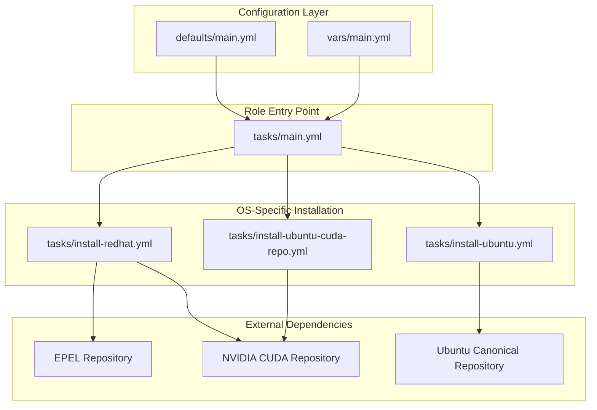
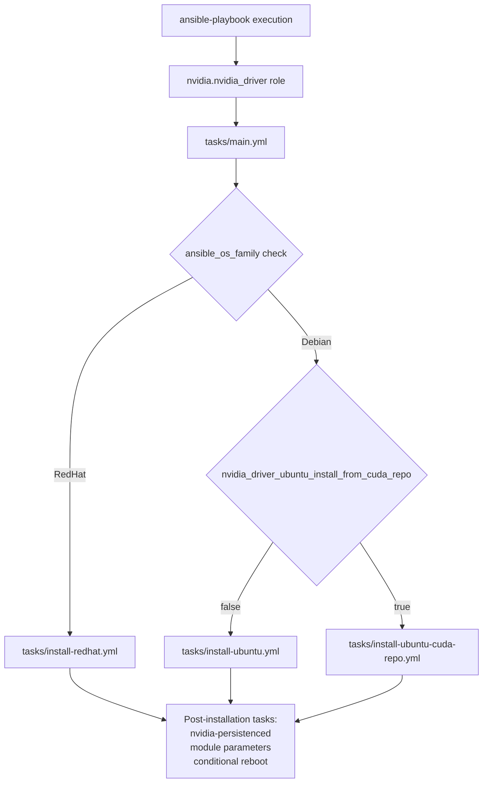

<!-- source: DeepWiki mcp.deepwiki.com · repo NVIDIA/ansible-role-nvidia-driver · page 1 Overview · fetched 2026-10-26 -->

# Overview

<details>
<summary>Relevant source files</summary>

The following files were used as context for generating this wiki page:

- [.gitignore](.gitignore)
- [README.md](README.md)
- [meta/main.yml](meta/main.yml)

</details>


## Purpose and Scope

This document provides an overview of the `ansible-role-nvidia-driver` repository, which implements an Ansible role for automated NVIDIA driver installation and configuration across multiple Linux distributions. The role handles the complexities of driver installation, repository management, and system configuration required to deploy NVIDIA drivers in enterprise environments.

The role is designed to be executed against remote GPU nodes. It includes safety mechanisms to prevent accidental reboots of the Ansible control node [README.md:7-13]().

## What is ansible-role-nvidia-driver

The `ansible-role-nvidia-driver` is a comprehensive Ansible role designed to automate NVIDIA driver installation across heterogeneous Linux environments. The role abstracts the complexity of managing different package repositories, handling kernel dependencies, and ensuring proper driver configuration across multiple operating system families.

**Core Architecture**

The role utilizes a standard Ansible structure where `tasks/main.yml` acts as the orchestrator, delegating to OS-specific task files based on discovered facts.



Sources: [meta/main.yml:1-8](), [README.md:23-34](), [README.md:36-56]()

**Decision Flow Architecture**

The role logic branches primarily based on the `ansible_os_family` and user-defined flags such as `nvidia_driver_ubuntu_install_from_cuda_repo`.



Sources: [README.md:47-53](), [README.md:66-77]()

## Installation and Basic Usage

The role can be installed directly from Ansible Galaxy using the namespace `nvidia.nvidia_driver`:

```bash
ansible-galaxy install nvidia.nvidia_driver
```

**Basic Playbook Implementation**

A minimal playbook requires only the role name and a target host group.

```yaml
- hosts: gpu_nodes
  roles:
  - nvidia.nvidia_driver
```

**Key Configuration Variables**

The following variables represent the primary knobs for controlling the installation:

| Variable | Default | Purpose |
|----------|---------|---------|
| `nvidia_driver_branch` | `"515"` | Default driver branch to install [README.md:34]() |
| `nvidia_driver_package_state` | `"present"` | Package state for NVIDIA driver packages [README.md:28]() |
| `nvidia_driver_persistence_mode_on` | `yes` | Whether to enable persistence mode (boolean) [README.md:30]() |
| `nvidia_driver_skip_reboot` | `no` | Whether to skip rebooting the node during the install [README.md:31]() |
| `nvidia_driver_package_version` | `""` | Specific package version to install [README.md:29]() |

Sources: [README.md:17-21](), [README.md:26-34](), [README.md:58-64]()

## Supported Platforms

The role supports several enterprise Linux distributions. It is validated for both traditional distributions and NVIDIA-specific operating systems.

| Distribution Family | Supported Versions | Installation Method |
|--------------------|--------------------|---------------------|
| Red Hat Enterprise Linux | 7, 8 | EPEL + NVIDIA CUDA repositories [README.md:75,77]() |
| CentOS | 7, 8 | EPEL + NVIDIA CUDA repositories [README.md:74,76]() |
| Ubuntu LTS | 18.04, 20.04 | Canonical (default) or NVIDIA CUDA repositories [README.md:72-73,47-49]() |
| NVIDIA DGX OS | 4, 5 | Optimized for DGX hardware [README.md:70-71]() |

The role metadata specifies a minimum Ansible version of 2.7 [meta/main.yml:8]().

Sources: [README.md:66-77](), [meta/main.yml:10-19]()

## Key Features

**Repository Management**
- **Red Hat Family**: Automatically installs the EPEL repository via `epel_package` [README.md:41]() and configures the CUDA repository using `nvidia_driver_rhel_cuda_repo_baseurl` [README.md:42]().
- **Ubuntu**: Supports switching between Canonical repositories and NVIDIA's CUDA repositories using the `nvidia_driver_ubuntu_install_from_cuda_repo` flag [README.md:53]().

**Driver Installation**
- **Version Control**: Allows pinning to specific branches (`nvidia_driver_branch`) or exact package versions (`nvidia_driver_package_version`) [README.md:29,34]().
- **Ubuntu Flavors**: By default, installs the `-server` suffix (headless) driver packages on Ubuntu [README.md:49,56]().

**System Integration**
- **Persistence**: Manages the `nvidia-persistenced` daemon to keep the GPU state initialized [README.md:30]().
- **Kernel Modules**: Configures driver parameters via `nvidia_driver_module_params` in the file specified by `nvidia_driver_module_file` (default: `/etc/modprobe.d/nvidia.conf`) [README.md:32-33]().
- **Reboot Logic**: Handles necessary reboots to finalize driver installation unless explicitly skipped [README.md:7,31]().

**Safety Features**
- **Execution Guard**: Detects if the playbook is running on the same node as the target (local connection) to prevent the control node from being rebooted [README.md:10-13]().

Sources: [README.md:7-13](), [README.md:28-34](), [README.md:36-56]()

---

