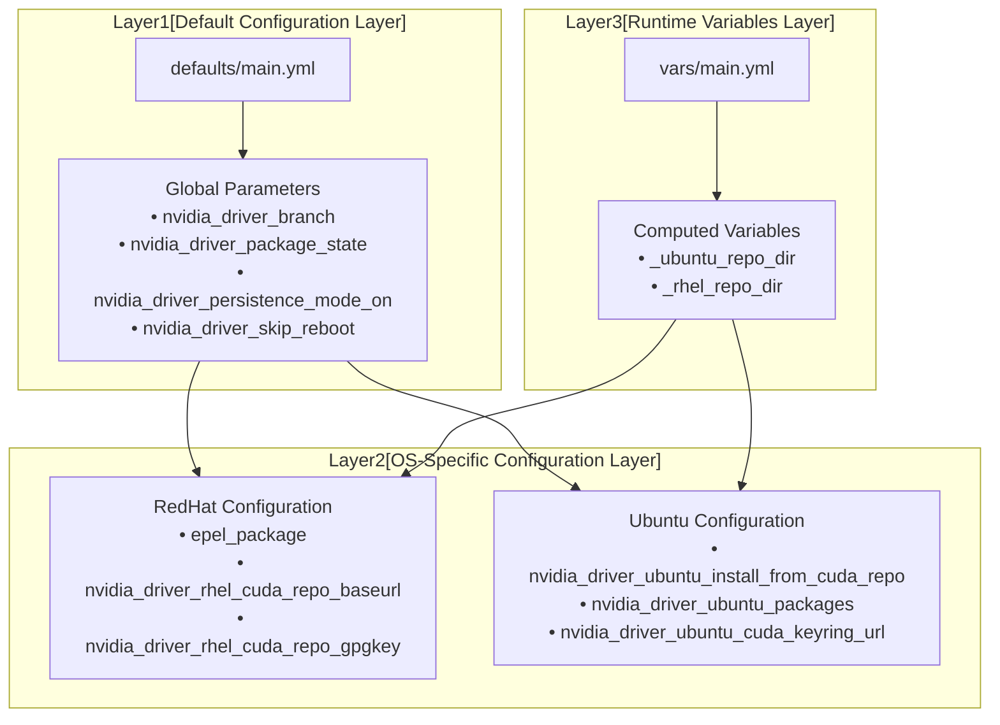
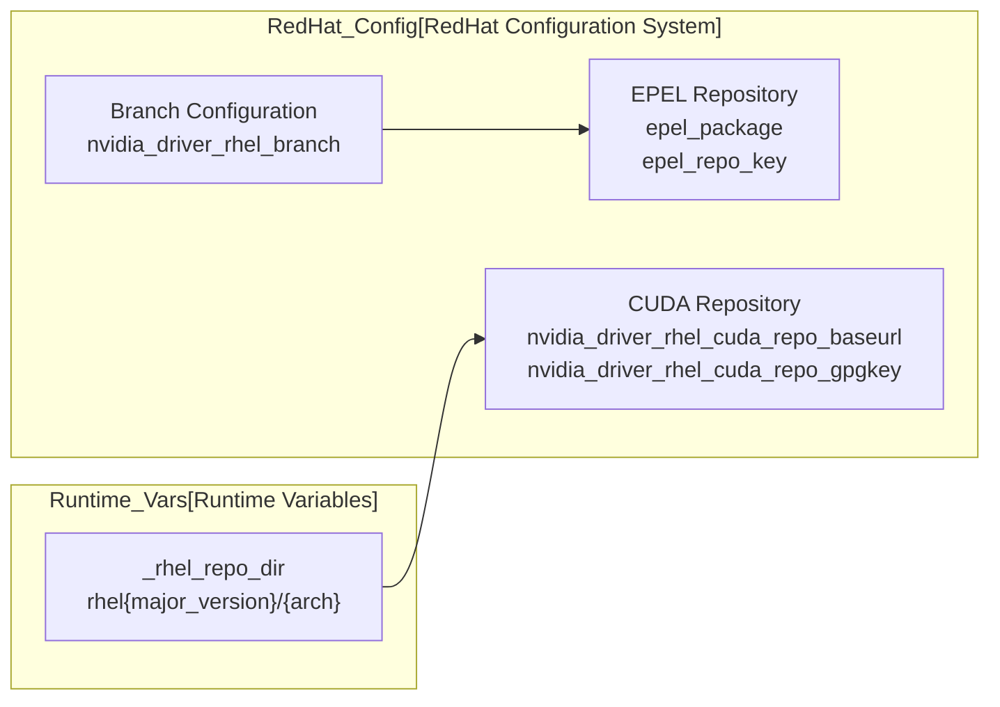
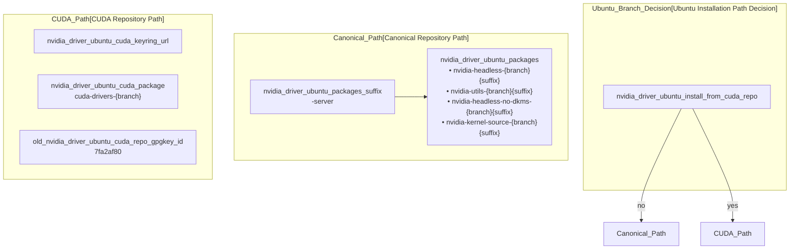
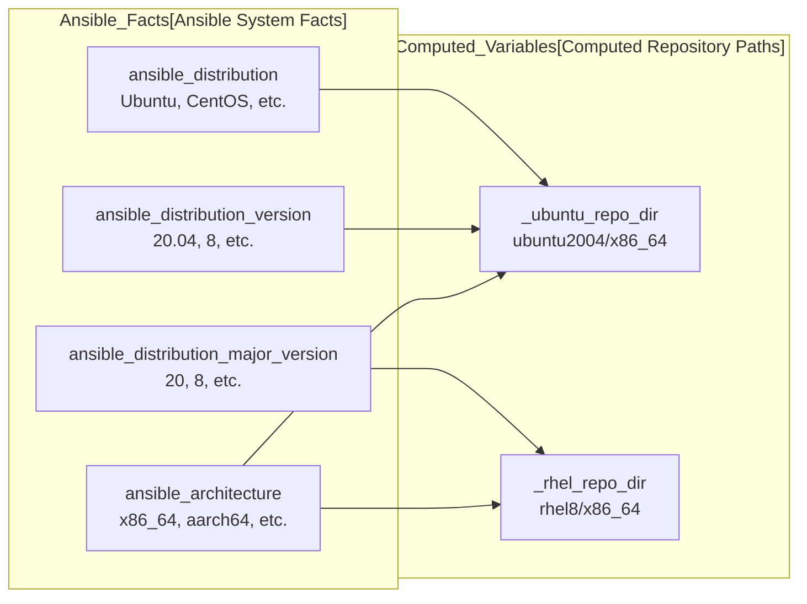
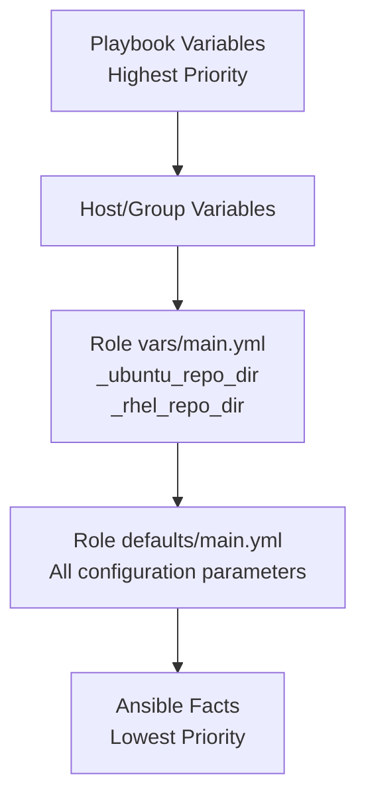

<!-- source: DeepWiki mcp.deepwiki.com · repo NVIDIA/ansible-role-nvidia-driver · page 2 Configuration System · fetched 2026-10-26 -->

# Configuration System

Relevant source files

The following files were used as context for generating this wiki page:

- [README.md](README.md)
- [defaults/main.yml](defaults/main.yml)
- [files/nvidia-persistenced-override.conf](files/nvidia-persistenced-override.conf)
- [vars/main.yml](vars/main.yml)

## Purpose and Scope

The configuration system controls the behavior of the NVIDIA driver installation role through a hierarchical variable system with default values, OS-specific overrides, and computed runtime variables. This system enables the role to adapt to different Linux distributions, package sources, and installation requirements while maintaining consistent defaults.

For information about how these configurations are used during installation, see [Installation Systems](#3). For testing configuration scenarios, see [Testing Framework](#4).

## Configuration Architecture Overview

The configuration system operates through a three-layer hierarchy that progressively specializes from global defaults to OS-specific parameters to runtime-computed values.

### Configuration Layer Architecture

Sources: [defaults/main.yml:1-47](), [vars/main.yml:1-3]()

## Global Configuration Parameters

The global configuration parameters control role behavior across all operating systems and are defined in the defaults layer.

### Core Driver Parameters

| Parameter | Default Value | Purpose |
|-----------|---------------|---------|
| `nvidia_driver_package_state` | `"present"` | Controls package installation state |
| `nvidia_driver_package_version` | `""` | Specific version constraint (empty = latest) |
| `nvidia_driver_branch` | `"515"` | Driver branch/series to install |
| `nvidia_driver_skip_reboot` | `no` | Whether to skip automatic reboots |

### Service and Module Configuration

| Parameter | Default Value | Purpose |
|-----------|---------------|---------|
| `nvidia_driver_persistence_mode_on` | `yes` | Enable nvidia-persistenced service |
| `nvidia_driver_module_file` | `"/etc/modprobe.d/nvidia.conf"` | Kernel module configuration file |
| `nvidia_driver_module_params` | `""` | Additional kernel module parameters |
| `nvidia_driver_add_repos` | `yes` | Whether to add NVIDIA repositories |

Sources: [defaults/main.yml:1-9](), [README.md:26-34]()

## OS-Specific Configuration Systems

The role implements specialized configuration branches for RedHat and Ubuntu families, each with distinct repository management and package selection strategies.

### RedHat Family Configuration

The RedHat configuration system manages EPEL repository installation and NVIDIA CUDA repository setup:

- **EPEL Repository**: [defaults/main.yml:14-15]() defines `epel_package` and `epel_repo_key` with version-specific URLs using `ansible_distribution_major_version`.
- **CUDA Repository**: [defaults/main.yml:16-17]() configures `nvidia_driver_rhel_cuda_repo_baseurl` and `nvidia_driver_rhel_cuda_repo_gpgkey`.
- **Branch Inheritance**: [defaults/main.yml:19]() sets `nvidia_driver_rhel_branch` from global `nvidia_driver_branch`.

### Ubuntu Configuration System

The Ubuntu configuration provides two distinct installation paths:

**Canonical Repository Path** [defaults/main.yml:32-39]():
- `nvidia_driver_ubuntu_packages_suffix`: Controls server vs desktop packages (defaults to `"-server"`).
- `nvidia_driver_ubuntu_packages`: Array of specific package names with branch/suffix interpolation.

**CUDA Repository Path** [defaults/main.yml:42-46]():
- `nvidia_driver_ubuntu_cuda_keyring_url`: Keyring package URL for repository authentication.
- `nvidia_driver_ubuntu_cuda_package`: Single meta-package for driver installation (`cuda-drivers-{{ nvidia_driver_ubuntu_branch }}`).
- `old_nvidia_driver_ubuntu_cuda_repo_gpgkey_id`: Legacy key ID (`7fa2af80`) for cleanup.

Sources: [defaults/main.yml:22-47](), [README.md:45-56]()

## Variable Inheritance and Resolution

The configuration system implements a resolution mechanism that combines static defaults with runtime-computed values.

### Runtime Variable Computation

The [vars/main.yml:1-2]() file computes repository directory paths using Ansible facts:

- `_ubuntu_repo_dir`: Combines lowercase distribution name, version (dots removed), and architecture (normalizing `aarch64` to `sbsa`).
- `_rhel_repo_dir`: Combines "rhel" prefix, major version, and architecture (normalizing `aarch64` to `sbsa`).

### Configuration Precedence Chain

Variable resolution follows Ansible's standard precedence rules, allowing users to override any default configuration at the playbook or inventory level.

Sources: [vars/main.yml:1-3](), [defaults/main.yml:1-47]()

## Configuration Validation and Dependencies

The configuration system includes implicit validation through variable dependencies and conditional logic.

### Inter-Variable Dependencies

| Primary Variable | Dependent Variables | Relationship |
|------------------|-------------------|--------------|
| `nvidia_driver_branch` | `nvidia_driver_rhel_branch`, `nvidia_driver_ubuntu_branch` | Branch inheritance |
| `nvidia_driver_ubuntu_branch` | `nvidia_driver_ubuntu_packages`, `nvidia_driver_ubuntu_cuda_package` | Package name interpolation |
| `_ubuntu_repo_dir`, `_rhel_repo_dir` | Repository URL construction | Path component injection |
| `nvidia_driver_ubuntu_install_from_cuda_repo` | Installation task selection | Conditional execution control |

### Configuration Constraints

The configuration system enforces several implicit constraints:

- **Branch Format**: Must be numeric string (e.g., `"515"`) for package name interpolation [defaults/main.yml:34]().
- **Persistence Mode**: Controlled via `nvidia_driver_persistence_mode_on` [defaults/main.yml:3](), implemented using a systemd override [files/nvidia-persistenced-override.conf:1-4]().
- **Package Version**: If `nvidia_driver_package_version` is provided, it must match the specific version of the deb or RPM package [README.md:29]().

Sources: [defaults/main.yml:1-47](), [vars/main.yml:1-3](), [files/nvidia-persistenced-override.conf:1-4](), [README.md:26-56]()

---

