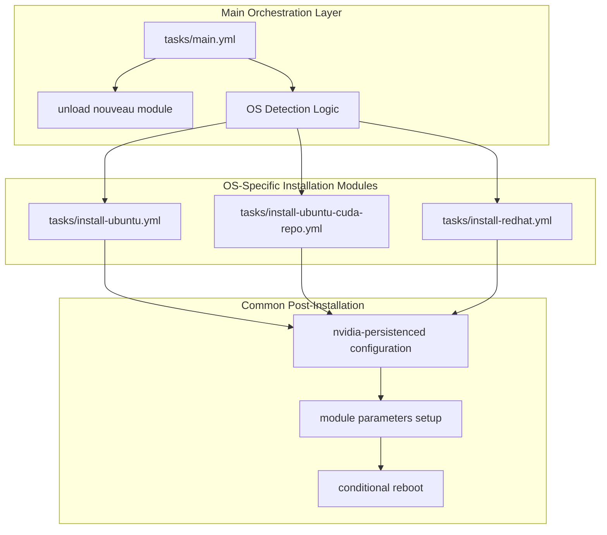
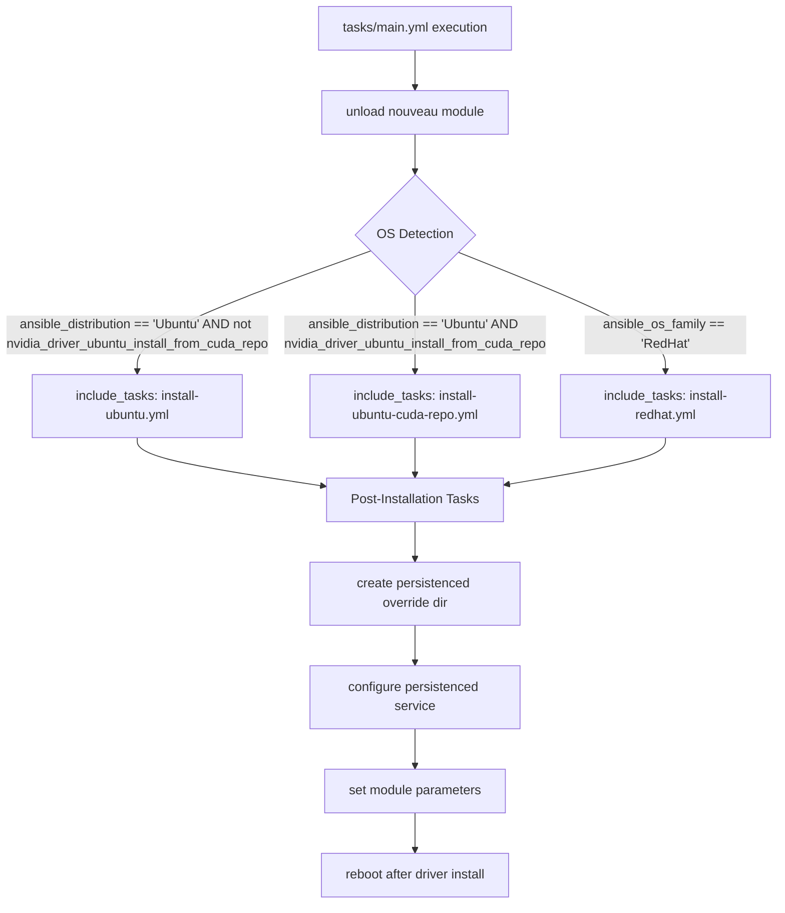

<!-- source: DeepWiki mcp.deepwiki.com · repo NVIDIA/ansible-role-nvidia-driver · page 3 Installation Systems · fetched 2026-10-26 -->

# Installation Systems

<details>
<summary>Relevant source files</summary>

The following files were used as context for generating this wiki page:

- [files/nvidia-persistenced-override.conf](files/nvidia-persistenced-override.conf)
- [tasks/main.yml](tasks/main.yml)
- [templates/nvidia.conf.j2](templates/nvidia.conf.j2)
- [vars/main.yml](vars/main.yml)

</details>


## Purpose and Scope

This document provides an overview of the modular installation architecture used by the `ansible-role-nvidia-driver`. It covers the main orchestration logic, OS detection mechanisms, and branching strategies that route execution to platform-specific installation procedures. 

For detailed documentation of specific installation procedures, see [RedHat Installation System](#3.1) and [Ubuntu Installation Systems](#3.2). For post-installation service configuration details, see [Service Management and Orchestration](#3.3).

## Installation Architecture Overview

The installation system follows a modular architecture where a central orchestrator (`tasks/main.yml`) performs OS detection and conditionally includes platform-specific installation tasks. This design enables support for multiple Linux distributions while maintaining clean separation of concerns.

**Installation System Architecture**


Sources: [tasks/main.yml:1-53]()

## Main Orchestration Logic

The primary orchestration is handled by `tasks/main.yml`, which implements a sequential execution model with conditional OS-specific branching. The orchestration follows this pattern:

| Phase | Description | Lines |
|-------|-------------|-------|
| Pre-Installation | Unload conflicting `nouveau` module | [tasks/main.yml:2-6]() |
| OS Detection | Evaluate `ansible_distribution` and `ansible_os_family` | [tasks/main.yml:8-18]() |
| Installation Execution | Include appropriate OS-specific task file | [tasks/main.yml:8-18]() |
| Post-Installation | Configure services and system parameters | [tasks/main.yml:20-52]() |

The orchestrator uses Ansible's `include_tasks` directive to dynamically load installation procedures based on detected system characteristics and configuration variables.

Sources: [tasks/main.yml:1-53]()

## OS Detection and Installation Routing

The system employs a decision tree based on Ansible facts and configuration variables to determine the appropriate installation method. The routing logic is implemented through conditional `when` clauses in task inclusion statements.

**Installation Routing Decision Flow**


The decision variables used are:

- `ansible_distribution`: Distinguishes Ubuntu from other distributions [tasks/main.yml:10]()
- `ansible_os_family`: Identifies RedHat family systems (RHEL, CentOS, Fedora) [tasks/main.yml:18]()
- `nvidia_driver_ubuntu_install_from_cuda_repo`: Controls Ubuntu repository selection [tasks/main.yml:14]()

The role also defines repository directory structures in `vars/main.yml` to support these systems, mapping distributions to specific CUDA repository paths.

Sources: [tasks/main.yml:8-18](), [vars/main.yml:1-2]()

## Common Post-Installation Tasks

After OS-specific installation completes, the orchestrator executes a series of common configuration tasks that apply regardless of the installation method used. These tasks handle service configuration, kernel module parameters, and system restart coordination.

### nvidia-persistenced Service Management

The system configures the `nvidia-persistenced` service to maintain GPU state across system operations. This includes creating a systemd override directory and applying specific service parameters defined in `files/nvidia-persistenced-override.conf`.

```yaml
# Directory creation for service overrides
path: /etc/systemd/system/nvidia-persistenced.service.d/

# Service configuration based on nvidia_driver_persistence_mode_on
src: nvidia-persistenced-override.conf
dest: /etc/systemd/system/nvidia-persistenced.service.d/override.conf
```

Sources: [tasks/main.yml:20-42](), [files/nvidia-persistenced-override.conf:1-4]()

### Module Parameter Configuration

Module parameters are applied using a Jinja2 template that renders the `nvidia_driver_module_params` variable into the file specified by `nvidia_driver_module_file`.

```yaml
src: nvidia.conf.j2
dest: "{{ nvidia_driver_module_file }}"
```

The template content is minimal, directly outputting the configured parameters to the target configuration file.

Sources: [tasks/main.yml:44-48](), [templates/nvidia.conf.j2:1-2]()

### Conditional System Reboot

The orchestrator handles system reboot coordination based on installation state changes and configuration preferences:

```yaml
when: install_driver.changed and not nvidia_driver_skip_reboot
```

The reboot logic depends on the `install_driver` variable being set by the OS-specific installation tasks and respects the `nvidia_driver_skip_reboot` configuration parameter.

Sources: [tasks/main.yml:50-52]()

## Integration with Child Systems

The installation systems documented in child pages integrate with this orchestration framework:

- **RedHat Installation System** ([RedHat Installation System](#3.1)): Handles EPEL repository management, CUDA repository setup, and yum/dnf package installation.
- **Ubuntu Installation Systems** ([Ubuntu Installation Systems](#3.2)): Manages canonical vs CUDA repository selection, PPA conflict resolution, and apt package installation.
- **Service Management and Orchestration** ([Service Management and Orchestration](#3.3)): Provides detailed coverage of the post-installation service configuration tasks, persistence mode, and reboot logic.

Sources: [tasks/main.yml:1-53]()

---

