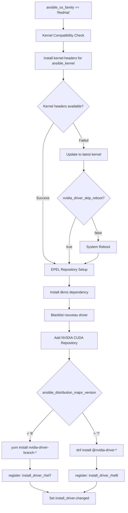
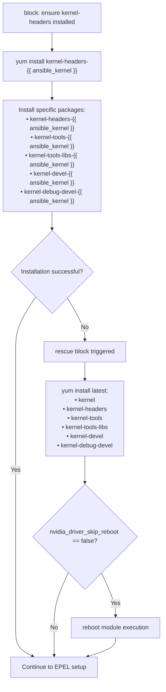
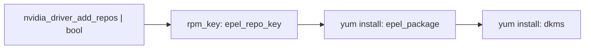
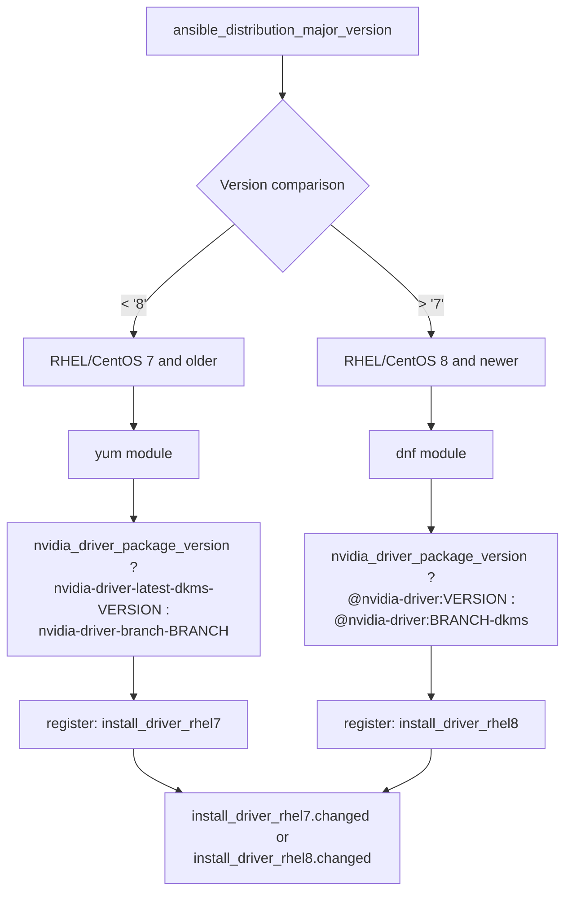
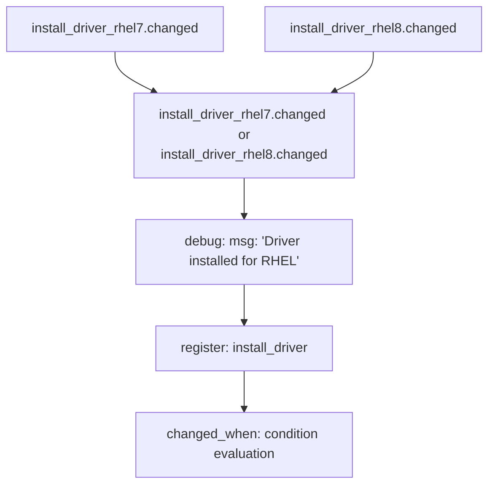

<!-- source: DeepWiki mcp.deepwiki.com · repo NVIDIA/ansible-role-nvidia-driver · page 3.1 RedHat Installation System · fetched 2026-10-26 -->

# RedHat Installation System

<details>
<summary>Relevant source files</summary>

The following files were used as context for generating this wiki page:

- [defaults/main.yml](defaults/main.yml)
- [tasks/install-redhat.yml](tasks/install-redhat.yml)

</details>


## Purpose and Scope

The RedHat Installation System handles automated NVIDIA driver installation for RedHat Enterprise Linux, CentOS, and other RedHat-family distributions. This system manages the complete installation pipeline including kernel preparation, repository configuration, dependency resolution, and driver package installation with version-specific handling for RHEL/CentOS 7 versus 8+ systems.

For Ubuntu-specific installation procedures, see 3.2 Ubuntu Installation Systems. For general service configuration and orchestration logic, see 3.3 Service Management and Orchestration.

## Installation Workflow Overview

The RedHat installation process follows a sequential workflow that ensures system compatibility before driver installation. The main orchestrator conditionally executes this workflow when `ansible_os_family == 'RedHat'`.

**RedHat Installation Sequence**


Sources: [tasks/install-redhat.yml:1-90]()

## Kernel Preparation System

The kernel preparation system ensures compatibility between the NVIDIA driver and the current kernel version. This is critical because NVIDIA drivers require kernel headers that match the running kernel version.

**Kernel Compatibility Resolution**


The system uses a `block`/`rescue` pattern to handle kernel header availability issues. When specific kernel headers for `ansible_kernel` are unavailable (common with older kernels on CentOS mirrors), the rescue block updates to the latest kernel version and conditionally reboots the system [tasks/install-redhat.yml:4-30]().

Sources: [tasks/install-redhat.yml:4-30]()

## Repository Management

The RedHat installation system manages two external repositories: EPEL (Extra Packages for Enterprise Linux) and the official NVIDIA CUDA repository.

### EPEL Repository Configuration

| Component | Implementation | Configuration Variable |
|-----------|----------------|------------------------|
| GPG Key | `rpm_key` module | `epel_repo_key` |
| Package Installation | `yum` module | `epel_package` |
| Conditional Logic | `when` clause | `nvidia_driver_add_repos` |

**EPEL Setup Process**


The EPEL repository is essential for providing the `dkms` dependency required for building the NVIDIA kernel modules [tasks/install-redhat.yml:47-50]().

### NVIDIA CUDA Repository Configuration

The CUDA repository setup uses the `yum_repository` module to configure the official NVIDIA package source [tasks/install-redhat.yml:57-64](). The repository URLs are constructed dynamically based on the RHEL version [defaults/main.yml:16-17]().

```yaml
yum_repository:
  name: cuda
  description: NVIDIA CUDA YUM Repo
  baseurl: "{{ nvidia_driver_rhel_cuda_repo_baseurl }}"
  gpgkey: "{{ nvidia_driver_rhel_cuda_repo_gpgkey }}"
```

Sources: [tasks/install-redhat.yml:32-64](), [defaults/main.yml:14-17]()

## Driver Installation Process

The driver installation process varies significantly between RHEL/CentOS versions due to package manager differences and driver packaging changes.

### Version-Specific Package Management

**RHEL/CentOS Version Detection and Package Installation**


### Package Naming Conventions

| RHEL Version | Package Manager | Package Format | Example |
|--------------|-----------------|----------------|---------|
| 7 and older | `yum` | `nvidia-driver-latest-dkms-{version}` or `nvidia-driver-branch-{branch}` | `nvidia-driver-branch-515` |
| 8 and newer | `dnf` | `@nvidia-driver:{version}` or `@nvidia-driver:{branch}-dkms` | `@nvidia-driver:515-dkms` |

The conditional package naming uses ternary operators to select between version-specific and branch-specific installations [tasks/install-redhat.yml:68,77]():

- **RHEL 7**: `{{ nvidia_driver_package_version | ternary('nvidia-driver-latest-dkms-'+nvidia_driver_package_version, 'nvidia-driver-branch-'+nvidia_driver_rhel_branch) }}`
- **RHEL 8+**: `{{ nvidia_driver_package_version | ternary('@nvidia-driver:'+nvidia_driver_package_version, '@nvidia-driver:'+nvidia_driver_rhel_branch+'-dkms') }}`

Sources: [tasks/install-redhat.yml:66-83](), [defaults/main.yml:1-8]()

## Driver State Management

The installation system tracks driver installation state through registered variables and provides unified change detection across different RHEL versions.

**Change Detection Logic**


This unified approach ensures that subsequent tasks in the main orchestration can reliably detect whether driver installation occurred, regardless of the specific RHEL version or package manager used [tasks/install-redhat.yml:84-90]().

### Proxy Environment Support

All package management operations support proxy environments through the `proxy_env` variable [tasks/install-redhat.yml:15,27,44,63,72,81]():

```yaml
environment: "{{proxy_env if proxy_env is defined else {}}}"
```

This pattern appears consistently across `yum`, `dnf`, and `yum_repository` tasks, ensuring network operations can function in corporate environments with proxy requirements.

Sources: [tasks/install-redhat.yml:15](), [tasks/install-redhat.yml:27](), [tasks/install-redhat.yml:44](), [tasks/install-redhat.yml:63](), [tasks/install-redhat.yml:72](), [tasks/install-redhat.yml:81](), [tasks/install-redhat.yml:84-90]()

---

