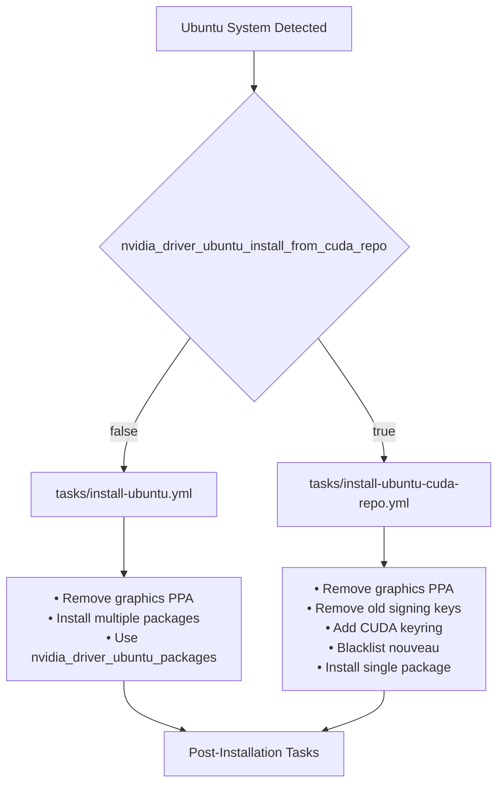
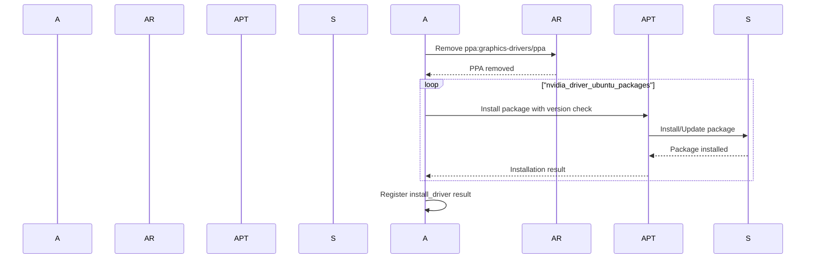
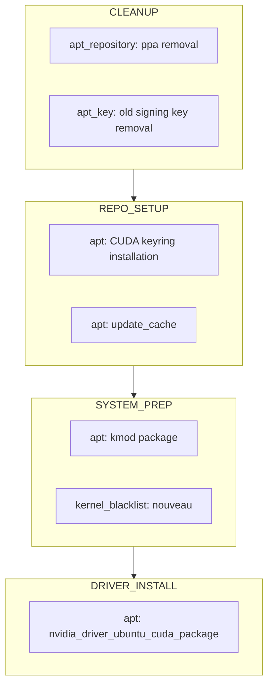
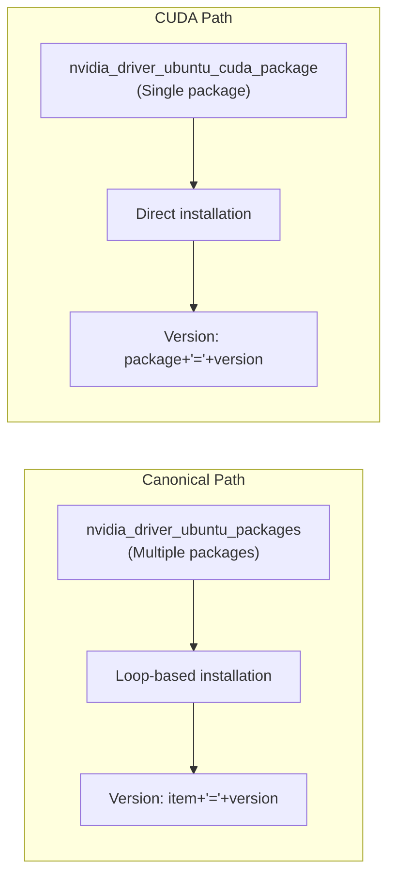

<!-- source: DeepWiki mcp.deepwiki.com · repo NVIDIA/ansible-role-nvidia-driver · page 3.2 Ubuntu Installation Systems · fetched 2026-10-26 -->

# Ubuntu Installation Systems

Relevant source files

The following files were used as context for generating this wiki page:

- [defaults/main.yml](defaults/main.yml)
- [tasks/install-ubuntu-cuda-repo.yml](tasks/install-ubuntu-cuda-repo.yml)
- [tasks/install-ubuntu.yml](tasks/install-ubuntu.yml)

## Purpose and Scope

This document covers the dual Ubuntu installation pathways implemented in the `ansible-role-nvidia-driver`. The role provides two distinct methods for installing NVIDIA drivers on Ubuntu systems: using canonical Ubuntu repositories or NVIDIA's official CUDA repositories. The choice between these methods is controlled by the `nvidia_driver_ubuntu_install_from_cuda_repo` configuration variable [defaults/main.yml:30-30]().

For information about RedHat installation systems, see [RedHat Installation System](#3.1). For overall orchestration logic, see [Service Management and Orchestration](#3.3).

## Installation Path Selection

The Ubuntu installation system implements a branching strategy based on the `nvidia_driver_ubuntu_install_from_cuda_repo` boolean variable. This decision determines the repository source, package selection, and installation procedures.

### Ubuntu Installation Decision Flow

Sources: [tasks/install-ubuntu.yml:1-16](), [tasks/install-ubuntu-cuda-repo.yml:1-44](), [defaults/main.yml:30-30]()

## Canonical Repository Installation

The canonical installation path uses Ubuntu's default repositories and is implemented in `tasks/install-ubuntu.yml`. This approach installs multiple related packages using the system's standard package management.

### Canonical Installation Process

### Package Installation Logic

The canonical installation uses a loop-based approach to install multiple packages defined in `nvidia_driver_ubuntu_packages` [defaults/main.yml:35-40](). Each package installation supports version pinning through `nvidia_driver_package_version`:

| Task | Implementation | Package Selection |
|------|----------------|-------------------|
| PPA Removal | `apt_repository` with `state: absent` | `ppa:graphics-drivers/ppa` [tasks/install-ubuntu.yml:2-5]() |
| Package Installation | `apt` module with loop | `nvidia_driver_ubuntu_packages` [tasks/install-ubuntu.yml:7-15]() |
| Version Control | Ternary operator | `nvidia_driver_package_version` [tasks/install-ubuntu.yml:9-9]() |

Sources: [tasks/install-ubuntu.yml:2-15](), [defaults/main.yml:35-40]()

## CUDA Repository Installation

The CUDA repository installation path uses NVIDIA's official repositories and implements additional system configuration steps. This method is more comprehensive but installs a single consolidated package.

### CUDA Installation Architecture

### CUDA Repository Configuration Steps

The CUDA installation implements a more detailed setup process with specific security and compatibility measures:

1. **Repository Cleanup**: Removes conflicting PPAs and outdated signing keys [tasks/install-ubuntu-cuda-repo.yml:2-10]().
2. **Security Setup**: Installs NVIDIA's official keyring from `nvidia_driver_ubuntu_cuda_keyring_url` [tasks/install-ubuntu-cuda-repo.yml:14-19]().
3. **System Preparation**: Ensures `kmod` is installed and blacklists conflicting `nouveau` drivers [tasks/install-ubuntu-cuda-repo.yml:26-34]().
4. **Driver Installation**: Installs the consolidated CUDA driver package defined by `nvidia_driver_ubuntu_cuda_package` [tasks/install-ubuntu-cuda-repo.yml:36-43]().

| Phase | Task Name | Module | Key Variable |
|-------|-----------|--------|--------------|
| Cleanup | `remove ppa` | `apt_repository` | `ppa:graphics-drivers/ppa` [tasks/install-ubuntu-cuda-repo.yml:2-5]() |
| Cleanup | `remove old signing key` | `apt_key` | `old_nvidia_driver_ubuntu_cuda_repo_gpgkey_id` [tasks/install-ubuntu-cuda-repo.yml:7-10]() |
| Security | `add CUDA keyring` | `apt` | `nvidia_driver_ubuntu_cuda_keyring_url` [tasks/install-ubuntu-cuda-repo.yml:14-19]() |
| System | `blacklist nouveau` | `kernel_blacklist` | `nouveau` [tasks/install-ubuntu-cuda-repo.yml:31-34]() |
| Install | `install driver packages` | `apt` | `nvidia_driver_ubuntu_cuda_package` [tasks/install-ubuntu-cuda-repo.yml:36-43]() |

Sources: [tasks/install-ubuntu-cuda-repo.yml:1-44](), [defaults/main.yml:42-46]()

## Technical Implementation Comparison

### Package Management Differences

### Environment and State Management

Both installation paths implement consistent environment and state management patterns:

- **Proxy Support**: Both paths use `environment: "{{proxy_env if proxy_env is defined else {}}}"` for network configuration [tasks/install-ubuntu.yml:15-15](), [tasks/install-ubuntu-cuda-repo.yml:43-43]().
- **State Management**: Both support `nvidia_driver_package_state` (e.g., `present`, `absent`) for installation/removal operations [tasks/install-ubuntu.yml:10-10](), [tasks/install-ubuntu-cuda-repo.yml:39-39]().
- **Cleanup Options**: Both implement `autoremove` and `purge` options for package removal scenarios [tasks/install-ubuntu.yml:11-12](), [tasks/install-ubuntu-cuda-repo.yml:40-41]().
- **Result Registration**: Both register installation results in the `install_driver` variable to trigger subsequent handlers [tasks/install-ubuntu.yml:14-14](), [tasks/install-ubuntu-cuda-repo.yml:42-42]().

Sources: [tasks/install-ubuntu.yml:9-15](), [tasks/install-ubuntu-cuda-repo.yml:36-43](), [defaults/main.yml:1-1]()

---

