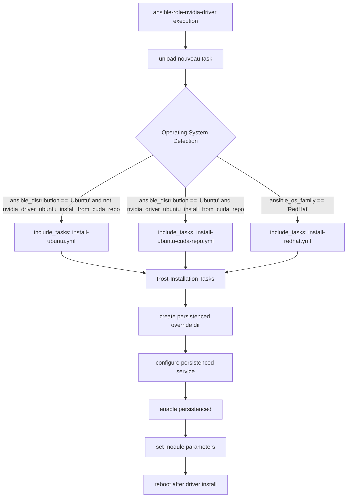
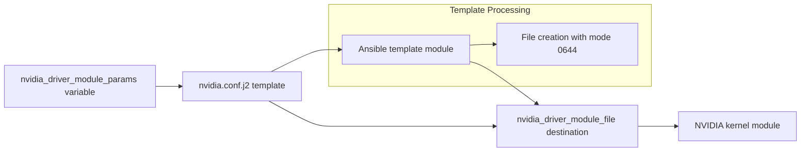
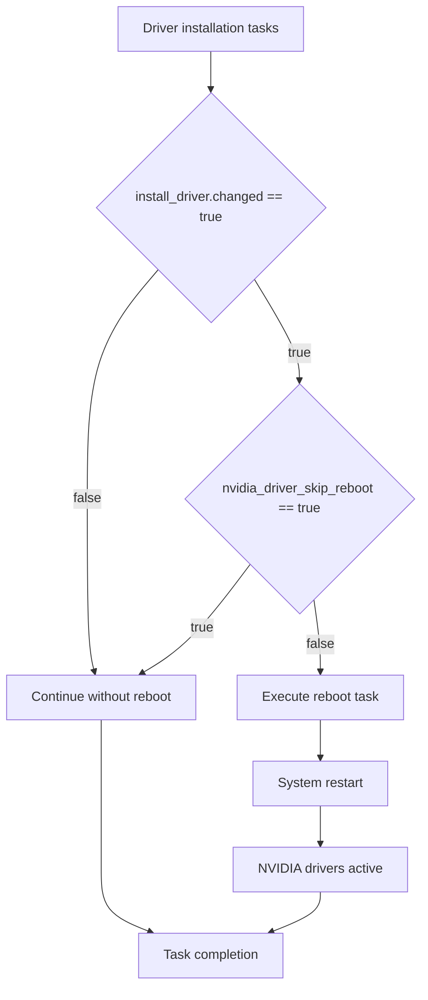

<!-- source: DeepWiki mcp.deepwiki.com · repo NVIDIA/ansible-role-nvidia-driver · page 3.3 Service Management and Orchestration · fetched 2026-10-26 -->

# Service Management and Orchestration

<details>
<summary>Relevant source files</summary>

The following files were used as context for generating this wiki page:

- [files/nvidia-persistenced-override.conf](files/nvidia-persistenced-override.conf)
- [tasks/main.yml](tasks/main.yml)
- [templates/nvidia.conf.j2](templates/nvidia.conf.j2)
- [vars/main.yml](vars/main.yml)

</details>


This document covers the main orchestration logic and service management components of the `ansible-role-nvidia-driver`. It focuses on the coordination between OS-specific installation tasks, post-installation service configuration, and system management operations like reboots and driver parameter tuning.

For details about the specific RedHat installation procedures, see [RedHat Installation System](#3.1). For Ubuntu-specific installation logic, see [Ubuntu Installation Systems](#3.2). For overall configuration options, see [Configuration System](#2).

## Main Orchestration Flow

The primary orchestration logic resides in [tasks/main.yml:1-53](), which serves as the central coordinator for the entire driver installation process. This file implements a conditional task execution model based on operating system detection and configuration parameters.

### Orchestration Decision Tree



Sources: [tasks/main.yml:1-53]()

The orchestration begins with nouveau driver unloading [tasks/main.yml:2-6]() to prevent conflicts, then branches to OS-specific installation tasks using conditional inclusion based on `ansible_distribution` and `ansible_os_family` facts [tasks/main.yml:8-18]().

## NVIDIA Persistenced Service Management

The role configures the `nvidia-persistenced` service to maintain GPU state across system operations. This service management involves systemd override configuration and conditional service enablement.

### Persistenced Service Configuration Flow

```mermaid
stateDiagram-v2
    [*] --> CheckPersistenceMode: nvidia_driver_persistence_mode_on variable
    
    CheckPersistenceMode --> CreateOverrideDir: if true
    CheckPersistenceMode --> RemoveOverride: if false
    
    CreateOverrideDir --> CopyOverrideFile: create /etc/systemd/system/nvidia-persistenced.service.d/
    CopyOverrideFile --> EnableService: copy nvidia-persistenced-override.conf
    
    RemoveOverride --> EnableService: remove override.conf
    
    EnableService --> [*]: systemd enable nvidia-persistenced
    
    note right of CreateOverrideDir: tasks/main.yml:20-24
    note right of CopyOverrideFile: tasks/main.yml:26-30
    note right of RemoveOverride: tasks/main.yml:32-36
    note right of EnableService: tasks/main.yml:38-42
```

Sources: [tasks/main.yml:20-42](), [files/nvidia-persistenced-override.conf:1-4]()

### Persistenced Override Configuration

The service override mechanism modifies the default `nvidia-persistenced` service behavior through systemd drop-in configuration:

| Configuration Element | Purpose | File Location |
|----------------------|---------|---------------|
| Override Directory | Houses systemd service modifications | `/etc/systemd/system/nvidia-persistenced.service.d/` |
| Override Configuration | Enables persistence mode with root user | `override.conf` |
| Service Parameters | `--user root --persistence-mode --verbose` | Applied via `ExecStart` override |

The override configuration [files/nvidia-persistenced-override.conf:1-4]() replaces the default service execution with persistence mode enabled, ensuring GPU state maintenance across driver operations.

Sources: [tasks/main.yml:20-36](), [files/nvidia-persistenced-override.conf:1-4]()

## Module Parameter Management

Driver module parameters are configured through template-based file generation, allowing runtime customization of NVIDIA kernel module behavior.

### Module Configuration System



Sources: [tasks/main.yml:44-48](), [templates/nvidia.conf.j2:1-2]()

The module parameter configuration uses a minimal template [templates/nvidia.conf.j2:1-2]() that directly renders the `nvidia_driver_module_params` variable content to the target file specified by `nvidia_driver_module_file` [tasks/main.yml:44-48](). This approach provides flexibility for users to specify custom kernel module parameters through configuration variables.

## Reboot Orchestration

System reboot management ensures driver changes take effect while providing control over when reboots occur during automated deployments.

### Conditional Reboot Logic



Sources: [tasks/main.yml:50-52]()

The reboot logic [tasks/main.yml:50-52]() implements a dual-condition check: the reboot only executes when both the driver installation tasks report changes (`install_driver.changed`) and the skip reboot flag (`nvidia_driver_skip_reboot`) is not set. This provides administrators with control over reboot timing in automated environments while ensuring reboots occur when necessary for driver activation.

### Post-Installation Task Sequence Summary

| Task Order | Operation | Conditional Logic | Purpose |
|------------|-----------|-------------------|---------|
| 1 | Nouveau unload | Always executed (ignores errors) | Prevent driver conflicts [tasks/main.yml:2-6]() |
| 2 | OS-specific installation | Based on OS detection | Install appropriate driver packages [tasks/main.yml:8-18]() |
| 3 | Persistenced directory creation | Always executed | Prepare systemd override location [tasks/main.yml:20-24]() |
| 4 | Persistenced service configuration | `nvidia_driver_persistence_mode_on` | Configure GPU state persistence [tasks/main.yml:26-30]() |
| 5 | Persistenced service enablement | `nvidia_driver_package_state != 'absent'` | Enable service for installed drivers [tasks/main.yml:38-42]() |
| 6 | Module parameter configuration | Always executed | Apply kernel module settings [tasks/main.yml:44-48]() |
| 7 | Conditional reboot | `install_driver.changed and not nvidia_driver_skip_reboot` | Activate new driver installation [tasks/main.yml:50-52]() |

Sources: [tasks/main.yml:1-53]()

---

