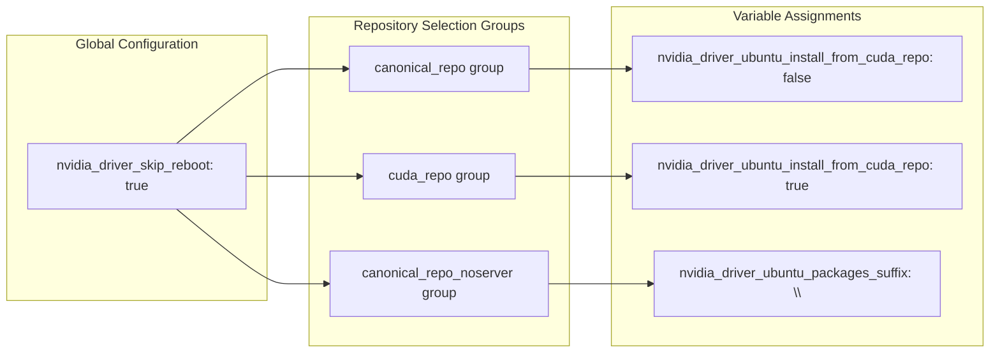

<!-- source: DeepWiki mcp.deepwiki.com · repo NVIDIA/ansible-role-nvidia-driver · page 4 Testing Framework · fetched 2026-10-26 -->

# Testing Framework

<details>
<summary>Relevant source files</summary>

The following files were used as context for generating this wiki page:

- [.github/workflows/molecule.yml](.github/workflows/molecule.yml)
- [molecule/default/molecule.yml](molecule/default/molecule.yml)
- [tests/README.md](tests/README.md)

</details>


## Purpose and Scope

This document provides an overview of the comprehensive testing approach used to validate the NVIDIA driver installation role across multiple operating systems and configuration scenarios. The testing framework ensures that the Ansible role functions correctly on different Linux distributions with various repository configurations and installation methods.

For detailed information about the Molecule testing configuration and platform matrix, see [Molecule Testing Suite](#4.1). For CI/CD pipeline and automated validation details, see [CI/CD and Basic Tests](#4.2).

## Testing Architecture Overview

The testing framework is built around Molecule, which provides comprehensive multi-platform validation through Docker containerization. The architecture supports testing both Ubuntu canonical repositories and NVIDIA CUDA repositories across multiple OS versions.

### Testing Framework Components

```mermaid
graph TB
    subgraph "Test Orchestration"
        MOLECULE_CONFIG["molecule.yml"]
        MOLECULE_DRIVER["docker driver"]
        ANSIBLE_PROVISIONER["ansible provisioner"]
        ANSIBLE_VERIFIER["ansible verifier"]
    end
    
    subgraph "Platform Matrix"
        UBUNTU_1804["ubuntu-1804-canonical"]
        UBUNTU_1804_CUDA["ubuntu-1804-cuda"]
        UBUNTU_2004_SERVER["ubuntu-2004-canonical-server"]
        UBUNTU_2004_NOSERVER["ubuntu-2004-canonical-noserver"]
        UBUNTU_2004_CUDA["ubuntu-2004-cuda"]
        UBUNTU_2204["ubuntu-2204-canonical"]
        UBUNTU_2204_CUDA["ubuntu-2204-cuda"]
        CENTOS_7["centos-7"]
    end
    
    subgraph "Group Variables"
        CANONICAL_REPO["canonical_repo"]
        CANONICAL_REPO_NOSERVER["canonical_repo_noserver"]
        CUDA_REPO["cuda_repo"]
        UBUNTU_GROUP["ubuntu"]
    end
    
    subgraph "Docker Infrastructure"
        GEERLINGGUY_UBUNTU1804["geerlingguy/docker-ubuntu1804-ansible"]
        GEERLINGGUY_UBUNTU2004["geerlingguy/docker-ubuntu2004-ansible"]
        GEERLINGGUY_UBUNTU2204["geerlingguy/docker-ubuntu2204-ansible"]
        GEERLINGGUY_CENTOS7["geerlingguy/docker-centos7-ansible"]
    end
    
    MOLECULE_CONFIG --> MOLECULE_DRIVER
    MOLECULE_CONFIG --> ANSIBLE_PROVISIONER
    MOLECULE_CONFIG --> ANSIBLE_VERIFIER
    
    MOLECULE_DRIVER --> UBUNTU_1804
    MOLECULE_DRIVER --> UBUNTU_1804_CUDA
    MOLECULE_DRIVER --> UBUNTU_2004_SERVER
    MOLECULE_DRIVER --> UBUNTU_2004_NOSERVER
    MOLECULE_DRIVER --> UBUNTU_2004_CUDA
    MOLECULE_DRIVER --> UBUNTU_2204
    MOLECULE_DRIVER --> UBUNTU_2204_CUDA
    MOLECULE_DRIVER --> CENTOS_7
    
    UBUNTU_1804 --> CANONICAL_REPO
    UBUNTU_1804 --> UBUNTU_GROUP
    UBUNTU_1804_CUDA --> CUDA_REPO
    UBUNTU_1804_CUDA --> UBUNTU_GROUP
    UBUNTU_2004_SERVER --> CANONICAL_REPO
    UBUNTU_2004_SERVER --> UBUNTU_GROUP
    UBUNTU_2004_NOSERVER --> CANONICAL_REPO
    UBUNTU_2004_NOSERVER --> CANONICAL_REPO_NOSERVER
    UBUNTU_2004_NOSERVER --> UBUNTU_GROUP
    UBUNTU_2004_CUDA --> CUDA_REPO
    UBUNTU_2004_CUDA --> UBUNTU_GROUP
    UBUNTU_2204 --> CANONICAL_REPO
    UBUNTU_2204 --> UBUNTU_GROUP
    UBUNTU_2204_CUDA --> CUDA_REPO
    UBUNTU_2204_CUDA --> UBUNTU_GROUP
    
    UBUNTU_1804 --> GEERLINGGUY_UBUNTU1804
    UBUNTU_1804_CUDA --> GEERLINGGUY_UBUNTU1804
    UBUNTU_2004_SERVER --> GEERLINGGUY_UBUNTU2004
    UBUNTU_2004_NOSERVER --> GEERLINGGUY_UBUNTU2004
    UBUNTU_2004_CUDA --> GEERLINGGUY_UBUNTU2004
    UBUNTU_2204 --> GEERLINGGUY_UBUNTU2204
    UBUNTU_2204_CUDA --> GEERLINGGUY_UBUNTU2204
    CENTOS_7 --> GEERLINGGUY_CENTOS7
```



Sources: [molecule/default/molecule.yml:1-118]()

## Platform Coverage Matrix

The testing framework validates the role across a comprehensive matrix of operating systems and repository configurations:

| Platform | Base Image | Repository Type | Special Configuration |
|----------|------------|-----------------|----------------------|
| `ubuntu-1804-canonical` | `geerlingguy/docker-ubuntu1804-ansible` | Canonical | Standard Ubuntu packages |
| `ubuntu-1804-cuda` | `geerlingguy/docker-ubuntu1804-ansible` | NVIDIA CUDA | Official NVIDIA repository |
| `ubuntu-2004-canonical-server` | `geerlingguy/docker-ubuntu2004-ansible` | Canonical | Server edition packages |
| `ubuntu-2004-canonical-noserver` | `geerlingguy/docker-ubuntu2004-ansible` | Canonical | No server suffix packages |
| `ubuntu-2004-cuda` | `geerlingguy/docker-ubuntu2004-ansible` | NVIDIA CUDA | Official NVIDIA repository |
| `ubuntu-2204-canonical` | `geerlingguy/docker-ubuntu2204-ansible` | Canonical | Standard Ubuntu packages |
| `ubuntu-2204-cuda` | `geerlingguy/docker-ubuntu2204-ansible` | NVIDIA CUDA | Official NVIDIA repository |
| `centos-7` | `geerlingguy/docker-centos7-ansible` | EPEL/CUDA | RedHat family testing |

Sources: [molecule/default/molecule.yml:6-93]()

## Configuration Strategy by Group Variables

The testing framework uses Ansible group variables to control different installation scenarios and validate the role's conditional logic:

### Test Configuration Variables



Sources: [molecule/default/molecule.yml:107-115]()

## Docker Container Configuration

All test platforms utilize privileged Docker containers with systemd support to properly simulate real system environments:

### Container Runtime Requirements

- **Privileged Mode**: Required for kernel module operations and system-level package management [molecule/default/molecule.yml:14]()
- **systemd Support**: Enabled through `/sbin/init` command [molecule/default/molecule.yml:12]() and cgroup volume mounting
- **Volume Mounts**: `/sys/fs/cgroup:/sys/fs/cgroup:ro` for proper systemd operation [molecule/default/molecule.yml:11]()
- **Pre-built Images**: Uses Jeff Geerling's pre-configured Ansible test images [molecule/default/molecule.yml:9]()

The `privileged: true` setting enables the containers to perform operations typically restricted in standard Docker environments, which is essential for driver installation testing.

Sources: [molecule/default/molecule.yml:10-26](), [molecule/default/molecule.yml:33-51](), [molecule/default/molecule.yml:58-84](), [molecule/default/molecule.yml:87-93]()

## Test Execution Components

The Molecule configuration defines key components for test execution and continuous integration:

### Execution Modes
- **Molecule**: The primary automated testing tool [molecule/default/molecule.yml:1-118]()
- **Manual Playbook**: Ad-hoc testing using `tests/playbook.yml` and `tests/inventory.yml` [tests/README.md:1-7]()
- **GitHub Actions**: Automated CI pipeline triggered on `push` and `pull_request` [.github/workflows/molecule.yml:2-4]()

### Provisioner and Verifier
- **Provisioner**: Uses `ansible` with enhanced verbosity (`-vv`) [molecule/default/molecule.yml:103-105]()
- **Verifier**: Uses `ansible` to validate state after the role runs [molecule/default/molecule.yml:117]()

### Dependency Management
- **Dependency**: Uses `galaxy` to resolve role dependencies [molecule/default/molecule.yml:3]()

Sources: [molecule/default/molecule.yml:102-118](), [tests/README.md:1-7](), [.github/workflows/molecule.yml:1-16]()

## Commented Platform Support

The configuration includes commented-out support for CentOS 8 testing, indicating planned or previously supported platforms:

```yaml
# - name: centos-8
#   image: geerlingguy/docker-centos8-ansible
```

This suggests the framework is designed to be extensible for additional platform support as needed.

Sources: [molecule/default/molecule.yml:94-100]()

---

