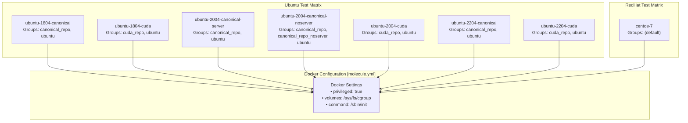
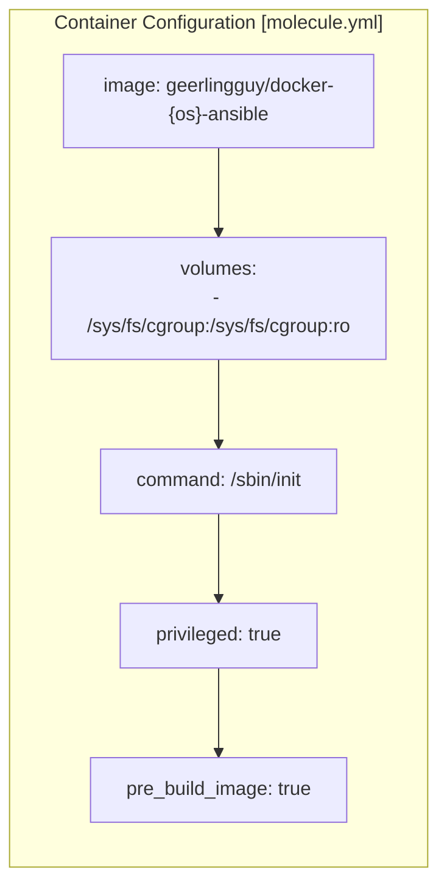
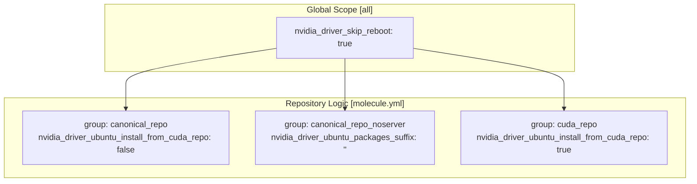
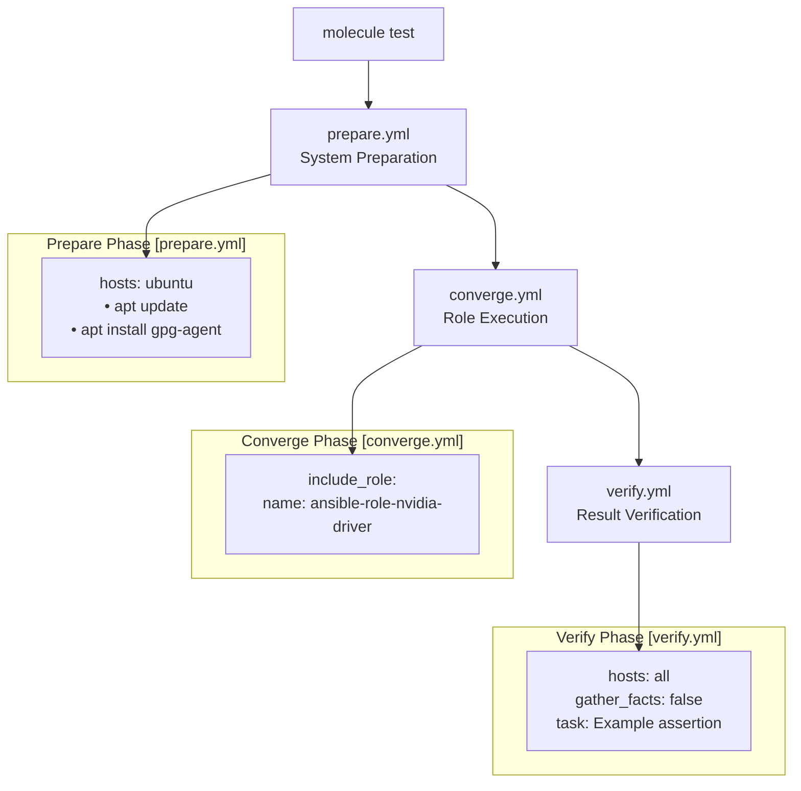

<!-- source: DeepWiki mcp.deepwiki.com · repo NVIDIA/ansible-role-nvidia-driver · page 4.1 Molecule Testing Suite · fetched 2026-10-26 -->

# Molecule Testing Suite

Relevant source files

The following files were used as context for generating this wiki page:

- [molecule/default/converge.yml](molecule/default/converge.yml)
- [molecule/default/molecule.yml](molecule/default/molecule.yml)
- [molecule/default/prepare.yml](molecule/default/prepare.yml)
- [molecule/default/verify.yml](molecule/default/verify.yml)

This document covers the Molecule testing infrastructure that validates the `ansible-role-nvidia-driver` across multiple Linux distributions and installation configurations. The testing suite uses Docker containers to simulate different target environments and verifies that the role executes correctly under various scenarios.

For information about the continuous integration pipeline and basic test infrastructure, see [CI/CD and Basic Tests](#4.2). For details about the installation systems being tested, see [Installation Systems](#3).

## Platform Test Matrix

The Molecule testing suite validates the role across a comprehensive matrix of operating systems and repository configurations. The test matrix includes several distinct platform configurations that cover the primary supported distributions and installation methods.

### Supported Platforms and Scenarios

| Platform | Image | Repository Type | Groups | Purpose |
|----------|-------|----------------|--------|---------|
| `ubuntu-1804-canonical` | `geerlingguy/docker-ubuntu1804-ansible` | Canonical | `canonical_repo`, `ubuntu` | Test Ubuntu 18.04 with canonical repositories |
| `ubuntu-1804-cuda` | `geerlingguy/docker-ubuntu1804-ansible` | CUDA | `cuda_repo`, `ubuntu` | Test Ubuntu 18.04 with NVIDIA CUDA repositories |
| `ubuntu-2004-canonical-server` | `geerlingguy/docker-ubuntu2004-ansible` | Canonical | `canonical_repo`, `ubuntu` | Test Ubuntu 20.04 with server packages |
| `ubuntu-2004-canonical-noserver` | `geerlingguy/docker-ubuntu2004-ansible` | Canonical | `canonical_repo`, `canonical_repo_noserver`, `ubuntu` | Test Ubuntu 20.04 without server packages |
| `ubuntu-2004-cuda` | `geerlingguy/docker-ubuntu2004-ansible` | CUDA | `cuda_repo`, `ubuntu` | Test Ubuntu 20.04 with NVIDIA CUDA repositories |
| `ubuntu-2204-canonical` | `geerlingguy/docker-ubuntu2204-ansible` | Canonical | `canonical_repo`, `ubuntu` | Test Ubuntu 22.04 with canonical repositories |
| `ubuntu-2204-cuda` | `geerlingguy/docker-ubuntu2204-ansible` | CUDA | `cuda_repo`, `ubuntu` | Test Ubuntu 22.04 with NVIDIA CUDA repositories |
| `centos-7` | `geerlingguy/docker-centos7-ansible` | Default | (none) | Test CentOS 7 with default configuration |

**Platform and Group Mapping**

Sources: [molecule/default/molecule.yml:6-101]()

## Docker Test Environment Configuration

The testing environment uses the Docker driver [molecule/default/molecule.yml:5]() configured with privileged access and systemd support to simulate realistic deployment targets. Each container is based on Jeff Geerling's Ansible-ready Docker images and includes specific volume mounts and initialization commands.

### Container Configuration Pattern

All test containers share a common configuration pattern that enables proper testing of system-level operations:

The `privileged: true` setting allows containers to perform system-level operations like service management, which are essential for driver installation testing. The cgroup volume mount enables systemd functionality within the containers by providing access to the host's cgroup filesystem [molecule/default/molecule.yml:10-14]().

Sources: [molecule/default/molecule.yml:10-14](), [molecule/default/molecule.yml:21-25](), [molecule/default/molecule.yml:88-92]()

## Group-Based Variable System

The testing suite uses Ansible inventory groups defined in `molecule.yml` to apply different configuration parameters to test platforms. This system enables testing of multiple installation scenarios (e.g., Canonical vs. CUDA repos) without duplicating platform definitions.

### Group Variable Configuration

The following variables are applied via `provisioner.inventory.group_vars` [molecule/default/molecule.yml:107]():

| Group | Variable | Value | Purpose |
|-------|----------|-------|---------|
| `all` | `nvidia_driver_skip_reboot` | `true` | Prevents containers from attempting reboots [molecule/default/molecule.yml:109]() |
| `canonical_repo` | `nvidia_driver_ubuntu_install_from_cuda_repo` | `false` | Forces use of Ubuntu default repos [molecule/default/molecule.yml:111]() |
| `cuda_repo` | `nvidia_driver_ubuntu_install_from_cuda_repo` | `true` | Forces use of NVIDIA CUDA repos [molecule/default/molecule.yml:115]() |
| `canonical_repo_noserver` | `nvidia_driver_ubuntu_packages_suffix` | `""` | Tests installation without the `-server` package suffix [molecule/default/molecule.yml:113]() |

**Variable Inheritance Flow**

Sources: [molecule/default/molecule.yml:107-115]()

## Test Lifecycle and Execution Flow

The Molecule test suite follows a structured lifecycle with distinct phases for preparation, execution, and verification.

### Test Phase Implementation

1.  **Prepare**: The `prepare.yml` playbook targets the `ubuntu` group to ensure `gpg-agent` is present and the apt cache is updated before the role runs [molecule/default/prepare.yml:2-10]().
2.  **Converge**: The `converge.yml` playbook includes the `ansible-role-nvidia-driver` for all hosts [molecule/default/converge.yml:2-7]().
3.  **Verify**: The `verify.yml` playbook runs post-installation checks. It currently contains a placeholder assertion [molecule/default/verify.yml:4-10]().

Sources: [molecule/default/prepare.yml:1-11](), [molecule/default/converge.yml:1-8](), [molecule/default/verify.yml:1-11]()

## Provisioner and Verifier Configuration

The Molecule provisioner uses Ansible with specific configuration optimizations.

### Provisioner Settings
The provisioner is configured with `ansible_args: ["-vv"]` to provide verbose output during CI runs, aiding in debugging [molecule/default/molecule.yml:104-105]().

### Verifier Settings
The verifier also uses the `ansible` name, allowing verification tasks to be written as standard Ansible playbooks in `verify.yml` [molecule/default/molecule.yml:116-117]().

Sources: [molecule/default/molecule.yml:102-117]()

---

