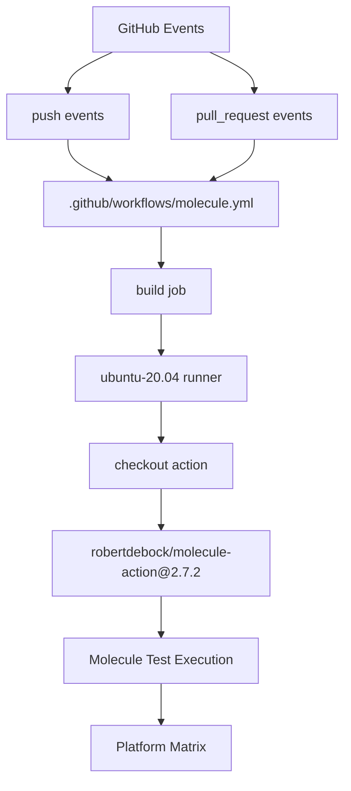
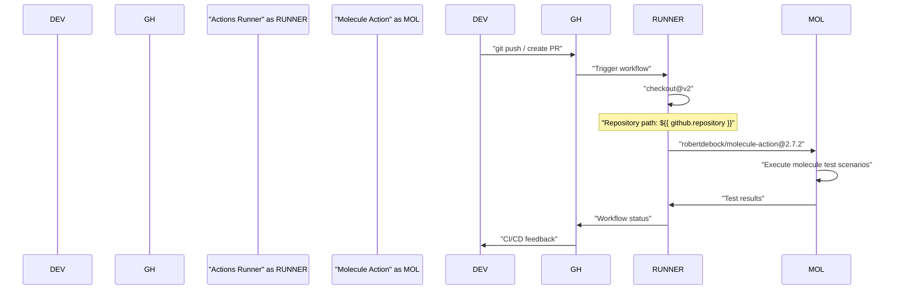
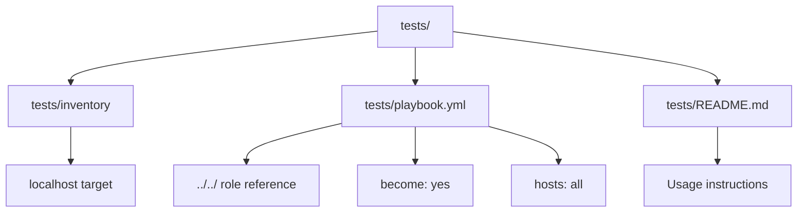
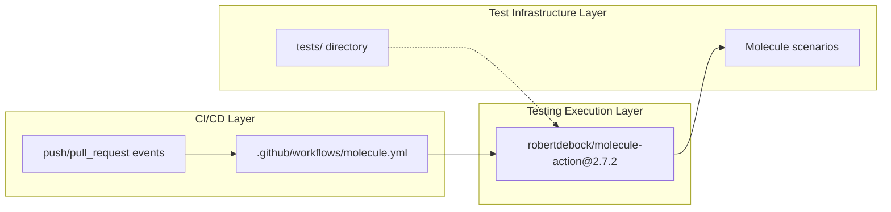

<!-- source: DeepWiki mcp.deepwiki.com · repo NVIDIA/ansible-role-nvidia-driver · page 4.2 CI/CD and Basic Tests · fetched 2026-10-26 -->

# CI/CD and Basic Tests

<details>
<summary>Relevant source files</summary>

The following files were used as context for generating this wiki page:

- [.github/workflows/molecule.yml](.github/workflows/molecule.yml)
- [tests/README.md](tests/README.md)
- [tests/inventory](tests/inventory)
- [tests/playbook.yml](tests/playbook.yml)

</details>


## Purpose and Scope

This document covers the continuous integration and delivery (CI/CD) pipeline and basic test infrastructure for the `ansible-role-nvidia-driver` repository. It focuses on the automated validation mechanisms that ensure role quality through GitHub Actions workflows and simple test cases. For comprehensive testing scenarios using Molecule with multiple OS variants, see [Molecule Testing Suite](#4.1).

The CI/CD system provides automated validation for every push and pull request, while the basic test infrastructure offers a lightweight testing approach for local development and simple validation scenarios.

## CI/CD Pipeline Architecture

The CI/CD pipeline is built around GitHub Actions and integrates with the Molecule testing framework to provide automated validation across multiple scenarios.

### CI/CD Workflow Structure



Sources: [.github/workflows/molecule.yml:1-16]()

The workflow triggers on both push events and pull requests, ensuring that all changes are validated before integration. The pipeline uses a standardized `ubuntu-20.04` runner environment and delegates actual testing to the Molecule framework through the `robertdebock/molecule-action`.

## GitHub Actions Workflow Implementation

### Workflow Configuration

The CI/CD workflow is defined in `.github/workflows/molecule.yml` with a minimal but effective configuration:

| Component | Configuration | Purpose |
|-----------|--------------|---------|
| Triggers | `push`, `pull_request` | Automatic validation on code changes |
| Runner | `ubuntu-20.04` | Standardized execution environment |
| Checkout Action | `actions/checkout@v2` | Repository access with path configuration |
| Molecule Action | `robertdebock/molecule-action@2.7.2` | Delegated test execution |

Sources: [.github/workflows/molecule.yml:2-4](), [.github/workflows/molecule.yml:8](), [.github/workflows/molecule.yml:10-13](), [.github/workflows/molecule.yml:14-15]()

### Workflow Execution Steps



Sources: [.github/workflows/molecule.yml:10-16]()

The workflow maintains separation of concerns by using the specialized `robertdebock/molecule-action`, which handles the complexity of Molecule test execution while the workflow focuses on environment setup and triggering.

## Basic Test Infrastructure

### Test Directory Structure

The `tests/` directory provides a simple testing framework for local development and basic validation scenarios:



Sources: [tests/inventory:1](), [tests/playbook.yml:1-6](), [tests/README.md:1-7]()

### Basic Test Components

#### Test Inventory Configuration

The basic test inventory is minimal, targeting localhost for simple validation:

- **Target Host**: `localhost` [tests/inventory:1]()
- **Scope**: Single-host testing for development scenarios.
- **Flexibility**: The documentation suggests modifying the inventory for different targets [tests/README.md:5-6]().

#### Test Playbook Structure

The test playbook `tests/playbook.yml` demonstrates the role's basic usage pattern by referencing the parent directory as the role source:

| Component | Value | Purpose |
|-----------|-------|---------|
| `hosts` | `all` | Apply to all inventory hosts |
| `become` | `yes` | Elevated privileges for driver installation |
| `roles` | `../..` | Relative path reference to the role directory |

Sources: [tests/playbook.yml:2-6]()

#### Test Execution Instructions

The basic test framework provides manual execution instructions via the `ansible-playbook` command:

```bash
ansible-playbook --inventory tests/inventory.yml tests/playbook.yml
```

Sources: [tests/README.md:3]()

This approach enables developers to run simple validation tests without the full Molecule test matrix complexity.

## Integration with Testing Framework

### CI/CD and Molecule Integration



Sources: [.github/workflows/molecule.yml:14-15]()

The CI/CD system primarily relies on Molecule for comprehensive testing, while the basic test infrastructure serves as a development aid and documentation of simple usage patterns.

### Validation Coverage

The integrated testing approach provides multiple validation layers:

- **Automated CI/CD**: Every push and pull request validation via GitHub Actions [.github/workflows/molecule.yml:2-4]().
- **Multi-platform Testing**: Automated execution across different environments via Molecule [tasks/main.yml]().
- **Basic Functionality**: Simple `localhost` testing capability for quick iterations [tests/inventory:1]().
- **Development Workflow**: Local testing instructions provided for manual validation [tests/README.md:1-7]().

This multi-layered approach ensures robust validation while maintaining development efficiency and providing clear usage examples for role consumers.

Sources: [.github/workflows/molecule.yml:2-4](), [tests/README.md:1-7](), [tests/playbook.yml:1-6]()

---

