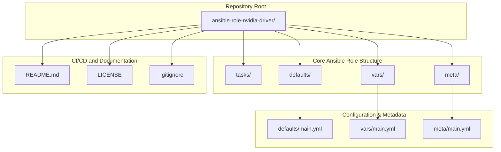
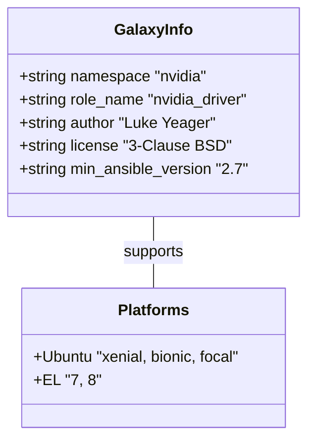

<!-- source: DeepWiki mcp.deepwiki.com · repo NVIDIA/ansible-role-nvidia-driver · page 5 Development Guide · fetched 2026-10-26 -->

# Development Guide

Relevant source files

The following files were used as context for generating this wiki page:

- [.gitignore](.gitignore)
- [LICENSE](LICENSE)
- [meta/main.yml](meta/main.yml)

## Purpose and Scope

This document provides essential information for developers contributing to the `ansible-role-nvidia-driver` project. It covers project structure, development workflows, and licensing requirements. This guide serves as a technical reference for understanding how the role is organized and the standards required for contributions.

## Project Structure Overview

The `ansible-role-nvidia-driver` follows standard Ansible role conventions while integrating a robust testing infrastructure to support multiple Linux distributions.

### Directory Layout and Code Organization

**File Organization Strategy**

The codebase is organized to separate metadata, configuration, and implementation logic:

| Directory | Purpose | Key Files |
|-----------|---------|-----------|
| `meta/` | Role metadata and platform support | [meta/main.yml:1-25]() |
| `defaults/` | Default variables (lowest precedence) | `defaults/main.yml` |
| `vars/` | Role-specific variables (higher precedence) | `vars/main.yml` |
| `tasks/` | Installation and orchestration logic | `tasks/main.yml` |
| `ROOT` | Project licensing and git configuration | [LICENSE:1-26](), [.gitignore:1-3]() |

**Sources:** [meta/main.yml:1-25](), [.gitignore:1-3](), [LICENSE:1-26]()

### Role Metadata and Platform Support

The role explicitly defines its supported environments and Galaxy metadata in the `meta/` directory.

As defined in [meta/main.yml:1-25](), the role supports:
*   **Ubuntu**: Xenial (16.04), Bionic (18.04), and Focal (20.04) [meta/main.yml:11-15]().
*   **Enterprise Linux (EL)**: Versions 7 and 8 [meta/main.yml:16-19]().
*   **Ansible Version**: Requires a minimum of Ansible 2.7 [meta/main.yml:8-8]().

**Sources:** [meta/main.yml:1-25]()

## Development Workflow

### Repository Maintenance

The project uses standard git ignore patterns to keep the repository clean of development artifacts and IDE-specific files.

| Pattern | Reason |
|---------|--------|
| `*.retry` | Generated by Ansible when a playbook fails [ .gitignore:1-1]() |
| `.idea/` | Configuration files for JetBrains IDEs (e.g., PyCharm, IntelliJ) [ .gitignore:2-2]() |

**Sources:** [.gitignore:1-3]()

### Licensing and Legal Information

The project is licensed under a BSD 3-Clause License owned by NVIDIA Corporation [LICENSE:1-1]().

**License Terms:**
*   **Redistribution**: Permitted in source and binary forms, provided the copyright notice and disclaimer are retained [LICENSE:3-10]().
*   **Attribution**: Redistributions in binary form must reproduce the copyright notice in the documentation [LICENSE:8-10]().
*   **Endorsement**: The name of NVIDIA or its contributors may not be used to promote products derived from this software without specific prior written permission [LICENSE:11-13]().

**Disclaimer:**
The software is provided "as is" without warranties of any kind, including merchantability or fitness for a particular purpose [LICENSE:15-18](). NVIDIA shall not be liable for any direct or indirect damages arising from the use of the software [LICENSE:18-25]().

**Sources:** [LICENSE:1-26]()

## Contribution Standards

When contributing to this role, developers should adhere to the following:

1.  **Metadata Updates**: If adding support for a new OS version, update the `platforms` list in [meta/main.yml:10-19]().
2.  **Galaxy Tags**: Ensure relevant tags (`nvidia`, `cuda`, `driver`) are maintained for discoverability [meta/main.yml:21-24]().
3.  **Variable Namespacing**: Maintain the `nvidia_driver_` prefix for all new variables to prevent namespace collisions in user playbooks.
4.  **License Header**: Ensure the BSD 3-Clause header remains intact in all distributed files.

**Sources:** [meta/main.yml:1-25](), [LICENSE:1-26]()

---

