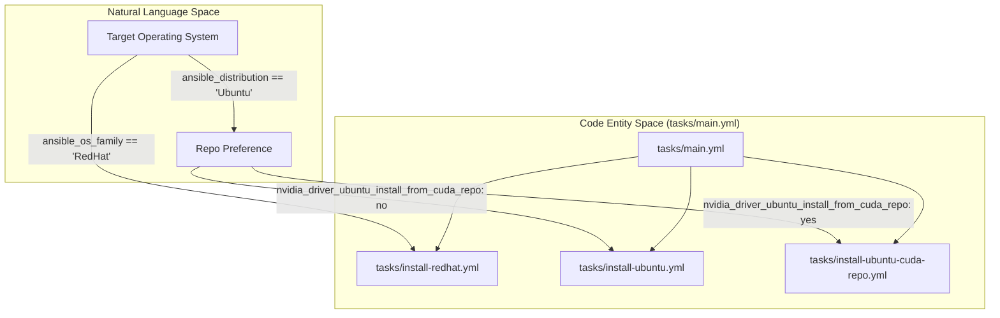
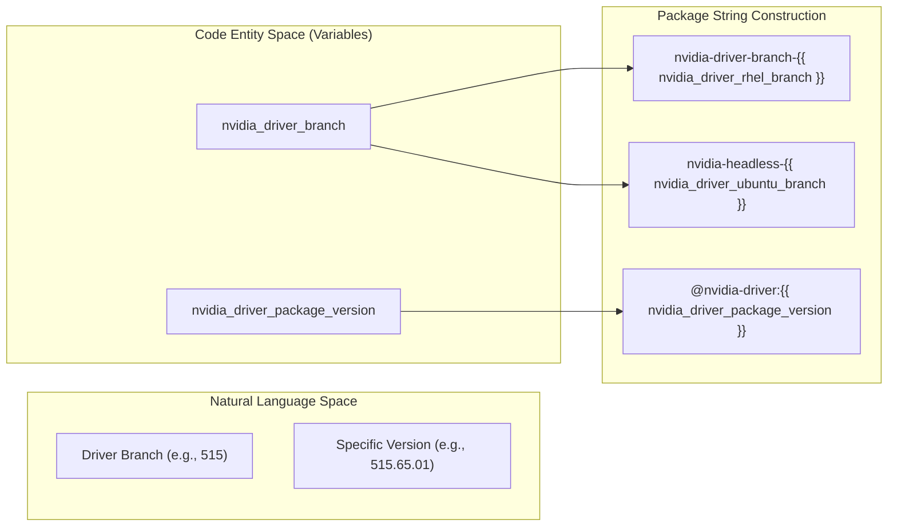

<!-- source: DeepWiki mcp.deepwiki.com · repo NVIDIA/ansible-role-nvidia-driver · page 6 Glossary · fetched 2026-10-26 -->

# Glossary

Relevant source files

The following files were used as context for generating this wiki page:

- [README.md](README.md)
- [defaults/main.yml](defaults/main.yml)
- [files/nvidia-persistenced-override.conf](files/nvidia-persistenced-override.conf)
- [tasks/install-redhat.yml](tasks/install-redhat.yml)
- [tasks/install-ubuntu-cuda-repo.yml](tasks/install-ubuntu-cuda-repo.yml)
- [tasks/main.yml](tasks/main.yml)
- [templates/nvidia.conf.j2](templates/nvidia.conf.j2)
- [vars/main.yml](vars/main.yml)

This page provides definitions for domain-specific terminology, technical jargon, and key configuration variables used within the `ansible-role-nvidia-driver` codebase. It serves as a reference for onboarding engineers to understand how NVIDIA driver concepts map to the Ansible implementation.

## Domain Concepts

### Persistence Mode
A state where the NVIDIA driver remains loaded even when no active clients (like CUDA applications or X11) are using the GPU. This reduces the latency of starting new applications by avoiding driver re-initialization.
*   **Implementation**: Controlled by the `nvidia-persistenced` daemon.
*   **Code Pointers**:
    *   `nvidia_driver_persistence_mode_on`: Boolean toggle in [defaults/main.yml:3-3]().
    *   The service is enabled in [tasks/main.yml:38-42]().
    *   Configuration is applied via a systemd override file [files/nvidia-persistenced-override.conf:1-4]().

### DKMS (Dynamic Kernel Module Support)
A framework used to generate GPU kernel modules that do not generally reside in the Linux kernel source tree. It allows the driver to be automatically rebuilt when a new kernel is installed.
*   **Implementation**: The role installs the `dkms` package on RedHat systems [tasks/install-redhat.yml:47-50]().
*   **Code Pointers**:
    *   RHEL 7 uses the `nvidia-driver-latest-dkms-` package naming convention [tasks/install-redhat.yml:68-68]().
    *   RHEL 8+ uses the `-dkms` suffix in the DNF module stream [tasks/install-redhat.yml:77-77]().

### Nouveau
The open-source driver for NVIDIA video cards. It must be disabled and "blacklisted" to prevent conflicts with the proprietary NVIDIA driver.
*   **Implementation**: The role unloads the module and adds it to the kernel blacklist.
*   **Code Pointers**:
    *   Module unloading: [tasks/main.yml:2-6]().
    *   Blacklisting (RedHat): [tasks/install-redhat.yml:52-55]().
    *   Blacklisting (Ubuntu): [tasks/install-ubuntu-cuda-repo.yml:31-34]().

---

## Code Entity Mapping

The following diagrams illustrate the relationship between high-level concepts and the specific variables and tasks that implement them.

### Diagram 1: Installation Source Selection
This diagram shows how the role determines which package source and installation task file to use based on the host's operating system and user configuration.

**Sources:** [tasks/main.yml:8-18](), [defaults/main.yml:30-30]()

### Diagram 2: Driver Versioning and Branching
This diagram maps the generic "Branch" concept to the specific package strings generated for different package managers (`yum`/`dnf` vs `apt`).

**Sources:** [defaults/main.yml:8-8](), [tasks/install-redhat.yml:68-77](), [defaults/main.yml:35-40]()

---

## Technical Abbreviations

| Term | Definition | Code Reference |
| :--- | :--- | :--- |
| **EPEL** | Extra Packages for Enterprise Linux. Required on RedHat for dependencies like DKMS. | [tasks/install-redhat.yml:38-45]() |
| **GPG** | GNU Privacy Guard. Used to verify the integrity of the NVIDIA/CUDA repositories. | [defaults/main.yml:17-17](), [tasks/install-ubuntu-cuda-repo.yml:8-12]() |
| **PPA** | Personal Package Archive (Ubuntu). The role ensures the `graphics-drivers/ppa` is removed when using CUDA repos. | [tasks/install-ubuntu-cuda-repo.yml:2-5]() |
| **SBSA** | Server Base System Architecture. Used in the codebase to normalize `aarch64` paths in repository URLs. | [vars/main.yml:1-2]() |

---

## Key Configuration Variables

### Repository Management
*   `nvidia_driver_add_repos`: [defaults/main.yml:7-7](). A global toggle (default `yes`) that determines if the role should attempt to configure external YUM/APT repositories.
*   `_rhel_repo_dir` / `_ubuntu_repo_dir`: [vars/main.yml:1-2](). Internal variables that construct the URL path for NVIDIA's download servers based on distribution, version, and architecture.

### Kernel Support
*   `kernel-headers-{{ ansible_kernel }}`: [tasks/install-redhat.yml:9-9](). The role specifically targets the headers for the *currently running* kernel to ensure the driver module compiles correctly.
*   `nvidia_driver_skip_reboot`: [defaults/main.yml:4-4](). A safety flag. If set to `no` (default), the role will trigger a reboot if the kernel was updated or the driver was installed to ensure the new module is loaded. [tasks/main.yml:50-53]().

### Module Parameters
*   `nvidia_driver_module_file`: [defaults/main.yml:5-5](). The destination on the filesystem (default `/etc/modprobe.d/nvidia.conf`) where driver options are written.
*   `nvidia_driver_module_params`: [defaults/main.yml:6-6](). A string of parameters passed to the kernel module (e.g., `NVreg_EnableVideoMemorySelfRefresh=1`). This is templated via `templates/nvidia.conf.j2`.

**Sources:** [defaults/main.yml:1-56](), [tasks/main.yml:1-53](), [tasks/install-redhat.yml:1-90](), [vars/main.yml:1-3](), [templates/nvidia.conf.j2:1-1]()