# Page: Overview

# Overview

<details>
<summary>Relevant source files</summary>

The following files were used as context for generating this wiki page:

- [.gitignore](.gitignore)
- [README.md](README.md)
- [meta/main.yml](meta/main.yml)

</details>


## Purpose and Scope

This document provides an overview of the `ansible-role-nvidia-driver` repository, which implements an Ansible role for automated NVIDIA driver installation and configuration across multiple Linux distributions. The role handles the complexities of driver installation, repository management, and system configuration required to deploy NVIDIA drivers in enterprise environments.

The role is designed to be executed against remote GPU nodes. It includes safety mechanisms to prevent accidental reboots of the Ansible control node [README.md:7-13]().

## What is ansible-role-nvidia-driver

The `ansible-role-nvidia-driver` is a comprehensive Ansible role designed to automate NVIDIA driver installation across heterogeneous Linux environments. The role abstracts the complexity of managing different package repositories, handling kernel dependencies, and ensuring proper driver configuration across multiple operating system families.

**Core Architecture**

The role utilizes a standard Ansible structure where `tasks/main.yml` acts as the orchestrator, delegating to OS-specific task files based on discovered facts.

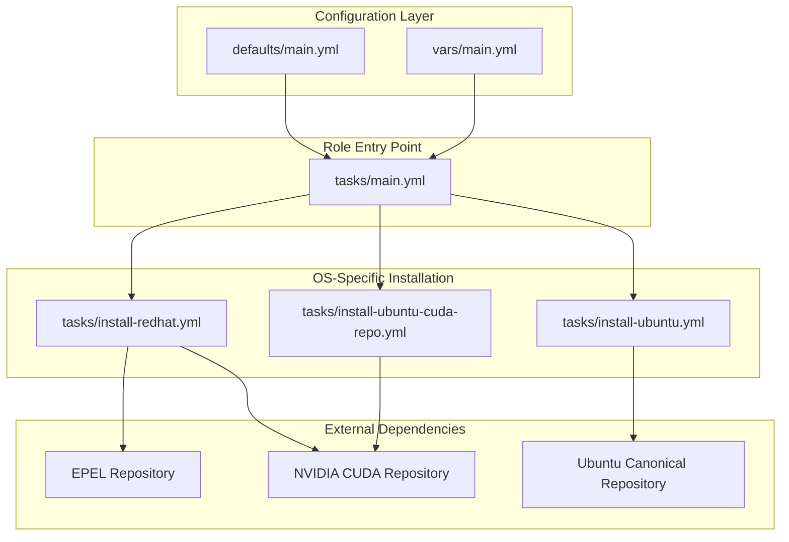

Sources: [meta/main.yml:1-8](), [README.md:23-34](), [README.md:36-56]()

**Decision Flow Architecture**

The role logic branches primarily based on the `ansible_os_family` and user-defined flags such as `nvidia_driver_ubuntu_install_from_cuda_repo`.

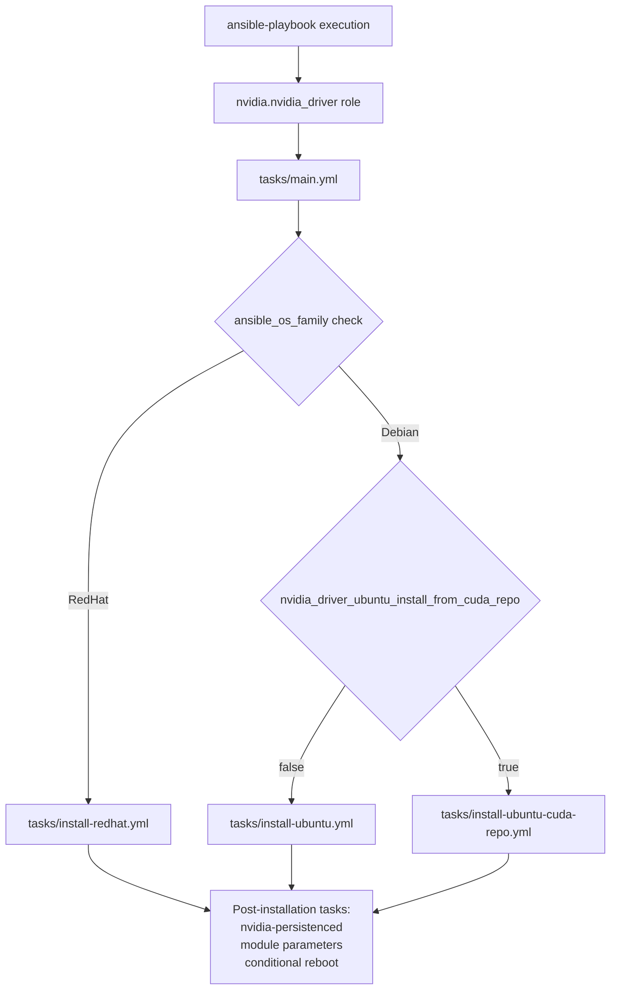

Sources: [README.md:47-53](), [README.md:66-77]()

## Installation and Basic Usage

The role can be installed directly from Ansible Galaxy using the namespace `nvidia.nvidia_driver`:

```bash
ansible-galaxy install nvidia.nvidia_driver
```

**Basic Playbook Implementation**

A minimal playbook requires only the role name and a target host group.

```yaml
- hosts: gpu_nodes
  roles:
  - nvidia.nvidia_driver
```

**Key Configuration Variables**

The following variables represent the primary knobs for controlling the installation:

| Variable | Default | Purpose |
|----------|---------|---------|
| `nvidia_driver_branch` | `"515"` | Default driver branch to install [README.md:34]() |
| `nvidia_driver_package_state` | `"present"` | Package state for NVIDIA driver packages [README.md:28]() |
| `nvidia_driver_persistence_mode_on` | `yes` | Whether to enable persistence mode (boolean) [README.md:30]() |
| `nvidia_driver_skip_reboot` | `no` | Whether to skip rebooting the node during the install [README.md:31]() |
| `nvidia_driver_package_version` | `""` | Specific package version to install [README.md:29]() |

Sources: [README.md:17-21](), [README.md:26-34](), [README.md:58-64]()

## Supported Platforms

The role supports several enterprise Linux distributions. It is validated for both traditional distributions and NVIDIA-specific operating systems.

| Distribution Family | Supported Versions | Installation Method |
|--------------------|--------------------|---------------------|
| Red Hat Enterprise Linux | 7, 8 | EPEL + NVIDIA CUDA repositories [README.md:75,77]() |
| CentOS | 7, 8 | EPEL + NVIDIA CUDA repositories [README.md:74,76]() |
| Ubuntu LTS | 18.04, 20.04 | Canonical (default) or NVIDIA CUDA repositories [README.md:72-73,47-49]() |
| NVIDIA DGX OS | 4, 5 | Optimized for DGX hardware [README.md:70-71]() |

The role metadata specifies a minimum Ansible version of 2.7 [meta/main.yml:8]().

Sources: [README.md:66-77](), [meta/main.yml:10-19]()

## Key Features

**Repository Management**
- **Red Hat Family**: Automatically installs the EPEL repository via `epel_package` [README.md:41]() and configures the CUDA repository using `nvidia_driver_rhel_cuda_repo_baseurl` [README.md:42]().
- **Ubuntu**: Supports switching between Canonical repositories and NVIDIA's CUDA repositories using the `nvidia_driver_ubuntu_install_from_cuda_repo` flag [README.md:53]().

**Driver Installation**
- **Version Control**: Allows pinning to specific branches (`nvidia_driver_branch`) or exact package versions (`nvidia_driver_package_version`) [README.md:29,34]().
- **Ubuntu Flavors**: By default, installs the `-server` suffix (headless) driver packages on Ubuntu [README.md:49,56]().

**System Integration**
- **Persistence**: Manages the `nvidia-persistenced` daemon to keep the GPU state initialized [README.md:30]().
- **Kernel Modules**: Configures driver parameters via `nvidia_driver_module_params` in the file specified by `nvidia_driver_module_file` (default: `/etc/modprobe.d/nvidia.conf`) [README.md:32-33]().
- **Reboot Logic**: Handles necessary reboots to finalize driver installation unless explicitly skipped [README.md:7,31]().

**Safety Features**
- **Execution Guard**: Detects if the playbook is running on the same node as the target (local connection) to prevent the control node from being rebooted [README.md:10-13]().

Sources: [README.md:7-13](), [README.md:28-34](), [README.md:36-56]()

---

# Page: Configuration System

# Configuration System

<details>
<summary>Relevant source files</summary>

The following files were used as context for generating this wiki page:

- [README.md](README.md)
- [defaults/main.yml](defaults/main.yml)
- [files/nvidia-persistenced-override.conf](files/nvidia-persistenced-override.conf)
- [vars/main.yml](vars/main.yml)

</details>


## Purpose and Scope

The configuration system controls the behavior of the NVIDIA driver installation role through a hierarchical variable system with default values, OS-specific overrides, and computed runtime variables. This system enables the role to adapt to different Linux distributions, package sources, and installation requirements while maintaining consistent defaults.

For information about how these configurations are used during installation, see [Installation Systems](#3). For testing configuration scenarios, see [Testing Framework](#4).

## Configuration Architecture Overview

The configuration system operates through a three-layer hierarchy that progressively specializes from global defaults to OS-specific parameters to runtime-computed values.

### Configuration Layer Architecture

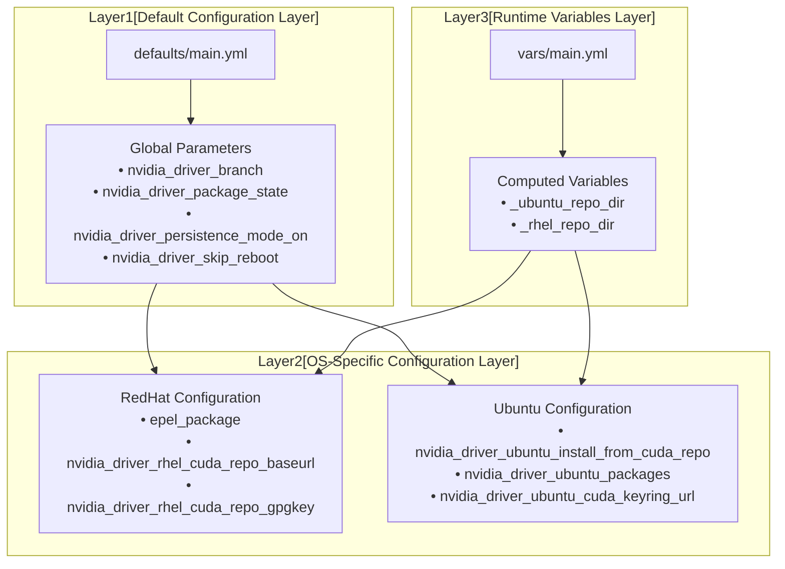

Sources: [defaults/main.yml:1-47](), [vars/main.yml:1-3]()

## Global Configuration Parameters

The global configuration parameters control role behavior across all operating systems and are defined in the defaults layer.

### Core Driver Parameters

| Parameter | Default Value | Purpose |
|-----------|---------------|---------|
| `nvidia_driver_package_state` | `"present"` | Controls package installation state |
| `nvidia_driver_package_version` | `""` | Specific version constraint (empty = latest) |
| `nvidia_driver_branch` | `"515"` | Driver branch/series to install |
| `nvidia_driver_skip_reboot` | `no` | Whether to skip automatic reboots |

### Service and Module Configuration

| Parameter | Default Value | Purpose |
|-----------|---------------|---------|
| `nvidia_driver_persistence_mode_on` | `yes` | Enable nvidia-persistenced service |
| `nvidia_driver_module_file` | `"/etc/modprobe.d/nvidia.conf"` | Kernel module configuration file |
| `nvidia_driver_module_params` | `""` | Additional kernel module parameters |
| `nvidia_driver_add_repos` | `yes` | Whether to add NVIDIA repositories |

Sources: [defaults/main.yml:1-9](), [README.md:26-34]()

## OS-Specific Configuration Systems

The role implements specialized configuration branches for RedHat and Ubuntu families, each with distinct repository management and package selection strategies.

### RedHat Family Configuration

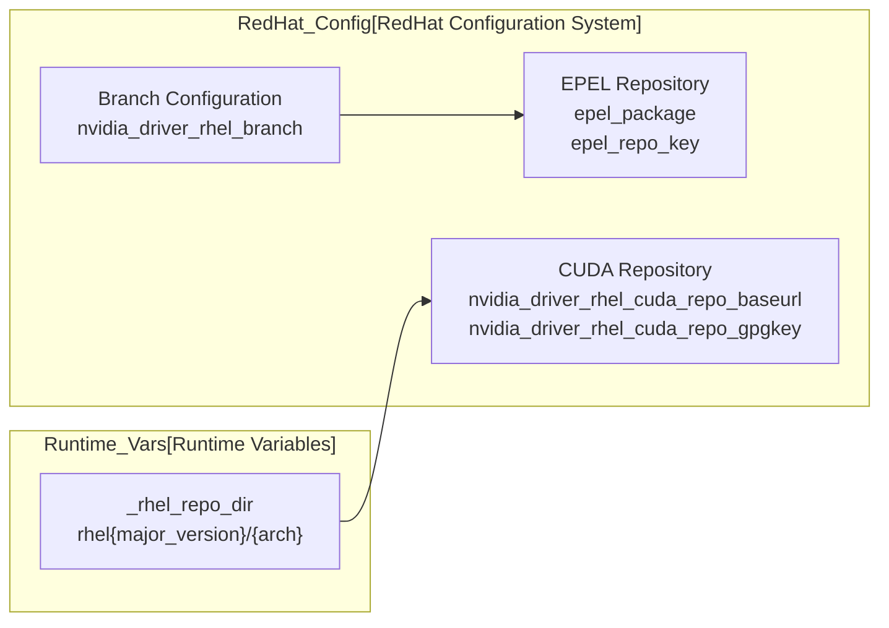

The RedHat configuration system manages EPEL repository installation and NVIDIA CUDA repository setup:

- **EPEL Repository**: [defaults/main.yml:14-15]() defines `epel_package` and `epel_repo_key` with version-specific URLs using `ansible_distribution_major_version`.
- **CUDA Repository**: [defaults/main.yml:16-17]() configures `nvidia_driver_rhel_cuda_repo_baseurl` and `nvidia_driver_rhel_cuda_repo_gpgkey`.
- **Branch Inheritance**: [defaults/main.yml:19]() sets `nvidia_driver_rhel_branch` from global `nvidia_driver_branch`.

### Ubuntu Configuration System

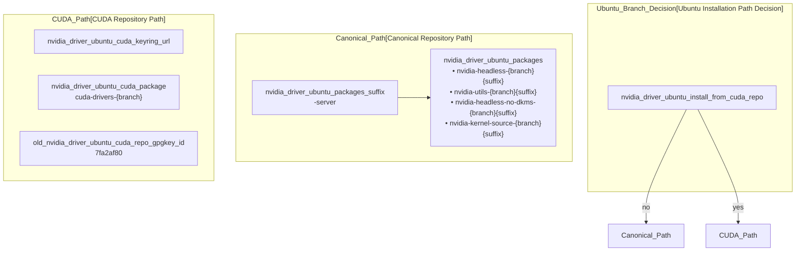

The Ubuntu configuration provides two distinct installation paths:

**Canonical Repository Path** [defaults/main.yml:32-39]():
- `nvidia_driver_ubuntu_packages_suffix`: Controls server vs desktop packages (defaults to `"-server"`).
- `nvidia_driver_ubuntu_packages`: Array of specific package names with branch/suffix interpolation.

**CUDA Repository Path** [defaults/main.yml:42-46]():
- `nvidia_driver_ubuntu_cuda_keyring_url`: Keyring package URL for repository authentication.
- `nvidia_driver_ubuntu_cuda_package`: Single meta-package for driver installation (`cuda-drivers-{{ nvidia_driver_ubuntu_branch }}`).
- `old_nvidia_driver_ubuntu_cuda_repo_gpgkey_id`: Legacy key ID (`7fa2af80`) for cleanup.

Sources: [defaults/main.yml:22-47](), [README.md:45-56]()

## Variable Inheritance and Resolution

The configuration system implements a resolution mechanism that combines static defaults with runtime-computed values.

### Runtime Variable Computation

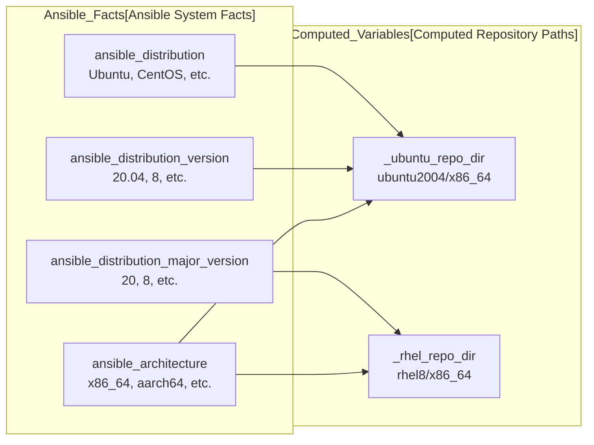

The [vars/main.yml:1-2]() file computes repository directory paths using Ansible facts:

- `_ubuntu_repo_dir`: Combines lowercase distribution name, version (dots removed), and architecture (normalizing `aarch64` to `sbsa`).
- `_rhel_repo_dir`: Combines "rhel" prefix, major version, and architecture (normalizing `aarch64` to `sbsa`).

### Configuration Precedence Chain

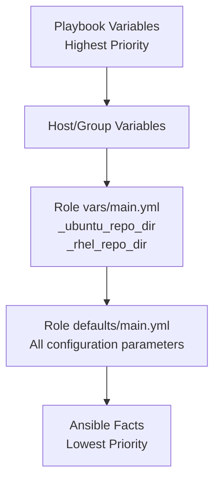

Variable resolution follows Ansible's standard precedence rules, allowing users to override any default configuration at the playbook or inventory level.

Sources: [vars/main.yml:1-3](), [defaults/main.yml:1-47]()

## Configuration Validation and Dependencies

The configuration system includes implicit validation through variable dependencies and conditional logic.

### Inter-Variable Dependencies

| Primary Variable | Dependent Variables | Relationship |
|------------------|-------------------|--------------|
| `nvidia_driver_branch` | `nvidia_driver_rhel_branch`, `nvidia_driver_ubuntu_branch` | Branch inheritance |
| `nvidia_driver_ubuntu_branch` | `nvidia_driver_ubuntu_packages`, `nvidia_driver_ubuntu_cuda_package` | Package name interpolation |
| `_ubuntu_repo_dir`, `_rhel_repo_dir` | Repository URL construction | Path component injection |
| `nvidia_driver_ubuntu_install_from_cuda_repo` | Installation task selection | Conditional execution control |

### Configuration Constraints

The configuration system enforces several implicit constraints:

- **Branch Format**: Must be numeric string (e.g., `"515"`) for package name interpolation [defaults/main.yml:34]().
- **Persistence Mode**: Controlled via `nvidia_driver_persistence_mode_on` [defaults/main.yml:3](), implemented using a systemd override [files/nvidia-persistenced-override.conf:1-4]().
- **Package Version**: If `nvidia_driver_package_version` is provided, it must match the specific version of the deb or RPM package [README.md:29]().

Sources: [defaults/main.yml:1-47](), [vars/main.yml:1-3](), [files/nvidia-persistenced-override.conf:1-4](), [README.md:26-56]()

---

# Page: Installation Systems

# Installation Systems

<details>
<summary>Relevant source files</summary>

The following files were used as context for generating this wiki page:

- [files/nvidia-persistenced-override.conf](files/nvidia-persistenced-override.conf)
- [tasks/main.yml](tasks/main.yml)
- [templates/nvidia.conf.j2](templates/nvidia.conf.j2)
- [vars/main.yml](vars/main.yml)

</details>


## Purpose and Scope

This document provides an overview of the modular installation architecture used by the `ansible-role-nvidia-driver`. It covers the main orchestration logic, OS detection mechanisms, and branching strategies that route execution to platform-specific installation procedures. 

For detailed documentation of specific installation procedures, see [RedHat Installation System](#3.1) and [Ubuntu Installation Systems](#3.2). For post-installation service configuration details, see [Service Management and Orchestration](#3.3).

## Installation Architecture Overview

The installation system follows a modular architecture where a central orchestrator (`tasks/main.yml`) performs OS detection and conditionally includes platform-specific installation tasks. This design enables support for multiple Linux distributions while maintaining clean separation of concerns.

**Installation System Architecture**
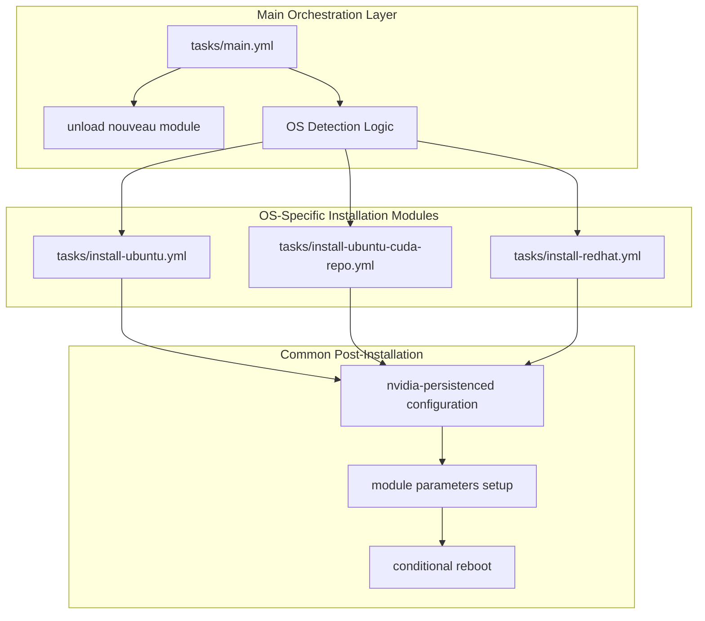

Sources: [tasks/main.yml:1-53]()

## Main Orchestration Logic

The primary orchestration is handled by `tasks/main.yml`, which implements a sequential execution model with conditional OS-specific branching. The orchestration follows this pattern:

| Phase | Description | Lines |
|-------|-------------|-------|
| Pre-Installation | Unload conflicting `nouveau` module | [tasks/main.yml:2-6]() |
| OS Detection | Evaluate `ansible_distribution` and `ansible_os_family` | [tasks/main.yml:8-18]() |
| Installation Execution | Include appropriate OS-specific task file | [tasks/main.yml:8-18]() |
| Post-Installation | Configure services and system parameters | [tasks/main.yml:20-52]() |

The orchestrator uses Ansible's `include_tasks` directive to dynamically load installation procedures based on detected system characteristics and configuration variables.

Sources: [tasks/main.yml:1-53]()

## OS Detection and Installation Routing

The system employs a decision tree based on Ansible facts and configuration variables to determine the appropriate installation method. The routing logic is implemented through conditional `when` clauses in task inclusion statements.

**Installation Routing Decision Flow**
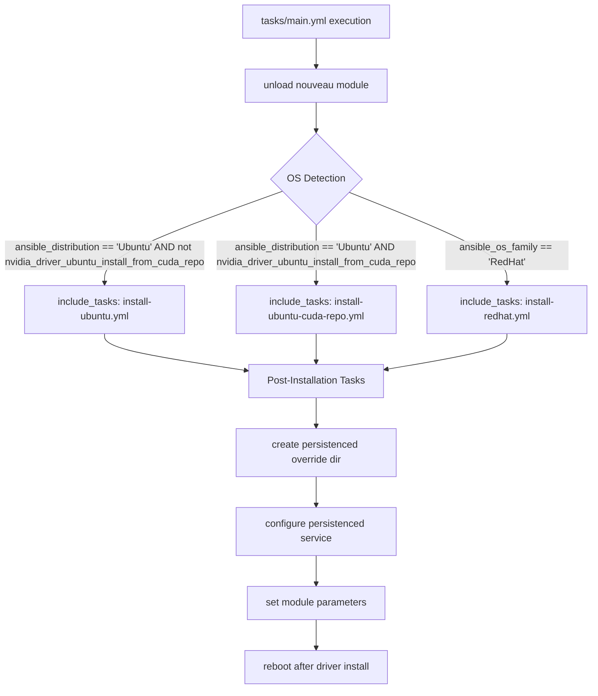

The decision variables used are:

- `ansible_distribution`: Distinguishes Ubuntu from other distributions [tasks/main.yml:10]()
- `ansible_os_family`: Identifies RedHat family systems (RHEL, CentOS, Fedora) [tasks/main.yml:18]()
- `nvidia_driver_ubuntu_install_from_cuda_repo`: Controls Ubuntu repository selection [tasks/main.yml:14]()

The role also defines repository directory structures in `vars/main.yml` to support these systems, mapping distributions to specific CUDA repository paths.

Sources: [tasks/main.yml:8-18](), [vars/main.yml:1-2]()

## Common Post-Installation Tasks

After OS-specific installation completes, the orchestrator executes a series of common configuration tasks that apply regardless of the installation method used. These tasks handle service configuration, kernel module parameters, and system restart coordination.

### nvidia-persistenced Service Management

The system configures the `nvidia-persistenced` service to maintain GPU state across system operations. This includes creating a systemd override directory and applying specific service parameters defined in `files/nvidia-persistenced-override.conf`.

```yaml
# Directory creation for service overrides
path: /etc/systemd/system/nvidia-persistenced.service.d/

# Service configuration based on nvidia_driver_persistence_mode_on
src: nvidia-persistenced-override.conf
dest: /etc/systemd/system/nvidia-persistenced.service.d/override.conf
```

Sources: [tasks/main.yml:20-42](), [files/nvidia-persistenced-override.conf:1-4]()

### Module Parameter Configuration

Module parameters are applied using a Jinja2 template that renders the `nvidia_driver_module_params` variable into the file specified by `nvidia_driver_module_file`.

```yaml
src: nvidia.conf.j2
dest: "{{ nvidia_driver_module_file }}"
```

The template content is minimal, directly outputting the configured parameters to the target configuration file.

Sources: [tasks/main.yml:44-48](), [templates/nvidia.conf.j2:1-2]()

### Conditional System Reboot

The orchestrator handles system reboot coordination based on installation state changes and configuration preferences:

```yaml
when: install_driver.changed and not nvidia_driver_skip_reboot
```

The reboot logic depends on the `install_driver` variable being set by the OS-specific installation tasks and respects the `nvidia_driver_skip_reboot` configuration parameter.

Sources: [tasks/main.yml:50-52]()

## Integration with Child Systems

The installation systems documented in child pages integrate with this orchestration framework:

- **RedHat Installation System** ([RedHat Installation System](#3.1)): Handles EPEL repository management, CUDA repository setup, and yum/dnf package installation.
- **Ubuntu Installation Systems** ([Ubuntu Installation Systems](#3.2)): Manages canonical vs CUDA repository selection, PPA conflict resolution, and apt package installation.
- **Service Management and Orchestration** ([Service Management and Orchestration](#3.3)): Provides detailed coverage of the post-installation service configuration tasks, persistence mode, and reboot logic.

Sources: [tasks/main.yml:1-53]()

---

# Page: RedHat Installation System

# RedHat Installation System

<details>
<summary>Relevant source files</summary>

The following files were used as context for generating this wiki page:

- [defaults/main.yml](defaults/main.yml)
- [tasks/install-redhat.yml](tasks/install-redhat.yml)

</details>


## Purpose and Scope

The RedHat Installation System handles automated NVIDIA driver installation for RedHat Enterprise Linux, CentOS, and other RedHat-family distributions. This system manages the complete installation pipeline including kernel preparation, repository configuration, dependency resolution, and driver package installation with version-specific handling for RHEL/CentOS 7 versus 8+ systems.

For Ubuntu-specific installation procedures, see 3.2 Ubuntu Installation Systems. For general service configuration and orchestration logic, see 3.3 Service Management and Orchestration.

## Installation Workflow Overview

The RedHat installation process follows a sequential workflow that ensures system compatibility before driver installation. The main orchestrator conditionally executes this workflow when `ansible_os_family == 'RedHat'`.

**RedHat Installation Sequence**
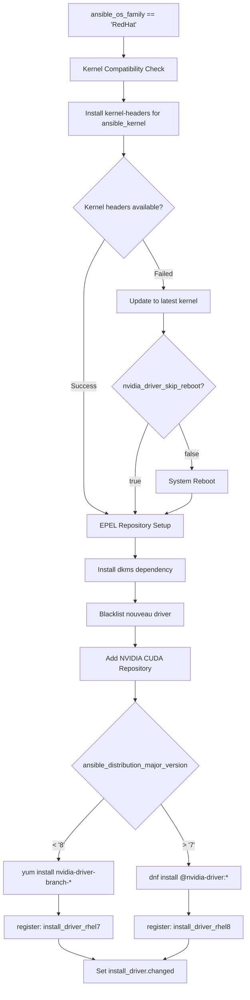

Sources: [tasks/install-redhat.yml:1-90]()

## Kernel Preparation System

The kernel preparation system ensures compatibility between the NVIDIA driver and the current kernel version. This is critical because NVIDIA drivers require kernel headers that match the running kernel version.

**Kernel Compatibility Resolution**
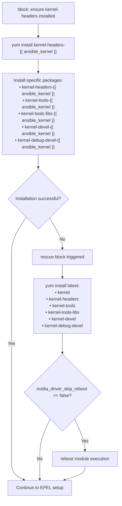

The system uses a `block`/`rescue` pattern to handle kernel header availability issues. When specific kernel headers for `ansible_kernel` are unavailable (common with older kernels on CentOS mirrors), the rescue block updates to the latest kernel version and conditionally reboots the system [tasks/install-redhat.yml:4-30]().

Sources: [tasks/install-redhat.yml:4-30]()

## Repository Management

The RedHat installation system manages two external repositories: EPEL (Extra Packages for Enterprise Linux) and the official NVIDIA CUDA repository.

### EPEL Repository Configuration

| Component | Implementation | Configuration Variable |
|-----------|----------------|------------------------|
| GPG Key | `rpm_key` module | `epel_repo_key` |
| Package Installation | `yum` module | `epel_package` |
| Conditional Logic | `when` clause | `nvidia_driver_add_repos` |

**EPEL Setup Process**
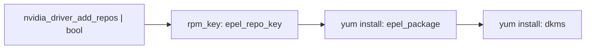

The EPEL repository is essential for providing the `dkms` dependency required for building the NVIDIA kernel modules [tasks/install-redhat.yml:47-50]().

### NVIDIA CUDA Repository Configuration

The CUDA repository setup uses the `yum_repository` module to configure the official NVIDIA package source [tasks/install-redhat.yml:57-64](). The repository URLs are constructed dynamically based on the RHEL version [defaults/main.yml:16-17]().

```yaml
yum_repository:
  name: cuda
  description: NVIDIA CUDA YUM Repo
  baseurl: "{{ nvidia_driver_rhel_cuda_repo_baseurl }}"
  gpgkey: "{{ nvidia_driver_rhel_cuda_repo_gpgkey }}"
```

Sources: [tasks/install-redhat.yml:32-64](), [defaults/main.yml:14-17]()

## Driver Installation Process

The driver installation process varies significantly between RHEL/CentOS versions due to package manager differences and driver packaging changes.

### Version-Specific Package Management

**RHEL/CentOS Version Detection and Package Installation**
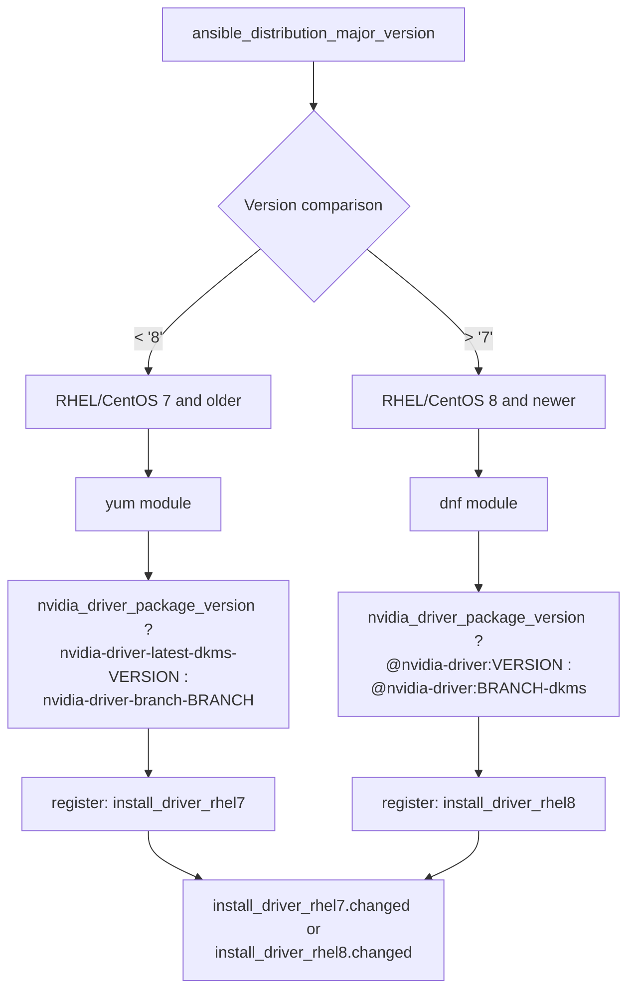

### Package Naming Conventions

| RHEL Version | Package Manager | Package Format | Example |
|--------------|-----------------|----------------|---------|
| 7 and older | `yum` | `nvidia-driver-latest-dkms-{version}` or `nvidia-driver-branch-{branch}` | `nvidia-driver-branch-515` |
| 8 and newer | `dnf` | `@nvidia-driver:{version}` or `@nvidia-driver:{branch}-dkms` | `@nvidia-driver:515-dkms` |

The conditional package naming uses ternary operators to select between version-specific and branch-specific installations [tasks/install-redhat.yml:68,77]():

- **RHEL 7**: `{{ nvidia_driver_package_version | ternary('nvidia-driver-latest-dkms-'+nvidia_driver_package_version, 'nvidia-driver-branch-'+nvidia_driver_rhel_branch) }}`
- **RHEL 8+**: `{{ nvidia_driver_package_version | ternary('@nvidia-driver:'+nvidia_driver_package_version, '@nvidia-driver:'+nvidia_driver_rhel_branch+'-dkms') }}`

Sources: [tasks/install-redhat.yml:66-83](), [defaults/main.yml:1-8]()

## Driver State Management

The installation system tracks driver installation state through registered variables and provides unified change detection across different RHEL versions.

**Change Detection Logic**
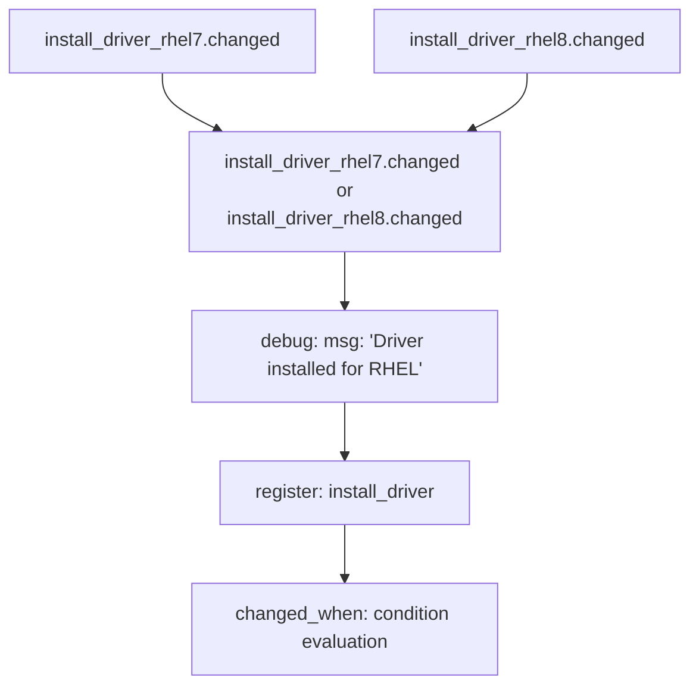

This unified approach ensures that subsequent tasks in the main orchestration can reliably detect whether driver installation occurred, regardless of the specific RHEL version or package manager used [tasks/install-redhat.yml:84-90]().

### Proxy Environment Support

All package management operations support proxy environments through the `proxy_env` variable [tasks/install-redhat.yml:15,27,44,63,72,81]():

```yaml
environment: "{{proxy_env if proxy_env is defined else {}}}"
```

This pattern appears consistently across `yum`, `dnf`, and `yum_repository` tasks, ensuring network operations can function in corporate environments with proxy requirements.

Sources: [tasks/install-redhat.yml:15](), [tasks/install-redhat.yml:27](), [tasks/install-redhat.yml:44](), [tasks/install-redhat.yml:63](), [tasks/install-redhat.yml:72](), [tasks/install-redhat.yml:81](), [tasks/install-redhat.yml:84-90]()

---

# Page: Ubuntu Installation Systems

# Ubuntu Installation Systems

<details>
<summary>Relevant source files</summary>

The following files were used as context for generating this wiki page:

- [defaults/main.yml](defaults/main.yml)
- [tasks/install-ubuntu-cuda-repo.yml](tasks/install-ubuntu-cuda-repo.yml)
- [tasks/install-ubuntu.yml](tasks/install-ubuntu.yml)

</details>


## Purpose and Scope

This document covers the dual Ubuntu installation pathways implemented in the `ansible-role-nvidia-driver`. The role provides two distinct methods for installing NVIDIA drivers on Ubuntu systems: using canonical Ubuntu repositories or NVIDIA's official CUDA repositories. The choice between these methods is controlled by the `nvidia_driver_ubuntu_install_from_cuda_repo` configuration variable [defaults/main.yml:30-30]().

For information about RedHat installation systems, see [RedHat Installation System](#3.1). For overall orchestration logic, see [Service Management and Orchestration](#3.3).

## Installation Path Selection

The Ubuntu installation system implements a branching strategy based on the `nvidia_driver_ubuntu_install_from_cuda_repo` boolean variable. This decision determines the repository source, package selection, and installation procedures.

### Ubuntu Installation Decision Flow

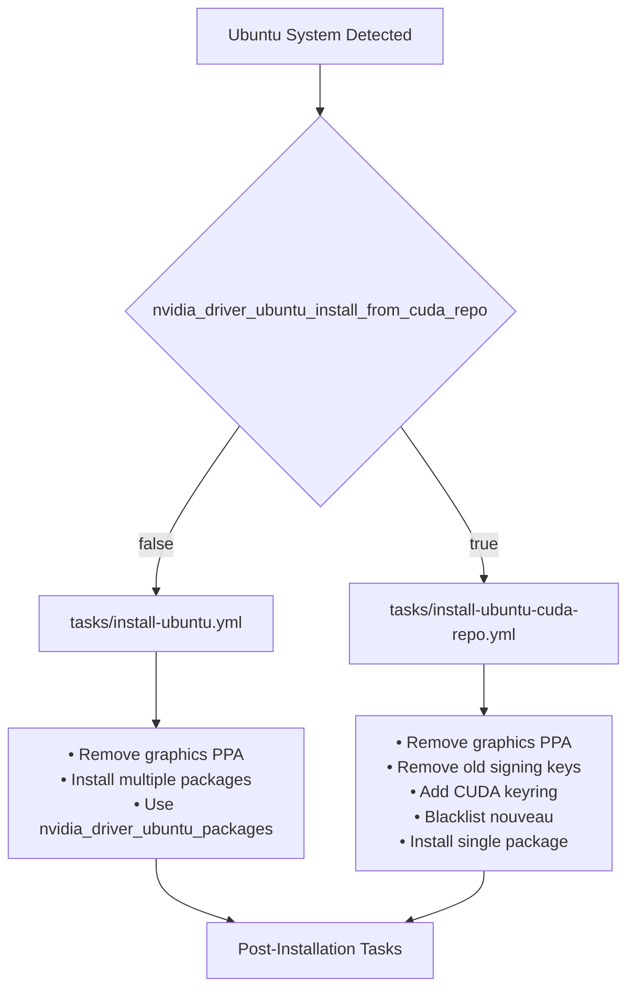

Sources: [tasks/install-ubuntu.yml:1-16](), [tasks/install-ubuntu-cuda-repo.yml:1-44](), [defaults/main.yml:30-30]()

## Canonical Repository Installation

The canonical installation path uses Ubuntu's default repositories and is implemented in `tasks/install-ubuntu.yml`. This approach installs multiple related packages using the system's standard package management.

### Canonical Installation Process

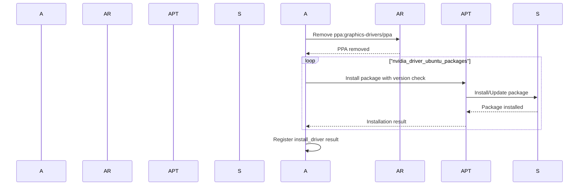

### Package Installation Logic

The canonical installation uses a loop-based approach to install multiple packages defined in `nvidia_driver_ubuntu_packages` [defaults/main.yml:35-40](). Each package installation supports version pinning through `nvidia_driver_package_version`:

| Task | Implementation | Package Selection |
|------|----------------|-------------------|
| PPA Removal | `apt_repository` with `state: absent` | `ppa:graphics-drivers/ppa` [tasks/install-ubuntu.yml:2-5]() |
| Package Installation | `apt` module with loop | `nvidia_driver_ubuntu_packages` [tasks/install-ubuntu.yml:7-15]() |
| Version Control | Ternary operator | `nvidia_driver_package_version` [tasks/install-ubuntu.yml:9-9]() |

Sources: [tasks/install-ubuntu.yml:2-15](), [defaults/main.yml:35-40]()

## CUDA Repository Installation

The CUDA repository installation path uses NVIDIA's official repositories and implements additional system configuration steps. This method is more comprehensive but installs a single consolidated package.

### CUDA Installation Architecture

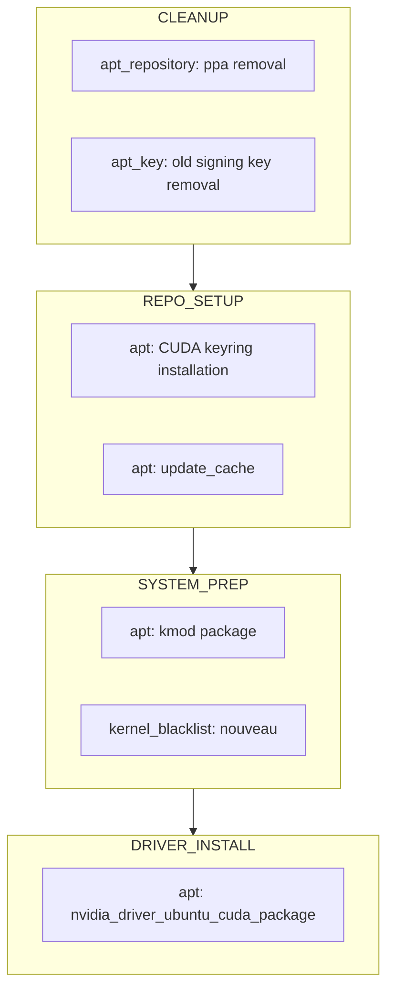

### CUDA Repository Configuration Steps

The CUDA installation implements a more detailed setup process with specific security and compatibility measures:

1. **Repository Cleanup**: Removes conflicting PPAs and outdated signing keys [tasks/install-ubuntu-cuda-repo.yml:2-10]().
2. **Security Setup**: Installs NVIDIA's official keyring from `nvidia_driver_ubuntu_cuda_keyring_url` [tasks/install-ubuntu-cuda-repo.yml:14-19]().
3. **System Preparation**: Ensures `kmod` is installed and blacklists conflicting `nouveau` drivers [tasks/install-ubuntu-cuda-repo.yml:26-34]().
4. **Driver Installation**: Installs the consolidated CUDA driver package defined by `nvidia_driver_ubuntu_cuda_package` [tasks/install-ubuntu-cuda-repo.yml:36-43]().

| Phase | Task Name | Module | Key Variable |
|-------|-----------|--------|--------------|
| Cleanup | `remove ppa` | `apt_repository` | `ppa:graphics-drivers/ppa` [tasks/install-ubuntu-cuda-repo.yml:2-5]() |
| Cleanup | `remove old signing key` | `apt_key` | `old_nvidia_driver_ubuntu_cuda_repo_gpgkey_id` [tasks/install-ubuntu-cuda-repo.yml:7-10]() |
| Security | `add CUDA keyring` | `apt` | `nvidia_driver_ubuntu_cuda_keyring_url` [tasks/install-ubuntu-cuda-repo.yml:14-19]() |
| System | `blacklist nouveau` | `kernel_blacklist` | `nouveau` [tasks/install-ubuntu-cuda-repo.yml:31-34]() |
| Install | `install driver packages` | `apt` | `nvidia_driver_ubuntu_cuda_package` [tasks/install-ubuntu-cuda-repo.yml:36-43]() |

Sources: [tasks/install-ubuntu-cuda-repo.yml:1-44](), [defaults/main.yml:42-46]()

## Technical Implementation Comparison

### Package Management Differences

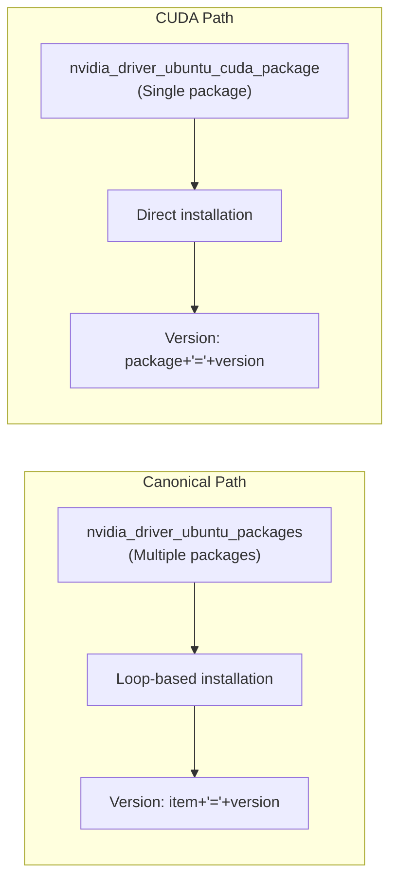

### Environment and State Management

Both installation paths implement consistent environment and state management patterns:

- **Proxy Support**: Both paths use `environment: "{{proxy_env if proxy_env is defined else {}}}"` for network configuration [tasks/install-ubuntu.yml:15-15](), [tasks/install-ubuntu-cuda-repo.yml:43-43]().
- **State Management**: Both support `nvidia_driver_package_state` (e.g., `present`, `absent`) for installation/removal operations [tasks/install-ubuntu.yml:10-10](), [tasks/install-ubuntu-cuda-repo.yml:39-39]().
- **Cleanup Options**: Both implement `autoremove` and `purge` options for package removal scenarios [tasks/install-ubuntu.yml:11-12](), [tasks/install-ubuntu-cuda-repo.yml:40-41]().
- **Result Registration**: Both register installation results in the `install_driver` variable to trigger subsequent handlers [tasks/install-ubuntu.yml:14-14](), [tasks/install-ubuntu-cuda-repo.yml:42-42]().

Sources: [tasks/install-ubuntu.yml:9-15](), [tasks/install-ubuntu-cuda-repo.yml:36-43](), [defaults/main.yml:1-1]()

---

# Page: Service Management and Orchestration

# Service Management and Orchestration

<details>
<summary>Relevant source files</summary>

The following files were used as context for generating this wiki page:

- [files/nvidia-persistenced-override.conf](files/nvidia-persistenced-override.conf)
- [tasks/main.yml](tasks/main.yml)
- [templates/nvidia.conf.j2](templates/nvidia.conf.j2)
- [vars/main.yml](vars/main.yml)

</details>


This document covers the main orchestration logic and service management components of the `ansible-role-nvidia-driver`. It focuses on the coordination between OS-specific installation tasks, post-installation service configuration, and system management operations like reboots and driver parameter tuning.

For details about the specific RedHat installation procedures, see [RedHat Installation System](#3.1). For Ubuntu-specific installation logic, see [Ubuntu Installation Systems](#3.2). For overall configuration options, see [Configuration System](#2).

## Main Orchestration Flow

The primary orchestration logic resides in [tasks/main.yml:1-53](), which serves as the central coordinator for the entire driver installation process. This file implements a conditional task execution model based on operating system detection and configuration parameters.

### Orchestration Decision Tree

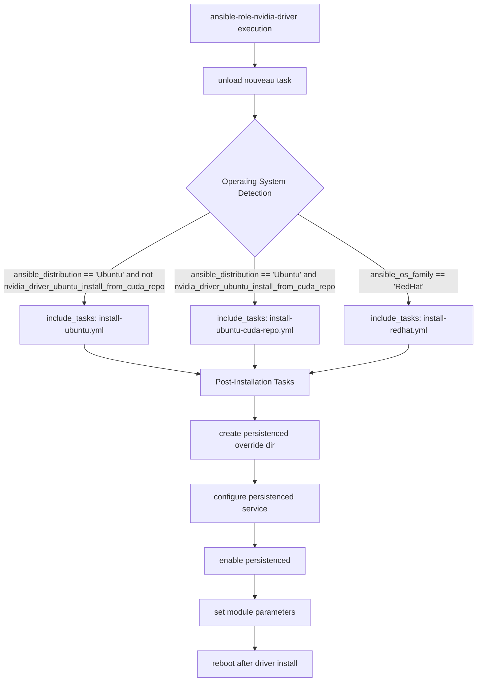

Sources: [tasks/main.yml:1-53]()

The orchestration begins with nouveau driver unloading [tasks/main.yml:2-6]() to prevent conflicts, then branches to OS-specific installation tasks using conditional inclusion based on `ansible_distribution` and `ansible_os_family` facts [tasks/main.yml:8-18]().

## NVIDIA Persistenced Service Management

The role configures the `nvidia-persistenced` service to maintain GPU state across system operations. This service management involves systemd override configuration and conditional service enablement.

### Persistenced Service Configuration Flow

```mermaid
stateDiagram-v2
    [*] --> CheckPersistenceMode: nvidia_driver_persistence_mode_on variable
    
    CheckPersistenceMode --> CreateOverrideDir: if true
    CheckPersistenceMode --> RemoveOverride: if false
    
    CreateOverrideDir --> CopyOverrideFile: create /etc/systemd/system/nvidia-persistenced.service.d/
    CopyOverrideFile --> EnableService: copy nvidia-persistenced-override.conf
    
    RemoveOverride --> EnableService: remove override.conf
    
    EnableService --> [*]: systemd enable nvidia-persistenced
    
    note right of CreateOverrideDir: tasks/main.yml:20-24
    note right of CopyOverrideFile: tasks/main.yml:26-30
    note right of RemoveOverride: tasks/main.yml:32-36
    note right of EnableService: tasks/main.yml:38-42
```

Sources: [tasks/main.yml:20-42](), [files/nvidia-persistenced-override.conf:1-4]()

### Persistenced Override Configuration

The service override mechanism modifies the default `nvidia-persistenced` service behavior through systemd drop-in configuration:

| Configuration Element | Purpose | File Location |
|----------------------|---------|---------------|
| Override Directory | Houses systemd service modifications | `/etc/systemd/system/nvidia-persistenced.service.d/` |
| Override Configuration | Enables persistence mode with root user | `override.conf` |
| Service Parameters | `--user root --persistence-mode --verbose` | Applied via `ExecStart` override |

The override configuration [files/nvidia-persistenced-override.conf:1-4]() replaces the default service execution with persistence mode enabled, ensuring GPU state maintenance across driver operations.

Sources: [tasks/main.yml:20-36](), [files/nvidia-persistenced-override.conf:1-4]()

## Module Parameter Management

Driver module parameters are configured through template-based file generation, allowing runtime customization of NVIDIA kernel module behavior.

### Module Configuration System

```mermaid
graph LR
    CONFIG_VAR["nvidia_driver_module_params variable"] --> TEMPLATE["nvidia.conf.j2 template"]
    TEMPLATE --> MODULE_FILE["nvidia_driver_module_file destination"]
    MODULE_FILE --> KERNEL_MODULE["NVIDIA kernel module"]
    
    subgraph "Template Processing"
        TEMPLATE_ENGINE["Ansible template module"]
        TEMPLATE_ENGINE --> FILE_CREATION["File creation with mode 0644"]
    end
    
    TEMPLATE --> TEMPLATE_ENGINE
    TEMPLATE_ENGINE --> MODULE_FILE
```

Sources: [tasks/main.yml:44-48](), [templates/nvidia.conf.j2:1-2]()

The module parameter configuration uses a minimal template [templates/nvidia.conf.j2:1-2]() that directly renders the `nvidia_driver_module_params` variable content to the target file specified by `nvidia_driver_module_file` [tasks/main.yml:44-48](). This approach provides flexibility for users to specify custom kernel module parameters through configuration variables.

## Reboot Orchestration

System reboot management ensures driver changes take effect while providing control over when reboots occur during automated deployments.

### Conditional Reboot Logic

```mermaid
flowchart TD
    DRIVER_INSTALL["Driver installation tasks"] --> CHECK_CHANGED{"install_driver.changed == true"}
    CHECK_CHANGED -->|false| SKIP_REBOOT["Continue without reboot"]
    CHECK_CHANGED -->|true| CHECK_SKIP{"nvidia_driver_skip_reboot == true"}
    
    CHECK_SKIP -->|true| SKIP_REBOOT
    CHECK_SKIP -->|false| EXECUTE_REBOOT["Execute reboot task"]
    
    EXECUTE_REBOOT --> SYSTEM_RESTART["System restart"]
    SYSTEM_RESTART --> DRIVER_ACTIVE["NVIDIA drivers active"]
    
    SKIP_REBOOT --> END["Task completion"]
    DRIVER_ACTIVE --> END
```

Sources: [tasks/main.yml:50-52]()

The reboot logic [tasks/main.yml:50-52]() implements a dual-condition check: the reboot only executes when both the driver installation tasks report changes (`install_driver.changed`) and the skip reboot flag (`nvidia_driver_skip_reboot`) is not set. This provides administrators with control over reboot timing in automated environments while ensuring reboots occur when necessary for driver activation.

### Post-Installation Task Sequence Summary

| Task Order | Operation | Conditional Logic | Purpose |
|------------|-----------|-------------------|---------|
| 1 | Nouveau unload | Always executed (ignores errors) | Prevent driver conflicts [tasks/main.yml:2-6]() |
| 2 | OS-specific installation | Based on OS detection | Install appropriate driver packages [tasks/main.yml:8-18]() |
| 3 | Persistenced directory creation | Always executed | Prepare systemd override location [tasks/main.yml:20-24]() |
| 4 | Persistenced service configuration | `nvidia_driver_persistence_mode_on` | Configure GPU state persistence [tasks/main.yml:26-30]() |
| 5 | Persistenced service enablement | `nvidia_driver_package_state != 'absent'` | Enable service for installed drivers [tasks/main.yml:38-42]() |
| 6 | Module parameter configuration | Always executed | Apply kernel module settings [tasks/main.yml:44-48]() |
| 7 | Conditional reboot | `install_driver.changed and not nvidia_driver_skip_reboot` | Activate new driver installation [tasks/main.yml:50-52]() |

Sources: [tasks/main.yml:1-53]()

---

# Page: Testing Framework

# Testing Framework

<details>
<summary>Relevant source files</summary>

The following files were used as context for generating this wiki page:

- [.github/workflows/molecule.yml](.github/workflows/molecule.yml)
- [molecule/default/molecule.yml](molecule/default/molecule.yml)
- [tests/README.md](tests/README.md)

</details>


## Purpose and Scope

This document provides an overview of the comprehensive testing approach used to validate the NVIDIA driver installation role across multiple operating systems and configuration scenarios. The testing framework ensures that the Ansible role functions correctly on different Linux distributions with various repository configurations and installation methods.

For detailed information about the Molecule testing configuration and platform matrix, see [Molecule Testing Suite](#4.1). For CI/CD pipeline and automated validation details, see [CI/CD and Basic Tests](#4.2).

## Testing Architecture Overview

The testing framework is built around Molecule, which provides comprehensive multi-platform validation through Docker containerization. The architecture supports testing both Ubuntu canonical repositories and NVIDIA CUDA repositories across multiple OS versions.

### Testing Framework Components

```mermaid
graph TB
    subgraph "Test Orchestration"
        MOLECULE_CONFIG["molecule.yml"]
        MOLECULE_DRIVER["docker driver"]
        ANSIBLE_PROVISIONER["ansible provisioner"]
        ANSIBLE_VERIFIER["ansible verifier"]
    end
    
    subgraph "Platform Matrix"
        UBUNTU_1804["ubuntu-1804-canonical"]
        UBUNTU_1804_CUDA["ubuntu-1804-cuda"]
        UBUNTU_2004_SERVER["ubuntu-2004-canonical-server"]
        UBUNTU_2004_NOSERVER["ubuntu-2004-canonical-noserver"]
        UBUNTU_2004_CUDA["ubuntu-2004-cuda"]
        UBUNTU_2204["ubuntu-2204-canonical"]
        UBUNTU_2204_CUDA["ubuntu-2204-cuda"]
        CENTOS_7["centos-7"]
    end
    
    subgraph "Group Variables"
        CANONICAL_REPO["canonical_repo"]
        CANONICAL_REPO_NOSERVER["canonical_repo_noserver"]
        CUDA_REPO["cuda_repo"]
        UBUNTU_GROUP["ubuntu"]
    end
    
    subgraph "Docker Infrastructure"
        GEERLINGGUY_UBUNTU1804["geerlingguy/docker-ubuntu1804-ansible"]
        GEERLINGGUY_UBUNTU2004["geerlingguy/docker-ubuntu2004-ansible"]
        GEERLINGGUY_UBUNTU2204["geerlingguy/docker-ubuntu2204-ansible"]
        GEERLINGGUY_CENTOS7["geerlingguy/docker-centos7-ansible"]
    end
    
    MOLECULE_CONFIG --> MOLECULE_DRIVER
    MOLECULE_CONFIG --> ANSIBLE_PROVISIONER
    MOLECULE_CONFIG --> ANSIBLE_VERIFIER
    
    MOLECULE_DRIVER --> UBUNTU_1804
    MOLECULE_DRIVER --> UBUNTU_1804_CUDA
    MOLECULE_DRIVER --> UBUNTU_2004_SERVER
    MOLECULE_DRIVER --> UBUNTU_2004_NOSERVER
    MOLECULE_DRIVER --> UBUNTU_2004_CUDA
    MOLECULE_DRIVER --> UBUNTU_2204
    MOLECULE_DRIVER --> UBUNTU_2204_CUDA
    MOLECULE_DRIVER --> CENTOS_7
    
    UBUNTU_1804 --> CANONICAL_REPO
    UBUNTU_1804 --> UBUNTU_GROUP
    UBUNTU_1804_CUDA --> CUDA_REPO
    UBUNTU_1804_CUDA --> UBUNTU_GROUP
    UBUNTU_2004_SERVER --> CANONICAL_REPO
    UBUNTU_2004_SERVER --> UBUNTU_GROUP
    UBUNTU_2004_NOSERVER --> CANONICAL_REPO
    UBUNTU_2004_NOSERVER --> CANONICAL_REPO_NOSERVER
    UBUNTU_2004_NOSERVER --> UBUNTU_GROUP
    UBUNTU_2004_CUDA --> CUDA_REPO
    UBUNTU_2004_CUDA --> UBUNTU_GROUP
    UBUNTU_2204 --> CANONICAL_REPO
    UBUNTU_2204 --> UBUNTU_GROUP
    UBUNTU_2204_CUDA --> CUDA_REPO
    UBUNTU_2204_CUDA --> UBUNTU_GROUP
    
    UBUNTU_1804 --> GEERLINGGUY_UBUNTU1804
    UBUNTU_1804_CUDA --> GEERLINGGUY_UBUNTU1804
    UBUNTU_2004_SERVER --> GEERLINGGUY_UBUNTU2004
    UBUNTU_2004_NOSERVER --> GEERLINGGUY_UBUNTU2004
    UBUNTU_2004_CUDA --> GEERLINGGUY_UBUNTU2004
    UBUNTU_2204 --> GEERLINGGUY_UBUNTU2204
    UBUNTU_2204_CUDA --> GEERLINGGUY_UBUNTU2204
    CENTOS_7 --> GEERLINGGUY_CENTOS7
```

Sources: [molecule/default/molecule.yml:1-118]()

## Platform Coverage Matrix

The testing framework validates the role across a comprehensive matrix of operating systems and repository configurations:

| Platform | Base Image | Repository Type | Special Configuration |
|----------|------------|-----------------|----------------------|
| `ubuntu-1804-canonical` | `geerlingguy/docker-ubuntu1804-ansible` | Canonical | Standard Ubuntu packages |
| `ubuntu-1804-cuda` | `geerlingguy/docker-ubuntu1804-ansible` | NVIDIA CUDA | Official NVIDIA repository |
| `ubuntu-2004-canonical-server` | `geerlingguy/docker-ubuntu2004-ansible` | Canonical | Server edition packages |
| `ubuntu-2004-canonical-noserver` | `geerlingguy/docker-ubuntu2004-ansible` | Canonical | No server suffix packages |
| `ubuntu-2004-cuda` | `geerlingguy/docker-ubuntu2004-ansible` | NVIDIA CUDA | Official NVIDIA repository |
| `ubuntu-2204-canonical` | `geerlingguy/docker-ubuntu2204-ansible` | Canonical | Standard Ubuntu packages |
| `ubuntu-2204-cuda` | `geerlingguy/docker-ubuntu2204-ansible` | NVIDIA CUDA | Official NVIDIA repository |
| `centos-7` | `geerlingguy/docker-centos7-ansible` | EPEL/CUDA | RedHat family testing |

Sources: [molecule/default/molecule.yml:6-93]()

## Configuration Strategy by Group Variables

The testing framework uses Ansible group variables to control different installation scenarios and validate the role's conditional logic:

### Test Configuration Variables

```mermaid
graph LR
    subgraph "Global Configuration"
        SKIP_REBOOT["nvidia_driver_skip_reboot: true"]
    end
    
    subgraph "Repository Selection Groups"
        CANONICAL_REPO_CONFIG["canonical_repo group"]
        CUDA_REPO_CONFIG["cuda_repo group"]
        CANONICAL_NOSERVER_CONFIG["canonical_repo_noserver group"]
    end
    
    subgraph "Variable Assignments"
        UBUNTU_CUDA_FALSE["nvidia_driver_ubuntu_install_from_cuda_repo: false"]
        UBUNTU_CUDA_TRUE["nvidia_driver_ubuntu_install_from_cuda_repo: true"]
        PACKAGES_SUFFIX_EMPTY["nvidia_driver_ubuntu_packages_suffix: \"\""]
    end
    
    CANONICAL_REPO_CONFIG --> UBUNTU_CUDA_FALSE
    CUDA_REPO_CONFIG --> UBUNTU_CUDA_TRUE
    CANONICAL_NOSERVER_CONFIG --> PACKAGES_SUFFIX_EMPTY
    
    SKIP_REBOOT --> CANONICAL_REPO_CONFIG
    SKIP_REBOOT --> CUDA_REPO_CONFIG
    SKIP_REBOOT --> CANONICAL_NOSERVER_CONFIG
```

Sources: [molecule/default/molecule.yml:107-115]()

## Docker Container Configuration

All test platforms utilize privileged Docker containers with systemd support to properly simulate real system environments:

### Container Runtime Requirements

- **Privileged Mode**: Required for kernel module operations and system-level package management [molecule/default/molecule.yml:14]()
- **systemd Support**: Enabled through `/sbin/init` command [molecule/default/molecule.yml:12]() and cgroup volume mounting
- **Volume Mounts**: `/sys/fs/cgroup:/sys/fs/cgroup:ro` for proper systemd operation [molecule/default/molecule.yml:11]()
- **Pre-built Images**: Uses Jeff Geerling's pre-configured Ansible test images [molecule/default/molecule.yml:9]()

The `privileged: true` setting enables the containers to perform operations typically restricted in standard Docker environments, which is essential for driver installation testing.

Sources: [molecule/default/molecule.yml:10-26](), [molecule/default/molecule.yml:33-51](), [molecule/default/molecule.yml:58-84](), [molecule/default/molecule.yml:87-93]()

## Test Execution Components

The Molecule configuration defines key components for test execution and continuous integration:

### Execution Modes
- **Molecule**: The primary automated testing tool [molecule/default/molecule.yml:1-118]()
- **Manual Playbook**: Ad-hoc testing using `tests/playbook.yml` and `tests/inventory.yml` [tests/README.md:1-7]()
- **GitHub Actions**: Automated CI pipeline triggered on `push` and `pull_request` [.github/workflows/molecule.yml:2-4]()

### Provisioner and Verifier
- **Provisioner**: Uses `ansible` with enhanced verbosity (`-vv`) [molecule/default/molecule.yml:103-105]()
- **Verifier**: Uses `ansible` to validate state after the role runs [molecule/default/molecule.yml:117]()

### Dependency Management
- **Dependency**: Uses `galaxy` to resolve role dependencies [molecule/default/molecule.yml:3]()

Sources: [molecule/default/molecule.yml:102-118](), [tests/README.md:1-7](), [.github/workflows/molecule.yml:1-16]()

## Commented Platform Support

The configuration includes commented-out support for CentOS 8 testing, indicating planned or previously supported platforms:

```yaml
# - name: centos-8
#   image: geerlingguy/docker-centos8-ansible
```

This suggests the framework is designed to be extensible for additional platform support as needed.

Sources: [molecule/default/molecule.yml:94-100]()

---

# Page: Molecule Testing Suite

# Molecule Testing Suite

<details>
<summary>Relevant source files</summary>

The following files were used as context for generating this wiki page:

- [molecule/default/converge.yml](molecule/default/converge.yml)
- [molecule/default/molecule.yml](molecule/default/molecule.yml)
- [molecule/default/prepare.yml](molecule/default/prepare.yml)
- [molecule/default/verify.yml](molecule/default/verify.yml)

</details>


This document covers the Molecule testing infrastructure that validates the `ansible-role-nvidia-driver` across multiple Linux distributions and installation configurations. The testing suite uses Docker containers to simulate different target environments and verifies that the role executes correctly under various scenarios.

For information about the continuous integration pipeline and basic test infrastructure, see [CI/CD and Basic Tests](#4.2). For details about the installation systems being tested, see [Installation Systems](#3).

## Platform Test Matrix

The Molecule testing suite validates the role across a comprehensive matrix of operating systems and repository configurations. The test matrix includes several distinct platform configurations that cover the primary supported distributions and installation methods.

### Supported Platforms and Scenarios

| Platform | Image | Repository Type | Groups | Purpose |
|----------|-------|----------------|--------|---------|
| `ubuntu-1804-canonical` | `geerlingguy/docker-ubuntu1804-ansible` | Canonical | `canonical_repo`, `ubuntu` | Test Ubuntu 18.04 with canonical repositories |
| `ubuntu-1804-cuda` | `geerlingguy/docker-ubuntu1804-ansible` | CUDA | `cuda_repo`, `ubuntu` | Test Ubuntu 18.04 with NVIDIA CUDA repositories |
| `ubuntu-2004-canonical-server` | `geerlingguy/docker-ubuntu2004-ansible` | Canonical | `canonical_repo`, `ubuntu` | Test Ubuntu 20.04 with server packages |
| `ubuntu-2004-canonical-noserver` | `geerlingguy/docker-ubuntu2004-ansible` | Canonical | `canonical_repo`, `canonical_repo_noserver`, `ubuntu` | Test Ubuntu 20.04 without server packages |
| `ubuntu-2004-cuda` | `geerlingguy/docker-ubuntu2004-ansible` | CUDA | `cuda_repo`, `ubuntu` | Test Ubuntu 20.04 with NVIDIA CUDA repositories |
| `ubuntu-2204-canonical` | `geerlingguy/docker-ubuntu2204-ansible` | Canonical | `canonical_repo`, `ubuntu` | Test Ubuntu 22.04 with canonical repositories |
| `ubuntu-2204-cuda` | `geerlingguy/docker-ubuntu2204-ansible` | CUDA | `cuda_repo`, `ubuntu` | Test Ubuntu 22.04 with NVIDIA CUDA repositories |
| `centos-7` | `geerlingguy/docker-centos7-ansible` | Default | (none) | Test CentOS 7 with default configuration |

**Platform and Group Mapping**
```mermaid
graph TB
    subgraph "Ubuntu Test Matrix"
        U1804C["ubuntu-1804-canonical<br/>Groups: canonical_repo, ubuntu"]
        U1804X["ubuntu-1804-cuda<br/>Groups: cuda_repo, ubuntu"]
        U2004CS["ubuntu-2004-canonical-server<br/>Groups: canonical_repo, ubuntu"]
        U2004CN["ubuntu-2004-canonical-noserver<br/>Groups: canonical_repo, canonical_repo_noserver, ubuntu"]
        U2004X["ubuntu-2004-cuda<br/>Groups: cuda_repo, ubuntu"]
        U2204C["ubuntu-2204-canonical<br/>Groups: canonical_repo, ubuntu"]
        U2204X["ubuntu-2204-cuda<br/>Groups: cuda_repo, ubuntu"]
    end
    
    subgraph "RedHat Test Matrix"
        C7["centos-7<br/>Groups: (default)"]
    end
    
    subgraph "Docker Configuration [molecule.yml]"
        DOCKER_CONFIG["Docker Settings<br/>• privileged: true<br/>• volumes: /sys/fs/cgroup<br/>• command: /sbin/init"]
    end
    
    U1804C --> DOCKER_CONFIG
    U1804X --> DOCKER_CONFIG
    U2004CS --> DOCKER_CONFIG
    U2004CN --> DOCKER_CONFIG
    U2004X --> DOCKER_CONFIG
    U2204C --> DOCKER_CONFIG
    U2204X --> DOCKER_CONFIG
    C7 --> DOCKER_CONFIG
```

Sources: [molecule/default/molecule.yml:6-101]()

## Docker Test Environment Configuration

The testing environment uses the Docker driver [molecule/default/molecule.yml:5]() configured with privileged access and systemd support to simulate realistic deployment targets. Each container is based on Jeff Geerling's Ansible-ready Docker images and includes specific volume mounts and initialization commands.

### Container Configuration Pattern

All test containers share a common configuration pattern that enables proper testing of system-level operations:

```mermaid
graph LR
    subgraph "Container Configuration [molecule.yml]"
        IMAGE["image: geerlingguy/docker-{os}-ansible"]
        VOLUMES["volumes:<br/>- /sys/fs/cgroup:/sys/fs/cgroup:ro"]
        COMMAND["command: /sbin/init"]
        PRIVILEGED["privileged: true"]
        PREBUILD["pre_build_image: true"]
    end
    
    IMAGE --> VOLUMES
    VOLUMES --> COMMAND
    COMMAND --> PRIVILEGED
    PRIVILEGED --> PREBUILD
```

The `privileged: true` setting allows containers to perform system-level operations like service management, which are essential for driver installation testing. The cgroup volume mount enables systemd functionality within the containers by providing access to the host's cgroup filesystem [molecule/default/molecule.yml:10-14]().

Sources: [molecule/default/molecule.yml:10-14](), [molecule/default/molecule.yml:21-25](), [molecule/default/molecule.yml:88-92]()

## Group-Based Variable System

The testing suite uses Ansible inventory groups defined in `molecule.yml` to apply different configuration parameters to test platforms. This system enables testing of multiple installation scenarios (e.g., Canonical vs. CUDA repos) without duplicating platform definitions.

### Group Variable Configuration

The following variables are applied via `provisioner.inventory.group_vars` [molecule/default/molecule.yml:107]():

| Group | Variable | Value | Purpose |
|-------|----------|-------|---------|
| `all` | `nvidia_driver_skip_reboot` | `true` | Prevents containers from attempting reboots [molecule/default/molecule.yml:109]() |
| `canonical_repo` | `nvidia_driver_ubuntu_install_from_cuda_repo` | `false` | Forces use of Ubuntu default repos [molecule/default/molecule.yml:111]() |
| `cuda_repo` | `nvidia_driver_ubuntu_install_from_cuda_repo` | `true` | Forces use of NVIDIA CUDA repos [molecule/default/molecule.yml:115]() |
| `canonical_repo_noserver` | `nvidia_driver_ubuntu_packages_suffix` | `""` | Tests installation without the `-server` package suffix [molecule/default/molecule.yml:113]() |

**Variable Inheritance Flow**
```mermaid
graph TB
    subgraph "Global Scope [all]"
        ALL_VARS["nvidia_driver_skip_reboot: true"]
    end
    
    subgraph "Repository Logic [molecule.yml]"
        CANONICAL["group: canonical_repo<br/>nvidia_driver_ubuntu_install_from_cuda_repo: false"]
        CANONICAL_NS["group: canonical_repo_noserver<br/>nvidia_driver_ubuntu_packages_suffix: ''"]
        CUDA["group: cuda_repo<br/>nvidia_driver_ubuntu_install_from_cuda_repo: true"]
    end
    
    ALL_VARS --> CANONICAL
    ALL_VARS --> CANONICAL_NS
    ALL_VARS --> CUDA
```

Sources: [molecule/default/molecule.yml:107-115]()

## Test Lifecycle and Execution Flow

The Molecule test suite follows a structured lifecycle with distinct phases for preparation, execution, and verification.

### Test Phase Implementation

```mermaid
flowchart TD
    START["molecule test"] --> PREPARE["prepare.yml<br/>System Preparation"]
    PREPARE --> CONVERGE["converge.yml<br/>Role Execution"]
    CONVERGE --> VERIFY["verify.yml<br/>Result Verification"]
    
    subgraph "Prepare Phase [prepare.yml]"
        PREP_UBUNTU["hosts: ubuntu<br/>• apt update<br/>• apt install gpg-agent"]
    end
    
    subgraph "Converge Phase [converge.yml]"
        CONV_ROLE["include_role:<br/>name: ansible-role-nvidia-driver"]
    end
    
    subgraph "Verify Phase [verify.yml]"
        VERIFY_ASSERT["hosts: all<br/>gather_facts: false<br/>task: Example assertion"]
    end
    
    PREPARE --> PREP_UBUNTU
    CONVERGE --> CONV_ROLE
    VERIFY --> VERIFY_ASSERT
```

1.  **Prepare**: The `prepare.yml` playbook targets the `ubuntu` group to ensure `gpg-agent` is present and the apt cache is updated before the role runs [molecule/default/prepare.yml:2-10]().
2.  **Converge**: The `converge.yml` playbook includes the `ansible-role-nvidia-driver` for all hosts [molecule/default/converge.yml:2-7]().
3.  **Verify**: The `verify.yml` playbook runs post-installation checks. It currently contains a placeholder assertion [molecule/default/verify.yml:4-10]().

Sources: [molecule/default/prepare.yml:1-11](), [molecule/default/converge.yml:1-8](), [molecule/default/verify.yml:1-11]()

## Provisioner and Verifier Configuration

The Molecule provisioner uses Ansible with specific configuration optimizations.

### Provisioner Settings
The provisioner is configured with `ansible_args: ["-vv"]` to provide verbose output during CI runs, aiding in debugging [molecule/default/molecule.yml:104-105]().

### Verifier Settings
The verifier also uses the `ansible` name, allowing verification tasks to be written as standard Ansible playbooks in `verify.yml` [molecule/default/molecule.yml:116-117]().

Sources: [molecule/default/molecule.yml:102-117]()

---

# Page: CI/CD and Basic Tests

# CI/CD and Basic Tests

<details>
<summary>Relevant source files</summary>

The following files were used as context for generating this wiki page:

- [.github/workflows/molecule.yml](.github/workflows/molecule.yml)
- [tests/README.md](tests/README.md)
- [tests/inventory](tests/inventory)
- [tests/playbook.yml](tests/playbook.yml)

</details>


## Purpose and Scope

This document covers the continuous integration and delivery (CI/CD) pipeline and basic test infrastructure for the `ansible-role-nvidia-driver` repository. It focuses on the automated validation mechanisms that ensure role quality through GitHub Actions workflows and simple test cases. For comprehensive testing scenarios using Molecule with multiple OS variants, see [Molecule Testing Suite](#4.1).

The CI/CD system provides automated validation for every push and pull request, while the basic test infrastructure offers a lightweight testing approach for local development and simple validation scenarios.

## CI/CD Pipeline Architecture

The CI/CD pipeline is built around GitHub Actions and integrates with the Molecule testing framework to provide automated validation across multiple scenarios.

### CI/CD Workflow Structure

```mermaid
flowchart TD
    TRIGGER["GitHub Events"] --> PUSH["push events"]
    TRIGGER --> PR["pull_request events"]
    
    PUSH --> WORKFLOW[".github/workflows/molecule.yml"]
    PR --> WORKFLOW
    
    WORKFLOW --> JOB["build job"]
    JOB --> RUNNER["ubuntu-20.04 runner"]
    
    RUNNER --> CHECKOUT["checkout action"]
    CHECKOUT --> MOLECULE_ACTION["robertdebock/molecule-action@2.7.2"]
    
    MOLECULE_ACTION --> MOLECULE_TESTS["Molecule Test Execution"]
    MOLECULE_TESTS --> PLATFORMS["Platform Matrix"]
```

Sources: [.github/workflows/molecule.yml:1-16]()

The workflow triggers on both push events and pull requests, ensuring that all changes are validated before integration. The pipeline uses a standardized `ubuntu-20.04` runner environment and delegates actual testing to the Molecule framework through the `robertdebock/molecule-action`.

## GitHub Actions Workflow Implementation

### Workflow Configuration

The CI/CD workflow is defined in `.github/workflows/molecule.yml` with a minimal but effective configuration:

| Component | Configuration | Purpose |
|-----------|--------------|---------|
| Triggers | `push`, `pull_request` | Automatic validation on code changes |
| Runner | `ubuntu-20.04` | Standardized execution environment |
| Checkout Action | `actions/checkout@v2` | Repository access with path configuration |
| Molecule Action | `robertdebock/molecule-action@2.7.2` | Delegated test execution |

Sources: [.github/workflows/molecule.yml:2-4](), [.github/workflows/molecule.yml:8](), [.github/workflows/molecule.yml:10-13](), [.github/workflows/molecule.yml:14-15]()

### Workflow Execution Steps

```mermaid
sequenceDiagram
    participant "Developer" as DEV
    participant "GitHub" as GH
    participant "Actions Runner" as RUNNER
    participant "Molecule Action" as MOL
    
    DEV->>GH: "git push / create PR"
    GH->>RUNNER: "Trigger workflow"
    RUNNER->>RUNNER: "checkout@v2"
    Note over RUNNER: "Repository path: ${{ github.repository }}"
    RUNNER->>MOL: "robertdebock/molecule-action@2.7.2"
    MOL->>MOL: "Execute molecule test scenarios"
    MOL->>RUNNER: "Test results"
    RUNNER->>GH: "Workflow status"
    GH->>DEV: "CI/CD feedback"
```

Sources: [.github/workflows/molecule.yml:10-16]()

The workflow maintains separation of concerns by using the specialized `robertdebock/molecule-action`, which handles the complexity of Molecule test execution while the workflow focuses on environment setup and triggering.

## Basic Test Infrastructure

### Test Directory Structure

The `tests/` directory provides a simple testing framework for local development and basic validation scenarios:

```mermaid
graph TD
    TESTS_DIR["tests/"] --> INVENTORY["tests/inventory"]
    TESTS_DIR --> PLAYBOOK["tests/playbook.yml"]
    TESTS_DIR --> README["tests/README.md"]
    
    INVENTORY --> LOCALHOST["localhost target"]
    PLAYBOOK --> ROLE_REF["../../ role reference"]
    README --> INSTRUCTIONS["Usage instructions"]
    
    PLAYBOOK --> BECOME["become: yes"]
    PLAYBOOK --> HOSTS["hosts: all"]
```

Sources: [tests/inventory:1](), [tests/playbook.yml:1-6](), [tests/README.md:1-7]()

### Basic Test Components

#### Test Inventory Configuration

The basic test inventory is minimal, targeting localhost for simple validation:

- **Target Host**: `localhost` [tests/inventory:1]()
- **Scope**: Single-host testing for development scenarios.
- **Flexibility**: The documentation suggests modifying the inventory for different targets [tests/README.md:5-6]().

#### Test Playbook Structure

The test playbook `tests/playbook.yml` demonstrates the role's basic usage pattern by referencing the parent directory as the role source:

| Component | Value | Purpose |
|-----------|-------|---------|
| `hosts` | `all` | Apply to all inventory hosts |
| `become` | `yes` | Elevated privileges for driver installation |
| `roles` | `../..` | Relative path reference to the role directory |

Sources: [tests/playbook.yml:2-6]()

#### Test Execution Instructions

The basic test framework provides manual execution instructions via the `ansible-playbook` command:

```bash
ansible-playbook --inventory tests/inventory.yml tests/playbook.yml
```

Sources: [tests/README.md:3]()

This approach enables developers to run simple validation tests without the full Molecule test matrix complexity.

## Integration with Testing Framework

### CI/CD and Molecule Integration

```mermaid
flowchart LR
    subgraph "CI/CD Layer"
        GH_WORKFLOW[".github/workflows/molecule.yml"]
        TRIGGER_EVENTS["push/pull_request events"]
    end
    
    subgraph "Testing Execution Layer"
        MOLECULE_ACTION["robertdebock/molecule-action@2.7.2"]
    end
    
    subgraph "Test Infrastructure Layer"
        BASIC_TESTS["tests/ directory"]
        MOLECULE_SCENARIOS["Molecule scenarios"]
    end
    
    TRIGGER_EVENTS --> GH_WORKFLOW
    GH_WORKFLOW --> MOLECULE_ACTION
    MOLECULE_ACTION --> MOLECULE_SCENARIOS
    
    BASIC_TESTS -.-> MOLECULE_ACTION
```

Sources: [.github/workflows/molecule.yml:14-15]()

The CI/CD system primarily relies on Molecule for comprehensive testing, while the basic test infrastructure serves as a development aid and documentation of simple usage patterns.

### Validation Coverage

The integrated testing approach provides multiple validation layers:

- **Automated CI/CD**: Every push and pull request validation via GitHub Actions [.github/workflows/molecule.yml:2-4]().
- **Multi-platform Testing**: Automated execution across different environments via Molecule [tasks/main.yml]().
- **Basic Functionality**: Simple `localhost` testing capability for quick iterations [tests/inventory:1]().
- **Development Workflow**: Local testing instructions provided for manual validation [tests/README.md:1-7]().

This multi-layered approach ensures robust validation while maintaining development efficiency and providing clear usage examples for role consumers.

Sources: [.github/workflows/molecule.yml:2-4](), [tests/README.md:1-7](), [tests/playbook.yml:1-6]()

---

# Page: Development Guide

# Development Guide

<details>
<summary>Relevant source files</summary>

The following files were used as context for generating this wiki page:

- [.gitignore](.gitignore)
- [LICENSE](LICENSE)
- [meta/main.yml](meta/main.yml)

</details>


## Purpose and Scope

This document provides essential information for developers contributing to the `ansible-role-nvidia-driver` project. It covers project structure, development workflows, and licensing requirements. This guide serves as a technical reference for understanding how the role is organized and the standards required for contributions.

## Project Structure Overview

The `ansible-role-nvidia-driver` follows standard Ansible role conventions while integrating a robust testing infrastructure to support multiple Linux distributions.

### Directory Layout and Code Organization

```mermaid
graph TB
    subgraph "Repository Root"
        ROOT["ansible-role-nvidia-driver/"]
    end
    
    subgraph "Core Ansible Role Structure"
        TASKS["tasks/"]
        DEFAULTS["defaults/"]
        VARS["vars/"]
        META["meta/"]
    end
    
    subgraph "Configuration & Metadata"
        DEFAULT_VARS["defaults/main.yml"]
        ROLE_VARS["vars/main.yml"]
        META_FILE["meta/main.yml"]
    end
    
    subgraph "CI/CD and Documentation"
        README_FILE["README.md"]
        LICENSE_FILE["LICENSE"]
        GITIGNORE[".gitignore"]
    end
    
    ROOT --> TASKS
    ROOT --> DEFAULTS
    ROOT --> VARS
    ROOT --> META
    ROOT --> README_FILE
    ROOT --> LICENSE_FILE
    ROOT --> GITIGNORE
    
    DEFAULTS --> DEFAULT_VARS
    VARS --> ROLE_VARS
    META --> META_FILE
```

**File Organization Strategy**

The codebase is organized to separate metadata, configuration, and implementation logic:

| Directory | Purpose | Key Files |
|-----------|---------|-----------|
| `meta/` | Role metadata and platform support | [meta/main.yml:1-25]() |
| `defaults/` | Default variables (lowest precedence) | `defaults/main.yml` |
| `vars/` | Role-specific variables (higher precedence) | `vars/main.yml` |
| `tasks/` | Installation and orchestration logic | `tasks/main.yml` |
| `ROOT` | Project licensing and git configuration | [LICENSE:1-26](), [.gitignore:1-3]() |

**Sources:** [meta/main.yml:1-25](), [.gitignore:1-3](), [LICENSE:1-26]()

### Role Metadata and Platform Support

The role explicitly defines its supported environments and Galaxy metadata in the `meta/` directory.

```mermaid
classDiagram
    class GalaxyInfo {
        +string namespace "nvidia"
        +string role_name "nvidia_driver"
        +string author "Luke Yeager"
        +string license "3-Clause BSD"
        +string min_ansible_version "2.7"
    }
    class Platforms {
        +Ubuntu "xenial, bionic, focal"
        +EL "7, 8"
    }
    GalaxyInfo -- Platforms : supports
```

As defined in [meta/main.yml:1-25](), the role supports:
*   **Ubuntu**: Xenial (16.04), Bionic (18.04), and Focal (20.04) [meta/main.yml:11-15]().
*   **Enterprise Linux (EL)**: Versions 7 and 8 [meta/main.yml:16-19]().
*   **Ansible Version**: Requires a minimum of Ansible 2.7 [meta/main.yml:8-8]().

**Sources:** [meta/main.yml:1-25]()

## Development Workflow

### Repository Maintenance

The project uses standard git ignore patterns to keep the repository clean of development artifacts and IDE-specific files.

| Pattern | Reason |
|---------|--------|
| `*.retry` | Generated by Ansible when a playbook fails [ .gitignore:1-1]() |
| `.idea/` | Configuration files for JetBrains IDEs (e.g., PyCharm, IntelliJ) [ .gitignore:2-2]() |

**Sources:** [.gitignore:1-3]()

### Licensing and Legal Information

The project is licensed under a BSD 3-Clause License owned by NVIDIA Corporation [LICENSE:1-1]().

**License Terms:**
*   **Redistribution**: Permitted in source and binary forms, provided the copyright notice and disclaimer are retained [LICENSE:3-10]().
*   **Attribution**: Redistributions in binary form must reproduce the copyright notice in the documentation [LICENSE:8-10]().
*   **Endorsement**: The name of NVIDIA or its contributors may not be used to promote products derived from this software without specific prior written permission [LICENSE:11-13]().

**Disclaimer:**
The software is provided "as is" without warranties of any kind, including merchantability or fitness for a particular purpose [LICENSE:15-18](). NVIDIA shall not be liable for any direct or indirect damages arising from the use of the software [LICENSE:18-25]().

**Sources:** [LICENSE:1-26]()

## Contribution Standards

When contributing to this role, developers should adhere to the following:

1.  **Metadata Updates**: If adding support for a new OS version, update the `platforms` list in [meta/main.yml:10-19]().
2.  **Galaxy Tags**: Ensure relevant tags (`nvidia`, `cuda`, `driver`) are maintained for discoverability [meta/main.yml:21-24]().
3.  **Variable Namespacing**: Maintain the `nvidia_driver_` prefix for all new variables to prevent namespace collisions in user playbooks.
4.  **License Header**: Ensure the BSD 3-Clause header remains intact in all distributed files.

**Sources:** [meta/main.yml:1-25](), [LICENSE:1-26]()

---

# Page: Glossary

# Glossary

<details>
<summary>Relevant source files</summary>

The following files were used as context for generating this wiki page:

- [README.md](README.md)
- [defaults/main.yml](defaults/main.yml)
- [files/nvidia-persistenced-override.conf](files/nvidia-persistenced-override.conf)
- [tasks/install-redhat.yml](tasks/install-redhat.yml)
- [tasks/install-ubuntu-cuda-repo.yml](tasks/install-ubuntu-cuda-repo.yml)
- [tasks/main.yml](tasks/main.yml)
- [templates/nvidia.conf.j2](templates/nvidia.conf.j2)
- [vars/main.yml](vars/main.yml)

</details>


This page provides definitions for domain-specific terminology, technical jargon, and key configuration variables used within the `ansible-role-nvidia-driver` codebase. It serves as a reference for onboarding engineers to understand how NVIDIA driver concepts map to the Ansible implementation.

## Domain Concepts

### Persistence Mode
A state where the NVIDIA driver remains loaded even when no active clients (like CUDA applications or X11) are using the GPU. This reduces the latency of starting new applications by avoiding driver re-initialization.
*   **Implementation**: Controlled by the `nvidia-persistenced` daemon.
*   **Code Pointers**:
    *   `nvidia_driver_persistence_mode_on`: Boolean toggle in [defaults/main.yml:3-3]().
    *   The service is enabled in [tasks/main.yml:38-42]().
    *   Configuration is applied via a systemd override file [files/nvidia-persistenced-override.conf:1-4]().

### DKMS (Dynamic Kernel Module Support)
A framework used to generate GPU kernel modules that do not generally reside in the Linux kernel source tree. It allows the driver to be automatically rebuilt when a new kernel is installed.
*   **Implementation**: The role installs the `dkms` package on RedHat systems [tasks/install-redhat.yml:47-50]().
*   **Code Pointers**:
    *   RHEL 7 uses the `nvidia-driver-latest-dkms-` package naming convention [tasks/install-redhat.yml:68-68]().
    *   RHEL 8+ uses the `-dkms` suffix in the DNF module stream [tasks/install-redhat.yml:77-77]().

### Nouveau
The open-source driver for NVIDIA video cards. It must be disabled and "blacklisted" to prevent conflicts with the proprietary NVIDIA driver.
*   **Implementation**: The role unloads the module and adds it to the kernel blacklist.
*   **Code Pointers**:
    *   Module unloading: [tasks/main.yml:2-6]().
    *   Blacklisting (RedHat): [tasks/install-redhat.yml:52-55]().
    *   Blacklisting (Ubuntu): [tasks/install-ubuntu-cuda-repo.yml:31-34]().

---

## Code Entity Mapping

The following diagrams illustrate the relationship between high-level concepts and the specific variables and tasks that implement them.

### Diagram 1: Installation Source Selection
This diagram shows how the role determines which package source and installation task file to use based on the host's operating system and user configuration.

```mermaid
graph TD
    subgraph "Natural Language Space"
        OS["Target Operating System"]
        Choice["Repo Preference"]
    end

    subgraph "Code Entity Space (tasks/main.yml)"
        Main["tasks/main.yml"]
        RH_Task["tasks/install-redhat.yml"]
        U_Can["tasks/install-ubuntu.yml"]
        U_CUDA["tasks/install-ubuntu-cuda-repo.yml"]
    end

    OS -- "ansible_os_family == 'RedHat'" --> RH_Task
    OS -- "ansible_distribution == 'Ubuntu'" --> Choice
    Choice -- "nvidia_driver_ubuntu_install_from_cuda_repo: no" --> U_Can
    Choice -- "nvidia_driver_ubuntu_install_from_cuda_repo: yes" --> U_CUDA
    
    Main --> RH_Task
    Main --> U_Can
    Main --> U_CUDA
```
**Sources:** [tasks/main.yml:8-18](), [defaults/main.yml:30-30]()

### Diagram 2: Driver Versioning and Branching
This diagram maps the generic "Branch" concept to the specific package strings generated for different package managers (`yum`/`dnf` vs `apt`).

```mermaid
graph LR
    subgraph "Natural Language Space"
        Branch["Driver Branch (e.g., 515)"]
        Ver["Specific Version (e.g., 515.65.01)"]
    end

    subgraph "Code Entity Space (Variables)"
        B_Var["nvidia_driver_branch"]
        V_Var["nvidia_driver_package_version"]
    end

    subgraph "Package String Construction"
        RHEL7["nvidia-driver-branch-{{ nvidia_driver_rhel_branch }}"]
        RHEL8["@nvidia-driver:{{ nvidia_driver_package_version }}"]
        UBUNTU["nvidia-headless-{{ nvidia_driver_ubuntu_branch }}"]
    end

    B_Var --> RHEL7
    B_Var --> UBUNTU
    V_Var --> RHEL8
```
**Sources:** [defaults/main.yml:8-8](), [tasks/install-redhat.yml:68-77](), [defaults/main.yml:35-40]()

---

## Technical Abbreviations

| Term | Definition | Code Reference |
| :--- | :--- | :--- |
| **EPEL** | Extra Packages for Enterprise Linux. Required on RedHat for dependencies like DKMS. | [tasks/install-redhat.yml:38-45]() |
| **GPG** | GNU Privacy Guard. Used to verify the integrity of the NVIDIA/CUDA repositories. | [defaults/main.yml:17-17](), [tasks/install-ubuntu-cuda-repo.yml:8-12]() |
| **PPA** | Personal Package Archive (Ubuntu). The role ensures the `graphics-drivers/ppa` is removed when using CUDA repos. | [tasks/install-ubuntu-cuda-repo.yml:2-5]() |
| **SBSA** | Server Base System Architecture. Used in the codebase to normalize `aarch64` paths in repository URLs. | [vars/main.yml:1-2]() |

---

## Key Configuration Variables

### Repository Management
*   `nvidia_driver_add_repos`: [defaults/main.yml:7-7](). A global toggle (default `yes`) that determines if the role should attempt to configure external YUM/APT repositories.
*   `_rhel_repo_dir` / `_ubuntu_repo_dir`: [vars/main.yml:1-2](). Internal variables that construct the URL path for NVIDIA's download servers based on distribution, version, and architecture.

### Kernel Support
*   `kernel-headers-{{ ansible_kernel }}`: [tasks/install-redhat.yml:9-9](). The role specifically targets the headers for the *currently running* kernel to ensure the driver module compiles correctly.
*   `nvidia_driver_skip_reboot`: [defaults/main.yml:4-4](). A safety flag. If set to `no` (default), the role will trigger a reboot if the kernel was updated or the driver was installed to ensure the new module is loaded. [tasks/main.yml:50-53]().

### Module Parameters
*   `nvidia_driver_module_file`: [defaults/main.yml:5-5](). The destination on the filesystem (default `/etc/modprobe.d/nvidia.conf`) where driver options are written.
*   `nvidia_driver_module_params`: [defaults/main.yml:6-6](). A string of parameters passed to the kernel module (e.g., `NVreg_EnableVideoMemorySelfRefresh=1`). This is templated via `templates/nvidia.conf.j2`.

**Sources:** [defaults/main.yml:1-56](), [tasks/main.yml:1-53](), [tasks/install-redhat.yml:1-90](), [vars/main.yml:1-3](), [templates/nvidia.conf.j2:1-1]()