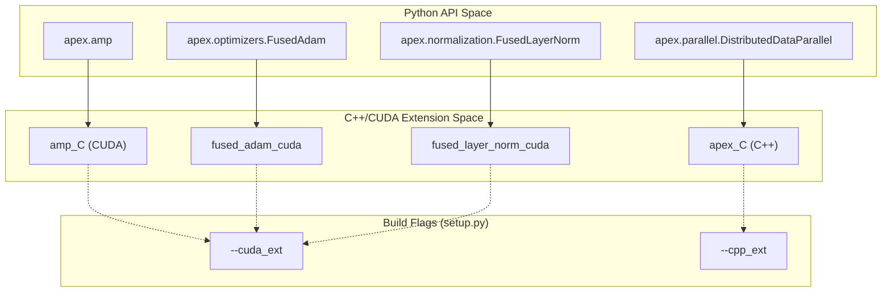
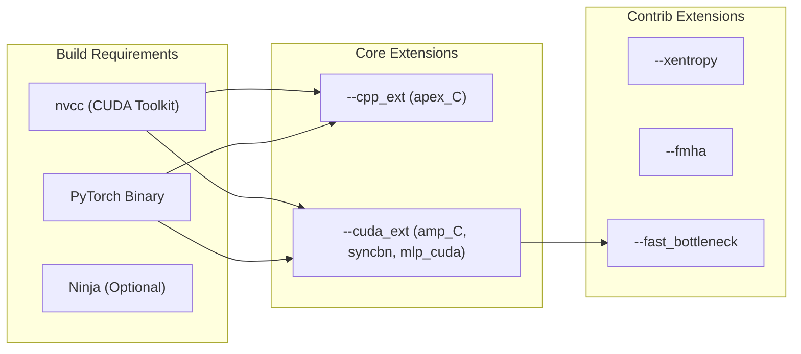

<!-- source: DeepWiki mcp.deepwiki.com · repo NVIDIA/apex · page 1 Overview · fetched 2026-10-26 -->

# Overview

Relevant source files

The following files were used as context for generating this wiki page:

- [README.md](README.md)
- [apex/__init__.py](apex/__init__.py)
- [docs/source/index.rst](docs/source/index.rst)
- [setup.py](setup.py)

APEX (A PyTorch Extension) is a repository of NVIDIA-maintained utilities designed to streamline mixed precision and distributed training in PyTorch [README.md:1-5](). The primary goal of APEX is to provide users with the most up-to-date performance optimizations—many of which are eventually integrated into upstream PyTorch—as quickly as possible [docs/source/index.rst:11-13]().

By leveraging custom CUDA and C++ extensions, APEX accelerates training through fused kernels, efficient communication protocols, and memory-optimized operations that are not yet available in the standard PyTorch distribution.

### Core System Architecture

The library is organized into several functional domains, ranging from high-level training wrappers to low-level CUDA kernel implementations.

| System | Primary Role | Key Components |
| :--- | :--- | :--- |
| **AMP** | Mixed Precision | `apex.amp` [README.md:80]() |
| **Parallel** | Distributed Training | `DistributedDataParallel`, `SyncBatchNorm` [README.md:79-80]() |
| **Optimizers** | Fused Kernels | `FusedAdam`, `FusedLAMB`, `DistributedFusedAdam` [setup.py:29-30, 110-111]() |
| **Normalization** | Optimized Layers | `FusedLayerNorm`, `FusedRMSNorm`, `GroupNorm` [setup.py:28, 32, 99]() |
| **Contrib** | Experimental/Specialized | `fmha`, `transducer`, `nccl_allocator` [setup.py:37, 40, 46]() |

**Sources:** [README.md:1-5](), [README.md:76-81](), [docs/source/index.rst:11-13](), [setup.py:24-48]()

### High-Level Subsystems

#### 1. Automatic Mixed Precision (AMP)
AMP provides a suite of tools to enable mixed-precision training with minimal code changes. It handles the complexities of tensor type casting and dynamic loss scaling to maintain numerical stability while utilizing the speed of Tensor Cores.
*   For details, see [Automatic Mixed Precision (AMP)](#2).

#### 2. Distributed Training
APEX offers optimized versions of distributed primitives. This includes `apex.parallel.DistributedDataParallel`, which is designed to overlap communication with computation more effectively than early versions of native PyTorch DDP, and `SyncBatchNorm` for cross-GPU batch normalization.
*   For details, see [Distributed Training](#3).

#### 3. Optimized Optimizers and Components
The library contains "fused" implementations of popular optimizers (like Adam and LAMB) and layers (like LayerNorm). Fusion combines multiple mathematical operations into a single CUDA kernel launch, significantly reducing memory bandwidth bottlenecks and CPU-GPU synchronization overhead [apex/__init__.py:7-13]().
*   For details, see [Optimized Optimizers](#4) and [Optimized Neural Network Components](#5).

#### 4. Automatic SParsity (ASP)
ASP provides a toolkit for 2:4 structured sparsity, allowing users to prune weights and accelerate inference and training on compatible NVIDIA architectures.
*   For details, see [Sparsity and Weight Pruning](#7).

### Code Entity Mapping

The following diagram bridges the high-level functional areas to the specific code entities and build flags defined in the repository.

**System to Code Entity Mapping**

**Sources:** [setup.py:24-30](), [setup.py:168-171](), [README.md:94-112](), [apex/__init__.py:7-15]()

### Installation and Build Configuration

APEX is highly configurable during installation. While it supports a Python-only build, the performance benefits are primarily realized through its C++ and CUDA extensions [README.md:72-81]().

**Extension Dependencies**

**Sources:** [setup.py:12-18](), [setup.py:56-57](), [README.md:26-38](), [README.md:94-120]()

*   For detailed installation instructions, environment variables, and build flags, see [Installation Guide](#1.1).

---

