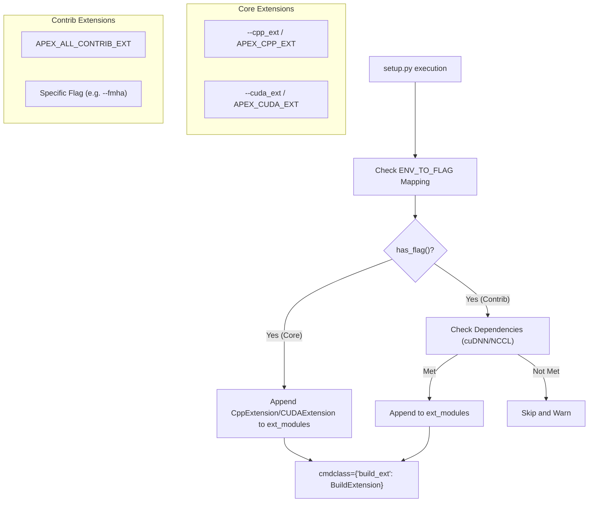
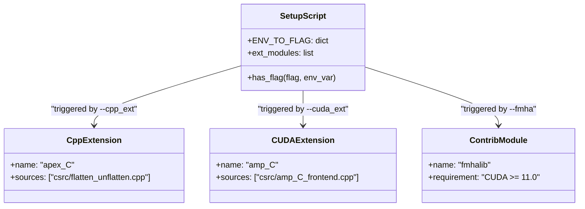

<!-- source: DeepWiki mcp.deepwiki.com · repo NVIDIA/apex · page 1.1 Installation Guide · fetched 2026-10-26 -->

# Installation Guide

<details>
<summary>Relevant source files</summary>

The following files were used as context for generating this wiki page:

- [README.md](README.md)
- [docs/source/index.rst](docs/source/index.rst)
- [examples/README.md](examples/README.md)
- [examples/docker/Dockerfile](examples/docker/Dockerfile)
- [examples/docker/README.md](examples/docker/README.md)
- [setup.py](setup.py)

</details>


This page provides detailed instructions for installing APEX (A PyTorch Extension). APEX is designed to provide NVIDIA-maintained utilities that streamline mixed-precision and distributed training. Because APEX relies heavily on custom CUDA and C++ extensions to achieve maximum performance, the installation process involves compiling these kernels against your local PyTorch and CUDA environments.

## Installation Methods

APEX supports three primary installation paths:
1.  **NVIDIA PyTorch Containers (Recommended)**: Pre-installed and tested environments available via NVIDIA GPU Cloud (NGC).
2.  **From Source with Extensions**: Compiles C++/CUDA kernels for maximum performance.
3.  **Python-only**: A fallback for environments where compilation is not possible.

### 1. NVIDIA PyTorch Containers
The simplest way to use APEX is through the [NVIDIA PyTorch Containers](https://catalog.ngc.nvidia.com/orgs/nvidia/containers/pytorch). These containers come with all custom extensions pre-compiled and verified [README.md:11-13]().

### 2. Installation from Source (Linux)
To install from source, it is recommended to use the latest stable or nightly version of PyTorch [README.md:22-24](). Using `Ninja` is highly recommended to accelerate the compilation process [README.md:26-26]().

#### Recommended: Environment Variables
The modern way to specify build options is via environment variables. This method is PEP 517 compatible [setup.py:23-24]().

```bash
git clone https://github.com/NVIDIA/apex
cd apex
# Build with core extensions (cpp and cuda)
APEX_CPP_EXT=1 APEX_CUDA_EXT=1 pip install -v --no-build-isolation .

# Build with all experimental contrib extensions
APEX_CPP_EXT=1 APEX_CUDA_EXT=1 APEX_ALL_CONTRIB_EXT=1 pip install -v --no-build-isolation .
```
Sources: [README.md:32-45](), [setup.py:24-48]()

#### Legacy: Command-Line Flags
Traditional flags are still supported via `pip` config settings or global options [README.md:55-68]().

```bash
pip install -v --no-build-isolation --config-settings "--build-option=--cpp_ext" --config-settings "--build-option=--cuda_ext" .
```

### 3. Python-Only Build
If you do not require fused kernels or cannot compile them, you can perform a Python-only install:
```bash
pip install -v --no-build-isolation --no-cache-dir .
```
**Warning**: A Python-only build lacks optimized kernels for `FusedAdam`, `FusedLayerNorm`, and optimized `SyncBatchNorm`. While `amp` and `DistributedDataParallel` will still function, they will experience significantly lower performance [README.md:72-81]().

---

## Build Configuration & Flags

The APEX `setup.py` maps environment variables and command-line flags to specific C++/CUDA extensions.

### Core Extensions
| Flag | Env Var | Extension Name | Description |
| :--- | :--- | :--- | :--- |
| `--cpp_ext` | `APEX_CPP_EXT` | `apex_C` | Basic C++ utilities (flatten/unflatten) [setup.py:168-171]() |
| `--cuda_ext` | `APEX_CUDA_EXT` | `amp_C`, `syncbn`, `fused_layer_norm_cuda`, `mlp_cuda` | Core CUDA kernels for AMP, SyncBN, and LayerNorm [README.md:97-100]() |

### Contrib & Experimental Extensions
These modules often require specific CUDA or cuDNN versions.

| Flag | Env Var | Functionality | Requirements |
| :--- | :--- | :--- | :--- |
| `--xentropy` | `APEX_XENTROPY` | Fused Softmax Cross Entropy | |
| `--fast_layer_norm` | `APEX_FAST_LAYER_NORM` | Optimized LayerNorm variant | |
| `--fmha` | `APEX_FMHA` | Fused Multi-Head Attention | |
| `--distributed_adam` | `APEX_DISTRIBUTED_ADAM` | Sharded Fused Adam | |
| `--cudnn_gbn` | `APEX_CUDNN_GBN` | cuDNN Group Batch Norm | cuDNN >= 8.5 [README.md:117]() |
| `--transducer` | `APEX_TRANSDUCER` | Transducer Joint/Loss kernels | |

Sources: [setup.py:24-48](), [README.md:94-125]()

---

## System Requirements & Implementation

### CUDA Version Matching
APEX enforces a strict check between the CUDA version used to compile PyTorch and the "bare metal" CUDA version found on the system via `nvcc`. A mismatch will raise a `RuntimeError` during installation [setup.py:77-92]().

### Cross-Compilation & GPU Architectures
If no GPU is detected during installation (e.g., inside a Docker build stage), APEX attempts to cross-compile for a range of architectures based on the CUDA version [setup.py:117-127]().

### Logic Flow: Build Extension Selection
The following diagram illustrates how `setup.py` processes flags to determine which extensions to build.

**Diagram: Extension Selection Logic**

Sources: [setup.py:24-65](), [setup.py:155-171]()

---

## Troubleshooting

### Common Issues

1.  **`nvcc` Not Found**: 
    If you receive an error that `nvcc` was not found while requesting CUDA extensions, ensure your `PATH` includes the CUDA bin directory. If using Docker, ensure you are using a `-devel` image (e.g., `pytorch/pytorch:2.0.1-cuda11.7-cudnn8-devel`) rather than a runtime image [setup.py:95-102](), [examples/docker/README.md:20-22]().

2.  **Version Mismatch**:
    If `bare_metal_version != torch_binary_version`, APEX will stop. This is because CUDA extensions are sensitive to the underlying toolchain. You can override this by editing `setup.py` at your own risk, but it is recommended to align your environment [setup.py:84-92]().

3.  **Parallel Build Failures**:
    When memory is limited, high parallelism can cause OOM during compilation. Use `APEX_PARALLEL_BUILD` to limit the number of parallel jobs [README.md:47-53]().

### Build Dependency Mapping
The following diagram bridges the user-facing install flags to the internal Python classes and C++ source files.

**Diagram: Build Flag to Code Entity Mapping**

Sources: [setup.py:24-48](), [setup.py:168-171](), [README.md:113]()

---

## Installation for Developers

### Parallel Building
To speed up installation on multi-core systems:
```bash
NVCC_APPEND_FLAGS="--threads 4" APEX_PARALLEL_BUILD=8 pip install -v --no-build-isolation .
```
Sources: [README.md:50]()

### Docker Integration
To include APEX in a custom Docker image, use a multi-stage build or install it on top of a base image that includes `nvcc`.
*   **Base Image**: Must be a `-devel` variant [examples/docker/README.md:11-13]().
*   **Uninstallation**: Always `pip uninstall apex` before a fresh install to avoid stale metadata [examples/docker/Dockerfile:9-10]().

Sources: [examples/docker/Dockerfile:1-17](), [examples/docker/README.md:1-22]()

---

