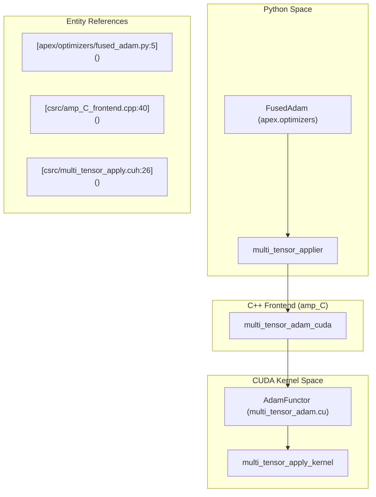
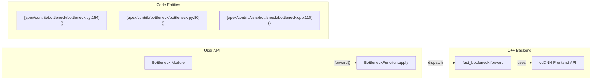

<!-- source: DeepWiki mcp.deepwiki.com · repo NVIDIA/apex · page 10 Glossary · fetched 2026-10-26 -->

# Glossary

Relevant source files

The following files were used as context for generating this wiki page:

- [.gitmodules](.gitmodules)
- [README.md](README.md)
- [apex/contrib/bottleneck/__init__.py](apex/contrib/bottleneck/__init__.py)
- [apex/contrib/bottleneck/bottleneck.py](apex/contrib/bottleneck/bottleneck.py)
- [apex/contrib/bottleneck/halo_exchangers.py](apex/contrib/bottleneck/halo_exchangers.py)
- [apex/contrib/bottleneck/test.py](apex/contrib/bottleneck/test.py)
- [apex/contrib/csrc/bottleneck/bottleneck.cpp](apex/contrib/csrc/bottleneck/bottleneck.cpp)
- [apex/contrib/csrc/nccl_p2p/nccl_p2p.cpp](apex/contrib/csrc/nccl_p2p/nccl_p2p.cpp)
- [apex/contrib/csrc/nccl_p2p/nccl_p2p_cuda.cu](apex/contrib/csrc/nccl_p2p/nccl_p2p_cuda.cu)
- [apex/contrib/csrc/nccl_p2p/nccl_p2p_cuda.cuh](apex/contrib/csrc/nccl_p2p/nccl_p2p_cuda.cuh)
- [apex/contrib/csrc/optimizers/fused_adam_cuda.cpp](apex/contrib/csrc/optimizers/fused_adam_cuda.cpp)
- [apex/contrib/csrc/optimizers/fused_adam_cuda_kernel.cu](apex/contrib/csrc/optimizers/fused_adam_cuda_kernel.cu)
- [apex/contrib/csrc/optimizers/multi_tensor_distopt_adam.cpp](apex/contrib/csrc/optimizers/multi_tensor_distopt_adam.cpp)
- [apex/contrib/csrc/optimizers/multi_tensor_distopt_adam_kernel.cu](apex/contrib/csrc/optimizers/multi_tensor_distopt_adam_kernel.cu)
- [apex/contrib/optimizers/distributed_fused_adam.py](apex/contrib/optimizers/distributed_fused_adam.py)
- [apex/contrib/peer_memory/peer_memory.py](apex/contrib/peer_memory/peer_memory.py)
- [apex/contrib/sparsity/asp.py](apex/contrib/sparsity/asp.py)
- [apex/contrib/sparsity/permutation_lib.py](apex/contrib/sparsity/permutation_lib.py)
- [apex/contrib/sparsity/permutation_search_kernels/__init__.py](apex/contrib/sparsity/permutation_search_kernels/__init__.py)
- [apex/contrib/sparsity/permutation_search_kernels/call_permutation_search_kernels.py](apex/contrib/sparsity/permutation_search_kernels/call_permutation_search_kernels.py)
- [apex/contrib/sparsity/permutation_search_kernels/exhaustive_search.py](apex/contrib/sparsity/permutation_search_kernels/exhaustive_search.py)
- [apex/contrib/sparsity/test/checkpointing_test_part1.py](apex/contrib/sparsity/test/checkpointing_test_part1.py)
- [apex/contrib/sparsity/test/checkpointing_test_part2.py](apex/contrib/sparsity/test/checkpointing_test_part2.py)
- [apex/contrib/sparsity/test/checkpointing_test_reference.py](apex/contrib/sparsity/test/checkpointing_test_reference.py)
- [apex/contrib/sparsity/test/test_permutation_application.py](apex/contrib/sparsity/test/test_permutation_application.py)
- [apex/optimizers/fused_adam.py](apex/optimizers/fused_adam.py)
- [apex/optimizers/fused_novograd.py](apex/optimizers/fused_novograd.py)
- [csrc/amp_C_frontend.cpp](csrc/amp_C_frontend.cpp)
- [csrc/layer_norm_cuda.cpp](csrc/layer_norm_cuda.cpp)
- [csrc/layer_norm_cuda_kernel.cu](csrc/layer_norm_cuda_kernel.cu)
- [csrc/multi_tensor_adam.cu](csrc/multi_tensor_adam.cu)
- [csrc/multi_tensor_apply.cuh](csrc/multi_tensor_apply.cuh)
- [csrc/multi_tensor_l2norm_kernel.cu](csrc/multi_tensor_l2norm_kernel.cu)
- [csrc/multi_tensor_scale_kernel.cu](csrc/multi_tensor_scale_kernel.cu)
- [csrc/type_shim.h](csrc/type_shim.h)
- [csrc/welford.cu](csrc/welford.cu)
- [docs/source/index.rst](docs/source/index.rst)
- [setup.py](setup.py)
- [tests/L0/run_optimizers/test_adam.py](tests/L0/run_optimizers/test_adam.py)
- [tests/L0/run_optimizers/test_fused_novograd.py](tests/L0/run_optimizers/test_fused_novograd.py)
- [tests/L0/run_optimizers/test_fused_optimizer.py](tests/L0/run_optimizers/test_fused_optimizer.py)

This page provides definitions and technical context for specific terms, jargon, and domain concepts used throughout the NVIDIA APEX codebase. It serves as a reference for engineers to understand how high-level optimization concepts map to specific C++, CUDA, and Python entities.

## Core Optimization Concepts

### Automatic Mixed Precision (AMP)
A system that automatically manages casting between different floating-point types (typically FP16/BF16 and FP32) to accelerate training while maintaining numerical stability.
*   **Implementation**: AMP uses a whitelist/blacklist system to determine which operations are safe to run in lower precision.
*   **Key Entity**: `apex.amp` provides the user-facing API [apex/optimizers/fused_adam.py:23-27]().
*   **Loss Scaling**: A technique to prevent underflow of small gradients in FP16 by multiplying the loss by a scale factor before backpropagation [csrc/amp_C_frontend.cpp:78-81]().

### Multi-Tensor Apply
A core APEX infrastructure pattern that allows a single CUDA kernel launch to operate on a list of non-contiguous tensors. This drastically reduces kernel launch overhead in optimizers and scaling operations.
*   **Implementation**: It uses a `TensorListMetadata` struct to pass addresses and sizes of multiple tensors to the GPU [csrc/multi_tensor_apply.cuh:17-23]().
*   **Functionality**: The `multi_tensor_apply` C++ function handles the grouping of tensors into "chunks" and "blocks" to maximize GPU utilization [csrc/multi_tensor_apply.cuh:33-103]().

### Fused Kernels
The process of combining multiple mathematical operations (e.g., Adam update steps or LayerNorm mean/variance calculations) into a single CUDA kernel to reduce memory round-trips.
*   **Examples**: `FusedAdam` [apex/optimizers/fused_adam.py:5-15](), `FusedLayerNorm` [csrc/layer_norm_cuda_kernel.cu:51-150](), and `FusedBottleneck` [apex/contrib/bottleneck/bottleneck.py:154-173]().

---

## Code Entity Mapping: Optimizers

The following diagram bridges the gap between the Python optimizer API and the underlying high-performance CUDA implementations.

**Optimizer Data Flow**

*Sources: [apex/optimizers/fused_adam.py:127-134](), [csrc/amp_C_frontend.cpp:40-42](), [csrc/multi_tensor_apply.cuh:25-30]()*

---

## Code Entity Mapping: Bottleneck Fusion

APEX provides a highly optimized ResNet Bottleneck layer that fuses convolutions, batch normalization, and ReLU activations using the cuDNN Frontend API.

**Bottleneck Implementation Mapping**

*Sources: [apex/contrib/bottleneck/bottleneck.py:80-99](), [apex/contrib/csrc/bottleneck/bottleneck.cpp:1-5]() [apex/contrib/csrc/bottleneck/bottleneck.cpp:110-153]()*

---

## Specific Terms & Jargon

| Term | Definition | Code Pointer |
| :--- | :--- | :--- |
| **Capturable** | A mode for optimizers (e.g., `FusedAdam`) that allows them to be recorded and replayed within a CUDA Graph. | [apex/optimizers/fused_adam.py:56-57]() |
| **Master Weights** | FP32 copies of parameters maintained by the optimizer when the model itself is running in FP16/BF16 to prevent precision loss during updates. | [apex/optimizers/fused_adam.py:58-61]() |
| **ILP** | Instruction Level Parallelism. In CUDA kernels, this often refers to processing multiple elements per thread (e.g., using `float4` or manual unrolling). | [apex/contrib/csrc/optimizers/fused_adam_cuda_kernel.cu:16-21]() |
| **Noop Flag** | A device-side integer flag used to skip kernel execution (e.g., if a gradient overflow is detected) without needing a CPU-GPU sync. | [csrc/multi_tensor_apply.cuh:26-30]() |
| **Welford Algorithm** | An online algorithm for computing variance in a single pass, used in `FusedLayerNorm` for numerical stability. | [csrc/layer_norm_cuda_kernel.cu:13-21]() |
| **NHWC** | A memory layout (Channels Last) where the channel dimension is the fastest-moving, preferred for Tensor Core performance. | [apex/contrib/csrc/bottleneck/bottleneck.cpp:66-83]() |
| **ASP** | Automatic SParsity. Tools for 2:4 structured sparsity pruning and fine-tuning. | [apex/contrib/sparsity/asp.py:1-10]() |

---

## Build System Terminology

APEX uses specific build flags passed to `setup.py` or as environment variables to enable/disable specific optimized extensions.

*   **`--cpp_ext` / `APEX_CPP_EXT`**: Compiles basic C++ extensions like `flatten_unflatten` [setup.py:25]().
*   **`--cuda_ext` / `APEX_CUDA_EXT`**: Compiles core CUDA kernels for AMP, LayerNorm, and multi-tensor apply [setup.py:26]().
*   **Contrib Extensions**: Experimental or specialized modules (e.g., `--fmha` for Fused Multi-Head Attention, `--distributed_adam` for ZeRO-style optimization) [setup.py:27-48]().
*   **Bare Metal Version**: The version of CUDA installed on the host system's PATH, which must match the version PyTorch was built with for extension compatibility [setup.py:68-74]().

*Sources: [setup.py:24-53](), [README.md:94-120]()*