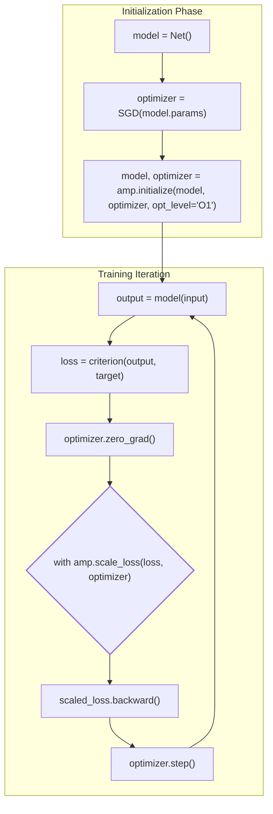
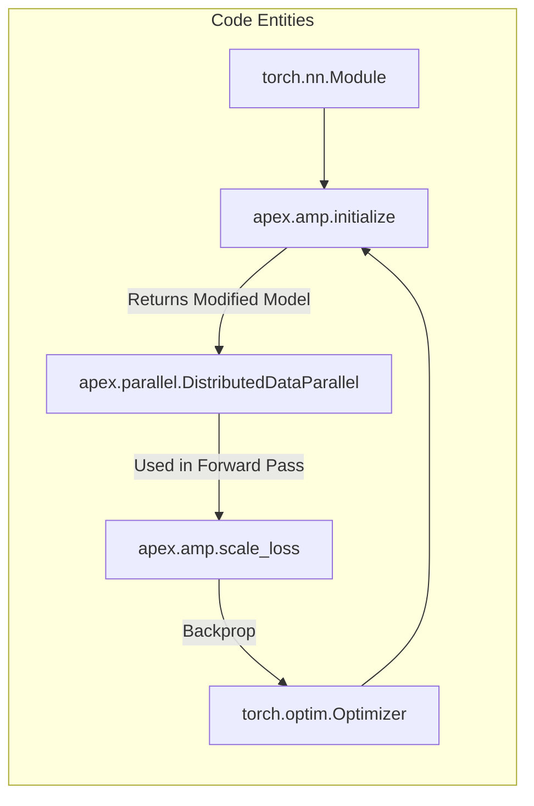

<!-- source: DeepWiki mcp.deepwiki.com · repo NVIDIA/apex · page 2.1 AMP Usage Guide · fetched 2026-10-26 -->

# AMP Usage Guide

Relevant source files

The following files were used as context for generating this wiki page:

- [examples/imagenet/README.md](examples/imagenet/README.md)
- [examples/imagenet/main_amp.py](examples/imagenet/main_amp.py)
- [examples/simple/distributed/README.md](examples/simple/distributed/README.md)
- [examples/simple/distributed/distributed_data_parallel.py](examples/simple/distributed/distributed_data_parallel.py)
- [examples/simple/distributed/run.sh](examples/simple/distributed/run.sh)

Automatic Mixed Precision (AMP) in APEX is designed to accelerate PyTorch training by using lower-precision floating-point formats (FP16) for compute-intensive operations while maintaining FP32 precision for numerically sensitive parts of the network. This guide details the implementation and usage of the AMP API.

## Core Integration Pattern

Enabling AMP in an existing PyTorch script requires three primary modifications to the training loop. Unlike manual casting, the AMP API manages tensor types and loss scaling automatically.

1.  **Initialization**: Call `amp.initialize` after defining the model and optimizer [examples/imagenet/README.md:7-9]().
2.  **Loss Scaling**: Wrap the backward pass with the `amp.scale_loss` context manager [examples/imagenet/README.md:11-13]().
3.  **No Explicit Casting**: Do not call `.half()` on the model or data; AMP handles casting based on the chosen optimization level [examples/imagenet/README.md:16-17]().

### System Data Flow

The following diagram illustrates how `amp.initialize` and `amp.scale_loss` intercept the standard PyTorch training flow to manage precision and gradients.

**AMP Training Loop Integration**

**Sources:** [examples/imagenet/README.md:7-14](), [examples/simple/distributed/distributed_data_parallel.py:40-62]()

---

## Optimization Levels (`opt_level`)

AMP provides four optimization levels that define the "recipe" for mixed precision. These are passed as the `opt_level` argument to `amp.initialize`.

| Level | Name | Description | Recommended Use |
| :--- | :--- | :--- | :--- |
| **O0** | FP32 Training | Pure FP32 precision. Useful as a baseline for accuracy. [examples/imagenet/README.md:65-67]() | Debugging / Baseline |
| **O1** | Mixed Precision | **Recommended.** Patches Torch functions to use a whitelist/blacklist. Tensor Core ops (convolutions, GEMMs) run in FP16; sensitive ops (Softmax, BatchNorm) run in FP32. [examples/imagenet/README.md:87-95]() | Most Use Cases |
| **O2** | "Almost" FP16 | Casts model to FP16 but keeps BatchNorm in FP32. Maintains FP32 master weights. Does not patch functions. [examples/imagenet/README.md:108-118]() | Internal/Specific Needs |
| **O3** | Pure FP16 | Full FP16 training. Often unstable for convergence but useful for "speed of light" benchmarks. [examples/imagenet/README.md:69-72]() | Performance Profiling |

### Performance Tuning with O3
For ResNet architectures, `O3` performance can be optimized by setting `keep_batchnorm_fp32=True`. This allows the use of optimized cuDNN batchnorm kernels, which require FP32 inputs [examples/imagenet/README.md:73-85]().

**Sources:** [examples/imagenet/README.md:36-126](), [examples/imagenet/main_amp.py:85-87]()

---

## Loss Scaling

Loss scaling is critical for FP16 training to prevent underflow of small gradient values. 

*   **Dynamic Loss Scaling**: Enabled by default for `O1` and `O2`. The scaler automatically adjusts the scale factor based on whether overflows (NaNs/Infs) are detected [examples/imagenet/README.md:36-37]().
*   **Static Loss Scaling**: Can be manually set via the `loss_scale` argument (e.g., `loss_scale=128.0`) [examples/imagenet/README.md:96-99]().
*   **Context Manager**: `amp.scale_loss` ensures that gradients are unscaled before the optimizer updates the weights, preventing the scale factor from affecting the learning rate [examples/imagenet/README.md:11-13]().

**Sources:** [examples/imagenet/README.md:36-40](), [examples/imagenet/main_amp.py:87]()

---

## Distributed Training Integration

AMP is compatible with both `torch.nn.parallel.DistributedDataParallel` and `apex.parallel.DistributedDataParallel`. 

### Critical Execution Order
When using Distributed Data Parallel (DDP), the model must be initialized with AMP **before** being wrapped by the DDP constructor. Failure to follow this order may result in errors or degraded performance [examples/simple/distributed/distributed_data_parallel.py:43-48](), [examples/simple/distributed/README.md:6-8]().

**Code Entity Relationship: AMP and DDP**

### Usage Example
In a multi-GPU environment, each process should manage its own AMP state.
1. Initialize the process group via `torch.distributed.init_process_group` [examples/simple/distributed/distributed_data_parallel.py:24-27]().
2. Set the device for the local rank [examples/simple/distributed/distributed_data_parallel.py:20-22]().
3. Call `amp.initialize` [examples/simple/distributed/distributed_data_parallel.py:43]().
4. Wrap with `DistributedDataParallel` [examples/simple/distributed/distributed_data_parallel.py:48]().

**Sources:** [examples/simple/distributed/distributed_data_parallel.py:14-53](), [examples/simple/distributed/README.md:1-12](), [examples/imagenet/main_amp.py:152-153]()

---

