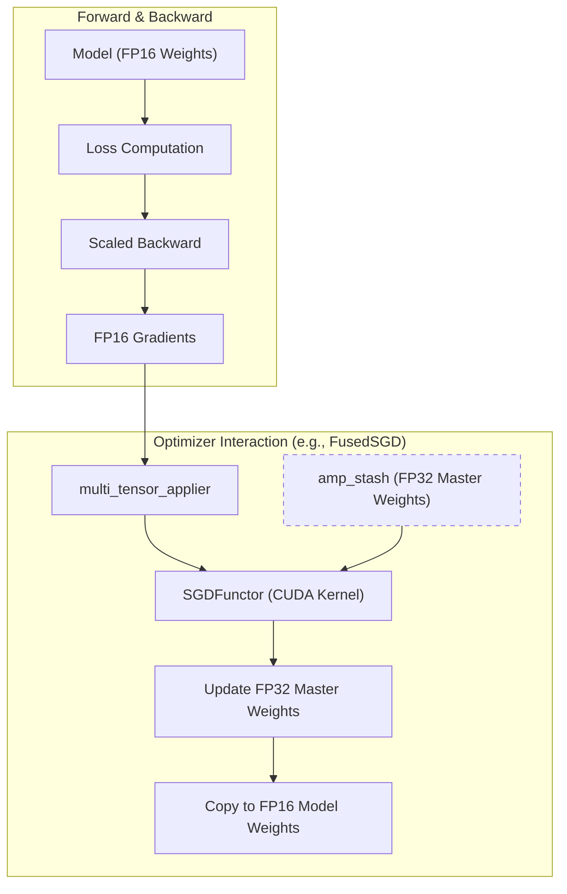
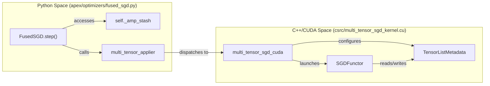

<!-- source: DeepWiki mcp.deepwiki.com · repo NVIDIA/apex · page 2.2 AMP Internals · fetched 2026-10-26 -->

# AMP Internals

Relevant source files

The following files were used as context for generating this wiki page:

- [apex/optimizers/fused_sgd.py](apex/optimizers/fused_sgd.py)
- [csrc/multi_tensor_sgd_kernel.cu](csrc/multi_tensor_sgd_kernel.cu)

Automatic Mixed Precision (AMP) in APEX is designed to automate the process of using lower-precision (FP16) arithmetic while maintaining the numerical stability of FP32. It achieves this through dynamic type casting and loss scaling. This page details the internal mechanisms that govern how AMP intercepts function calls, manages master weights, and implements efficient gradient updates.

## Core Mechanisms

AMP operates by wrapping PyTorch functions and methods to insert cast operations dynamically based on a predefined set of rules (whitelist, blacklist, etc.).

### Type Casting and Function Wrapping
When `amp.initialize` is called, AMP modifies the namespace of `torch`, `torch.nn.functional`, and `tensor` methods. It replaces standard operations with "wrapped" versions that check the input types and cast them to the appropriate precision before execution.

*   **Whitelist:** Operations that are safe and faster in FP16 (e.g., `conv2d`, `linear`).
*   **Blacklist:** Operations that are numerically sensitive and must stay in FP32 (e.g., `exp`, `log`, `softmax`).
*   **Allow-list:** Operations that should match the precision of the widest input.

### Master Weight Management
To prevent precision loss during weight updates, AMP (specifically in `O2` optimization level) maintains a set of FP32 "master weights."
1.  **Forward Pass:** Model uses FP16 weights.
2.  **Backward Pass:** Gradients are computed in FP16.
3.  **Optimizer Step:** FP16 gradients are applied to FP32 master weights.
4.  **Synchronization:** The updated FP32 master weights are copied back to the FP16 model weights for the next iteration.

### Data Flow of an AMP-Optimized Step

The following diagram illustrates the interaction between the model, the optimizer, and the `amp_stash` which stores the precision-related metadata.

**AMP Gradient Update Flow**

**Sources:** [apex/optimizers/fused_sgd.py:165-180](), [csrc/multi_tensor_sgd_kernel.cu:28-54]()

---

## Loss Scaling Implementation

Loss scaling is critical to prevent FP16 gradients from "underflowing" (becoming zero). AMP scales the loss by a factor $S$ before the backward pass, causing gradients to be scaled by $S$ as well.

### The Scaler Logic
The `LossScaler` (or the internal logic within `amp`) performs the following:
1.  **Scale:** Multiplies the loss by the current scale factor.
2.  **Unscale:** Before the optimizer updates the weights, gradients are divided by the scale factor.
3.  **Overflow Check:** If any gradient contains `NaN` or `Inf`, the optimizer step is skipped, and the scale factor is reduced.
4.  **Scale Update:** If no overflows occur for a certain number of steps, the scale factor is increased.

In optimized kernels like `FusedSGD`, the unscaling is often fused directly into the update kernel to save memory bandwidth.

| Feature | Implementation Detail |
| :--- | :--- |
| **Overflow Detection** | Uses a `noop_flag` on the GPU to signal if a `NaN/Inf` was found during the kernel execution [csrc/multi_tensor_sgd_kernel.cu:30-34](). |
| **Fused Unscaling** | The `scale` factor is passed directly to the CUDA kernel and applied during the gradient load [csrc/multi_tensor_sgd_kernel.cu:69](). |
| **Master Gradients** | Can optionally materialize FP32 gradients from FP16 versions during the update [apex/optimizers/fused_sgd.py:108](). |

**Sources:** [apex/optimizers/fused_sgd.py:107-111](), [csrc/multi_tensor_sgd_kernel.cu:116-118]()

---

## Optimizer Internals: FusedSGD and AMP

APEX optimizers like `FusedSGD` are designed to work seamlessly with AMP by handling the three primary data type combinations encountered in mixed-precision training.

### Precision Combinations
The optimizer must handle the following scenarios, as defined in the `FusedSGD` implementation:

| Case | Grad Type | Param Type | Momentum Type | Model Copy Required? |
| :--- | :--- | :--- | :--- | :--- |
| 1 | FP16 | FP16 | FP16 | No |
| 2 | FP32 | FP32 | FP32 | No |
| 3 | FP16 | FP32 | FP32 | Yes (Master Weights) |

**Sources:** [apex/optimizers/fused_sgd.py:175-180](), [csrc/multi_tensor_sgd_kernel.cu:131-136]()

### Multi-Tensor Integration
AMP leverages the `multi_tensor_applier` to process all parameters in a few kernel launches. The `SGDFunctor` in the CUDA backend accepts a `TensorListMetadata` structure containing addresses for gradients, weights, and momentum buffers.

**Code Entity Mapping: FusedSGD to CUDA Kernel**

**Sources:** [apex/optimizers/fused_sgd.py:184-200](), [csrc/multi_tensor_sgd_kernel.cu:116-120](), [csrc/multi_tensor_sgd_kernel.cu:28-32]()

### Fused SGD Kernel Logic
The `SGDFunctor` implements the update logic directly in CUDA. It handles weight decay, momentum, and Nesterov momentum while accounting for the AMP scale factor.

1.  **Load:** Gradients are loaded and multiplied by the `scale` (unscaling) [csrc/multi_tensor_sgd_kernel.cu:69]().
2.  **Weight Decay:** Applied either before or after momentum based on `wd_after_momentum` [csrc/multi_tensor_sgd_kernel.cu:85]().
3.  **Momentum Update:** $v = \rho * v + (1 - dampening) * g$ [csrc/multi_tensor_sgd_kernel.cu:89]().
4.  **Weight Update:** $p = p - lr * g_{final}$ [csrc/multi_tensor_sgd_kernel.cu:103]().
5.  **FP16 Sync:** If master weights are used (Case 3/4), the updated FP32 weight is cast to FP16 and written to the model weight buffer [csrc/multi_tensor_sgd_kernel.cu:106]().

**Sources:** [csrc/multi_tensor_sgd_kernel.cu:81-111]()

---

