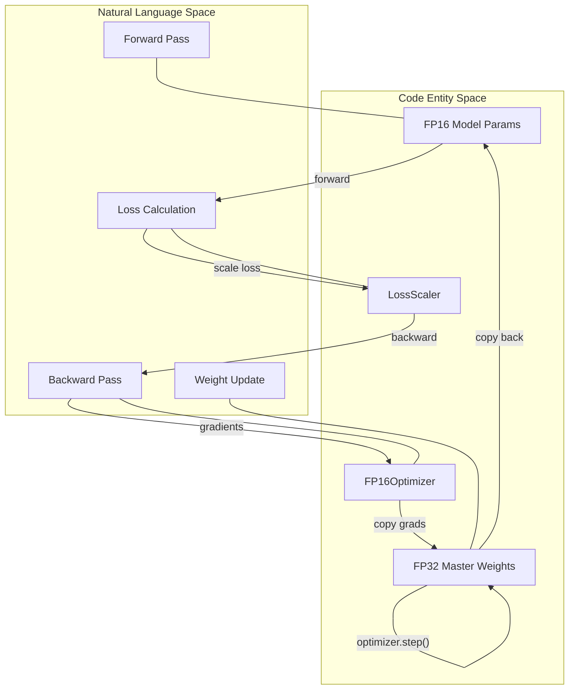
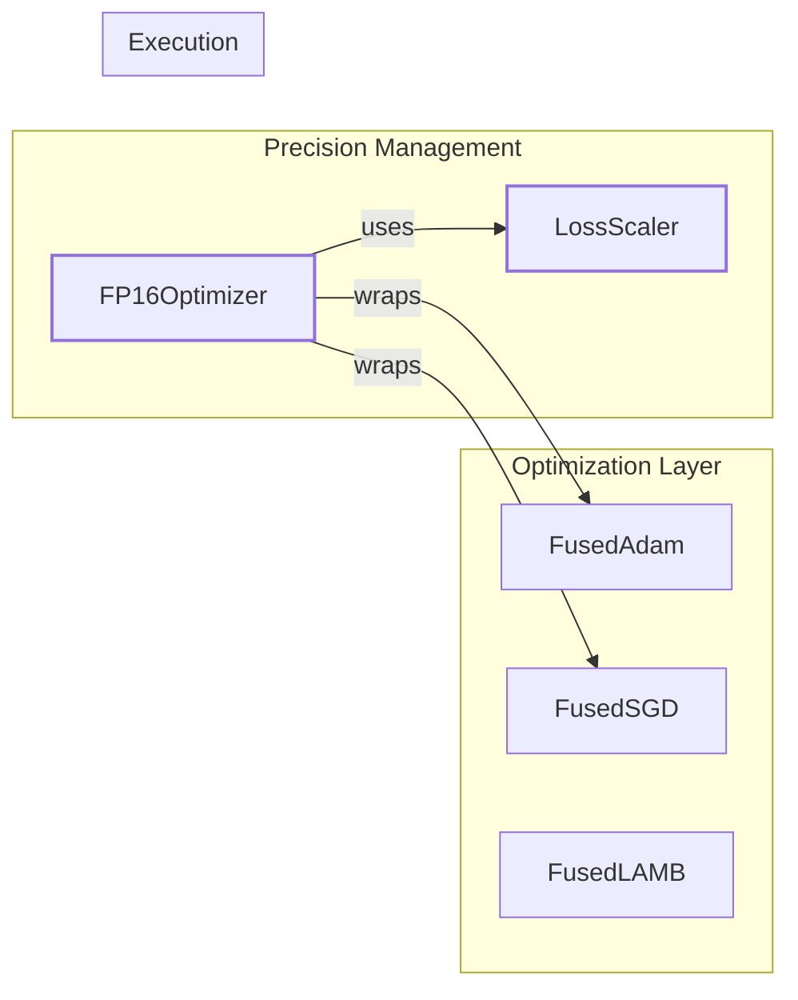

<!-- source: DeepWiki mcp.deepwiki.com · repo NVIDIA/apex · page 2.3 Legacy FP16 Utilities · fetched 2026-10-26 -->

# Legacy FP16 Utilities

Relevant source files

The following files were used as context for generating this wiki page:

- [apex/optimizers/__init__.py](apex/optimizers/__init__.py)
- [docs/source/conf.py](docs/source/conf.py)
- [tests/L0/run_optimizers/__init__.py](tests/L0/run_optimizers/__init__.py)

The `apex.fp16_utils` module contains the original suite of tools developed by NVIDIA to facilitate mixed-precision training in PyTorch. While largely superseded by the `apex.amp` (Automatic Mixed Precision) API, these utilities remain part of the codebase for legacy support and for users who require manual, fine-grained control over master weight management and loss scaling.

## Overview and Comparison with AMP

The legacy utilities require the user to manually handle model casting, input casting, and the wrapping of optimizers. In contrast, the modern AMP API automates these processes via `amp.initialize`.

| Feature | Legacy (`fp16_utils`) | Modern (`amp`) |
| :--- | :--- | :--- |
| **Weight Management** | Manual `FP16Optimizer` wrapping | Automatic via `O1`/`O2` levels |
| **Type Casting** | Manual `.half()` calls on model/inputs | Automatic via `autocast` or `O1` |
| **Loss Scaling** | `LossScaler` class (Manual) | `amp.scale_loss` (Automatic) |
| **Master Weights** | Explicitly managed in `FP16Optimizer` | Transparently handled |

**Sources:** [apex/optimizers/__init__.py:1-6]()

---

## Key Components

### FP16Optimizer
The `FP16Optimizer` is a wrapper designed to manage a model's parameters in FP16 while maintaining a "master copy" in FP32. This ensures that small gradient updates are not lost due to the limited precision of FP16 (underflow).

**Implementation Logic:**
1.  **Initialization**: It takes an existing FP32 optimizer and a list of FP16 parameters.
2.  **Master Weights**: It creates a copy of all model parameters in FP32.
3.  **Step Process**:
    *   Gradients are computed in FP16.
    *   Gradients are copied/cast to the FP32 master weights.
    *   The wrapped optimizer performs the update on the FP32 master weights.
    *   The updated FP32 weights are copied back into the FP16 model parameters.

### LossScaler
The `LossScaler` handles dynamic or static scaling of the loss to prevent gradient underflow.

*   **Static Scaling**: Multiplies the loss by a fixed factor.
*   **Dynamic Scaling**: Starts with a large scale and monitors gradients for `NaN` or `Inf` values. If an overflow is detected, the step is skipped and the scale is reduced. If no overflows occur for a set number of steps, the scale is increased.

---

## Data Flow: Legacy FP16 Training

The following diagram illustrates the flow of data between the FP16 model, the FP32 master weights, and the `LossScaler` during a training iteration.

### Legacy Mixed Precision Training Loop

**Sources:** [apex/optimizers/__init__.py:1-6](), [docs/source/conf.py:66-68]()

---

## Interaction with Fused Optimizers

The legacy FP16 utilities are often used in conjunction with APEX's fused optimizers to maximize throughput. These optimizers, such as `FusedAdam` or `FusedSGD`, are designed to operate efficiently on the master weights managed by the legacy utilities.

### Mapping Code Entities to System Roles

**Sources:** [apex/optimizers/__init__.py:1-6]()

### Available Fused Optimizers for Legacy Flows
These optimizers are frequently used as the "inner" optimizer within `FP16Optimizer`:
*   `FusedAdam`: Optimized Adam implementation for CUDA. [apex/optimizers/__init__.py:2]()
*   `FusedSGD`: Optimized SGD implementation. [apex/optimizers/__init__.py:1]()
*   `FusedLAMB`: Layer-wise Adaptive Moments optimizer for large batch training. [apex/optimizers/__init__.py:4]()
*   `FusedNovoGrad`: Decoupled weight decay optimizer. [apex/optimizers/__init__.py:3]()

## Summary of Usage Pattern

In the legacy workflow, the developer is responsible for the following sequence:
1.  Initialize the model and convert it to FP16 via `model.half()`.
2.  Initialize the FP32 optimizer (e.g., `FusedAdam`) with the model's parameters.
3.  Wrap the optimizer in `FP16Optimizer` (which creates the FP32 master weights).
4.  In the training loop, use `LossScaler` to scale the loss before calling `.backward()`.
5.  Call `optimizer.step()`, which handles the FP32/FP16 synchronization.

**Sources:** [apex/optimizers/__init__.py:1-6](), [docs/source/conf.py:77-80]()

---

