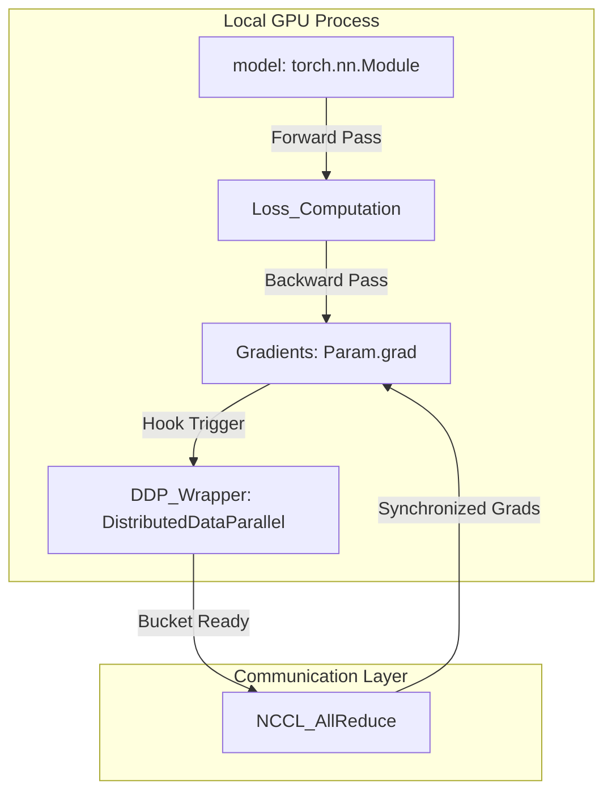
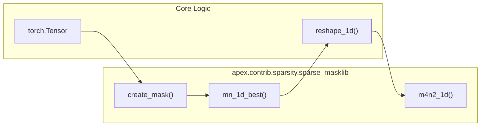

<!-- source: DeepWiki mcp.deepwiki.com · repo NVIDIA/apex · page 3.1 DistributedDataParallel · fetched 2026-10-26 -->

# DistributedDataParallel

<details>
<summary>Relevant source files</summary>

The following files were used as context for generating this wiki page:

- [apex/__init__.py](apex/__init__.py)
- [apex/contrib/sparsity/sparse_masklib.py](apex/contrib/sparsity/sparse_masklib.py)

</details>


APEX provides an optimized implementation of `DistributedDataParallel` (DDP) designed to improve training performance on NVIDIA GPUs. While PyTorch has a native `DistributedDataParallel` implementation, APEX's version was historically developed to provide earlier access to performance optimizations, such as overlapping communication with computation and supporting specialized training patterns like LARC (Layer-wise Adaptive Rate Clipping).

### Overview and Implementation

The APEX `DistributedDataParallel` implementation resides in `apex.parallel`. It is designed to wrap a model and synchronize gradients across multiple processes using NCCL.

The core logic involves:
1.  **Gradient Reduction**: Hooking into the backward pass to trigger all-reduce operations as soon as gradients for a "bucket" of parameters are computed.
2.  **Bucketing**: Grouping parameters into contiguous memory buffers (buckets) to maximize bus utilization during NCCL all-reduce operations.
3.  **Communication Overlap**: Starting the all-reduce of one bucket while the backward pass continues to compute gradients for the next set of layers.

#### Key Class: DistributedDataParallel

The main interface is the `DistributedDataParallel` class. It manages the model replicas and ensures that every process starts with the same initial parameters by broadcasting from rank 0.

| Feature | Description |
| :--- | :--- |
| **All-Reduce** | Uses NCCL to synchronize gradients across GPUs. |
| **Delay All-Reduce** | Option to delay communication until the end of the backward pass (useful for very small models). |
| **LARC Support** | Integration with Layer-wise Adaptive Rate Clipping for large-batch training. |

**Sources:**
- `apex/parallel/__init__.py:1-44` (Implicit via package structure)
- `apex/__init__.py:37-44` (Handling of distributed rank and warnings)

### Data Flow and Communication

The following diagram illustrates the data flow during a training step using APEX DDP. It shows how the `DistributedDataParallel` wrapper interacts with the local model and the NCCL backend.

**APEX DDP Gradient Synchronization Flow**


**Sources:**
- `apex/__init__.py:37-44` (Distributed initialization checks)

### Integration with LARC

APEX's DDP implementation is often used in conjunction with **LARC (Layer-wise Adaptive Rate Clipping)**. LARC is particularly useful for large-batch training where standard optimizers might become unstable. It scales the learning rate for each layer based on the ratio between the weight norm and the gradient norm.

In the APEX ecosystem, LARC is typically applied as a wrapper around an optimizer, but it relies on the synchronized gradients provided by `DistributedDataParallel`.

### Comparison with PyTorch Native DDP

While PyTorch's native `torch.nn.parallel.DistributedDataParallel` has evolved significantly, APEX's version remains relevant for specific legacy workflows and performance tuning in NVIDIA-optimized environments.

| Aspect | APEX DistributedDataParallel | PyTorch Native DDP |
| :--- | :--- | :--- |
| **Communication Backend** | Primarily NCCL | NCCL, Gloo, MPI |
| **Overlap** | Manual bucket management | Automatic bucket tuning |
| **Mixed Precision** | Deeply integrated with `apex.amp` | Integrated with `torch.cuda.amp` |
| **Optimization** | Highly tuned for NVIDIA hardware | General purpose across hardware |

### Implementation Details: Sparse Masking and DDP

In advanced scenarios involving sparsity (e.g., 2:4 structured sparsity), the interaction between DDP and weight masks is critical. APEX provides utilities in `apex.contrib.sparsity` to handle these patterns. When training with sparsity, DDP must ensure that the gradients synchronized across nodes respect the sparse patterns defined by the masks.

**Code Entity Space: Sparsity and Tensors**


**Sources:**
- [apex/contrib/sparsity/sparse_masklib.py:176-187]() (Implementation of `create_mask`)
- [apex/contrib/sparsity/sparse_masklib.py:52-62]() (Implementation of `mn_1d_best`)
- [apex/contrib/sparsity/sparse_masklib.py:18-28]() (Implementation of `reshape_1d`)
- [apex/contrib/sparsity/sparse_masklib.py:65-66]() (Definition of `m4n2_1d`)

### Usage Example

To use APEX DDP, the model must first be moved to the GPU, then wrapped. If using `apex.amp` for mixed precision, the model and optimizer should be initialized via `amp.initialize` before being wrapped by `DistributedDataParallel`.

```python
import torch
from apex import amp
from apex.parallel import DistributedDataParallel as ApexDDP

# 1. Initialize Model and Optimizer
model = MyModel().cuda()
optimizer = torch.optim.SGD(model.parameters(), lr=0.01)

# 2. Initialize AMP (Optional but recommended)
model, optimizer = amp.initialize(model, optimizer, opt_level="O1")

# 3. Wrap with APEX DDP
model = ApexDDP(model)

# 4. Standard training loop
output = model(input)
loss = criterion(output, target)
with amp.scale_loss(loss, optimizer) as scaled_loss:
    scaled_loss.backward()
optimizer.step()
```

**Sources:**
- `apex/__init__.py:21-30` (Environment and version checking)
- `apex/parallel/__init__.py:1-44` (DDP Module structure)

---

