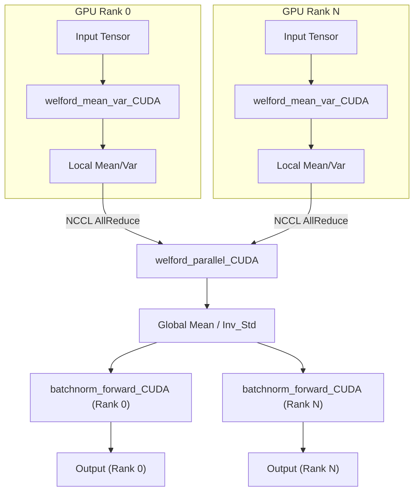

<!-- source: DeepWiki mcp.deepwiki.com · repo NVIDIA/apex · page 3.2 SyncBatchNorm · fetched 2026-10-26 -->

# SyncBatchNorm

<details>
<summary>Relevant source files</summary>

The following files were used as context for generating this wiki page:

- [csrc/syncbn.cpp](csrc/syncbn.cpp)
- [tests/distributed/synced_batchnorm/python_single_gpu_unit_test.py](tests/distributed/synced_batchnorm/python_single_gpu_unit_test.py)
- [tests/distributed/synced_batchnorm/single_gpu_unit_test.py](tests/distributed/synced_batchnorm/single_gpu_unit_test.py)
- [tests/distributed/synced_batchnorm/test_batchnorm1d.py](tests/distributed/synced_batchnorm/test_batchnorm1d.py)
- [tests/distributed/synced_batchnorm/two_gpu_test_different_batch_size.py](tests/distributed/synced_batchnorm/two_gpu_test_different_batch_size.py)
- [tests/distributed/synced_batchnorm/two_gpu_unit_test.py](tests/distributed/synced_batchnorm/two_gpu_unit_test.py)
- [tests/distributed/synced_batchnorm/unit_test.sh](tests/distributed/synced_batchnorm/unit_test.sh)

</details>


`SyncBatchNorm` provides a synchronized implementation of Batch Normalization across multiple GPUs. Unlike standard `torch.nn.BatchNorm`, which calculates mean and variance independently for each GPU's local batch, `SyncBatchNorm` communicates across processes to compute global statistics. This is critical for training with small per-GPU batch sizes where local statistics would be too noisy or inaccurate to represent the true distribution.

## Overview and Purpose

The primary goal of `SyncBatchNorm` is to ensure that the Batch Normalization layer behaves identically regardless of how the global batch is distributed across GPUs [tests/distributed/synced_batchnorm/two_gpu_unit_test.py:98-102](). It supports both standard (NCHW) and "channel last" (NHWC) memory formats [csrc/syncbn.cpp:39-40](), and is optimized using custom CUDA kernels for performance.

### Key Features
*   **Welford’s Algorithm**: Uses a numerically stable one-pass algorithm to compute mean and variance [csrc/syncbn.cpp:7-8]().
*   **Parallel Reduction**: Synchronizes local statistics across a process group to derive global values [csrc/syncbn.cpp:10-15]().
*   **NHWC Support**: Optimized paths for "channel last" data layouts often used in Tensor Core acceleration [csrc/syncbn.cpp:80-87]().
*   **Kahan Summation**: Utilized in backward passes to maintain precision during gradient reductions [csrc/syncbn.cpp:26-28]().

**Sources:** [csrc/syncbn.cpp:1-89](), [tests/distributed/synced_batchnorm/two_gpu_unit_test.py:105-118]()

---

## Implementation Architecture

The implementation is split between a Python API (within `apex.parallel`) and high-performance C++/CUDA kernels.

### Data Flow: Forward Pass
The forward pass involves two distinct synchronization steps to compute global statistics before the elementwise normalization occurs.

1.  **Local Statistics**: Each GPU computes local `mean` and `biased_var` using `welford_mean_var_CUDA` [csrc/syncbn.cpp:8-9]().
2.  **Global Reduction**: Statistics are shared across the process group. The `welford_parallel_CUDA` function takes local nodes and the number of elements (`numel`) to produce the global `mean` and `inv_std` [csrc/syncbn.cpp:13-15]().
3.  **Elementwise Application**: The final `batchnorm_forward_CUDA` kernel applies the global statistics, weights, and shifts to the input tensor [csrc/syncbn.cpp:20-21]().

### Data Flow: Backward Pass
The backward pass similarly requires a reduction step to compute gradients for weights and biases across the distributed group.

1.  **Local Reduction**: `reduce_bn_CUDA` computes the local sums of gradients (`sum_dy`, `sum_dy_xmu`) and local parameter gradients [csrc/syncbn.cpp:27-28]().
2.  **Global Gradient Computation**: `batchnorm_backward_CUDA` uses the reduced sums and the total element count across all GPUs to calculate the final `grad_input` [csrc/syncbn.cpp:33-35]().

### Process Logic Diagram
The following diagram illustrates the interaction between the distributed processes and the CUDA kernels.

**SyncBatchNorm Distributed Logic**

**Sources:** [csrc/syncbn.cpp:8-35](), [tests/distributed/synced_batchnorm/two_gpu_unit_test.py:83-188]()

---

## Technical Details

### Memory Formats and Kernels
APEX provides specialized kernels for different data layouts to maximize throughput.

| Kernel Function | Memory Format | Purpose |
| :--- | :--- | :--- |
| `welford_mean_var_CUDA` | NCHW | Compute mean/var for standard layout [csrc/syncbn.cpp:8]() |
| `welford_mean_var_c_last_CUDA` | NHWC | Compute mean/var for channel-last layout [csrc/syncbn.cpp:40]() |
| `batchnorm_forward_c_last_CUDA` | NHWC | Forward BN with optional ReLU fusion [csrc/syncbn.cpp:46-49]() |
| `relu_backward_c_last_CUDA` | NHWC | Specialized backward for fused ReLU/BN [csrc/syncbn.cpp:67-69]() |

### Code Entity Mapping
The following table maps the mathematical operations of Batch Normalization to the specific C++ functions implemented in `syncbn.cpp`.

| BN Operation | Code Entity (C++) | Code Entity (Python Bind) |
| :--- | :--- | :--- |
| $\mu, \sigma^2$ (Local) | `welford_mean_var_CUDA` | `welford_mean_var` [csrc/syncbn.cpp:72]() |
| $\mu, \sigma^2$ (Global) | `welford_parallel_CUDA` | `welford_parallel` [csrc/syncbn.cpp:73]() |
| $y = \gamma \hat{x} + \beta$ | `batchnorm_forward_CUDA` | `batchnorm_forward` [csrc/syncbn.cpp:75]() |
| $\frac{\partial L}{\partial \gamma}, \frac{\partial L}{\partial \beta}$ | `reduce_bn_CUDA` | `reduce_bn` [csrc/syncbn.cpp:76]() |
| $\frac{\partial L}{\partial x}$ | `batchnorm_backward_CUDA` | `batchnorm_backward` [csrc/syncbn.cpp:78]() |

**Sources:** [csrc/syncbn.cpp:71-89]()

---

## Usage and Testing

### Integration with DistributedDataParallel (DDP)
`SyncBatchNorm` is typically used in conjunction with `apex.parallel.DistributedDataParallel`. When using different batch sizes per GPU, the implementation correctly accounts for the varying element counts in the global reduction [tests/distributed/synced_batchnorm/two_gpu_test_different_batch_size.py:10-11]().

```python
from apex.parallel import SyncBatchNorm, DistributedDataParallel as DDP

# Initialize model with SyncBN
model = torch.nn.Sequential(
    torch.nn.Conv2d(3, 6, 3, 1, 1),
    SyncBatchNorm(6)
)
model = model.cuda()
model = DDP(model, device_ids=[local_rank])
```
**Sources:** [tests/distributed/synced_batchnorm/two_gpu_test_different_batch_size.py:45-59]()

### Verification
The implementation is verified against standard `torch.nn.BatchNorm2d` and `torch.nn.BatchNorm1d` [tests/distributed/synced_batchnorm/test_batchnorm1d.py:9-18](). Tests include:
1.  **Single GPU Consistency**: Ensuring `SyncBatchNorm` matches `BatchNorm` when world size is 1 [tests/distributed/synced_batchnorm/python_single_gpu_unit_test.py:53-71]().
2.  **Multi-GPU Mathematical Equivalence**: Ensuring that the sum of gradients across GPUs matches a single large-batch execution on one GPU [tests/distributed/synced_batchnorm/two_gpu_unit_test.py:131-154]().
3.  **Different Batch Sizes**: Validating that the reduction logic handles uneven workloads across ranks [tests/distributed/synced_batchnorm/two_gpu_test_different_batch_size.py:63-68]().

**Sources:** [tests/distributed/synced_batchnorm/unit_test.sh:1-8](), [tests/distributed/synced_batchnorm/two_gpu_unit_test.py:183-199]()

---

