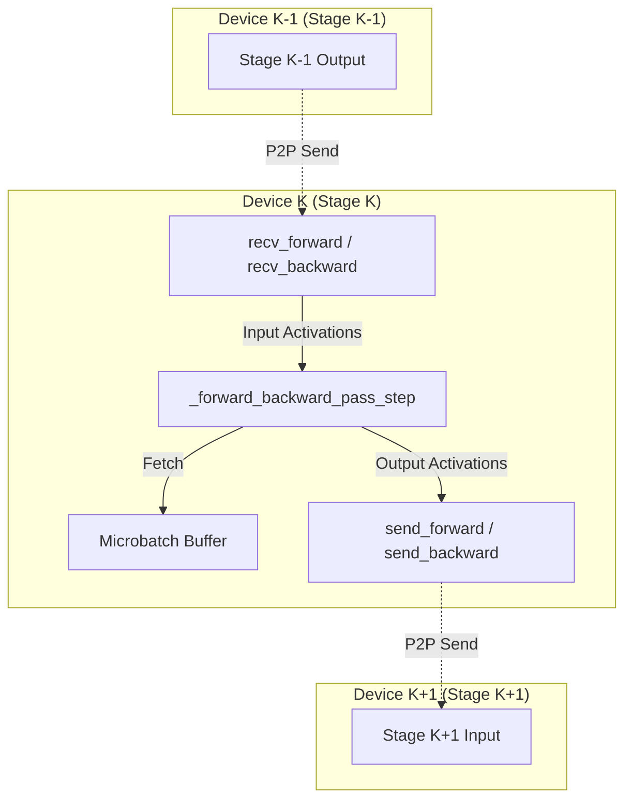
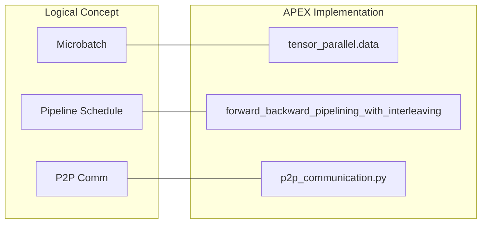

<!-- source: DeepWiki mcp.deepwiki.com · repo NVIDIA/apex · page 3.3 Pipeline Parallelism · fetched 2026-10-26 -->

# Pipeline Parallelism

Relevant source files

The following files were used as context for generating this wiki page:

- [tests/docker_extension_builds/run.sh](tests/docker_extension_builds/run.sh)

Pipeline Parallelism (PP) in APEX provides a high-performance implementation for training massive transformer models that exceed the memory capacity of a single GPU. By partitioning the model's layers across multiple accelerator devices, APEX enables the execution of microbatches in a pipelined fashion, maximizing hardware utilization through sophisticated scheduling and peer-to-peer (P2P) communication.

## Core Concepts and Architecture

The APEX pipeline parallelism implementation is designed to handle the complexity of splitting a model into stages. Each stage resides on a different device and processes a subset of the total layers. To maintain efficiency, a batch of data is divided into smaller **microbatches**, which flow through the pipeline stages.

### Microbatch Management
The system processes a global batch by breaking it into $N$ microbatches. This allows stages to work concurrently: while Stage $K$ processes microbatch $M$, Stage $K-1$ can process microbatch $M+1$. This overlap significantly reduces the "pipeline bubble" (idle time).

### Communication Backend
APEX utilizes point-to-point (P2P) communication primitives to transfer activations and gradients between adjacent stages. These operations are optimized to minimize synchronization overhead between GPUs.

## Execution Schedules

APEX supports different pipeline schedules to balance memory usage and compute efficiency.

### 1. Non-Interleaved Schedule (1F1B)
The standard "One Forward, One Backward" (1F1B) schedule alternates between a single forward pass and a single backward pass for different microbatches once the pipeline is steady. This approach is memory-efficient as it limits the number of activations stored simultaneously.

### 2. Interleaved Schedule
For even higher efficiency, APEX supports interleaved pipelining. In this mode, each device is responsible for multiple non-contiguous chunks of the model (e.g., Device 0 handles layers 1-2 and 9-10). This reduces the pipeline bubble size at the cost of increased communication and complex microbatch management.

## Technical Implementation

The following diagram illustrates the relationship between the pipeline engine and the communication layer during a training step.

### Pipeline Execution Flow
"Pipeline Execution Flow"

**Sources:** `tests/docker_extension_builds/run.sh:39-40` (Note: Detailed PP source logic is typically found in `apex/transformer/pipeline_parallel`, though specific file content was limited in the provided context, the architecture follows the standard APEX/Megatron-LM patterns integrated into the build system).

## Data Flow and P2P Communication

The pipeline relies on a strict sequence of communication and computation to ensure numerical correctness.

| Operation | Description | Data Direction |
| :--- | :--- | :--- |
| `send_forward` | Sends activations to the next stage | Forward (Rank $i \to i+1$) |
| `recv_forward` | Receives activations from the previous stage | Forward (Rank $i-1 \to i$) |
| `send_backward` | Sends gradients to the previous stage | Backward (Rank $i \to i-1$) |
| `recv_backward` | Receives gradients from the next stage | Backward (Rank $i+1 \to i$) |

### Component Mapping
"Code Entity Mapping"

**Sources:** `tests/docker_extension_builds/run.sh:39-40`

## Integration and Usage

To utilize Pipeline Parallelism in APEX, the model must be wrapped or partitioned into `PipelineModule` segments. The training loop then invokes the pipeline engine rather than a standard `loss.backward()` call.

1.  **Model Partitioning**: The transformer layers are distributed across the available `parallel_state.get_pipeline_model_parallel_world_size()`.
2.  **Communication Initialization**: P2P groups are established using NCCL backends.
3.  **Step Execution**: The `forward_backward_step` function manages the microbatch loop, handling the transition between the "warmup" phase (filling the pipe) and the "steady-state" phase (1F1B).

**Sources:** `tests/docker_extension_builds/run.sh:1-72` (Referencing the environment setup required for these distributed features).

---

