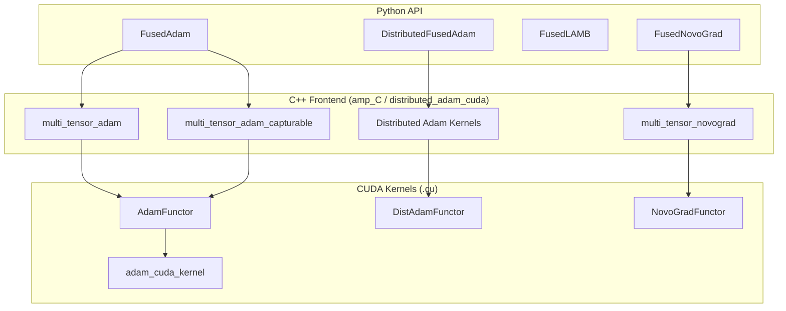
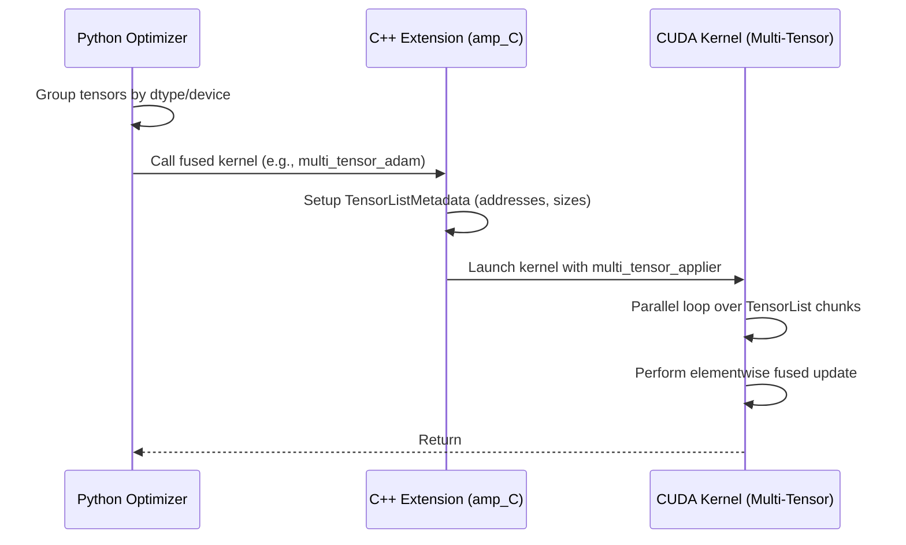

<!-- source: DeepWiki mcp.deepwiki.com · repo NVIDIA/apex · page 4 Optimized Optimizers · fetched 2026-10-26 -->

# Optimized Optimizers

Relevant source files

The following files were used as context for generating this wiki page:

- [apex/contrib/csrc/optimizers/fused_adam_cuda.cpp](apex/contrib/csrc/optimizers/fused_adam_cuda.cpp)
- [apex/contrib/csrc/optimizers/fused_adam_cuda_kernel.cu](apex/contrib/csrc/optimizers/fused_adam_cuda_kernel.cu)
- [apex/contrib/csrc/optimizers/multi_tensor_distopt_adam.cpp](apex/contrib/csrc/optimizers/multi_tensor_distopt_adam.cpp)
- [apex/contrib/csrc/optimizers/multi_tensor_distopt_adam_kernel.cu](apex/contrib/csrc/optimizers/multi_tensor_distopt_adam_kernel.cu)
- [apex/contrib/optimizers/distributed_fused_adam.py](apex/contrib/optimizers/distributed_fused_adam.py)
- [apex/optimizers/fused_adam.py](apex/optimizers/fused_adam.py)
- [apex/optimizers/fused_novograd.py](apex/optimizers/fused_novograd.py)
- [csrc/amp_C_frontend.cpp](csrc/amp_C_frontend.cpp)
- [csrc/multi_tensor_adam.cu](csrc/multi_tensor_adam.cu)
- [tests/L0/run_optimizers/test_adam.py](tests/L0/run_optimizers/test_adam.py)
- [tests/L0/run_optimizers/test_fused_novograd.py](tests/L0/run_optimizers/test_fused_novograd.py)
- [tests/L0/run_optimizers/test_fused_optimizer.py](tests/L0/run_optimizers/test_fused_optimizer.py)

APEX provides a suite of high-performance optimizers designed to accelerate deep learning training on NVIDIA GPUs. These optimizers leverage CUDA kernel fusion to combine elementwise update operations and utilize a "multi-tensor apply" mechanism to batch updates across all model parameters into a minimal number of kernel launches. This significantly reduces the overhead associated with launching thousands of small kernels for individual parameter updates.

### Core Optimization Strategies

1.  **Kernel Fusion**: Standard PyTorch optimizers often execute multiple separate CUDA kernels for a single parameter update (e.g., one for gradient scaling, one for momentum, one for the final update). APEX fuses these into a single CUDA kernel [apex/optimizers/fused_adam.py:11-14]().
2.  **Multi-Tensor Apply**: Instead of iterating through parameters in Python and launching kernels sequentially, APEX groups tensors by metadata (device and dtype) and processes them in large batches within the CUDA backend [apex/optimizers/fused_adam.py:127-134]().
3.  **Distributed State Sharding**: Advanced optimizers like `DistributedFusedAdam` implement ZeRO-2 style optimization, sharding the optimizer states (moments) across data-parallel ranks to reduce memory footprint [apex/contrib/optimizers/distributed_fused_adam.py:32-52]().

### System Architecture: Python to CUDA Bridge

The following diagram illustrates how the Python optimizer classes interface with the underlying C++/CUDA implementations via the `amp_C` and `fused_adam_cuda` extensions.

**Optimizer Entity Mapping**

Sources: [apex/optimizers/fused_adam.py:132-134](), [apex/optimizers/fused_novograd.py:103-103](), [csrc/amp_C_frontend.cpp:40-54](), [apex/contrib/csrc/optimizers/fused_adam_cuda_kernel.cu:65-168](), [apex/contrib/csrc/optimizers/multi_tensor_distopt_adam_kernel.cu:46-82]()

---

## Optimizer Families

### FusedAdam
`FusedAdam` is a high-performance implementation of the Adam and AdamW algorithms. It is designed as a drop-in replacement for `torch.optim.Adam` and `torch.optim.AdamW`. It supports "capturable" mode for use with CUDA Graphs and can maintain FP32 master weights for mixed-precision training.

For details, see [FusedAdam](#4.1).
Sources: [apex/optimizers/fused_adam.py:5-66](), [csrc/multi_tensor_adam.cu:111-115]()

### DistributedFusedAdam
`DistributedFusedAdam` provides a memory-efficient implementation of Adam by sharding optimizer states across GPUs (similar to ZeRO-2). It overlaps the reduction of gradients with the optimizer step and supports bucketing to improve communication efficiency. It is highly optimized for large-scale distributed training.

For details, see [DistributedFusedAdam](#4.2).
Sources: [apex/contrib/optimizers/distributed_fused_adam.py:126-139](), [apex/contrib/csrc/optimizers/multi_tensor_distopt_adam_kernel.cu:176-182]()

### FusedLAMB and DistributedFusedLAMB
The LAMB (Layer-wise Adaptive Moments optimizer for Batch training) family is designed for large-batch training. APEX provides both a fused version for single-GPU performance and a distributed version that shards states to save memory on massive models.

For details, see [FusedLAMB and DistributedFusedLAMB](#4.3).
Sources: [csrc/amp_C_frontend.cpp:30-38](), [csrc/amp_C_frontend.cpp:65-76]()

### Other Optimizers
APEX includes several other specialized fused optimizers:
*   **FusedSGD**: A multi-tensor version of Stochastic Gradient Descent [csrc/amp_C_frontend.cpp:86-87]().
*   **FusedNovoGrad**: An implementation of the NovoGrad algorithm, often used in acoustic models like Jasper [apex/optimizers/fused_novograd.py:5-65]().
*   **Multi-tensor Adagrad**: Fused implementation of the Adagrad algorithm [csrc/amp_C_frontend.cpp:56-57]().

For details, see [Other Optimizers](#4.4).

---

## Technical Comparison

| Feature | FusedAdam | DistributedFusedAdam | FusedNovoGrad |
| :--- | :--- | :--- | :--- |
| **Algorithm** | Adam / AdamW | Adam / AdamW (ZeRO-2) | NovoGrad |
| **State Memory** | $2 \times \text{params}$ | $(2 \times \text{params}) / \text{world\_size}$ | $1 \times \text{params} + \text{layers}$ |
| **CUDA Graph** | Supported (`capturable=True`) | Supported | Not natively |
| **Master Weights** | Supported | Internalized | Not natively |
| **Primary Use** | Standard Training | Large Scale / Memory Constrained | Speech/Acoustic Models |

### Multi-Tensor Apply Mechanism
The `multi_tensor_applier` is the workhorse behind these optimizers. It takes a CUDA kernel (Functor) and a list of tensor lists, then manages the grid launch to ensure that the GPU is saturated while minimizing the number of kernel calls.

**Multi-Tensor Execution Flow**

Sources: [apex/optimizers/fused_adam.py:171-190](), [csrc/multi_tensor_adam.cu:24-54](), [apex/contrib/csrc/optimizers/fused_adam_cuda_kernel.cu:65-88]()

---

