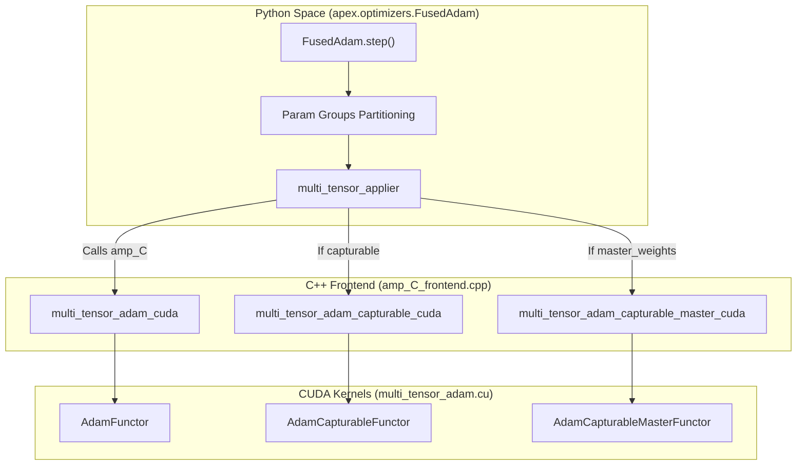

<!-- source: DeepWiki mcp.deepwiki.com · repo NVIDIA/apex · page 4.1 FusedAdam · fetched 2026-10-26 -->

# FusedAdam

<details>
<summary>Relevant source files</summary>

The following files were used as context for generating this wiki page:

- [apex/optimizers/fused_adam.py](apex/optimizers/fused_adam.py)
- [apex/optimizers/fused_novograd.py](apex/optimizers/fused_novograd.py)
- [csrc/amp_C_frontend.cpp](csrc/amp_C_frontend.cpp)
- [csrc/flatten_unflatten.cpp](csrc/flatten_unflatten.cpp)
- [csrc/multi_tensor_adam.cu](csrc/multi_tensor_adam.cu)
- [tests/L0/run_optimizers/test_adam.py](tests/L0/run_optimizers/test_adam.py)
- [tests/L0/run_optimizers/test_fused_novograd.py](tests/L0/run_optimizers/test_fused_novograd.py)
- [tests/L0/run_optimizers/test_fused_optimizer.py](tests/L0/run_optimizers/test_fused_optimizer.py)

</details>


The `FusedAdam` optimizer is a high-performance implementation of the Adam algorithm designed specifically for NVIDIA GPUs. It achieves significant speedups over the standard `torch.optim.Adam` by fusing the elementwise update operations into a single CUDA kernel and utilizing a multi-tensor apply mechanism to batch updates across all model parameters into a minimal number of kernel launches [apex/optimizers/fused_adam.py:5-14]().

## Overview and Implementation

`FusedAdam` serves as a drop-in replacement for `torch.optim.Adam` (with `adam_w_mode=False`) or `torch.optim.AdamW` (default) [apex/optimizers/fused_adam.py:16-17](). It supports both standard FP32 training and mixed-precision training via APEX AMP or `torch.amp` [apex/optimizers/fused_adam.py:23-29]().

### Key Features
*   **Kernel Fusion**: Combines the update logic (momentum, variance, and weight update) into a single CUDA kernel to reduce memory bandwidth bottlenecks [apex/optimizers/fused_adam.py:11-14]().
*   **Multi-Tensor Apply**: Uses the `multi_tensor_applier` to process lists of tensors (e.g., all parameters of the same dtype) in a single launch, minimizing CPU-side overhead and kernel launch latency [apex/optimizers/fused_adam.py:14](), [apex/optimizers/fused_adam.py:127-134]().
*   **Capturable Mode**: Supports execution within CUDA Graphs by using fixed-address tensors for learning rate and step counts [apex/optimizers/fused_adam.py:117-125]().
*   **Master Weights**: Maintains FP32 master weights for mixed-precision training, currently available in `capturable` mode [apex/optimizers/fused_adam.py:84-87](), [apex/optimizers/fused_adam.py:104-115]().

### Logic Flow and Data Mapping

The following diagram illustrates how the Python-level `FusedAdam` class interacts with the underlying CUDA kernels via the `amp_C` extension.

**FusedAdam System Architecture**


**Sources:** [apex/optimizers/fused_adam.py:146-154](), [csrc/amp_C_frontend.cpp:40-54](), [csrc/multi_tensor_adam.cu:24-28](), [csrc/multi_tensor_adam.cu:111-115]()

---

## Technical Details

### Multi-Tensor Apply Mechanism
The optimizer categorizes parameters into groups based on their `dtype` (e.g., FP16 vs FP32). For each group, it populates lists for gradients (`g`), parameters (`p`), first moments (`m`), and second moments (`v`) [apex/optimizers/fused_adam.py:189-204](). These lists are passed to `multi_tensor_applier`, which chunks the work and invokes the CUDA backend [apex/optimizers/fused_adam.py:236-248]().

**Entity Mapping: Python to CUDA**

| Python Symbol | CUDA Functor Address Index | Description |
| :--- | :--- | :--- |
| `p.grad.data` | `tl.addresses[0]` | Gradients ($g$) |
| `p.data` | `tl.addresses[1]` | Model Parameters ($p$) |
| `state['exp_avg']` | `tl.addresses[2]` | First Moment ($m$) |
| `state['exp_avg_sq']` | `tl.addresses[3]` | Second Moment ($v$) |

**Sources:** [apex/optimizers/fused_adam.py:206-215](), [csrc/multi_tensor_adam.cu:41-51]()

### Capturable Mode and CUDA Graphs
When `capturable=True` is set, the optimizer is designed to be compatible with CUDA Graphs [apex/optimizers/fused_adam.py:79]().
1.  **Tensors for Scalars**: Learning rate (`lr`) and `step` count are maintained as single-element tensors on the GPU device [apex/optimizers/fused_adam.py:89](), [apex/optimizers/fused_adam.py:123]().
2.  **Bias Correction**: In `capturable` mode, the bias correction terms $\beta_1^t$ and $\beta_2^t$ are calculated directly inside the CUDA kernel using the `step` tensor [csrc/multi_tensor_adam.cu:118-122]().
3.  **No CPU-GPU Sync**: By avoiding CPU-side scalar updates for the step count, the optimizer avoids the synchronizations that would break CUDA Graph capturing.

**Sources:** [apex/optimizers/fused_adam.py:117-125](), [csrc/multi_tensor_adam.cu:111-122]()

### Master Weights Support
For FP16 training, `FusedAdam` can maintain a high-precision FP32 copy of the weights (master weights) to prevent precision loss during accumulation [apex/optimizers/fused_adam.py:58-60](). 
*   If `master_weights=True`, the optimizer initializes a `param_groups_master` list containing FP32 clones of the parameters [apex/optimizers/fused_adam.py:105-115]().
*   During `step()`, the `multi_tensor_adam_capturable_master` kernel is used. This kernel reads FP16 gradients, updates FP32 moments and FP32 master weights, and then writes the updated values back to the FP16 model parameters [csrc/amp_C_frontend.cpp:50-54]().

**Sources:** [apex/optimizers/fused_adam.py:104-115](), [csrc/amp_C_frontend.cpp:50-54]()

---

## Performance Benefits

The performance gains of `FusedAdam` stem from two primary optimizations:

1.  **Memory Coalescing and ILP**: The CUDA kernels use Instruction-Level Parallelism (ILP) of 4, processing multiple elements per thread to saturate memory bandwidth [csrc/multi_tensor_adam.cu:14](), [csrc/multi_tensor_adam.cu:56-60]().
2.  **Reduced Kernel Launches**: Standard Adam launches $4 \times N$ kernels (where $N$ is the number of parameters). `FusedAdam` reduces this to $O(D)$ launches, where $D$ is the number of distinct dtypes in the model (typically 1 or 2) [apex/optimizers/fused_adam.py:11-14]().

**Update Algorithm (AdamW Mode)**
The kernel implements the following logic for the update:
$$m_t = \beta_1 m_{t-1} + (1 - \beta_1) g_t$$
$$v_t = \beta_2 v_{t-1} + (1 - \beta_2) g_t^2$$
$$\text{update} = \frac{m_t / (1 - \beta_1^t)}{\sqrt{v_t / (1 - \beta_2^t)} + \epsilon} + \text{decay} \times p_{t-1}$$
$$p_t = p_{t-1} - \text{lr} \times \text{update}$$

**Sources:** [csrc/multi_tensor_adam.cu:88-94]()

## Usage Example

```python
from apex.optimizers import FusedAdam

# Initialize model and optimizer
model = MyModel().cuda()
optimizer = FusedAdam(model.parameters(), 
                      lr=1e-3, 
                      adam_w_mode=True, 
                      capturable=True)

# Training loop
for input, target in data_loader:
    optimizer.zero_grad()
    output = model(input)
    loss = criterion(output, target)
    loss.backward()
    optimizer.step()
```
**Sources:** [apex/optimizers/fused_adam.py:16-21](), [tests/L0/run_optimizers/test_adam.py:114-116]()

---

