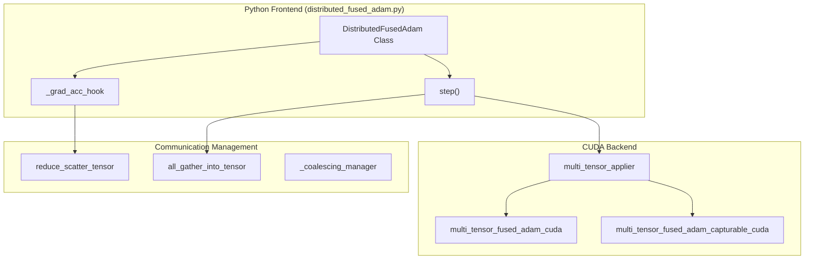

<!-- source: DeepWiki mcp.deepwiki.com · repo NVIDIA/apex · page 4.2 DistributedFusedAdam · fetched 2026-10-26 -->

# DistributedFusedAdam

<details>
<summary>Relevant source files</summary>

The following files were used as context for generating this wiki page:

- [apex/contrib/csrc/optimizers/fused_adam_cuda.cpp](apex/contrib/csrc/optimizers/fused_adam_cuda.cpp)
- [apex/contrib/csrc/optimizers/fused_adam_cuda_kernel.cu](apex/contrib/csrc/optimizers/fused_adam_cuda_kernel.cu)
- [apex/contrib/csrc/optimizers/multi_tensor_distopt_adam.cpp](apex/contrib/csrc/optimizers/multi_tensor_distopt_adam.cpp)
- [apex/contrib/csrc/optimizers/multi_tensor_distopt_adam_kernel.cu](apex/contrib/csrc/optimizers/multi_tensor_distopt_adam_kernel.cu)
- [apex/contrib/optimizers/distributed_fused_adam.py](apex/contrib/optimizers/distributed_fused_adam.py)
- [apex/contrib/test/cudnn_gbn/test_cudnn_gbn_with_two_gpus.py](apex/contrib/test/cudnn_gbn/test_cudnn_gbn_with_two_gpus.py)
- [apex/contrib/test/optimizers/test_dist_adam.py](apex/contrib/test/optimizers/test_dist_adam.py)

</details>


`DistributedFusedAdam` is a high-performance distributed optimizer that implements the Adam/AdamW algorithm with ZeRO-2 sharding. It is designed to minimize communication overhead and memory usage by sharding optimizer states across data-parallel ranks, overlapping gradient synchronization with the backward pass, and overlapping parameter synchronization with the optimizer step.

## Overview and Key Features

`DistributedFusedAdam` extends the capabilities of standard fused optimizers by integrating distributed communication directly into the optimization process. Key features include:

*   **ZeRO-2 Sharding:** Optimizer states (momentum and variance) are sharded across the distributed process group, significantly reducing the memory footprint per GPU [apex/contrib/optimizers/distributed_fused_adam.py:83-105]().
*   **Communication Overlap:** It supports overlapping gradient reduction-scatter with the backward pass (`overlap_grad_sync`) and overlapping parameter all-gather with the optimizer step (`overlap_param_sync`) [apex/contrib/optimizers/distributed_fused_adam.py:734-738]().
*   **CUDA Graph Support:** The optimizer is "capturable," meaning it can be used within CUDA Graphs to reduce CPU launch overhead [apex/contrib/optimizers/distributed_fused_adam.py:756-760]().
*   **Mixed Precision:** Supports various combinations of dtypes for parameters, gradients, and optimizer states, including FP32, FP16, and BF16 [apex/contrib/optimizers/distributed_fused_adam.py:821-830]().
*   **Bucketing:** Communication is managed in buckets to maximize bandwidth utilization [apex/contrib/optimizers/distributed_fused_adam.py:910-915]().

Sources: [apex/contrib/optimizers/distributed_fused_adam.py:615-772](), [apex/contrib/test/optimizers/test_dist_adam.py:83-105]()

---

## Implementation Architecture

The optimizer manages data through several specialized buffers and hooks. It organizes parameters into "buckets" to perform collective communications efficiently.

### Data Flow and Synchronization

The following diagram illustrates the lifecycle of gradients and parameters during a training step when communication overlap is enabled.

**Gradient and Parameter Lifecycle**
```mermaid
sequenceDiagram
    participant BWD as Backward Pass
    participant GRAD_BUF as Gradient Buckets
    participant OPT as DistributedFusedAdam
    participant PARAM_BUF as Parameter Buckets
    participant COMM as NCCL (Distributed)

    BWD->>GRAD_BUF: Accumulate Gradients
    Note over GRAD_BUF: Hook: _grad_acc_hook
    GRAD_BUF->>COMM: reduce_scatter (async)
    Note right of COMM: Grad Sync Overlap
    COMM-->>OPT: Sharded Gradients Ready
    OPT->>OPT: step() / Fused Kernel
    Note over OPT: Update Sharded States
    OPT->>COMM: all_gather (async)
    Note right of COMM: Param Sync Overlap
    COMM-->>PARAM_BUF: Full Parameters Updated
```
Sources: [apex/contrib/optimizers/distributed_fused_adam.py:1220-1250](), [apex/contrib/optimizers/distributed_fused_adam.py:1550-1600]()

### Code Entity Mapping

This diagram bridges the high-level logic to specific classes and functions in the codebase.

**System Entity Mapping**

Sources: [apex/contrib/optimizers/distributed_fused_adam.py:23-57](), [apex/contrib/optimizers/distributed_fused_adam.py:615-620](), [apex/contrib/csrc/optimizers/multi_tensor_distopt_adam.cpp:3-17]()

---

## Key Components and Functions

### DistributedFusedAdam Class
The main entry point. It inherits from `torch.optim.Optimizer` but overrides initialization to set up sharded buffers and process groups.

*   **`__init__`**: Initializes sharded optimizer states and allocates contiguous buffers if requested. It also sets up parameter hooks for gradient synchronization [apex/contrib/optimizers/distributed_fused_adam.py:615-772]().
*   **`_grad_acc_hook`**: A post-backward hook attached to parameters. When a gradient is ready, it marks the corresponding bucket as ready for reduction [apex/contrib/optimizers/distributed_fused_adam.py:1224-1240]().
*   **`step(closure)`**: Performs the optimizer update. If `overlap_param_sync` is enabled, it triggers asynchronous all-gathers for parameter buckets [apex/contrib/optimizers/distributed_fused_adam.py:1550-1650]().

### Communication Management
The optimizer uses several utility functions to handle distributed operations across different PyTorch versions:
*   `reduce_scatter_tensor`: Used for sharding gradients [apex/contrib/optimizers/distributed_fused_adam.py:42-46]().
*   `all_gather_into_tensor`: Used for synchronizing parameters [apex/contrib/optimizers/distributed_fused_adam.py:48-52]().
*   `_coalescing_manager`: A context manager used to group multiple NCCL calls together for better performance [apex/contrib/optimizers/distributed_fused_adam.py:57-110]().

### CUDA Kernels
The core math is performed by specialized multi-tensor kernels:
*   `multi_tensor_fused_adam`: Standard Adam/AdamW update that processes multiple tensors in a single kernel launch [apex/contrib/csrc/optimizers/multi_tensor_distopt_adam.cpp:3-6]().
*   `multi_tensor_fused_adam_capturable`: A version of the kernel designed for CUDA Graphs, taking scalars like `lr` and `step` as tensors [apex/contrib/csrc/optimizers/multi_tensor_distopt_adam.cpp:8-11]().
*   `DistAdamFunctor`: The CUDA functor implementing the element-wise logic for sharded state updates and parameter output [apex/contrib/csrc/optimizers/multi_tensor_distopt_adam_kernel.cu:45-82]().

Sources: [apex/contrib/optimizers/distributed_fused_adam.py:30-32](), [apex/contrib/csrc/optimizers/multi_tensor_distopt_adam_kernel.cu:176-182]()

---

## Technical Configuration

| Parameter | Description |
| :--- | :--- |
| `overlap_grad_sync` | If True, reduce-scatters gradients asynchronously during the backward pass [apex/contrib/optimizers/distributed_fused_adam.py:734](). |
| `overlap_param_sync` | If True, all-gathers parameters asynchronously during the optimizer step [apex/contrib/optimizers/distributed_fused_adam.py:738](). |
| `bucket_cap_mb` | The maximum size (in MB) for a communication bucket [apex/contrib/optimizers/distributed_fused_adam.py:714](). |
| `contiguous_grad_buffer` | Whether to allocate a single contiguous buffer for gradients [apex/contrib/optimizers/distributed_fused_adam.py:743](). |
| `capturable` | Enables support for CUDA Graphs [apex/contrib/optimizers/distributed_fused_adam.py:756](). |
| `store_params` | If True, maintains a master copy of parameters in the optimizer's preferred dtype [apex/contrib/optimizers/distributed_fused_adam.py:748](). |

Sources: [apex/contrib/optimizers/distributed_fused_adam.py:680-772]()

## Usage Example

```python
from apex.contrib.optimizers import DistributedFusedAdam

model = MyModel().cuda()
optimizer = DistributedFusedAdam(
    model.parameters(),
    lr=1e-3,
    weight_decay=1e-2,
    overlap_grad_sync=True,
    overlap_param_sync=True,
    capturable=True
)

# Standard training loop
for input, target in data_loader:
    optimizer.zero_grad()
    output = model(input)
    loss = criterion(output, target)
    loss.backward()
    optimizer.step()
```
Sources: [apex/contrib/test/optimizers/test_dist_adam.py:83-105]()

---

