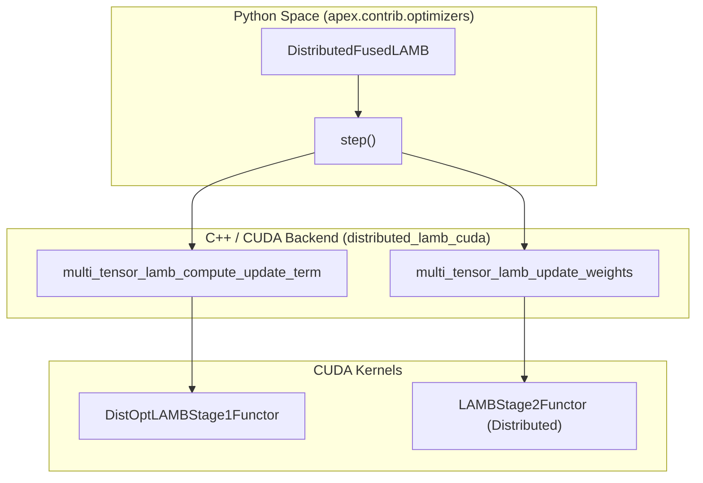

<!-- source: DeepWiki mcp.deepwiki.com · repo NVIDIA/apex · page 4.3 FusedLAMB and DistributedFusedLAMB · fetched 2026-10-26 -->

# FusedLAMB and DistributedFusedLAMB

Relevant source files

The following files were used as context for generating this wiki page:

- [apex/contrib/csrc/optimizers/fused_lamb_cuda.cpp](apex/contrib/csrc/optimizers/fused_lamb_cuda.cpp)
- [apex/contrib/csrc/optimizers/fused_lamb_cuda_kernel.cu](apex/contrib/csrc/optimizers/fused_lamb_cuda_kernel.cu)
- [apex/contrib/csrc/optimizers/multi_tensor_distopt_lamb.cpp](apex/contrib/csrc/optimizers/multi_tensor_distopt_lamb.cpp)
- [apex/contrib/csrc/optimizers/multi_tensor_distopt_lamb_kernel.cu](apex/contrib/csrc/optimizers/multi_tensor_distopt_lamb_kernel.cu)
- [apex/contrib/optimizers/__init__.py](apex/contrib/optimizers/__init__.py)
- [apex/contrib/optimizers/distributed_fused_lamb.py](apex/contrib/optimizers/distributed_fused_lamb.py)
- [apex/contrib/optimizers/fp16_optimizer.py](apex/contrib/optimizers/fp16_optimizer.py)
- [apex/contrib/optimizers/fused_lamb.py](apex/contrib/optimizers/fused_lamb.py)
- [apex/contrib/optimizers/fused_sgd.py](apex/contrib/optimizers/fused_sgd.py)
- [apex/optimizers/fused_lamb.py](apex/optimizers/fused_lamb.py)
- [apex/optimizers/fused_mixed_precision_lamb.py](apex/optimizers/fused_mixed_precision_lamb.py)
- [csrc/multi_tensor_l2norm_kernel_mp.cu](csrc/multi_tensor_l2norm_kernel_mp.cu)
- [csrc/multi_tensor_l2norm_scale_kernel.cu](csrc/multi_tensor_l2norm_scale_kernel.cu)
- [csrc/multi_tensor_lamb.cu](csrc/multi_tensor_lamb.cu)
- [csrc/multi_tensor_lamb_mp.cu](csrc/multi_tensor_lamb_mp.cu)
- [csrc/multi_tensor_lamb_stage_1.cu](csrc/multi_tensor_lamb_stage_1.cu)
- [csrc/multi_tensor_lamb_stage_2.cu](csrc/multi_tensor_lamb_stage_2.cu)
- [csrc/multi_tensor_novograd.cu](csrc/multi_tensor_novograd.cu)
- [tests/L0/run_optimizers/test_lamb.py](tests/L0/run_optimizers/test_lamb.py)

The LAMB (Layer-wise Adaptive Moments optimizer for Batch training) algorithm is designed to enable large-batch training of deep learning models without loss of accuracy. APEX provides several optimized implementations of LAMB, ranging from standard fused kernels to distributed versions that shard optimizer states across multiple GPUs to reduce memory overhead.

## FusedLAMB

`FusedLAMB` provides a high-performance implementation of the LAMB algorithm by fusing elementwise operations and utilizing a multi-tensor apply mechanism. This approach batches updates for all model parameters into a minimal number of CUDA kernel launches, significantly reducing overhead compared to standard PyTorch implementations [apex/optimizers/fused_lamb.py:11-16]().

### Implementation Details
The optimizer supports both `float16` and `float32` parameters and can be used with or without APEX AMP [apex/optimizers/fused_lamb.py:24-30](). It computes the global gradient norm across all parameters before applying the LAMB update logic [apex/optimizers/fused_lamb.py:145-160]().

The core logic is implemented in two stages within the CUDA kernels:
1.  **Stage 1**: Computes the Adam-like update term ($m_t / \sqrt{v_t} + \epsilon$) and updates the first and second moments [csrc/multi_tensor_lamb_stage_1.cu:16-22]().
2.  **Stage 2**: Calculates the trust ratio (norm of weights / norm of update) and applies the final update to the parameters [csrc/multi_tensor_lamb_stage_2.cu:18-24]().

### Code Entity Mapping: FusedLAMB Logic
The following diagram maps the Python-level optimizer calls to the underlying C++/CUDA implementations.

| Component | Code Entity | File |
| :--- | :--- | :--- |
| **Python API** | `FusedLAMB` | [apex/optimizers/fused_lamb.py:5]() |
| **Multi-Tensor Kernel** | `multi_tensor_lamb` | [apex/optimizers/fused_lamb.py:98]() |
| **C++ Binding** | `amp_C.multi_tensor_lamb` | [apex/optimizers/fused_lamb.py:98]() |
| **CUDA Functor (Stage 1)** | `LAMBStage1Functor` | [csrc/multi_tensor_lamb_stage_1.cu:18]() |
| **CUDA Functor (Stage 2)** | `LAMBStage2Functor` | [csrc/multi_tensor_lamb_stage_2.cu:21]() |

**Sources:** [apex/optimizers/fused_lamb.py:5-114](), [csrc/multi_tensor_lamb_stage_1.cu:16-120](), [csrc/multi_tensor_lamb_stage_2.cu:18-96]()

---

## DistributedFusedLAMB

`DistributedFusedLAMB` is an advanced implementation sharding optimizer states (moments) across GPUs, similar to ZeRO-2 optimization. It is specifically designed for very large models where optimizer state memory becomes a bottleneck [apex/contrib/optimizers/distributed_fused_lamb.py:26-36]().

### Key Features
*   **State Sharding**: Parameters and their corresponding moments are distributed across the world size or specified process groups [apex/contrib/optimizers/distributed_fused_lamb.py:177-181]().
*   **Communication Overlap**: Supports overlapping gradient reductions with the backward pass [apex/contrib/optimizers/distributed_fused_lamb.py:112-118]().
*   **NVLAMB Support**: Includes an option to apply adaptive learning rates even to parameters with zero weight decay [apex/contrib/optimizers/distributed_fused_lamb.py:75-76]().

### Data Flow and Communication
The distributed version utilizes NCCL collectives to synchronize gradients and parameters. It typically follows a pattern of:
1.  **Reduce-Scatter**: To distribute gradients to the ranks owning the respective parameter shards.
2.  **Local Update**: Each rank updates its shard of the parameters and moments.
3.  **All-Gather**: To synchronize the updated parameter shards back to all ranks.

### Code Structure: Distributed Implementation
The distributed version resides in `apex.contrib` and utilizes a specialized CUDA backend for sharded updates.

**Sources:** [apex/contrib/optimizers/distributed_fused_lamb.py:26-153](), [apex/contrib/csrc/optimizers/multi_tensor_distopt_lamb.cpp:3-22](), [apex/contrib/csrc/optimizers/multi_tensor_distopt_lamb_kernel.cu:98-175]()

---

## Technical Comparison

| Feature | FusedLAMB (Standard) | DistributedFusedLAMB |
| :--- | :--- | :--- |
| **State Storage** | Full copy on every GPU | Sharded across GPUs |
| **Communication** | Relies on DDP for gradients | Internal Reduce-Scatter / All-Gather |
| **Memory Efficiency** | Lower | Higher (ZeRO-2 style) |
| **Multi-Tensor Apply** | Yes [apex/optimizers/fused_lamb.py:16]() | Yes [apex/contrib/optimizers/distributed_fused_lamb.py:35]() |
| **NVLAMB Variant** | Supported [apex/optimizers/fused_lamb.py:76]() | Supported [apex/contrib/optimizers/distributed_fused_lamb.py:75]() |

### Kernel Optimization
Both implementations utilize the `multi_tensor_apply` infrastructure. This allows the kernels to process lists of tensors (of different shapes) in a single grid launch. The kernels use **Instruction-Level Parallelism (ILP)** and vectorized loads/stores to maximize memory bandwidth utilization on NVIDIA GPUs [csrc/multi_tensor_lamb_stage_1.cu:14-52](), [apex/contrib/csrc/optimizers/multi_tensor_distopt_lamb_kernel.cu:14-25]().

**Sources:** [apex/optimizers/fused_lamb.py:5-105](), [apex/contrib/optimizers/distributed_fused_lamb.py:26-181](), [csrc/multi_tensor_lamb_stage_1.cu:13-14](), [apex/contrib/csrc/optimizers/multi_tensor_distopt_lamb_kernel.cu:13-14]()

---

