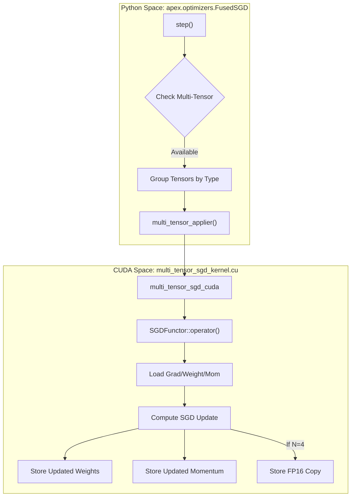
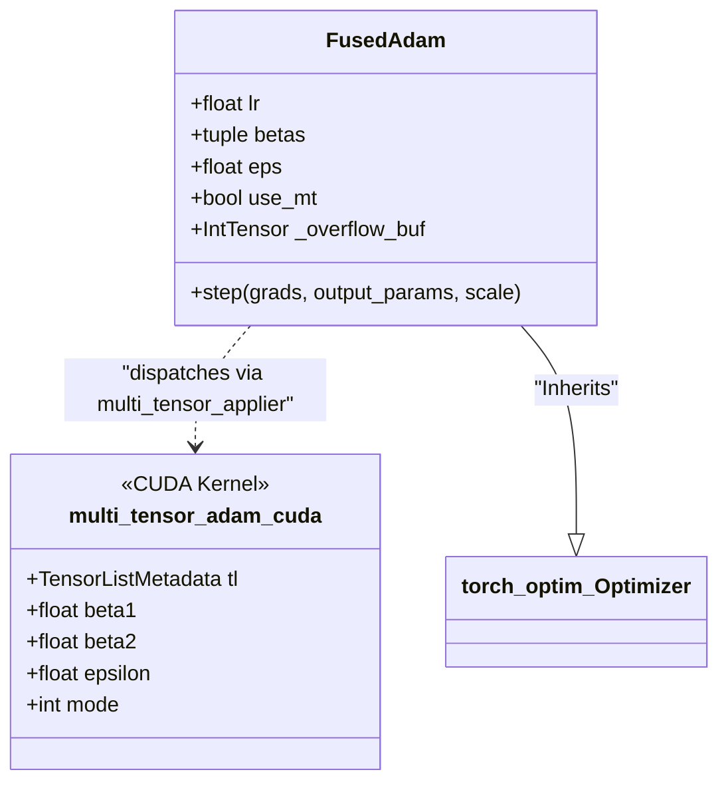

<!-- source: DeepWiki mcp.deepwiki.com · repo NVIDIA/apex · page 4.4 Other Optimizers · fetched 2026-10-26 -->

# Other Optimizers

Relevant source files

The following files were used as context for generating this wiki page:

- [apex/contrib/optimizers/fused_adam.py](apex/contrib/optimizers/fused_adam.py)
- [apex/optimizers/__init__.py](apex/optimizers/__init__.py)
- [apex/optimizers/fused_sgd.py](apex/optimizers/fused_sgd.py)
- [csrc/multi_tensor_sgd_kernel.cu](csrc/multi_tensor_sgd_kernel.cu)
- [requirements_dev.txt](requirements_dev.txt)
- [tests/L0/run_optimizers/__init__.py](tests/L0/run_optimizers/__init__.py)

This page documents additional high-performance optimizers provided by APEX, specifically focusing on `FusedSGD`, `FusedNovoGrad`, and the experimental `contrib` variant of `FusedAdam`. These optimizers leverage CUDA kernels and the `multi_tensor_apply` infrastructure to minimize kernel launch overhead and accelerate elementwise updates.

## FusedSGD

`FusedSGD` is a GPU-only implementation of Stochastic Gradient Descent that integrates two primary optimizations:
1.  **Elementwise Fusion**: Combines weight decay, momentum updates, and parameter updates into a single CUDA kernel.
2.  **Multi-Tensor Launch**: Batches updates for all model parameters into one or a few kernel launches using the `multi_tensor_apply` infrastructure [[apex/optimizers/fused_sgd.py:13-16]]().

### Implementation Details
The optimizer supports various data type combinations for gradients, parameters, and momentum buffers, including mixed-precision scenarios where master weights are maintained in FP32 while model weights are in FP16 [[apex/optimizers/fused_sgd.py:175-181]]().

The core logic resides in the `SGDFunctor` within the CUDA backend. It handles the following update rule:
1.  **Weight Decay**: Applied either before or after momentum based on the `wd_after_momentum` flag [[csrc/multi_tensor_sgd_kernel.cu:85-100]]().
2.  **Momentum**: Updates the velocity buffer $v = \rho * v + (1 - \text{dampening}) * g$ [[csrc/multi_tensor_sgd_kernel.cu:88-89]]().
3.  **Nesterov**: If enabled, the gradient is adjusted by the momentum buffer before the weight update [[csrc/multi_tensor_sgd_kernel.cu:93-94]]().
4.  **Weight Update**: $p = p - lr * g$ [[csrc/multi_tensor_sgd_kernel.cu:103]]().

### Data Flow: FusedSGD
The following diagram illustrates how `FusedSGD` coordinates between the Python API and the CUDA kernels.

**FusedSGD Execution Flow**

Sources: [[apex/optimizers/fused_sgd.py:154-210]](), [[csrc/multi_tensor_sgd_kernel.cu:28-114]]()

---

## FusedNovoGrad

`FusedNovoGrad` implements the NovoGrad algorithm, which is often used in large-batch training for speech and NLP tasks. Like other APEX optimizers, it is optimized for CUDA and supports multi-tensor application to reduce overhead [[apex/optimizers/__init__.py:3]]().

| Feature | Description |
| :--- | :--- |
| **Normalization** | Normalizes gradients per-layer before applying updates. |
| **Fusion** | Fuses elementwise logic for second moment estimation and weight updates. |
| **Multi-Tensor** | Utilizes `multi_tensor_apply` to process multiple parameter tensors in a single kernel launch. |

Sources: [[apex/optimizers/__init__.py:3]](), [[apex/multi_tensor_apply/__init__.py:1-10]]()

---

## Contrib FusedAdam

The `apex.contrib.optimizers.FusedAdam` variant is an experimental version of the standard `FusedAdam`. It includes specific features for advanced workflows, such as `max_grad_norm` clipping integrated directly into the optimizer step and support for `CUDA Graphs` via capturable modes [[apex/contrib/optimizers/fused_adam.py:7-51]]().

### Key Differences from Standard FusedAdam
*   **Integrated Clipping**: Can perform gradient clipping internally if `max_grad_norm` is provided, avoiding a separate global norm calculation pass [[apex/contrib/optimizers/fused_adam.py:136-140]]().
*   **Scale Adjustment**: Supports `amp_scale_adjustment` for fine-grained control over loss scaling [[apex/contrib/optimizers/fused_adam.py:63]]().
*   **Multi-Tensor Option**: Explicitly toggleable via the `use_mt` flag [[apex/contrib/optimizers/fused_adam.py:56-61]]().

### Code Entity Map: Contrib FusedAdam
This diagram maps the Python class attributes to the underlying CUDA kernel requirements.

**Contrib FusedAdam Entity Mapping**

Sources: [[apex/contrib/optimizers/fused_adam.py:7-75]](), [[apex/contrib/optimizers/fused_adam.py:144-148]]()

---

## Multi-Tensor SGD Kernel

The `multi_tensor_sgd` kernel is the workhorse behind `FusedSGD`. It is designed to handle up to 4 tensor lists simultaneously [[csrc/multi_tensor_sgd_kernel.cu:13-19]]():
1.  **Gradients** (`tl[0]`)
2.  **Weights** (`tl[1]`)
3.  **Momentum Buffers** (`tl[2]`)
4.  **FP16 Model Weights** (`tl[3]`) - Optional, used when the optimizer maintains FP32 master weights but needs to update the FP16 weights used in the forward pass.

### Performance Optimizations
*   **ILP (Instruction Level Parallelism)**: The kernel processes 4 elements per thread (`ILP=4`) to hide memory latency [[csrc/multi_tensor_sgd_kernel.cu:11]]().
*   **No-op Flag**: Checks a `noop_gmem` flag at the start of the kernel. If an overflow was detected elsewhere (e.g., in AMP), the kernel exits immediately without performing computations [[csrc/multi_tensor_sgd_kernel.cu:34]]().
*   **Unrolled Loops**: Uses `#pragma unroll` for both the load and compute phases to maximize throughput [[csrc/multi_tensor_sgd_kernel.cu:62-80]]().

### Supported Type Combinations
The CUDA backend explicitly instantiates templates for the following configurations [[csrc/multi_tensor_sgd_kernel.cu:131-175]]():

| Case | Grad Type | Param Type | Momentum Type | FP16 Copy |
| :--- | :--- | :--- | :--- | :--- |
| 1 | Half | Half | Half | No |
| 2 | Float | Float | Float | No |
| 3 | Half | Float | Float | Yes |
| 4 | Float | Float | Float | Yes |

Sources: [[csrc/multi_tensor_sgd_kernel.cu:10-27]](), [[csrc/multi_tensor_sgd_kernel.cu:116-175]]()

---

