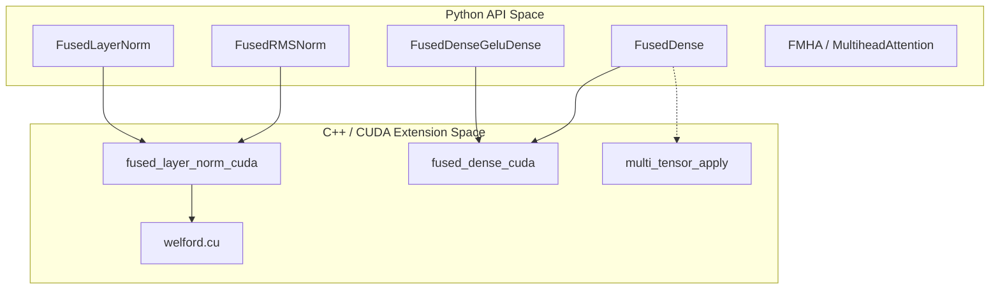
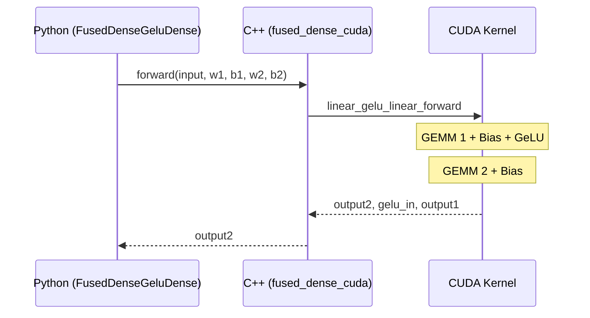

<!-- source: DeepWiki mcp.deepwiki.com · repo NVIDIA/apex · page 5 Optimized Neural Network Components · fetched 2026-10-26 -->

# Optimized Neural Network Components

Relevant source files

The following files were used as context for generating this wiki page:

- [apex/contrib/layer_norm/layer_norm.py](apex/contrib/layer_norm/layer_norm.py)
- [apex/contrib/test/layer_norm/test_fast_layer_norm.py](apex/contrib/test/layer_norm/test_fast_layer_norm.py)
- [apex/fused_dense/fused_dense.py](apex/fused_dense/fused_dense.py)
- [apex/normalization/fused_layer_norm.py](apex/normalization/fused_layer_norm.py)
- [csrc/layer_norm_cuda.cpp](csrc/layer_norm_cuda.cpp)
- [csrc/layer_norm_cuda_kernel.cu](csrc/layer_norm_cuda_kernel.cu)
- [csrc/multi_tensor_apply.cuh](csrc/multi_tensor_apply.cuh)
- [csrc/multi_tensor_l2norm_kernel.cu](csrc/multi_tensor_l2norm_kernel.cu)
- [csrc/multi_tensor_scale_kernel.cu](csrc/multi_tensor_scale_kernel.cu)
- [csrc/type_shim.h](csrc/type_shim.h)
- [csrc/welford.cu](csrc/welford.cu)
- [tests/L0/run_fused_layer_norm/test_fused_layer_norm.py](tests/L0/run_fused_layer_norm/test_fused_layer_norm.py)

The APEX library provides a suite of highly optimized implementations for common neural network building blocks. These components are designed to replace standard PyTorch layers with versions that leverage CUDA kernel fusion, specialized hardware features, and efficient memory management to significantly reduce training latency and memory overhead.

The primary focus of these optimizations is to minimize the number of GPU kernel launches and global memory round-trips by fusing multiple operations (such as normalization, activation, and linear projections) into single, high-performance CUDA kernels.

### Component Relationship Overview

The following diagram illustrates how high-level APEX components map to their underlying optimized CUDA implementations and C++ extensions.

**Component to Code Entity Mapping**

Sources: [apex/normalization/fused_layer_norm.py:12-13](), [apex/fused_dense/fused_dense.py:1-13](), [csrc/layer_norm_cuda.cpp:68-70](), [csrc/welford.cu:118-120]()

---

## Fused Layer Normalization

APEX provides several variants of Layer Normalization that are significantly faster than the native PyTorch implementation. These modules fuse the mean and variance calculation, normalization, and affine transformation into a single kernel.

*   **`FusedLayerNorm`**: The standard optimized implementation. [apex/normalization/fused_layer_norm.py:381-383]()
*   **`FusedRMSNorm`**: A faster variant that only calculates Root Mean Square, omitting the mean subtraction. [apex/normalization/fused_layer_norm.py:461-463]()
*   **`MixedFusedLayerNorm`**: Designed for mixed-precision training where weights are kept in `float32` while inputs are `float16` or `bfloat16`. [apex/normalization/fused_layer_norm.py:423-425]()
*   **`FastLayerNorm`**: A specialized implementation in `apex.contrib` targeting specific hidden sizes for maximum throughput. [apex/contrib/layer_norm/layer_norm.py:45-46]()

For details, see [Fused Layer Normalization](#5.1).

## Bottleneck Layers

Optimizations for Convolutional Neural Networks (CNNs) are centered around the bottleneck architecture. APEX utilizes the cuDNN frontend to fuse convolution, batch normalization, and activation functions.

*   **Spatial Parallelism**: Supports splitting large feature maps across multiple GPUs.
*   **Halo Exchange**: Manages the boundary data required for distributed spatial convolutions.

For details, see [Bottleneck Layers](#5.2).

## Attention Mechanisms

Attention is often the primary bottleneck in Transformer models. APEX provides multiple levels of optimization for these layers:

*   **Fused Multi-Head Attention (FMHA)**: High-performance kernels that fuse the entire attention computation.
*   **Fused Softmax**: Optimized kernels for the attention scoring mechanism, including scaled and masked variants. [csrc/megatron/scaled_masked_softmax.cu:1-10]()
*   **Fused Rotary Positional Embeddings (RoPE)**: Efficient implementation of rotary embeddings commonly used in modern LLMs.

For details, see [Attention Mechanisms](#5.3).

## Group Normalization and Other Ops

Beyond LayerNorm, APEX optimizes other normalization strategies, particularly for computer vision tasks:

*   **`GroupNorm`**: Optimized specifically for `NHWC` (channels-last) memory formats.
*   **`cudnn_gbn`**: A cuDNN-based implementation of Group Batch Normalization.

For details, see [Group Normalization and Other Normalization Layers](#5.4).

## MLP and Dense Layers

The `apex.fused_dense` module provides linear layers that fuse the matrix multiplication (GEMM) with bias addition and activation functions.

*   **`FusedDense`**: Fuses `Linear + Bias`. [apex/fused_dense/fused_dense.py:78-80]()
*   **`FusedDenseGeluDense`**: Fuses a common Transformer MLP pattern: `Linear + Bias + GeLU + Linear + Bias`. [apex/fused_dense/fused_dense.py:97-98]()

**MLP Fusion Logic Flow**

Sources: [apex/fused_dense/fused_dense.py:39-47](), [apex/fused_dense/fused_dense.py:109-110]()

For details, see [MLP and Dense Layers](#5.5).

---
**Sources:**
*   [apex/normalization/fused_layer_norm.py:1-50]()
*   [apex/fused_dense/fused_dense.py:1-110]()
*   [csrc/layer_norm_cuda.cpp:1-150]()
*   [csrc/welford.cu:1-150]()
*   [apex/contrib/layer_norm/layer_norm.py:1-60]()

---

