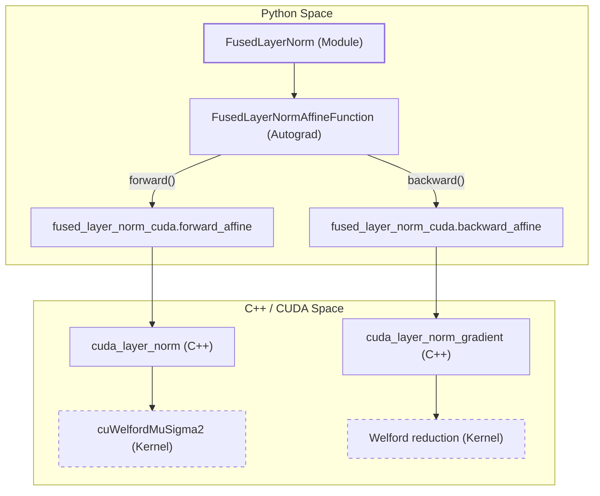
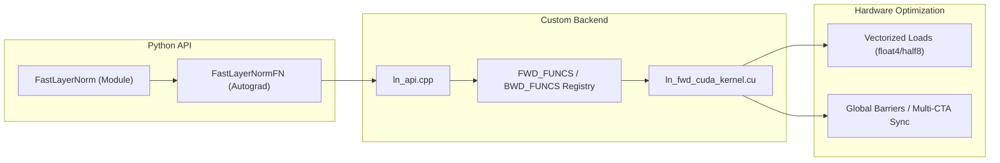

<!-- source: DeepWiki mcp.deepwiki.com · repo NVIDIA/apex · page 5.1 Fused Layer Normalization · fetched 2026-10-26 -->

# Fused Layer Normalization

<details>
<summary>Relevant source files</summary>

The following files were used as context for generating this wiki page:

- [apex/contrib/csrc/layer_norm/ln.h](apex/contrib/csrc/layer_norm/ln.h)
- [apex/contrib/csrc/layer_norm/ln_api.cpp](apex/contrib/csrc/layer_norm/ln_api.cpp)
- [apex/contrib/csrc/layer_norm/ln_bwd_kernels.cuh](apex/contrib/csrc/layer_norm/ln_bwd_kernels.cuh)
- [apex/contrib/csrc/layer_norm/ln_bwd_semi_cuda_kernel.cu](apex/contrib/csrc/layer_norm/ln_bwd_semi_cuda_kernel.cu)
- [apex/contrib/csrc/layer_norm/ln_fwd_cuda_kernel.cu](apex/contrib/csrc/layer_norm/ln_fwd_cuda_kernel.cu)
- [apex/contrib/csrc/layer_norm/ln_fwd_kernels.cuh](apex/contrib/csrc/layer_norm/ln_fwd_kernels.cuh)
- [apex/contrib/csrc/layer_norm/ln_kernel_traits.h](apex/contrib/csrc/layer_norm/ln_kernel_traits.h)
- [apex/contrib/csrc/layer_norm/ln_utils.cuh](apex/contrib/csrc/layer_norm/ln_utils.cuh)
- [apex/contrib/layer_norm/layer_norm.py](apex/contrib/layer_norm/layer_norm.py)
- [apex/contrib/test/layer_norm/test_fast_layer_norm.py](apex/contrib/test/layer_norm/test_fast_layer_norm.py)
- [apex/fused_dense/fused_dense.py](apex/fused_dense/fused_dense.py)
- [apex/normalization/fused_layer_norm.py](apex/normalization/fused_layer_norm.py)
- [csrc/layer_norm_cuda.cpp](csrc/layer_norm_cuda.cpp)
- [csrc/layer_norm_cuda_kernel.cu](csrc/layer_norm_cuda_kernel.cu)
- [csrc/multi_tensor_apply.cuh](csrc/multi_tensor_apply.cuh)
- [csrc/multi_tensor_l2norm_kernel.cu](csrc/multi_tensor_l2norm_kernel.cu)
- [csrc/multi_tensor_scale_kernel.cu](csrc/multi_tensor_scale_kernel.cu)
- [csrc/type_shim.h](csrc/type_shim.h)
- [csrc/welford.cu](csrc/welford.cu)
- [tests/L0/run_fused_layer_norm/test_fused_layer_norm.py](tests/L0/run_fused_layer_norm/test_fused_layer_norm.py)

</details>


The APEX library provides several optimized implementations of Layer Normalization and Root Mean Square Normalization (RMSNorm). These implementations fuse the element-wise operations (mean, variance, scaling, and shifting) into a single CUDA kernel to reduce memory bandwidth bottlenecks and improve training performance.

## Overview of Implementations

APEX offers four primary variants of fused normalization, each targeting different use cases and performance requirements:

| Class | Description | Primary Use Case |
| :--- | :--- | :--- |
| `FusedLayerNorm` | Standard Layer Normalization with fused CUDA kernels. | General replacement for `torch.nn.LayerNorm`. |
| `FusedRMSNorm` | Fused implementation of Root Mean Square Normalization. | Modern Transformer architectures (e.g., Llama). |
| `MixedFusedLayerNorm` | Supports mixed-precision inputs where weights/bias are FP32 but data is FP16/BF16. | Stability in low-precision training. |
| `FastLayerNorm` | Highly optimized version using persistent kernels and specialized memory access. | Maximum performance on specific hidden sizes. |

### Data Flow and System Architecture

The following diagram illustrates the transition from the Python API to the underlying CUDA implementations for standard Fused Layer Normalization.

**Layer Normalization Call Stack**

**Sources:** [apex/normalization/fused_layer_norm.py:38-74](), [csrc/layer_norm_cuda.cpp:92-130](), [csrc/layer_norm_cuda_kernel.cu:51-150]()

---

## FusedLayerNorm and FusedRMSNorm

`FusedLayerNorm` is the drop-in replacement for `torch.nn.LayerNorm`. It supports `elementwise_affine` and `memory_efficient` modes.

### Key Features
- **Memory Efficiency**: In `memory_efficient=True` mode, the backward pass recomputes parts of the forward pass to save activation memory [apex/normalization/fused_layer_norm.py:40-57]().
- **Welford Algorithm**: Uses a parallel Welford online algorithm for numerically stable one-pass mean and variance computation [csrc/layer_norm_cuda_kernel.cu:13-21]().
- **RMS Variant**: `FusedRMSNorm` simplifies the calculation by only computing the root mean square of inputs, skipping the mean subtraction step [apex/normalization/fused_layer_norm.py:22-35](), [csrc/layer_norm_cuda_kernel.cu:41-44]().

**Sources:** [apex/normalization/fused_layer_norm.py:441-482](), [csrc/layer_norm_cuda_kernel.cu:51-150]()

---

## MixedFusedLayerNorm

`MixedFusedLayerNorm` is designed for scenarios where the input data is in a lower precision (FP16 or BF16) but the learnable parameters (gamma/beta) are maintained in FP32 for numerical stability.

### Implementation Details
The kernel handles mixed types by dispatching to specialized templates that perform accumulation in `float` regardless of the input `scalar_t` [csrc/layer_norm_cuda.cpp:110-124]().

**Sources:** [apex/normalization/fused_layer_norm.py:597-628](), [csrc/layer_norm_cuda.cpp:110-124]()

---

## FastLayerNorm (Experimental Contrib)

Located in `apex.contrib.layer_norm`, `FastLayerNorm` provides a highly optimized implementation for specific hidden sizes. It utilizes persistent kernels where a single CTA (Collaborative Thread Array) can process multiple rows or collaborate across large hidden dimensions.

### FastLayerNorm Architecture


### Technical Highlights
- **Registry System**: Uses a template-based registry to dispatch to specific kernels based on `HIDDEN_SIZE` and data types at compile time [apex/contrib/csrc/layer_norm/ln.h:153-182]().
- **Multi-CTA Support**: For very large hidden layers, it supports splitting the normalization across multiple thread blocks using global barriers for synchronization [apex/contrib/csrc/layer_norm/ln.h:28-66]().
- **Persistent Memory**: Optimization for cases where the weights fit into L1/Shared memory.

**Sources:** [apex/contrib/layer_norm/layer_norm.py:45-59](), [apex/contrib/csrc/layer_norm/ln.h:1-185](), [apex/contrib/csrc/layer_norm/ln_api.cpp:1-50]()

---

## Torch.compile Integration

APEX Fused Layer Normalization supports `torch.compile` via `torch.library.custom_op`. This allows the optimized CUDA kernels to be integrated into the PyTorch 2.0 Graph Capture system.

### Custom Operator Registration
The implementation registers "fake" kernels (Meta tensors) to allow the compiler to reason about output shapes and dtypes without executing CUDA code [apex/normalization/fused_layer_norm.py:100-122]().

```python
@torch.library.custom_op("apex::fused_layer_norm_affine_fwd", mutates_args=())
def fused_layer_norm_affine_fwd(input, weight, bias, normalized_shape, eps, memory_efficient):
    # ... calls C++ backend ...
```

**Sources:** [apex/normalization/fused_layer_norm.py:77-124](), [apex/normalization/fused_layer_norm.py:196-200]()

---

## Comparison of Kernel Mechanisms

| Feature | Standard Fused | FastLayerNorm |
| :--- | :--- | :--- |
| **Algorithm** | Parallel Welford [csrc/layer_norm_cuda_kernel.cu:51]() | Two-pass/Persistent [apex/contrib/csrc/layer_norm/ln_fwd_kernels.cuh]() |
| **Dispatch** | Runtime Type Dispatch [csrc/type_shim.h:32]() | Compile-time Registry [apex/contrib/csrc/layer_norm/ln.h:165]() |
| **Alignment** | Handles unaligned with scalars [csrc/layer_norm_cuda_kernel.cu:172]() | Requires vectorized alignment [apex/contrib/csrc/layer_norm/ln_utils.cuh]() |
| **Hidden Size** | Arbitrary | Optimized for powers of 2 / specific multiples |

**Sources:** [csrc/layer_norm_cuda_kernel.cu:51-150](), [apex/contrib/csrc/layer_norm/ln.h:95-102](), [csrc/type_shim.h:32-51]()

---

