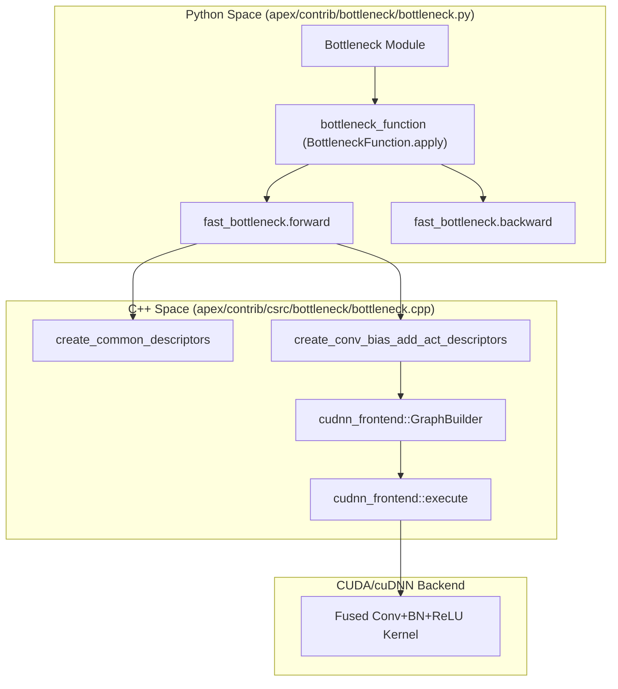
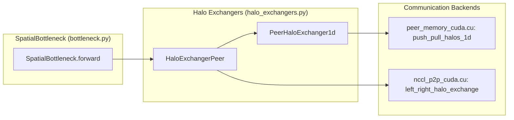

<!-- source: DeepWiki mcp.deepwiki.com · repo NVIDIA/apex · page 5.2 Bottleneck Layers · fetched 2026-10-26 -->

# Bottleneck Layers

<details>
<summary>Relevant source files</summary>

The following files were used as context for generating this wiki page:

- [.gitmodules](.gitmodules)
- [apex/contrib/bottleneck/__init__.py](apex/contrib/bottleneck/__init__.py)
- [apex/contrib/bottleneck/bottleneck.py](apex/contrib/bottleneck/bottleneck.py)
- [apex/contrib/bottleneck/halo_exchangers.py](apex/contrib/bottleneck/halo_exchangers.py)
- [apex/contrib/bottleneck/test.py](apex/contrib/bottleneck/test.py)
- [apex/contrib/csrc/bottleneck/bottleneck.cpp](apex/contrib/csrc/bottleneck/bottleneck.cpp)
- [apex/contrib/csrc/nccl_p2p/nccl_p2p.cpp](apex/contrib/csrc/nccl_p2p/nccl_p2p.cpp)
- [apex/contrib/csrc/nccl_p2p/nccl_p2p_cuda.cu](apex/contrib/csrc/nccl_p2p/nccl_p2p_cuda.cu)
- [apex/contrib/csrc/nccl_p2p/nccl_p2p_cuda.cuh](apex/contrib/csrc/nccl_p2p/nccl_p2p_cuda.cuh)
- [apex/contrib/csrc/peer_memory/peer_memory.cpp](apex/contrib/csrc/peer_memory/peer_memory.cpp)
- [apex/contrib/csrc/peer_memory/peer_memory_cuda.cu](apex/contrib/csrc/peer_memory/peer_memory_cuda.cu)
- [apex/contrib/csrc/peer_memory/peer_memory_cuda.cuh](apex/contrib/csrc/peer_memory/peer_memory_cuda.cuh)
- [apex/contrib/peer_memory/__init__.py](apex/contrib/peer_memory/__init__.py)
- [apex/contrib/peer_memory/peer_halo_exchanger_1d.py](apex/contrib/peer_memory/peer_halo_exchanger_1d.py)
- [apex/contrib/peer_memory/peer_memory.py](apex/contrib/peer_memory/peer_memory.py)
- [apex/contrib/test/bottleneck/test_bottleneck_module.py](apex/contrib/test/bottleneck/test_bottleneck_module.py)
- [apex/contrib/test/optimizers/test_distributed_fused_lamb.py](apex/contrib/test/optimizers/test_distributed_fused_lamb.py)
- [apex/contrib/test/peer_memory/test_peer_halo_exchange_module.py](apex/contrib/test/peer_memory/test_peer_halo_exchange_module.py)
- [apex/distributed_testing/__init__.py](apex/distributed_testing/__init__.py)
- [apex/distributed_testing/_ucc_util.py](apex/distributed_testing/_ucc_util.py)
- [apex/distributed_testing/distributed_test_base.py](apex/distributed_testing/distributed_test_base.py)

</details>


The APEX bottleneck layer implementations provide highly optimized CNN building blocks that leverage cuDNN frontend fusion and advanced communication patterns for spatial parallelism. These components are designed to accelerate ResNet-style architectures by fusing multiple operations (Convolution, Batch Normalization, ReLU, and Addition) into single CUDA kernels and providing efficient halo exchange mechanisms for distributed spatial decomposition.

## 1. Bottleneck Implementation

The core optimized bottleneck is implemented in `Bottleneck` and `SpatialBottleneck` [apex/contrib/bottleneck/bottleneck.py:154-162](). These modules support ResNet V1.5 configurations where the stride for downsampling is placed at the 3x3 convolution [apex/contrib/bottleneck/bottleneck.py:155-159]().

### Key Features
*   **cuDNN Frontend Fusion**: Uses the cuDNN frontend API to fuse Conv+BN+ReLU sequences into a single graph [apex/contrib/csrc/bottleneck/bottleneck.cpp:160-163]().
*   **Memory Formats**: Optimized for NHWC (channels_last) and explicit NHWC layouts [apex/contrib/bottleneck/bottleneck.py:172]().
*   **Frozen Batch Normalization**: Currently supports `FrozenBatchNorm2d` where statistics and affine parameters are fixed during training [apex/contrib/bottleneck/bottleneck.py:32-37]().

### Data Flow and Code Entities

The following diagram maps the high-level Python API to the underlying C++/CUDA implementation.

**Bottleneck System Architecture**

Sources: [apex/contrib/bottleneck/bottleneck.py:80-132](), [apex/contrib/csrc/bottleneck/bottleneck.cpp:160-175]()

## 2. Spatial Parallelism

`SpatialBottleneck` extends the standard bottleneck to support spatial parallelism, where a large image is split across multiple GPUs along the height or width dimension [apex/contrib/bottleneck/bottleneck.py:284-300](). This requires "Halo Exchange" to share border pixels between adjacent GPUs.

### Halo Exchangers
APEX provides several mechanisms for halo exchange via the `HaloExchanger` hierarchy [apex/contrib/bottleneck/halo_exchangers.py:10]():

| Class | Mechanism | Use Case |
| :--- | :--- | :--- |
| `HaloExchangerNoComm` | Swaps local inputs | Performance testing only [apex/contrib/bottleneck/halo_exchangers.py:28-29]() |
| `HaloExchangerAllGather` | `torch.distributed.all_gather` | Standard NCCL collectives [apex/contrib/bottleneck/halo_exchangers.py:46-47]() |
| `HaloExchangerSendRecv` | NCCL P2P (Send/Recv) | Point-to-point communication [apex/contrib/bottleneck/halo_exchangers.py:95-96]() |
| `HaloExchangerPeer` | Direct NVLink Peer Access | Lowest latency via `peer_memory` [apex/contrib/bottleneck/halo_exchangers.py:146-147]() |

### Code Mapping: Spatial Parallel Flow
This diagram illustrates how spatial parallelism is coordinated between Python classes and the NCCL/PeerMemory backends.

**Spatial Parallelism Coordination**

Sources: [apex/contrib/bottleneck/bottleneck.py:315-325](), [apex/contrib/bottleneck/halo_exchangers.py:165-180](), [apex/contrib/peer_memory/peer_halo_exchanger_1d.py:69-84]()

## 3. Peer Memory Management

The `PeerMemoryPool` is a critical utility for spatial parallelism. It manages static buffers that are mapped into the address space of peer GPUs via NVLink, allowing for zero-copy or direct-DMA transfers [apex/contrib/peer_memory/peer_memory.py:15-25]().

### Implementation Details
*   **Allocation**: Uses `cudaHostAlloc` or `cudaMalloc` with peer access enabled via `cudaDeviceEnablePeerAccess` [apex/contrib/csrc/peer_memory/peer_memory_cuda.cu:12-20]().
*   **Synchronization**: Uses volatile pointers and custom semaphores in CUDA kernels to ensure data consistency during push/pull operations [apex/contrib/csrc/peer_memory/peer_memory_cuda.cu:155-167]().
*   **Push-Pull Kernels**: The `push_pull_halos_1d` kernel performs the actual data movement between local device memory and remote peer memory buffers [apex/contrib/csrc/peer_memory/peer_memory_cuda.cuh:33-47]().

## 4. Usage Example

To use the optimized bottleneck with cuDNN fusion:

```python
from apex.contrib.bottleneck import Bottleneck

model = Bottleneck(
    in_channels=256,
    bottleneck_channels=64,
    out_channels=256,
    stride=1,
    use_cudnn=True,
    explicit_nhwc=True
).cuda().half()
```
Sources: [apex/contrib/bottleneck/bottleneck.py:162-173]()

For spatial parallelism, a `PeerMemoryPool` and a `HaloExchanger` must be initialized:

```python
from apex.contrib.bottleneck import SpatialBottleneck, HaloExchangerPeer
from apex.contrib.peer_memory import PeerMemoryPool

# Assuming distributed environment is set up
pool = PeerMemoryPool(pool_size, ranks)
halex = HaloExchangerPeer(ranks, rank_in_group, pool, explicit_nhwc=True)

model = SpatialBottleneck(
    in_channels, bottleneck_channels, out_channels,
    spatial_parallel_args=(group_size, rank, comm, halex, method, delay)
).cuda().half()
```
Sources: [apex/contrib/test/bottleneck/test_bottleneck_module.py:151-173](), [apex/contrib/bottleneck/bottleneck.py:284-300]()

## 5. Technical Constraints
*   **cuDNN Version**: Requires cuDNN 8.4.0 or higher [apex/contrib/bottleneck/bottleneck.py:11]().
*   **Groups/Dilation**: Currently only supports `groups=1` and `dilation=1` [apex/contrib/bottleneck/bottleneck.py:175-178]().
*   **Normalization**: Hardcoded to use `FrozenBatchNorm2d` in the current implementation [apex/contrib/bottleneck/bottleneck.py:179-182]().

Sources:
* [apex/contrib/bottleneck/bottleneck.py:1-325]()
* [apex/contrib/csrc/bottleneck/bottleneck.cpp:1-175]()
* [apex/contrib/bottleneck/halo_exchangers.py:1-180]()
* [apex/contrib/csrc/peer_memory/peer_memory_cuda.cu:1-180]()
* [apex/contrib/peer_memory/peer_halo_exchanger_1d.py:1-85]()

---

