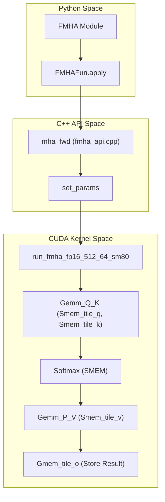
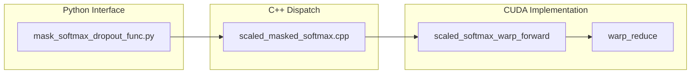

<!-- source: DeepWiki mcp.deepwiki.com · repo NVIDIA/apex · page 5.3 Attention Mechanisms · fetched 2026-10-26 -->

# Attention Mechanisms

Relevant source files

The following files were used as context for generating this wiki page:

- [apex/contrib/csrc/fmha/fmha_api.cpp](apex/contrib/csrc/fmha/fmha_api.cpp)
- [apex/contrib/csrc/fmha/src/fmha.h](apex/contrib/csrc/fmha/src/fmha.h)
- [apex/contrib/csrc/fmha/src/fmha/gmem_tile.h](apex/contrib/csrc/fmha/src/fmha/gmem_tile.h)
- [apex/contrib/csrc/fmha/src/fmha/smem_tile.h](apex/contrib/csrc/fmha/src/fmha/smem_tile.h)
- [apex/contrib/csrc/fmha/src/fmha_dgrad_fp16_512_64_kernel.sm80.cu](apex/contrib/csrc/fmha/src/fmha_dgrad_fp16_512_64_kernel.sm80.cu)
- [apex/contrib/csrc/fmha/src/fmha_dgrad_kernel_1xN_reload.h](apex/contrib/csrc/fmha/src/fmha_dgrad_kernel_1xN_reload.h)
- [apex/contrib/csrc/fmha/src/fmha_dgrad_kernel_1xN_reload_nl.h](apex/contrib/csrc/fmha/src/fmha_dgrad_kernel_1xN_reload_nl.h)
- [apex/contrib/csrc/fmha/src/fmha_fprop_fp16_512_64_kernel.sm80.cu](apex/contrib/csrc/fmha/src/fmha_fprop_fp16_512_64_kernel.sm80.cu)
- [apex/contrib/csrc/fmha/src/fmha_fprop_kernel_1xN.h](apex/contrib/csrc/fmha/src/fmha_fprop_kernel_1xN.h)
- [apex/contrib/csrc/fmha/src/fmha_noloop_reduce.cu](apex/contrib/csrc/fmha/src/fmha_noloop_reduce.cu)
- [apex/contrib/csrc/multihead_attn/softmax.cuh](apex/contrib/csrc/multihead_attn/softmax.cuh)
- [apex/contrib/fmha/fmha.py](apex/contrib/fmha/fmha.py)
- [apex/contrib/multihead_attn/encdec_multihead_attn.py](apex/contrib/multihead_attn/encdec_multihead_attn.py)
- [apex/contrib/multihead_attn/encdec_multihead_attn_func.py](apex/contrib/multihead_attn/encdec_multihead_attn_func.py)
- [apex/contrib/multihead_attn/fast_encdec_multihead_attn_func.py](apex/contrib/multihead_attn/fast_encdec_multihead_attn_func.py)
- [apex/contrib/multihead_attn/fast_encdec_multihead_attn_norm_add_func.py](apex/contrib/multihead_attn/fast_encdec_multihead_attn_norm_add_func.py)
- [apex/contrib/multihead_attn/fast_self_multihead_attn_func.py](apex/contrib/multihead_attn/fast_self_multihead_attn_func.py)
- [apex/contrib/multihead_attn/fast_self_multihead_attn_norm_add_func.py](apex/contrib/multihead_attn/fast_self_multihead_attn_norm_add_func.py)
- [apex/contrib/multihead_attn/mask_softmax_dropout_func.py](apex/contrib/multihead_attn/mask_softmax_dropout_func.py)
- [apex/contrib/multihead_attn/self_multihead_attn.py](apex/contrib/multihead_attn/self_multihead_attn.py)
- [apex/contrib/multihead_attn/self_multihead_attn_func.py](apex/contrib/multihead_attn/self_multihead_attn_func.py)
- [apex/contrib/test/multihead_attn/test_encdec_multihead_attn.py](apex/contrib/test/multihead_attn/test_encdec_multihead_attn.py)
- [apex/contrib/test/multihead_attn/test_encdec_multihead_attn_norm_add.py](apex/contrib/test/multihead_attn/test_encdec_multihead_attn_norm_add.py)
- [apex/contrib/test/multihead_attn/test_fast_self_multihead_attn_bias.py](apex/contrib/test/multihead_attn/test_fast_self_multihead_attn_bias.py)
- [apex/contrib/test/multihead_attn/test_mha_fused_softmax.py](apex/contrib/test/multihead_attn/test_mha_fused_softmax.py)
- [apex/contrib/test/multihead_attn/test_self_multihead_attn.py](apex/contrib/test/multihead_attn/test_self_multihead_attn.py)
- [apex/contrib/test/multihead_attn/test_self_multihead_attn_norm_add.py](apex/contrib/test/multihead_attn/test_self_multihead_attn_norm_add.py)
- [csrc/megatron/fused_rotary_positional_embedding.cpp](csrc/megatron/fused_rotary_positional_embedding.cpp)
- [csrc/megatron/fused_rotary_positional_embedding.h](csrc/megatron/fused_rotary_positional_embedding.h)
- [csrc/megatron/fused_rotary_positional_embedding_cuda.cu](csrc/megatron/fused_rotary_positional_embedding_cuda.cu)
- [csrc/megatron/generic_scaled_masked_softmax.h](csrc/megatron/generic_scaled_masked_softmax.h)
- [csrc/megatron/scaled_masked_softmax.cpp](csrc/megatron/scaled_masked_softmax.cpp)
- [csrc/megatron/scaled_masked_softmax.h](csrc/megatron/scaled_masked_softmax.h)
- [csrc/megatron/scaled_masked_softmax_cuda.cu](csrc/megatron/scaled_masked_softmax_cuda.cu)
- [csrc/megatron/scaled_softmax_cuda.cu](csrc/megatron/scaled_softmax_cuda.cu)
- [csrc/megatron/scaled_upper_triang_masked_softmax.cpp](csrc/megatron/scaled_upper_triang_masked_softmax.cpp)
- [csrc/megatron/scaled_upper_triang_masked_softmax.h](csrc/megatron/scaled_upper_triang_masked_softmax.h)
- [csrc/megatron/scaled_upper_triang_masked_softmax_cuda.cu](csrc/megatron/scaled_upper_triang_masked_softmax_cuda.cu)

This page documents APEX's suite of optimized attention components, ranging from fully fused kernels to modular building blocks for Transformer architectures. These implementations focus on reducing memory bandwidth bottlenecks and maximizing throughput on NVIDIA GPUs.

## Fused Multi-Head Attention (FMHA)

FMHA is a highly optimized implementation of the attention mechanism that fuses the entire sequence of operations—including the first matrix multiply (Q*K), softmax, dropout, and the second matrix multiply (P*V)—into a single CUDA kernel.

### Implementation and Data Flow

The FMHA implementation is designed for Ampere (SM80) and later architectures. It utilizes specialized "tiles" to manage data movement between global memory (GMEM) and shared memory (SMEM).

**Key Components:**
*   **`FMHAFun`**: The `torch.autograd.Function` that wraps the C++ backend [apex/contrib/fmha/fmha.py:33-93]().
*   **`mha_fwd`**: The C++ entry point that selects the appropriate kernel based on the `max_seq_len` (128, 256, 384, or 512) [apex/contrib/csrc/fmha/fmha_api.cpp:79-158]().
*   **`Gemm_Q_K`**: A C++ template that handles the first GEMM operation within the fused kernel [apex/contrib/csrc/fmha/src/fmha_fprop_kernel_1xN.h:68-118]().

**Data Flow Diagram:**

Sources: [apex/contrib/fmha/fmha.py:33-117](), [apex/contrib/csrc/fmha/fmha_api.cpp:34-158](), [apex/contrib/csrc/fmha/src/fmha_fprop_kernel_1xN.h:39-165]().

## Contrib Multi-Head Attention Modules

The `apex.contrib.multihead_attn` package provides specialized versions of Multi-Head Attention (MHA) for self-attention and encoder-decoder attention. These modules offer "fast" implementations that bypass some of the overhead in standard PyTorch MHA.

### Self and Encoder-Decoder Variants
*   **`SelfMultiheadAttn`**: Optimized for cases where Query, Key, and Value are derived from the same input [apex/contrib/multihead_attn/self_multihead_attn.py:22-113]().
*   **`EncdecMultiheadAttn`**: Optimized for cross-attention where Query comes from one source and Key/Value from another [apex/contrib/multihead_attn/encdec_multihead_attn.py:22-90]().

### Feature Matrix

| Feature | `SelfMultiheadAttn` | `EncdecMultiheadAttn` |
| :--- | :--- | :--- |
| **Separate QKV Params** | Supported [apex/contrib/multihead_attn/self_multihead_attn.py:58-63]() | Always separate [apex/contrib/multihead_attn/encdec_multihead_attn.py:50-51]() |
| **Fused LayerNorm** | Supported [apex/contrib/multihead_attn/self_multihead_attn.py:86-96]() | Supported [apex/contrib/multihead_attn/encdec_multihead_attn.py:64-74]() |
| **Impl Modes** | "fast" or "default" [apex/contrib/multihead_attn/self_multihead_attn.py:100-112]() | "fast" or "default" [apex/contrib/multihead_attn/encdec_multihead_attn.py:77-90]() |

Sources: [apex/contrib/multihead_attn/self_multihead_attn.py:22-113](), [apex/contrib/multihead_attn/encdec_multihead_attn.py:22-90]().

## Fused Softmax

APEX provides several fused softmax kernels designed specifically for the attention mask patterns found in Transformers. These kernels combine the scale, mask, and softmax operations to reduce memory round-trips.

### Variants
1.  **Scaled Masked Softmax**: Applies a scalar scale and a general binary mask [csrc/megatron/scaled_masked_softmax.h:105-203]().
2.  **Scaled Upper Triangular Masked Softmax**: Optimized for causal self-attention where the mask is always the upper triangular part of the matrix.

**Code Entity Mapping:**

Sources: [csrc/megatron/scaled_masked_softmax.h:27-103](), [csrc/megatron/scaled_masked_softmax.h:105-203]().

## Fused Rotary Positional Embeddings (RoPE)

The Rotary Positional Embedding (RoPE) implementation in APEX is fused to perform the rotation of the query and key vectors efficiently in a single kernel.

### Technical Details
The kernel applies the rotation matrix to chunks of the input tensor. It supports both a standard forward pass and a "cached" version where `cos` and `sin` values are pre-computed.

*   **`fused_rope_forward`**: The global kernel that calculates block offsets and delegates to the block-level logic [csrc/megatron/fused_rotary_positional_embedding.h:98-108]().
*   **`fused_rope_block_forward`**: Implements the actual rotation math: `dst = v_src * cos + v_src_rotate * sin` [csrc/megatron/fused_rotary_positional_embedding.h:27-60]().
*   **Stride Handling**: The implementation manually manages strides to support various memory formats (e.g., `[s, b, h, d]`) [csrc/megatron/fused_rotary_positional_embedding_cuda.cu:24-41]().

**Key Functions:**
*   `fwd_cuda`: Standard forward pass [csrc/megatron/fused_rotary_positional_embedding_cuda.cu:24-63]().
*   `fwd_cached_cuda`: Forward pass using pre-computed sin/cos caches [csrc/megatron/fused_rotary_positional_embedding.cpp:71-87]().
*   `fwd_thd_cuda`: Variant for "THD" format (Total sequences, Heads, Dim) used in packed sequence processing [csrc/megatron/fused_rotary_positional_embedding.cpp:109-121]().

Sources: [csrc/megatron/fused_rotary_positional_embedding.h:27-108](), [csrc/megatron/fused_rotary_positional_embedding.cpp:42-121](), [csrc/megatron/fused_rotary_positional_embedding_cuda.cu:24-63]().

---

