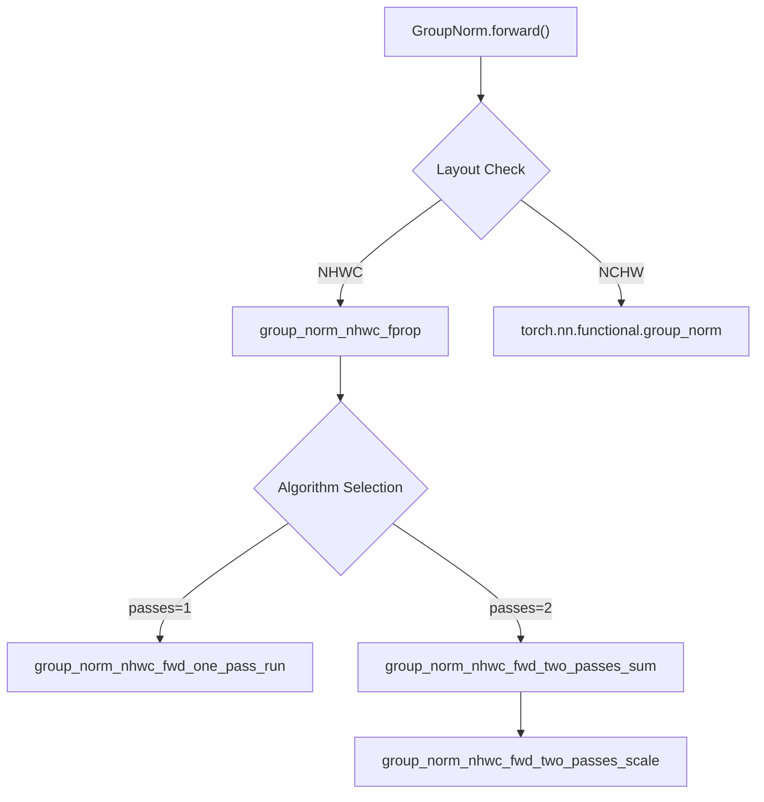
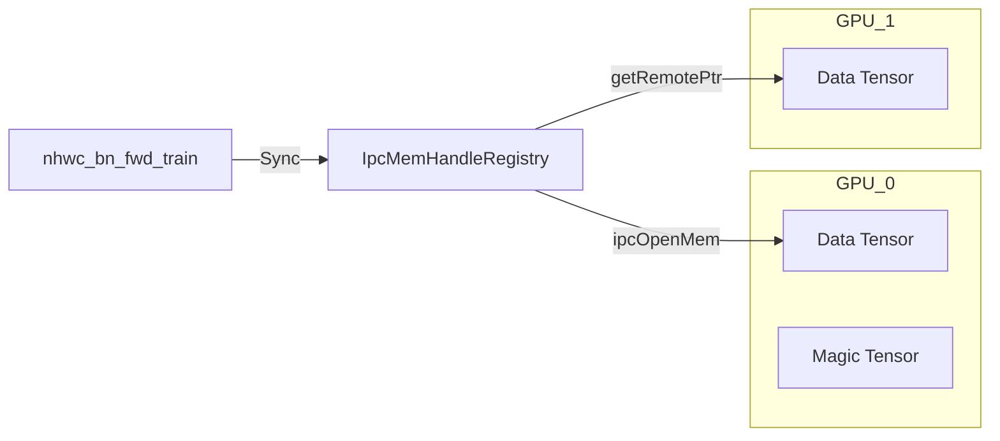

<!-- source: DeepWiki mcp.deepwiki.com · repo NVIDIA/apex · page 5.4 Group Normalization and Other Normalization Layers · fetched 2026-10-26 -->

# Group Normalization and Other Normalization Layers

Relevant source files

The following files were used as context for generating this wiki page:

- [.gitignore](.gitignore)
- [.pre-commit-config.yaml](.pre-commit-config.yaml)
- [apex/contrib/__init__.py](apex/contrib/__init__.py)
- [apex/contrib/csrc/cudnn_gbn/cudnn_gbn.cpp](apex/contrib/csrc/cudnn_gbn/cudnn_gbn.cpp)
- [apex/contrib/csrc/cudnn_gbn/norm_sample.cpp](apex/contrib/csrc/cudnn_gbn/norm_sample.cpp)
- [apex/contrib/csrc/cudnn_gbn/norm_sample.h](apex/contrib/csrc/cudnn_gbn/norm_sample.h)
- [apex/contrib/csrc/group_norm/group_norm_nhwc.cpp](apex/contrib/csrc/group_norm/group_norm_nhwc.cpp)
- [apex/contrib/csrc/group_norm/group_norm_nhwc.h](apex/contrib/csrc/group_norm/group_norm_nhwc.h)
- [apex/contrib/csrc/group_norm/group_norm_nhwc_bwd_one_pass.h](apex/contrib/csrc/group_norm/group_norm_nhwc_bwd_one_pass.h)
- [apex/contrib/csrc/group_norm/group_norm_nhwc_bwd_one_pass_kernel.cuh](apex/contrib/csrc/group_norm/group_norm_nhwc_bwd_one_pass_kernel.cuh)
- [apex/contrib/csrc/group_norm/group_norm_nhwc_bwd_two_pass.cu](apex/contrib/csrc/group_norm/group_norm_nhwc_bwd_two_pass.cu)
- [apex/contrib/csrc/group_norm/group_norm_nhwc_fwd_one_pass.h](apex/contrib/csrc/group_norm/group_norm_nhwc_fwd_one_pass.h)
- [apex/contrib/csrc/group_norm/group_norm_nhwc_fwd_one_pass_kernel.cuh](apex/contrib/csrc/group_norm/group_norm_nhwc_fwd_one_pass_kernel.cuh)
- [apex/contrib/csrc/group_norm/group_norm_nhwc_fwd_two_pass.cu](apex/contrib/csrc/group_norm/group_norm_nhwc_fwd_two_pass.cu)
- [apex/contrib/csrc/group_norm/group_norm_nhwc_one_pass_12.cu](apex/contrib/csrc/group_norm/group_norm_nhwc_one_pass_12.cu)
- [apex/contrib/csrc/group_norm/group_norm_nhwc_one_pass_120.cu](apex/contrib/csrc/group_norm/group_norm_nhwc_one_pass_120.cu)
- [apex/contrib/csrc/group_norm/group_norm_nhwc_one_pass_160.cu](apex/contrib/csrc/group_norm/group_norm_nhwc_one_pass_160.cu)
- [apex/contrib/csrc/group_norm/group_norm_nhwc_one_pass_26.cu](apex/contrib/csrc/group_norm/group_norm_nhwc_one_pass_26.cu)
- [apex/contrib/csrc/group_norm/group_norm_nhwc_op.cpp](apex/contrib/csrc/group_norm/group_norm_nhwc_op.cpp)
- [apex/contrib/csrc/group_norm/macros.h](apex/contrib/csrc/group_norm/macros.h)
- [apex/contrib/csrc/group_norm/traits.h](apex/contrib/csrc/group_norm/traits.h)
- [apex/contrib/csrc/groupbn/batch_norm.cu](apex/contrib/csrc/groupbn/batch_norm.cu)
- [apex/contrib/csrc/groupbn/batch_norm.h](apex/contrib/csrc/groupbn/batch_norm.h)
- [apex/contrib/csrc/groupbn/batch_norm_add_relu.cu](apex/contrib/csrc/groupbn/batch_norm_add_relu.cu)
- [apex/contrib/csrc/groupbn/batch_norm_add_relu.h](apex/contrib/csrc/groupbn/batch_norm_add_relu.h)
- [apex/contrib/csrc/groupbn/cuda_utils.h](apex/contrib/csrc/groupbn/cuda_utils.h)
- [apex/contrib/csrc/groupbn/interface.cpp](apex/contrib/csrc/groupbn/interface.cpp)
- [apex/contrib/csrc/groupbn/ipc.cu](apex/contrib/csrc/groupbn/ipc.cu)
- [apex/contrib/csrc/groupbn/nhwc_batch_norm_kernel.h](apex/contrib/csrc/groupbn/nhwc_batch_norm_kernel.h)
- [apex/contrib/cudnn_gbn/__init__.py](apex/contrib/cudnn_gbn/__init__.py)
- [apex/contrib/cudnn_gbn/batch_norm.py](apex/contrib/cudnn_gbn/batch_norm.py)
- [apex/contrib/group_norm/group_norm.py](apex/contrib/group_norm/group_norm.py)
- [apex/contrib/groupbn/__init__.py](apex/contrib/groupbn/__init__.py)
- [apex/contrib/groupbn/batch_norm.py](apex/contrib/groupbn/batch_norm.py)
- [apex/contrib/layer_norm/__init__.py](apex/contrib/layer_norm/__init__.py)
- [apex/contrib/test/group_norm/test_group_norm.py](apex/contrib/test/group_norm/test_group_norm.py)

This page documents APEX's high-performance normalization implementations, specifically focusing on NHWC-optimized Group Normalization and synchronized Batch Normalization variants. These layers are designed to leverage NVIDIA GPU architectures by minimizing memory passes and supporting fused activation functions.

## 1. NHWC Optimized Group Normalization

The APEX Group Normalization implementation is specifically optimized for the **NHWC (Channels Last)** memory format. It provides significant speedups over the standard PyTorch implementation by using specialized CUDA kernels that can perform the normalization in one or two passes and optionally fuse the Swish (SiLU) activation function.

### Implementation Architecture
The implementation is split between a Python frontend and multiple CUDA backends. The system selects the most efficient kernel based on the input dimensions and hardware capabilities.

| Component | Description |
| :--- | :--- |
| `GroupNorm` (Python) | High-level module inheriting from `torch.nn.Module`. Manages parameters and kernel dispatch. |
| `group_norm_nhwc_fprop` | Custom autograd function for forward propagation. |
| `group_norm_cuda` | C++ extension for "v1" kernels (One-pass and Two-pass algorithms). |
| `group_norm_v2_cuda` | C++ extension for "v2" kernels supporting additional SM margin tuning. |

**Data Flow and Kernel Dispatch**
The forward pass (`fprop`) and backward pass (`bprop`) are registered as custom operators, allowing them to integrate with `torch.compile` and the autograd engine.

**Sources:** [apex/contrib/group_norm/group_norm.py:49-82](), [apex/contrib/group_norm/group_norm.py:211-260]()

### Algorithms: One-Pass vs. Two-Pass
The implementation supports two primary algorithmic approaches for computing mean and variance:

1.  **One-Pass Algorithm:** Computes the mean and variance in a single pass over the data using a persistent kernel. This is generally faster but has stricter constraints on the number of groups and channels.
2.  **Two-Pass Algorithm:** 
    *   **Pass 1:** Computes partial sums and sums of squares across the spatial dimensions (`H*W`) and channels within a group [apex/contrib/csrc/group_norm/group_norm_nhwc_fwd_two_pass.cu:20-105]().
    *   **Pass 2:** Normalizes the input using the global statistics and applies gamma/beta scaling [apex/contrib/csrc/group_norm/group_norm_nhwc_fwd_two_pass.cu:142-143]().

### Precision and Fusions
*   **Mixed Precision:** Supports various combinations of input and parameter types, including FP16, BF16, and FP32 [apex/contrib/csrc/group_norm/group_norm_nhwc.h:51-61]().
*   **Activation Fusion:** Supports fusing the **Swish/SiLU** activation directly into the normalization kernel, avoiding an extra memory trip [apex/contrib/group_norm/group_norm.py:69-81]().

**Sources:** [apex/contrib/group_norm/group_norm.py:193-205](), [apex/contrib/csrc/group_norm/group_norm_nhwc_op.cpp:85-111]()

---

## 2. cuDNN Group Batch Normalization (cudnn_gbn)

The `cudnn_gbn` module provides a synchronized Batch Normalization implementation utilizing the cuDNN frontend API. This is designed for distributed training where normalization statistics must be synchronized across a group of GPUs.

### Key Components
*   **`CudnnGBN`**: The Python wrapper that interfaces with the cuDNN-based C++ extension.
*   **`norm_sample.cpp`**: Implements the cuDNN graph execution for normalization. It handles the workspace allocation and execution of the cuDNN backend descriptors.

**Sources:** [apex/contrib/csrc/cudnn_gbn/cudnn_gbn.cpp:1-50](), [apex/contrib/csrc/cudnn_gbn/norm_sample.cpp:15-100]()

---

## 3. Legacy Group Batch Normalization (groupbn)

The `groupbn` implementation (located in `apex/contrib/groupbn`) is a specialized implementation of synchronized Batch Normalization for NHWC layouts. It is notable for its use of CUDA IPC (Inter-Process Communication) for low-latency synchronization between GPUs on the same node.

### IPC Synchronization
Instead of using standard NCCL collectives, this implementation can use direct peer-to-peer memory access via `cudaIpcOpenMemHandle`.

### Key Functions
*   **`nhwc_bn_fwd_train`**: The main training forward pass. It manages cuDNN descriptors and workspace offsets [apex/contrib/csrc/groupbn/batch_norm.cu:37-109]().
*   **`nhwc_bn_addrelu_fwd_train`**: A specialized fused kernel that performs Batch Normalization, followed by an addition (residual connection) and ReLU activation [apex/contrib/csrc/groupbn/batch_norm_add_relu.cu:38-114]().
*   **`get_remote_data_ptr`**: Retrieves a pointer to memory on a different GPU using IPC handles [apex/contrib/csrc/groupbn/ipc.cu:102-107]().

**Sources:** [apex/contrib/csrc/groupbn/interface.cpp:75-100](), [apex/contrib/csrc/groupbn/ipc.cu:54-94]()

---

## 4. Summary Table of Normalization Layers

| Feature | `GroupNorm` (NHWC) | `groupbn` (Legacy) | `cudnn_gbn` |
| :--- | :--- | :--- | :--- |
| **Format** | NHWC (Channels Last) | NHWC | NCHW / NHWC |
| **Sync** | Local (Single GPU) | IPC-based Sync | cuDNN-based Sync |
| **Fusions** | Swish / SiLU | ReLU / Add+ReLU | cuDNN-supported |
| **Precision** | FP16, BF16, FP32 | FP16 (Half) | Mixed |
| **Algorithm** | One-pass / Two-pass | cuDNN Backend | cuDNN Frontend |

**Sources:** [apex/contrib/group_norm/group_norm.py:211-230](), [apex/contrib/csrc/groupbn/batch_norm.cu:59-65](), [apex/contrib/csrc/group_norm/group_norm_nhwc_op.cpp:37-40]()

---

