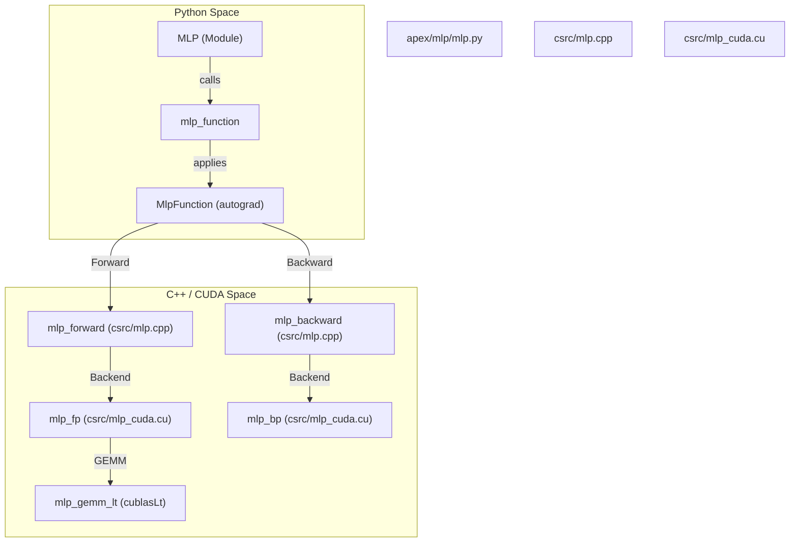
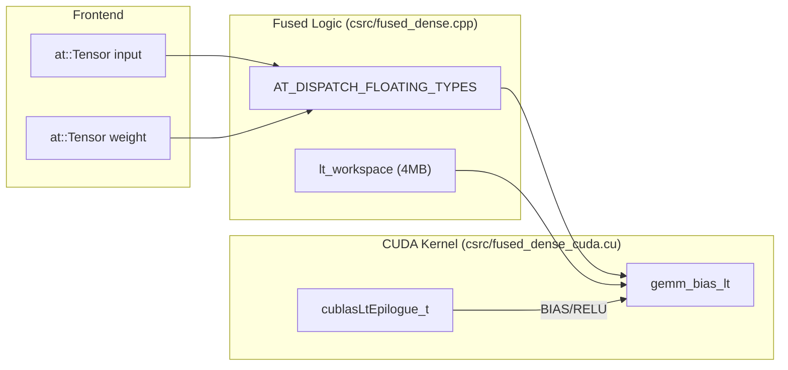

<!-- source: DeepWiki mcp.deepwiki.com · repo NVIDIA/apex · page 5.5 MLP and Dense Layers · fetched 2026-10-26 -->

# MLP and Dense Layers

Relevant source files

The following files were used as context for generating this wiki page:

- [apex/_autocast_utils.py](apex/_autocast_utils.py)
- [apex/contrib/test/fused_dense/test_fused_dense.py](apex/contrib/test/fused_dense/test_fused_dense.py)
- [apex/fused_dense/__init__.py](apex/fused_dense/__init__.py)
- [apex/mlp/__init__.py](apex/mlp/__init__.py)
- [apex/mlp/mlp.py](apex/mlp/mlp.py)
- [csrc/fused_dense.cpp](csrc/fused_dense.cpp)
- [csrc/fused_dense_cuda.cu](csrc/fused_dense_cuda.cu)
- [csrc/mlp.cpp](csrc/mlp.cpp)
- [csrc/mlp_cuda.cu](csrc/mlp_cuda.cu)
- [tests/L0/run_mlp/test_mlp.py](tests/L0/run_mlp/test_mlp.py)

The MLP and Dense layer implementations in APEX provide highly optimized CUDA backends for multi-layer perceptrons and linear transformations. These modules leverage `cublasLt` for kernel fusion (e.g., fusing bias addition and activation functions) to reduce memory bandwidth bottlenecks and improve training throughput.

## MLP (Multi-Layer Perceptron)

The `MLP` module is a specialized implementation that executes multiple dense layers and activations in a single C++ call, significantly reducing the overhead associated with launching multiple PyTorch kernels.

### Implementation Details
The Python frontend `MLP` [apex/mlp/mlp.py:33-42]() manages a list of weight and bias parameters. It uses a custom autograd function, `MlpFunction` [apex/mlp/mlp.py:11-25](), to interface with the compiled CUDA backend.

- **Supported Activations**: "none", "relu", and "sigmoid" [apex/mlp/mlp.py:48-55]().
- **Data Flow**: The forward pass [apex/mlp/mlp.py:13-19]() calls `mlp_cuda.forward`, which calculates the output and returns a `reserved_space` tensor used to store intermediate activations for the backward pass [csrc/mlp.cpp:58]().
- **Memory Management**: The backend calculates the required workspace for backward passes using `get_mlp_bp_workspace_in_bytes` [csrc/mlp.cpp:94]().

### MLP Entity Mapping
The following diagram maps the high-level Python API to the underlying C++/CUDA entities.

**MLP Component Mapping**

Sources: [apex/mlp/mlp.py:11-30](), [csrc/mlp.cpp:21-112](), [csrc/mlp_cuda.cu:82-154]()

## Fused Dense Layers

The Fused Dense implementation provides optimized linear layers where the bias addition and specific activations (like GeLU) are fused into the matrix multiplication kernel via `cublasLt`.

### Key Functions
- `linear_bias_forward`: Standard $Wx + b$ operation with fused bias [csrc/fused_dense.cpp:26-52]().
- `linear_gelu_linear_forward`: A specialized fusion of two linear layers with an intermediate GeLU activation [csrc/fused_dense.cpp:88-120]().

### Backend Backends and cublasLt
The backend uses `cublasLtMatmul` to perform the computation. If the CUDA version is $\ge 11.0$, it utilizes the `cublasLt` epilogue feature to perform bias addition and ReLU activation within the GEMM kernel itself [csrc/mlp_cuda.cu:107-121]().

**Dense Layer Execution Flow**

Sources: [csrc/fused_dense.cpp:38-49](), [csrc/fused_dense_cuda.cu:51-85](), [csrc/mlp_cuda.cu:107-121]()

## Autocast Integration

Both MLP and Dense layers are compatible with PyTorch's Automatic Mixed Precision (AMP). APEX provides utility functions to ensure tensors are cast to the appropriate `autocast` dtype before entering the C++ backend.

- **Utility**: `_cast_if_autocast_enabled` [apex/_autocast_utils.py:22-27]() checks if autocast is active and casts arguments to `torch.get_autocast_gpu_dtype()`.
- **Usage**: In the MLP module, `mlp_function` wraps the autograd apply call with this utility to handle FP16/BF16 transitions seamlessly [apex/mlp/mlp.py:28-30]().

## Performance and Precision

| Feature | MLP Module | Fused Dense |
| :--- | :--- | :--- |
| **Backend** | `cublasLt` / Custom Kernels | `cublasLt` |
| **Fusion** | Bias + Activation (ReLU/Sigmoid) | Bias + GeLU |
| **Workspace** | Dynamic based on layers | Fixed 4MB `lt_workspace` |
| **Dtypes** | FP16, FP32, BF16 | FP16, FP32, BF16, FP64 |

The MLP implementation uses a fixed 4MB workspace for `cublasLt` operations [csrc/mlp.cpp:41](). During the backward pass, it calculates a specific `work_size` to handle gradient computations for weights and biases across all layers [csrc/mlp.cpp:94-97]().

Sources: [csrc/mlp.cpp:41](), [csrc/fused_dense.cpp:38](), [apex/_autocast_utils.py:22-27](), [tests/L0/run_mlp/test_mlp.py:89-91]()

---

