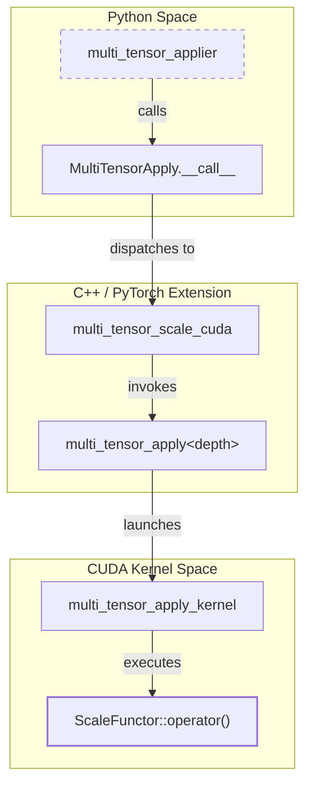
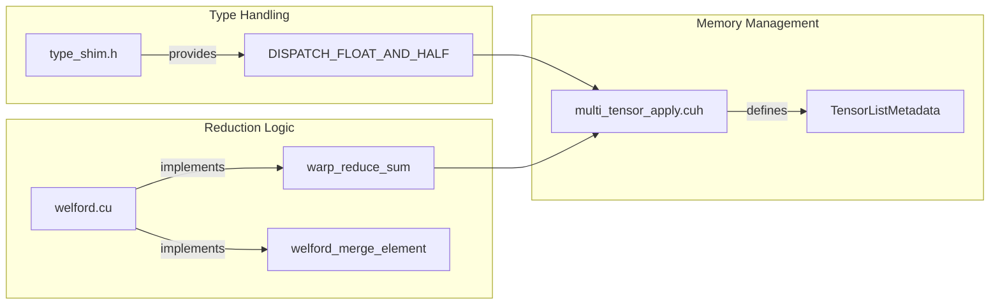

<!-- source: DeepWiki mcp.deepwiki.com · repo NVIDIA/apex · page 6 CUDA Internals · fetched 2026-10-26 -->

# CUDA Internals

Relevant source files

The following files were used as context for generating this wiki page:

- [apex/multi_tensor_apply/__init__.py](apex/multi_tensor_apply/__init__.py)
- [apex/multi_tensor_apply/multi_tensor_apply.py](apex/multi_tensor_apply/multi_tensor_apply.py)
- [csrc/layer_norm_cuda.cpp](csrc/layer_norm_cuda.cpp)
- [csrc/layer_norm_cuda_kernel.cu](csrc/layer_norm_cuda_kernel.cu)
- [csrc/multi_tensor_apply.cuh](csrc/multi_tensor_apply.cuh)
- [csrc/multi_tensor_l2norm_kernel.cu](csrc/multi_tensor_l2norm_kernel.cu)
- [csrc/multi_tensor_scale_kernel.cu](csrc/multi_tensor_scale_kernel.cu)
- [csrc/type_shim.h](csrc/type_shim.h)
- [csrc/welford.cu](csrc/welford.cu)

APEX provides a suite of highly optimized CUDA kernels designed to bypass the overhead of launching multiple small kernels in PyTorch. By utilizing advanced GPU programming patterns—such as kernel fusion, Instruction-Level Parallelism (ILP), and the Multi-Tensor Apply mechanism—APEX significantly accelerates operations like normalization, optimization steps, and large-scale distributed training.

## Core Optimization Patterns

The performance gains in APEX's CUDA backends generally stem from three primary strategies:

1.  **Multi-Tensor Fusion**: Instead of launching one kernel per tensor (e.g., in an optimizer update), APEX packs multiple tensors into a single kernel launch.
2.  **Welford's Algorithm**: Used for numerically stable, single-pass computation of mean and variance in normalization layers [csrc/layer_norm_cuda_kernel.cu:14-21]().
3.  **ILP (Instruction-Level Parallelism)**: Kernels are written to process multiple elements per thread (typically 4 or 8) to hide memory latency and saturate GPU throughput [csrc/multi_tensor_l2norm_kernel.cu:15-16]().

### High-Level Architecture: Python to CUDA

The following diagram illustrates how high-level Python calls interface with the low-level CUDA infrastructure.

**APEX CUDA Interface Flow**

**Sources:** [apex/multi_tensor_apply/multi_tensor_apply.py:24-27](), [csrc/multi_tensor_apply.cuh:33-34](), [csrc/multi_tensor_scale_kernel.cu:96-107]()

---

## Multi-Tensor Apply

The `multi_tensor_apply` infrastructure is the "one-stop shop" for fused operations in APEX [csrc/multi_tensor_apply.cuh:10](). It handles the complex logic of chunking multiple tensors of varying sizes into a unified grid of thread blocks.

*   **TensorListMetadata**: A C++ struct that stores device pointers and sizes for up to 110 tensors per launch [csrc/multi_tensor_apply.cuh:13-23]().
*   **Noop Flag Pattern**: A global memory flag (`noop_flag`) that kernels can write to if they encounter non-finite values (NaN/Inf). This allows subsequent operations (like a master weight update) to be skipped without a costly CPU-GPU synchronization [csrc/multi_tensor_scale_kernel.cu:92]().

For details on the metadata management and ILP patterns, see [Multi-Tensor Apply](#6.1).

**Sources:** [csrc/multi_tensor_apply.cuh:13-30](), [csrc/multi_tensor_l2norm_kernel.cu:85]()

---

## Optimized Normalization Kernels

APEX implements `LayerNorm` and `RMSNorm` using highly optimized CUDA kernels that outperform standard PyTorch implementations by fusing the statistics calculation and the affine transformation.

### Numerical Stability and Performance
The kernels utilize **Welford's Online Algorithm** to compute variance in a single pass [csrc/layer_norm_cuda_kernel.cu:14-21](). For cross-warp and cross-block reductions, APEX uses `cuChanOnlineSum` to merge partial results [csrc/layer_norm_cuda_kernel.cu:24-39]().

| Feature | Implementation Detail |
| :--- | :--- |
| **Algorithm** | Welford's Online Sum for mean/variance |
| **Parallelism** | One warp per row (n1 index) [csrc/layer_norm_cuda_kernel.cu:64]() |
| **Reductions** | Intra-warp `SHFL` and Inter-warp Shared Memory [csrc/layer_norm_cuda_kernel.cu:90-116]() |
| **Mixed Precision** | Specialized paths for `at::Half` and `float` [csrc/layer_norm_cuda_kernel.cu:152-154]() |

**Sources:** [csrc/layer_norm_cuda_kernel.cu:51-150](), [csrc/layer_norm_cuda.cpp:78-90]()

---

## Megatron-LM Kernels

APEX hosts specific kernels developed for the Megatron-LM project. these are tailored for massive Transformer models where standard operations become bottlenecks at scale.

*   **Fused Softmax**: Combines masking and scaling into the softmax kernel to reduce memory passes.
*   **Rotary Positional Embeddings (RoPE)**: Optimized kernels for applying rotary embeddings to high-dimensional query/key tensors.

For details, see [Megatron-LM Kernels](#6.2).

---

## Experimental and Contrib Modules

The `contrib` directory contains experimental CUDA-based utilities that interface with low-level system features:
*   **NVLS Collectives**: Custom allocators for NVIDIA Link Stack.
*   **GPUDirect Storage**: Direct data paths between GPU memory and storage.
*   **Triton Kernels**: Implementations using the Triton language for OpenFold.

For details, see [Contrib Experimental Modules](#6.3).

---

## Internal Utility Mapping

The following diagram maps internal C++ utilities to their primary roles in the CUDA backend.

**CUDA Utility Map**

**Sources:** [csrc/type_shim.h:16-30](), [csrc/welford.cu:40-44](), [csrc/welford.cu:97-104](), [csrc/multi_tensor_apply.cuh:17-23]()

---

